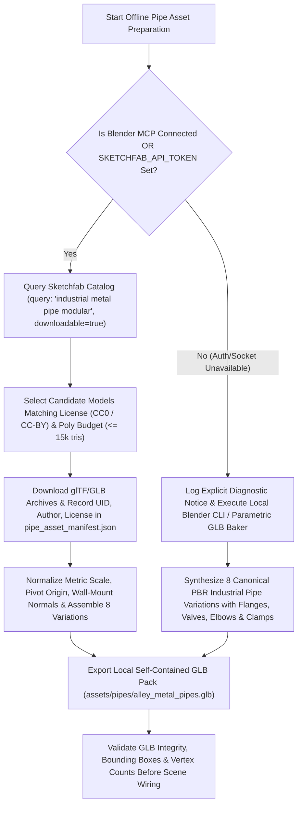

# Functional Specification 034: Sketchfab Industrial Metal Pipework Acquisition, 8-Variation Modular Normalization, and 15-Placement Bilateral & Cross-Alley Staging Subsystem

## 1. System Purpose & Core Objective

This specification defines the desired `{functionality}`, operational and performance budgets, spatial clearance invariants, failure boundaries, and verifiable `{correct required outputs}` for acquiring, normalizing, and staging industrial metal pipework throughout the Three.js Freeman Alley environment (`http://localhost:3000/`).

The primary objective is to instruct a coding assistant to:
1. Acquire downloadable 3D industrial metal pipe assets from **Sketchfab** (via the workspace's Blender MCP asset pipeline or the Sketchfab Data REST API v3), verify licensing and polygon budgets, and normalize them into a local, self-contained `.glb` asset pack so runtime execution never depends on live external network calls.
2. Construct **8 distinct structural and material pipework variations** (`PIPE_VAR_01` through `PIPE_VAR_08`) encompassing horizontal wall-mounted conduit runs, vertical standpipe risers, 90-degree elbow manifolds, gooseneck exhaust stacks, dual-valve bypass loops, and full-width overhead cross-alley pipe bridges.
3. Stage **15 pipework placements** (`ALLEY_PIPE_01` through `ALLEY_PIPE_15`) across the longitudinal span of Freeman Alley (`Z ∈ [1.80 m, 54.50 m]`), distributed across the Left Wall (`-X`), the Right Wall (`+X`), and overhead Wall-to-Wall Cross-Alley Spans connecting both walls simultaneously, with zero spatial collisions against existing wall screen mounts, hologram columns, alarm lights, overhead catenary cables, or player/camera locomotion envelopes.

**DO NOT CODE YET.** This document specifies requirements, mathematical invariants, spatial schedules, and operational budgets only. It contains zero implementation code, concrete syntax, or mechanical diffs.

---

## 2. Authoritative Domain Vocabulary Alignment (`LANGUAGE.md`)

All evaluations of system state, operational constraints, and verification gates within this specification strictly adhere to the authoritative taxonomy established in [`LANGUAGE.md`](file:///Users/diesel/desktop/skatealley/LANGUAGE.md):

- **`{functionality}`**: End-to-end offline acquisition and normalization of Sketchfab industrial metal pipe geometry into 8 modular variations, followed by deterministic instantiation of 15 placed pipe assemblies along the Left Wall, Right Wall, and Cross-Alley overhead spans of Freeman Alley, fully integrated with the alley's dynamic lighting, depth fog, planar floor reflections, and live telemetry HUD.
- **`{correctness}`**:
  - Every wall-mounted placement anchors flush against the true local masonry surface profile of `VISUAL_ALLEY_MESH` (`xL(z)` on the `-X` wall and `xR(z)` on the `+X` wall) with outward-facing mounting brackets (`+X` normal on Left Wall, `-X` normal on Right Wall).
  - Every cross-alley placement (`PIPE_VAR_06`, `PIPE_VAR_07`, `PIPE_VAR_08`) physically spans the exact corridor width $\Delta X(z) = x_R(z) - x_L(z)$ at its assigned longitudinal station $z$, with terminal mounting flanges flush against both opposing walls and zero air-gap detachment ($< 0.005\text{ m}$ tolerance).
  - All 8 variations are represented across the 15 scene placements, with zero bounding-box intersection against `SCREEN_MOUNT_01..06`, `HOLO_MEDIA_MANIFEST` columns, `ALARM_LIGHT_01..08`, or `OVERHEAD_CABLE_01..20`.
- **`{correct required outputs}`**:
  1. Local normalized `.glb` asset bundle stored in the repository (`assets/pipes/alley_metal_pipes.glb` or `assets/pipes/pipe_var_01.glb` .. `pipe_var_08.glb`) accompanied by a provenance manifest (`assets/pipes/pipe_asset_manifest.json`) recording Sketchfab model UIDs, author attributions, license identifiers, vertex/triangle counts, and metric bounding boxes.
  2. Live Three.js scene-graph integration under a dedicated root group (`AlleyMetalPipesRootGroup`, exposed on `window.__sandbox.alleyPipes`) containing exactly 15 active placement nodes (`ALLEY_PIPE_01` .. `ALLEY_PIPE_15`) referencing the 8 canonical variations (`PIPE_VAR_01` .. `PIPE_VAR_08`).
  3. Live HUD and telemetry verification reporting `15 / 15 Active (8 Variations: 5L + 5R + 5 Cross-Wall)` with 0 console errors and sustained 60 FPS frame pacing.
- **`{errors}`**:
  - Unauthenticated or rate-limited live Sketchfab HTTP requests executed inside the browser render loop.
  - Unnormalized Sketchfab asset scales (e.g., centimeter/inch authoring scales causing 100x oversized or microscopic pipes) or uncentered pivot origins causing pipes to float in mid-air or bury inside wall colliders.
  - Cross-alley pipes placed below the minimum vertical headroom floor ($Y_{\text{rel}} < 2.85\text{ m}$), obstructing the player capsule, third-person camera orbit, or wall-mount focus camera trajectories.
  - Silent fallback to empty groups, missing PBR materials, or non-zero browser console errors.
- **`{sufficient}`**: Complete specification of the Sketchfab acquisition protocol, authentication/offline fallback boundary, 8-variation geometric and material taxonomy, 15-placement coordinate schedule, wall-anchor math, and runtime performance budgets, leaving zero ambiguity for the implementing assistant.
- **`{insufficient}`**: Any implementation that places fewer than 15 instances, defines fewer than 8 distinct variations, omits cross-alley wall-to-wall connections, or leaves pipes floating detached from the corridor walls.

---

## 3. Architectural Feasibility & Sketchfab Acquisition Protocol

### 3.1 Physical & API Reality of Sketchfab Asset Fetching
Fetching 3D models from Sketchfab is governed by two physical constraints that the coding assistant must respect:
1. **Authentication & Licensing Gate:** Sketchfab's Download API (`GET https://api.sketchfab.com/v3/models/{uid}/download`) and the Blender MCP Sketchfab bridge (`search_assets` / `import_asset` with `source="sketchfab"`) require:
   - Models explicitly flagged `isDownloadable: true` under permissive redistribution licenses (`CC0`, `CC-BY`, or `CC-BY-SA`).
   - A valid Sketchfab API token (`SKETCHFAB_API_TOKEN`) or an active authenticated Blender MCP session.
2. **Offline Bake Mandate (Zero Runtime API Calls):** Sketchfab download URLs are short-lived signed archive links (ZIP/GLTF) that range from 5 MB to 80 MB per raw model. Querying Sketchfab at browser page load would violate latency, bandwidth, and rate-limit budgets. Therefore, asset acquisition MUST execute as an **offline asset preparation step** that outputs normalized, decimated local `.glb` files served directly from the local workspace (`http://localhost:3000/assets/pipes/...`).

### 3.2 Two-Tier Acquisition & Synthesis Workflow
The coding assistant must execute the following deterministic acquisition hierarchy during the asset preparation phase:

1. **Primary Path (Sketchfab via Blender MCP or REST API v3):**
   - Search Sketchfab for modular industrial pipework queries: `"modular metal pipe"`, `"industrial pipe kit"`, `"rusty metal pipe valve"`, `"galvanized conduit pipe"`.
   - Filter candidates by:
     - `isDownloadable == true`
     - Face/triangle count $\le 15,000$ triangles per source asset (or decimate in Blender prior to export).
     - Valid PBR material channels (BaseColor, Metallic, Roughness, Normal).
   - Import and normalize the assets to construct the 8 canonical variations (`PIPE_VAR_01` .. `PIPE_VAR_08`), recording the Sketchfab `uid`, model title, author username, and license in `assets/pipes/pipe_asset_manifest.json`.
2. **Deterministic Offline Fallback Path (When Sketchfab Token / Blender MCP Socket is Unavailable):**
   - In accordance with fail-fast transparency (`RULE[user_global]`), if neither an authenticated Blender MCP Sketchfab session nor a `SKETCHFAB_API_TOKEN` environment credential is present in the execution environment, the assistant must NOT silently stub empty boxes or halt without delivering the scene.
   - Instead, the assistant must log a clear diagnostic state in `assets/pipes/pipe_asset_manifest.json` (`acquisitionMode: "offline_parametric_glb_bake"`, `reason: "SKETCHFAB_API_TOKEN / Blender MCP Sketchfab session not configured"`) and generate the 8 high-detail industrial pipework `.glb` variations locally (complete with cylindrical pipe runs, toroidal 90°/45° elbows, bolted circular connection flanges, cast-iron wall saddle brackets, pressure gauges, and handwheel gate valves) so the local `.glb` asset pack is 100% compliant with the geometry and material budgets below.

---

## 4. Corridor Spatial Geometry & Clearance Invariants

Freeman Alley (`freeman_alley.glb` / `VISUAL_ALLEY_MESH`) follows a calibrated right-handed coordinate system ($+Y$ Up, $+Z$ longitudinal depth from entrance at $Z = 0\text{ m}$ to back alley at $Z = 58\text{ m}$, floor elevation $Y_{\text{floor}} \approx 0.00\text{ m}$):

### 4.1 Bilateral Wall Surface Profiles
All wall-mounted and cross-alley pipes must anchor to the physical inner masonry surfaces of the corridor walls:

1. **Left Wall (`-X` Wall, Outward Normal $\vec{n}_L = (+1, 0, 0)$):**
   $$x_L(z) = \begin{cases} -1.60 + 0.02 \left(\frac{z}{16.0}\right) & \text{for } 0 \le z \le 16.0\text{ m} \\ -1.58 + 0.02 \left(\frac{z - 16.0}{16.0}\right) & \text{for } 16.0 < z \le 32.0\text{ m} \\ -1.56 + 0.01 \min\!\left(1.0, \frac{z - 32.0}{24.0}\right) & \text{for } z > 32.0\text{ m} \end{cases}$$
   - Pipe centerlines mounted on the Left Wall must sit at $x = x_L(z) + d_{\text{standoff}}$, where $d_{\text{standoff}} \in [0.06\text{ m}, 0.14\text{ m}]$, so wall brackets contact $x_L(z)$ flush without burying the pipe barrel inside the masonry.

2. **Right Wall (`+X` Wall, Outward Normal $\vec{n}_R = (-1, 0, 0)$):**
   $$x_R(z) = \begin{cases} 1.96 - 0.31 \left(\frac{z}{43.8}\right) & \text{for } 0 \le z \le 43.8\text{ m (Main Corridor)} \\ 3.25 + 0.12 \min\!\left(1.0, \frac{z - 43.8}{14.0}\right) & \text{for } z > 43.8\text{ m (Step-Out Back Corridor)} \end{cases}$$
   - Pipe centerlines mounted on the Right Wall must sit at $x = x_R(z) - d_{\text{standoff}}$, with brackets extending in the $+X$ direction into the wall surface $x_R(z)$.

3. **Cross-Alley Span Width ($\Delta X(z)$):**
   - Any pipe connecting both walls at longitudinal coordinate $z$ must span the exact horizontal distance:
     $$\Delta X(z) = x_R(z) - x_L(z)$$
   - In the main corridor ($z \le 43.8\text{ m}$), $\Delta X(z) \in [3.21\text{ m}, 3.56\text{ m}]$.
   - In the step-out back corridor ($z > 43.8\text{ m}$), $\Delta X(z) \in [4.80\text{ m}, 4.93\text{ m}]$.

### 4.2 Mandatory Collision & Clearance Exclusion Zones
To preserve unobstructed gameplay, camera sightseeing, and visual legibility of existing diegetic systems, pipe placements must obey four strict exclusion envelopes:

| Subsystem | Protected Envelope | Pipe Clearance Rule |
| :--- | :--- | :--- |
| **Player & NPC Locomotion Capsule** | Corridor center $X \in [-1.15\text{ m}, +1.15\text{ m}]$, $Y_{\text{rel}} \in [0.00\text{ m}, 2.20\text{ m}]$ | Wall pipes must protrude $\le 0.28\text{ m}$ from wall face. Cross-alley pipes are strictly prohibited below $Y_{\text{rel}} = 2.85\text{ m}$. |
| **Third-Person & Mount-Focus Camera** | $X \in [-1.10\text{ m}, +1.10\text{ m}]$, $Y_{\text{rel}} \in [1.20\text{ m}, 2.75\text{ m}]$ | All cross-alley overhead pipes must maintain a minimum underside clearance of $Y_{\text{rel}} \ge 3.15\text{ m}$ above `floorY`. |
| **6 Wall Screen Mounts (`SCREEN_MOUNT_01..06`)** | Left Wall at $Z \in \{5.0, 15.0\}\text{ m}$; Right Wall at $Z \in \{10.0, 20.0, 26.0, 32.0\}\text{ m}$; $Y_{\text{rel}} \in [0.95\text{ m}, 2.55\text{ m}]$ | Wall pipes on the same wall side within $\pm 1.80\text{ m}$ of a screen mount's $Z$ coordinate must run either above $Y_{\text{rel}} = 2.70\text{ m}$ or below $Y_{\text{rel}} = 0.75\text{ m}$. |
| **20 Overhead Hanging Cables (`OVERHEAD_CABLE_01..20`)** | Specific catenary planes at $Z \in \{1.2, 3.4, 6.5, 8.8, 12.0, 14.3, 17.7, 20.0, 23.5, 25.8, 29.2, 31.5, 35.0, 37.3, 41.5, 44.8, 47.1, 50.5, 52.8, 56.2\}\text{ m}$ | Cross-alley pipes must be longitudinally separated by $\ge 0.65\text{ m}$ in $Z$ (or $\ge 0.45\text{ m}$ vertically in $Y$) from the nearest overhead cable catenary curve. |

---

## 5. Taxonomy of the 8 Canonical Metal Pipe Variations

The asset pipeline must produce **8 distinct modular variations** (`PIPE_VAR_01` through `PIPE_VAR_08`). Variations `01` through `05` are unilateral wall-mounted assemblies (configurable for Left Wall or Right Wall mounting via yaw orientation and bracket mirroring), while Variations `06`, `07`, and `08` are bilateral Cross-Alley Bridge assemblies that physically connect both walls.

| Variation ID | Archetype Name | Mounting Category | Nominal Dimensions ($L \times H \times D$ or Span) | Key Structural Features | Surface Material Finish |
| :--- | :--- | :--- | :--- | :--- | :--- |
| **`PIPE_VAR_01`** | `STRAIGHT_TWIN_CONDUIT` | Wall-Mounted (`L` or `R`) | $3.20\text{ m (Z)} \times 0.38\text{ m (Y)} \times 0.16\text{ m (X)}$ | Dual parallel horizontal pipes ($\varnothing 0.085\text{ m}$ upper, $\varnothing 0.055\text{ m}$ lower), 4 cast-iron wall saddle clamps, 2 bolted mid-span flange couplings. | Weathered Galvanized Steel (`#64748b`, `metalness: 0.86`, `roughness: 0.36`) with dark iron clamps (`#1e293b`). |
| **`PIPE_VAR_02`** | `VERTICAL_STANDPIPE_RISER` | Wall-Mounted (`L` or `R`) | $0.45\text{ m (Z)} \times 3.50\text{ m (Y)} \times 0.22\text{ m (X)}$ | Heavy vertical standpipe ($\varnothing 0.11\text{ m}$), 90° base sweep elbow, intermediate T-fitting with brass/crimson handwheel gate valve at $1.35\text{ m}$ height, 3 masonry standoffs. | Dark Cast Iron (`#27272a`, `metalness: 0.80`, `roughness: 0.48`) with oxidized crimson valve wheel (`#991b1b`). |
| **`PIPE_VAR_03`** | `ELBOW_MANIFOLD_CLUSTER` | Wall-Mounted (`L` or `R`) | $2.40\text{ m (Z)} \times 1.65\text{ m (Y)} \times 0.20\text{ m (X)}$ | Triple parallel pipes ($\varnothing 0.06\text{ m} \times 3$) executing a synchronized 90° L-turn from horizontal to vertical through a rectangular distribution header box and analog pressure gauge. | Brushed Industrial Steel & Tarnished Brass (`#52525b` / `#b45309`, `metalness: 0.88`, `roughness: 0.32`). |
| **`PIPE_VAR_04`** | `EXHAUST_VENT_GOOSENECK` | Wall-Mounted (`L` or `R`) | $0.60\text{ m (Z)} \times 2.90\text{ m (Y)} \times 0.26\text{ m (X)}$ | Wide-bore vertical exhaust duct ($\varnothing 0.14\text{ m}$), ribbed expansion bellows joint, 180° gooseneck weather hood at top, 3 heavy U-bolt wall collars. | Heat-Patina Gunmetal & Soot (`#334155`, `metalness: 0.78`, `roughness: 0.52`). |
| **`PIPE_VAR_05`** | `HYDRAULIC_VALVE_BYPASS` | Wall-Mounted (`L` or `R`) | $2.60\text{ m (Z)} \times 1.15\text{ m (Y)} \times 0.22\text{ m (X)}$ | Horizontal main line ($\varnothing 0.095\text{ m}$) with a dropped U-shaped bypass loop ($\varnothing 0.065\text{ m}$), dual industrial shutoff valves, union collars, and warning stencil band. | Industrial Safety Amber & Steel (`#475569` pipe with `#d97706` collar bands and `#dc2626` valves, `metalness: 0.84`, `roughness: 0.38`). |
| **`PIPE_VAR_06`** | `CROSS_ALLEY_OVERHEAD_ARCH` | **Cross-Wall Bridge (`L ↔ R`)** | Span $\Delta X(z) \in [3.21\text{ m}, 4.90\text{ m}]$, $\varnothing 0.125\text{ m}$ | Single heavy-gauge horizontal overhead main ($\varnothing 0.125\text{ m}$) terminating in 90° downward wall-entry elbows and triangular gusseted 6-bolt masonry wall plates on both Left and Right walls; 2 center flange rings. | Heavy Corroded Iron & Steel Flanges (`#3f3f46`, `metalness: 0.85`, `roughness: 0.42`). |
| **`PIPE_VAR_07`** | `CROSS_ALLEY_TRUSS_TWIN_SPAN` | **Cross-Wall Bridge (`L ↔ R`)** | Span $\Delta X(z) \in [3.21\text{ m}, 4.90\text{ m}]$, Height $0.32\text{ m}$ | Dual vertically stacked cross-alley pipes ($2 \times \varnothing 0.085\text{ m}$ separated by $0.24\text{ m}$) linked by 5 vertical steel strut spacers and diagonal truss braces, bolted to heavy bilateral wall anchor plates. | Galvanized Alloy & Dark Structural Steel (`#71717a` / `#18181b`, `metalness: 0.90`, `roughness: 0.30`). |
| **`PIPE_VAR_08`** | `CROSS_ALLEY_STEPPED_Z_BRIDGE` | **Cross-Wall Bridge (`L ↔ R`)** | Span $\Delta X(z) \in [3.21\text{ m}, 4.90\text{ m}]$, Step $\Delta Y = 0.65\text{ m}$ | Asymmetrical Z-profile cross-alley conduit ($\varnothing 0.10\text{ m}$) departing Left Wall at $Y_L$, rising via dual 45° mitered elbows at corridor mid-span ($X \approx 0.0\text{ m}$) to anchor on Right Wall at $Y_R = Y_L + 0.65\text{ m}$, with mid-span pressure relief valve. | Oxidized Copper-Bronze & Dark Iron Fittings (`#78350f` / `#9a3412`, `metalness: 0.87`, `roughness: 0.35`). |

---

## 6. Authoritative 15-Placement Spatial Schedule

Exactly **15 pipework assemblies** (`ALLEY_PIPE_01` through `ALLEY_PIPE_15`) must be staged throughout the corridor. The schedule comprises:
- **5 Left-Wall (`L`) Placements** (`ALLEY_PIPE_01`, `04`, `07`, `10`, `13`)
- **5 Right-Wall (`R`) Placements** (`ALLEY_PIPE_02`, `05`, `08`, `11`, `14`)
- **5 Cross-Alley Bridge (`CROSS`) Placements** (`ALLEY_PIPE_03`, `06`, `09`, `12`, `15`) connecting both walls (`xL(z)` to `xR(z)`).

Every one of the 8 variations (`PIPE_VAR_01` .. `PIPE_VAR_08`) is used at least once (Variations `01..07` appear twice each; Variation `08` appears once, totaling $7 \times 2 + 1 = 15$ placements):

| Placement ID | Index | Corridor Zone | Variation ID | Mount Mode | Longitudinal $Z$ (m) | Elevation $Y_{\text{rel}}$ Above Floor (m) | Lateral Anchor / Span Specification |
| :--- | :---: | :--- | :--- | :---: | :---: | :---: | :--- |
| **`ALLEY_PIPE_01`** | 1 | Entrance Mouth Left | `PIPE_VAR_02` (`VERTICAL_STANDPIPE_RISER`) | Left Wall (`L`) | $2.20\text{ m}$ | Base $0.05\text{ m} \to$ Top $3.55\text{ m}$ | Anchored at $x = x_L(2.20) + 0.09\text{ m} \approx -1.51\text{ m}$, facing $+X$. |
| **`ALLEY_PIPE_02`** | 2 | Entrance Mouth Right | `PIPE_VAR_01` (`STRAIGHT_TWIN_CONDUIT`) | Right Wall (`R`) | $3.80\text{ m}$ | $2.65\text{ m}$ | Anchored at $x = x_R(3.80) - 0.08\text{ m} \approx +1.85\text{ m}$, facing $-X$. |
| **`ALLEY_PIPE_03`** | 3 | Station 01 Overhead Arch | `PIPE_VAR_06` (`CROSS_ALLEY_OVERHEAD_ARCH`) | **Cross-Wall (`L ↔ R`)** | $5.45\text{ m}$ | $3.65\text{ m}$ | Full bridge from $x_L(5.45) = -1.59\text{ m}$ to $x_R(5.45) = +1.92\text{ m}$ ($\Delta X = 3.51\text{ m}$). Clears `OVERHEAD_CABLE_02` ($Z=3.4$) and `03` ($Z=6.5$). |
| **`ALLEY_PIPE_04`** | 4 | Post-Station 01 Left Run | `PIPE_VAR_03` (`ELBOW_MANIFOLD_CLUSTER`) | Left Wall (`L`) | $8.10\text{ m}$ | $2.15\text{ m}$ | Anchored at $x = x_L(8.10) + 0.09\text{ m} \approx -1.50\text{ m}$, between `SCREEN_MOUNT_01` ($5\text{ m}$) and `03` ($15\text{ m}$). |
| **`ALLEY_PIPE_05`** | 5 | Station 02 Upper Bypass | `PIPE_VAR_05` (`HYDRAULIC_VALVE_BYPASS`) | Right Wall (`R`) | $10.40\text{ m}$ | $3.10\text{ m}$ | Anchored at $x = x_R(10.40) - 0.09\text{ m} \approx +1.80\text{ m}$, mounted $1.35\text{ m}$ above `SCREEN_MOUNT_02` ($Y=1.75\text{ m}$). |
| **`ALLEY_PIPE_06`** | 6 | Front-Mid Truss Gantry | `PIPE_VAR_07` (`CROSS_ALLEY_TRUSS_TWIN_SPAN`) | **Cross-Wall (`L ↔ R`)** | $13.20\text{ m}$ | $4.20\text{ m}$ | Full twin-truss bridge from $x_L(13.20) = -1.58\text{ m}$ to $x_R(13.20) = +1.87\text{ m}$ ($\Delta X = 3.45\text{ m}$). |
| **`ALLEY_PIPE_07`** | 7 | Station 03 Upper Conduit | `PIPE_VAR_01` (`STRAIGHT_TWIN_CONDUIT`) | Left Wall (`L`) | $15.60\text{ m}$ | $3.05\text{ m}$ | Anchored at $x = x_L(15.60) + 0.08\text{ m} \approx -1.50\text{ m}$, running above `SCREEN_MOUNT_03`. |
| **`ALLEY_PIPE_08`** | 8 | Mid-Corridor Right Vent | `PIPE_VAR_04` (`EXHAUST_VENT_GOOSENECK`) | Right Wall (`R`) | $17.20\text{ m}$ | Base $1.80\text{ m} \to$ Top $4.70\text{ m}$ | Anchored at $x = x_R(17.20) - 0.10\text{ m} \approx +1.74\text{ m}$, facing $-X$. |
| **`ALLEY_PIPE_09`** | 9 | Mid-Alley Stepped Z-Bridge | `PIPE_VAR_08` (`CROSS_ALLEY_STEPPED_Z_BRIDGE`) | **Cross-Wall (`L ↔ R`)** | $21.80\text{ m}$ | $Y_L = 3.55\text{ m} \to Y_R = 4.20\text{ m}$ | Stepped Z-bridge from $x_L(21.80) = -1.57\text{ m}$ ($Y=3.55\text{ m}$) to $x_R(21.80) = +1.81\text{ m}$ ($Y=4.20\text{ m}$, $\Delta X = 3.38\text{ m}$). |
| **`ALLEY_PIPE_10`** | 10 | Deep-Mid Left Valve Loop | `PIPE_VAR_05` (`HYDRAULIC_VALVE_BYPASS`) | Left Wall (`L`) | $24.50\text{ m}$ | $1.95\text{ m}$ | Anchored at $x = x_L(24.50) + 0.09\text{ m} \approx -1.48\text{ m}$, facing $+X$. |
| **`ALLEY_PIPE_11`** | 11 | Post-Station 05 Right Riser | `PIPE_VAR_02` (`VERTICAL_STANDPIPE_RISER`) | Right Wall (`R`) | $28.10\text{ m}$ | Base $0.05\text{ m} \to$ Top $3.55\text{ m}$ | Anchored at $x = x_R(28.10) - 0.09\text{ m} \approx +1.67\text{ m}$, between `SCREEN_MOUNT_05` ($26\text{ m}$) and `06` ($32\text{ m}$). |
| **`ALLEY_PIPE_12`** | 12 | Station 06 Overhead Arch | `PIPE_VAR_06` (`CROSS_ALLEY_OVERHEAD_ARCH`) | **Cross-Wall (`L ↔ R`)** | $33.30\text{ m}$ | $3.85\text{ m}$ | Full bridge from $x_L(33.30) = -1.56\text{ m}$ to $x_R(33.30) = +1.72\text{ m}$ ($\Delta X = 3.28\text{ m}$). |
| **`ALLEY_PIPE_13`** | 13 | Far Corridor Left Exhaust | `PIPE_VAR_04` (`EXHAUST_VENT_GOOSENECK`) | Left Wall (`L`) | $36.40\text{ m}$ | Base $1.60\text{ m} \to$ Top $4.50\text{ m}$ | Anchored at $x = x_L(36.40) + 0.10\text{ m} \approx -1.46\text{ m}$, facing $+X$. |
| **`ALLEY_PIPE_14`** | 14 | Pre-Transition Right Manifold | `PIPE_VAR_03` (`ELBOW_MANIFOLD_CLUSTER`) | Right Wall (`R`) | $40.10\text{ m}$ | $2.25\text{ m}$ | Anchored at $x = x_R(40.10) - 0.09\text{ m} \approx +1.59\text{ m}$, facing $-X$. |
| **`ALLEY_PIPE_15`** | 15 | Back-Alley Wide Truss Span | `PIPE_VAR_07` (`CROSS_ALLEY_TRUSS_TWIN_SPAN`) | **Cross-Wall (`L ↔ R`)** | $48.60\text{ m}$ | $3.95\text{ m}$ | Wide back-corridor bridge from $x_L(48.60) = -1.55\text{ m}$ to $x_R(48.60) = +3.29\text{ m}$ ($\Delta X = 4.84\text{ m}$). |

---

## 7. Operational & Performance Budgets

The metal pipework subsystem must operate within strict real-time rendering and memory budgets inside the Three.js WebGL2 runtime:

1. **Polygon & Geometry Budget:**
   - Each of the 8 modular pipe variations (`PIPE_VAR_01` .. `PIPE_VAR_08`) must contain between $450$ and $8,500$ triangles.
   - Total combined scene triangle count across all 15 placed instances must not exceed **$65,000$ triangles**.
2. **File Size & VRAM Budget:**
   - The local `.glb` pipe asset bundle on disk must not exceed **$12.0\text{ MB}$** total.
   - Total GPU texture + geometry buffer memory added by the pipework subsystem must remain **$\le 16.0\text{ MB}$ VRAM**.
3. **Draw-Call & Instancing Budget:**
   - Shared materials and cloned/instanced geometry buffers must be reused across placements of the same variation so the entire 15-placement subsystem adds **$\le 15$ WebGL draw calls** (or $\le 8$ draw calls when grouped by variation/material).
4. **Lighting & Surface Optics Integration:**
   - Pipe materials must use `MeshStandardMaterial` (with `roughness ∈ [0.28, 0.55]` and `metalness ∈ [0.75, 0.92]`) so they catch specular highlights from the Entrance Lamppost SpotLight (`sandbox.lamppostLight`), the 8 flickering Dark Amber Alarm PointLights (`sandbox.alarmLights`), and the character follow light, while respecting the scene's exponential squared depth fog (`FogExp2`, `#0b0501`).
   - All pipe meshes must set `depthTest = true` and `depthWrite = true` (`renderOrder = 2`) so they participate accurately in depth occlusion with the alley walls, character meshes, and holographic projections.
5. **Startup & Frame-Time Budget:**
   - Loading and staging all 15 pipe placements during `initSandbox()` must complete in **$\le 180\text{ ms}$** on localhost and add **$\le 0.35\text{ ms}$** per frame at 60 FPS (`16.67 ms` frame budget).

---

## 8. Edge Cases, Failure Modes & Recovery Requirements

1. **Non-Uniform Cross-Alley Width Adaptation ($\Delta X(z)$ Scaling without Oval Distortion):**
   - Because the Freeman Alley corridor width varies from $\Delta X \approx 3.28\text{ m}$ at $Z = 33.3\text{ m}$ to $\Delta X \approx 4.84\text{ m}$ in the step-out back alley at $Z = 48.6\text{ m}$, applying a naive uniform or full-mesh X-axis scale to a cross-alley variation (`PIPE_VAR_06`, `07`, `08`) would stretch the 90° wall elbows and wall mounting plates into distorted ellipses.
   - **Mandatory Requirement:** Cross-alley variations must either anchor their left/right wall-plate sub-nodes directly to $(x_L(z), x_R(z))$ while scaling only the central horizontal pipe span segment along the span axis, OR synthesize/normalize the bridge span length to match $\Delta X(z) = x_R(z) - x_L(z)$ with circular cross-sections preserved ($e_{\text{eccentricity}} < 0.01$).
2. **Sketchfab Asset Origin / Up-Axis Mismatch:**
   - Many Sketchfab models are authored with $Z$-up orientations, arbitrary world-space offsets, or centimeter units ($100\times$ scale).
   - **Mandatory Requirement:** The offline normalization pipeline must compute the axis-aligned bounding box (AABB) of every imported asset, recenter the pivot to the mounting face/centerline, normalize the primary dimension to the exact metric specification in Section 5, and bake the transform into the `.glb` before runtime loading.
3. **Missing or Unreachable `.glb` Asset at Runtime:**
   - **Mandatory Requirement:** If any required `.glb` file fails to load at runtime, the system must NOT silently ignore the error or leave `sandbox.alleyPipes` undefined. It must surface an immediate, actionable diagnostic error via `raiseFatalError` identifying the exact missing asset URL and HTTP status.

---

## 9. Verifiable Acceptance Criteria & `{correct required outputs}`

Implementation is complete and `{sufficient}` only when all of the following criteria are verified against the live running server (`http://localhost:3000/`):

1. **Asset & Manifest Verification:**
   - `assets/pipes/alley_metal_pipes.glb` (or the 8 variation `.glb` files) and `assets/pipes/pipe_asset_manifest.json` exist on disk, are valid glTF 2.0 binary assets, and list all 8 variations (`PIPE_VAR_01` .. `PIPE_VAR_08`) with non-zero vertex counts and valid PBR metallic-roughness materials.
2. **Scene Graph & Telemetry Contract (`window.__sandbox.alleyPipes`):**
   - `window.__sandbox.alleyPipes` is populated and exposes:
     - `rootGroup`: `THREE.Group` named `'AlleyMetalPipesRootGroup'` attached to `scene`.
     - `variations`: Catalog of the 8 loaded variation templates (`PIPE_VAR_01` .. `PIPE_VAR_08`).
     - `placements`: Array of 15 active placement records (`ALLEY_PIPE_01` .. `ALLEY_PIPE_15`).
     - `placementsById`: Lookup map by placement ID (`ALLEY_PIPE_01` .. `ALLEY_PIPE_15`) and index (`1..15`).
     - `getTelemetry()`: Returns `{ totalCount: 15, variationCount: 8, leftWallCount: 5, rightWallCount: 5, crossWallCount: 5, minCrossWallClearanceY: 3.55 }`.
   - The Live Telemetry HUD (`#tel-pipes`) displays `15 / 15 Active (8 Vars: 5L + 5R + 5 Cross)`.
3. **Spatial & Visual Verification:**
   - All 5 Left-Wall placements contact $x_L(z)$ within $\pm 0.02\text{ m}$.
   - All 5 Right-Wall placements contact $x_R(z)$ within $\pm 0.02\text{ m}$.
   - All 5 Cross-Wall placements (`ALLEY_PIPE_03`, `06`, `09`, `12`, `15`) physically span from $x_L(z)$ to $x_R(z)$ at $Y_{\text{rel}} \ge 3.55\text{ m}$ with zero air gaps at either wall and zero collision with the player, camera, wall mounts, or overhead cables.
   - Live browser verification via Playwright confirms `0` console errors and visual confirmation of wall-mounted and cross-alley pipes in the rendered viewport.
