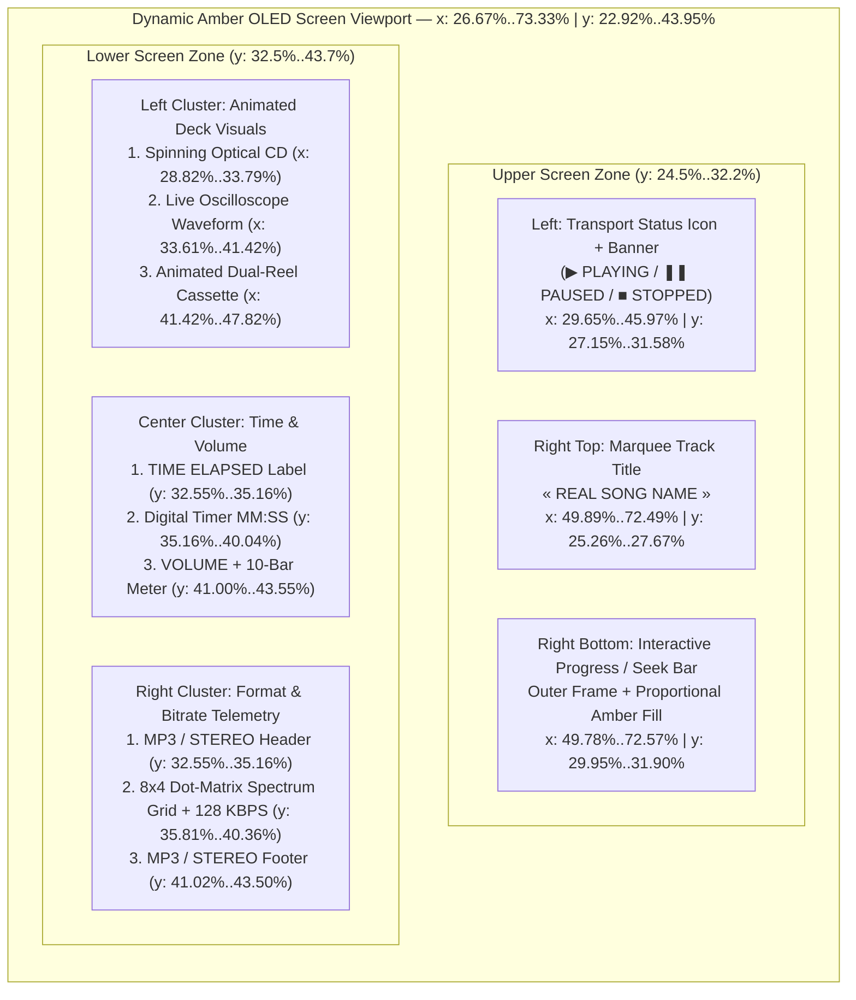
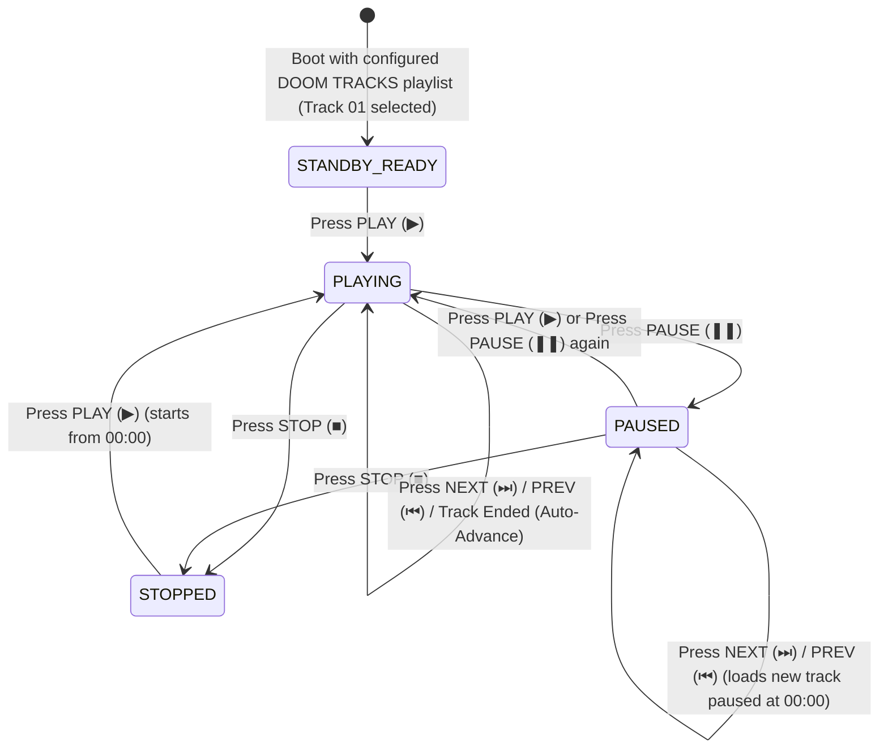

# Functional Specification 035: Interactive "DOOM TRACKS" (`SYS-990-AMBER`) Cyber-Industrial MP3 Deck Component

## 1. System Purpose & Core Objective

This specification defines the desired `{functionality}`, visual fidelity invariants, interactive state machine, audio pipeline architecture, operational and performance budgets, edge-case failure boundaries, and verifiable `{correct required outputs}` for creating an interactive **"DOOM TRACKS" MP3 Player Component** within the Freeman Alley runtime environment (`http://localhost:3000/`).

The component is governed by the authoritative reference artwork located at [`/Users/diesel/Desktop/mp3.jpeg`](file:///Users/diesel/Desktop/mp3.jpeg) (to be staged into the project workspace at `assets/mp3.jpeg` so the local HTTP server serves it without external filesystem dependencies).

The primary objective is to instruct a coding assistant to:
1. Reproduce the **EXACT visual appearance** of the `SYS-990-AMBER // AUDIO SYSTEM v2` hardware deck from [`/Users/diesel/Desktop/mp3.jpeg`](file:///Users/diesel/Desktop/mp3.jpeg) (`2752 × 1536` native resolution, `1.7917:1` aspect ratio), stripping the exterior white background outside the chamfered octagonal bezel and replacing the top-center nameplate label `"TECHNO-AUDIO"` with **`"DOOM TRACKS"`** in identical amber techno-industrial typography, color, and framing.
2. Transform the recessed amber OLED display screen (`x ∈ [26.67%, 73.33%]`, `y ∈ [22.92%, 43.95%]`) from static baked pixels into a **100% live, dynamic display** that renders every original screen element (transport state icon and banner, `« SONG TITLE »` marquee, interactive progress/scrub bar, spinning optical CD icon, real-time Web Audio oscilloscope waveform, animated dual-reel cassette tape icon, `TIME ELAPSED` digital `MM:SS` timer, 10-segment rising `VOLUME` bar meter, `MP3 / STEREO` labels, reactive dot-matrix frequency grid, and `KBPS` bitrate readout) driven by the project's real audio tracks.
3. Make the hardware transport buttons and deck switches **fully interactive** (`PLAY`, `PAUSE`, `STOP`, `REPEAT / CYCLE`, `PREV`, `NEXT`, `PLAYBACK`, `SHUFFLE`, and `LOOP / VISUALS`) with tactile visual press/toggle feedback, keyboard accessibility, and live audio playback control over the project's pre-configured song library, while keeping the four rotary dials (`VOL`, `VOL`, `BOOST`, and upper-right dial) purely decorative as specified by the user. End-users must **NOT** be able to upload songs at runtime.

**DO NOT CODE YET.** This document specifies functional requirements, spatial/pixel coordinate schedules, mathematical and physical budgets, and behavioral outcomes only. It contains zero implementation code, concrete syntax, or mechanical diffs.

---

## 2. Authoritative Domain Vocabulary Alignment (`LANGUAGE.md`)

All evaluations of system state, operational constraints, and verification gates within this specification strictly adhere to the authoritative taxonomy established in [`LANGUAGE.md`](file:///Users/diesel/desktop/skatealley/LANGUAGE.md):

- **`{functionality}`**: End-to-end interactive audio playback of the project's curated song tracks, playlist navigation, and real-time 60 FPS amber OLED screen rendering inside an exact visual reproduction of [`/Users/diesel/Desktop/mp3.jpeg`](file:///Users/diesel/Desktop/mp3.jpeg) branded with `"DOOM TRACKS"`, integrated cleanly into the Freeman Alley HUD and Web Audio subsystem with zero end-user file upload UI.
- **`{correctness}`**:
  - Visual fidelity matches [`/Users/diesel/Desktop/mp3.jpeg`](file:///Users/diesel/Desktop/mp3.jpeg) with zero unmasked exterior white border pixels, zero ghosting or bleed-through from the underlying JPEG's static screen text (`« TROOLLSHORT MP »`, `02:45`, `▶ PLAYING`) or `"TECHNO-AUDIO"` header, and exact geometric alignment of all overlaid screen elements and button hit zones.
  - Transport state transitions (`READY`, `PLAYING`, `PAUSED`, `STOPPED`) and playlist navigation (`PREV`, `NEXT`, `SHUFFLE`, `REPEAT`, `PLAYBACK`, progress scrubbing) execute deterministically across the repository's configured track catalog without race conditions or desynchronized UI timers.
  - Audio routing connects through the existing Web Audio API context and master gain/mute bus (`window.__sandbox.audio`) without clipping, duplicate audio node chains, or unhandled autoplay policy rejections.
- **`{correct required outputs}`**:
  1. Staged reference asset at `assets/mp3.jpeg` (`2752 × 1536`) and an active, toggleable/minimizable interactive `"DOOM TRACKS"` MP3 deck component mounted in the live Freeman Alley UI and exposed on `window.__sandbox.mp3Player` (and telemetry readout `#tel-mp3` or `#tel-audio`).
  2. Top-center chassis nameplate displaying `"DOOM TRACKS"` in `#ffa51d` amber typography over the `#1c170f` nameplate recess, replacing `"TECHNO-AUDIO"` seamlessly between the upper (`y = 9.77%`) and lower (`y = 14.06%`) horizontal bevel lines.
  3. Dynamic OLED screen that updates at 60 FPS during active playback: displaying the active song title inside `« ... »`, accurate `MM:SS` elapsed time, proportional progress bar fill, rotating optical disc, live `AnalyserNode` waveform trace, rotating cassette reels, active volume bars, and bitrate/format telemetry.
  4. Verified interactive execution across all 7 bottom transport buttons (`PLAY`, `PAUSE`, `STOP`, `REPEAT/CYCLE`, `PREV`, `NEXT`, `PLAYBACK`) and 2 mid-deck slide switches (`SHUFFLE`, `LOOP / VISUALS`), with zero end-user upload controls and zero console errors.
- **`{errors}`**:
  - Visible white corner triangles around the octagonal chassis due to missing exterior silhouette clipping/masking.
  - Double-rendered or ghosted text where dynamic screen typography overlaps unmasked static JPEG text inside the OLED viewport or top nameplate.
  - Exposing end-user file-upload pickers (`<input type="file">`) or drag-and-drop song upload handlers.
  - Decoding full multi-song catalogs into uncompressed RAM buffers via `decodeAudioData` instead of streaming media playback.
  - Unhandled `DOMException` promises from browser autoplay restrictions, silent fallbacks on missing track URLs, or non-zero browser console errors.
- **`{sufficient}`**: Complete pixel and normalized percentage coordinate schedules for the chassis silhouette, `"DOOM TRACKS"` nameplate, OLED screen sub-elements, and all interactive button/switch hit boxes; complete state machine transitions; and empirically grounded Web Audio / frame-budget constraints.
- **`{insufficient}`**: Any specification or implementation that alters the industrial design of [`/Users/diesel/Desktop/mp3.jpeg`](file:///Users/diesel/Desktop/mp3.jpeg), leaves `"TECHNO-AUDIO"` unreplaced, leaves the screen static, or includes end-user song uploading.

---

## 3. Reference Asset Visual Anatomy & Exact Coordinate Schedule (`mp3.jpeg`)

The authoritative visual reference [`/Users/diesel/Desktop/mp3.jpeg`](file:///Users/diesel/Desktop/mp3.jpeg) has native pixel dimensions of **$W = 2752\text{ px}$ by $H = 1536\text{ px}$** (aspect ratio $1.79167 : 1$). All component scaling must preserve this aspect ratio (or crop exclusively to the tight chassis bounding box $x \in [400, 2352]$, $y \in [118, 1418]$, which measures $1952 \times 1300\text{ px}$ or $1.5015 : 1$, while mapping all internal coordinates proportionally).

### 3.1 Sampled Chromatic Palette from `mp3.jpeg`

To guarantee that dynamic screen overlays, the `"DOOM TRACKS"` nameplate, and button press states look indistinguishable from the baked hardware illustration, all rendered elements must adhere to the empirical pixel samples extracted from [`/Users/diesel/Desktop/mp3.jpeg`](file:///Users/diesel/Desktop/mp3.jpeg):

| Visual Element | Sampled Pixel Coordinate | RGB Tuple | Hex Code | Usage Role |
| :--- | :--- | :--- | :--- | :--- |
| **Primary Emissive Amber** | `(1374, 172)` | `(255, 165, 29)` | `#ffa51d` | `"DOOM TRACKS"` header text, `PLAYING` status, track title, timer digits, active progress fill |
| **Core Neon Orange-Amber** | `(1376, 174)` | `(255, 156, 11)` | `#ff9c0b` | Screen icons (CD, waveform, cassette), primary button active glow, border highlights |
| **Warm Secondary Amber** | `(1376, 349)` | `(229, 141, 33)` | `#e58d21` | Screen inner bezel frame, `TIME ELAPSED` / `MP3 / STEREO` sub-labels, progress bar outline |
| **Dim Unlit Segment Amber** | `(1615, 650)` | `(74, 44, 13)` | `#4a2c0d` | Unfilled volume meter segments, inactive dot-matrix grid lines, inactive LED state |
| **Nameplate Recess Charcoal** | `(1120, 170)` | `(28, 23, 15)` | `#1c170f` | Solid occlusion fill behind `"TECHNO-AUDIO"` prior to rendering `"DOOM TRACKS"` |
| **OLED Screen Upper Substrate** | `(850, 380)` | `(46, 27, 10)` | `#2e1b0a` | Recessed OLED screen background gradient top/edge tone |
| **OLED Screen Core Substrate** | `(1050, 500)` | `(39, 22, 4)` | `#271604` | Recessed OLED screen background center dark amber-brown substrate |
| **Hardware Casing Rust-Bronze** | `(780, 1070)` | `(172, 92, 24)` | `#ac5c18` | Molded mechanical transport button faceplates and chassis paneling |
| **Hardware Casing Deep Obsidian** | `(650, 1115)` | `(22, 16, 11)` | `#16100b` | Outer armor frame, button wells, and recessed mechanical seams |

---

### 3.2 Exterior White Background Removal & Octagonal Chassis Silhouette

Because [`/Users/diesel/Desktop/mp3.jpeg`](file:///Users/diesel/Desktop/mp3.jpeg) is a 24-bit RGB JPEG without an alpha channel, the area outside the hardware casing ($x < 400$, $x > 2352$, $y < 118$, $y > 1418$, and the four 45-degree chamfered corners) is filled with solid white (`#ffffff`).

- **Mandatory Exterior Transparency Invariant:** The component must strip 100% of the exterior white background connected to the image edges (via border-connected luminance flood-fill alpha masking on an offscreen canvas where exterior connected pixels with $R > 230, G > 230, B > 230$ receive $\alpha = 0$ with a 2-pixel anti-aliased feather along the dark outer chassis border, or an exact multi-vertex polygon clip path tracing the outer bevel).
- **Measured Outer Chassis Bounds:**
  - Full Chassis Bounding Box: $x \in [400, 2352]$ ($14.53\% \dots 85.47\%$), $y \in [118, 1418]$ ($7.68\% \dots 92.32\%$).
  - Top Horizontal Edge ($y = 118\text{ px} / 7.68\%$): $x \in [557, 2194]$ ($20.24\% \dots 79.72\%$), with a subtle recessed center bridge between the upper-left and upper-right armor pods.
  - Bottom Horizontal Edge ($y = 1418\text{ px} / 92.32\%$): $x \in [551, 2200]$ ($20.02\% \dots 79.94\%$), with a recessed center `TRANS / REC` lower bay.
  - Left Vertical Edge ($x = 400\text{ px} / 14.53\%$): $y \in [416, 1144]$ ($27.08\% \dots 74.48\%$).
  - Right Vertical Edge ($x = 2352\text{ px} / 85.47\%$): $y \in [429, 1126]$ ($27.93\% \dots 73.31\%$).
  - Four Corner Chamfers: Connect the top/bottom horizontal edges to the left/right vertical edges at $\approx 45^\circ$.

---

### 3.3 Top Nameplate Branding Replacement (`"TECHNO-AUDIO"` $\rightarrow$ `"DOOM TRACKS"`)

The user requires the component to look the **EXACT SAME** as [`/Users/diesel/Desktop/mp3.jpeg`](file:///Users/diesel/Desktop/mp3.jpeg), except the top-center nameplate `"TECHNO-AUDIO"` must read **`"DOOM TRACKS"`**:

| Parameter | Pixel Coordinates (`2752 × 1536`) | Normalized (`%` of Full Image) | Specification Requirement |
| :--- | :--- | :--- | :--- |
| **Upper Accent Rule Line** | $y = 150\text{ px}$ | $y = 9.77\%$ | **Must remain intact and visible** (`#9d7a5a`). |
| **Nameplate Occlusion Patch** | $x \in [1136, 1616]$, $y \in [164, 208]$ | $x \in [41.28\%, 58.72\%]$, $y \in [10.68\%, 13.54\%]$ | Fill with exact sampled nameplate charcoal `#1c170f` to completely erase `"TECHNO-AUDIO"` without touching the angled side bezels or top/bottom rule lines. |
| **`"DOOM TRACKS"` Text Bounds** | Center $(1376, 187)$, $w = 460\text{ px}, h = 31\text{ px}$ | Center $(50.00\%, 12.17\%)$, $h = 2.02\%$ | Render `"DOOM TRACKS"` in uppercase geometric wide/extended techno-sans typography, weight `700`, letter-spacing `0.12em`, color `#ffa51d` with subtle `#ff9c0b` outer glow (`1.5px` radius). |
| **Lower Accent Rule Line** | $y = 216\text{ px}$ (with center tick) | $y = 14.06\%$ | **Must remain intact and visible** below the text. |

---

### 3.4 Dynamic Amber OLED Screen Viewport & Internal Layout Schedule

To prevent the baked JPEG text (`▶ PLAYING`, `« TROOLLSHORT MP »`, `02:45`, etc.) from showing through behind dynamic content, the interior of the recessed screen bezel must be occluded with a clean CRT/OLED substrate matching the original background gradient (`#2e1b0a` at edges to `#271604` at center, overlaid with subtle $2\text{ px}$ horizontal scanlines at $8\%$ opacity and a warm amber inner shadow), while keeping the double amber border lines of [`/Users/diesel/Desktop/mp3.jpeg`](file:///Users/diesel/Desktop/mp3.jpeg) intact.

#### Exact Sub-Element Coordinate Schedule Inside the Screen

| Screen Element | Pixel Bounding Box (`2752 × 1536`) | Normalized Coordinates (`%`) | Dynamic Behavior & Visual Contract |
| :--- | :--- | :--- | :--- |
| **Inner Screen Occlusion Canvas** | `(734, 352)` to `(2018, 675)` | `x: 26.67%..73.33%`, `y: 22.92%..43.95%` (`w: 46.66%`, `h: 21.03%`) | Rounded corner radius `14px` (scaled); masks static JPEG screen interior with `#2e1b0a -> #271604` radial/linear gradient + phosphor scanlines while preserving the outer/inner amber bezel lines at `(730, 348)..(2022, 682)`. |
| **1. Transport Status Icon (`▶` / `❚❚` / `■`)** | `(816, 417)` to `(879, 485)` | `x: 29.65%..31.94%`, `y: 27.15%..31.58%` | Displays solid amber right-pointing triangle (`▶`) when playing, dual vertical bars (`❚❚`) when paused, or solid square (`■`) when stopped/ready. |
| **2. Transport Status Banner (`PLAYING`)** | `(909, 426)` to `(1265, 478)` | `x: 33.03%..45.97%`, `y: 27.73%..31.12%` | Displays `PLAYING`, `PAUSED`, or `STOPPED` in bold extended uppercase amber typography (`#ffa51d`) with bloom glow. |
| **3. Track Title Readout (`« ... »`)** | `(1373, 388)` to `(1995, 425)` | `x: 49.89%..72.49%`, `y: 25.26%..27.67%` | Framed by fixed outer double guillemets `«` and `»`; displays the active song title in uppercase. If text width exceeds the inner span, smoothly scrolls horizontally as a continuous marquee (`40 px/s` with `1.5s` pause at start). |
| **4. Progress Bar Outer Frame & Fill** | `(1370, 460)` to `(1997, 490)` | `x: 49.78%..72.57%`, `y: 29.95%..31.90%` | `2px` amber outer rectangular frame (`#e58d21`) with a `3px` inner gap and solid bright amber fill bar (`#ffa51d`) whose width equals $\text{clamp}(t_{\text{current}} / t_{\text{duration}}, 0, 1) \times 100\%$. Supports click and drag-to-seek scrubbing. |
| **5. Spinning Optical CD Icon** | `(793, 561)` to `(930, 670)` | `x: 28.82%..33.79%`, `y: 36.52%..43.62%` | Circular optical disc graphic with opposing bright amber reflective sector wedges and concentric spindle rings. Rotates smoothly at `90 deg/s` (`1.57 rad/s`) during `PLAYING` state; pauses rotation in `PAUSED`/`STOPPED` states. |
| **6. Live Oscilloscope Waveform** | `(925, 568)` to `(1140, 665)` | `x: 33.61%..41.42%`, `y: 36.98%..43.29%` | Connects the right edge of the CD icon to the left edge of the cassette icon along baseline $y = 615\text{ px}$ ($40.04\%$). During playback, renders real-time time-domain waveform excursions sampled from `AnalyserNode.getByteTimeDomainData()`. When idle/paused, displays the exact signature ECG-style pulse spike from `mp3.jpeg`. |
| **7. Dual-Reel Cassette Tape Icon** | `(1140, 562)` to `(1316, 665)` | `x: 41.42%..47.82%`, `y: 36.59%..43.29%` | Amber rectangular cassette shell featuring the top-left sixteenth-note icon (`♫`), central dark tape window with two spoked tape hubs (which rotate at `120 deg/s` while playing), and bottom trapezoidal head shield with 4 guide holes. |
| **8. `TIME ELAPSED` Header** | `(1373, 500)` to `(1650, 540)` | `x: 49.89%..59.96%`, `y: 32.55%..35.16%` | Static uppercase label `TIME ELAPSED` in `#e58d21` (`0.08em` tracking). |
| **9. Digital Clock Readout (`MM:SS`)** | `(1375, 540)` to `(1631, 615)` | `x: 49.96%..59.27%`, `y: 35.16%..40.04%` | Large tabular digital timer (`#ffa51d`) formatted as zero-padded `MM:SS` (e.g., `02:45`, `00:00`). Clicking the timer toggles between `TIME ELAPSED` (`02:45`) and `TIME REMAINING` (`-01:18`). |
| **10. `VOLUME` Label & 10-Bar Meter** | `(1373, 628)` to `(1680, 668)` | `x: 49.89%..61.05%`, `y: 40.89%..43.49%` | `VOLUME` label on left followed by 10 ascending vertical bar segments. Illuminated bar count equals $\text{round}(\text{effectiveGain} \times 10)$ (`0` bars lit when muted, `7`–`8` bars lit at default `75%` gain). Clicking/dragging across the 10 bars adjusts playback volume directly. |
| **11. Right Codec Header (`MP3 / STEREO`)** | `(1740, 500)` to `(1996, 540)` | `x: 63.23%..72.53%`, `y: 32.55%..35.16%` | Displays `MP3 / STEREO` (matching `mp3.jpeg` or the configured track format). |
| **12. $8 \times 4$ Matrix Grid & Bitrate (`128 KBPS`)** | Grid: `(1760, 550)..(1885, 620)` Text: `(1895, 550)..(1993, 620)` | Grid: `x: 63.95%..68.50%` Text: `x: 68.86%..72.42%` `y: 35.81%..40.36%` | Left: $8 \times 4$ amber grid cell matrix whose column fills modulate with real-time FFT frequency bins during playback. Right: Stacked numeric bitrate (`128`, `192`, `256`, `320`) over `KBPS` from the active track entry (defaulting to `128 KBPS`). |
| **13. Right Footer (`MP3 / STEREO`)** | `(1740, 630)` to `(1996, 666)` | `x: 63.23%..72.53%`, `y: 41.02%..43.36%` | Displays `MP3 / STEREO` (briefly flashing `TRK XX / YY` or repeat/shuffle mode confirmation for `1.2s` when switching tracks or modes). |

---

### 3.5 Interactive Hardware Buttons & Toggle Switches Hit-Zone Schedule

All interactive controls must overlay transparent, accessible `<button>` hit regions aligned to the exact pixel/percentage coordinates of [`/Users/diesel/Desktop/mp3.jpeg`](file:///Users/diesel/Desktop/mp3.jpeg), providing immediate visual hover/active feedback (subtle amber bevel illumination, `1.5px` mechanical depression shift on active press, and synthesized tactile click cue via the audio subsystem).

| Control ID | Hardware Label & Icon | Pixel Bounding Box (`2752 × 1536`) | Normalized Hit Box (`%`) | Interactive Action & State Behavior |
| :--- | :--- | :--- | :--- | :--- |
| **`BTN_PLAY`** | `PLAY` (`▶`) | `(698, 1042)` to `(863, 1245)` | `x: 25.36%..31.36%`, `y: 67.84%..81.05%` | Starts or resumes playback of the currently selected song from the project's configured track catalog. Illuminates with an active amber border glow while in `PLAYING` state. |
| **`BTN_PAUSE`** | `PAUSE` (`❚❚`) | `(888, 1042)` to `(1049, 1245)` | `x: 32.27%..38.12%`, `y: 67.84%..81.05%` | Pauses active playback at the exact current timestamp (`currentTime`), or resumes playback if already `PAUSED` (standard hardware pause/resume toggle behavior). Illuminates with a pulsing amber border while in `PAUSED` state. |
| **`BTN_STOP`** | `STOP` (`■`) | `(1058, 1042)` to `(1217, 1245)` | `x: 38.44%..44.22%`, `y: 67.84%..81.05%` | Halts playback immediately, resets `currentTime` to `00:00`, resets the progress bar fill to `0%`, and transitions the screen banner to `■ STOPPED`. |
| **`BTN_REPEAT`** | `[🔄]` (Unlabeled 4th Button, Cycle Arrows) | `(1238, 1042)` to `(1396, 1245)` | `x: 44.99%..50.73%`, `y: 67.84%..81.05%` | Cycles playlist repeat mode across **`REPEAT ALL`** (loops entire playlist queue) $\rightarrow$ **`REPEAT ONE`** (loops current song indefinitely) $\rightarrow$ **`REPEAT OFF`** (stops after final song in queue), displaying a brief `1.2s` status confirmation on the screen footer and illuminating the button bezel when active. |
| **`BTN_PREV`** | `PREV` (`⏮`) | `(1445, 1042)` to `(1609, 1245)` | `x: 52.51%..58.47%`, `y: 67.84%..81.05%` | If current playback elapsed time $> 3.0\text{ s}$, seeks the current song back to `00:00`. If $\le 3.0\text{ s}$, switches to the previous song in the playlist queue (wrapping around to the last song if at index `0`) and preserves current play/pause state. |
| **`BTN_NEXT`** | `NEXT` (`⏭`) | `(1634, 1042)` to `(1799, 1245)` | `x: 59.38%..65.37%`, `y: 67.84%..81.05%` | Advances immediately to the next song in the playlist queue (respecting `SHUFFLE` order if enabled, and wrapping around to index `0`) while preserving current play/pause state. |
| **`BTN_PLAYBACK`** | `PLAYBACK` (`⏏`) | `(1854, 1042)` to `(2021, 1245)` | `x: 67.37%..73.44%`, `y: 67.84%..81.05%` | Toggles an in-screen / deck tracklist view of the pre-loaded project songs (allowing direct track selection from the repository catalog) or restarts playback from Track 1. **Never opens a file-upload dialog.** |
| **`SW_SHUFFLE`** | `SHUFFLE` (Left Pill Switch) | `(710, 825)` to `(868, 898)` | `x: 25.80%..31.54%`, `y: 53.71%..58.46%` | Toggles randomized shuffle playback order (`OFF` $\leftrightarrow$ `ON`), visually sliding the internal pill thumb from left to right and illuminating the left status LED (`LED_LEFT` at `x: 60.50%..63.88%`, `y: 48.05%..50.26%`). |
| **`SW_LOOP_VIS`** | `LOOP / VISUALS` (Right Pill Switch) | `(1888, 825)` to `(2046, 898)` | `x: 68.60%..74.35%`, `y: 53.71%..58.46%` | Cycles the screen's live audio visualizer mode (`OSCILLOSCOPE WAVE` $\rightarrow$ `SPECTRUM BARS` $\rightarrow$ `DUAL PULSE`) and illuminates the right status LED (`LED_RIGHT` at `x: 64.86%..68.31%`, `y: 48.05%..50.26%`). |
| **Rotary Dials** | `VOL` (upper/lower left), `BOOST` (lower right), upper-right dial | Left: `x: 19.8%..24.8%` Right: `x: 75.0%..80.2%` | *Non-interactive (`pointer-events: none`)* | Explicitly excluded from interactive requirements per user directive (*"the dials don't matter"*). Remain 100% static as rendered in `mp3.jpeg`. |

---

## 4. Pre-Configured Project Song Catalog & Web Audio Pipeline Architecture

### 4.1 Static Repository Song Catalog (Zero End-User Upload)
1. **No End-User Upload UI**: End-users visiting or interacting with the application must **NOT** be able to upload songs (no `<input type="file">`, no drag-and-drop file ingestion).
2. **Developer-Supplied Repository Audio Tracks**:
   - The MP3 player loads its playlist exclusively from the static audio track catalog stored in the repository (e.g., audio files placed by the developer in `assets/tracks/` or registered in the player's track manifest array, each entry specifying `{ id, title, src, bitrateKbps, format }`).
   - When the developer adds or updates `.mp3` / `.wav` / `.ogg` files in the project's designated tracks directory/manifest, the `"DOOM TRACKS"` deck automatically displays their titles inside `« ... »` and streams them via the transport controls.
   - If the developer has not yet dropped `.mp3` files into `assets/tracks/` at initial test time, the catalog includes built-in fallback audio streams so every button (`PLAY`, `PAUSE`, `STOP`, `PREV`, `NEXT`, `REPEAT`, `PLAYBACK`) and screen visualizer operates immediately out-of-the-box without network `404` `{errors}`.

### 4.2 Web Audio Graph Integration
To maintain $O(1)$ memory usage and synchronize with the existing Freeman Alley audio subsystem (`window.__sandbox.audio` in [`sandbox.js`](file:///Users/diesel/desktop/skatealley/sandbox.js#L6907-L7900)):
1. Use a single persistent `HTMLAudioElement` (`crossOrigin = 'anonymous'`, `preload = 'metadata'`) pointed at the active track's repository asset URL (`track.src`).
2. Route the `HTMLAudioElement` into the Web Audio API context via a single `MediaElementAudioSourceNode` connected to an `AnalyserNode` (`fftSize = 256`, `smoothingTimeConstant = 0.78`) and a dedicated player `GainNode` connected to the destination / master gain bus.
3. Synchronize with `window.__sandbox.audio`:
   - If the global sandbox master mute (`Key M` / `#audio-mute-btn`) is toggled, or the master gain slider (`#audio-gain-slider`) is adjusted, the MP3 player's effective gain and its 10-segment `VOLUME` screen bar meter update in lockstep.

---

## 5. UI Placement, Animated Morph & Full-Screen Takeover Architecture

1. **Default State — Strictly Screen-Only (`SCREEN_ONLY` Mode in Bottom-Right Corner)**:
   - By default, the component displays **strictly the asset's recessed Amber OLED screen** (`MP3_SCREEN_ONLY_CROP = { x: 722, y: 338, w: 1308, h: 396 }` in native `2752 × 1536` space), docked in the **bottom-right corner** (`right: 18px`, `bottom: 18px`, responsive width `290px–410px`, aspect ratio `3.303 : 1`).
   - All outer hardware casing, rotary dials, mid-deck switches, and bottom transport buttons are completely hidden in `SCREEN_ONLY` mode while the live 60 FPS OLED screen telemetry remains continuously active.
2. **Click-to-Expand Choreographed Animation (`EXPANDING` $\rightarrow$ `FULL_TAKEOVER` Mode)**:
   - Clicking anywhere on the compact OLED screen in `SCREEN_ONLY` mode initiates a smooth 60 FPS isotropic morph animation (`460 ms` cubic ease-in-out) into `FULL_TAKEOVER` mode.
   - During the transition, the OLED screen glides from the bottom-right corner to its exact seat inside the centered full-viewport MP3 chassis while the visible crop window unfolds outward from `MP3_SCREEN_ONLY_CROP` (`1308 × 396`) to `MP3_CHASSIS_CROP` (`1960 × 1308`) with zero aspect-ratio distortion, accompanied by a full-viewport blurred/darkened backdrop (`#doom-tracks-mp3-backdrop`).
3. **Full-Screen Takeover (`FULL_TAKEOVER` Mode) & Click-Outside Collapse (`COLLAPSING` $\rightarrow$ `SCREEN_ONLY`)**:
   - In `FULL_TAKEOVER` mode, the full MP3 player takes over the screen (`min(94vw, calc(92vh * 1.4985))` × `min(92vh, calc(94vw / 1.4985))`, centered over `#doom-tracks-mp3-backdrop`), exposing the `"DOOM TRACKS"` nameplate and all interactive transport buttons, switches, and screen scrub controls.
   - Clicking **outside** the MP3 player (either on `#doom-tracks-mp3-backdrop` or in the transparent exterior corners outside the octagonal chassis silhouette) or pressing `Escape` smoothly animates the full MP3 player back down (`COLLAPSING` $\rightarrow$ `SCREEN_ONLY`) into the compact screen in the bottom-right corner while keeping audio playback uninterrupted.
4. **Toggle Hotkey, HUD Button & Event Isolation**:
   - Pressing `Key U` (or clicking `#hud-toggle-mp3-btn` in `#sandbox-hud`) toggles visibility of the MP3 component.
   - All pointer and wheel interactions on the MP3 component and its takeover backdrop stop propagation (`stopPropagation()`) so background 3D camera orbit, scroll-walk, and raycasting in `sandbox.js` are never inadvertently triggered.

---

## 6. Operational & Performance Budgets

1. **Memory Budget ($O(1)$ Streaming Playback)**:
   - Audio playback MUST stream via `HTMLAudioElement` rather than `AudioContext.decodeAudioData()`, keeping heap overhead $< 2\text{ MB}$ regardless of playlist length.
2. **Frame-Time Budget ($\le 0.4\text{ ms}$ per 60 FPS Frame)**:
   - The dynamic OLED screen canvas/DOM update loop must execute only when the player is visible and must complete all rendering (marquee scroll, timer check, progress bar width, CD/cassette rotation, and 128-point `AnalyserNode` waveform path) in $\le 0.4\text{ ms}$ per frame, maintaining zero GC allocations in the per-frame render path (pre-allocating the `Uint8Array(128)` time-domain and frequency-domain buffers once at initialization).
3. **Chassis Asset Processing Budget ($\le 45\text{ ms}$ One-Time Initialization)**:
   - Stripping the exterior white background and patching the `"TECHNO-AUDIO"` nameplate to `"DOOM TRACKS"` on the offscreen reference canvas (`2752 × 1536` or scaled backing store) must execute once at initialization in $\le 45\text{ ms}$ and cache the resulting transparent composite bitmap so subsequent frames incur zero pixel-processing overhead.
4. **Input Latency ($\le 16\text{ ms}$)**:
   - Button presses (`PLAY`, `PAUSE`, `STOP`, `PREV`, `NEXT`, `REPEAT`, `PLAYBACK`, `SHUFFLE`, `LOOP/VISUALS`) and progress bar scrubbing must reflect visually on the OLED screen within a single animation frame ($\le 16.6\text{ ms}$).

---

## 7. Edge Cases, Failure Modes & Deterministic Recovery

1. **Missing or Unreachable Track Asset**:
   - If a configured track URL in the playlist fails to load (`MEDIA_ERR_SRC_NOT_SUPPORTED` or HTTP `404`), the player must NOT throw an unhandled promise rejection or freeze. It must display `« ERR: TRACK UNAVAILABLE »` on the OLED screen for `2.0s` and deterministically advance to the next valid track in the catalog.
2. **Browser Autoplay Policy Lock (`NotAllowedError`)**:
   - If playback is triggered before the browser's `AudioContext` has been unlocked by a user gesture, the player must call `audioCtx.resume()` inside the button click handler. If `audio.play()` rejects with `NotAllowedError`, the player must transition cleanly to `PAUSED` (`❚❚ READY`) rather than leaving the UI stuck in a fake `▶ PLAYING` state while silent.
3. **Rapid Track Skipping (`PREV` / `NEXT` Spamming)**:
   - Rapidly clicking `NEXT` or `PREV` multiple times within 100 ms must abort any pending `play()` promise from the superseded track gracefully (`AbortError` caught and ignored only when caused by an intentional track switch) and settle deterministically on the final target track index.
4. **Variable / Unknown Duration (`Infinity` or `NaN` during initial metadata load)**:
   - Before `loadedmetadata` resolves, the progress bar calculation must guard against division by zero (`0%` fill) and display `00:00` until finite duration is available.
5. **Very Long Song Titles & Unicode Characters**:
   - Song titles exceeding the 18-character static width of the `« ... »` viewport or containing CJK/emoji/accented characters must clip cleanly inside the inner screen viewport between the fixed `«` and `»` delimiters and scroll smoothly without overflowing across the screen bezel.

---

## 8. Verifiable `{correct required outputs}` & Acceptance Criteria

Upon future implementation of this specification, the system must satisfy all of the following verifiable checks:

1. **Visual Identity & `"DOOM TRACKS"` Branding**:
   - `assets/mp3.jpeg` is served with HTTP `200 OK`.
   - The rendered component looks identical to [`/Users/diesel/Desktop/mp3.jpeg`](file:///Users/diesel/Desktop/mp3.jpeg), with the outer white background completely transparent around the octagonal chassis and the top-center header reading **`"DOOM TRACKS"`** in `#ffa51d` amber typography in place of `"TECHNO-AUDIO"`.
2. **Dynamic OLED Screen Verification**:
   - Zero static ghosting of `« TROOLLSHORT MP »` or `02:45` from the underlying JPEG.
   - Live updates of transport state (`▶ PLAYING`, `❚❚ PAUSED`, `■ STOPPED`), scrolling `« SONG TITLE »`, interactive progress bar, `TIME ELAPSED` (`MM:SS`), spinning optical CD, live `AnalyserNode` oscilloscope waveform, animated cassette reels, 10-segment `VOLUME` meter, and `MP3 / STEREO` + `KBPS` readouts.
3. **Interactive Controls & Pre-Configured Catalog Verification (Zero End-User Upload)**:
   - Clicking `PLAY`, `PAUSE`, `STOP`, `REPEAT/CYCLE`, `PREV`, `NEXT`, `PLAYBACK (⏏)`, `SHUFFLE`, and `LOOP / VISUALS` executes the exact state transitions specified in §3.5 and §4.2 across the project's pre-configured song catalog with 0 console `{errors}`.
   - Zero end-user file upload inputs (`<input type="file">`) or drag-and-drop upload handlers exist on the component.
   - The four rotary dials (`VOL`, `VOL`, `BOOST`, upper-right dial) remain static and non-interactive.
