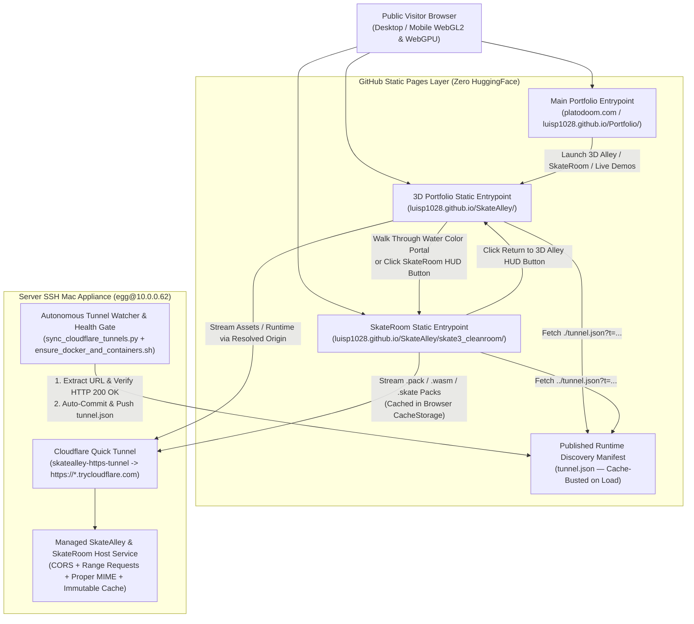

# Functional Specification 037: Full 3D Project Portfolio & SkateRoom (`skate3_cleanroom`) Public Deployment via Server SSH Mac (`egg@10.0.0.62`) and GitHub Static Pages (Zero HuggingFace Hosting)

## 1. System Purpose & Core Objective

This specification defines the desired `{functionality}`, hybrid hosting topology, runtime endpoint discovery contract, static asset and module resolution requirements, bidirectional portfolio-to-SkateRoom navigation workflow, operational and performance budgets, failure-isolation boundaries, and verifiable `{correct required outputs}` for deploying full public access to both:

1. **The Full 3D Interactive Project Portfolio ("SkateAlley" / Freeman Alley Runtime)** — the scroll-driven and WASD free-roam 3D WebGL2 environment showcasing interactive project wall mounts (`SCREEN_MOUNT_01` through `SCREEN_MOUNT_06`), 17 holographic media columns, 7 volumetric math pods, the `"DOOM TRACKS"` (`SYS-990-AMBER`) MP3 audio deck, interactive scene-cutting tools, custom rigged characters (`PlatoDoom` and `Luis`), and the Water Color Shader Gallery portal.
2. **The Playable SkateRoom (`skate3_cleanroom`)** — the WebGPU Rust/Bevy clean-room Skate 3 engine port featuring selectable custom rigged skaters (`PlatoDoom`, `Luis`, and `Luis + Hologram`) and verified playable skatepark maps (`StartPark` and `BlackBoxPark`), accessible both by walking through the Water Color Shader Gallery portal at the end of Freeman Alley and via direct public URL navigation.

To **completely eliminate HuggingFace hosting** (`*.hf.space` and `huggingface.co` spaces/datasets) while respecting GitHub's repository and static hosting limits, the deployment architecture pairs **GitHub Static Pages** (`https://luisp1028.github.io/SkateAlley/` and the main portfolio entrypoint at `https://luisp1028.github.io/Portfolio/` / `platodoom.com`) with the dedicated **Server SSH Mac (`egg@10.0.0.62`)** acting as the self-hosted high-bandwidth origin and runtime appliance exposed over a health-verified HTTPS Cloudflare Quick Tunnel.

**DO NOT CODE YET.** This document specifies functional requirements, physical payload and latency models, state transitions, operational budgets, and observable outcomes only. It contains zero implementation instructions, concrete code syntax, or mechanical diffs.

---

## 2. Authoritative Domain Vocabulary Alignment (`LANGUAGE.md`)

All evaluations of system state, operational constraints, and verification gates within this specification strictly adhere to the authoritative taxonomy established in [`LANGUAGE.md`](file:///Users/diesel/desktop/skatealley/LANGUAGE.md):

- **`{functionality}`**: End-to-end public reachability and interactive execution of both the Full 3D Project Portfolio (Freeman Alley) and the SkateRoom (`skate3_cleanroom`) across GitHub Static Pages and the self-hosted Server SSH Mac (`egg@10.0.0.62`), with zero dependency on HuggingFace hosting, seamless portal transitions between the 3D Portfolio and the SkateRoom, complete project showcase accessibility, and unattended recovery across Server Mac reboots or tunnel rotations.
- **`{correctness}`**:
  - Zero runtime dependencies on untracked local-only directories (such as `.gitignore`-excluded `node_modules/` paths) when loaded from GitHub Static Pages or the Server Mac origin.
  - Exact cryptographic and byte-length parity between `skate3_cleanroom/pack.json` and the actual `.pack`, `.wasm`, and `.skate` binary artifacts served to the browser, with zero references to missing map files that would trigger HTTP `404` failures.
  - Dynamic runtime discovery of the Server Mac's active HTTPS tunnel URL via a cache-busted published metadata manifest (`tunnel.json`), with deterministic fallback and support for explicit query-parameter overrides.
  - Unattended background monitoring and pre-publication health verification (`HTTP 200 OK`) on `egg@10.0.0.62` before any rotated tunnel URL is committed and pushed to GitHub.
- **`{correct required outputs}`**:
  1. Live, publicly accessible GitHub Static Pages deployment for `LuisP1028/SkateAlley` (`https://luisp1028.github.io/SkateAlley/` and `https://luisp1028.github.io/SkateAlley/skate3_cleanroom/`) and integrated portfolio access from `LuisP1028/Portfolio` (`https://luisp1028.github.io/Portfolio/` / `https://platodoom.com`).
  2. Live, persistent hosting service and HTTPS tunnel running on the Server SSH Mac (`egg@10.0.0.62`) serving the SkateAlley portfolio and SkateRoom binary packs (`core.pack`, `core_luis.pack`, `core_holo.pack`, `skate3rust_bg.wasm`, `StartPark.skate`, `BlackBoxPark.skate`, and `.glb` assets) with CORS (`Access-Control-Allow-Origin: *`), byte-range support (`Accept-Ranges: bytes`), and proper MIME types (`application/wasm`, `model/gltf-binary`, `application/octet-stream`), registered with the Server Mac's boot-recovery and tunnel-watcher services.
  3. Complete removal/replacement of legacy HuggingFace Space endpoints (`*.hf.space` / `huggingface.co/spaces/...`) across the portfolio project cards and widgets in favor of self-hosted Server Mac / GitHub Pages endpoints.
  4. Verified bidirectional navigation: walking into the Water Color Shader Gallery portal (or activating the HUD SkateRoom portal trigger) transitions cleanly into the playable SkateRoom (`skate3_cleanroom`), and an in-game HUD return control inside the SkateRoom navigates cleanly back to the Freeman Alley 3D Portfolio.
- **`{errors}`**:
  - Failed ES module resolution (`HTTP 404` on `./node_modules/three/...`) when visiting the GitHub Static Pages URL because `node_modules` is excluded from Git tracking.
  - Git push rejections caused by attempting to commit unsplit single files exceeding GitHub's `100 MiB` (`104,857,600` bytes) hard limit or committing untracked offline scan/backup directories (`20261019T213303-735-zjzk/`, raw unrigged backup `.glb` files).
  - Map selector failures (`HTTP 404`) in `skate3_cleanroom` caused by `pack.json` advertising maps (`dmjumpline`, `DownTownSkatePark`, `IndustrialSkatePark`, `MaloofMoneyCup`, `MegaPark`, `SkateSchool`) whose `.skate` binary files are absent from `skate3_cleanroom/maps/`.
  - Dead or unreachable `huggingface.co` / `*.hf.space` URLs or broken local script links on portfolio project stations.
  - Stale, unverified `*.trycloudflare.com` tunnel URLs causing `NXDOMAIN` or CORS errors in the browser.
- **`{sufficient}`**: Complete specification of the physical payload sizes, GitHub vs. Server Mac hosting split, module and asset resolution contracts, `pack.json` manifest integrity rules, Server Mac daemon and tunnel-watcher integration, portfolio station link contracts, and measurable acceptance criteria.
- **`{insufficient}`**: Any specification that ignores GitHub's `100 MiB` file limit, overlooks `.gitignore` exclusion of `node_modules/` on GitHub Pages, leaves `pack.json` out of sync with available `.skate` map files, or relies on manual terminal sessions on `egg@10.0.0.62`.

---

## 3. First-Principles Physical Reality & Empirical Baseline

Read-only empirical inspection of the local workspace (`/Users/diesel/desktop/skatealley`) and the Server SSH Mac (`egg@10.0.0.62` via `~/.ssh/id_ed25519_server`) establishes the exact physical constraints that govern this deployment:

### 3.1 Empirical Payload Inventory & Platform Limits

| Subsystem / Asset Group | Measured Disk Volume | Largest Individual Artifacts | Physical & Hosting Constraint |
| :--- | :--- | :--- | :--- |
| **Freeman Alley 3D Portfolio Core (`index.html`, JS modules, CSS)** | `~1.45 MB` | `sandbox.js` (`586 KB`), `math_pods.js` (`168 KB`), `hologram_columns.js` (`134 KB`), `alley_atmosphere_023.js` (`95 KB`), `doom_tracks_mp3_hud.js` (`84 KB`), `mathpod_popup.js` (`79 KB`) | Ideal for direct GitHub Static Pages delivery (`< 2 MB` compressed). **Blocker Identified:** `index.html` currently maps `"three"` to `./node_modules/three/...`, which is gitignored and `404`s on GitHub Pages unless vendor-staged into a tracked directory or resolved via a self-contained static import path. |
| **Freeman Alley Runtime 3D Meshes (`.glb`), Hologram Media (`anim/`), & Audio (`assets/`)** | `~128 MB` (active runtime set) | `villainy_inc_textured.glb` (`30.0 MB`), `character_hoodie.glb` (`9.7 MB`), `LUIS_SKATE3_RIGGED.glb` (`7.6 MB`), `freeman_alley.glb` (`7.5 MB`), `DOOM_HEAD_DECIMATED_COMPANION.glb` (`4.3 MB`), `audiodevice.glb` (`3.8 MB`), `PLATODOOM_SKATE3_RIGGED.glb` (`3.1 MB`), `anim/*` (`47 MB`), `assets/*` (`14 MB`) | All individual active runtime `.glb`, `.mp4`, `.jpeg`, and `.mp3` files are $\le 31.2\text{ MB}$ (well below GitHub's `100 MiB` per-file limit). However, raw authoring backups (`PLATODOOM_HEAD.glb` `24 MB`, `LUIS_HEAD.glb` `16 MB`, `PLATODOOM_RAW.glb` `11 MB`, `20261019T213303-735-zjzk/` `114 MB`) must be excluded from production deployment to prevent repository bloat. |
| **SkateRoom Engine & Character Packs (`skate3_cleanroom/`)** | `~366 MB` total | `core_holo.pack` (`100.27 MB` / `95.63 MiB`), `core_luis.pack` (`98.65 MB` / `94.08 MiB`), `core.pack` (`93.91 MB` / `89.56 MiB`), `skate3rust_bg.wasm` (`50.75 MB` / `48.40 MiB`) | `core_holo.pack` (`100.27 MB`), `core_luis.pack` (`98.65 MB`), and `core.pack` (`93.91 MB`) sit right at GitHub's `50–100 MiB` warning/rejection boundary (`~283 MB` combined for just the 3 character packs). `skate3_cleanroom/loader.js` already natively supports multi-part chunked arrays (`parts: [...]`) and `CacheStorage` (`skate3-pack`) caching, as well as remote URL fetching. |
| **SkateRoom Playable Maps (`skate3_cleanroom/maps/`)** | `~30.7 MB` on disk | `BlackBoxPark.skate` (`20.48 MB`), `StartPark.skate` (`10.21 MB`) | **Defect Identified:** `skate3_cleanroom/pack.json` currently lists 8 maps (`BlackBoxPark`, `dmjumpline`, `DownTownSkatePark`, `IndustrialSkatePark`, `MaloofMoneyCup`, `MegaPark`, `SkateSchool`, `StartPark`), but only `StartPark.skate` and `BlackBoxPark.skate` exist in `skate3_cleanroom/maps/`. Selecting any of the other 6 maps triggers an immediate `HTTP 404` fatal error. |

### 3.2 Empirical State of the Server SSH Mac (`egg@10.0.0.62`)
Live telemetry from `egg@10.0.0.62` (`Darwin Eggs-MacBook-Air.local 23.6.0 x86_64`) confirms:
- **Disk Capacity**: `26 GiB` free available on `/` (`/dev/disk1s5s1`).
- **Active Daemon Infrastructure**:
  - Docker Desktop (`com.luisp1028.boot-recovery.plist` -> `/Users/egg/.local/bin/ensure_docker_and_containers.sh`) is active and running 6 containers (`bartending-app-local`, `bartending-https-tunnel`, `lag-policy-engine-local`, `lag-policy-engine-tunnel`, `polymarket-postgres`, `polymarket-redis`).
  - Cloudflare Quick Tunnel Watcher (`com.luisp1028.tunnel-watcher.plist` -> `/Users/egg/.local/bin/sync_cloudflare_tunnels.py`) is active, polling container logs, verifying DNS + HTTP `200 OK` health, and auto-committing `tunnel.json` updates to GitHub.
  - GitHub Project Synchronizer (`com.luisp1028.github-sync.plist` -> `/Users/egg/.local/bin/sync_github_projects.sh`) is active and authenticated under GitHub account `LuisP1028`.
  - `/Users/egg/Desktop/SkateAlley` and `/Users/egg/Desktop/Portfolio` exist on `egg@10.0.0.62`.

---

## 4. Desired `{functionality}` & Architectural Pillars

---

### 4.1 Pillar 1: Self-Contained Static Compatibility & Repository Hygiene for GitHub Pages

1. **Zero `node_modules` Runtime Dependency**:
   - The Freeman Alley 3D Portfolio (`index.html` and all imported ES modules) must resolve `three` and `three/addons/` without referencing `./node_modules/...` (which is ignored by Git and absent on GitHub Static Pages).
   - Tracked, version-locked vendor modules (or an equivalent self-contained static module path committed in the repository) must be used so that loading `index.html` on GitHub Static Pages (`https://luisp1028.github.io/SkateAlley/`) resolves every ES module import (`three`, `GLTFLoader`, `TransformControls`, and all scene subsystems) with `HTTP 200 OK` and zero external package-manager build steps required at request time.
2. **Jekyll Bypass (`.nojekyll`)**:
   - The published GitHub Pages root must include a `.nojekyll` marker so GitHub Pages serves all files and directories verbatim without stripping underscore-prefixed assets (such as `skate3rust_bg.wasm` or `__test`) or failing on large static directories.
3. **Strict Exclusion of Non-Runtime Authoring Bloat & $> 50\text{ MB}$ Single-File Bloat**:
   - Offline scan archives and intermediate authoring backups that are not referenced by the live runtime (specifically `20261019T213303-735-zjzk/`, `assets/20261022T230304-120-0j7w/`, `handoff/`, `wayfinder/`, `PLATODOOM_RAW.glb`, `PLATODOOM_HEAD.glb`, `LUIS_HEAD.glb`, `LUIS_TPOSE_STANDALONE_BACKUP.glb`, `LUIS_DECIMATED_STANDALONE.glb`, `DOOM_HEAD_COLOR.glb`, `LUIS_HEAD_COLOR.glb`, `Luis_BODY_COLOR.glb`) must be excluded from the production GitHub deployment so repository size remains within GitHub Pages quotas.
   - Any binary asset in `skate3_cleanroom/` exceeding `45 MB` (`core.pack` at `93.9 MB`, `core_luis.pack` at `98.6 MB`, `core_holo.pack` at `100.3 MB`, and `skate3rust_bg.wasm` at `50.7 MB`) must either be split into deterministic multi-part chunks ($\le 45\text{ MB}$ per part file, e.g., `.part00`, `.part01`, `.part02`) referenced via the `parts` array in `skate3_cleanroom/pack.json` and/or streamed directly from the Server SSH Mac tunnel origin so that **zero single files in Git exceed `48 MB`** (eliminating GitHub's `50 MiB` warning and `100 MiB` hard rejection).

---

### 4.2 Pillar 2: Server SSH Mac (`egg@10.0.0.62`) Hosting Service & Autonomous Tunnel Publication

1. **Managed SkateAlley & SkateRoom Hosting Service on `egg@10.0.0.62`**:
   - The Server SSH Mac (`egg@10.0.0.62`) must host a dedicated, persistent local HTTP/container service (`skatealley-app-local` on a dedicated non-conflicting host port, e.g., `3002` or `8088`, avoiding ports `3001`, `5432`, `6379`, `7860`, and `8443` already in use on `egg@10.0.0.62`) serving the complete `/Users/egg/Desktop/SkateAlley` workspace (including `/`, `/skate3_cleanroom/`, all `.glb` meshes, `.pack` character archives, `.wasm` binaries, `.skate` maps, `anim/` media, and `assets/tracks/` audio).
   - The Server Mac HTTP server must enforce:
     - **CORS Headers**: `Access-Control-Allow-Origin: *`, `Access-Control-Allow-Methods: GET, HEAD, OPTIONS`, `Access-Control-Allow-Headers: Range, Content-Type, Accept`, and `Access-Control-Expose-Headers: Content-Length, Content-Range, Accept-Ranges` so GitHub Static Pages (`https://luisp1028.github.io` and `https://platodoom.com`) can fetch `.pack`, `.wasm`, `.skate`, and `.glb` binaries cross-origin via `fetch()` and WebGL/WebGPU loaders without CORS blockage.
     - **Accurate Content-Type MIME Mapping**: `application/wasm` for `.wasm`, `model/gltf-binary` for `.glb`, `application/octet-stream` for `.pack` and `.skate`, `application/json` for `.json`, `text/javascript` for `.js`, `audio/mpeg` for `.mp3`, and `video/mp4` for `.mp4`.
     - **Byte-Range & Content-Length Support**: Accurate `Content-Length` headers on all binary responses so `skate3_cleanroom/loader.js` progress tracking (`done / total MB`) and byte-length verification (`if (at !== total) throw new Error(...)`) succeed deterministically.
2. **Dedicated Cloudflare HTTPS Quick Tunnel (`skatealley-https-tunnel`)**:
   - Alongside `bartending-https-tunnel` and `lag-policy-engine-tunnel`, the Server Mac must run a dedicated Cloudflare Quick Tunnel container (`skatealley-https-tunnel`) forwarding public HTTPS traffic (`https://<subdomain>.trycloudflare.com`) to the local SkateAlley host service.
3. **Integration with Unattended Boot Recovery & Autonomous Tunnel Watcher on `egg@10.0.0.62`**:
   - **Boot Recovery (`ensure_docker_and_containers.sh`)**: Upon any reboot or login on `egg@10.0.0.62`, the boot-recovery script must automatically ensure both the SkateAlley host server/container and `skatealley-https-tunnel` are running.
   - **Autonomous Tunnel Watcher (`sync_cloudflare_tunnels.py`)**: The tunnel watcher on `egg@10.0.0.62` must monitor `skatealley-https-tunnel`, extract the latest `https://<subdomain>.trycloudflare.com` URL, verify that both the root portfolio health/manifest endpoint and `/skate3_cleanroom/pack.json` return `HTTP 200 OK` over the public tunnel, and automatically update, commit, and push `tunnel.json` to `LuisP1028/SkateAlley` (and `LuisP1028/Portfolio` if referenced there) whenever the tunnel URL rotates.
   - **GitHub Sync (`sync_github_projects.sh`)**: `/Users/egg/Desktop/SkateAlley` on `egg@10.0.0.62` must be synchronized with `https://github.com/LuisP1028/SkateAlley.git` so code and asset updates pushed to GitHub automatically propagate to the Server Mac.

---

### 4.3 Pillar 3: Dynamic Runtime Endpoint Resolution (`tunnel.json`) & Hybrid Asset Delivery

1. **Published `tunnel.json` Contract**:
   - The repository root must maintain a machine-readable `tunnel.json` manifest containing:
     - `service`: `"skatealley-app-local"`
     - `url`: The verified active `https://<subdomain>.trycloudflare.com` base URL on `egg@10.0.0.62`
     - `portfolio_url`: Public GitHub Pages URL (`"https://luisp1028.github.io/SkateAlley/"`)
     - `skateroom_url`: Public SkateRoom URL (`"https://luisp1028.github.io/SkateAlley/skate3_cleanroom/"`)
     - `updated_at`: ISO-8601 UTC timestamp
2. **Dynamic Asset & Engine Resolution in SkateRoom (`skate3_cleanroom/loader.js`) and Freeman Alley (`sandbox.js`)**:
   - When a visitor opens the 3D Portfolio or SkateRoom on GitHub Static Pages (`*.github.io` or `platodoom.com`):
     - The runtime fetches `tunnel.json?t=<timestamp>` (`cache: 'no-store'`).
     - For heavy binary downloads in `skate3_cleanroom` (`core.pack`, `core_luis.pack`, `core_holo.pack`, `skate3rust_bg.wasm`, and `.skate` maps), the loader resolves parts against the fastest verified origin (supporting both local relative chunked parts on GitHub Pages and the Server Mac HTTPS tunnel URL when `?backend=` / `tunnel.json` specifies external/server-hosted packs), caching the reassembled binary payload in the browser's `CacheStorage` (`skate3-pack`) keyed by content hash (`core-${selectedChar}.${coreHash}`, `engine.${engine.hash}`, `map-${map.name}.${map.hash}`).
     - If one origin experiences a transient network error while fetching a part, the loader must deterministically fail over between the GitHub Pages static chunk path and the verified Server Mac tunnel origin before raising a fatal error.
   - **Precedence Hierarchy**:
     1. Explicit URL query parameter overrides (`?server=https://...`, `?backend_url=https://...`, `?mapurl=https://...`).
     2. Local development origin (`localhost` or `127.0.0.1`), which loads directly from the local server without external network hops.
     3. Dynamically resolved `tunnel.json` / relative GitHub Pages static paths.

---

### 4.4 Pillar 4: Full SkateRoom (`skate3_cleanroom`) Access & Bidirectional Portfolio Navigation

1. **Authoritative `skate3_cleanroom/pack.json` Integrity**:
   - Every character entry (`platodoom`, `luis`, `luis_holo`), engine binary (`skate3rust_bg.wasm`), and map entry listed in `skate3_cleanroom/pack.json` must correspond to a physically present, hash-verified binary file (or multi-part chunk sequence) on disk and on the server.
   - Any map entry in `pack.json` whose `.skate` binary file does not exist in `skate3_cleanroom/maps/` must either have its verified `.skate` binary staged into `skate3_cleanroom/maps/` or be removed from `pack.json`'s `maps` array so the Map Picker dropdown in `skate3_cleanroom/index.html` exclusively lists 100% playable, reachable maps (`StartPark`, `BlackBoxPark`, plus `Test world` and community/local `.skate` support) with zero `HTTP 404` traps.
2. **Seamless Forward Transition (Freeman Alley 3D Portfolio $\rightarrow$ SkateRoom)**:
   - In Freeman Alley (`index.html` / `sandbox.js`), users must have two clear, immediate ways to enter the SkateRoom:
     - **Diegetic 3D Portal Walk-Through**: Walking the character (`PlatoDoom` or `Luis`) through the **Water Color Shader Gallery Portal** at the end of the alley (`Z ≈ 36.5 m`) triggers the chromatic portal surge and navigates directly to `./skate3_cleanroom/` (passing the currently active character selection `?char=platodoom` or `?char=luis` or `?char=luis_holo` so the player spawns in the SkateRoom as the character they were using in the alley).
     - **Direct HUD & Quick-Access Controls**: A prominent **"ENTER SKATEROOM 🛹"** action button in the Freeman Alley HUD (and on the Water Color Portal callout / Radial Menu) allows any visitor to jump straight into the SkateRoom at any time with a single click, without having to scroll or walk the full length of the alley first.
3. **Seamless Return Transition (SkateRoom $\rightarrow$ Freeman Alley 3D Portfolio)**:
   - Inside `skate3_cleanroom/index.html` (`#mapbar` and splash/overlay screen), a dedicated **"← 3D Portfolio (Alley)"** navigation button must be present so the user can return from the SkateRoom back to the Freeman Alley 3D Portfolio (`../` or configured portfolio URL) with a single click.

---

### 4.5 Pillar 5: Elimination of HuggingFace Hosting & Full Project Portfolio Access

1. **Zero HuggingFace Dependencies Across Portfolio Entrypoints**:
   - All legacy references to HuggingFace Spaces (`https://choppedcheese-digitaltwin.hf.space`, `https://huggingface.co/spaces/ChoppedCheese/DigitalTwin/...`, `https://choppedcheese-platodoomcave.hf.space/chat`) in the user's portfolio (`LuisP1028/Portfolio` on `egg@10.0.0.62` and `LuisP1028/SkateAlley`) must be replaced with self-hosted Server SSH Mac (`egg@10.0.0.62`) / GitHub Pages endpoints.
   - In `LuisP1028/Portfolio` (`platodoom.com`), the Deployed Units (`[PROJECTS]`) grid and navigation must provide direct, first-class access to both the **Freeman Alley 3D Interactive Portfolio** (`https://luisp1028.github.io/SkateAlley/`) and the **SkateRoom (`skate3_cleanroom`)** (`https://luisp1028.github.io/SkateAlley/skate3_cleanroom/`), alongside the Server-Mac-hosted **LAG Policy Engine Showcase** (`OBJ-200`, `https://luisp1028.github.io/lag-policy-engine-showcase/`), **DITHER-OS Bartending** (`https://luisp1028.github.io/Bartending/`), and **State Space Model (`OBJ-01`)**.
2. **Valid, Reachable Links on All 6 Freeman Alley Project Stations (`SCREEN_MOUNT_01`..`06`)**:
   - In `sandbox.js`, the 6 interactive Wall Screen Mount project stations (`HOLO_PROJECT_STATIONS` for `SCREEN_MOUNT_01` through `SCREEN_MOUNT_06`) currently point several `primaryLink` and `secondaryLink` URLs at non-existent local relative paths (such as `./scene_preparation.md`, `./prepare_scene.py`, `./hunyuan3d_colab_studio.py`, `./functional_specification_012.md`, `./minimax_h3_scene_chainer.py`, `./research_minimax_h3_generation_benchmarks.md`, `./research_threejs_mcp_evaluation.md`, `./operational_runbook.md`, `./functional_specification_014.md`) that return `HTTP 404` when clicked.
   - Every station's `primaryLink` and `secondaryLink` (and/or interactive station modal/action) must resolve to real, reachable portfolio project deployments, live interactive demos (including the LAG Policy Engine Showcase, DITHER-OS Bartending, SkateRoom Clean-Room Port, Polymarket / State Space Model, and Freeman Alley 3D Engine), or existing tracked documentation/source files so that **zero project station buttons in Freeman Alley produce `HTTP 404` errors**.

---

## 5. Operational & Performance Budgets

| Metric / Operational Envelope | Mandatory Target Budget | Physical & Architectural Rationale |
| :--- | :--- | :--- |
| **Max Single File Size in Git Repository** | **$\le 48.0\text{ MB}$ (`50,331,648` bytes)** | Strictly below GitHub's `50 MiB` warning threshold and `100 MiB` hard push rejection limit. |
| **Total Published GitHub Pages Site Size** | **$\le 850\text{ MB}$** | Strictly within GitHub Pages' `1.0 GB` static deployment ceiling after excluding untracked scan/raw backups. |
| **Runtime `tunnel.json` Discovery Latency** | **$\le 400\text{ ms}$** (with `2,500 ms` timeout) | Non-blocking fetch of cache-busted `tunnel.json`; falls back to relative static chunks immediately if tunnel lookup times out. |
| **Freeman Alley Initial Interactive Boot (Cached / Broadband)** | **$\le 4.5\text{ s}$** to interactive 60 FPS render | Parallel GLB and texture streaming with progressive spray-paint loader feedback. |
| **SkateRoom Repeat Load Latency (`CacheStorage` Hit)** | **$\le 1.8\text{ s}$** | `skate3-pack` `CacheStorage` serves the `~94 MB` character pack, `~50 MB` WASM binary, and `~10–20 MB` map from local browser storage with zero network transfer on repeat visits or map switches. |
| **Server Mac Tunnel Health Check & Auto-Publish Interval** | **$\le 60\text{ s}$** detection-to-GitHub-push | `sync_cloudflare_tunnels.py` launchd service runs continuously on `egg@10.0.0.62` and verifies `HTTP 200 OK` before committing `tunnel.json`. |
| **Browser Console & Network Error Budget** | **$0$ Errors (`0` HTTP 404s, `0` CORS failures)** | Every module, `.glb`, `.mp3`, `.mp4`, `.pack`, `.wasm`, and `.skate` request must return `HTTP 200 OK` (or `206 Partial Content`). |

---

## 6. Edge Cases, Failure Modes & Deterministic Recovery

1. **Cloudflare Quick Tunnel Subdomain Rotation on Server Mac Reboot**:
   - *Failure Mode*: Whenever `skatealley-https-tunnel` restarts on `egg@10.0.0.62`, Cloudflare assigns a new random `https://<subdomain>.trycloudflare.com` hostname.
   - *Deterministic Recovery*: The tunnel watcher (`sync_cloudflare_tunnels.py`) on `egg@10.0.0.62` extracts the new URL from container logs, verifies DNS resolution (via `1.1.1.1` / `8.8.8.8`) and `HTTP 200 OK` against `/skate3_cleanroom/pack.json`, and pushes the updated `tunnel.json` to GitHub. Meanwhile, static chunked assets committed to GitHub Pages continue serving uninterrupted even during the brief tunnel rotation window.
2. **Browser without WebGPU Visiting SkateRoom (`skate3_cleanroom`)**:
   - *Failure Mode*: Visitor opens `/skate3_cleanroom/` on a browser or device with WebGPU disabled or unsupported (`!navigator.gpu` or `!(await navigator.gpu.requestAdapter())`).
   - *Deterministic Recovery*: Instead of a blank black screen, the SkateRoom overlay displays a clear diagnostic message explaining the WebGPU requirement AND provides an interactive **"← Return to 3D Alley Portfolio (WebGL2)"** button so the visitor can immediately return to the WebGL2 Freeman Alley experience.
3. **Browser Storage Quota Exceeded in `skate3_cleanroom` (`CacheStorage`)**:
   - *Failure Mode*: Mobile or private-browsing windows reject `cache.put()` due to storage quota limits when caching `~150 MB` of `.pack` + `.wasm` data.
   - *Deterministic Recovery*: `cachedParts()` must catch storage quota exceptions without aborting execution and hand the downloaded `Uint8Array` directly to the WASM module in memory (`globalThis.SKATE_PACK`), while enabling `SKATE_LITE` texture/MSAA reduction on coarse-pointer (mobile/tablet) devices.
4. **Port Collisions on `egg@10.0.0.62`**:
   - *Failure Mode*: Existing services on `egg@10.0.0.62` occupy ports `3001` (Bartending), `5432` (Postgres), `6379` (Redis), `7860` (LAG), and `8443` (Polymarket Webapp).
   - *Deterministic Recovery*: The SkateAlley host server on `egg@10.0.0.62` binds exclusively to a dedicated port (e.g., `3002`) verified via `/Users/egg/.local/bin/ensure_port_free.sh` prior to container/service startup.
5. **Cross-Origin Isolation & Audio Autoplay Restrictions**:
   - *Failure Mode*: Browsers suspend `AudioContext` and `HTMLAudioElement` playback until the first user gesture.
   - *Deterministic Recovery*: Both Freeman Alley (`sandbox.js` / `doom_tracks_mp3_hud.js`) and SkateRoom (`loader.js`) unlock and resume all registered `AudioContext` instances on the first `pointerdown`, `click`, `touchend`, or `keydown` event without throwing unhandled promise rejections.

---

## 7. Verifiable Acceptance Criteria (`{correct required outputs}`)

The implementation of this specification is complete and `{sufficient}` only when all of the following measurable outcomes are verified against live runtime reality:

| ID | Verification Gate | Measurable `{correct required outputs}` |
| :--- | :--- | :--- |
| **`AC-01`** | **GitHub Static Pages Deployment (`LuisP1028/SkateAlley`)** | `https://github.com/LuisP1028/SkateAlley` is pushed cleanly with zero files $> 48\text{ MB}$, `.nojekyll` present, tracked static Three.js module imports (zero `./node_modules/` references in `index.html`), and GitHub Pages enabled and serving `https://luisp1028.github.io/SkateAlley/` with `HTTP 200 OK`. |
| **`AC-02`** | **Server SSH Mac (`egg@10.0.0.62`) Host Service & HTTPS Tunnel** | On `egg@10.0.0.62`, the SkateAlley host service and `skatealley-https-tunnel` are running, managed by `ensure_docker_and_containers.sh` and `sync_cloudflare_tunnels.py`, and `tunnel.json` publishes the verified `https://*.trycloudflare.com` URL returning `HTTP 200 OK` with CORS headers (`Access-Control-Allow-Origin: *`). |
| **`AC-03`** | **Full 3D Portfolio Runtime Verification** | Loading the deployed 3D Portfolio in a headless/live browser renders Freeman Alley at 60 FPS with `0` console errors and `0` failed network requests (`HTTP 200 OK` across all `.glb` meshes, `anim/` hologram media, math pods, `"DOOM TRACKS"` MP3 player, and project stations `SCREEN_MOUNT_01`..`06`). |
| **`AC-04`** | **Full SkateRoom (`skate3_cleanroom`) Access & Map/Character Parity** | Loading `/skate3_cleanroom/` boots the Skate 3 Rust/Bevy WebGPU engine cleanly (`HTTP 200 OK` for `pack.json`, `skate3rust.js`, `skate3rust_bg.wasm`, `core.pack` / `core_luis.pack` / `core_holo.pack`, `StartPark.skate`, and `BlackBoxPark.skate`), `pack.json` contains zero missing/404 maps, and switching between `PlatoDoom`, `Luis`, and `Luis + Hologram` loads the respective rigged character pack cleanly. |
| **`AC-05`** | **Bidirectional Portfolio $\leftrightarrow$ SkateRoom Navigation** | Walking through the Water Color Shader Gallery portal in Freeman Alley (or clicking the HUD `"ENTER SKATEROOM"` button) navigates to `/skate3_cleanroom/` with the active character preserved; clicking `"← 3D Portfolio (Alley)"` inside `/skate3_cleanroom/` returns to the Freeman Alley 3D Portfolio. |
| **`AC-06`** | **Zero HuggingFace Hosting Dependencies** | Searching active runtime endpoints across `LuisP1028/SkateAlley` and `LuisP1028/Portfolio` confirms `0` active runtime dependencies on `*.hf.space` or `huggingface.co`, with all live project demos and portfolio entrypoints served via GitHub Static Pages and the Server SSH Mac (`egg@10.0.0.62`). |
