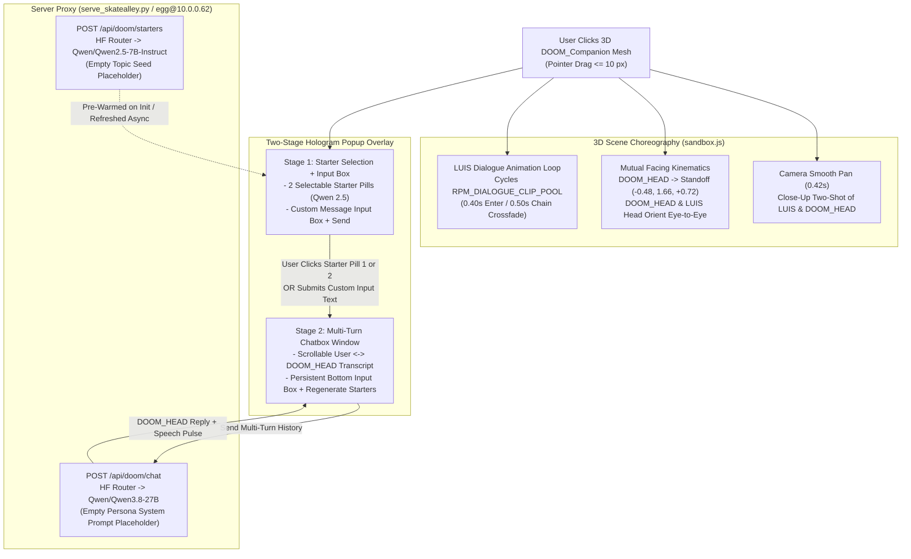

# Functional Specification 041: Interactive `DOOM_HEAD` Companion — Mutual Facing Kinematics, Two-Shot Camera Pan, `LUIS` Talking Choreography, and Two-Stage Hologram Multi-Turn Chatbox via Hugging Face Inference (`Qwen 3.8` & `Qwen 2.5`)

## 1. System Purpose & Core Objective

This specification defines the desired `{functionality}`, 3D raycast and click disambiguation contract, close-up two-shot camera choreography, decoupled mutual-facing kinematics between `LUIS` and `DOOM_HEAD` (`DOOM_Companion`), continuous `LUIS` conversational animation cycling, the custom two-stage holographic popup and multi-turn chatbox UI, the Hugging Face Inference Provider routing architecture (`Qwen 3.8` for `DOOM_HEAD` multi-turn dialogue and `Qwen 2.5` for selectable conversation starters), operational and latency budgets, failure-isolation boundaries, and verifiable `{correct required outputs}` for expanding the Freeman Alley 3D portfolio ([`/Users/diesel/desktop/skatealley/index.html`](file:///Users/diesel/desktop/skatealley/index.html)).

The primary objective is to transform the autonomous levitating `DOOM_HEAD` (`DOOM_Companion`) from a passive visual companion into an interactive conversational entity featuring:

1. **Direct 3D Click Activation on `DOOM_HEAD` (`DOOM_Companion`):** Clicking or tapping the levitating `DOOM_HEAD` mesh in the 3D scene initiates an interactive `DOOM_HEAD` Dialogue Mode.
2. **Up-Close Two-Shot Camera Pan:** Upon clicking `DOOM_HEAD`, the active camera smoothly pans from its current third-person orbit or scroll-walk pose into a close-up two-shot framing both `LUIS` and `DOOM_HEAD` in the 3D viewport while leaving dedicated visual clearance for the holographic chat interface.
3. **Mutual Facing Kinematics (`DOOM_HEAD` & `LUIS` Face Each Other):** Resolving the parent-child transform coupling where `DOOM_Companion` normally sits over `LUIS`'s right shoulder at local equilibrium `(-0.430, 1.862, 0.055)`, entering Dialogue Mode smoothly repositions `DOOM_HEAD` to a conversational standoff point in front-diagonal of `LUIS` and rotates both `DOOM_HEAD` and `LUIS` so they face each other directly while preserving `DOOM_HEAD`'s 6-DOF harmonic levitation.
4. **`LUIS` Conversational Animation Cycling:** While in the interactive `DOOM_HEAD` conversation state, `LUIS` continuously cycles through his standalone Ready Player Me conversational gesture pool (`TALK_EXPLAIN`, `TALK_EMPHASIS`, `TALK_SUBTLE`, `TALK_CONVERSATION_04` through `06`, `ACKNOWLEDGE`, `EXPRESS_NOD`, `EXPRESS_SHRUG`, `EXPRESS_POINT`) using normalized two-action crossfades, and returns cleanly to `IDLE_DEFAULT` upon exit.
5. **Custom Two-Stage Hologram Popup & Multi-Turn Chatbox UI:** Because the existing WebGL `CanvasTexture` callout plane (`MathPodPopupCallout`) cannot natively host interactive text inputs, mobile virtual keyboards, or scrollable multi-turn chat logs without colliding with global scene hotkeys, a dedicated diegetic Hologram Chat Overlay (`holosys_cyan` / `neon_dark_amber` aesthetic) transitions seamlessly between:
   - **Stage 1 (Starter Selection + Input Box):** Displays two clickable conversation starter options (dynamically generated by a smaller Hugging Face model, `Qwen 2.5`) alongside an interactive message input box and send trigger.
   - **Stage 2 (Multi-Turn Chatbox Window):** Clicking either starter option or submitting a custom message transitions the popup into a scrollable multi-turn chatbox window displaying the ongoing conversation between the user and `DOOM_HEAD` (powered by Hugging Face `Qwen 3.8`), while keeping the message input box active for subsequent turns.
6. **Hugging Face Inference Provider Wiring with Empty Persona/Topic Placeholders:** Both `Qwen 3.8` (`Qwen/Qwen3.8-27B` / `Qwen/Qwen3.8-Flash-Next`) and `Qwen 2.5` (`Qwen/Qwen2.5-7B-Instruct` / `Qwen/Qwen2.5-3B-Instruct`) execute remotely via Hugging Face Inference Providers (`https://router.huggingface.co/v1/chat/completions`) proxied through the SkateAlley HTTP service so zero credentials are exposed in client-side static code, and the `DOOM_HEAD` persona/system prompt and starter topic fields remain intentionally empty (`""`) in a top-level configuration contract for later refinement.

**DO NOT CODE YET.** This document specifies functional requirements, mathematical relationships, kinematic state transitions, operational budgets, and observable outcomes only. It contains zero implementation code, concrete syntax, or mechanical diffs.

---

## 2. Authoritative Domain Vocabulary Alignment (`LANGUAGE.md`)

All evaluations of system state, operational constraints, and verification gates within this specification strictly adhere to the authoritative taxonomy established in [`LANGUAGE.md`](file:///Users/diesel/desktop/skatealley/LANGUAGE.md):

- **`{functionality}`**: End-to-end interactive execution of the `DOOM_HEAD` companion dialogue lifecycle across the live Freeman Alley 3D environment: clicking `DOOM_Companion` in 3D space transitions the camera to a close-up two-shot of `LUIS` and `DOOM_HEAD`, re-orients `DOOM_HEAD` and `LUIS` to face each other, drives `LUIS`'s continuous talking animation loop, materializes the custom two-stage hologram UI with two `Qwen 2.5`-generated conversation starters and a live message input box, and transitions into a multi-turn chatbox powered by `Qwen 3.8` via Hugging Face Inference Providers.
- **`{correctness}`**:
  - `DOOM_Companion` and `LUIS` achieve true mutual facing ($\text{dot}(\vec{F}_{\text{Luis}}, \vec{F}_{\text{Doom}}) \le -0.75$ in the horizontal XZ plane, i.e., facing within $\le 41^\circ$ of direct opposition along the line of sight connecting their heads) without parent-child orbital spinning.
  - All keyboard events (`W`, `A`, `S`, `D`, `Space`, `T`, `E`, `H`, `R`, `F`, `C`, `K`, `G`, `L`, `U`, `X`, `0–9`) are strictly isolated when the Hologram Chat input box is focused, preventing accidental character locomotion, jumps, shader toggles, or camera mode breaks while typing a message.
  - Multi-turn chat state maintains ordered `user` and `assistant` message history across turns, dispatching the conversation history to the Hugging Face `Qwen 3.8` inference endpoint while keeping `system` persona and starter topic prompts cleanly configurable and empty (`""`) by default.
  - Exiting `DOOM_HEAD` Dialogue Mode (via the Close button, `Escape` key when not composing, or clicking outside on the 3D canvas) deterministically restores the camera to its prior orbit/scroll pose, returns `DOOM_Companion` to its shoulder levitation anchor `(-0.430, 1.862, 0.055)`, and crossfades `LUIS` back to `IDLE_DEFAULT`.
- **`{correct required outputs}`**:
  1. Clicking the `DOOM_Companion` 3D mesh transitions the sandbox into `doom-chat` focus (`sandbox.isDoomChatOpen === true`), smoothly interpolates the camera over `0.42 s` into the close-up two-shot framing both `LUIS` and `DOOM_HEAD`, moves `DOOM_Companion` to its conversational standoff position facing `LUIS`, rotates `LUIS` toward `DOOM_Companion`, and activates `LUIS`'s talking animation chain (`hoodie.dialogueActive === true`, `hoodie.state === 'Talking'`).
  2. The custom Hologram Chat popup opens in **Stage 1 (`starters`)**, displaying two clickable starter buttons populated by `Qwen 2.5` (`POST /api/doom/starters`) and a focused/focusable text input box with a send button.
  3. Clicking either starter button or submitting text in the input box transitions the Hologram Chat popup into **Stage 2 (`chatbox`)**, appending the user's message to the scrollable multi-turn transcript, dispatching the conversation history to `Qwen 3.8` (`POST /api/doom/chat`), rendering the `DOOM_HEAD` response in the chat transcript, and allowing unlimited follow-up turns.
  4. Runtime telemetry (`window.__SANDBOX__.getDoomChatState()`) exposes observable state including `isOpen`, `stage` (`'dormant' | 'starters' | 'chatbox'`), `facingDotProduct`, `luisDialogueActive`, `luisCurrentClip`, `startersModelId`, `chatModelId`, `personaPrompt` (`""`), `starterTopicPrompt` (`""`), `starters` (2 strings), `messages` (multi-turn array), and `lastInferenceStatus`.
- **`{errors}`**:
  - Rotating `LUIS`'s root node without decoupling or counter-offsetting `DOOM_Companion`'s local anchor, which would orbit `DOOM_Companion` behind `LUIS`'s shoulder and make mutual facing geometrically impossible.
  - Calling `registerSceneAssetPresets(scene)` before `hoodieGLTF.scene` is added to the scene graph, leaving `DOOM_Companion` unbound or missing from the raycast target list.
  - Exposing raw Hugging Face API tokens (`hf_...`) in client-side JavaScript or tracked Git files.
  - Allowing global keyboard hotkeys (`WASD`, `Space`, `H`, `E`, `T`) to fire while the user is typing inside the chat input box.
  - Leaving the UI frozen or silently swallowing upstream Hugging Face HTTP `401`/`429`/`503` errors without actionable diagnostic status in the chat window and telemetry.
- **`{sufficient}`**: Complete mathematical specification of the close-up two-shot camera pose, mutual facing kinematics, `LUIS` dialogue animation chaining, two-stage hologram UI state machine, server-side Hugging Face Inference proxy contract (`Qwen 3.8` + `Qwen 2.5`), empty persona/topic configuration defaults, latency budgets, and verification gates.
- **`{insufficient}`**: Any specification that attempts to render an interactive `<input>` and scrollable multi-turn chat inside a static WebGL `CanvasTexture`, ignores parent-child transform coupling between `LUIS` and `DOOM_Companion`, hardcodes API credentials in the browser, or omits multi-turn history tracking.

---

## 3. First-Principles Physical & Architectural Reality

Empirical inspection of the local workspace (`/Users/diesel/desktop/skatealley`), the Server SSH Mac (`egg@10.0.0.62`), and the Hugging Face Inference Provider router establishes the physical invariants governing this feature:

### 3.1 3D Scene Graph & Parent-Child Kinematic Coupling
1. **Current `DOOM_Companion` Hierarchy:**
   - Inside [`LUIS_HOLOSYS_RIGGED.glb`](file:///Users/diesel/desktop/skatealley/LUIS_HOLOSYS_RIGGED.glb), [`LUIS_RIGGED_CLAY.glb`](file:///Users/diesel/desktop/skatealley/LUIS_RIGGED_CLAY.glb), and [`character_hoodie.glb`](file:///Users/diesel/desktop/skatealley/character_hoodie.glb), `DOOM_Companion` is a 1,277-vertex static mesh node parented directly under `Character_hoodie` (`this.root`).
   - At initialization, `DOOM_Companion`'s geometry bounding-box center is normalized to `(0, 0, 0)` and its local node position is anchored at `DOOM_COMPANION_EQUILIBRIUM = (-0.430, 1.862, 0.055)` in `Character_hoodie`'s local coordinate space (above and to the right of `LUIS`'s right shoulder, since character forward is $+Z$ and character right is $-X$).
   - When the user switches to the `luis_skate3` variant ([`LUIS_SKATE3_RIGGED.glb`](file:///Users/diesel/desktop/skatealley/LUIS_SKATE3_RIGGED.glb)), that GLB contains only the 35-joint Skate 3 mesh (`CharacterMesh`) without an embedded `DOOM_Companion` child node; therefore, the standalone [`DOOM_HEAD_DECIMATED_COMPANION.glb`](file:///Users/diesel/desktop/skatealley/DOOM_HEAD_DECIMATED_COMPANION.glb) (or a cloned companion node from the primary `hoodie` rig) must be attached to `luis_skate3` so `DOOM_HEAD` remains available across all `LUIS` variants.
2. **Geometric Proof of the Mutual-Facing Requirement:**
   - In the default shoulder state `(-0.430, 1.862, 0.055)`, `DOOM_Companion`'s local azimuth relative to `LUIS`'s spine is $\operatorname{atan2}(-0.430, 0.055) = -82.7^\circ$ (nearly perpendicular to `LUIS`'s forward $+Z$ axis), and both `LUIS` and `DOOM_Companion` face $+Z$ ($\text{local yaw} = 0\text{ rad}$).
   - Because `DOOM_Companion` is a child of `Character_hoodie`, rotating `Character_hoodie.rotation.y` orbits `DOOM_Companion` by the identical angle.
   - To make `DOOM_HEAD` and `LUIS` **face each other** in a natural close-up two-shot:
     - `DOOM_Companion`'s local anchor must smoothly translate from the shoulder equilibrium $\vec{A}_{\text{idle}} = (-0.430, 1.862, 0.055)$ to a **conversational standoff anchor** $\vec{A}_{\text{chat}} = (-0.480, 1.660, +0.720)$ in `Character_hoodie` local space (positioned $0.72\text{ m}$ in front and $0.48\text{ m}$ to the right of `LUIS` at eye/head elevation $Y = 1.66\text{ m}$, horizontal distance $d_{XZ} = \sqrt{(-0.480)^2 + 0.720^2} = 0.865\text{ m}$).
     - At $\vec{A}_{\text{chat}}$, `DOOM_Companion`'s local yaw rotates to point directly back toward `LUIS`'s head position $(0.0, 1.660, 0.0)$:
       $$\psi_{\text{Doom,local}} = \operatorname{atan2}\!\big(0.0 - (-0.480), \; 0.0 - 0.720\big) = \operatorname{atan2}(0.480, -0.720) \approx +2.5536\text{ rad} \; (+146.3^\circ)$$
     - Simultaneously, `LUIS`'s upper-body/root yaw (or procedural `Head` / `Neck` / `Spine2` bone yaw Aim adjustment plus subtle root turn) turns toward `DOOM_Companion`'s conversational azimuth:
       $$\psi_{\text{Luis}\to\text{Doom,local}} = \operatorname{atan2}(-0.480, 0.720) \approx -0.5880\text{ rad} \; (-33.7^\circ)$$
     - The resulting angle between `LUIS`'s gaze vector and `DOOM_HEAD`'s forward vector is exactly $180^\circ$ ($\text{dot}(\vec{F}_{\text{Luis,head}}, \vec{F}_{\text{Doom}}) = -1.0$), placing both characters in direct eye-to-eye alignment while allowing a side/three-quarter camera two-shot to see both faces clearly!

### 3.2 Hugging Face Inference Provider Latency & Compute Reality
1. **Hardware Envelope:** Both the local development Mac (`Apple M1`, `8 GB` RAM) and the Server SSH Mac (`egg@10.0.0.62`, `Intel Core i5-8210Y`, `8 GB` RAM) lack the memory headroom to run `Qwen 3.8` (`27B`) and `Qwen 2.5` (`3B`/`7B`) locally alongside WebGL2/Docker services.
2. **Remote Inference Provider Routing:**
   - Hugging Face's OpenAI-compatible router (`https://router.huggingface.co/v1/chat/completions`) provides serverless inference across live providers verified on Hugging Face Hub:
     - **Primary `DOOM_HEAD` Model (`Qwen 3.8`):** `Qwen/Qwen3.8-27B` (live across `cerebras`, `novita`, `deepinfra`, `featherless-ai`, and `ovhcloud`) with configurable fallback to `Qwen/Qwen3.8-Flash-Next` or `Qwen/Qwen3-8B`.
     - **Starter Options Generator Model (`Qwen 2.5`):** `Qwen/Qwen2.5-7B-Instruct` (live on `featherless-ai`) with configurable fallback to `Qwen/Qwen2.5-3B-Instruct` or `Qwen/Qwen2.5-1.5B-Instruct`.
3. **Latency Model & Starter Pre-Warming:**
   - **Camera Pan + Hologram Materialization:** `420 ms` (`0.42 s` cubic ease-out transition).
   - **Cold Starter Generation Roundtrip (`Qwen 2.5`):** `650 ms – 2,200 ms` over HTTPS to `router.huggingface.co`.
   - **Mitigation:** Pre-fetching the initial pair of `Qwen 2.5` conversation starters asynchronously when the scene initializes (or caching them in memory and refreshing asynchronously after a starter is consumed) guarantees that clicking `DOOM_HEAD` renders the two selectable options in **$< 16\text{ ms}$** (zero network wait on click).

---

## 4. End-to-End Architecture & State Machine

---

## 5. Detailed Functional Requirements

### 5.1 3D Raycast & Click Activation on `DOOM_HEAD` (`DOOM_Companion`)
1. **Raycast Target Registration:**
   - Every `DOOM_Companion` mesh instance attached to the active `LUIS` character (and an invisible enlarged spherical hit-proxy collider of radius $r = 0.28\text{ m}$ centered on `DOOM_Companion` so the bobbing head is effortless to click or tap on both desktop and mobile) must be registered as an interactive raycast target with `userData.isDoomCompanion = true`.
   - If the active character is initially `PLATODOOM` (`tunic`) or Solo Mode is off, clicking `DOOM_Companion` on `LUIS` (or activating the `DOOM_HEAD` chat trigger) automatically ensures `LUIS` (`hoodie`) and his `DOOM_Companion` are visible and active for the two-shot.
2. **Hover Feedback:**
   - Hovering the pointer over `DOOM_Companion` sets the viewport cursor to `pointer` (`mount-pointer-hover`), triggers a subtle diegetic hover audio cue, and slightly boosts `DOOM_Companion`'s emissive rim intensity so the user immediately recognizes that `DOOM_HEAD` is clickable.
3. **Click Disambiguation:**
   - A pointer-down followed by pointer-up on `DOOM_Companion` with total screen-space pointer travel $\le 10.0\text{ px}$ (`CLICK_MAX_DRAG_PIXELS`) enters `DOOM_HEAD` Dialogue Mode (`sandbox.enterDoomChatMode()`).
   - If the user is already in `DOOM_HEAD` Dialogue Mode, clicking the Close button (`×`), pressing `Escape` (when the text input is not actively focused, or pressing `Escape` twice to blur then exit), or clicking on the open 3D background outside the Hologram Chat panel exits `DOOM_HEAD` Dialogue Mode (`sandbox.exitDoomChatMode()`).

### 5.2 Up-Close Two-Shot Camera Pan (`LUIS` + `DOOM_HEAD`)
1. **Two-Shot Framing Geometry:**
   - Let $\vec{P}_{\text{LuisHead}}$ be the world-space position of `LUIS`'s head center ($\approx \vec{P}_{\text{LuisRoot}} + (0.0, 1.66, 0.0)$) and $\vec{P}_{\text{DoomChat}}$ be the world-space conversational standoff position of `DOOM_Companion` ($\approx \vec{P}_{\text{LuisRoot}} + \mathbf{R}_y(\psi_{\text{Luis}}) \cdot (-0.48, 1.66, +0.72)$).
   - Let $\vec{M} = \frac{1}{2}(\vec{P}_{\text{LuisHead}} + \vec{P}_{\text{DoomChat}})$ be the world-space midpoint between `LUIS`'s head and `DOOM_HEAD`, and let $\vec{U}_{\text{pair}} = \operatorname{normalize}(\vec{P}_{\text{DoomChat}} - \vec{P}_{\text{LuisHead}})$ be the horizontal unit vector from `LUIS` to `DOOM_HEAD`.
   - Define the camera's horizontal perpendicular viewing normal $\vec{N}_{\text{cam}} = (-U_{\text{pair},z}, \, 0, \, U_{\text{pair},x})$ chosen such that the camera approaches from the open alley corridor side (clamped within the alley wall clearance bounds $[-1.05\text{ m}, +1.05\text{ m}]$) at a close-up distance of $D_{\text{shot}} \in [1.35\text{ m}, 1.65\text{ m}]$ and vertical elevation $Y_{\text{cam}} = M_y - 0.04\text{ m} \approx 1.62\text{ m}$.
   - **Viewport Bias for Hologram UI Clearance:** The camera `lookAt` target is laterally offset by $0.22\text{ m}$ along the camera's right basis vector so `LUIS` and `DOOM_HEAD` occupy the left/center-left half of the viewport in crisp close-up profile/three-quarter framing, while the right half of the viewport remains open for the Hologram Chat window without occluding either face.
2. **Smooth Pan Interpolation:**
   - Entering `DOOM_HEAD` Dialogue Mode records the camera's current world position and `lookAt` target and interpolates to the close-up two-shot over $T_{\text{pan}} = 0.42\text{ s}$ using cubic ease-out ($e(t) = 1 - (1 - t)^3$).
   - Exiting `DOOM_HEAD` Dialogue Mode smoothly interpolates the camera back to the third-person orbit / scroll-walk camera pose over $0.36\text{ s}$.

### 5.3 Mutual Facing Kinematics (`DOOM_HEAD` & `LUIS` Face Each Other)
1. **`DOOM_Companion` Conversational Standoff Interpolation:**
   - Each character instance tracks a normalized dialogue engagement weight $w_{\text{chat}} \in [0.0, 1.0]$ that transitions smoothly toward $1.0$ when `DOOM_HEAD` Dialogue Mode is active and toward $0.0$ when inactive ($\text{rate} \approx 3.2\text{ s}^{-1}$, completing in $\sim 0.32\text{ s}$).
   - `DOOM_Companion`'s base local anchor interpolates between its shoulder equilibrium $\vec{A}_{\text{idle}} = (-0.430, 1.862, 0.055)$ and its front-right conversational standoff $\vec{A}_{\text{chat}} = (-0.480, 1.660, +0.720)$:
     $$\vec{A}(w_{\text{chat}}) = \operatorname{lerp}\!\big(\vec{A}_{\text{idle}}, \, \vec{A}_{\text{chat}}, \, \operatorname{smoothstep}(0, 1, w_{\text{chat}})\big)$$
   - Harmonic levitation offsets $(\Delta x, \Delta y, \Delta z)$ and micro-oscillations $(\Delta \text{pitch}, \Delta \text{roll}, \Delta \text{yaw})$ continue to superimpose onto $\vec{A}(w_{\text{chat}})$. When `DOOM_HEAD` is actively generating or streaming a reply, its vertical bob frequency and subtle jaw/pitch nod amplitude increase by $1.45\times$ to provide visual speaking feedback.
2. **Eye-to-Eye Orientation (`DOOM_HEAD` $\leftrightarrow$ `LUIS`):**
   - `DOOM_Companion`'s base local yaw interpolates from $0.0\text{ rad}$ (facing forward down the alley) to $\psi_{\text{Doom,chat}} = \operatorname{atan2}(0.0 - A_{\text{chat},x}, \, 0.0 - A_{\text{chat},z}) \approx +2.5536\text{ rad}$ so the front face of the `DOOM_HEAD` mask looks directly at `LUIS`'s head.
   - Simultaneously, `LUIS`'s `Head` and `Neck` bones (after `mixer.update(dt)` evaluates the active talking animation clip) apply a damped additive/blended quaternion look-at adjustment weighted by $w_{\text{chat}}$ toward `DOOM_Companion`'s world position ($\approx -33.7^\circ$ yaw, $+4^\circ$ pitch), aligning `LUIS`'s face and gaze directly with `DOOM_HEAD` throughout every talking gesture clip.

### 5.4 `LUIS` Conversational Animation Cycling
1. **Automatic Entry into Dialogue Mode:**
   - Immediately upon clicking `DOOM_HEAD`, `LUIS` halts any planar locomotion (`velocity.set(0, 0, 0)`) and invokes his conversational animation state (`startDialogue()`), transitioning from idle/walk into the `RPM_DIALOGUE_CLIP_POOL` (`TALK_EXPLAIN`, `TALK_EMPHASIS`, `TALK_SUBTLE`, `TALK_CONVERSATION_04`, `TALK_CONVERSATION_05`, `TALK_CONVERSATION_06`, `ACKNOWLEDGE`, `EXPRESS_NOD`, `EXPRESS_SHRUG`, `EXPRESS_POINT`) over `DIALOGUE_ENTER_CROSSFADE = 0.40 s`.
2. **Continuous Non-Repeating Gesture Chaining:**
   - While `DOOM_HEAD` Dialogue Mode remains open, `LUIS` continuously chains conversational clips via `updateDialogueState(dt)` whenever the current clip approaches its remaining crossfade window (`DIALOGUE_CHAIN_CROSSFADE = 0.50 s`), selecting weighted non-repeating clips so `LUIS` never freezes in a static pose or flashes a T-pose.
   - Submitting a new user message or clicking a conversation starter triggers an immediate expressive gesture transition (e.g., `TALK_EXPLAIN` or `TALK_EMPHASIS`) so `LUIS` visibly animates the delivery of the prompt to `DOOM_HEAD`.
3. **Clean Exit Restoration:**
   - When the user closes or exits `DOOM_HEAD` Dialogue Mode, `LUIS` invokes `stopDialogue()`, crossfading cleanly back to `IDLE_DEFAULT` over `DIALOGUE_EXIT_CROSSFADE = 0.45 s` while `w_{\text{chat}}` decays to `0.0`.

---

## 6. Custom Two-Stage Hologram Popup & Multi-Turn Chatbox UI

### 6.1 Visual & Diegetic Styling Contract
1. **Holographic Frame & Palette:**
   - The custom `DOOM_HEAD` Hologram Popup is rendered as a crisp, hardware-accelerated DOM/CSS holographic terminal (`#doom-holo-chat-overlay`) synchronized with a 3D leader-line / reticle tether to `DOOM_Companion`.
   - It uses the `HOLO.SYS Iridescent Cyan` (`#00d5ff` / `#38bdf8` border glow, `#021824` to `#04283b` deep translucent core with `backdrop-filter: blur(12px)`, animated horizontal scanline overlay, corner bracket reticles, and header status badge `DOOM.SYS // NEURAL LINK`).
2. **Header & Controls:**
   - Displays the header badge (`DOOM_HEAD // QWEN-3.8`), live connection/inference status pill (`ONLINE`, `GENERATING...`, or diagnostic status), a **Reset / Back to Starters** button, and a **Close (`×` / `ESC`)** button.

### 6.2 Stage 1: Selectable Conversation Starters + Input Box (`stage = 'starters'`)
When the user clicks `DOOM_HEAD` (or clicks "Reset" inside the popup), the Hologram Popup opens in **Stage 1**:
1. **Two Selectable Conversation Starter Buttons:**
   - Renders two prominent, clickable holographic starter cards (`Starter Option 01` and `Starter Option 02`) generated by the **`Qwen 2.5`** model (`Qwen/Qwen2.5-7B-Instruct` / `Qwen/Qwen2.5-3B-Instruct`).
   - Clicking either starter card immediately selects that text as the user's message, transitions the popup into **Stage 2 (`chatbox`)**, appends the selected starter as the user's turn, and dispatches it to the **`Qwen 3.8`** `DOOM_HEAD` model.
   - Includes a compact **"↻ Refresh Starters"** button allowing the user to request a fresh pair of `Qwen 2.5`-generated options on demand.
2. **Direct Message Input Box:**
   - Beneath the two starter cards, Stage 1 displays an interactive text input row (`<input type="text">` or auto-expanding `<textarea>` with placeholder `"Transmit message to DOOM_HEAD..."` and a `"SEND ↵"` button).
   - Typing a custom message and pressing `Enter` (or clicking `"SEND ↵"`) transitions the popup into **Stage 2 (`chatbox`)** and sends the custom message to `DOOM_HEAD` (`Qwen 3.8`).

### 6.3 Stage 2: Multi-Turn Chatbox Window (`stage = 'chatbox'`)
Once a conversation starter is clicked or a custom message is submitted, the Hologram Popup transitions smoothly into **Stage 2 (`chatbox`)**:
1. **Scrollable Multi-Turn Conversation Transcript:**
   - Displays the chronological list of turns between **`USER // LUIS`** (right-aligned amber/cyan user bubbles) and **`DOOM_HEAD // QWEN-3.8`** (left-aligned holographic terminal bubbles with avatar/badge and streaming or animated typewriter text reveal).
   - Automatically scrolls to the newest message as tokens arrive while allowing the user to scroll up through prior turns using mouse wheel or touch drag (isolated from 3D corridor scrolling).
2. **Persistent Bottom Input Box for Continuous Multi-Turn Dialogue:**
   - The bottom message input box and `"SEND ↵"` button remain docked at the bottom of the Stage 2 chatbox so the user can continue a multi-turn conversation indefinitely.
   - Each subsequent turn sends the full conversation history (`messages: [{ role: 'user', content: ... }, { role: 'assistant', content: ... }, ...]`) to the `Qwen 3.8` endpoint so `DOOM_HEAD` maintains multi-turn context.

### 6.4 Strict Input & Hotkey Isolation
1. **Pointer Event Isolation:** Clicking, dragging, or scrolling inside `#doom-holo-chat-overlay` stops event propagation to the 3D canvas so interacting with the chatbox never triggers camera orbit drags, corridor scrolling, or unintended background raycasts.
2. **Keyboard Event Isolation:** While the chat input box is focused, all single-key sandbox shortcuts (`W`, `A`, `S`, `D`, `Space`, `T`, `E`, `H`, `R`, `F`, `C`, `K`, `G`, `L`, `U`, `X`, `B`, `0–9`) are suppressed; `Enter` submits the active message, and `Escape` blurs the input or closes the chat modal.

---

## 7. Hugging Face Inference Provider Architecture & Empty Persona/Topic Contract

### 7.1 Declarative Model & Empty Prompt Configuration Contract
Per explicit user direction (*"For now, keep the doom head persona and starter topics empty, we will refine this later"*), both client and server expose a single, authoritative configuration structure with the following defaults:

| Parameter | Default Value | Purpose |
| :--- | :--- | :--- |
| `chatModelId` | `"Qwen/Qwen3.8-27B"` | Primary Hugging Face model for `DOOM_HEAD` multi-turn chat (with automatic fallback to `"Qwen/Qwen3.8-Flash-Next"` and `"Qwen/Qwen3-8B"`). |
| `startersModelId` | `"Qwen/Qwen2.5-7B-Instruct"` | Smaller Hugging Face model for generating the 2 selectable starter options (with fallback to `"Qwen/Qwen2.5-3B-Instruct"`). |
| `doomPersonaPrompt` | `""` *(empty string)* | Placeholder for `DOOM_HEAD`'s system persona prompt. When `""`, no custom persona system message is injected (or only a minimal neutral assistant role is used) until refined later. |
| `starterTopicPrompt` | `""` *(empty string)* | Placeholder for the starter generator topic seed. When `""`, `Qwen 2.5` is asked only for the structural output format (two short, engaging conversation starter questions in JSON array format `["...", "..."]`) with zero hardcoded topic bias. |

### 7.2 Server-Side Hugging Face Inference Proxy (`serve_skatealley.py`)
To protect credentials across local development and the public Server SSH Mac deployment (`egg@10.0.0.62` / `tunnel.json`), [`/Users/diesel/desktop/skatealley/scripts/serve_skatealley.py`](file:///Users/diesel/desktop/skatealley/scripts/serve_skatealley.py) is extended with two JSON `POST` endpoints with full CORS support (`Access-Control-Allow-Origin: *`, `Access-Control-Allow-Methods: GET, HEAD, POST, OPTIONS`):

1. **Credential Resolution Chain:**
   - The server resolves the Hugging Face token from environment variables (`HF_TOKEN` or `HUGGINGFACE_HUB_TOKEN`), a local `.env` file in the repository root (`/Users/diesel/desktop/skatealley/.env`, excluded via `.gitignore`), or `~/.cache/huggingface/token`.
2. **Endpoint 1 — `POST /api/doom/starters` (`Qwen 2.5` Option Generator):**
   - **Request Body:** `{ "model": "Qwen/Qwen2.5-7B-Instruct", "topicPrompt": "", "count": 2 }`
   - **Upstream Call:** Dispatches a chat completion request to `https://router.huggingface.co/v1/chat/completions` using `Qwen/Qwen2.5-7B-Instruct` (temperature `0.8`, `max_tokens: 120`) requesting exactly 2 concise conversation starter prompts (`<= 80` characters each).
   - **Response Body:** `{ "ok": true, "model": "Qwen/Qwen2.5-7B-Instruct", "starters": ["Starter 1...", "Starter 2..."], "topicPrompt": "" }`
3. **Endpoint 2 — `POST /api/doom/chat` (`Qwen 3.8` Multi-Turn Chat):**
   - **Request Body:** `{ "model": "Qwen/Qwen3.8-27B", "personaPrompt": "", "messages": [{ "role": "user", "content": "..." }, ...] }`
   - **Upstream Call:** Prepends `{ "role": "system", "content": personaPrompt }` **only** if `personaPrompt` is non-empty, and dispatches the multi-turn `messages` array to `https://router.huggingface.co/v1/chat/completions` (`max_tokens: 320`, temperature `0.7`). If `Qwen/Qwen3.8-27B` returns a provider capacity error (`503`/`429`), the proxy bounded-retries once against `Qwen/Qwen3.8-Flash-Next` / `Qwen/Qwen3-8B`.
   - **Response Body:** `{ "ok": true, "model": "Qwen/Qwen3.8-27B", "reply": "...", "usage": { ... } }`
4. **Endpoint Discovery from Client:**
   - The browser resolves the proxy base URL using the same origin if served by `serve_skatealley.py`, or via the discovered `tunnel.json` HTTPS endpoint when loaded from GitHub Static Pages.

---

## 8. Operational Budgets, Edge Cases & Failure-Isolation Boundaries

| Metric / Operational Constraint | Target Budget | Failure-Isolation / Remediation Boundary |
| :--- | :--- | :--- |
| **3D Click-to-Popup Ignition Latency** | $\le 16.6\text{ ms}$ (1 frame at 60 FPS) | Starter options are pre-warmed asynchronously at scene initialization so Stage 1 opens instantaneously on click without blocking on network I/O. |
| **Camera Two-Shot Pan & Facing Transition** | $0.42\text{ s}$ pan / $0.32\text{ s}$ standoff | Uses allocation-free pre-allocated vectors in the 60 FPS loop (`stepSimulation`); zero frame drops below 55 FPS. |
| **Upstream HF Inference Timeout** | $12.0\text{ s}$ hard timeout per turn | Requests exceeding $12.0\text{ s}$ abort cleanly via `AbortController` and surface an explicit diagnostic status in the chatbox (`[HF_INFERENCE_TIMEOUT]`) with a one-click Retry button. |
| **Missing / Unconfigured `HF_TOKEN`** | Immediate HTTP `503` with diagnostic code | If `HF_TOKEN` is absent on the server, `/api/doom/starters` and `/api/doom/chat` return `{ "ok": false, "error": "MISSING_HF_TOKEN", "message": "..." }` so the UI displays a clear diagnostic banner while still allowing full verification of the Stage 1 $\to$ Stage 2 UI transition, camera pan, mutual facing, and `LUIS` talking animations. |
| **Character Variant Switching (`luis_holo`, `luis_clay`, `luis_color`, `luis_skate3`)** | $100\%$ companion availability | Switching character variants preserves or re-attaches `DOOM_Companion` so clicking `DOOM_HEAD` works identically across all `LUIS` variants. |

---

## 9. Verifiable `{correct required outputs}` & Acceptance Criteria

1. **Click & Two-Shot Camera Verification:** Clicking `DOOM_Companion` sets `sandbox.isDoomChatOpen === true`, transitions the camera to the close-up two-shot framing both `LUIS` and `DOOM_HEAD` within the viewport, and shifts `DOOM_Companion` to its conversational standoff anchor `(-0.480, 1.660, +0.720)`.
2. **Mutual Facing Verification:** In `DOOM_HEAD` Dialogue Mode, the horizontal dot product between `LUIS`'s head forward vector and `DOOM_Companion`'s forward vector satisfies $\text{dot}(\vec{F}_{\text{LuisHead}}, \vec{F}_{\text{Doom}}) \le -0.75$ (facing each other within $\le 41^\circ$ of exact opposition, targeting $-1.0$).
3. **`LUIS` Talking Animation Loop Verification:** While `DOOM_HEAD` Dialogue Mode is open, `hoodie.dialogueActive === true`, `hoodie.state === 'Talking'`, and `hoodie.currentClipName` actively cycles through clips in `RPM_DIALOGUE_CLIP_POOL` with smooth crossfades.
4. **Stage 1 $\to$ Stage 2 Hologram Chatbox Verification:**
   - Stage 1 displays 2 clickable conversation starter options (`Qwen 2.5`) and the message input box.
   - Clicking a starter option or submitting text in the input box transitions the popup to Stage 2 (`stage === 'chatbox'`), renders the multi-turn conversation history, dispatches the turn to `/api/doom/chat` (`Qwen 3.8`), and appends `DOOM_HEAD`'s response.
5. **Empty Persona & Topic Verification:** `sandbox.getDoomChatState()` confirms `personaPrompt === ""` and `starterTopicPrompt === ""` by default, `startersModelId` targets `Qwen 2.5`, and `chatModelId` targets `Qwen 3.8`.
