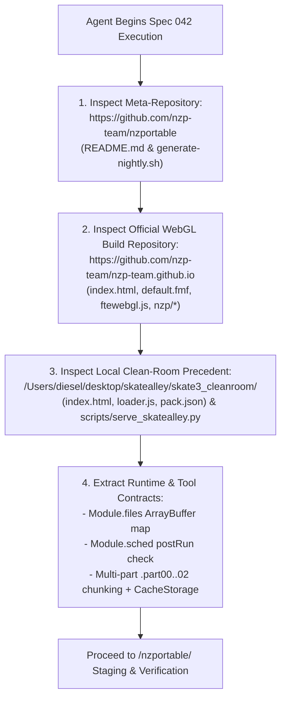

# Functional Specification 042: Standalone Playable WebAssembly/WebGL Web Application for Nazi Zombies: Portable (`/nzportable/`)

## 1. System Purpose & Core Objective

This specification defines the desired `{functionality}`, mandatory upstream GitHub repository analysis protocol, required tool inventory, asset acquisition and multi-part chunking contracts, standalone FTEQW Emscripten WebAssembly/WebGL runtime architecture, unified HTTP and byte-range hosting requirements, operational and performance budgets, failure-isolation boundaries, and verifiable `{correct required outputs}` for deploying **Nazi Zombies: Portable (`nzportable`)** as a **standalone, full-screen playable web application** mounted at `/nzportable/` within the SkateAlley workspace (`/Users/diesel/desktop/skatealley/nzportable/`).

### Architectural Invariant: Strict Native Engine Execution (Zero Three.js Porting)
Nazi Zombies: Portable **MUST** execute its native compiled C/QuakeC $\rightarrow$ Emscripten WebAssembly engine (`ftewebgl.wasm` + `ftewebgl.js`, powered by the FTEQW sourceport from `https://github.com/nzp-team/nzportable` and `https://github.com/nzp-team/nzp-team.github.io`) inside its own dedicated, isolated HTML5 `<canvas>` web application route (`/nzportable/`), following the exact architectural precedent established by the Skate 3 clean-room webapp ([`/Users/diesel/desktop/skatealley/skate3_cleanroom/`](file:///Users/diesel/desktop/skatealley/skate3_cleanroom/index.html)). Under no circumstances may a coding assistant attempt to parse, convert, or port `.pk3`, `.bsp`, `.mdl`, or QuakeC `.dat` game files into the Three.js Freeman Alley scene ([`/Users/diesel/desktop/skatealley/index.html`](file:///Users/diesel/desktop/skatealley/index.html) / [`/Users/diesel/desktop/skatealley/sandbox.js`](file:///Users/diesel/desktop/skatealley/sandbox.js)).

**DO NOT CODE YET.** This document specifies functional requirements, upstream repository inspection mandates, physical payload models, state transitions, operational budgets, and observable outcomes only. It contains zero implementation code, concrete syntax, or mechanical diffs.

---

## 2. Authoritative Domain Vocabulary Alignment ([`LANGUAGE.md`](file:///Users/diesel/desktop/skatealley/LANGUAGE.md))

All evaluations of system state, operational constraints, and verification gates within this specification strictly adhere to the authoritative taxonomy established in [`LANGUAGE.md`](file:///Users/diesel/desktop/skatealley/LANGUAGE.md):

- **`{functionality}`**: End-to-end standalone browser execution of **Nazi Zombies: Portable** at `/nzportable/` using its native FTEQW Emscripten WebAssembly/WebGL engine (`ftewebgl.wasm`), complete with persistent browser `CacheStorage` caching (`nzportable-pack-v1`), multi-part chunk fallback (`.part00`..`.part02`) for GitHub Static Pages compatibility, unlocked Web Audio playback on user gesture, PointerLock mouse/keyboard and gamepad input handling, full-screen controls, return navigation to the Freeman Alley 3D Portfolio (`../`), and unified serving via [`/Users/diesel/desktop/skatealley/scripts/serve_skatealley.py`](file:///Users/diesel/desktop/skatealley/scripts/serve_skatealley.py) (both locally and on the Server SSH Mac `egg@10.0.0.62`).
- **`{correctness}`**:
  - Complete runtime and DOM isolation between the Freeman Alley Three.js portfolio (`/`) and the standalone `/nzportable/` WebAssembly application.
  - Deterministic pre-population of the Emscripten in-memory virtual filesystem (`Module.files["default.fmf"]`, `Module.files["nzp/progs.pk3"]`, and `Module.files["nzp/game.pk3"]`) as resolved `ArrayBuffer` instances prior to executing `ftewebgl.js`, bypassing the raw debug `#dropzone` file-picker UI and preventing redundant network re-downloads on page refresh.
  - Exact byte-length parity across all staged NZ:P runtime artifacts (`default.fmf` = `96 B`, `nzp/progs.pk3` = `491,379 B`, `nzp/game.pk3` = `94,276,834 B`, `ftewebgl.js` = `165,608 B`, `ftewebgl.wasm` = `5,178,106 B`).
  - Strict compliance with GitHub's `50–100 MiB` per-file repository limit by excluding the raw `94.28 MB` `nzp/game.pk3` file from Git tracking via [`.gitignore`](file:///Users/diesel/desktop/skatealley/.gitignore) while tracking deterministic $\le 35\text{ MB}$ split chunks (`/nzportable/parts/game.pk3.part00`, `.part01`, `.part02`) described by `/nzportable/pack.json`.
- **`{correct required outputs}`**:
  1. **Playable `/nzportable/` WebApp**: Navigating to `/nzportable/` serves a dedicated dark-themed HTML5 shell with a click-to-launch splash screen (unlocking Web Audio), loads and caches `default.fmf` (`96 B`), `nzp/progs.pk3` (`491,379 B`), `nzp/game.pk3` (`94,276,834 B`), `ftewebgl.js` (`165,608 B`), and `ftewebgl.wasm` (`5,178,106 B`) with `HTTP 200 OK`, initializes the FTEQW main scheduler loop (`Module["sched"] !== undefined`), renders the interactive Nazi Zombies: Portable title screen and playable maps (e.g., *Nacht der Untoten*) at 60 FPS on `#canvas`, and provides a non-intrusive HUD bar with `Fullscreen` and `← 3D Portfolio (Alley)` controls.
  2. **Deterministic Telemetry Contract**: Runtime state is exposed on `window.__NZP_STATUS__` (`{ initialized, engineReady, gamePk3Bytes, progsPk3Bytes, fmfBytes, wasmLoaded, cacheHit, fps, errors }`) with `engineReady === true`, `gamePk3Bytes === 94276834`, `progsPk3Bytes === 491379`, and `errors.length === 0`.
  3. **Unified Server & Health Telemetry**: [`/Users/diesel/desktop/skatealley/scripts/serve_skatealley.py`](file:///Users/diesel/desktop/skatealley/scripts/serve_skatealley.py) serves `/nzportable/` with proper MIME types (`application/wasm`, `application/octet-stream`), CORS headers, and HTTP `206 Partial Content` range requests, reporting `"nzportable_webapp": true` in `/api/health`.
- **`{errors}`**:
  - Attempting to load or recreate NZ:P maps/models inside the Three.js scene graph (`sandbox.js`).
  - Leaving `/nzportable/` stuck on the stock `nzp-team.github.io` debug file-dropper (`#dropzone` / `showfiles()`) or failing to populate `Module.files` with `ArrayBuffer` instances before `ftewebgl.js` executes.
  - Failing to unlock browser `AudioContext` / `webkitAudioContext` instances on the user's launch gesture, resulting in silent gameplay.
  - Committing the unsplit `94.28 MB` `nzp/game.pk3` binary directly to Git without `.gitignore` protection and $\le 35\text{ MB}$ `.partNN` chunking.
- **`{sufficient}`**: Complete specification of the upstream GitHub repository inspection protocol, required tools, exact artifact byte sizes, `Module.files` pre-loading and `CacheStorage` reassembly architecture, HUD and telemetry contracts, and end-to-end verification criteria.
- **`{insufficient}`**: Any specification or implementation that skips analyzing `nzp-team/nzportable` and `nzp-team/nzp-team.github.io`, relies on manual drag-and-drop file loading, omits `CacheStorage` caching, or attempts to port NZ:P into Three.js.

---

## 3. Mandatory Upstream GitHub Repository Inspection & Tool Analysis Protocol

Before downloading assets, creating directories, or writing any code, **the coding assistant working on this task MUST first inspect and analyze the upstream GitHub repositories and local clean-room precedents** detailed below. Doing so provides the exact Emscripten `Module` contract and asset layout, saving significant implementation and debugging time.

### 3.1 Step 1: Analyze `https://github.com/nzp-team/nzportable`
1. Fetch and read `README.md` and `generate-nightly.sh` from `nzp-team/nzportable` (via `curl -s https://raw.githubusercontent.com/nzp-team/nzportable/main/README.md` and `generate-nightly.sh`).
2. Verify how NZ:P separates its architecture across three components:
   - **Engine**: FTEQW (`nzp-team/fteqw`) for WebGL (`https://nzp.gay`), and `vril-engine` for console/desktop targets.
   - **QuakeC Game Logic**: `standard-nzp-qc.zip` / `nzp/progs.pk3` containing compiled QuakeC bytecode (`progs.dat`, HUD, weapons, perks, barricade repair, mystery box, and zombie AI).
   - **Game Assets**: `pc-nzp-assets.zip` / `nzp/game.pk3` containing maps (`ndu.bsp` / *Nacht der Untoten*, etc.), textures, sounds, and models.
3. Confirm that `README.md` designates `https://github.com/nzp-team/nzp-team.github.io` as the authoritative repository hosting the compiled WebGL/WASM build.

### 3.2 Step 2: Analyze `https://github.com/nzp-team/nzp-team.github.io`
1. Query the repository contents (`curl -s https://api.github.com/repos/nzp-team/nzp-team.github.io/contents` and `contents/nzp`) and read `index.html` and `default.fmf`.
2. Verify the exact Emscripten `Module` contract expected by `ftewebgl.js`:
   - **`Module.files` Dictionary**: Maps virtual filesystem paths (`"default.fmf"`, `"nzp/game.pk3"`, `"nzp/progs.pk3"`) directly to `ArrayBuffer` instances (or URL strings). When `Module.files[path]` is pre-populated with an `ArrayBuffer` before `ftewebgl.js` loads, `ftewebgl.js` mounts those buffers directly into Emscripten's in-memory filesystem (MEMFS) without issuing redundant internal XHR downloads.
   - **`default.fmf` Manifest (`96 B`)**: Configures FTEQW with:
     - `game nzp`
     - `name "Nazi Zombies Portable"`
     - `basegame nzp`
     - `mainconfig "nzportable.cfg"`
     - `disablehomedir 1`
   - **`Module.canvas`**: Binds to `document.getElementById('canvas')` (must have `border: 0px none; width: 100%; height: 100%; padding: 0; margin: 0;` so Emscripten mouse/PointerLock coordinates remain 1:1 calibrated).
   - **`Module.setStatus(text)` & `Module.monitorRunDependencies(left)`**: Receive startup progress notifications matching `/([^(]+)\((\d+(\.\d+)?)\/(\d+)\)/` and dependency countdowns until `left === 0`.
   - **`Module.postRun` Verification Hook**: Checks `Module["sched"] !== undefined` after `main()` executes to confirm that the FTEQW main loop initialized cleanly.

### 3.3 Step 3: Analyze Local Workspace Precedents
1. Inspect [`/Users/diesel/desktop/skatealley/skate3_cleanroom/index.html`](file:///Users/diesel/desktop/skatealley/skate3_cleanroom/index.html), [`/Users/diesel/desktop/skatealley/skate3_cleanroom/loader.js`](file:///Users/diesel/desktop/skatealley/skate3_cleanroom/loader.js), and [`/Users/diesel/desktop/skatealley/skate3_cleanroom/pack.json`](file:///Users/diesel/desktop/skatealley/skate3_cleanroom/pack.json) to mirror:
   - The `AudioContext` / `webkitAudioContext` proxy tracker that captures every audio context created by the WASM engine and resumes them on the user's launch click/key/touch gesture.
   - The `CacheStorage` + multi-part `.partNN` chunk loader pattern (`fetchPack` / `fetchParts`) and `tunnel.json` remote origin fallback.
   - The splash screen aesthetic and bottom-right `#mapbar` HUD (`← 3D Portfolio (Alley)` button + `Fullscreen` button).
2. Inspect [`/Users/diesel/desktop/skatealley/scripts/serve_skatealley.py`](file:///Users/diesel/desktop/skatealley/scripts/serve_skatealley.py) to see how static directories, byte-range requests (`HTTP 206`), `.wasm` MIME types, and `/api/health` checks are implemented.

### 3.4 Required Tools Inventory
The coding assistant must use the following verified tools available in the workspace:
- **Acquisition (`curl`)**: Download `ftewebgl.wasm`, `ftewebgl.js`, `default.fmf`, `nzp/progs.pk3`, and `nzp/game.pk3` directly from `https://raw.githubusercontent.com/nzp-team/nzp-team.github.io/main/...` using `curl -L --fail --retry 3`.
- **Chunking & Manifest Generation (`python3`)**: Split `/nzportable/nzp/game.pk3` (`94,276,834` bytes) into 3 deterministic chunks of $\le 35\text{ MB}$ (`36,700,160` bytes max per part) inside `/nzportable/parts/game.pk3.part00`, `.part01`, `.part02`, and generate `/nzportable/pack.json` recording exact byte sizes and SHA-256 digests.
- **HTTP Server ([`scripts/serve_skatealley.py`](file:///Users/diesel/desktop/skatealley/scripts/serve_skatealley.py))**: Serve `/nzportable/` locally and on `egg@10.0.0.62`.
- **Browser Verification (`playwright` MCP)**: Launch headless/headed Chromium with WebGL and Web Audio enabled, click the `/nzportable/` splash screen, verify `HTTP 200 OK` asset loads, confirm `window.__NZP_STATUS__.engineReady === true` and `Module.sched !== undefined`, and capture a visual screenshot of the running NZ:P title screen/gameplay.

---

## 4. First-Principles Physical Reality & Empirical Payload Model

Read-only HTTP probes against `https://raw.githubusercontent.com/nzp-team/nzp-team.github.io/main/` establish the exact byte-level budget for `/nzportable/`:

| File Path in `/nzportable/` | Exact Byte Size | Size (`MiB`) | Verified Upstream URL (`HTTP 200 OK`) | Git Tracking & Delivery Policy |
| :--- | :---: | :---: | :--- | :--- |
| `default.fmf` | `96 B` | `< 0.01 MiB` | `https://raw.githubusercontent.com/nzp-team/nzp-team.github.io/main/default.fmf` | Tracked directly in Git. |
| `ftewebgl.js` | `165,608 B` | `0.16 MiB` | `https://raw.githubusercontent.com/nzp-team/nzp-team.github.io/main/ftewebgl.js` | Tracked directly in Git. |
| `ftewebgl.wasm` | `5,178,106 B` | `4.94 MiB` | `https://raw.githubusercontent.com/nzp-team/nzp-team.github.io/main/ftewebgl.wasm` | Tracked directly in Git (`< 45 MB`). |
| `nzp/progs.pk3` | `491,379 B` | `0.47 MiB` | `https://raw.githubusercontent.com/nzp-team/nzp-team.github.io/main/nzp/progs.pk3` | Tracked directly in Git (`< 45 MB`). |
| `nzp/game.pk3` | `94,276,834 B` | `89.91 MiB` | `https://raw.githubusercontent.com/nzp-team/nzp-team.github.io/main/nzp/game.pk3` | Kept on local disk & `egg@10.0.0.62` for fast single-stream serving, **excluded from Git via `.gitignore`**, and split into 3 tracked chunks (`parts/game.pk3.part00..02`, each $\le 35\text{ MB}$). |
| `parts/game.pk3.part00..02` | `94,276,834 B` total (`3 × ~31.4 MB`) | `89.91 MiB` total | Generated deterministically from `nzp/game.pk3` | Tracked in Git so GitHub Static Pages (`luisp1028.github.io/SkateAlley/nzportable/`) works with zero single files $> 35\text{ MB}$. |

---

## 5. Detailed Functional Requirements for `/nzportable/`

### 5.1 Complete Directory & File Layout (`/Users/diesel/desktop/skatealley/nzportable/`)
1. `/nzportable/index.html` — Full-viewport dark HTML5 shell containing:
   - `<canvas class="emscripten" id="canvas" oncontextmenu="event.preventDefault()" tabindex="0"></canvas>` styled with `border: 0px none; width: 100%; height: 100%; padding: 0; margin: 0; display: block;` so FTEQW mouse coordinates remain exact.
   - `#splash` — Click-to-begin splash screen displaying the **Nazi Zombies: Portable** logo/header, credit to `nzp-team` (`FTEQW WebGL Clean-Room Build`), keybindings summary (`WASD` Move · `Mouse` Aim/Fire · `R` Reload · `F` Interact/Buy · `Shift` Sprint · `C` Crouch · `Esc` Menu), and a **"Click or Press Any Key to Launch"** prompt.
   - `#overlay` — Loading progress panel displaying `#status` text, a smooth `#progress` bar (`0%–100%`), MB downloaded counter, and a `← Return to 3D Alley Portfolio` fallback link (`href="../"`).
   - `#hudbar` — Compact, non-intrusive bottom-right overlay bar (matching [`skate3_cleanroom/index.html`](file:///Users/diesel/desktop/skatealley/skate3_cleanroom/index.html)) containing:
     - `← 3D Portfolio (Alley)` button (`onclick="window.location.assign('../')"`).
     - `Fullscreen` toggle button (`#fullscreen`).
2. `/nzportable/pack.json` — JSON manifest specifying the exact byte sizes and paths/parts for `default.fmf` (`96`), `nzp/progs.pk3` (`491379`), `nzp/game.pk3` (`94276834`, with `url: "./nzp/game.pk3"` and `parts: ["./parts/game.pk3.part00", "./parts/game.pk3.part01", "./parts/game.pk3.part02"]`), and `ftewebgl.wasm` (`5178106`).
3. `/nzportable/loader.js` — Standalone ES module orchestrating audio unlock, `CacheStorage` persistence, multi-part fallback, `Module` configuration, and telemetry.

### 5.2 Startup State Machine & `loader.js` Execution Contract
1. **Web Audio Auto-Unlock Proxy:**
   - Before `ftewebgl.js` is loaded, `loader.js` wraps `window.AudioContext` and `window.webkitAudioContext` in a `Proxy` that records every audio context instantiated by Emscripten and resumes any suspended context on `pointerdown`, `pointerup`, `touchend`, `click`, or `keydown`.
2. **Splash Gate $\rightarrow$ Asset Resolution & `CacheStorage` (`nzportable-pack-v1`):**
   - When the user clicks `#splash` or presses any key (or immediately upon load if `?autostart=1` is present in the URL query string for automated testing), `#splash` hides and `#overlay` appears.
   - `loader.js` opens `caches.open('nzportable-pack-v1')` and resolves the three virtual FS files (`default.fmf`, `nzp/progs.pk3`, `nzp/game.pk3`):
     - **Cache Hit**: If a cached `Response` exists in `nzportable-pack-v1` whose `byteLength` matches the exact expected byte count in `pack.json`, it is read into an `ArrayBuffer` in $< 200\text{ ms}$.
     - **Cache Miss**: `loader.js` streams `./nzp/game.pk3` (or, if `./nzp/game.pk3` returns `404` on a static host, streams and concatenates `./parts/game.pk3.part00..02`, or falls back to the active Server Mac origin from `../tunnel.json`), updating `#progress` and `#status` (`Downloading game.pk3 (XX.X / 94.3 MB)...`), verifies `byteLength === 94276834`, stores the complete `ArrayBuffer` in `nzportable-pack-v1`, and assigns it to `Module.files["nzp/game.pk3"]`.
3. **FTEQW Engine Boot & Overlay Dismissal:**
   - Once `Module.files["default.fmf"]`, `Module.files["nzp/progs.pk3"]`, and `Module.files["nzp/game.pk3"]` are populated with their `ArrayBuffer` instances, `loader.js` configures `window.Module` (`canvas`, `files`, `print`, `printErr`, `setStatus`, `monitorRunDependencies`, `postRun`) and appends ``.
   - When `Module.postRun` fires and confirms `Module["sched"] !== undefined` (or when `monitorRunDependencies(0)` completes and the first WebGL frames render), `#overlay` hides, `#canvas` receives focus, `#hudbar` becomes visible, and `window.__NZP_STATUS__.engineReady` transitions to `true`.

---

## 6. Unified HTTP Server Contract ([`scripts/serve_skatealley.py`](file:///Users/diesel/desktop/skatealley/scripts/serve_skatealley.py)) & Optional Portfolio Link

1. **MIME Type & Directory Routing in `serve_skatealley.py`:**
   - Ensure `.pk3`, `.fmf`, and `.part00`..`.part99` are registered in `EXTRA_MIME_TYPES` as `application/octet-stream` and `.wasm` as `application/wasm`.
   - Update `/api/health` in [`scripts/serve_skatealley.py`](file:///Users/diesel/desktop/skatealley/scripts/serve_skatealley.py) to verify the existence of `/nzportable/index.html`, `/nzportable/ftewebgl.wasm`, and `/nzportable/nzp/progs.pk3`, reporting `"nzportable_webapp"` in the `services` list.
2. **Optional Launcher Link in Freeman Alley HUD (`index.html`):**
   - Add a clean launcher link/button in the Freeman Alley HUD sidebar (`index.html`) pointing to `./nzportable/` (`NZ: Portable (Zombies)`), allowing one-click navigation from the 3D portfolio to the standalone webapp.

---

## 7. Operational Budgets, Edge Cases & Failure-Isolation Boundaries

| Operational Parameter | Target Budget | Failure-Isolation & Recovery Boundary |
| :--- | :--- | :--- |
| **Cold Load Time (Local / Server Mac)** | $\le 3.5\text{ s}$ from click to FTEQW title screen | Streams `94.3 MB` locally at loopback/LAN speed and caches in `CacheStorage`. |
| **Warm Load Time (`CacheStorage` Hit)** | $\le 1.2\text{ s}$ from click to FTEQW title screen | Reads `94.3 MB` directly from `nzportable-pack-v1` without network I/O. |
| **Static Host / GitHub Pages Fallback** | `100%` boot parity when raw `nzp/game.pk3` is absent | Automatically reassembles `parts/game.pk3.part00..02` (`3 × ~31.4 MB`) when `nzp/game.pk3` returns `HTTP 404`. |
| **Git Single-File Size Ceiling** | $\le 35\text{ MB}$ per tracked file | `nzportable/nzp/game.pk3` is added to `.gitignore`; only `parts/game.pk3.part00..02` (`~31.4 MB` each) and `< 6 MB` engine files are tracked. |
| **Mouse Coordinate Calibration** | `0 px` border/padding offset on `#canvas` | `#canvas` occupies `100% × 100%` with `border: 0; padding: 0; margin: 0;` so FTEQW menu clicks and PointerLock aim align 1:1. |

---

## 8. Verifiable `{correct required outputs}` & Acceptance Criteria

1. **Asset & Chunk Integrity:**
   - `/nzportable/ftewebgl.wasm` (`5,178,106 B`), `/nzportable/ftewebgl.js` (`165,608 B`), `/nzportable/default.fmf` (`96 B`), `/nzportable/nzp/progs.pk3` (`491,379 B`), and `/nzportable/nzp/game.pk3` (`94,276,834 B`) exist on disk with exact byte parity, alongside `/nzportable/parts/game.pk3.part00..02` ($\le 35\text{ MB}$ each) and `/nzportable/pack.json`.
2. **Live Playwright Browser Verification (`/nzportable/`):**
   - Visiting `http://localhost:3002/nzportable/` (or `?autostart=1`) loads with `HTTP 200 OK` on all requests and zero `404` or console errors.
   - Launching the game populates `Module.files`, initializes `ftewebgl.wasm`, sets `window.Module.sched !== undefined` and `window.__NZP_STATUS__.engineReady === true`, hides `#overlay`, and renders non-black WebGL frames of the Nazi Zombies: Portable title screen / gameplay on `#canvas` at $\ge 55\text{ FPS}$.
3. **Git Hygiene:**
   - `git status` confirms `nzportable/nzp/game.pk3` is ignored by Git and zero tracked files in the repository exceed `45 MB`.
