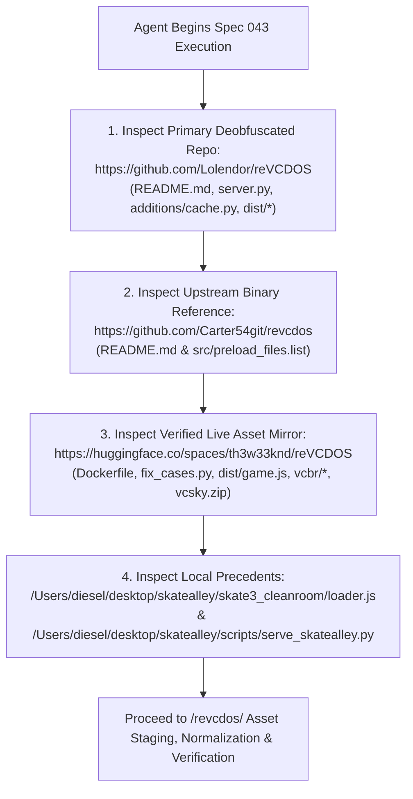

# Functional Specification 043: Standalone Playable WebAssembly/WebGL2 Web Application for GTA: Vice City (`/revcdos/`)

## 1. System Purpose & Core Objective

This specification defines the desired `{functionality}`, mandatory upstream GitHub repository analysis protocol, required tool inventory, dead-CDN root-cause remediations, startup `.data` chunking and `CacheStorage` contracts, lowercase on-demand asset normalization (`vcsky/fetched/`), standalone `reVC` Emscripten WebAssembly/WebGL2 runtime architecture, unified HTTP and byte-range hosting requirements, operational and performance budgets, failure-isolation boundaries, and verifiable `{correct required outputs}` for deploying **GTA: Vice City (`reVCDOS`)** as a **standalone, full-screen playable web application** mounted at `/revcdos/` within the SkateAlley workspace (`/Users/diesel/desktop/skatealley/revcdos/`).

### Architectural Invariant: Strict Native Engine Execution (Zero Three.js Porting)
GTA: Vice City (`reVCDOS`) **MUST** execute its native compiled C++ $\rightarrow$ Emscripten WebAssembly engine (`vc-sky-en-v6.wasm` + `vc-sky-en-v6.data` + modular runtime `modules/*.js`, derived from `https://github.com/Lolendor/reVCDOS`, `https://github.com/Carter54git/revcdos`, and `https://huggingface.co/spaces/th3w33knd/reVCDOS`) inside its own dedicated, isolated HTML5 `<canvas>` web application route (`/revcdos/`), following the exact architectural precedent established by the Skate 3 clean-room webapp ([`/Users/diesel/desktop/skatealley/skate3_cleanroom/`](file:///Users/diesel/desktop/skatealley/skate3_cleanroom/index.html)). Under no circumstances may a coding assistant attempt to parse, convert, or port `.dff`, `.txd`, `.col`, `.ipl`, `.ide`, or `.img` game files into the Three.js Freeman Alley scene ([`/Users/diesel/desktop/skatealley/index.html`](file:///Users/diesel/desktop/skatealley/index.html) / [`/Users/diesel/desktop/skatealley/sandbox.js`](file:///Users/diesel/desktop/skatealley/sandbox.js)).

**DO NOT CODE YET.** This document specifies functional requirements, upstream repository inspection mandates, physical payload models, state transitions, operational budgets, and observable outcomes only. It contains zero implementation code, concrete syntax, or mechanical diffs.

---

## 2. Authoritative Domain Vocabulary Alignment ([`LANGUAGE.md`](file:///Users/diesel/desktop/skatealley/LANGUAGE.md))

All evaluations of system state, operational constraints, and verification gates within this specification strictly adhere to the authoritative taxonomy established in [`LANGUAGE.md`](file:///Users/diesel/desktop/skatealley/LANGUAGE.md):

- **`{functionality}`**: End-to-end standalone browser execution of **GTA: Vice City (`reVCDOS`)** at `/revcdos/` using its native `reVC` Emscripten WebAssembly/WebGL2 engine (`vc-sky-en-v6.wasm`), preloaded startup filesystem (`vc-sky-en-v6.data`), and self-hosted on-demand streaming asset tree (`/revcdos/vcsky/fetched/...`), complete with automatic full-game mode unlock (`vcsky.haveOriginalGame = "true"`), persistent browser `CacheStorage` and `IndexedDB` (`emscripten_filesystem` + `/vc-assets/local/userfiles`) save/asset caching, keyboard/mouse and mobile touch (`GamepadEmulator.js`) controls, built-in `F3` cheat menu support (`?cheats=1`), return navigation to the Freeman Alley 3D Portfolio (`../`), and unified serving via [`/Users/diesel/desktop/skatealley/scripts/serve_skatealley.py`](file:///Users/diesel/desktop/skatealley/scripts/serve_skatealley.py) (both locally and on the Server SSH Mac `egg@10.0.0.62`).
- **`{correctness}`**:
  - Complete runtime and DOM isolation between the Freeman Alley Three.js portfolio (`/`) and the standalone `/revcdos/` WebAssembly application.
  - Complete elimination of dead upstream CDN endpoints:
    1. `https://cdn.dos.zone/vcsky/` and `https://br.cdn.dos.zone/vcsky/` (which return `HTTP 403 Forbidden / AccessDenied` from S3 bucket `68bbc47d0de7-br-bundles`).
    2. `https://folder.morgen.qzz.io/revcdos.bin` (which returns `HTTP 525 Cloudflare SSL Handshake Failed`).
  - Automatic full-game activation on page load (`localStorage.setItem('vcsky.haveOriginalGame', 'true')` and `ownerShipConfirmed()`) so the primary action button immediately reads **"Click to play"** and launches directly into the game without triggering the disabled-demo blockage (`demoOffDisclaimer`) or the retail file-upload picker (`#original-game-file`).
  - `100%` lowercase normalization of all directories and filenames inside `/revcdos/vcsky/fetched/` (coupled with lowercase path normalization in `replaceFetch` and case-insensitive fallback in [`scripts/serve_skatealley.py`](file:///Users/diesel/desktop/skatealley/scripts/serve_skatealley.py)) so asynchronous `emscripten_start_fetch` (`fetchXHR`) calls never fail with `HTTP 404` on case-sensitive filesystems.
  - Strict compliance with GitHub's `50–100 MiB` per-file repository limit by excluding the raw `135.36 MB` `vc-sky-en-v6.data` file and the `~748 MB` `/revcdos/vcsky/` directory from Git tracking via [`.gitignore`](file:///Users/diesel/desktop/skatealley/.gitignore), while tracking deterministic $\le 35\text{ MB}$ split chunks (`/revcdos/parts/vc-sky-en-v6.data.part00..03`) and hosting the full streaming tree locally and on `egg@10.0.0.62`.
- **`{correct required outputs}`**:
  1. **Playable `/revcdos/` WebApp**: Navigating to `/revcdos/` displays the GTA: Vice City start screen with **"Click to play"** active, loads `vcbr/vc-sky-en-v6.wasm` (`7,625,877 B`) and `vcbr/vc-sky-en-v6.data` (`135,355,111 B`) with `HTTP 200 OK`, populates `/vc-assets/local/...`, invokes `Module.mainCalled()`, streams `/revcdos/vcsky/fetched/...` assets on demand with `HTTP 200 OK` (`0` failed XHR fetches), renders the GTA: Vice City intro/menu and open-world 3D gameplay at 60 FPS on `#canvas`, and provides a non-intrusive `← 3D Portfolio (Alley)` return button.
  2. **Deterministic Telemetry Contract**: Runtime state is exposed on `window.__REVCDOS_STATUS__` (`{ haveOriginalGame, dataLoadedBytes, wasmReady, mainCalled, fetchedAssetsCount, failedFetchesCount, lastError }`) with `haveOriginalGame === true`, `dataLoadedBytes === 135355111`, `mainCalled === true`, and `failedFetchesCount === 0`.
  3. **Unified Server & Health Telemetry**: [`/Users/diesel/desktop/skatealley/scripts/serve_skatealley.py`](file:///Users/diesel/desktop/skatealley/scripts/serve_skatealley.py) serves `/revcdos/` with proper MIME types (`application/wasm`, `application/octet-stream`, `audio/mpeg`), CORS headers, case-insensitive `/revcdos/vcsky/` path resolution, and HTTP `206 Partial Content` range requests, reporting `"revcdos_webapp": true` in `/api/health`.
- **`{errors}`**:
  - Attempting to import or recreate GTA: Vice City maps/models inside the Three.js scene graph (`sandbox.js`).
  - Leaving `game.js` or `server.py` pointed at `cdn.dos.zone`, `br.cdn.dos.zone`, or `folder.morgen.qzz.io`, resulting in `HTTP 403`/`525` failures.
  - Leaving `haveOriginalGame` false at startup, blocking the user with the disabled-demo disclaimer or a local file-upload dialog.
  - Extracting `vcsky.zip` without recursive lowercase renaming (`fix_cases.py`), causing asynchronous `XMLHttpRequest` `404` hangs when the WASM engine requests lowercase paths (`vcsky/fetched/models/gta3.img/...`, `vcsky/fetched/audio/...`).
  - Committing unsplit files $> 45\text{ MB}$ (`vc-sky-en-v6.data` at `135.4 MB`, `vcsky.zip` at `619.0 MB`, or unpacked `vcsky/` at `~748 MB`) to Git.
- **`{sufficient}`**: Complete specification of the upstream GitHub/HuggingFace repository inspection protocol, required tools, empirical byte sizes, dead-CDN and ownership-gate remediations, lowercase asset normalization, multi-part `.data` chunking, server integration, and end-to-end browser verification gates.
- **`{insufficient}`**: Any specification or implementation that assumes default `Lolendor/reVCDOS` CDN URLs work, omits lowercase normalization of `vcsky/`, leaves the retail file-upload gate active, or fails to isolate the WASM engine into `/revcdos/`.

---

## 3. Mandatory Upstream GitHub Repository Inspection & Tool Analysis Protocol

Before downloading assets, extracting archives, or editing any files, **the coding assistant working on this task MUST first inspect and analyze the three upstream repositories and local workspace precedents** listed below. Analyzing these repositories first reveals the exact loader mechanics, ownership-check bypass, and case-sensitivity fix already proven by the community.

### 3.1 Step 1: Analyze `https://github.com/Lolendor/reVCDOS`
1. Inspect `README.md`, `server.py`, `additions/cache.py`, `dist/index.html`, `dist/game.js`, `dist/index.js`, and `dist/modules/` (`loader.js`, `fetch.js`, `fs.js`, `runtime.js`, `packages/en.js`, `cheats.js`).
2. In `dist/game.js`, trace the four critical runtime mechanisms:
   - **URL Rewriting (`replaceFetch` & `replaceBR`)**:
     - `replaceFetch` intercepts URLs passed to `fetchXHR` in `dist/modules/fetch.js` and replaces `"https://cdn.dos.zone/vcsky/"` with the local relative path `"vcsky/"`.
     - `replaceBR` defines the prefix (`"vcbr/"`) for `vc-sky-en-v6.data` and `vc-sky-en-v6.wasm`.
   - **Ownership / Demo Gate (`haveOriginalGame` & `ownerShipConfirmed()`)**:
     - Inspect how `localStorage.getItem('vcsky.haveOriginalGame') === 'true'` triggers `ownerShipConfirmed()`, which sets `haveOriginalGame = true`, hides `#demo-off-disclaimer`, checks `#disclaimer-checkbox`, and sets `#click-to-play-button` text to `t('clickToPlayFull')` (`"Click to play"`).
     - Observe why leaving `haveOriginalGame === false` causes clicking `#click-to-play-button` to open a hidden file input (`#original-game-file`) instead of calling `startGame(e)`.
   - **Startup Preload Package (`loadData()` & `loadGame(dataBuffer)`)**:
     - Inspect how `loadData()` caches `data_content` in `CacheStorage`, streams the `135,355,111`-byte startup package with progress updates (`setStatus("Downloading...(receivedLength/dataSize)")`), and passes the `Uint8Array` buffer into `loadGame(data)` where `Module.getPreloadedPackage` supplies `data.buffer` to `dist/modules/loader.js`.
   - **INI Configuration & Persistence (`revc_iniDefault`, `mainCalled`, `syncRevcIni`)**:
     - Inspect how `Module.mainCalled` writes `/vc-assets/local/revc.ini` into the Emscripten filesystem once the engine boots and how `Module.syncRevcIni` syncs settings back to `localStorage.setItem('vcsky.revc.ini', ...)`.
3. In `dist/modules/fetch.js` and `dist/modules/packages/en.js`, trace how:
   - `packages/en.js` creates the `/vc-assets/local/` directory structure (`anim`, `audio`, `data/maps/*`, `models/gta3.img`, `mp3`, `mss`, `skins`, `text`, `txd`) and slices `index.data` (`vc-sky-en-v6.data`) into individual preloaded files.
   - `fetch.js` opens the `emscripten_filesystem` `IndexedDB` database (`FILES` object store) and executes `fetchXHR` using `replaceFetch(UTF8ToString(url))` to stream on-demand map, model, and audio assets during gameplay.

### 3.2 Step 2: Analyze `https://github.com/Carter54git/revcdos`
1. Inspect `README.md` and `src/preload_files.list` to understand the separation between the startup preload bundle and asynchronous on-demand files, as well as the attribution requirement (keeping the DOS.Zone Team credit and menu logo intact).

### 3.3 Step 3: Analyze `https://huggingface.co/spaces/th3w33knd/reVCDOS`
1. Inspect `Dockerfile`, `fix_cases.py`, `dist/game.js`, `vcbr/`, and `vcsky.zip` via the Hugging Face Hub API (`https://huggingface.co/api/spaces/th3w33knd/reVCDOS/tree/main`).
2. Verify why `th3w33knd/reVCDOS` succeeds where default `Lolendor/reVCDOS` fails:
   - It hosts pre-decompressed `vcbr/vc-sky-en-v6.wasm` (`7,625,877 B`) and `vcbr/vc-sky-en-v6.data` (`135,355,111 B`), so `dist/game.js` loads `.data` and `.wasm` directly without `.br` suffix issues.
   - It automatically sets `if (params.get('request_original_game') !== "1") localStorage.setItem('vcsky.haveOriginalGame', 'true');` at top-of-file in `dist/game.js`.
   - It bundles the complete on-demand asset archive `vcsky.zip` (`618,960,890 B`) and runs `fix_cases.py` (`os.walk("vcsky", topdown=False)` renaming every file and directory to `.lower()`) immediately after extraction.

### 3.4 Required Tools Inventory
The coding assistant must use the following verified local tools:
- **Client & Binary Acquisition (`git` / `curl`)**:
  - Clone or fetch the `dist/` client tree from `https://github.com/Lolendor/reVCDOS` (or `th3w33knd/reVCDOS`) into `/Users/diesel/desktop/skatealley/revcdos/`.
  - Download `vc-sky-en-v6.wasm` (`7,625,877 B`), `vc-sky-en-v6.data` (`135,355,111 B`), and `vcsky.zip` (`618,960,890 B`) from `https://huggingface.co/spaces/th3w33knd/reVCDOS/resolve/main/...` using `curl -L --fail --retry 3`.
- **Archive Extraction, Lowercase Normalization, & Chunk Splitting (`unzip`, `python3`)**:
  - Extract `vcsky.zip` into `/Users/diesel/desktop/skatealley/revcdos/vcsky/` using `unzip -q -o` and delete the temporary `vcsky.zip` archive once verified.
  - Run recursive bottom-up lowercase normalization (`python3`) over `/Users/diesel/desktop/skatealley/revcdos/vcsky/` so 100% of directories and filenames are lowercase (handling case-insensitive APFS two-step rename via a temporary suffix when `old_path.lower() == new_path.lower()` but casing differs!).
  - Split `/revcdos/vcbr/vc-sky-en-v6.data` (`135,355,111 B`) into 4 deterministic chunks of $\le 35\text{ MB}$ (`/revcdos/parts/vc-sky-en-v6.data.part00..03`) and write `/revcdos/pack.json`.
- **Unified HTTP Server ([`scripts/serve_skatealley.py`](file:///Users/diesel/desktop/skatealley/scripts/serve_skatealley.py))**: Serve `/revcdos/` locally and on `egg@10.0.0.62` with byte-range (`HTTP 206`), CORS, and case-insensitive `/revcdos/vcsky/` path resolution.
- **Browser Verification (`playwright` MCP)**: Verify `/revcdos/` in live Chromium with WebGL2 and Web Audio.

---

## 4. First-Principles Physical Reality & Empirical Payload Model

Read-only HTTP probes against `https://huggingface.co/spaces/th3w33knd/reVCDOS/resolve/main/` establish the exact byte-level budget for `/revcdos/`:

| File / Directory Path in `/revcdos/` | Exact Measured Size | Size (`MiB`) | Verified Upstream URL (`HTTP 200 OK`) | Git Tracking & Delivery Policy |
| :--- | :---: | :---: | :--- | :--- |
| `index.html`, `game.js`, `index.js`, `GamepadEmulator.js`, `idbfs.js`, `jsdos-cloud-sdk*.js`, `cover.jpg`, `intro.mp4`, `modules/**` | `~9,150,000 B` | `~8.73 MiB` | `Lolendor/reVCDOS/dist/*` & `th3w33knd/reVCDOS/dist/*` | Tracked directly in Git (`all files <= 8.02 MB`). |
| `vcbr/vc-sky-en-v6.wasm` | `7,625,877 B` | `7.27 MiB` | `https://huggingface.co/spaces/th3w33knd/reVCDOS/resolve/main/vcbr/vc-sky-en-v6.wasm` | Tracked directly in Git (`< 45 MB`). |
| `vcbr/vc-sky-en-v6.data` | `135,355,111 B` | `129.08 MiB` | `https://huggingface.co/spaces/th3w33knd/reVCDOS/resolve/main/vcbr/vc-sky-en-v6.data` | Kept on local disk & `egg@10.0.0.62` for fast direct serving, **excluded from Git via `.gitignore`** (exceeds GitHub's `100 MiB` limit), and split into 4 tracked chunks (`parts/vc-sky-en-v6.data.part00..03`, each $\le 35\text{ MB}$). |
| `parts/vc-sky-en-v6.data.part00..03` | `135,355,111 B` total (`4 × ~33.84 MB`) | `129.08 MiB` total | Generated deterministically from `vcbr/vc-sky-en-v6.data` | Tracked in Git so static deployments have the full startup filesystem with zero files $> 35\text{ MB}$. |
| `vcsky/fetched/**` (unzipped from `vcsky.zip` + lowercased) | `618,960,890 B` zip (`~748 MB` unpacked) | `590.29 MiB` zip (`~713 MiB` unpacked) | `https://huggingface.co/spaces/th3w33knd/reVCDOS/resolve/main/vcsky.zip` | Extracted and lowercased at `/revcdos/vcsky/fetched/**` on local disk (and synced to `egg@10.0.0.62`), **excluded from Git via `.gitignore`**. |

> [!WARNING]
> **macOS APFS Case-Insensitive Rename Trap (`fix_cases.py` on macOS):**
> By default, macOS uses case-insensitive APFS (`FOO.MP3` and `foo.mp3` refer to the same inode). Calling `os.rename("vcsky/fetched/AUDIO/WATER.MP3", "vcsky/fetched/AUDIO/water.mp3")` directly on macOS can silently no-op in directory listings unless renamed via an intermediate temporary name (`water.mp3.__tmp_case__` $\rightarrow$ `water.mp3`). The lowercase normalization script **must** use a two-step temporary rename whenever `old_name != new_name` and `old_name.lower() == new_name.lower()` so that the on-disk directory entry casing is truly updated on macOS APFS as well as Linux ext4!

---

## 5. Detailed Functional Requirements for `/revcdos/`

### 5.1 Complete Directory & File Layout (`/Users/diesel/desktop/skatealley/revcdos/`)
1. `/revcdos/index.html` — Standalone HTML5 game page based on `Lolendor/reVCDOS/dist/index.html`, preserving all DOS.Zone Team credits and UI elements (`.start-container`, `#click-to-play-button`, `#config-panel`, `.intro-container`, `.loader-container`, `<canvas id="canvas">`, `.wasted-container`), enhanced with a non-intrusive top-left/bottom-right HUD button:
   - `← 3D Portfolio (Alley)` (`onclick="window.location.assign('../')"`) so the user can return to Freeman Alley at any time.
2. `/revcdos/game.js` — Enhanced launcher script implementing:
   - **Pre-Enabled Full Game Mode**: Sets `localStorage.setItem('vcsky.haveOriginalGame', 'true')` before checking ownership (unless `?request_original_game=1` is passed) so `ownerShipConfirmed()` runs immediately at boot.
   - **Pre-Decompressed Binary Paths**: Configures `data_content = "vcbr/vc-sky-en-v6.data"` (`135,355,111` bytes) and `wasm_content = "vcbr/vc-sky-en-v6.wasm"` (`7,625,877` bytes).
   - **Multi-Part Chunk & `CacheStorage` Loader (`loadData()`)**:
     - Checks `caches.open("revcdos-pack-v1")` for a cached `vc-sky-en-v6.data` response with exact byte length `135355111`.
     - On cache miss, streams `./vcbr/vc-sky-en-v6.data` directly (if `HTTP 200 OK`) or falls back to streaming and concatenating `./parts/vc-sky-en-v6.data.part00..03` (or fetching from the active Server Mac tunnel in `../tunnel.json`), updating `#status` and `#progress` (`Downloading XX%`), verifying `byteLength === 135355111`, caching in `revcdos-pack-v1`, and returning `new Uint8Array(buffer)`.
   - **Normalized `replaceFetch(str)` for On-Demand Asset Streaming**:
     - Rewrites `"https://cdn.dos.zone/vcsky/"` to the resolved local `vcsky/` base path (or `${tunnelOrigin}/revcdos/vcsky/` if running on GitHub Pages where `vcsky/` is served by `egg@10.0.0.62`), and converts the relative asset path after `vcsky/` to `.toLowerCase()` so every `fetchXHR` call in `modules/fetch.js` requests a guaranteed lowercase URL.
   - **Optional Auto-Skip Intro / Auto-Start for Verification (`?autostart=1`)**:
     - In normal user mode, clicking **"Click to play"** starts the intro video (`intro.mp4`) while `loadData()` streams in the background, and clicking **"Click to continue..."** launches `loadGame(dataBuffer)`.
     - When `?autostart=1` is passed (or when the user clicks through), `loadGame(dataBuffer)` boots `vc-sky-en-v6.wasm` and triggers `Module.mainCalled()`.
   - **Observable Telemetry (`window.__REVCDOS_STATUS__`)**:
     - Tracks `{ haveOriginalGame, dataLoadedBytes, wasmReady, mainCalled, fetchedAssetsCount, failedFetchesCount, lastFetchedUrl, lastError }` across `loadData()`, `Module.mainCalled()`, and `modules/fetch.js` XHR callbacks.
3. `/revcdos/modules/**` — Complete unmodified (or telemetry-instrumented) Emscripten modular runtime (`runtime.js`, `loader.js`, `fs.js`, `audio.js`, `graphics.js`, `events.js`, `fetch.js`, `syscalls.js`, `main.js`, `cheats.js`, `asm_consts/en.js`, `asm_consts/ru.js`, `packages/en.js`, `packages/ru.js`).
4. `/revcdos/vcbr/vc-sky-en-v6.wasm` (`7,625,877 B`) & `/revcdos/vcbr/vc-sky-en-v6.data` (`135,355,111 B`) + `/revcdos/parts/vc-sky-en-v6.data.part00..03` & `/revcdos/pack.json`.
5. `/revcdos/vcsky/fetched/**` — Complete extracted, lowercase-normalized on-demand asset hierarchy (`anim/`, `audio/`, `data/`, `models/`, `mp3/`, `mss/`, `skins/`, `text/`, `txd/`).

---

## 6. Unified HTTP Server Contract ([`scripts/serve_skatealley.py`](file:///Users/diesel/desktop/skatealley/scripts/serve_skatealley.py)) & Optional Portfolio Link

1. **MIME Types, COOP/COEP Compatibility & Case-Insensitive `/revcdos/vcsky/` Routing in `serve_skatealley.py`:**
   - Register `.data`, `.txd`, `.dff`, `.col`, `.img`, `.dir`, `.dat`, `.scm`, `.gxt`, `.raw`, `.adf`, `.part00`..`.part99` as `application/octet-stream`, `.wasm` as `application/wasm`, and `.mp3` as `audio/mpeg`.
   - Implement a case-insensitive path resolver in `serve_skatealley.py` for any request under `/revcdos/vcsky/` so that even if a request contains mixed-case characters, the server resolves each path component case-insensitively on disk before returning `404`.
   - Update `/api/health` in [`scripts/serve_skatealley.py`](file:///Users/diesel/desktop/skatealley/scripts/serve_skatealley.py) to check `/revcdos/index.html`, `/revcdos/vcbr/vc-sky-en-v6.wasm`, and `/revcdos/vcsky/fetched`, reporting `"revcdos_webapp"` in the `services` array.
2. **Optional Launcher Link in Freeman Alley HUD (`index.html`):**
   - Add a clean launcher link/button in the Freeman Alley HUD sidebar (`index.html`) pointing to `./revcdos/` (`GTA: Vice City (reVCDOS)`), allowing one-click navigation from the 3D portfolio to the standalone webapp.

---

## 7. Operational Budgets, Edge Cases & Failure-Isolation Boundaries

| Operational Parameter | Target Budget | Failure-Isolation & Recovery Boundary |
| :--- | :--- | :--- |
| **Cold Load Time (Local / Server Mac)** | $\le 5.0\text{ s}$ from click to GTA: Vice City menu | Streams `135.4 MB` `.data` locally and caches in `CacheStorage` (`revcdos-pack-v1`). |
| **Warm Load Time (`CacheStorage` Hit)** | $\le 1.8\text{ s}$ from click to GTA: Vice City menu | Reads `135.4 MB` `.data` directly from `CacheStorage` without network transfer. |
| **On-Demand `vcsky/fetched/` Streaming** | `0` failed XHR requests (`failedFetchesCount === 0`) | 100% of `vcsky/fetched/` paths are lowercase-normalized via two-step APFS-safe rename + `replaceFetch` `.toLowerCase()` + server case-insensitive fallback. |
| **Git Single-File Size Ceiling** | $\le 35\text{ MB}$ per tracked file | `revcdos/vcbr/vc-sky-en-v6.data`, `revcdos/vcsky/`, and `*.zip` are added to `.gitignore`; only `parts/vc-sky-en-v6.data.part00..03` (`~33.8 MB` each) and `< 9 MB` client/wasm files are tracked. |
| **Retail Ownership Gate Bypass** | `0` file-upload prompts on launch | `vcsky.haveOriginalGame = "true"` is pre-seeded before `ownerShipConfirmed()` runs. |

---

## 8. Verifiable `{correct required outputs}` & Acceptance Criteria

1. **Asset, Chunk & Lowercase Normalization Integrity:**
   - `/revcdos/vcbr/vc-sky-en-v6.wasm` (`7,625,877 B`) and `/revcdos/vcbr/vc-sky-en-v6.data` (`135,355,111 B`) exist on disk with exact byte parity, alongside `/revcdos/parts/vc-sky-en-v6.data.part00..03` ($\le 35\text{ MB}$ each) and `/revcdos/pack.json`.
   - `/revcdos/vcsky/fetched/` contains the extracted asset hierarchy with **zero uppercase directory or file names** verified via `find revcdos/vcsky -name '*[A-Z]*'` returning empty output.
2. **Live Playwright Browser Verification (`/revcdos/`):**
   - Visiting `http://localhost:3002/revcdos/` immediately shows **"Click to play"** (`window.__REVCDOS_STATUS__.haveOriginalGame === true`) with `#demo-off-disclaimer` empty/hidden and zero file-upload dialogs.
   - Clicking to play (and clicking to continue past the intro) loads `vc-sky-en-v6.data` (`135,355,111 B`) and `vc-sky-en-v6.wasm`, triggers `Module.mainCalled` (`window.__REVCDOS_STATUS__.mainCalled === true`), streams `/revcdos/vcsky/fetched/...` assets with `HTTP 200 OK` (`window.__REVCDOS_STATUS__.failedFetchesCount === 0`), and renders active GTA: Vice City frames on `#canvas`.
3. **Git Hygiene:**
   - `git status` confirms `revcdos/vcbr/vc-sky-en-v6.data` and `revcdos/vcsky/` are ignored by Git and zero tracked files in the repository exceed `45 MB`.
