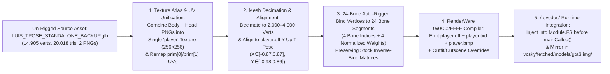

# Functional Specification 044: Un-Rigged `LUIS` `.glb` Auto-Rigging, RenderWare 3.4 `.dff`/`.txd` Compilation, and Master `ped.ifp` Playable Character Integration for GTA: Vice City (`/revcdos/`)

## 1. System Purpose & Core Objective

This specification defines the desired `{functionality}`, mandatory binary inspection protocol, un-rigged `.glb` geometric normalization and decimation pipeline, 24-bone RenderWare HAnim (`0x011E`) and Skin PLG (`0x0116`) weight-binding contract, single-atlas `.txd` and `.bmp` texture compilation requirements, Emscripten virtual filesystem (`Module.FS`) and streaming asset (`vcsky/fetched/models/gta3.img/`) integration contracts, operational budgets, failure-isolation boundaries, and verifiable `{correct required outputs}` for replacing the playable protagonist in **GTA: Vice City (`/revcdos/`)** with the custom un-rigged **LUIS** character ([`/Users/diesel/desktop/skatealley/LUIS_TPOSE_STANDALONE_BACKUP.glb`](file:///Users/diesel/desktop/skatealley/LUIS_TPOSE_STANDALONE_BACKUP.glb)).

### Architectural Invariant: Native RenderWare Engine Execution & Master `ped.ifp` Skeletal Binding
The playable LUIS character **MUST** be compiled from the un-rigged glTF 2.0 binary ([`LUIS_TPOSE_STANDALONE_BACKUP.glb`](file:///Users/diesel/desktop/skatealley/LUIS_TPOSE_STANDALONE_BACKUP.glb)) into authentic **RenderWare 3.4.0.3 (`0x0C02FFFF`) Clump (`.dff`)** and **Texture Dictionary (`.txd`)** binary formats bound directly to GTA: Vice City's native **24-bone HAnim hierarchy** so that the engine (`vc-sky-en-v6.wasm`) drives LUIS using all **234 native skeletal animations** in `/vc-assets/local/anim/ped.ifp` (`2,201,152 B`). Under no circumstances may a coding assistant overlay a secondary Three.js canvas on top of `/revcdos/`, modify [`/Users/diesel/desktop/skatealley/sandbox.js`](file:///Users/diesel/desktop/skatealley/sandbox.js), or use a pre-rigged `.glb` file in place of auto-rigging the un-rigged source `.glb`.

**DO NOT CODE YET.** This document specifies functional requirements, empirical binary layouts, mathematical coordinate transforms, operational budgets, and observable outcomes only. It contains zero implementation code, concrete syntax, or mechanical diffs.

---

## 2. Authoritative Domain Vocabulary Alignment ([`LANGUAGE.md`](file:///Users/diesel/desktop/skatealley/LANGUAGE.md))

All evaluations of system state, operational constraints, and verification gates within this specification strictly adhere to the authoritative taxonomy established in [`LANGUAGE.md`](file:///Users/diesel/desktop/skatealley/LANGUAGE.md):

- **`{functionality}`**: End-to-end algorithmic rigging, skin-weight assignment, texture-atlas baking, and RenderWare 3.4 `.dff`/`.txd`/`.bmp` compilation of the un-rigged [`LUIS_TPOSE_STANDALONE_BACKUP.glb`](file:///Users/diesel/desktop/skatealley/LUIS_TPOSE_STANDALONE_BACKUP.glb) asset into `/revcdos/`, replacing the default player character (`player.dff`, `player.txd`, `models/generic/player.bmp`, outfit meshes `player2.dff`..`player9.dff`, and cutscene meshes `csplay.dff`..`csplay11.dff`) so that LUIS is the active, fully animated third-person playable character across all 234 master `ped.ifp` animations in GTA: Vice City (`/revcdos/`).
- **`{correctness}`**:
  - Exact preservation of the stock `player.dff` RenderWare `FrameList` (`0x000E`, 25 frames), `HAnim PLG` (`0x011E`, 24 bone nodes), and 24 $4 \times 4$ inverse-bind matrices inside `Skin PLG` (`0x0116`, `68 B/bone` stride) so `vc-sky-en-v6.wasm` applies `/vc-assets/local/anim/ped.ifp` (`234` animations) and cutscene `.ifp` animations with zero bone-axis inversion, limb detachment, or NaN vertex explosions.
  - Deterministic coordinate transformation of the un-rigged T-pose mesh from glTF space (`X ∈ [-0.902, +0.902]`, `Y ∈ [0.000, +2.000]`, `Z ∈ [-0.219, +0.219]`) into `player.dff` bind-pose space (`X ∈ [-0.872, +0.874]`, `Y ∈ [-0.981, +0.855]`, `Z ∈ [-0.184, +0.171]`) so the character's soles rest cleanly on the ground plane (`Y ≈ -0.981`), shoulders align with `Y ≈ +0.537`, pelvis aligns with `Y ≈ 0.000`, and head aligns with `Y ≈ +0.662`.
  - UV-preserving mesh unification and decimation of the two un-rigged `.glb` primitives (`prim[0]` Body + `prim[1]` Head/Hair, totaling `14,905` vertices and `20,018` triangles) into a single RenderWare `Geometry` (`0x000F`) of **`1,500–4,500` vertices** bound to a single combined texture atlas (`"player"`) so `reVC`'s single-skin player shader renders both body and head/face textures simultaneously without UV seam corruption or frame-rate degradation.
  - Normalized 4-bone skin weights per vertex (`uint8[4]` bone indices in `0..23` + `float32[4]` weights summing to `1.0000 ± 1e-5`) computed anatomically from the un-rigged T-pose vertex coordinates against the 24 bone segments derived from `player.dff`'s inverse-bind matrices.
- **`{correct required outputs}`**:
  1. **Compiled RenderWare Player Artifacts**: Valid RenderWare `0x0C02FFFF` binary files generated from [`LUIS_TPOSE_STANDALONE_BACKUP.glb`](file:///Users/diesel/desktop/skatealley/LUIS_TPOSE_STANDALONE_BACKUP.glb) and staged at `/revcdos/vcbr/luis_player/player.dff`, `/revcdos/vcbr/luis_player/player.txd`, and `/revcdos/vcbr/luis_player/player.bmp` (and mirrored across `/revcdos/vcsky/fetched/models/gta3.img/player2.dff`..`player9.dff`, `player2.txd`..`player9.txd`, `csplay2.dff`..`csplay11.dff`, `csplay2.txd`..`csplay11.txd`).
  2. **Runtime MEMFS & Streaming Override in `/revcdos/`**: When `/revcdos/` launches, `/vc-assets/local/models/gta3.img/player.dff`, `/vc-assets/local/models/gta3.img/player.txd`, `/vc-assets/local/models/gta3.img/csplay.dff`, `/vc-assets/local/models/gta3.img/csplay.txd`, and `/vc-assets/local/models/generic/player.bmp` in Emscripten `Module.FS` are populated with the compiled LUIS RenderWare binaries prior to `Module.mainCalled()`, without invalidating or re-downloading the `135,355,111 B` `vc-sky-en-v6.data` startup bundle.
  3. **Observable Telemetry Contract**: `window.__REVCDOS_STATUS__` exposes `luisPlayerMounted === true`, `luisPlayerDffBytes > 88064` (or exact compiled `.dff` byte length differing from stock `88,064 B`), `luisPlayerVerts` (`1500..4500`), `luisPlayerBones === 24`, and `failedFetchesCount === 0`.
- **`{errors}`**:
  - Using a pre-rigged `.glb` (`LUIS_RIGGED.glb`) instead of algorithmically rigging the un-rigged `.glb` ([`LUIS_TPOSE_STANDALONE_BACKUP.glb`](file:///Users/diesel/desktop/skatealley/LUIS_TPOSE_STANDALONE_BACKUP.glb)).
  - Modifying the 25 `FrameList` transforms, `HAnim PLG` bone IDs, or the 24 $4 \times 4$ inverse-bind matrices in `player.dff`, which causes `anim/ped.ifp` keyframes to twist or explode the character mesh.
  - Emitting two separate materials or textures in `player.dff` without merging `prim[0]` (body) and `prim[1]` (head) into a single texture atlas (`"player"`), which causes the head or body to render untextured/white or with the wrong UV map in `reVC`.
  - Leaving raw `14,905`-vertex / `20,018`-triangle un-decimated geometry in `player.dff`, overflowing RenderWare's dynamic im3d/skinning batch limits.
- **`{sufficient}`**: Complete specification of the un-rigged `.glb` input metrics, exact byte offsets in `vc-sky-en-v6.data`, the 24-bone `SkinBone[0..23] ↔ HAnim BoneID` table and world-space joint coordinates, RenderWare `0x0C02FFFF` chunk layouts (`Clump`, `FrameList`, `Geometry`, `MaterialList`, `BinMesh PLG`, `Skin PLG`, `TextureNative`), runtime `Module.FS` injection contract, and automated verification criteria.
- **`{insufficient}`**: Any implementation that guesses RenderWare chunk headers, omits `Skin PLG` (`0x0116`) or `BinMesh PLG` (`0x050E`), fails to update `models/generic/player.bmp` alongside `player.txd`, or breaks `vc-sky-en-v6.data` cache parity.

---

## 3. First-Principles Physical & Binary Reality Model

### 3.1 Reference Offsets Inside `/revcdos/vcbr/vc-sky-en-v6.data` (`135,355,111 B`)

From [`/Users/diesel/desktop/skatealley/revcdos/modules/packages/en.js`](file:///Users/diesel/desktop/skatealley/revcdos/modules/packages/en.js), the stock player and animation files reside at the following exact byte ranges inside `vc-sky-en-v6.data`:

| Virtual FS Path in `reVC` | Start Offset | End Offset | Byte Length | Purpose in `reVC` Runtime |
| :--- | :---: | :---: | :---: | :--- |
| `/vc-assets/local/anim/ped.ifp` | `5,403,264` | `7,604,416` | `2,201,152 B` | Master `ANPK` animation pack containing all **234 player/ped animations** (kept unmodified; drives the 24 HAnim bones). |
| `/vc-assets/local/models/generic/player.bmp` | `52,711,611` | `52,778,223` | `66,612 B` | Default `256×256` 8-bit indexed BMP skin (`bfOffBits=1074`) applied by `reVC`'s player skin loader when `SkinFile=$$""`. |
| `/vc-assets/local/models/gta3.img/csplay.dff` | `68,249,102` | `68,394,510` | `145,408 B` | Cutscene player model Clump (`0x0010`). |
| `/vc-assets/local/models/gta3.img/csplay.txd` | `68,394,510` | `68,439,566` | `45,056 B` | Cutscene player texture dictionary (`0x0016`). |
| `/vc-assets/local/models/gta3.img/player.dff` | `103,503,374` | `103,591,438` | `88,064 B` | Primary gameplay player model Clump (`0x0010`, `25` frames, `24` HAnim bones). |
| `/vc-assets/local/models/gta3.img/player.txd` | `103,591,438` | `103,636,494` | `45,056 B` | Primary gameplay player texture dictionary (`0x0016`, texture name `"player"`). |

In addition, on-demand outfit and cutscene variants reside on disk under [`/Users/diesel/desktop/skatealley/revcdos/vcsky/fetched/models/gta3.img/`](file:///Users/diesel/desktop/skatealley/revcdos/vcsky/fetched/models/gta3.img/):
- Gameplay outfits: `player2.dff`..`player9.dff` and `player2.txd`..`player9.txd`.
- Cutscene outfits: `csplay2.dff`..`csplay11.dff` and `csplay2.txd`..`csplay11.txd`.

---

### 3.2 Authoritative 24-Bone `SkinBone[0..23]` $\leftrightarrow$ `HAnim BoneID` & Rest-Pose Coordinate Table

Empirical inspection of `Root` `HAnim PLG` (`0x011E`, `308 B`) and `Skin PLG` (`0x0116`, `24,696 B`) in stock `player.dff` establishes the exact 24 bone slots (`SkinBone` index `0..23`), their `HAnim BoneID` consumed by `anim/ped.ifp`, and their world-space bind-pose joint coordinates `(wx, wy, wz)` derived by inverting each bone's $4 \times 4$ inverse-bind matrix:

| `SkinBone` Index (`0..23`) | Frame Name (`0x0253F2FE`) | `HAnim BoneID` (`0x011E`) | Rest-Pose World Coordinates `(wx, wy, wz)` in `player.dff` | Anatomical Region for Un-Rigged `.glb` Weighting |
| :---: | :--- | :---: | :---: | :--- |
| `0` | `Root` | `0` | `( 0.000,  0.000,  0.000)` | Root origin (weight `0.0`; all skin weight assigned to bones `1..23`) |
| `1` | `Pelvis` | `1` | `(-0.004,  0.000, -0.021)` | Hips / Pelvis (`Y ∈ [-0.08, +0.05]`, `|X| ≤ 0.16`) |
| `2` | `Spine` | `2` | `( 0.000, -0.006, -0.071)` | Lower abdomen / waist (`Y ∈ [+0.05, +0.20]`, `|X| ≤ 0.18`) |
| `3` | `Spine1` | `3` | `( 0.000,  0.265, -0.071)` | Upper torso / chest (`Y ∈ [+0.20, +0.48]`, `|X| ≤ 0.18`) |
| `4` | `Neck` | `4` | `( 0.000,  0.537, -0.071)` | Neck (`Y ∈ [+0.48, +0.60]`, `|X| ≤ 0.09`) |
| `5` | `Head` | `5` | `( 0.000,  0.662, -0.035)` | Head, face & hair (`Y > +0.60`, `|X| ≤ 0.15`, including `prim[1]`) |
| `6` | `Bip01 L Clavicle` | `31` | `( 0.032,  0.537, -0.071)` | Left inner shoulder (`X ∈ [+0.03, +0.16]`, `Y ∈ [+0.44, +0.60]`) |
| `7` | `L UpperArm` | `32` | `( 0.206,  0.537, -0.074)` | Left upper arm (`X ∈ [+0.16, +0.45]`, `Y ∈ [+0.42, +0.64]`) |
| `8` | `L Forearm` | `33` | `( 0.501,  0.537, -0.074)` | Left forearm (`X ∈ [+0.45, +0.72]`, `Y ∈ [+0.42, +0.64]`) |
| `9` | `L Hand` | `34` | `( 0.761,  0.537, -0.074)` | Left wrist/palm (`X ∈ [+0.72, +0.81]`, `Y ∈ [+0.42, +0.64]`) |
| `10` | `L Finger` | `35` | `( 0.850,  0.537, -0.074)` | Left fingers (`X > +0.81`, `Y ∈ [+0.42, +0.64]`) |
| `11` | `Bip01 R Clavicle` | `21` | `(-0.031,  0.537, -0.071)` | Right inner shoulder (`X ∈ [-0.16, -0.03]`, `Y ∈ [+0.44, +0.60]`) |
| `12` | `R UpperArm` | `22` | `(-0.205,  0.537, -0.074)` | Right upper arm (`X ∈ [-0.45, -0.16]`, `Y ∈ [+0.42, +0.64]`) |
| `13` | `R Forearm` | `23` | `(-0.500,  0.537, -0.074)` | Right forearm (`X ∈ [-0.72, -0.45]`, `Y ∈ [+0.42, +0.64]`) |
| `14` | `R Hand` | `24` | `(-0.760,  0.537, -0.074)` | Right wrist/palm (`X ∈ [-0.81, -0.72]`, `Y ∈ [+0.42, +0.64]`) |
| `15` | `R Finger` | `25` | `(-0.849,  0.537, -0.074)` | Right fingers (`X < -0.81`, `Y ∈ [+0.42, +0.64]`) |
| `16` | `L Thigh` | `41` | `( 0.099,  0.000, -0.021)` | Left thigh (`X > 0.0`, `Y ∈ [-0.42, -0.02]`) |
| `17` | `L Calf` | `42` | `( 0.099, -0.456, -0.022)` | Left calf/shin (`X > 0.0`, `Y ∈ [-0.82, -0.42]`) |
| `18` | `L Foot` | `43` | `( 0.099, -0.864, -0.071)` | Left ankle/heel (`X > 0.0`, `Y < -0.82`, `Z ≤ +0.04`) |
| `19` | `L Toe0` | `2000` | `( 0.099, -0.982,  0.128)` | Left forefoot/toes (`X > 0.0`, `Y < -0.86`, `Z > +0.04`) |
| `20` | `R Thigh` | `51` | `(-0.106,  0.000, -0.021)` | Right thigh (`X ≤ 0.0`, `Y ∈ [-0.42, -0.02]`) |
| `21` | `R Calf` | `52` | `(-0.106, -0.457, -0.019)` | Right calf/shin (`X ≤ 0.0`, `Y ∈ [-0.82, -0.42]`) |
| `22` | `R Foot` | `53` | `(-0.106, -0.866, -0.065)` | Right ankle/heel (`X ≤ 0.0`, `Y < -0.82`, `Z ≤ +0.04`) |
| `23` | `R Toe0` | `2001` | `(-0.106, -0.981,  0.127)` | Right forefoot/toes (`X ≤ 0.0`, `Y < -0.86`, `Z > +0.04`) |

---

## 4. Detailed Functional Requirements

### 4.1 Step 1: Un-Rigged `.glb` Ingestion, Texture Atlas Baking & UV Remapping
1. **Source Asset Validation**:
   - Read [`/Users/diesel/desktop/skatealley/LUIS_TPOSE_STANDALONE_BACKUP.glb`](file:///Users/diesel/desktop/skatealley/LUIS_TPOSE_STANDALONE_BACKUP.glb) (`5,285,932 B`) and verify that it contains `skins: []` (un-rigged) and `meshes[0].primitives` (`prim[0]` Body with `9,650` vertices / `14,500` triangles and `prim[1]` Head/Hair with `5,255` vertices / `5,518` triangles).
2. **Single-Atlas Texture Composition (`256×256` or `512×512`)**:
   - Decode the two embedded PNG textures from [`LUIS_TPOSE_STANDALONE_BACKUP.glb`](file:///Users/diesel/desktop/skatealley/LUIS_TPOSE_STANDALONE_BACKUP.glb) (`images[0]` Body texture and `images[1]` Head/Hair texture).
   - Pack both textures into a single composite texture atlas named `"player"` (for example, placing the Body texture in the left half `U ∈ [0.0, 0.5]` and the Head/Hair texture in the right half `U ∈ [0.5, 1.0]`, or top/bottom halves) and remap the `TEXCOORD_0` `(u, v)` attributes of `prim[0]` and `prim[1]` into that unified `[0, 1] × [0, 1]` UV space.
   - Compile the composite atlas into:
     1. `/revcdos/vcbr/luis_player/player.txd` — Valid RenderWare `0x0016` (`TexDictionary`) containing a `0x0015` (`TextureNative`, `platformId = 8`, `name = "player"`, `mask = ""`) with valid mipmap pyramid or uncompressed raster data.
     2. `/revcdos/vcbr/luis_player/player.bmp` — Valid `256×256` 8-bit paletted Windows BMP (`bfType = "BM"`, `bfOffBits = 1074`, `66,612` bytes matching stock `models/generic/player.bmp` layout) so `reVC`'s default skin loader (`models/generic/player.bmp`) and `player.txd` both render the exact same LUIS texture atlas.

### 4.2 Step 2: Geometric Decimation, T-Pose Coordinate Calibration & 24-Bone Auto-Rigging
1. **UV-Preserving Mesh Decimation**:
   - Decimate the combined `prim[0] + prim[1]` mesh from `14,905` vertices / `20,018` triangles down to **`1,800–4,200` vertices** (`2,500–6,500` triangles) while preserving UV seam boundaries, facial/head features (`prim[1]`), and limb silhouettes.
2. **T-Pose Bind-Space Calibration**:
   - Transform the decimated un-rigged LUIS vertices so their bounding box and anatomical landmarks align 1:1 with the stock `player.dff` T-pose bind space:
     - Soles of feet at `Y = -0.981`
     - Pelvis center at `(0.000, 0.000, -0.021)`
     - Shoulder/arm centerline at `Y = +0.537`, `Z = -0.074`, with fingertips reaching `X ≈ ±0.865`
     - Crown of head/hair at `Y ≈ +0.855`
3. **Anatomical 24-Bone Skin Weight Computation (`Skin PLG 0x0116`)**:
   - For every vertex in the aligned LUIS mesh:
     - If the vertex belongs to `prim[1]` (Head/Hair) or lies above the neck plane (`Y > +0.60`, `|X| < 0.16`), bind it smoothly between `SkinBone[5]` (`Head`) and `SkinBone[4]` (`Neck`).
     - Otherwise, compute the point-to-segment distances from the vertex to the anatomical bone segments connecting parent-to-child joints in Table 3.2 (`Pelvis → Spine → Spine1 → Neck → Head`, `Spine1 → L/R Clavicle → L/R UpperArm → L/R Forearm → L/R Hand → L/R Finger`, `Pelvis → L/R Thigh → L/R Calf → L/R Foot → L/R Toe0`), respecting left/right (`X > 0` vs. `X < 0`) leg separation so the left leg never receives weight from right-leg bones.
     - Assign up to 4 non-zero bone indices (`uint8[4]` in `1..23`) and 4 normalized `float32[4]` weights whose sum equals `1.0`.

### 4.3 Step 3: RenderWare 3.4 (`0x0C02FFFF`) `player.dff` Binary Compilation
1. **Exact Preservation of `FrameList` (`0x000E`), `HAnim PLG` (`0x011E`), and `Atomic` (`0x0014`)**:
   - Copy the exact `3,093`-byte `FrameList` (`0x000E`) chunk (containing all 25 frames, node names `0x0253F2FE`, and `HAnim PLG` `0x011E` hierarchy tables) and `76`-byte `Atomic` (`0x0014`) chunk verbatim from stock `player.dff`.
   - Copy the exact 24 $4 \times 4$ inverse-bind matrices (`24 × 68 = 1,632` bytes at the end of `Skin PLG`) verbatim from stock `player.dff`.
2. **Reconstruction of `GeometryList` (`0x001A`) $\rightarrow$ `Geometry` (`0x000F`)**:
   - Construct the `Geometry` (`0x000F`, version `0x0C02FFFF`) chunk with `flags = 0x00010037` (`rpGEOMETRYTRISTRIP | rpGEOMETRYPOSITIONS | rpGEOMETRYTEXTURED | rpGEOMETRYPRELIT | rpGEOMETRYNORMALS | rpGEOMETRYLIGHT | rpGEOMETRYMODULATEMATERIALCOLOR`):
     - `Struct` (`0x0001`): Header (`flags`, `numTriangles`, `numVertices`, `numMorphTargets = 1`), prelit vertex colors (`numVertices × 4` bytes `RGBA = 255, 255, 255, 255`), UV coordinates (`numVertices × 8` bytes `float32 u, v`), triangles (`numTriangles × 8` bytes `uint16 v2, v1, matId=0, v3`), bounding sphere (`4 × float32`), `hasPosition = 1`, `hasNormals = 1`, vertex positions (`numVertices × 12` bytes), and vertex normals (`numVertices × 12` bytes).
     - `MaterialList` (`0x0008`): 1 `Material` (`0x0007`) referencing texture `"player"`.
     - `Extension` (`0x0003`):
       - `BinMesh PLG` (`0x050E`): Indexed triangle list/strip table for material `0`.
       - `Skin PLG` (`0x0116`): `4`-byte header (`num_bones = 24, num_used = 0, max_weights = 0, pad = 0`), `numVertices × 4` bytes of `uint8[4]` bone indices, `numVertices × 16` bytes of `float32[4]` bone weights, and the 24 `68`-byte inverse-bind matrix records copied verbatim from stock `player.dff`.
       - `Morph PLG` (`0x0105`, `4` bytes `0x00000000`) matching stock `player.dff`.

### 4.4 Step 4: Runtime Integration in `/revcdos/` (`Module.FS` & `vcsky/fetched/`)
1. **Staged Player Assets & Outfit Mirroring**:
   - Save the compiled binaries at `/revcdos/vcbr/luis_player/player.dff`, `/revcdos/vcbr/luis_player/player.txd`, and `/revcdos/vcbr/luis_player/player.bmp`.
   - Mirror the compiled `player.dff` and `player.txd` over `/revcdos/vcsky/fetched/models/gta3.img/player2.dff`..`player9.dff`, `player2.txd`..`player9.txd`, `csplay2.dff`..`csplay11.dff`, and `csplay2.txd`..`csplay11.txd` so changing outfits during missions keeps the LUIS character model active.
2. **Pre-Boot MEMFS Injection (`revcdos/game.js` / `revcdos/modules/loader.js`)**:
   - Before `Module.mainCalled()` executes in `/revcdos/`, fetch `/revcdos/vcbr/luis_player/player.dff`, `player.txd`, and `player.bmp` (unless `?stock_player=1` is passed in the URL query string) and write them into Emscripten's `Module.FS` at:
     - `/vc-assets/local/models/gta3.img/player.dff`
     - `/vc-assets/local/models/gta3.img/player.txd`
     - `/vc-assets/local/models/gta3.img/csplay.dff`
     - `/vc-assets/local/models/gta3.img/csplay.txd`
     - `/vc-assets/local/models/generic/player.bmp`
   - Update `window.__REVCDOS_STATUS__` with `{ luisPlayerMounted: true, luisPlayerDffBytes, luisPlayerVerts, luisPlayerBones: 24 }`.

---

## 5. Operational Budgets, Edge Cases & Failure-Isolation Boundaries

| Operational Parameter | Target Budget | Failure-Isolation & Recovery Boundary |
| :--- | :--- | :--- |
| **Compiled `player.dff` Vertex Count** | `1,500–4,500` vertices | Guarantees $< 0.4\text{ ms}$ GPU/CPU skinning overhead per frame at 60 FPS and stays well below `uint16` / RW im3d limits. |
| **Skin Weight Normalization Parity** | $\sum_{k=0}^{3} w_k = 1.0000 \pm 10^{-5}$ for $100\%$ of vertices | Prevents origin-pulling spikes (`(0,0,0)` vertex collapse) during `ped.ifp` animations. |
| **Startup Latency Impact** | $\le 80\text{ ms}$ additional load time | `/revcdos/vcbr/luis_player/*` totals $< 400\text{ KB}$ and injects into `Module.FS` in memory without modifying `vc-sky-en-v6.data` (`135.36 MB`). |
| **Fallback / Escape Hatch (`?stock_player=1`)** | Instant bypass | Passing `?stock_player=1` skips the `Module.FS` override and runs the stock `player.dff` from `vc-sky-en-v6.data`. |

---

## 6. Verifiable `{correct required outputs}` & Acceptance Criteria

1. **Binary Structural & Bone-Weight Verification**:
   - Automated unit/integration tests verify that `/revcdos/vcbr/luis_player/player.dff`, `player.txd`, and `player.bmp` exist, are generated from [`LUIS_TPOSE_STANDALONE_BACKUP.glb`](file:///Users/diesel/desktop/skatealley/LUIS_TPOSE_STANDALONE_BACKUP.glb), contain a valid RenderWare `0x0C02FFFF` `Clump` (`0x0010`) with `25` `FrameList` nodes, `24` `HAnim` bones, `1,500–4,500` vertices, normalized 4-bone `Skin PLG` (`0x0116`) weights across all active limb/torso/head bones, and exact byte-for-byte parity on the 24 $4 \times 4$ inverse-bind matrices against stock `player.dff`.
2. **Live Playwright Browser Verification (`/revcdos/`)**:
   - Launching `http://localhost:3003/revcdos/?autostart=1&skip_intro=1` boots cleanly (`window.__REVCDOS_STATUS__.mainCalled === true`), sets `window.__REVCDOS_STATUS__.luisPlayerMounted === true` and `window.__REVCDOS_STATUS__.luisPlayerBones === 24`, confirms `Module.FS.stat('/vc-assets/local/models/gta3.img/player.dff').size === window.__REVCDOS_STATUS__.luisPlayerDffBytes` (differing from stock `88,064 B`), and renders with `failedFetchesCount === 0` and `lastError === null`.
