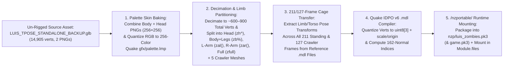

# Functional Specification 045: Un-Rigged `LUIS` `.glb` Modular Limb Partitioning, 211/127-Frame Quake `IDPO` `.mdl` Compilation, and Zombie AI Model Replacement for Nazi Zombies: Portable (`/nzportable/`)

## 1. System Purpose & Core Objective

This specification defines the desired `{functionality}`, mandatory binary inspection protocol, un-rigged `.glb` geometric decimation and anatomical limb-partitioning pipeline, 256-color Quake palette (`gfx/palette.lmp`) skin quantization contract, 211-frame standing and 127-frame crawler deformation-cage transfer algorithm, Quake 1 `IDPO` v6 `.mdl` binary compilation requirements, `nzportable/nzp/game.pk3` (and `.part00..02`) packaging contracts, operational budgets, failure-isolation boundaries, and verifiable `{correct required outputs}` for replacing the enemy zombie models in **Nazi Zombies: Portable (`/nzportable/`)** with the custom un-rigged **LUIS** character ([`/Users/diesel/desktop/skatealley/LUIS_TPOSE_STANDALONE_BACKUP.glb`](file:///Users/diesel/desktop/skatealley/LUIS_TPOSE_STANDALONE_BACKUP.glb)).

### Architectural Invariant: Native FTEQW Alias `.mdl` Execution & Modular Limb Dismemberment
In Nazi Zombies: Portable (`/nzportable/`), the compiled QuakeC bytecode ([`/Users/diesel/desktop/skatealley/nzportable/nzp/progs.pk3`](file:///Users/diesel/desktop/skatealley/nzportable/nzp/progs.pk3): `qwprogs.dat` and `csprogs.dat`) spawns every zombie as a synchronized assembly of **modular Quake 1 Alias (`.mdl`, magic `IDPO`, version `6`) sub-models** (`models/ai/zb%.mdl` torso+legs, `models/ai/zh^.mdl` head, `models/ai/zal(.mdl` left arm, `models/ai/zar(.mdl` right arm, and `models/ai/zfull.mdl`, plus crawler variants `zbc%.mdl`, `zhc^.mdl`, `zalc(.mdl`, `zarc(.mdl`, and `zcfull.mdl`). To replace the zombies with LUIS without breaking QuakeC frame-index tables or headshot/limb dismemberment, the un-rigged [`LUIS_TPOSE_STANDALONE_BACKUP.glb`](file:///Users/diesel/desktop/skatealley/LUIS_TPOSE_STANDALONE_BACKUP.glb) asset **MUST** be algorithmically partitioned into those 10 modular body regions, deformed across all **211 standing animation frames** (`frame_0`..`frame_210`) and **127 crawler animation frames** (`frame_0`..`frame_126`), quantized against `gfx/palette.lmp`, and compiled into valid `IDPO` v6 `.mdl` binaries mounted into the FTEQW WebAssembly virtual filesystem (`Module.files`).

**DO NOT CODE YET.** This document specifies functional requirements, empirical binary layouts, mathematical deformation models, operational budgets, and observable outcomes only. It contains zero implementation code, concrete syntax, or mechanical diffs.

---

## 2. Authoritative Domain Vocabulary Alignment ([`LANGUAGE.md`](file:///Users/diesel/desktop/skatealley/LANGUAGE.md))

All evaluations of system state, operational constraints, and verification gates within this specification strictly adhere to the authoritative taxonomy established in [`LANGUAGE.md`](file:///Users/diesel/desktop/skatealley/LANGUAGE.md):

- **`{functionality}`**: End-to-end algorithmic decimation, anatomical limb partitioning (Torso+Legs, Head, Left Arm, Right Arm, Full Body, and Crawler equivalents), 256-color `gfx/palette.lmp` texture baking, 211/127-frame vertex animation synthesis, and Quake 1 `IDPO` v6 `.mdl` compilation from the un-rigged [`LUIS_TPOSE_STANDALONE_BACKUP.glb`](file:///Users/diesel/desktop/skatealley/LUIS_TPOSE_STANDALONE_BACKUP.glb) asset into `/nzportable/`, so that all zombies spawned in Nazi Zombies: Portable render and animate as **LUIS** while preserving full dismemberment, crawler transitions, hitboxes, and 60 FPS WebGL performance.
- **`{correctness}`**:
  - Exact frame-count and frame-name parity across all 10 zombie `.mdl` files (`211` frames `frame_0`..`frame_210` for `zb%.mdl`, `zh^.mdl`, `zal(.mdl`, `zar(.mdl`, `zfull.mdl`; `127` frames `frame_0`..`frame_126` for `zbc%.mdl`, `zhc^.mdl`, `zalc(.mdl`, `zarc(.mdl`, `zcfull.mdl`) so QuakeC animation state machines (`qwprogs.dat` / `csprogs.dat`) never index out-of-bounds frames.
  - World-space coordinate and bounding-box alignment in Quake coordinates (`+X` forward, `+Y` left, `+Z` up; zombie height `Z ∈ [-32.8, +40.2]`, shoulder span `Y ∈ [-12.9, +13.1]`) so modular sub-models (`zh^.mdl` head, `zal(.mdl` left arm, `zar(.mdl` right arm) attach seamlessly to the torso (`zb%.mdl`) across all 211/127 animation frames without floating gaps.
  - Strict compliance with Quake 1 `IDPO` v6 binary format invariants: 8-bit skin pixels (`skinwidth × skinheight` divisible by 4, indexed against the 768-byte `gfx/palette.lmp`), integer `stverts` (`onseam`, `s ∈ [0, skinwidth-1]`, `t ∈ [0, skinheight-1]`), `triangles` (`facesfront`, `vertindex[3]`), and quantized `trivertx_t` frame vertices (`uint8 v[3]`, `uint8 lightnormalindex ∈ [0, 161]`).
  - Seamless runtime mounting via a dedicated high-priority override archive `/nzportable/nzp/luis_zombies.pk3` (or updated `nzp/game.pk3` + `parts/game.pk3.part00..02` and `default.fmf` / `Module.files`) so FTEQW loads the LUIS zombie `.mdl` files automatically on startup while keeping all tracked Git files $\le 35\text{ MB}$.
- **`{correct required outputs}`**:
  1. **Compiled Quake `IDPO` v6 Zombie `.mdl` Set (`10` Files)**: Valid `.mdl` binaries generated from [`LUIS_TPOSE_STANDALONE_BACKUP.glb`](file:///Users/diesel/desktop/skatealley/LUIS_TPOSE_STANDALONE_BACKUP.glb) for all 10 zombie model paths (`models/ai/zb%.mdl`, `models/ai/zh^.mdl`, `models/ai/zal(.mdl`, `models/ai/zar(.mdl`, `models/ai/zfull.mdl`, `models/ai/zbc%.mdl`, `models/ai/zhc^.mdl`, `models/ai/zalc(.mdl`, `models/ai/zarc(.mdl`, `models/ai/zcfull.mdl`), packaged into `/nzportable/` (`nzportable/nzp/luis_zombies.pk3` and/or `nzportable/nzp/game.pk3` + `parts/game.pk3.part00..02`).
  2. **Deterministic Telemetry Contract**: `window.__NZP_STATUS__` exposes `luisZombiesMounted === true`, `luisZombieModelsCount === 10`, `engineReady === true`, and `errors.length === 0`.
- **`{errors}`**:
  - Using a pre-rigged `.glb` instead of the un-rigged [`LUIS_TPOSE_STANDALONE_BACKUP.glb`](file:///Users/diesel/desktop/skatealley/LUIS_TPOSE_STANDALONE_BACKUP.glb).
  - Replacing only `models/ai/zfull.mdl` while leaving the 4 modular dismemberment models (`zb%.mdl`, `zh^.mdl`, `zal(.mdl`, `zar(.mdl`) or 5 crawler models untouched (since `qwprogs.dat` spawns zombies using `zb%.mdl` + `zh^.mdl` + `zal(.mdl` + `zar(.mdl`).
  - Emitting `.mdl` files with mismatched frame counts ($\ne 211$ for standing or $\ne 127$ for crawlers), out-of-range UV `s`/`t` coordinates, or `lightnormalindex >= 162`.
- **`{sufficient}`**: Complete specification of the 10 target `.mdl` paths, exact frame counts, Quake coordinate bounds, deformation-cage transfer from the reference zombie `.mdl` frames, `gfx/palette.lmp` color quantization, `IDPO` v6 binary layout, FTEQW `.pk3` mounting order, and automated verification criteria.
- **`{insufficient}`**: Any implementation that emits static 1-frame models, omits limb/crawler variants, or breaks `CacheStorage` / `.part00..02` parity in `/nzportable/`.

---

## 3. First-Principles Physical & Binary Reality Model

### 3.1 Authoritative Inventory of Zombie `.mdl` Targets in `nzportable/nzp/game.pk3`

Read-only inspection of `nzportable/nzp/progs.pk3` (`qwprogs.dat` and `csprogs.dat`) and `nzportable/nzp/game.pk3` establishes the exact 10 zombie `.mdl` files that must be compiled from [`LUIS_TPOSE_STANDALONE_BACKUP.glb`](file:///Users/diesel/desktop/skatealley/LUIS_TPOSE_STANDALONE_BACKUP.glb):

| Target Path in `nzp/` | Anatomical Partition | Stock Verts / Tris | Mandatory Frame Count | Frame 0 World BBox (`X`, `Y`, `Z` in Quake Units) | Target Compiled Verts Budget |
| :--- | :--- | :---: | :---: | :--- | :---: |
| `models/ai/zb%.mdl` | Standing Torso + Pelvis + Both Legs | `292`v / `331`t | **`211` frames** (`frame_0`..`210`) | `X: [-1.30, 15.13], Y: [-12.81, 12.97], Z: [-32.80, 31.67]` | `250–650` verts |
| `models/ai/zh^.mdl` | Standing Head + Neck (`prim[1]` + upper neck) | `66`v / `116`t | **`211` frames** (`frame_0`..`210`) | `X: [6.08, 16.21], Y: [-3.90, 3.64], Z: [25.86, 40.16]` | `80–280` verts |
| `models/ai/zal(.mdl` | Standing Left Arm (`+Y` shoulder to hand) | `61`v / `59`t | **`211` frames** (`frame_0`..`210`) | `X: [6.52, 17.16], Y: [4.72, 13.07], Z: [-5.80, 16.84]` | `50–160` verts |
| `models/ai/zar(.mdl` | Standing Right Arm (`-Y` shoulder to hand) | `60`v / `59`t | **`211` frames** (`frame_0`..`210`) | `X: [5.18, 15.51], Y: [-12.49, -5.64], Z: [-6.35, 17.48]` | `50–160` verts |
| `models/ai/zfull.mdl` | Full Standing Zombie (Unified Body + Head + Arms) | `389`v / `484`t | **`211` frames** (`frame_0`..`210`) | `X: [-1.18, 17.27], Y: [-12.93, 12.87], Z: [-32.64, 40.00]` | `400–1,000` verts |
| `models/ai/zbc%.mdl` | Crawler Torso + Pelvis (legs amputated at thigh) | `260`v / `261`t | **`127` frames** (`frame_0`..`126`) | `X: [-1.65, 14.69], Y: [-13.19, 17.49], Z: [-8.55, 32.56]` | `200–500` verts |
| `models/ai/zhc^.mdl` | Crawler Head + Neck | `66`v / `116`t | **`127` frames** (`frame_0`..`126`) | Matches crawler head trajectory across frames `0..126` | `80–280` verts |
| `models/ai/zalc(.mdl` | Crawler Left Arm (`+Y`) | `61`v / `59`t | **`127` frames** (`frame_0`..`126`) | Matches crawler left-arm trajectory across frames `0..126` | `50–160` verts |
| `models/ai/zarc(.mdl` | Crawler Right Arm (`-Y`) | `60`v / `59`t | **`127` frames** (`frame_0`..`126`) | Matches crawler right-arm trajectory across frames `0..126` | `50–160` verts |
| `models/ai/zcfull.mdl` | Full Crawler Zombie | `363`v / `416`t | **`127` frames** (`frame_0`..`126`) | `X: [-1.75, 19.16], Y: [-15.28, 22.67], Z: [-9.58, 40.41]` | `350–850` verts |

---

### 3.2 Quake 1 `IDPO` v6 (`.mdl`) Binary Structure Contract

Each compiled `.mdl` file must strictly conform to the little-endian Quake 1 Alias Model (`IDPO` version `6`) specification consumed by `ftewebgl.wasm`:

1. **`mdl_header_t` (`84` bytes)**:
   - `ident = b"IDPO"` (`4s`), `version = 6` (`int32`)
   - `scale` (`float32[3]`) and `translate` / `origin` (`float32[3]`): Global quantization transform converting `uint8` vertex coordinates `[0..255]` to Quake world coordinates:
     $$P_{\text{world}} = V_{\text{uint8}} \odot \text{scale} + \text{origin}$$
   - `boundingradius` (`float32`), `eyeposition` (`float32[3]`)
   - `numskins = 1`, `skinwidth = 256` (or `128`), `skinheight = 256` (or `128`)
   - `numverts`, `numtris`, `numframes` (`211` or `127`), `synctype = 0`, `flags = 0`, `size` (`float32`)
2. **Skin Data (`4 + skinwidth × skinheight` bytes)**:
   - `group = 0` (`int32`), followed by `skinwidth × skinheight` `uint8` palette indices mapped via nearest-neighbor perceptual RGB distance against the 256 RGB triplets in `gfx/palette.lmp` (`768` bytes inside `nzportable/nzp/game.pk3`, excluding fullbright indices `224..255` for non-emissive clothing/skin).
3. **Texture Coordinates (`numverts × 12` bytes of `stvert_t`)**:
   - `onseam = 0` (`int32`), `s = int32(round(u * (skinwidth - 1)))`, `t = int32(round(v * (skinheight - 1)))`.
4. **Triangles (`numtris × 16` bytes of `dtriangle_t`)**:
   - `facesfront = 1` (`int32`), `vertindex = int32[3]` (`0 <= idx < numverts`).
5. **Animation Frames (`numframes × (28 + numverts × 4)` bytes)**:
   - For each frame `f` (`0..numframes-1`):
     - `type = 0` (`int32` simple frame)
     - `bboxmin` (`uint8[3]` quantized min + `uint8` lightnormal), `bboxmax` (`uint8[3]` quantized max + `uint8` lightnormal)
     - `name` (`16` bytes null-padded ASCII `"frame_0"`, `"frame_1"`, ..., `"frame_210"` / `"frame_126"`)
     - `verts` (`numverts × 4` bytes): `uint8 x, y, z` quantized against the model's header `scale` and `origin`, plus `uint8 lightnormalindex` (`0..161` matching Quake's `r_avertexnormals` table).

---

## 4. Detailed Functional Requirements

### 4.1 Step 1: Un-Rigged `.glb` Ingestion, Quake Coordinate Mapping & Limb Partitioning
1. **Coordinate Mapping (`glTF` $\rightarrow$ Quake Zombie Rest Space)**:
   - Read [`/Users/diesel/desktop/skatealley/LUIS_TPOSE_STANDALONE_BACKUP.glb`](file:///Users/diesel/desktop/skatealley/LUIS_TPOSE_STANDALONE_BACKUP.glb) (`14,905` verts, `20,018` tris).
   - Map glTF coordinates (`X_glb` right/left, `Y_glb` up `[0..2.0]`, `Z_glb` forward) into Quake zombie coordinates (`+X` forward, `+Y` left, `+Z` up `[-32.8..+40.2]`) and rotate the T-pose arms into the zombie Frame-0 rest pose so that the transformed LUIS mesh aligns with the exact Frame-0 bounding boxes of `zb%.mdl` (`Z ∈ [-32.80, +31.67]`), `zh^.mdl` (`Z ∈ [+25.86, +40.16]`), `zal(.mdl` (`Y ∈ [+4.72, +13.07]`), and `zar(.mdl` (`Y ∈ [-12.49, -5.64]`).
2. **Mesh Decimation & Clean Anatomical Partitioning**:
   - Decimate the combined LUIS mesh to $\sim 550\text{–}900$ total vertices while preserving UV coordinates.
   - Partition the triangles cleanly into the 4 anatomical dismemberment regions:
     - **Head (`zh^.mdl` / `zhc^.mdl`)**: All triangles from `prim[1]` (head/hair) plus upper neck (`Z >= 25.8`).
     - **Left Arm (`zal(.mdl` / `zalc(.mdl`)**: Left arm triangles beyond the left shoulder seam (`Y >= 4.7`, `Z >= -6.0`).
     - **Right Arm (`zar(.mdl` / `zarc(.mdl`)**: Right arm triangles beyond the right shoulder seam (`Y <= -5.2`, `Z >= -6.4`).
     - **Torso + Pelvis + Legs (`zb%.mdl`)**: Remaining torso, pelvis, and leg triangles (`Z ∈ [-32.8, +31.7]`).
     - **Crawler Torso (`zbc%.mdl`)**: Torso + pelvis triangles with lower legs below the knee (`Z < -8.5` in crawler rest space) capped/removed.
     - **Full Standing (`zfull.mdl`) & Full Crawler (`zcfull.mdl`)**: Unified combinations of the standing and crawler partitions.

### 4.2 Step 2: 211-Frame Standing & 127-Frame Crawler Deformation Transfer
1. **Reference Cage Extraction from Stock `.mdl` Files**:
   - For each of the 10 stock `.mdl` files in `nzportable/nzp/game.pk3`, decode the 3D world-space vertex positions across all frames (`f = 0..210` for standing models and `f = 0..126` for crawler models).
   - Bind each LUIS vertex in a partition (`zb%`, `zh^`, `zal(`, `zar(`, `zfull`, `zbc%`, `zhc^`, `zalc(`, `zarc(`, `zcfull`) to its $K$ nearest reference vertices (`K = 4..8`, weighted by inverse squared distance in Frame 0 after aligning each partition's Frame-0 bounding box to the stock partition's Frame-0 bounding box) or local affine bone clusters (Head, Upper Torso, Pelvis, L/R Upper Arm, L/R Forearm, L/R Thigh, L/R Calf).
2. **Per-Frame Vertex Synthesis**:
   - For every frame `f` (`0..210` or `0..126`), deform each LUIS vertex by applying the weighted local rigid/affine displacement of its bound reference cage from Frame `0` to Frame `f`, preserving LUIS's high-resolution facial and clothing proportions while reproducing the exact locomotion, barricade-tearing, attack, stumble, and death trajectories of every frame `frame_0`..`frame_210` / `frame_126`.
   - Compute the tightly fitted global `scale[3]` and `origin[3]` over all frames of each `.mdl` so all deformed vertices quantize cleanly into `uint8 [0..255]` with zero clipping.

### 4.3 Step 3: Packaging & Runtime Mounting in `/nzportable/`
1. **Override PK3 & `game.pk3` Integration**:
   - Package the 10 compiled `.mdl` files into `/nzportable/nzp/luis_zombies.pk3` (tracked directly in Git, $< 5\text{ MB}$) **and** update the local `nzportable/nzp/game.pk3` + `nzportable/parts/game.pk3.part00..02` chunks and `/nzportable/pack.json` (or mount `nzp/luis_zombies.pk3` alongside `nzp/game.pk3` and `nzp/progs.pk3` in `Module.files` via [`/Users/diesel/desktop/skatealley/nzportable/loader.js`](file:///Users/diesel/desktop/skatealley/nzportable/loader.js) and [`/Users/diesel/desktop/skatealley/nzportable/default.fmf`](file:///Users/diesel/desktop/skatealley/nzportable/default.fmf)) so FTEQW loads the 10 LUIS zombie `.mdl` models with highest search-path priority on both local servers and static hosts.
2. **Telemetry Exposure (`window.__NZP_STATUS__`)**:
   - Update [`/Users/diesel/desktop/skatealley/nzportable/loader.js`](file:///Users/diesel/desktop/skatealley/nzportable/loader.js) so `window.__NZP_STATUS__` reports `luisZombiesMounted: true` and `luisZombieModelsCount: 10`.

---

## 5. Operational Budgets, Edge Cases & Failure-Isolation Boundaries

| Operational Parameter | Target Budget | Failure-Isolation & Recovery Boundary |
| :--- | :--- | :--- |
| **Vertex Count per `.mdl` File** | `50–1,000` vertices per `.mdl` | Well below FTEQW's alias model limit (`2,048` verts); keeps all 10 `.mdl` files combined $< 4\text{ MB}$ uncompressed. |
| **Frame Table Parity** | Exact `211` (standing) & `127` (crawler) frames | Prevents QuakeC (`progs.pk3`) frame-index warnings or missing animation states during round transitions. |
| **Dismemberment Seam Alignment** | $< 1.5$ Quake units gap at neck/shoulders | Ensures head (`zh^.mdl`) and arms (`zal(.mdl`, `zar(.mdl`) stay attached to torso (`zb%.mdl`) until dismembered. |
| **Frame Rate in `/nzportable/`** | $\ge 55\text{ FPS}$ with active zombie horde | Verified in live headless/headed Chromium WebGL. |

---

## 6. Verifiable `{correct required outputs}` & Acceptance Criteria

1. **Binary `IDPO` v6 & Frame Parity Verification**:
   - Automated tests verify that all 10 zombie `.mdl` files (`zb%.mdl`, `zh^.mdl`, `zal(.mdl`, `zar(.mdl`, `zfull.mdl`, `zbc%.mdl`, `zhc^.mdl`, `zalc(.mdl`, `zarc(.mdl`, `zcfull.mdl`) are generated from [`LUIS_TPOSE_STANDALONE_BACKUP.glb`](file:///Users/diesel/desktop/skatealley/LUIS_TPOSE_STANDALONE_BACKUP.glb), have valid `IDPO` v6 headers, `256×256` (or `128×128`) non-blank `gfx/palette.lmp` skins, exact frame counts (`211` and `127`), valid `stverts` (`0 <= s < skinwidth`, `0 <= t < skinheight`), valid `triangles` (`0 <= idx < numverts`), and valid `lightnormalindex` (`0..161`).
2. **Live Playwright Browser Verification (`/nzportable/`)**:
   - Launching `http://localhost:3002/nzportable/?autostart=1` boots cleanly (`window.__NZP_STATUS__.engineReady === true`), sets `window.__NZP_STATUS__.luisZombiesMounted === true` and `window.__NZP_STATUS__.luisZombieModelsCount === 10`, loads *Nacht der Untoten* (`ndu.bsp`) with zero `.mdl` parse errors in console, and maintains $\ge 55\text{ FPS}$ with `errors.length === 0`.
