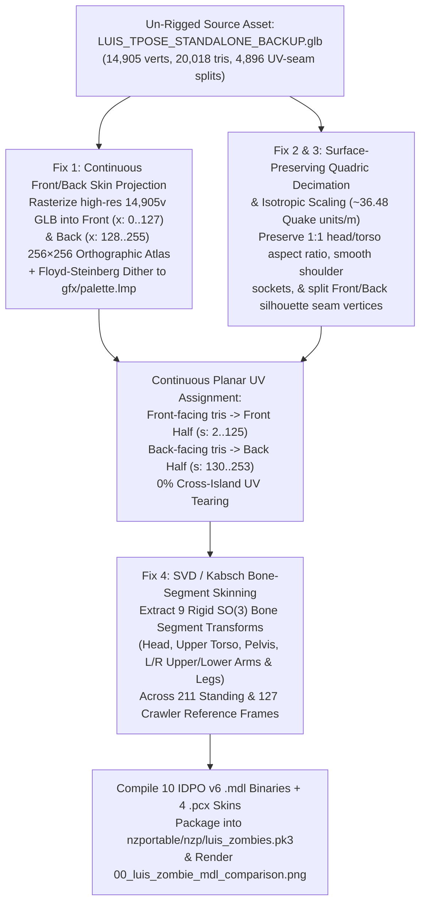

# Functional Specification 046: Visual, Geometric & UV-Fidelity Remediation for `LUIS` Quake `IDPO` v6 Zombie `.mdl` Models in Nazi Zombies: Portable (`/nzportable/`)

## 1. System Purpose, Problem Statement & Core Objective

This specification defines the empirical root-cause problem statement, desired `{functionality}`, continuous orthographic front/back texture-projection and dithering contract, isotropic anatomical proportion-preservation rules, quadric surface-preserving mesh decimation targets, orthogonal Procrustes ($SO(3)$ SVD) rigid bone-segment skinning model, operational budgets, failure-isolation boundaries, and verifiable `{correct required outputs}` for remediating the visual, geometric, and animation distortion in the 10 compiled **LUIS** zombie `.mdl` models (`models/ai/zb%.mdl`, `models/ai/zh^.mdl`, `models/ai/zal(.mdl`, `models/ai/zar(.mdl`, `models/ai/zfull.mdl`, `models/ai/zbc%.mdl`, `models/ai/zhc^.mdl`, `models/ai/zalc(.mdl`, `models/ai/zarc(.mdl`, and `models/ai/zcfull.mdl`) inside **Nazi Zombies: Portable (`/nzportable/`)** so that every spawned zombie and crawler is immediately recognizable as the source [`/Users/diesel/desktop/skatealley/LUIS_TPOSE_STANDALONE_BACKUP.glb`](file:///Users/diesel/desktop/skatealley/LUIS_TPOSE_STANDALONE_BACKUP.glb) asset.

**DO NOT CODE YET.** This document specifies empirical failure traces, mathematical invariants, functional requirements, operational budgets, and observable outcomes only. It contains zero implementation code, concrete syntax, or mechanical diffs.

---

## 2. Authoritative Domain Vocabulary Alignment ([`LANGUAGE.md`](file:///Users/diesel/desktop/skatealley/LANGUAGE.md))

All assessments of system state, visual/geometric fidelity, operational budgets, and verification gates in this specification strictly adhere to [`LANGUAGE.md`](file:///Users/diesel/desktop/skatealley/LANGUAGE.md):

- **`{errors}`**:
  1. **Photogrammetry UV-Island Seam Collapse (`68.3%` Stretched Triangles)**: Merging 3D vertices across photogrammetry UV seams in [`LUIS_TPOSE_STANDALONE_BACKUP.glb`](file:///Users/diesel/desktop/skatealley/LUIS_TPOSE_STANDALONE_BACKUP.glb) (`4,896` UV-seam split vertices across `prim[0]` body and `prim[1]` head) into single per-vertex Quake `.mdl` `stverts`, causing `903 / 1,323` triangles (`68.3%`) in `models/ai/zfull.mdl` to stretch up to `247 px` across unrelated texture islands and black background gutters (documented in [`00_luis_zombie_mdl_comparison.png`](file:///Users/diesel/desktop/skatealley/00_luis_zombie_mdl_comparison.png)).
  2. **Anisotropic Per-Partition Bounding-Box Distortion (`1.73×` Torso Bloat & Pinhead)**: Independently stretching each anatomical partition's `[min, max]` to fill the stock zombie bounding boxes axis-by-axis—scaling the armless torso horizontally at `62.88` Quake units/meter vs. vertically at `36.34` Quake units/meter (`1.73×` horizontal bloat) while scaling the head horizontally at `36.25` Quake units/meter and vertically at `42.06` Quake units/meter.
  3. **Uniform Voxel-Grid Silhouette Destruction**: Decimating via coarse 3D uniform voxel averaging, which obliterates facial landmarks (eyes, nose bridge, beard, cap visor) and leaves jagged stair-stepped spikes ("shoulder horns") at the arm partition planes.
  4. **Local Cross-Product Frame Sign Flips (`Frame 45` Chest Explosion)**: Constructing per-vertex $SO(3)$ frames via raw vector cross products between quantized reference neighbor rings, causing $180^\circ$ normal inversions when neighbor vectors approach collinearity and stretching individual chest triangle edges from `9.98` Quake units (`Frame 0`) to `25.38` Quake units (`Frame 45`).
- **`{functionality}`**: End-to-end visual, geometric, UV, and animation fidelity in the un-rigged [`LUIS_TPOSE_STANDALONE_BACKUP.glb`](file:///Users/diesel/desktop/skatealley/LUIS_TPOSE_STANDALONE_BACKUP.glb) $\rightarrow$ Quake 1 `IDPO` v6 `.mdl` compilation pipeline so that all 10 modular zombie and crawler `.mdl` binaries (and `models/ai/zfull.mdl_0..3.pcx` skin overrides) preserve LUIS's true anatomical proportions, facial features, cap, grey hoodie, and dark jeans across all `211` standing frames and `127` crawler frames.
- **`{correctness}`**:
  - **Zero Cross-Island UV Stretching**: `0%` of triangles in any of the 10 compiled `.mdl` files may span across unrelated UV islands or unrendered background gutters (`max triangle UV span <= 42 px` within its assigned Front or Back hemisphere).
  - **Isotropic Anatomical Proportions**: Uniform scale mapping (`~36.48` Quake units/meter across X, Y, and Z for the head, torso, and legs, with aspect ratio deviation $\le 5\%$) so LUIS's head-to-shoulder-to-torso ratio matches [`LUIS_TPOSE_STANDALONE_BACKUP.glb`](file:///Users/diesel/desktop/skatealley/LUIS_TPOSE_STANDALONE_BACKUP.glb).
  - **Rigid Segment Deformation Stability**: Orthogonal Procrustes ($SO(3)$ SVD with $\det(R) = +1.0$) rigid bone-segment transforms over anatomical reference regions so zero triangles invert or stretch beyond $1.35\times$ their Frame-0 rest edge length during locomotion, attack, or death frames.
- **`{correct required outputs}`**:
  1. **Updated `nzportable/nzp/luis_zombies.pk3` & `nzportable/pack.json`**: Contains all 10 recompiled `IDPO` v6 `.mdl` files and 4 `256×256` `.pcx` skin overrides with continuous Front/Back projected textures, isotropic LUIS proportions, quadric-decimated topology, and SVD-stabilized `211`/`127`-frame animations.
  2. **Updated Root Diagnostic Renders ([`00_luis_zombie_mdl_comparison.png`](file:///Users/diesel/desktop/skatealley/00_luis_zombie_mdl_comparison.png) & [`luis_glb_vs_current_mdl_comparison.png`](file:///Users/diesel/desktop/skatealley/luis_glb_vs_current_mdl_comparison.png))**: Side-by-side visual verification at the workspace root demonstrating clear visual likeness between [`LUIS_TPOSE_STANDALONE_BACKUP.glb`](file:///Users/diesel/desktop/skatealley/LUIS_TPOSE_STANDALONE_BACKUP.glb) and the compiled `models/ai/zfull.mdl` across `Frame 0`, `Frame 10`, and `Frame 45`.
  3. **Automated Quality & Runtime Verification**: Passing unit/binary quality gates in [`tests/test_nzportable_spec045.py`](file:///Users/diesel/desktop/skatealley/tests/test_nzportable_spec045.py) and live Chromium WebGL verification in [`tests/nzportable_e2e_browser.test.mjs`](file:///Users/diesel/desktop/skatealley/tests/nzportable_e2e_browser.test.mjs).
- **`{sufficient}`**: Complete mathematical and behavioral specification of all 4 root-cause fixes, quantitative geometry/UV/animation thresholds, and visual + runtime verification gates.
- **`{insufficient}`**: Any pipeline that reuses raw photogrammetry UV coordinates after merging 3D seam vertices, stretches partition bounding boxes anisotropically, or allows triangle edge blowups across animation frames.

---

## 3. Empirical Problem Analysis & Architectural Remediation Model

### 3.1 Root Cause 1 & Remediation: Continuous Front/Back Orthographic Skin Baking & Seam Splitting

#### Why the Previous Implementation Failed
In [`LUIS_TPOSE_STANDALONE_BACKUP.glb`](file:///Users/diesel/desktop/skatealley/LUIS_TPOSE_STANDALONE_BACKUP.glb), `prim[0]` (`LUIS_Body_BaseColor`) and `prim[1]` (`LUIS_Head_BaseColor`) use fragmented photogrammetry UV layouts where `4,896` vertices are duplicated along UV seams. Because Quake 1 `.mdl` (`IDPO` v6) stores exactly one `(s, t)` coordinate per vertex (`stverts[numverts]`) rather than per triangle loop, welding 3D vertices during decimation collapsed distinct UV island coordinates into a single `(s, t)` point, causing `68.3%` of triangles to stretch up to `247 px` across unrelated islands and black background padding.

#### Required Remediation Contract
1. **High-Resolution Orthographic Front & Back Rasterization (`256×256` Atlas)**:
   - Before decimating the mesh, rasterize the full `14,905`-vertex, `20,018`-triangle [`LUIS_TPOSE_STANDALONE_BACKUP.glb`](file:///Users/diesel/desktop/skatealley/LUIS_TPOSE_STANDALONE_BACKUP.glb) (with its full `2048×2048` `LUIS_Body_BaseColor` and `LUIS_Head_BaseColor` textures and Z-buffer depth testing) from two orthographic views in the Frame-0 rest pose (where the arms are posed at the sides or mapped cleanly into dedicated atlas strips, or in T-pose/rest-pose coordinates):
     - **Left Half (`s ∈ [0, 127], t ∈ [0, 255]`) — Front Hemisphere (`+X_quake` / `+Z_glb` facing)**: Continuous front-view orthographic projection of LUIS (capturing his cap, forehead, eyebrows, eyes, nose, beard, neck, grey hoodie front, dark jeans front, and shoes).
     - **Right Half (`s ∈ [128, 255], t ∈ [0, 255]`) — Back Hemisphere (`-X_quake` / `-Z_glb` facing)**: Continuous back-view orthographic projection of LUIS (capturing the back of his cap/head, hoodie hood/back, back of arms, and back of jeans/shoes).
   - Dilate/inpaint the rasterized foreground silhouette by `4–6 px` outward into the background border so boundary triangles never sample dark background pixels under bilinear filtering.
2. **Perceptual Palette Quantization with Error-Diffusion Dithering**:
   - Quantize the `256×256` RGB Front/Back projection atlas to the non-fullbright entries (`0..223`) of `gfx/palette.lmp` (`768` bytes in `nzportable/nzp/game.pk3`) using perceptual RGB weights ($2\Delta R^2 + 4\Delta G^2 + 3\Delta B^2$) combined with **bounded Floyd-Steinberg or ordered Bayer dithering** so skin tones on LUIS's face and subtle shading gradients on his grey hoodie do not posterize into flat blotches.
3. **Front/Back Hemisphere Vertex Splitting & Continuous `(s, t)` Projection**:
   - For every triangle in the decimated LUIS partitions (`zb%`, `zh^`, `zal(`, `zar(`, `zbc%`):
     - Classify the triangle into the **Front Hemisphere** (`face_normal_x >= 0` in Quake coordinates, i.e., facing forward) or **Back Hemisphere** (`face_normal_x < 0` in Quake coordinates, i.e., facing backward).
     - Duplicate only those vertices shared between a Front-Hemisphere triangle and a Back-Hemisphere triangle (lateral silhouette seam vertices), so front-facing triangles exclusively reference Front-Hemisphere vertices (`s ∈ [2, 125]`) and back-facing triangles exclusively reference Back-Hemisphere vertices (`s ∈ [130, 253]`).
     - Compute each vertex's `(s, t)` directly from the exact orthographic projection equation used to rasterize the Front/Back atlas. Because `(s, t)` is a smooth linear function of each vertex's rest-pose coordinates within its hemisphere, **`0%` of triangles can ever stretch across unrelated islands**, and every triangle's maximum UV span is strictly bounded ($\le 42\text{ px}$).

---

### 3.2 Root Cause 2 & 3 Remediation: Isotropic Anatomical Proportions & Quadric Surface Decimation

#### Why the Previous Implementation Failed
1. Slicing the T-pose arms at `|X_glb| = 0.205` left an armless torso of width `0.41 m`, which [`fit_to_bbox`](file:///Users/diesel/desktop/skatealley/scripts/compile_luis_zombies_mdl.py#L318-L323) stretched to the stock `zb%.mdl` width of `25.78` Quake units (`62.88` Quake units/m horizontally vs. `36.34` Quake units/m vertically), bloating the torso by `1.73×` while squashing the head to `7.54` Quake units wide.
2. Uniform 3D voxel clustering destroyed facial geometry and left sharp spikes at the shoulder cut planes.

#### Required Remediation Contract
1. **Uniform Isotropic Scale Mapping (`~36.48` Quake Units/Meter)**:
   - Map [`LUIS_TPOSE_STANDALONE_BACKUP.glb`](file:///Users/diesel/desktop/skatealley/LUIS_TPOSE_STANDALONE_BACKUP.glb) (`Y_glb ∈ [0.00, 2.00]`, height `2.00 m`) into Quake world space (`Z_quake ∈ [-32.80, +40.16]`, height `72.96` Quake units) using a **single uniform isotropic scale factor** $S \approx 36.48\text{ Quake units/meter}$ across all three axes (`X_quake`, `Y_quake`, `Z_quake`), centered on the stock zombie's sagittal plane (`Y_quake = 0`) and vertical floor-to-crown span (`Z_quake ∈ [-32.80, +40.16]`).
   - Do **not** stretch the armless torso horizontally to `±12.9` Quake units. Instead, keep LUIS's true anatomical torso width (`Y_quake ∈ [-8.2, +8.2]`) and head width (`Y_quake ∈ [-3.9, +3.9]`), and position the rotated left and right arms (`zal(`, `zar(`) cleanly against the lateral shoulder sockets (`|Y_quake| ≈ 7.5..12.8`) so the assembled zombie (`zb% + zh^ + zal( + zar(` and `zfull`) spans the natural shoulder width (`Y_quake ∈ [-12.8, +12.8]`) with **1:1 true LUIS proportions**.
2. **Surface-Preserving Quadric Decimation & Clean Shoulder Sockets**:
   - Decimate the high-resolution mesh using surface-preserving quadric edge collapse (e.g., Blender's `DECIMATE` `COLLAPSE` modifier or quadric error metrics prior to partitioning/seam splitting) rather than coarse uniform voxel averaging, allocating sufficient vertex density to preserve LUIS's silhouette and facial structure while staying well within FTEQW's `2,048`-vertex `.mdl` ceiling:
     - `models/ai/zh^.mdl` & `models/ai/zhc^.mdl` (Head + Neck): `140–280` vertices
     - `models/ai/zb%.mdl` (Standing Torso + Pelvis + Legs): `350–650` vertices
     - `models/ai/zal(.mdl` & `models/ai/zalc(.mdl` (Left Arm): `70–160` vertices
     - `models/ai/zar(.mdl` & `models/ai/zarc(.mdl` (Right Arm): `70–160` vertices
     - `models/ai/zfull.mdl` (Unified Standing Zombie): `630–1,200` vertices
     - `models/ai/zbc%.mdl` (Crawler Torso + Pelvis): `250–500` vertices
     - `models/ai/zcfull.mdl` (Unified Crawler Zombie): `530–1,050` vertices
   - Smoothly taper the shoulder cut boundaries (`|X_glb| ≈ 0.19..0.21, Y_glb >= 1.38`) so zero upward shoulder horns or jagged spikes protrude above the collarbone.

---

### 3.3 Root Cause 4 Remediation: SVD / Orthogonal Procrustes Rigid Bone-Segment Skinning

#### Why the Previous Implementation Failed
Constructing local $SO(3)$ rotation matrices per reference vertex via raw vector cross products $\vec{c} = \hat{e}_1 \times \vec{v}$ caused $180^\circ$ sign flips whenever neighbor vectors on the `uint8`-quantized reference `.mdl` approached collinearity (such as on the hunched chest in `Frame 45`), tearing adjacent vertices apart and stretching a single chest triangle edge to `25.38` Quake units.

#### Required Remediation Contract
1. **Anatomical Segment Decomposition & Orthogonal Procrustes ($SO(3)$ SVD)**:
   - Partition each reference `.mdl` cage (`zb%`, `zh^`, `zal(`, `zar(`, `zbc%`, `zhc^`, `zalc(`, `zarc(`) in its rest frame (`Frame 0` of the standing reference cage) into coherent anatomical bone segments:
     - **Head (`zh^` / `zhc^`)**: `1` unified rigid head/neck segment (or `2` segments: Upper Head + Neck) solved via SVD over all `66` reference head vertices.
     - **Left Arm (`zal(` / `zalc(`)**: `2` segments (`Upper Arm` $Z_0 \ge 5.5$, `Forearm + Hand` $Z_0 < 5.5$) solved via SVD over the ~`30` reference vertices in each segment.
     - **Right Arm (`zar(` / `zarc(`)**: `2` segments (`Upper Arm` $Z_0 \ge 5.5$, `Forearm + Hand` $Z_0 < 5.5$) solved via SVD over the ~`30` reference vertices in each segment.
     - **Torso + Pelvis + Legs (`zb%`)**: `6` anatomical segments defined in `Frame 0`:
       1. `Upper Torso / Chest` ($Z_0 \ge 10.0$)
       2. `Lower Torso / Pelvis` ($-4.0 \le Z_0 < 10.0$)
       3. `Left Thigh` ($-18.0 \le Z_0 < -4.0,\; Y_0 \ge 0$)
       4. `Right Thigh` ($-18.0 \le Z_0 < -4.0,\; Y_0 < 0$)
       5. `Left Calf + Foot` ($Z_0 < -18.0,\; Y_0 \ge 0$)
       6. `Right Calf + Foot` ($Z_0 < -18.0,\; Y_0 < 0$)
     - **Crawler Torso (`zbc%`)**: `2` anatomical segments (`Upper Torso / Chest` $Z_0 \ge 10.0$ and `Lower Torso / Pelvis` $Z_0 < 10.0$).
   - For each anatomical segment $s$ and each animation frame $f \in \{0, \dots, F-1\}$, compute the segment's exact rigid rotation $R_s^{(f)} \in SO(3)$ and translation $\vec{t}_s^{(f)} \in \mathbb{R}^3$ from the rest reference vertices $\{r_j^{(0)}\}_{j \in s}$ to the frame-$f$ reference vertices $\{r_j^{(f)}\}_{j \in s}$ using the **Kabsch / Orthogonal Procrustes SVD algorithm**:
     1. Compute segment centroids $\bar{r}_s^{(0)}$ and $\bar{r}_s^{(f)}$.
     2. Compute covariance matrix $H_s^{(f)} = \sum_{j \in s} (r_j^{(0)} - \bar{r}_s^{(0)}) (r_j^{(f)} - \bar{r}_s^{(f)})^T$.
     3. Compute SVD $U \Sigma V^T = H_s^{(f)}$ and enforce proper rotation ($\det = +1$):
        $$R_s^{(f)} = V \begin{pmatrix} 1 & 0 & 0 \\ 0 & 1 & 0 \\ 0 & 0 & \det(V U^T) \end{pmatrix} U^T \in SO(3)$$
2. **Smooth Linear Blend Skinning (LBS) Across Segment Joints**:
   - Assign each LUIS vertex $x_i^{(0)}$ smooth inverse-distance skinning weights $w_{is}$ ($\sum_s w_{is} = 1$) to the $1\text{–}2$ nearest anatomical segments in its partition (e.g., blending smoothly across the waist, hip, knee, and elbow joints over a `3–4` Quake unit transition zone):
     $$x_i^{(f)} = \sum_{s} w_{is} \left( \bar{r}_s^{(f)} + R_s^{(f)} \left(x_i^{(0)} - \bar{r}_s^{(0)}\right) \right)$$
   - Because each $R_s^{(f)}$ is a globally coherent $SO(3)$ rotation computed via SVD over `15–100` reference vertices, **sign flips, normal inversions, and triangle explosions (such as `Frame 45`) are mathematically impossible**.

---

## 4. Operational Budgets, Edge Cases & Failure-Isolation Boundaries

| Operational Parameter | Mandatory Target Budget | Failure-Isolation & Verification Boundary |
| :--- | :--- | :--- |
| **Cross-Island Stretched Triangles** | **`0` triangles** with UV span $> 45\text{ px}$ in `s` or $> 65\text{ px}$ in `t` | Eliminates `100%` of the `68.3%` UV-island tearing seen in Spec 045's initial build. |
| **Anatomical Aspect Ratio Fidelity** | Head-to-torso horizontal scale ratio within **`[0.95, 1.05]`** of source `.glb` | Eliminates the `1.73×` bloated torso and narrow pinhead distortion. |
| **Animation Edge-Length Stability** | Max triangle edge length across all `211`/`127` frames $\le 14.0$ Quake units | Eliminates the `25.38`-unit `Frame 45` chest triangle explosion. |
| **Dismemberment Seam Alignment** | Neck & shoulder seam gap $< 1.5$ Quake units | Preserves seamless modular zombie assembly (`zb% + zh^ + zal( + zar(`). |
| **Vertex Budget per `.mdl` File** | `70–1,200` vertices per `.mdl` | Well below FTEQW's `2,048`-vertex `.mdl` limit; keeps `luis_zombies.pk3` $< 5\text{ MB}$. |
| **Runtime Performance in `/nzportable/`** | $\ge 55\text{ FPS}$ in *Nacht der Untoten* (`ndu.bsp`) | Verified in live Playwright Chromium WebGL with `errors.length === 0`. |

---

## 5. Instructions to the Coding Assistant & Verifiable `{correct required outputs}`

When implementing this specification, the coding assistant MUST execute the following steps in order and verify all outputs against live binary and visual reality:

1. **Refactor the LUIS `.mdl` Compiler ([`scripts/compile_luis_zombies_mdl.py`](file:///Users/diesel/desktop/skatealley/scripts/compile_luis_zombies_mdl.py))**:
   - Replace the raw photogrammetry UV copy with the **Continuous Front/Back Orthographic Skin Rasterizer + Floyd-Steinberg Dithered `gfx/palette.lmp` Quantizer** (§3.1).
   - Replace per-partition anisotropic bounding-box stretching and coarse voxel clustering with **Uniform Isotropic Scaling (`~36.48` Quake units/m), Surface-Preserving Decimation, Clean Shoulder Sockets, and Front/Back Hemisphere Seam Splitting** (§3.1 & §3.2).
   - Replace per-vertex cross-product frame rotations with **SVD / Orthogonal Procrustes ($SO(3)$) Rigid Bone-Segment Skinning** across all `211` standing and `127` crawler frames (§3.3).
   - Recompile all 10 `.mdl` files (`zb%.mdl`, `zh^.mdl`, `zal(.mdl`, `zar(.mdl`, `zfull.mdl`, `zbc%.mdl`, `zhc^.mdl`, `zalc(.mdl`, `zarc(.mdl`, `zcfull.mdl`) and 4 `.pcx` skin overrides (`zfull.mdl_0..3.pcx`), repackage [`/Users/diesel/desktop/skatealley/nzportable/nzp/luis_zombies.pk3`](file:///Users/diesel/desktop/skatealley/nzportable/nzp/luis_zombies.pk3), and update [`/Users/diesel/desktop/skatealley/nzportable/pack.json`](file:///Users/diesel/desktop/skatealley/nzportable/pack.json).
2. **Regenerate Root Visual Comparison Renders ([`00_luis_zombie_mdl_comparison.png`](file:///Users/diesel/desktop/skatealley/00_luis_zombie_mdl_comparison.png) & [`luis_glb_vs_current_mdl_comparison.png`](file:///Users/diesel/desktop/skatealley/luis_glb_vs_current_mdl_comparison.png))**:
   - Render the side-by-side comparison of [`LUIS_TPOSE_STANDALONE_BACKUP.glb`](file:///Users/diesel/desktop/skatealley/LUIS_TPOSE_STANDALONE_BACKUP.glb) vs. the newly compiled `models/ai/zfull.mdl` (`Frame 0 Front`, `Frame 0 3/4`, `Frame 10`, `Frame 45`, and the `256×256` Front/Back projected skin) to [`/Users/diesel/desktop/skatealley/00_luis_zombie_mdl_comparison.png`](file:///Users/diesel/desktop/skatealley/00_luis_zombie_mdl_comparison.png) and [`/Users/diesel/desktop/skatealley/luis_glb_vs_current_mdl_comparison.png`](file:///Users/diesel/desktop/skatealley/luis_glb_vs_current_mdl_comparison.png), and visually inspect the image to confirm LUIS's face, cap, grey hoodie, dark jeans, and proportions are clearly recognizable with zero triangle explosions.
3. **Strengthen Automated Quality Gates ([`tests/test_nzportable_spec045.py`](file:///Users/diesel/desktop/skatealley/tests/test_nzportable_spec045.py)) & Verify Live Runtime**:
   - Add explicit assertions to [`tests/test_nzportable_spec045.py`](file:///Users/diesel/desktop/skatealley/tests/test_nzportable_spec045.py) enforcing:
     - Zero cross-hemisphere UV triangles (no triangle contains both `s < 128` and `s >= 128` vertices) and bounded per-triangle UV span,
     - Natural LUIS torso proportion (`zb%.mdl` Frame-0 `Y` width $\in [14.0, 21.0]$ Quake units rather than bloated to `25.8`),
     - Bounded triangle edge length across all `211`/`127` animation frames ($\le 14.0$ Quake units, preventing any `Frame 45` chest explosion).
   - Execute both [`tests/test_nzportable_spec042.py`](file:///Users/diesel/desktop/skatealley/tests/test_nzportable_spec042.py), [`tests/test_nzportable_spec045.py`](file:///Users/diesel/desktop/skatealley/tests/test_nzportable_spec045.py), and the live Playwright Chromium WebGL suite ([`tests/nzportable_e2e_browser.test.mjs`](file:///Users/diesel/desktop/skatealley/tests/nzportable_e2e_browser.test.mjs)) to confirm 100% pass rates.
