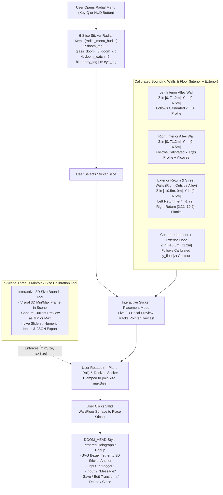

# Functional Specification 047: Interactive 3D Holographic Sticker Placement, Radial Menu Sticker Catalog, In-Scene Min/Max Size Calibration Tool, Aligned Interior/Exterior Wall & Floor Bounding Surfaces, and Tethered Holographic Tagger/Message Popup

## 1. System Purpose & Core Objective

This specification defines the desired `{functionality}`, spatial and geometric invariants, surface-normal projection rules, interactive rotation and resizing bounds, in-scene min/max size calibration tool behavior, radial menu sticker selection workflow, DOOM_HEAD-style tethered holographic popup lifecycle (`"Tagger:"` and `"Message:"` inputs), operational and performance budgets, edge-case failure-isolation boundaries, and verifiable `{correct required outputs}` for enabling interactive user sticker placement across the Freeman Alley 3D environment ([`/Users/diesel/desktop/skatealley/index.html`](file:///Users/diesel/desktop/skatealley/index.html)).

The primary objective is to allow users to select holographic die-cut stickers from the radial menu, place them onto any wall or floor surface inside the alleyway as well as right outside the alleyway entrance, rotate and resize their stickers within calibrated minimum and maximum size limits (defined directly from the Three.js scene via a dedicated calibration tool), and attach a tagger identity and message to each placed sticker via a tethered holographic popup modeled after the DOOM_HEAD holographic dialogue overlay.

**DO NOT CODE YET.** This document specifies functional requirements, physical and spatial geometry, state transitions, operational budgets, and observable outcomes only. It contains zero implementation code, concrete syntax, or mechanical diffs.

---

## 2. Authoritative Domain Vocabulary Alignment ([`LANGUAGE.md`](file:///Users/diesel/desktop/skatealley/LANGUAGE.md))

All evaluations of system state, operational constraints, and verification gates within this specification strictly adhere to the authoritative taxonomy established in [`LANGUAGE.md`](file:///Users/diesel/desktop/skatealley/LANGUAGE.md):

- **`{functionality}`**: End-to-end interactive sticker placement workflow within the live Freeman Alley 3D scene:
  1. Selecting any of the 6 holographic die-cut stickers from the 2D HUD Radial Menu ([`/Users/diesel/desktop/skatealley/radial_menu_hud.js`](file:///Users/diesel/desktop/skatealley/radial_menu_hud.js) & [`/Users/diesel/desktop/skatealley/holographic_stickers.js`](file:///Users/diesel/desktop/skatealley/holographic_stickers.js)).
  2. Defining and enforcing global minimum and maximum sticker size bounds (`[minSize, maxSize]`) directly within the live Three.js scene using a dedicated in-scene Sticker Size Calibration Tool.
  3. Projecting, previewing, and placing stickers flush onto all interior alleyway walls (`Z >= 0`), exterior building return and boundary walls right outside the alleyway (`Z <= 0`), and both interior and exterior floor surfaces (`Z in [-10.50m, 71.20m]`) via properly aligned bounding wall and floor surfaces.
  4. Rotating stickers in-plane around the surface normal and resizing stickers uniformly within `[minSize, maxSize]` while preserving each sticker's native cropped aspect ratio.
  5. Materializing a DOOM_HEAD-style SVG-tethered holographic popup immediately upon sticker placement (and upon clicking an existing placed sticker) containing two interactive input boxes—**`"Tagger:"`** and **`"Message:"`**—while isolating keyboard and pointer events from 3D scene locomotion and camera controls.
- **`{correctness}`**:
  - **Surface Flush Alignment:** Every placed or previewed sticker aligns its local surface normal $\vec{N}_{\text{sticker}}$ parallel to the hit bounding surface's outward unit normal $\vec{N}_{\text{surface}}$ ($\vec{N}_{\text{sticker}} \cdot \vec{N}_{\text{surface}} \ge 0.999$) and positions its center at an exact normal standoff of $\Delta n = +0.015\text{ m}$ from the calibrated wall or floor surface so the decal never sinks behind brick/cobblestone relief, floats in mid-air, or exhibits depth buffer z-fighting.
  - **Aspect-Ratio & Size Clamping Fidelity:** Resizing any sticker scales its width $W$ and height $H$ uniformly around its native cropped aspect ratio $A = W_{\text{crop}} / H_{\text{crop}}$ such that its governing size scalar $S$ satisfies $S_{\min} \le S \le S_{\max}$ across all user resize actions and tool adjustments, with aspect ratio drift $|(W/H) - A| < 10^{-3}$.
  - **In-Plane Rotation Orthogonality:** Rotating a sticker by angle $\theta \in [-\pi, +\pi]\text{ rad}$ (`[-180°, +180°]`) rotates the sticker strictly within the tangent plane of the host wall or floor surface (around $\vec{N}_{\text{surface}}$) without tilting the sticker into or away from the surface.
  - **Input Isolation & Data Binding:** Focusing either the **`"Tagger:"`** or **`"Message:"`** input box inside the sticker holographic popup suppresses all single-key 3D sandbox hotkeys (`W`, `A`, `S`, `D`, `Space`, `Shift`, `Q`, `E`, `G`, `H`, `K`, `L`, `M`, `P`, `T`, `U`, `X`, `B`, `0–9`, `<`, `>`, `+`, `-`), and submitting or updating the form deterministically binds the `tagger` and `message` strings to that specific placed sticker instance.
- **`{correct required outputs}`**:
  1. **Radial Menu Catalog Output:** Opening the radial menu (`Q` key or HUD trigger) displays the 6 holographic sticker assets (`doom_tag`, `glass_doom`, `doom_cig`, `doom_watch`, `blueberry_tag`, `eye_tag`) with their artwork thumbnails and labels; selecting a wedge activates Sticker Placement Mode with that sticker asset.
  2. **In-Scene Size Calibration Tool Output:** Adjusting or capturing `minSize` and `maxSize` in the Three.js scene tool immediately updates the live visual reference bounds in the 3D viewport, persists the calibrated `[minSize, maxSize]` envelope in runtime state, and clamps all active and subsequent sticker resize operations to `[minSize, maxSize]`.
  3. **Wall & Floor Placement Output:** Raycasting and placing stickers succeeds across all 5 surface zones—(a) Left Interior Alley Wall (`Z in [0.0m, 71.2m]`), (b) Right Interior Alley Wall (`Z in [0.0m, 71.2m]`), (c) Exterior Left & Right Facade Return Walls right outside the alleyway (`Z in [-10.5m, 0.0m]`, `X in [-9.4m, -1.72m]` and `X in [2.21m, 10.2m]`), (d) Interior Alley Floor (`Z in [0.0m, 71.2m]`), and (e) Exterior Street/Sidewalk Floor right outside the alleyway (`Z in [-10.5m, 0.0m]`).
  4. **Tethered Holographic Popup Output:** Placing a sticker transitions the Sticker Holographic Popup into its active visible state, renders the screen-space SVG Bezier leader-line tether from the placed 3D sticker's world anchor to the holographic dialog panel, exposes interactive **`"Tagger:"`** and **`"Message:"`** input boxes, and stores the submitted `tagger` and `message` payload on the sticker record.
  5. **Observable Telemetry Contract:** Runtime telemetry exposes the active calibration bounds (`minSize`, `maxSize`), bounding surface alignment status, total placed sticker count, currently selected/active sticker transform (`position`, `normal`, `rotationRad`, `size`, `surfaceZone`), and the popup state (`isOpen`, `activeStickerId`, `tagger`, `message`).
- **`{errors}`**:
  - Raycasting against uncalibrated raw `COLLIDER_WALL_L` or `COLLIDER_WALL_R` slabs that sit up to `0.94 m` away from the visible brick wall or terminate at `Y = 3.0 m`, causing stickers to float in mid-air or sink inside the wall mesh.
  - Omitting calibrated bounding wall or floor surfaces right outside the alleyway (`Z <= 0.0 m`), preventing users from placing stickers on the exterior storefront return walls or exterior sidewalk/street floor.
  - Performing unindexed per-frame pointer-move raycasts against the 50,638-vertex `VISUAL_ALLEY_MESH` in the hot loop instead of low-poly calibrated bounding surfaces.
  - Allowing sticker sizes below `minSize`, above `maxSize`, or with distorted aspect ratios.
  - Allowing keyboard input inside `"Tagger:"` or `"Message:"` to trigger character movement, radial menu toggling, or scene tools.
- **`{sufficient}`**: Complete functional and spatial specification of the 6-slice radial menu catalog, the in-scene min/max size calibration tool, the exact interior and exterior bounding wall/floor surface coordinates, the surface-normal orientation and in-plane rotation math, and the DOOM_HEAD-style tethered holographic popup with `"Tagger:"` and `"Message:"` inputs.
- **`{insufficient}`**: Any specification that leaves exterior walls (`Z <= 0`) or upper walls (`Y > 3.0 m`) unplaceable, hardcodes arbitrary min/max sizes without an in-scene Three.js calibration tool, omits rotation/resize controls, or fails to isolate keyboard events when typing `"Tagger:"` and `"Message:"`.

---

## 3. First-Principles Spatial & Physical Reality Model

Empirical inspection of [`/Users/diesel/desktop/skatealley/freeman_alley.glb`](file:///Users/diesel/desktop/skatealley/freeman_alley.glb), [`/Users/diesel/desktop/skatealley/holographic_stickers.js`](file:///Users/diesel/desktop/skatealley/holographic_stickers.js), [`/Users/diesel/desktop/skatealley/radial_menu_hud.js`](file:///Users/diesel/desktop/skatealley/radial_menu_hud.js), and [`/Users/diesel/desktop/skatealley/sandbox.js`](file:///Users/diesel/desktop/skatealley/sandbox.js) establishes the physical constraints governing this subsystem:

### 3.1 Discrepancy Between Raw GLB Colliders and Visual Alley/Exterior Surfaces
1. **Interior Alleyway Wall Drift (`Z in [0.00m, 71.20m]`):**
   - In `freeman_alley.glb`, `VISUAL_ALLEY_MESH` contains `50,638` vertices spanning `X in [-11.65m, +10.78m]`, `Y in [-0.47m, +10.47m]`, and `Z in [-20.29m, +73.19m]`.
   - By contrast, the embedded `COLLIDER_WALL_L` (`12` vertices) and `COLLIDER_WALL_R` (`32` vertices) meshes are coarse vertical slabs capped at height `Y = 3.00 m`. Along the primary corridor (`Z in [0.00m, 44.00m]`), raw `COLLIDER_WALL_L` is a single straight plane from `X = -1.65 m` (`Z = 0`) to `X = -1.50 m` (`Z = 71.2`), whereas the actual photogrammetric left brick wall bows outward to `X = -2.66 m` at `Z = 26.2 m` (a **`0.94 m` lateral discrepancy**). Similarly, raw `COLLIDER_WALL_R` connects `X = +2.00 m` (`Z = 0`) to `X = +1.65 m` (`Z = 44.0`), whereas the actual right brick wall follows a piecewise profile from `X = +2.24 m` (`Z = 0`) to `X = +1.52 m` (`Z = 34.0`) and steps out to `X = +3.45 m` at `Z = 44.0 m`.
   - Furthermore, capping wall colliders at `Y = 3.00 m` prevents placing stickers on upper brick wall sections (`Y in [3.00m, 6.50m]`).
2. **Exterior Walls Right Outside the Alleyway (`Z <= 0.00m`):**
   - Right outside the alleyway mouth (`Z = 0.00 m`), the building facade turns outward (`-Z` normal) on both sides of the entrance:
     - **Exterior Left Facade Return Wall:** Extends laterally from the left alley mouth corner (`X = -1.72 m, Z = 0.00 m`) across `X in [-9.40m, -1.72m]` along the exterior storefront plane (`Z approx 0.00 m` to `-0.35 m`), with a perpendicular outer street boundary wall along `X = -9.40 m` for `Z in [-10.50m, 0.00m]`.
     - **Exterior Right Facade Return Wall:** Extends laterally from the right alley mouth corner (`X = +2.21 m, Z = 0.00 m`) across `X in [+2.21m, +10.20m]` along the exterior storefront plane (`Z approx 0.00 m`), with a perpendicular outer street boundary wall along `X = +10.20 m` for `Z in [-10.50m, 0.00m]`.
     - **Exterior Street Threshold Wall (`Z = -10.50m`):** Spans `X in [-9.40m, +10.20m]` facing `+Z` (`(0, 0, +1)` normal) back toward the alley mouth.
3. **Interior & Exterior Floor Contour (`Z in [-10.50m, 71.20m]`):**
   - Raw `COLLIDER_FLOOR` (`14` vertices) is a flat plane at `Y = 0.00 m` across `Z in [-10.50m, 71.20m]`, whereas the visual cobblestone/asphalt floor height varies along `Z` (`Y approx 0.32 m` at the `Z = 0.00 m` alley mouth threshold, sloping to `0.25 m` at `Z = 8.00 m`, `0.05 m` across `Z in [16.00m, 32.00m]`, `0.14 m` at `Z = 44.00 m`, and `0.16 m–0.32 m` across the exterior street apron `Z in [-10.50m, 0.00m]`).
   - If floor stickers are placed at a flat `Y = 0.00 m` near the alley mouth (`Z in [-4.0m, +10.0m]`), they will be buried up to `0.30 m` beneath the visible cobblestone floor mesh!
4. **Compute Complexity of Raycasting (`O(1)` Bounding Proxies vs. `O(N)` Visual Mesh):**
   - Raycasting against `VISUAL_ALLEY_MESH` (`50,638` vertices / `~42,314` triangles) on every `pointermove` event during live sticker placement and drag-repositioning incurs `O(N)` triangle intersection checks per frame (`~1.8–3.5 ms` per pointer event on Apple M1), whereas raycasting against a dedicated, tightly calibrated set of low-poly bounding wall and floor meshes (`< 80` triangles total covering all interior walls, exterior return walls, and contoured floor segments) completes in **`< 0.05 ms`** (`O(1)`) while guaranteeing exact planar normal orientation and flush surface placement.

---

## 4. End-to-End System Architecture & Workflow

---

## 5. Detailed Functional Requirements

### 5.1 Radial Menu Sticker Catalog Integration
1. **6-Sticker Radial Menu Population:**
   - The 2D Cyber-Tactical HUD Radial Menu ([`/Users/diesel/desktop/skatealley/radial_menu_hud.js`](file:///Users/diesel/desktop/skatealley/radial_menu_hud.js)) must display the 6 authoritative stickers defined in [`STICKER_ASSET_MANIFEST`](file:///Users/diesel/desktop/skatealley/holographic_stickers.js#L14) as its selectable radial slices:
     1. **`doom_tag` (`HOLO-STK-01`)**: `tags/1DOOMTAG.jpeg` (`stickers_build/doom_tag/base_color.png`, aspect `2.8037:1`, label `"DOOM TAG"`).
     2. **`glass_doom` (`HOLO-STK-02`)**: `tags/Glass_DOOM.jpg` (`stickers_build/glass_doom/base_color.png`, aspect `2.3682:1`, label `"GLASS DOOM"`).
     3. **`doom_cig` (`HOLO-STK-03`)**: `tags/DOOMTAG_CIG.jpg` (`stickers_build/doom_cig/base_color.png`, aspect `1.0195:1`, label `"DOOM CIG"`).
     4. **`doom_watch` (`HOLO-STK-04`)**: `tags/DOOM_WATCH.jpg` (`stickers_build/doom_watch/base_color.png`, aspect `0.7661:1`, label `"DOOM WATCH"`).
     5. **`blueberry_tag` (`HOLO-STK-05`)**: `tags/blueberrytag.jpeg` (`stickers_build/blueberry_tag/base_color.png`, aspect `0.8955:1`, label `"BLUEBERRY"`).
     6. **`eye_tag` (`HOLO-STK-06`)**: `tags/eyetag.jpeg` (`stickers_build/eye_tag/base_color.png`, aspect `1.0198:1`, label `"EYE TAG"`).
2. **Thumbnail Harmonization & Selection Trigger:**
   - Each radial menu wedge renders the corresponding sticker's die-cut artwork thumbnail and telemetry code (`HOLO-STK-01`..`06`).
   - Selecting any sticker slice in the radial menu closes the radial menu overlay and immediately transitions the scene into **Interactive Sticker Placement Mode** with the chosen sticker asset active.

---

### 5.2 In-Scene Three.js Sticker Min/Max Size Calibration Tool
1. **Purpose & Direct 3D Scene Calibration Workflow:**
   - To enable defining the minimum (`minSize`) and maximum (`maxSize`) allowed sticker sizes directly from the Three.js scene, the system provides an interactive **Sticker Min/Max Size Calibration Tool** accessible from the scene HUD and synchronized with a live 3D visual reference in the viewport.
   - In this specification, a sticker's **size scalar $S$ (in meters)** represents the characteristic base dimension (`baseHeightMeters`, where sticker plane height $H = S / \sqrt{A}$ and width $W = S \cdot \sqrt{A}$ so that total surface area $W \times H = S^2$ is invariant across aspect ratios, or equivalently scaling the sticker's calibrated 1:1 metric plane dimensions uniformly by factor $S$).
2. **Interactive 3D Scene Calibration Capabilities:**
   - **Live 3D Reference Preview & Bounding Outlines:** When the calibration tool is active (or while sizing a sticker in the 3D scene), the user can toggle visible 3D wireframe/holographic size boundary frames right on the target wall or floor surface showing:
     - The **Minimum Size Frame (`minSize`)** in cyan/emerald outline.
     - The **Maximum Size Frame (`maxSize`)** in amber/magenta outline.
     - The **Current Sticker Size (`currentSize`)** inside those bounds.
   - **Direct Scene Capture ("Set Current as Min" / "Set Current as Max"):** While scaling a sticker directly in the 3D scene (using mouse wheel, `+`/`-` keys, or scale handle), the user can click **"Capture as Min Size"** or **"Capture as Max Size"** in the tool panel to lock the sticker's exact current 3D world size as the new global `minSize` or `maxSize` limit.
   - **Direct Sliders, Numeric Inputs & JSON Copy:** The tool also provides synchronized sliders and numeric inputs for `minSize` (e.g., configurable across `[0.05m, 5.00m]`, default baseline `0.25m`) and `maxSize` (configurable across `[0.10m, 8.00m]`, default baseline `2.40m`), plus a **"Copy Size Config JSON"** action so the user can export the calibrated `[minSize, maxSize]` values directly from the scene.
3. **Invariant Ordering & Clamping Enforcement:**
   - The tool enforces the strict mathematical invariant $0.05\text{ m} \le S_{\min} \le S_{\max} \le 10.0\text{ m}$. If the user sets `minSize` above `maxSize` (or vice versa), the complementary bound automatically adjusts or clamps so $S_{\min} \le S_{\max}$ is never violated.
   - Whenever `minSize` or `maxSize` is updated, the active placement preview sticker (and any sticker currently being resized) is immediately clamped into $[S_{\min}, S_{\max}]$.

---

### 5.3 Aligned Bounding Walls & Floor (Interior Alleyway + Exterior Right Outside the Alleyway)
To guarantee that stickers can be placed seamlessly onto all walls and the floor—both inside the alleyway and right outside the alleyway—the system must construct and align dedicated **Sticker Placement Bounding Surfaces** (`COLLIDER_STICKER_WALL_L`, `COLLIDER_STICKER_WALL_R`, `COLLIDER_STICKER_EXTERIOR_L`, `COLLIDER_STICKER_EXTERIOR_R`, `COLLIDER_STICKER_BOUND_START`, `COLLIDER_STICKER_BOUND_END`, and `COLLIDER_STICKER_FLOOR`) that conform to the true visual geometry of `freeman_alley.glb`:

| Surface Zone ID | Spatial Coverage (`X`, `Y`, `Z` in World Meters) | Outward Surface Normal $\vec{N}_{\text{surface}}$ | Geometric Alignment Requirement |
| :--- | :--- | :---: | :--- |
| **1. Left Interior Alley Wall** | `Z in [0.00m, 71.20m]`, `Y in [y_floor(z), 6.50m]`, `X = x_L(z)` (`-1.72m` at `Z=0` $\to$ `-2.66m` at `Z=26.2` $\to$ `-1.64m` at `Z=44` $\to$ `-1.50m` at `Z=71.2`) | Inward toward corridor `(+n_x, 0, +n_z)` ($\approx (+1, 0, 0)$) | Multi-segment vertical wall strip following the piecewise `resolveAlleyWallProfileX('L', z)` profile so decals sit flush on the left brick wall. |
| **2. Right Interior Alley Wall** | `Z in [0.00m, 71.20m]`, `Y in [y_floor(z), 6.50m]`, `X = x_R(z)` (`+2.24m` at `Z=0` $\to$ `+1.52m` at `Z=34` $\to$ `+1.87m` at `Z=43.8` $\to$ `+3.45m` step-out & rear alcoves to `Z=71.2`) | Inward toward corridor `(-n_x, 0, +n_z)` ($\approx (-1, 0, 0)$) | Multi-segment vertical wall strip following `resolveAlleyWallProfileX('R', z)` plus the `Z = 44.0m` alcove step-out (`X: 1.85m -> 3.45m`) and far corridor segments. |
| **3. Exterior Left Facade & Flank Walls (Right Outside Alley)** | **Front Return:** `X in [-9.40m, -1.72m]`, `Z = 0.00m`, `Y in [y_floor(0), 6.50m]` **Outer Street Flank:** `X = -9.40m`, `Z in [-10.50m, 0.00m]`, `Y in [y_floor(z), 6.50m]` | Front Return: `(0, 0, -1)` (facing `-Z` into street) Outer Flank: `(+1, 0, 0)` | Aligned with the left entrance facade return right outside the alley mouth and the left street boundary. |
| **4. Exterior Right Facade & Flank Walls (Right Outside Alley)** | **Front Return:** `X in [+2.21m, +10.20m]`, `Z = 0.00m`, `Y in [y_floor(0), 6.50m]` **Outer Street Flank:** `X = +10.20m`, `Z in [-10.50m, 0.00m]`, `Y in [y_floor(z), 6.50m]` **Street Start Wall:** `X in [-9.40m, +10.20m]`, `Z = -10.50m` | Front Return: `(0, 0, -1)` Outer Flank: `(-1, 0, 0)` Street Start: `(0, 0, +1)` | Aligned with the right entrance facade return right outside the alley mouth, the right street flank, and the `-10.50m` street boundary. |
| **5. Contoured Interior & Exterior Floor** | **Exterior Floor Apron:** `X in [-9.40m, +10.20m]`, `Z in [-10.50m, 0.00m]` **Interior Corridor Floor:** `X in [x_L(z), x_R(z)]`, `Z in [0.00m, 71.20m]` **Elevation:** `Y = y_floor(z)` (`0.16m..0.32m` for `Z <= 0`, `0.32m` at `Z=0`, `0.25m` at `Z=8`, `0.05m` at `Z=16..32`, `0.14m` at `Z=44`, `0.00m..0.14m` for `Z > 44`) | Upward `(0, +1, y_slope)` ($\approx (0, +1, 0)$) | Piecewise-contoured floor mesh spanning both the exterior street/sidewalk outside the alleyway and the entire interior alley floor so floor stickers never sink below the cobblestones. |

1. **Dual-Stage Surface Projection & Normal Offset:**
   - When the user aims at any wall or floor in the scene, the raycaster intersects the aligned bounding wall/floor surfaces (and optionally refines depth against `VISUAL_ALLEY_MESH` within a tight local tolerance window $\pm 0.25\text{ m}$ where brick/facade relief exists while retaining the clean planar surface normal $\vec{N}_{\text{surface}}$ of the bounding wall/floor).
   - Each sticker plane is positioned at:
     $$\vec{P}_{\text{sticker}} = \vec{P}_{\text{hit}} + \vec{N}_{\text{surface}} \cdot 0.015\text{ m}$$
     with `polygonOffset` enabled (`polygonOffsetFactor = -2`, `polygonOffsetUnits = -2`) so the sticker adheres cleanly to walls and floors without z-fighting.
2. **Boundary Margin Clamping on Edges/Corners:**
   - When placing a sticker near a wall-to-floor seam or wall corner, the sticker's center is either clamped so its bounding radius remains on the host surface or cleanly offset along $\vec{N}_{\text{surface}}$ so the edges of the sticker plane never clip through adjacent perpendicular walls or the floor.

---

### 5.4 Interactive Sticker Placement, Rotation, and Resizing
1. **Live Placement Preview State:**
   - Once a sticker is selected from the radial menu (or when moving an existing sticker), a live 3D holographic sticker preview tracks the user's pointer across all interior/exterior bounding walls and floor surfaces.
   - As the pointer moves from a wall onto the floor (or from an interior alley wall to an exterior wall right outside the alleyway), the sticker preview smoothly re-orients its tangent plane to match the new surface's outward normal $\vec{N}_{\text{surface}}$.
2. **In-Plane Sticker Rotation (`[-180°, +180°]`):**
   - Users can rotate a sticker around the host surface's normal vector $\vec{N}_{\text{surface}}$ both **before placing it** (during live preview) and **after placing it** (when selected/editing):
     - **Keyboard Controls:** Pressing `<` / `,` (or `[`) rotates counter-clockwise; pressing `>` / `.` (or `]`) rotates clockwise.
     - **Pointer / Gizmo / UI Controls:** Dragging a rotation handle, using `Shift + Mouse Wheel`, or adjusting the **Rotation (`deg` / `rad`)** slider in the sticker popup or HUD rotates the sticker smoothly across `[-180°, +180°]`.
   - **Tangent Basis Construction:** Given outward surface normal $\vec{N}_{\text{surface}}$, define the reference up tangent $\vec{U}_0 = \operatorname{normalize}(\vec{Y}_{\text{world}} - (\vec{Y}_{\text{world}} \cdot \vec{N}_{\text{surface}})\vec{N}_{\text{surface}})$ for walls (where $|\vec{N}_{\text{surface}} \cdot \vec{Y}_{\text{world}}| < 0.9$), or the camera/corridor forward horizontal tangent for the floor (where $|\vec{N}_{\text{surface}} \cdot \vec{Y}_{\text{world}}| \ge 0.9$), and apply the in-plane roll rotation matrix $\mathbf{R}(\vec{N}_{\text{surface}}, \theta)$ around $\vec{N}_{\text{surface}}$.
3. **Aspect-Locked Sticker Resizing Clamped to `[minSize, maxSize]`:**
   - Users can resize a sticker both **before placing it** and **after placing it**:
     - **Keyboard & Wheel Controls:** Pressing `+`/`=` (or scrolling up) increases size $S$; pressing `-`/`_` (or scrolling down) decreases size $S$.
     - **Pointer / Gizmo / UI Controls:** Dragging the scale handle or adjusting the **Size (`m`)** slider in the sticker popup or HUD scales the sticker in real time.
   - Every resize operation strictly clamps the resulting size scalar $S$ to the calibrated scene bounds:
     $$S_{\text{clamped}} = \operatorname{clamp}(S, \; S_{\min}, \; S_{\max})$$
     where $S_{\min}$ and $S_{\max}$ are governed by the In-Scene Three.js Sticker Min/Max Size Calibration Tool (§5.2).
4. **Committing Placement & Selecting Existing Stickers:**
   - Clicking on any valid bounding wall or floor surface while in Sticker Placement Mode places (commits) the sticker instance at that world position, normal orientation, in-plane rotation $\theta$, and clamped size $S_{\text{clamped}}$, and immediately opens the **Tethered Holographic Popup** (§5.5) for that sticker.
   - Clicking any previously placed sticker in the 3D scene selects that sticker, re-opens its Tethered Holographic Popup displaying its saved `Tagger:` and `Message:`, and allows the user to rotate, resize, relocate, or delete the sticker.

---

### 5.5 DOOM_HEAD-Style Tethered Holographic Popup (`"Tagger:"` & `"Message:"`)
1. **Visual & Architectural Parity with the DOOM_HEAD Holographic Popup:**
   - Modeled directly on the `#doom-holo-chat-overlay` architecture ([`/Users/diesel/desktop/skatealley/index.html`](file:///Users/diesel/desktop/skatealley/index.html#L1871)), the **Sticker Holographic Popup** (`#sticker-holo-popup-overlay`) is a hardware-accelerated diegetic holographic HUD overlay featuring:
     - Translucent glassmorphic terminal styling (`backdrop-filter: blur(14px)`, iridescent cyan `#00d5ff` and violet `#a855f7` / amber `#f59e0b` neon borders, animated horizontal scanlines, corner targeting reticles, and header status badge `HOLO.SYS // STICKER TAG TERMINAL`).
     - A dynamic full-viewport **SVG Bezier Tether (`#sticker-holo-tether-svg`)** with glowing dual-stroke paths and endpoint anchor dots that continuously projects the placed 3D sticker's world-space center into 2D screen coordinates (`project(camera)`) on every animation frame, visually tethering the floating holographic dialog box to the exact sticker on the wall or floor.
2. **Mandatory Input Boxes (`"Tagger:"` and `"Message:"`):**
   - The holographic popup MUST include two explicitly labeled interactive input controls:
     1. **`Tagger:`** — Text input field (e.g., `<input type="text">` associated with label `"Tagger:"`, placeholder `"Enter tagger name / handle..."`, max length `64` characters) recording the name or handle of the user who placed the sticker.
     2. **`Message:`** — Text input / multi-line field (associated with label `"Message:"`, placeholder `"Leave a message on this sticker..."`, max length `280` characters) recording the user's message attached to the sticker.
3. **Interactive Transform & Lifecycle Controls in the Popup:**
   - Alongside the **`Tagger:`** and **`Message:`** input boxes, the holographic popup provides:
     - **Live Rotate & Resize Controls** (compact sliders/buttons for **Rotation `-180°..+180°`** and **Size `minSize..maxSize`**) so the user can fine-tune the placed sticker's angle and size while viewing the popup.
     - **Save / Leave Message Button:** Commits the `Tagger:` and `Message:` text to the sticker's state, displays a confirmed holographic tag readout card on the popup, and persists the placed sticker in the scene.
     - **Move / Reposition & Delete Sticker Buttons:** Allows picking the sticker back up to place it elsewhere or removing it from the scene.
     - **Close (`×` / `ESC`) Button:** Dismisses the holographic popup while keeping the placed sticker (and its saved `Tagger:` and `Message:` metadata) mounted on the wall or floor.
4. **Strict Keyboard & Pointer Event Isolation:**
   - Clicking, dragging, or scrolling inside the Sticker Holographic Popup stops propagation to the 3D WebGL canvas so interacting with the popup never triggers camera orbit drags, corridor scrolling, or unintended sticker placements behind the panel.
   - Whenever the **`Tagger:`** or **`Message:`** input field is focused, all global 3D scene keyboard shortcuts (`WASD`, `Arrows`, `Space`, `Shift`, `Q`, `E`, `G`, `H`, `K`, `L`, `M`, `P`, `T`, `U`, `X`, `B`, `0–9`, `+`, `-`, `<`, `>`) are completely suppressed so the user can type any character freely without moving the character or triggering scene tools.

---

## 6. Operational & Performance Budgets

| Operational Parameter | Mandatory Target Budget | Failure-Isolation Boundary |
| :--- | :--- | :--- |
| **Placement Raycast Latency** | $\le 0.15\text{ ms}$ per pointer move | Raycasts intersect the dedicated low-poly bounding wall/floor collider meshes (`< 80` triangles) rather than performing unindexed full-scene mesh traversal on every frame. |
| **Frame Rate During Placement & Popup** | $\ge 55\text{ FPS}$ ($\le 18.1\text{ ms}$ frame time) | Sticker preview transforms and SVG tether screen-space projections reuse pre-allocated vectors in the main render loop with zero per-frame heap allocations or shader recompilations. |
| **Surface Normal Alignment Accuracy** | $\vec{N}_{\text{sticker}} \cdot \vec{N}_{\text{surface}} \ge 0.999$, standoff $+0.015\text{ m}$ | Prevents z-fighting, brick clipping, or floating stickers across both interior corridor walls (`Z in [0, 71.2m]`) and exterior street walls (`Z in [-10.5m, 0m]`). |
| **Size Clamping Precision** | $S \in [S_{\min}, S_{\max}]$ within $\pm 10^{-4}\text{ m}$ | Every resize pathway (wheel, keys, slider, gizmo, API) passes through a single authoritative clamping gate governed by the In-Scene Min/Max Size Calibration Tool. |
| **Popup Ignition Latency on Placement** | $\le 16.6\text{ ms}$ (1 frame at 60 FPS) | Placing a sticker transitions the pre-mounted DOM/SVG holographic overlay to visible within the same frame and focuses the `"Tagger:"` input without network blocking. |

---

## 7. Edge Cases, Invalid Inputs & Deterministic Recovery

1. **Pointer Aimed at Sky or Non-Placeable Geometry (Characters, Companion, Pipes):**
   - If the user's pointer ray misses all valid wall and floor bounding surfaces (e.g., aiming up into the open sky), the placement preview decal either hides or holds its last valid surface pose with a `"NO SURFACE TARGET"` indicator, and clicking does not spawn an invalid floating sticker or open the popup.
   - Character meshes (`LUIS`, `PLATODOOM`, `DOOM_Companion`), hologram columns, and math pods are excluded from the sticker placement raycast target list so stickers are placed strictly onto walls and the floor.
2. **Transition Across Wall-to-Floor or Interior-to-Exterior Seams:**
   - Moving the pointer across the `Z = 0.00 m` alley mouth corner (where the interior alley wall `X = -1.72 m` or `+2.21 m` meets the exterior facade return wall `Z = 0.00 m`) or from a vertical wall onto the horizontal floor deterministically switches the sticker's orientation quaternion to the hit triangle's outward normal without NaN quaternions (`setFromUnitVectors` singularity at $180^\circ$ handled explicitly when $\vec{N} \approx (0, 0, -1)$).
3. **Empty `"Tagger:"` or `"Message:"` Submission:**
   - Submitting the popup with an empty `"Tagger:"` defaults cleanly to `"ANONYMOUS"` (or preserves user-entered whitespace-trimmed text) without throwing an exception; submitting with an empty `"Message:"` is either prompted with inline validation or saved cleanly without corrupting sticker state.
4. **Calibrating `minSize` or `maxSize` While Stickers Already Exist in the Scene:**
   - Updating `minSize` or `maxSize` in the In-Scene Calibration Tool immediately updates the allowed range on all resize sliders/controls and clamps the active preview sticker (and optionally clamps any sticker currently being edited) to the new $[S_{\min}, S_{\max}]$ envelope.
5. **Mutual Exclusion with Other Overlays (`DOOM_HEAD` Chat, Wall Mount Focus, Radial Menu):**
   - Opening the Radial Menu (`Q`) while the Sticker Holographic Popup is open cleanly closes or pauses the popup; opening `DOOM_HEAD` Dialogue Mode exits active Sticker Placement Mode so two competing holographic dialogs are never stacked simultaneously.

---

## 8. Verifiable `{correct required outputs}` & Acceptance Criteria

1. **AC-01 — 6-Sticker Radial Menu Catalog Verification:**
   - Opening the radial menu renders all 6 stickers from [`STICKER_ASSET_MANIFEST`](file:///Users/diesel/desktop/skatealley/holographic_stickers.js#L14) (`doom_tag`, `glass_doom`, `doom_cig`, `doom_watch`, `blueberry_tag`, `eye_tag`). Selecting any slice enters Sticker Placement Mode with that sticker's holographic shader material and cropped aspect ratio active.
2. **AC-02 — In-Scene Three.js Min/Max Size Calibration Tool Verification:**
   - The user can define and adjust `minSize` and `maxSize` directly from the Three.js scene tool (both via interactive sliders/inputs and by capturing the current 3D sticker preview size in the scene as `Min` or `Max`, accompanied by visible 3D reference bounds). Attempting to resize any sticker below `minSize` or above `maxSize` deterministically clamps the sticker's size to `[minSize, maxSize]`.
3. **AC-03 — Interior & Exterior Wall + Floor Bounding Surface Verification:**
   - Stickers can be placed flush (`+0.015 m` normal offset, $\vec{N}_{\text{sticker}} \cdot \vec{N}_{\text{surface}} \ge 0.999$) across all required scene surfaces:
     - Left interior alleyway wall (`Z in [0.0m, 71.2m]`, following `x_L(z)`).
     - Right interior alleyway wall (`Z in [0.0m, 71.2m]`, following `x_R(z)`).
     - Exterior left and right building walls right outside the alleyway (`Z in [-10.5m, 0.0m]`, including the `Z = 0.0m` entrance return walls `X in [-9.4m, -1.72m]` and `X in [2.21m, 10.2m]`).
     - Interior alleyway floor (`Z in [0.0m, 71.2m]`) and exterior street/sidewalk floor right outside the alleyway (`Z in [-10.5m, 0.0m]`), following the vertical floor contour `y_floor(z)`.
4. **AC-04 — Sticker Rotation & Aspect-Preserving Resize Verification:**
   - Users can rotate stickers in-plane (`[-180°, +180°]`) around the host wall or floor normal and resize stickers uniformly within `[minSize, maxSize]` both during placement preview and after placement, preserving each sticker's native cropped aspect ratio within $< 10^{-3}$ error.
5. **AC-05 — Tethered Holographic Popup with `"Tagger:"` and `"Message:"` Verification:**
   - Placing a sticker on any wall or floor immediately opens the DOOM_HEAD-style holographic popup tethered via a live SVG Bezier leader line to the 3D sticker's world position.
   - The popup displays two functional input boxes labeled **`"Tagger:"`** and **`"Message:"`**, isolates all keyboard hotkeys while typing, saves the submitted `tagger` and `message` strings to the placed sticker instance, and re-displays them whenever that sticker is clicked/selected in the 3D scene.
