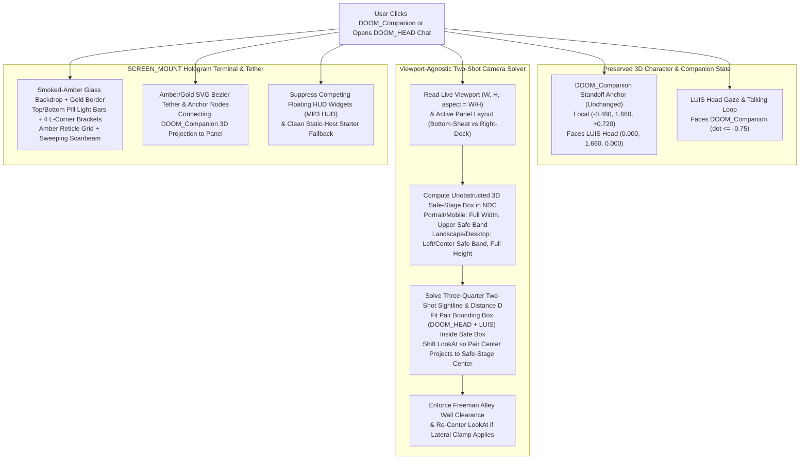

# Functional Specification 049: `DOOM_HEAD` Hologram `SCREEN_MOUNT` Theme Parity & Viewport-Agnostic Two-Shot Camera Framing Across All Screen Sizes

## 1. System Purpose & Core Objective

This specification defines the desired `{functionality}`, diegetic visual and chromatic parity with the Freeman Alley `SCREEN_MOUNT` holographic terminals, first-principles perspective frustum geometry for screen-size-agnostic two-shot camera framing of `LUIS` and `DOOM_HEAD` (`DOOM_Companion`), responsive layout and HUD collision-isolation rules, operational and performance budgets, edge-case failure-isolation boundaries, and verifiable `{correct required outputs}` for refining the interactive `DOOM_HEAD` dialogue experience in the Freeman Alley 3D environment ([`/Users/diesel/desktop/skatealley/index.html`](file:///Users/diesel/desktop/skatealley/index.html) and [`/Users/diesel/desktop/skatealley/sandbox.js`](file:///Users/diesel/desktop/skatealley/sandbox.js)).

The primary objective is twofold:

1. **`SCREEN_MOUNT` Hologram Theme & Color Parity:** Transform the `DOOM_HEAD` two-stage holographic dialogue overlay and its 3D-to-2D SVG tether from its current cyan/slate/purple palette into the authoritative **Warm Smoked-Amber / Gold Holographic Terminal** theme established by the six alleyway wall screen mounts (`SCREEN_MOUNT_01` through `SCREEN_MOUNT_06` and the `.holo-window` projection terminal). This includes smoked-amber translucent glass surfaces, crisp amber/gold borders and outer bloom, ignited top and bottom pill light bars, four L-shaped corner reticle brackets, fine amber horizontal scanlines paired with a coordinate reticle mesh, a sweeping vertical scanbeam, warm gold/cream typography and interactive controls, unified class-to-element styling across Stage 1 and Stage 2, and a warm amber/gold SVG Bezier leader line tethered to `DOOM_Companion`.
2. **Viewport-Agnostic Two-Shot Camera Framing (Preserving `DOOM_HEAD`'s Clicked Position):** While keeping `DOOM_Companion`'s conversational standoff position relative to `LUIS` strictly unchanged at local `(-0.480, 1.660, +0.720)`, replace the fixed desktop-biased camera offset with a dynamic, aspect-ratio-aware and safe-area-aware perspective frustum solver. Regardless of screen size, device orientation, or viewport aspect ratio (from narrow mobile portrait viewports such as `390×844` / `1284×2778` up to ultrawide desktop monitors), the camera must automatically position and orient itself so both `DOOM_Companion` and `LUIS`'s head/upper torso are framed with clear lateral separation inside the unobstructed portion of the viewport not covered by the holographic dialogue card.

**DO NOT CODE YET.** This document specifies functional requirements, mathematical frustum invariants, visual design tokens, operational budgets, and observable outcomes only. It contains zero implementation code, concrete syntax, or mechanical diffs.

---

## 2. Authoritative Domain Vocabulary Alignment (`LANGUAGE.md`)

All assessments of system state, design sufficiency, runtime invariants, and verification gates within this specification strictly adopt the evaluation taxonomy defined in [`LANGUAGE.md`](file:///Users/diesel/desktop/skatealley/LANGUAGE.md):

- **`{functionality}`**: End-to-end interactive execution of the `DOOM_HEAD` dialogue mode across all desktop, tablet, and mobile viewports such that:
  1. Clicking or tapping `DOOM_Companion` keeps `DOOM_Companion` at its existing conversational standoff anchor `(-0.480, 1.660, +0.720)` facing `LUIS`, while smoothly transitioning the camera into a readable three-quarter two-shot that captures both `DOOM_Companion` and `LUIS` within the unobstructed viewport safe area at any screen size or aspect ratio.
  2. The `DOOM_HEAD` holographic dialogue terminal and its SVG tether materialize with full visual, structural, and chromatic parity with the warm smoked-amber/gold `SCREEN_MOUNT` terminals across both Stage 1 (conversation starters + input box) and Stage 2 (scrollable multi-turn chatbox).
- **`{correctness}`**:
  - **Spatial Invariance of `DOOM_Companion`:** `DOOM_Companion`'s local conversational standoff coordinates `(-0.480, 1.660, +0.720)` and mutual-facing orientation with `LUIS` ($\text{dot}(\vec{F}_{\text{LuisHead}}, \vec{F}_{\text{Doom}}) \le -0.75$) remain completely unaltered.
  - **Universal Frustum Containment:** Across the entire supported aspect-ratio spectrum $a = W / H \in [0.42, 2.60]$ (including portrait phones $375\times 812$, $390\times 844$, $430\times 932$, tablets $768\times 1024$, and desktop viewports $1280\times 720$ to $2560\times 1440$), the projected 2D screen-space bounding boxes of both `DOOM_Companion` (full head mesh including harmonic levitation excursion) and `LUIS`'s head and upper shoulders lie strictly within the visible, unobstructed normalized device coordinate (NDC) safe region ($x_{\text{NDC}} \in [-0.88, +0.88]$, $y_{\text{NDC}} \in [-0.88, +0.88]$, and outside the bounding rectangle of `#doom-holo-chat-panel`) with horizontal center-to-center screen separation $\Delta x_{\text{NDC}} \ge 0.22$ so the two characters never clip off-screen or occlude one another.
  - **Corridor Wall Clearance:** The computed world-space camera position remains strictly inside the navigable Freeman Alley corridor wall boundaries (`resolveAlleyWallProfileX('left', z) + 0.24 m` to `resolveAlleyWallProfileX('right', z) - 0.24 m`) for any character position and yaw.
  - **Chromatic & Structural Consistency:** Every visual layer of `#doom-holo-chat-overlay` (panel background, border, outer glow, top/bottom light bars, 4 corner brackets, scanline/reticle grid, sweeping scanbeam, badges, starter cards, chat bubbles, input field, action buttons, and SVG tether) uses the warm smoked-amber/gold `SCREEN_MOUNT` palette (`#fbbf24`, `#f59e0b`, `#fcd34d`, `#fef3c7`, `#fffbeb`, `#3b1d06`) with zero orphaned unstyled text spans or residual cyan/purple theme mismatches.
- **`{correct required outputs}`**:
  1. On both desktop landscape (e.g., `1280×800`, $a = 1.60$) and mobile portrait (e.g., `390×844`, $a \approx 0.462$), entering `DOOM_HEAD` Dialogue Mode positions the camera so `DOOM_Companion` (left) and `LUIS` (right) are both 100% visible inside the unobstructed 3D viewport region—centered in the upper unobstructed viewport above the bottom-docked hologram card on portrait/mobile, and centered in the left unobstructed viewport beside the right-docked hologram card on landscape/desktop.
  2. Live runtime telemetry and projection diagnostics confirm that both `DOOM_Companion`'s outer left/right/top/bottom bounds and `LUIS`'s head/shoulder bounds project to $\text{NDC}_x \in [-0.86, +0.86]$ and do not overlap the active `#doom-holo-chat-panel` bounding box on either portrait or landscape viewports.
  3. Computed style inspection of `#doom-holo-chat-panel` and `#doom-holo-tether-svg` confirms warm smoked-amber background gradients, amber/gold border and glow tokens, rendered top/bottom light bars, four L-shaped corner brackets, sweeping scanbeam, styled starter labels/indices/texts, and mutual exclusion of competing floating HUD widgets (such as the bottom-right MP3 player HUD) while `DOOM_HEAD` Dialogue Mode is active.
- **`{errors}`**:
  - Any camera pose where `DOOM_Companion` or `LUIS`'s head clips across the left, right, top, or bottom viewport edge ($|\text{NDC}_x| > 0.92$ or $|\text{NDC}_y| > 0.92$) or is buried behind `#doom-holo-chat-panel` on mobile portrait (`390×844` / `430×932`) or desktop viewports.
  - Modifying `DOOM_Companion`'s local conversational standoff anchor `(-0.480, 1.660, +0.720)` or breaking the mutual-facing dot-product invariant ($\text{dot} \le -0.75$).
  - Orphaning DOM text elements with mismatched CSS class names (leaving starter labels, indices, or message role headers unstyled), allowing the bottom-right MP3 player HUD (`#doom-mp3-hud`) to overlap the chat panel on mobile, or flashing raw browser JSON parse exceptions (`ERR // The string did not match the expected patt...`) in the status bar when opened on static hosting (`github.io`) where `/api/doom/starters` returns an HTML 404 page.
- **`{sufficient}`**: Complete mathematical specification of the aspect-ratio-aware and safe-area-aware camera frustum solver, corridor wall-clamping recovery, exhaustive `SCREEN_MOUNT` visual/color tokens for the `DOOM_HEAD` hologram overlay and tether, HUD collision suppression, static-host starter fallback behavior, operational budgets, and multi-viewport verification criteria.
- **`{insufficient}`**: Any specification that relies on a single hardcoded camera offset vector tuned only for 16:9 desktop screens, alters `DOOM_Companion`'s local standoff position, leaves mobile vertical framing centered at the screen midpoint behind the bottom-sheet hologram card, or fails to align every sub-element of `#doom-holo-chat-overlay` with the `SCREEN_MOUNT` theme.

---

## 3. Empirical Root-Cause Diagnosis & First-Principles Physical Modeling (`RULE[user_global]`)

Inspection of the mobile portrait capture (`/Users/diesel/Downloads/IMG_1904.PNG`, `1284×2778`, aspect ratio $a = W / H \approx 0.462$) alongside the current camera and stylesheet definitions in [`sandbox.js`](file:///Users/diesel/desktop/skatealley/sandbox.js) and [`index.html`](file:///Users/diesel/desktop/skatealley/index.html) identifies four concrete architectural root causes:

### 3.1 Horizontal Frustum Collapse on Portrait Viewports ($25.4^\circ$ vs. $81.8^\circ$)
1. **Perspective Camera Optics:**
   - The scene uses a vertical field-of-view perspective camera with $\text{FOV}_y = 52^\circ$, giving vertical half-tangent:
     $$t_y = \tan\!\left(\frac{52^\circ}{2}\right) = \tan(26^\circ) \approx 0.48773$$
   - The horizontal half-tangent scales linearly with viewport aspect ratio $a = W / H$:
     $$t_x(a) = a \cdot t_y$$
   - On a standard `16:9` desktop viewport ($a \approx 1.778$), $t_x \approx 0.8671$, yielding a wide horizontal field of view $\text{FOV}_x = 2\arctan(0.8671) \approx 81.8^\circ$.
   - On a mobile portrait viewport ($a \approx 0.462$), $t_x \approx 0.2254$, collapsing the horizontal field of view to only:
     $$\text{FOV}_x = 2\arctan(0.2254) \approx 25.4^\circ$$
2. **Why the Static Desktop Offset Fails on Mobile:**
   - Currently, the camera pose uses a static character-local camera offset `(-0.56, 1.66, 1.62)` and a static look-at offset `(+0.22, 1.56, 0.16)`.
   - Shifting the look-at target to $x = +0.22\text{ m}$ (to the right of `LUIS` at $x = 0.0\text{ m}$) was designed to push both characters into the left half of a wide $81.8^\circ$ desktop frustum so a right-docked desktop panel could occupy the right half.
   - However, on a $25.4^\circ$ portrait frustum at distance $D \approx 1.65\text{ m}$, the entire visible horizontal half-width at `DOOM_Companion`'s depth ($d_{\text{Doom}} \approx 0.90\text{ m}$ from the camera) is only $0.90 \times 0.2254 \approx 0.203\text{ m}$! Because the camera look-at ray passes to the right of `DOOM_Companion` (`x = -0.48`), `DOOM_Companion` projects to $\text{NDC}_x \approx -1.06$, slicing `DOOM_HEAD` in half against the left screen border.
   - Furthermore, because the camera at `(-0.56, 1.66, 1.62)` looking toward `(+0.22, 1.56, 0.16)` views the `DOOM_Companion`-to-`LUIS` axis at a steep, nearly edge-on oblique angle near the left frustum edge, the viewer cannot easily perceive the mutual-facing spatial relationship between `DOOM_HEAD` and `LUIS` on a narrow screen.

### 3.2 Vertical Safe-Area Mismatch Between Desktop Side-Panel and Mobile Bottom-Sheet Layouts
1. **Desktop Landscape Layout ($W > 768\text{ px}$):**
   - `#doom-holo-chat-panel` docks on the **right side** of the viewport (`right: 32px`, `top: 50%`, `width: min(468px, calc(100vw - 48px))`), leaving the **left/center vertical column** of the screen unobstructed from top to bottom.
2. **Mobile / Portrait Layout ($W \le 768\text{ px}$ or $a < 0.95$):**
   - `#doom-holo-chat-panel` docks at the **bottom** of the viewport (`left: 12px`, `right: 12px`, `bottom: 16px`), covering the lower portion of the screen while leaving the **upper half of the viewport** (between the top status pill and the top edge of `#doom-holo-chat-panel`) completely open across the full screen width.
   - Because the current camera look-at elevation is fixed at $Y = 1.56\text{ m}$ (putting eye level $Y = 1.66\text{ m}$ near the vertical midpoint $\text{NDC}_y \approx +0.10$), the upper $40\%$ of the mobile screen (`NDC_y` $\in [+0.35, +0.90]$) is wasted as empty black ceiling space while `LUIS`'s upper torso and the bottom of the two-shot are buried behind the bottom-docked hologram panel.

### 3.3 Visual & Structural Divergence from `SCREEN_MOUNT` Terminals
1. **Palette & Chrome Divergence:**
   - The six `SCREEN_MOUNT` stations and `.holo-window` projection terminal define Freeman Alley's signature diegetic terminal aesthetic: translucent smoked-amber glass (`#3b1d06` / `rgba(38, 18, 4, ...)`), high-bloom gold/amber borders (`#fbbf24` / `#f59e0b`), ignited top and bottom horizontal pill light bars, four L-shaped corner reticle brackets, a $36\times 36\text{ px}$ amber reticle grid with $4\text{ px}$ scanlines, and an animated vertical `.holo-scanbeam`.
   - In contrast, `#doom-holo-chat-panel` and `#doom-holo-tether-svg` were styled with an isolated cyan/navy/purple scheme (`#00d5ff`, `rgba(2, 24, 36, 0.92)`, `#a855f7`) and lack the top/bottom pill light bars, L-shaped corner brackets, coordinate reticle mesh, and sweeping scanbeam of the `SCREEN_MOUNT` terminals.
2. **Orphaned Class Selectors, HUD Overlap & Static-Host Error Noise in `IMG_1904.PNG`:**
   - Inside `#doom-holo-stage-starters` and `#doom-holo-stage-chatbox`, the HTML markup uses `.doom-starters-label`, `.starter-idx`, `.starter-text`, and `.msg-role`, whereas the stylesheet defines `.doom-starters-subtitle`, `.doom-starter-option-tag`, `.doom-starter-option-text`, and `.doom-chat-msg-sender`, causing those text elements to render with unstyled default browser typography.
   - The floating MP3 HUD (`#doom-mp3-hud`, `z-index: 95`) remains visible at the bottom-right corner during `DOOM_HEAD` Dialogue Mode and overlaps the bottom-right action area of `#doom-holo-chat-panel` (`z-index: 86`).
   - When loaded from static GitHub Pages (`luisp1028.github.io`) without an active backend proxy tunnel, the background starter pre-fetch receives an HTML `404` page; attempting to parse it as JSON throws Safari's `"The string did not match the expected pattern."` and overwrites the Stage 1 status bar with `ERR // The string did not match the expected patt` even though the two default conversation starters are already populated and ready to use.

---

## 4. End-to-End Functional Architecture

---

## 5. Detailed Functional Requirements

### 5.1 Preservation of `DOOM_Companion` Standoff Position & Mutual-Facing Kinematics
1. **Strict Standoff Coordinate Invariance:**
   - When `DOOM_HEAD` Dialogue Mode is entered, `DOOM_Companion` MUST continue to transition from its shoulder equilibrium `(-0.430, 1.862, 0.055)` to its exact conversational standoff anchor `(-0.480, 1.660, +0.720)` in `LUIS`'s local coordinate frame.
   - `DOOM_Companion`'s conversational yaw ($\approx +2.5536\text{ rad}$ / $+146.31^\circ$), 6-DOF harmonic levitation, speaking pulse modulation, and `LUIS`'s conversational head look ($\approx -0.5880\text{ rad}$ / $-33.69^\circ$ yaw) and talking animation cycling (`RPM_DIALOGUE_CLIP_POOL`) MUST remain unchanged.

---

### 5.2 Viewport-Agnostic Two-Shot Camera Framing (`LUIS` + `DOOM_HEAD`)

To ensure the camera captures both `DOOM_Companion` and `LUIS` clearly and readably on any screen size, orientation, or aspect ratio without clipping or UI occlusion, the dialogue camera controller MUST dynamically compute the two-shot camera position and `lookAt` target from the live viewport geometry:

1. **Pair Spatial Envelope & Readable Three-Quarter Sightline:**
   - In `LUIS`'s local coordinate frame (where `LUIS` root is at $(0, 0, 0)$ facing $+Z$, `LUIS` head center is at $\vec{P}_{\text{Luis}} = (0.00, 1.66, 0.00)$, and `DOOM_Companion` center is at $\vec{P}_{\text{Doom}} = (-0.48, 1.66, +0.72)$):
     - Define the **two-shot focus midpoint** between `DOOM_Companion` and `LUIS`'s upper torso/head at $\vec{M}_{\text{pair}} = (-0.24, 1.58, +0.36)$ in character-local space.
     - Define the camera's local horizontal approach direction $\hat{u}_{\text{cam}}$ at a front-corridor three-quarter azimuth $\alpha_{\text{cam}} \in [-16^\circ, -10^\circ]$ relative to character forward $+Z$ (i.e., approaching from in front of `LUIS` and `DOOM_Companion` along $+Z$ with a slight $-X$ offset, such as $\hat{u}_{\text{cam}} = \operatorname{normalize}(-0.22, 0.0, +0.975)$).
     - **Why this sightline is readable across all aspect ratios:** Viewed along $\hat{u}_{\text{cam}}$ toward $\vec{M}_{\text{pair}}$, `DOOM_Companion` at $(-0.48, 1.66, +0.72)$ projects cleanly to the **left** side of the two-shot in a three-quarter profile facing right-inward toward `LUIS`, while `LUIS` at $(0.00, 1.66, 0.00)$ projects cleanly to the **right** side of the two-shot facing left-forward toward `DOOM_Companion`. The perpendicular lateral separation between their centers is $\ge 0.42\text{ m}$ and the required outer horizontal bounding span (including `DOOM_Companion`'s $0.22\text{ m}$ radius, `LUIS`'s head/shoulder radius $0.26\text{ m}$, and breathing margin) is $W_{\text{pair}} \approx 1.04\text{ m}$, while the vertical bounding span covering both heads, `DOOM_Companion`'s bobbing excursion, and `LUIS`'s upper chest/shoulders ($Y \in [1.22\text{ m}, 1.90\text{ m}]$) is $H_{\text{pair}} \approx 0.68\text{ m}$.

2. **Unobstructed Viewport Safe-Stage Determination:**
   - Let $(W_{\text{vp}}, H_{\text{vp}})$ be the live viewport dimensions in CSS pixels, $a = W_{\text{vp}} / H_{\text{vp}}$ be the aspect ratio, $t_y = \tan(\text{FOV}_y / 2) = \tan(26^\circ) \approx 0.48773$, and $t_x = a \cdot t_y$.
   - The camera framing solver MUST partition the viewport into the region occupied by `#doom-holo-chat-panel` (plus top HUD bar margin) and the **unobstructed 3D safe stage** $[x_{\min}, x_{\max}] \times [y_{\min}, y_{\max}] \subset [-1, +1]^2$ in NDC:
     - **Case A — Portrait / Compact Viewports ($W_{\text{vp}} \le 768\text{ px}$ or $a < 0.95$, Bottom-Sheet Panel Layout):**
       - `#doom-holo-chat-panel` docks near the bottom of the screen. To guarantee an ample, unobstructed 3D stage on mobile phones, `#doom-holo-chat-panel` on portrait/mobile viewports MUST cap its height at $\le 50\text{vh}$ (or $\le 420\text{ px}$ in Stage 1 and $\le 52\text{vh}$ in Stage 2) with compact vertical padding, leaving the upper $\ge 44\%$ of the viewport unobstructed between the top status bar and the top border of `#doom-holo-chat-panel`.
       - If `#doom-holo-chat-panel` has a live measured bounding rectangle with `rect.height > 0`, the bottom edge of the safe stage in NDC is derived directly from the panel's top edge $y_{\text{panel,top}}$ (with a $16\text{ px}$ visual clearance buffer), clamped so the safe stage always spans:
         $$x_{\text{NDC}} \in [-0.84, +0.84] \quad (\text{center } x_c = 0.0, \; \text{half-width } \Delta x_{\text{safe}} = 0.84)$$
         $$y_{\text{NDC}} \in [y_{\min}, +0.82] \quad \text{where } y_{\min} \in [+0.02, +0.16] \quad (\text{center } y_c = \tfrac{1}{2}(y_{\min} + 0.82) \approx +0.44, \; \text{half-height } \Delta y_{\text{safe}} \approx 0.38)$$
     - **Case B — Landscape / Desktop Viewports ($W_{\text{vp}} > 768\text{ px}$ and $a \ge 0.95$, Right-Docked Panel Layout):**
       - `#doom-holo-chat-panel` docks on the right side of the viewport (`right: 32px`, `width: min(468px, calc(100vw - 48px))`), occupying a horizontal fraction $f_{\text{panel}} = \operatorname{clamp}((W_{\text{panel}} + 48) / W_{\text{vp}}, 0.25, 0.52)$ on the right side of the screen.
       - The unobstructed 3D safe stage occupies the left/center portion of the viewport:
         $$x_{\min} = -0.86, \qquad x_{\max} = \max(-0.05, \; 1.0 - 2 f_{\text{panel}} - 0.06)$$
         $$x_c = \frac{x_{\min} + x_{\max}}{2}, \qquad \Delta x_{\text{safe}} = \frac{x_{\max} - x_{\min}}{2}$$
         $$y_{\text{NDC}} \in [-0.68, +0.76] \quad (\text{center } y_c = +0.04, \; \text{half-height } \Delta y_{\text{safe}} = 0.72)$$

3. **Analytical Distance & Frustum-Centering Look-At Solver:**
   - To guarantee that the pair's required horizontal span $W_{\text{pair}} \approx 1.04\text{ m}$ and vertical span $H_{\text{pair}} \approx 0.68\text{ m}$ fit inside the unobstructed safe-stage half-extents $(\Delta x_{\text{safe}}, \Delta y_{\text{safe}})$ at any aspect ratio $a$:
     $$D_{\text{horiz}}(a) = \frac{W_{\text{pair}} / 2}{\Delta x_{\text{safe}} \cdot t_x(a)}, \qquad D_{\text{vert}} = \frac{H_{\text{pair}} / 2}{\Delta y_{\text{safe}} \cdot t_y}$$
     $$D_{\text{shot}}(a) = \operatorname{clamp}\!\big(\max(D_{\text{horiz}}(a), \, D_{\text{vert}}), \; 1.45\text{ m}, \; 3.20\text{ m}\big)$$
   - The candidate world-space camera position is placed at distance $D_{\text{shot}}(a)$ from the world-space pair midpoint $\vec{M}_{\text{world}}$ along the rotated approach vector $\mathbf{R}_y(\psi_{\text{char}}) \cdot \hat{u}_{\text{cam}}$ at elevation $Y_{\text{cam}} = M_{\text{world},y} + 0.04\text{ m}$, and its $X$ coordinate is clamped within the Freeman Alley corridor wall clearance bounds (`[minWallX + 0.24 m, maxWallX - 0.24 m]`).
   - Using the actual clamped camera position $\vec{P}_{\text{cam}}$ and the true distance $D_{\text{actual}} = \|\vec{P}_{\text{cam}} - \vec{M}_{\text{world}}\|$, let $\vec{F}_0 = \operatorname{normalize}(\vec{M}_{\text{world}} - \vec{P}_{\text{cam}})$ be the baseline sightline directly to the pair midpoint, $\vec{R}_0 = \operatorname{normalize}(\vec{F}_0 \times \vec{Y}_{\text{world}})$ be the camera right basis vector, and $\vec{U}_0 = \vec{R}_0 \times \vec{F}_0$ be the camera up basis vector.
   - To project $\vec{M}_{\text{world}}$ directly onto the safe-stage center $(x_c, y_c)$ in NDC (so on portrait mobile the characters sit in the upper unobstructed viewport above the bottom card, and on landscape desktop they sit in the left unobstructed viewport beside the right card—even if corridor wall clamping shifted $\vec{P}_{\text{cam}}$ laterally), the world-space `lookAt` target is computed as:
     $$\vec{P}_{\text{lookAt}} = \vec{M}_{\text{world}} - \big(x_c \cdot D_{\text{actual}} \cdot t_x(a)\big)\,\vec{R}_0 - \big(y_c \cdot D_{\text{actual}} \cdot t_y\big)\,\vec{U}_0$$
   - **Real-Time Viewport Resize Adaptation:** Because the active camera controller evaluates `computeDoomChatCameraPose` while `DOOM_HEAD` Dialogue Mode is open (and upon `window` resize / orientation change), rotating a mobile device or resizing a browser window immediately updates the framing without requiring the user to exit and re-enter the chat.

---

### 5.3 `SCREEN_MOUNT` Hologram Theme & Color Parity (`#doom-holo-chat-overlay`)

The `DOOM_HEAD` Hologram Dialogue overlay (`#doom-holo-chat-overlay`, `#doom-holo-chat-panel`, and `#doom-holo-tether-svg`) MUST be restyled to achieve full visual, structural, and color parity with the `SCREEN_MOUNT` holographic terminals (`.holo-window` and `SCREEN_MOUNT_01`..`06`):

1. **Translucent Smoked-Amber Glass Panel & Warm Gold Border:**
   - **Panel Surface (`#doom-holo-chat-panel`):** Replaces the dark cyan/navy gradient with the `SCREEN_MOUNT` smoked-amber translucent glass backdrop:
     - Background gradient: `linear-gradient(135deg, rgba(38, 18, 4, 0.84) 0%, rgba(64, 30, 6, 0.80) 48%, rgba(44, 20, 4, 0.86) 100%)` with `backdrop-filter: blur(12px)` (`-webkit-backdrop-filter: blur(12px)`).
     - Border: `1.5px solid rgba(252, 211, 77, 0.92)` (`#fcd34d` / `#fbbf24`).
     - Outer & Inner Holographic Bloom (`box-shadow`): Warm amber/gold dual-layer glow (`0 18px 48px rgba(0, 0, 0, 0.85), 0 0 28px rgba(245, 158, 11, 0.30), 0 0 54px rgba(217, 119, 6, 0.20), inset 0 0 22px rgba(245, 158, 11, 0.14)`).
   - **Amber Scanlines & Coordinate Reticle Grid (`#doom-holo-chat-panel::before`):**
     - Matches `.holo-window::before`: horizontal `4px` repeating scanlines in `rgba(245, 158, 11, 0.07)` layered over a `36px × 36px` orthogonal coordinate reticle mesh in `rgba(245, 158, 11, 0.05)`.

2. **Diegetic `SCREEN_MOUNT` Structural Frame Elements Inside `#doom-holo-chat-panel`:**
   - **Ignited Top & Bottom Pill Light Bars:** Includes `.holo-light-bar.top` and `.holo-light-bar.bottom` along the upper and lower edges of `#doom-holo-chat-panel` (`linear-gradient(90deg, rgba(245, 158, 11, 0.35), #fffbeb, #fef08a, #fffbeb, rgba(245, 158, 11, 0.35))` with `0 0 14px rgba(251, 191, 36, 0.95)` glow).
   - **Four L-Shaped Corner Reticle Brackets:** Includes `.holo-corner.tl`, `.holo-corner.tr`, `.holo-corner.bl`, and `.holo-corner.br` (`#f59e0b` $2\text{ px}$ solid L-brackets with `drop-shadow(0 0 6px rgba(245, 158, 11, 0.9))`).
   - **Sweeping Horizontal Scanbeam:** Includes a `.holo-scanbeam` element sweeping vertically across the terminal (`linear-gradient(90deg, transparent 0%, rgba(245, 158, 11, 0.78) 20%, rgba(253, 230, 138, 0.95) 50%, rgba(245, 158, 11, 0.78) 80%, transparent 100%)`).

3. **Typography, Header Badges, Starter Cards, Chat Bubbles & Input Controls:**
   - **Header Zone (`.doom-holo-header`):**
     - Bottom divider border in `rgba(245, 158, 11, 0.35)`.
     - Eyebrow / kicker (`.doom-holo-eyebrow`): monospace uppercase in `#fbbf24` with `0 0 8px rgba(245, 158, 11, 0.65)` text-shadow.
     - Title (`.doom-holo-title`): `#fffbeb` with glowing amber status dot (`.doom-holo-status-dot` in `#fbbf24`, `box-shadow: 0 0 8px #fbbf24`) and warm amber pill badge (`.doom-holo-model-badge` in `rgba(217, 119, 6, 0.26)` background, `1px solid rgba(245, 158, 11, 0.72)` border, `#fef3c7` text).
     - Header action buttons (`.doom-holo-icon-btn` for `↻ Starters` and `↻ Refresh`): smoked-amber button surface `rgba(45, 18, 3, 0.78)` with `1px solid rgba(245, 158, 11, 0.58)` border and `#fde68a` text, brightening to `rgba(217, 119, 6, 0.38)` and `#fffbeb` on hover.
     - Close / Exit button (`#doom-close-chat-btn.close-btn`): matches `.holo-exit-focus-btn` (`rgba(239, 68, 68, 0.26)` background, `1px solid rgba(248, 113, 113, 0.82)` border, `#fef2f2` text, red glow on hover).
   - **Stage 1 Conversation Starter Cards (`#doom-holo-stage-starters`):**
     - Unifies all class selectors so `.doom-starters-label` / `.doom-starters-subtitle` renders in crisp `10.5px` uppercase monospace `#fcd34d` (`text-shadow: 0 0 8px rgba(245, 158, 11, 0.55)`).
     - Starter option cards (`.doom-starter-option-btn`): smoked-amber card surface `linear-gradient(135deg, rgba(68, 30, 6, 0.68) 0%, rgba(44, 18, 4, 0.76) 100%)`, `1px solid rgba(245, 158, 11, 0.58)` border, `inset 0 0 12px rgba(245, 158, 11, 0.10)`, hovering to `linear-gradient(135deg, rgba(217, 119, 6, 0.38) 0%, rgba(180, 83, 9, 0.34) 100%)` with `#fcd34d` border and `0 0 16px rgba(245, 158, 11, 0.35)` glow.
     - Starter index tag (`.starter-idx` / `.doom-starter-option-tag`): `9.5px` bold monospace `#fbbf24` (`letter-spacing: 0.07em`).
     - Starter prompt text (`.starter-text` / `.doom-starter-option-text`): `13px` medium `#fffbeb` / `#fef3c7` (`line-height: 1.4`).
   - **Stage 2 Multi-Turn Chatbox (`#doom-holo-stage-chatbox`):**
     - Transcript container: `rgba(24, 10, 2, 0.72)` background with `1px solid rgba(245, 158, 11, 0.34)` border.
     - Assistant (`DOOM_HEAD`) message bubble (`.doom-chat-msg.assistant`): smoked-amber terminal bubble `rgba(68, 30, 6, 0.72)` with `1px solid rgba(245, 158, 11, 0.64)` border, `#fef3c7` text, and `.msg-role` / `.doom-chat-msg-sender` header in `#fbbf24`.
     - User (`VISITOR // YOU`) message bubble (`.doom-chat-msg.user`): warm gold-accented bubble `rgba(217, 119, 6, 0.30)` with `1px solid rgba(252, 211, 77, 0.78)` border, `#fffbeb` text, and `.msg-role` / `.doom-chat-msg-sender` header in `#fde68a`.
   - **Input Row & Footer Meta Bar (`.doom-holo-footer`):**
     - Input box (`#doom-chat-input`): `rgba(28, 12, 2, 0.88)` background, `1.5px solid rgba(245, 158, 11, 0.58)` border, `#fffbeb` text, placeholder in `rgba(253, 230, 138, 0.50)`, focusing to `#fcd34d` border with `0 0 12px rgba(245, 158, 11, 0.35)` glow.
     - Send button (`#doom-chat-send-btn`): matches `.holo-link-btn` primary CTA (`linear-gradient(90deg, rgba(217, 119, 6, 0.68), rgba(180, 83, 9, 0.68))`, `1.5px solid rgba(252, 211, 77, 0.90)`, `#fffbeb` bold monospace text).
     - Footer meta bar (`.doom-holo-meta-bar`): top border `1px solid rgba(245, 158, 11, 0.28)`, text in `#fde68a` / `#fcd34d`, `<kbd>` highlight in `#fffbeb`.

4. **Warm Amber/Gold SVG Tether (`#doom-holo-tether-svg`) & Viewport-Adaptive Anchor Point:**
   - **Chromatic Parity:**
     - `#doom-tether-grad` stops use `#fbbf24` (`0%`), `#fef08a` (`50%`), and `#f59e0b` (`100%`).
     - `#doom-holo-tether-glow` uses `rgba(245, 158, 11, 0.32)`.
     - `#doom-holo-tether-origin-dot` (on `DOOM_Companion`) uses `fill="#fbbf24"` and `stroke="#fffbeb"`.
     - `#doom-holo-tether-panel-dot` (on `#doom-holo-chat-panel`) uses `fill="#f59e0b"` and `stroke="#fef08a"`.
   - **Orientation-Aware Tether Attachment:**
     - On desktop/landscape viewports where `#doom-holo-chat-panel` is docked on the right side of the screen (`rect.left > vw * 0.35`), the SVG Bezier tether attaches to the **left border** of `#doom-holo-chat-panel` (`px = rect.left`, `py = rect.top + min(92, rect.height * 0.28)`).
     - On mobile/portrait viewports where `#doom-holo-chat-panel` is docked at the bottom of the screen (`rect.left <= vw * 0.35` and `rect.top > vh * 0.35`), the SVG Bezier tether attaches cleanly to the **top border** of `#doom-holo-chat-panel` horizontally aligned below `DOOM_Companion` (`px = clamp(sx, rect.left + 28, rect.right - 28)`, `py = rect.top`), curving smoothly downward from `DOOM_Companion` into the top edge of the holographic terminal card.

---

### 5.4 Floating HUD Mutual Exclusion & Static-Host Starter Resilience

1. **Suppression of Overlapping Floating HUD Widgets During `DOOM_HEAD` Chat:**
   - While `DOOM_HEAD` Dialogue Mode is active (`sandbox.isDoomChatOpen === true`), competing floating overlays at the bottom of the viewport—specifically the `DOOM ALLOY // II` MP3 player HUD (`#doom-mp3-hud`) and mobile locomotion thumbpad (`#mobile-touch-controls`)—MUST be temporarily hidden (`opacity: 0; pointer-events: none;`) and automatically restored upon exiting `DOOM_HEAD` Dialogue Mode, preventing the bottom-right overlap seen in `IMG_1904.PNG`.
2. **Clean Fallback When Static Hosting Lacks a Reachable Starter Proxy:**
   - If the background starter pre-fetch (`fetchDoomStartersFromHF`) fails because the page is served from a static host (e.g., `luisp1028.github.io`) where no local or tunneled `/api/doom/starters` endpoint is reachable, the client MUST retain its built-in default conversation starters in Stage 1 (`STAGE 1 // STARTERS READY`) without overwriting the footer status pill with a raw browser `SyntaxError` (`ERR // The string did not match the expected patt`). Explicit error diagnostics in the status pill and transcript remain active when the user explicitly clicks `↻ Refresh` or submits a Stage 2 chat turn that fails.

---

## 6. Operational & Performance Budgets

| Operational Dimension | Mandatory Budget / Invariant | Verification Method |
| :--- | :--- | :--- |
| **Per-Frame Camera Pose & Frustum Computation** | $\le 0.05\text{ ms}$ per frame (`O(1)` analytical math, zero heap allocations in the 60 FPS render loop) | Pre-allocated `THREE.Vector3` scratch registers; verified via frame-time telemetry (`>= 58 FPS`). |
| **3D Click-to-Hologram Transition Duration** | $0.42\text{ s}$ cubic ease-out camera pan; $< 16.6\text{ ms}$ DOM activation | Live inspection of `doomChatCameraState.transitionProgress` and `#doom-holo-chat-overlay.active`. |
| **Two-Shot NDC Frustum Containment Across Aspect Ratios** | Both `DOOM_Companion` and `LUIS` head/upper shoulders project within $\text{NDC}_x \in [-0.86, +0.86]$ and outside `#doom-holo-chat-panel` across $a \in [0.42, 2.60]$ | Automated multi-viewport projection audit at `390×844` (iPhone portrait), `430×932` (iPhone Max), `768×1024` (iPad), and `1280×800` (Desktop). |
| **Minimum Lateral Two-Shot Separation** | $\Delta x_{\text{NDC}} = |\text{NDC}_{x,\text{Luis}} - \text{NDC}_{x,\text{Doom}}| \ge 0.22$ across all viewports | Live 3D-to-NDC projection check of `DOOM_Companion` world center vs. `LUIS` head world center. |
| **Corridor Wall Clearance** | $\ge 0.24\text{ m}$ clearance from both left and right Freeman Alley wall profiles (`resolveAlleyWallProfileX`) | Verified across corridor stations $Z \in [0\text{ m}, 36\text{ m}]$ and character yaws $\psi \in [-\pi, +\pi]$. |

---

## 7. Edge Cases & Failure-Isolation Boundaries

1. **Character Positioned Near Left or Right Alley Wall (`X` Near Corridor Boundary):**
   - If `LUIS` stands close to the Left or Right Alley Wall when the user clicks `DOOM_Companion`, clamping the camera's world $X$ coordinate to `[minWallX + 0.24 m, maxWallX - 0.24 m]` shifts the camera laterally relative to the unconstrained approach ray.
   - Because the `lookAt` solver computes the baseline sightline $\vec{F}_0 = \operatorname{normalize}(\vec{M}_{\text{world}} - \vec{P}_{\text{cam,clamped}})$ **after** wall clamping, the camera automatically re-aims at the pair midpoint $\vec{M}_{\text{world}}$ and applies the safe-stage NDC offset $(x_c, y_c)$ from the clamped vantage—preventing wall clipping while keeping both characters centered in the unobstructed safe stage.
2. **Dynamic Orientation Flip or Window Resize While Dialogue Mode Is Open:**
   - Rotating a mobile device between portrait ($390\times 844$) and landscape ($844\times 390$) or resizing a desktop browser window while `sandbox.isDoomChatOpen === true` dynamically updates `camera.aspect`, `#doom-holo-chat-panel` docking geometry, the two-shot camera pose, and the SVG tether attachment point on the very next animation frame without dropping state or conversation history.
3. **Stage 1 $\to$ Stage 2 Panel Height Change on Mobile:**
   - Transitioning from Stage 1 (`starters`) to Stage 2 (`chatbox`) on mobile keeps `#doom-holo-chat-panel` within its bounded bottom-sheet height ($\le 52\text{vh}$) with internal transcript scrolling (`overflow-y: auto`), ensuring the upper 3D two-shot of `DOOM_Companion` and `LUIS` remains unobstructed throughout a multi-turn conversation.

---

## 8. Verifiable `{correct required outputs}` & Acceptance Criteria

1. **`DOOM_Companion` Position Invariance Verification:**
   - In `DOOM_HEAD` Dialogue Mode (`sandbox.isDoomChatOpen === true`), `DOOM_Companion`'s local conversational standoff anchor remains `(-0.480, 1.660, +0.720)` and mutual-facing dot product satisfies $\text{dot}(\vec{F}_{\text{LuisHead}}, \vec{F}_{\text{Doom}}) \le -0.75$.
2. **Mobile Portrait (`390×844` & `430×932`) Two-Shot Framing Verification:**
   - Entering `DOOM_HEAD` Dialogue Mode on a portrait viewport frames both `DOOM_Companion` (left) and `LUIS` (right) completely inside the upper unobstructed viewport above `#doom-holo-chat-panel`:
     - Both characters' outer horizontal bounds lie strictly within $\text{NDC}_x \in [-0.86, +0.86]$ (zero left-edge clipping of `DOOM_Companion`).
     - Both characters' head centers lie within the upper unobstructed vertical band ($\text{NDC}_y \in [+0.15, +0.75]$) above the top edge of `#doom-holo-chat-panel`.
     - Horizontal center-to-center separation satisfies $\Delta x_{\text{NDC}} \ge 0.22$.
3. **Desktop Landscape (`1280×800`) Two-Shot Framing Verification:**
   - Entering `DOOM_HEAD` Dialogue Mode on a desktop landscape viewport frames both `DOOM_Companion` and `LUIS` within the unobstructed left/center viewport region to the left of `#doom-holo-chat-panel`, with zero off-screen clipping and zero panel overlap.
4. **`SCREEN_MOUNT` Hologram Theme & Tether Verification:**
   - `#doom-holo-chat-panel` renders with the smoked-amber translucent glass backdrop, `#fcd34d`/`#fbbf24` border and amber outer glow, top and bottom pill light bars (`.holo-light-bar`), four L-shaped corner brackets (`.holo-corner`), amber scanline + coordinate reticle grid, sweeping `.holo-scanbeam`, and warm amber/gold typography across all Stage 1 and Stage 2 elements.
   - `#doom-holo-tether-svg` renders a warm amber/gold Bezier tether connecting `DOOM_Companion`'s projected 3D position to the top edge of the panel on mobile bottom-sheet layouts and to the left edge of the panel on desktop side-docked layouts.
   - Competing bottom-right HUD overlays (`#doom-mp3-hud`) are hidden while `DOOM_HEAD` Dialogue Mode is active and restored on exit.
