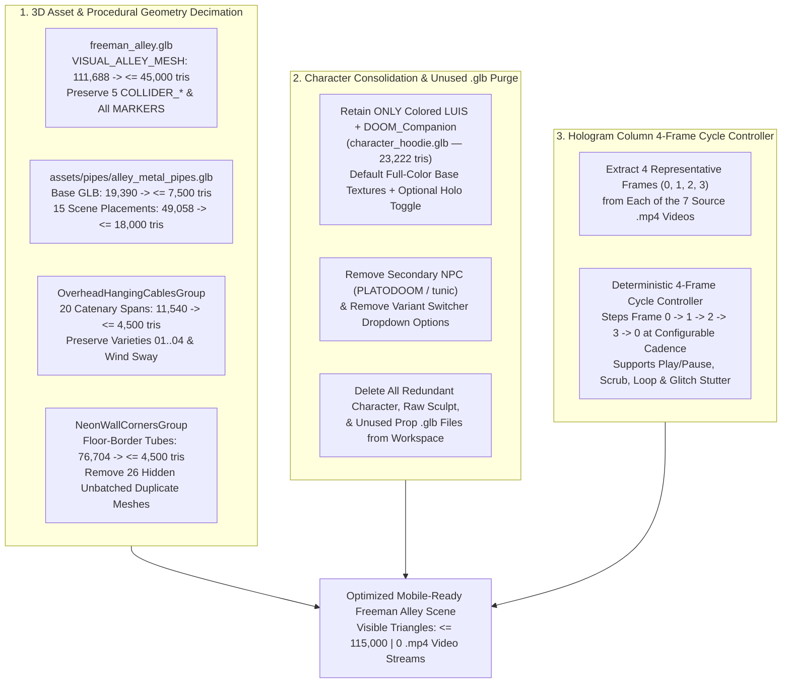

# Functional Specification 050: Mobile Scene Triangle Decimation, Single Colored Character Consolidation, Unused `.glb` Purge & 4-Frame Hologram Column Cycling

## 1. System Purpose & Core Objective

This specification defines the desired `{functionality}`, empirical baseline telemetry, target polygon and payload budgets, asset retention and purge rules, 4-frame hologram media cycling behavior, edge-case failure-isolation boundaries, and verifiable `{correct required outputs}` for optimizing the Freeman Alley 3D web application ([`/Users/diesel/desktop/skatealley/index.html`](file:///Users/diesel/desktop/skatealley/index.html), [`/Users/diesel/desktop/skatealley/sandbox.js`](file:///Users/diesel/desktop/skatealley/sandbox.js), [`/Users/diesel/desktop/skatealley/alley_metal_pipes.js`](file:///Users/diesel/desktop/skatealley/alley_metal_pipes.js), [`/Users/diesel/desktop/skatealley/alley_atmosphere_023.js`](file:///Users/diesel/desktop/skatealley/alley_atmosphere_023.js), and [`/Users/diesel/desktop/skatealley/hologram_columns.js`](file:///Users/diesel/desktop/skatealley/hologram_columns.js)) so that it loads rapidly and renders smoothly on mobile devices.

The primary objective comprises three coordinated workstreams:

1. **Targeted 3D Geometry Decimation of Top Scene Polygon Outliers:** Substantially reduce the triangle and vertex counts of the four primary scene geometry consumers—[freeman_alley.glb](file:///Users/diesel/desktop/skatealley/freeman_alley.glb) (`VISUAL_ALLEY_MESH`), [alley_metal_pipes.glb](file:///Users/diesel/desktop/skatealley/assets/pipes/alley_metal_pipes.glb) (`AlleyMetalPipesRootGroup`), the procedural overhead hanging cables (`OverheadHangingCablesGroup` in [alley_atmosphere_023.js](file:///Users/diesel/desktop/skatealley/alley_atmosphere_023.js)), and the procedural floor-border neon wall corners (`NeonWallCornersGroup` in [sandbox.js](file:///Users/diesel/desktop/skatealley/sandbox.js))—while preserving all collision proxies, stage locators, spatial profiles, shader optics, and scene cutter compatibility.
2. **Character Consolidation to Colored `LUIS` + `DOOM_Companion` & Unused `.glb` Purge:** Remove all alternative character `.glb` variants, the secondary NPC character (`PLATODOOM` / `tunic`), and all unused `.glb` files from both the runtime scene and the workspace disk, retaining **only** the full-color rigged `LUIS` + floating `DOOM_Companion` character asset ([character_hoodie.glb](file:///Users/diesel/desktop/skatealley/character_hoodie.glb)) alongside the active environment/prop `.glb` assets and Ready Player Me skeletal animation clips.
3. **Hologram Column `.mp4` Replacement with 4-Frame Image Cycling:** Extract 4 representative still frames from each of the 7 `.mp4` hologram column videos (`DOOMLAMBO.mp4`, `TIGER.mp4`, `DAFFY.mp4`, `EYEDOOM.mp4`, `NOKIA.mp4`, `PINKPANTHER.mp4`, and `doomsnake.mp4`) and cycle those 4 frames deterministically on their respective hologram columns (and carousel slides) instead of downloading, decoding, and streaming `.mp4` video files via HTML5 `<video>` and `THREE.VideoTexture`.

**DO NOT CODE YET.** This document specifies functional requirements, mathematical and operational budgets, asset contracts, and observable outcomes only. It contains zero implementation code, concrete syntax, or mechanical diffs.

---

## 2. Authoritative Domain Vocabulary Alignment (`LANGUAGE.md`)

All assessments of system state, design sufficiency, runtime invariants, and verification gates within this specification strictly adopt the evaluation taxonomy defined in [`LANGUAGE.md`](file:///Users/diesel/desktop/skatealley/LANGUAGE.md):

- **`{functionality}`**: End-to-end execution of the Freeman Alley 3D environment across mobile and desktop viewports such that:
  1. The scene loads with a drastically reduced polygon footprint across `freeman_alley.glb`, `alley_metal_pipes.glb`, `OverheadHangingCablesGroup`, and `NeonWallCornersGroup`.
  2. Only the single full-color rigged `LUIS` + `DOOM_Companion` character is loaded, staged, and animated in the scene, with all other character variants and unused `.glb` files removed from the runtime pipeline and repository.
  3. All 7 former video hologram columns (and the 2 video slides inside the multi-slide carousel column) render by cycling smoothly and deterministically through 4 extracted still frames per source video with zero `.mp4` network requests or HTML5 `<video>` decoder instances.
- **`{correctness}`**:
  - **Spatial & Structural Integrity of Decimated Assets:**
    - Decimating [freeman_alley.glb](file:///Users/diesel/desktop/skatealley/freeman_alley.glb) preserves the `VISUAL_ALLEY_MESH` node hierarchy, UV texture mapping across its 3 material primitives, the `COLLIDERS` group (`COLLIDER_FLOOR`, `COLLIDER_WALL_L`, `COLLIDER_WALL_R`, `COLLIDER_BOUND_START`, `COLLIDER_BOUND_END`), and the `MARKERS` group (`SPAWN_PLAYER`, `SPAWN_NPC`, `SCREEN_MOUNT_01`..`06`, etc.) with zero broken locators or physics fall-throughs.
    - Decimating [alley_metal_pipes.glb](file:///Users/diesel/desktop/skatealley/assets/pipes/alley_metal_pipes.glb) preserves all required named pipe variation and component mesh nodes (`PIPE_VAR_01`..`PIPE_VAR_08`, `Pipe_Bracket`, `Pipe_Joint_90`, `Pipe_Junction_3Way`, `Pipe_Junction_4Way`, `Pipe_Straight_ExtraLong`, `Pipe_Straight_Long`, `Pipe_Straight_Medium`, `Pipe_Straight_Short`, `Pipe_Valve_Handle`, `Pipe_Valve_Junction`, `Solo_Thick_Pipe`), UV coordinates, and world-space placement across `ALLEY_PIPE_01`..`ALLEY_PIPE_15`.
    - Decimating `OverheadHangingCablesGroup` preserves all 20 scheduled cable spans (`OVERHEAD_CABLE_01`..`OVERHEAD_CABLE_20`), their catenary sag profiles, vertex-shader wind sway attributes, and scene-cutter per-cable culling metadata.
    - Decimating `NeonWallCornersGroup` preserves the exact world-space floor-border segment endpoints (`NEON_CORNER_VERTICES` and `NEON_WALL_SEGMENTS_SCHEDULE`), core/halo shader materials, and corner joint spheres while eliminating excessive longitudinal cylinder subdivisions and redundant hidden unbatched segment meshes.
  - **Single Colored Character Invariant:** The active player character is initialized directly from the full-color rigged `LUIS` + `DOOM_Companion` asset (`character_hoodie.glb`), with full-color base textures visible by default (while preserving the ability to toggle the iridescent holographic shader if desired), full Ready Player Me (`RPM_ANIMATION_CATALOG`) skeletal locomotion/dialogue retargeting, and full `DOOM_Companion` levitation and interactive chat functionality.
  - **4-Frame Hologram Cycling Invariant:** Every hologram column and carousel slide formerly backed by an `.mp4` video cycles deterministically through its 4 extracted still frames (Index `0` $\to$ `1` $\to$ `2` $\to$ `3` $\to$ `0`) while preserving play/pause, playback rate, frame scrubbing (`0..3`), loop toggling, glitch stutter/freeze dynamics, and holographic scanline/tint shaders.
- **`{correct required outputs}`**:
  1. Total visible scene triangles reported by `window.sandbox.renderer.info.render.triangles` at default spawn drop from **230,288 triangles** to **$\le 115,000$ triangles** (a $\ge 50\%$ reduction in rendered scene triangles), and total pre-cut scene-graph triangles drop from **355,958 triangles** to **$\le 145,000$ triangles**.
  2. Individual subsystem triangle counts satisfy their mandatory post-decimation budgets:
     - `freeman_alley.glb` (`VISUAL_ALLEY_MESH` pre-cut): reduced from **111,688 tris** to **$\le 45,000$ tris** (and post-$Z=42.5\text{m}$ cut visible tris reduced from **66,052 tris** to **$\le 28,000$ tris**).
     - `AlleyMetalPipesRootGroup` (15 pipe assemblies, excluding steam): reduced from **49,058 tris** (`19,390` base GLB tris) to **$\le 18,000$ instanced tris** (**$\le 7,500$ base GLB tris**).
     - `OverheadHangingCablesGroup` (`OverheadHangingCablesBatchMesh`): reduced from **11,540 pre-cut / 8,636 post-cut tris** to **$\le 4,500$ pre-cut / $\le 3,400$ post-cut tris**.
     - `NeonWallCornersGroup`: reduced from **76,704 pre-cut / 69,472 post-cut total tris (35,536 visible tris)** to **$\le 4,500$ total tris ($\le 4,500$ visible tris, $0$ duplicate hidden segment tris)**.
  3. Zero `.mp4` network requests are issued during page load or runtime (`performance.getEntriesByType('resource').filter(r => r.name.includes('.mp4')).length === 0`), eliminating the **22.51 MB** of startup video downloads.
  4. Only 1 character `.glb` file ([character_hoodie.glb](file:///Users/diesel/desktop/skatealley/character_hoodie.glb)) exists in the main workspace and is fetched at startup; all 16+ redundant character/sculpt `.glb` files and unused prop `.glb` files are removed from disk and from `sandbox.js` / `index.html`.
- **`{errors}`**:
  - Any missing collider (`COLLIDER_*`) or stage marker (`SPAWN_PLAYER`, `SCREEN_MOUNT_01`..`06`, etc.) inside the decimated `freeman_alley.glb` or missing named pipe node inside the decimated `alley_metal_pipes.glb` that triggers `raiseFatalError`.
  - Any broken UV coordinates, inverted normals, or holes in the primary alley walls/floor after decimation.
  - Any runtime reference, `fetch`, or UI dropdown option pointing to a deleted `.glb` variant (`LUIS_HOLOSYS_RIGGED.glb`, `LUIS_RIGGED_CLAY.glb`, `LUIS_SKATE3_RIGGED.glb`, `PLATODOOM_*`, `character_tunic.glb`, etc.) or deleted `.mp4` video stream.
  - Silent fallback to empty/black textures on any of the 7 4-frame hologram columns or carousel slides.
- **`{sufficient}`**: Complete, unambiguous specification of baseline vs. target triangle budgets for each asset, preserved node/collider/marker contracts, exact list of `.glb` files to retain vs. purge, and deterministic 4-frame extraction and cycling rules for the 7 hologram columns.
- **`{insufficient}`**: Any specification that leaves ambiguous which `.glb` files remain in the workspace, omits required internal node names needed by `sandbox.js` validation gates, or fails to define how existing video playback/glitch controls map onto the 4-frame cycle controller.

---

## 3. Empirical Baseline Telemetry & First-Principles Modeling (`RULE[user_global]`)

Live telemetry captured from the running application (`window.sandbox.scene`, `window.sandbox.renderer.info`, and `performance.getEntriesByType('resource')`) establishes the exact baseline cost of the targeted subsystems:

### 3.1 Baseline Geometry Outliers in the Active Scene

| Target Subsystem | Source Asset / Module | Baseline Pre-Cut Triangles | Baseline Post-Cut Scene Triangles | Baseline Visible Triangles | Root Cause of Polygon Inflation |
| :--- | :--- | ---: | ---: | ---: | :--- |
| **1. Freeman Alley Environment** | [freeman_alley.glb](file:///Users/diesel/desktop/skatealley/freeman_alley.glb) | **111,723** *(111,688 visual + 35 collider)* | **66,073** | **66,052** | High-density photogrammetry/sculpt triangulation across 3 primitives (`VISUAL_ALLEY_MESH_1`: 42,314 tris, `_2`: 35,380 tris, `_3`: 33,994 tris), plus 45,636 triangles located behind the $Z = 42.5\text{m}$ cutoff plane. |
| **2. Floor-Border Neon Corners** | `NeonWallCornersGroup` ([sandbox.js](file:///Users/diesel/desktop/skatealley/sandbox.js)) | **76,704** | **69,472** | **35,536** | Straight cylindrical neon segments are subdivided longitudinally at `ceil(length * 8)` height segments (up to 128 height segments $\times$ 12 radial segments = 3,072 tris for a single straight tube), AND all 26 individual unbatched core/halo meshes are kept in the scene graph (`visible: false`) alongside the 2 merged batch meshes, doubling the geometry count in memory. |
| **3. Modular Metal Pipework** | [alley_metal_pipes.glb](file:///Users/diesel/desktop/skatealley/assets/pipes/alley_metal_pipes.glb) ([alley_metal_pipes.js](file:///Users/diesel/desktop/skatealley/alley_metal_pipes.js)) | **50,978** *(49,058 pipe + 1,920 steam)* | **50,978** | **47,082** | Base `.glb` contains 19 meshes totaling 19,390 tris (`PIPE_VAR_01..08` at 1,612–3,128 tris each, `Pipe_Valve_Handle` at 480 tris, `Pipe_Valve_Junction` at 466 tris). Cloning across 15 corridor placements (`ALLEY_PIPE_01..15`) multiplies this to 49,058 pipe triangles across 155 meshes. |
| **4. Overhead Hanging Cables** | `OverheadHangingCablesGroup` ([alley_atmosphere_023.js](file:///Users/diesel/desktop/skatealley/alley_atmosphere_023.js)) | **11,540** | **8,636** | **8,636** | 20 catenary cable spans (`OVERHEAD_CABLE_01..20`), several with 3 parallel strands plus collar ties and insulator cleats, tessellated with high longitudinal curve segment counts into `OverheadHangingCablesBatchMesh`. |
| **5. Secondary NPC Character** | [PLATODOOM_HOLOSYS_RIGGED.glb](file:///Users/diesel/desktop/skatealley/PLATODOOM_HOLOSYS_RIGGED.glb) | **20,007** | **20,007** | **0** *(hidden)* | Eagerly downloaded (2.16 MB) and staged in the scene graph at startup despite Solo Character Mode hiding it immediately. |
| **Subtotal of Targeted Outliers** | — | **270,952** *(76.1% of scene)* | **215,166** *(71.8% of scene)* | **157,306** *(68.3% of visible)* | — |

### 3.2 Baseline Video Stream Payload on Hologram Columns

At startup, [`HOLO_MEDIA_MANIFEST`](file:///Users/diesel/desktop/skatealley/hologram_columns.js#L110) and [`HOLO_CAROUSEL_DEFAULT_SLIDES`](file:///Users/diesel/desktop/skatealley/hologram_columns.js#L6) initialize 7 HTML5 `<video preload="auto">` streams:

| Column ID / Carousel Slide | Source `.mp4` Path | Resolution | Frame Count | Baseline Startup Payload |
| :--- | :--- | :---: | ---: | ---: |
| `doomlambo_vid` & `slide_02_doomlambo_vid` | `anim/DOOMLAMBO.mp4` | `860×540` | 145 | **6,290.4 KB** |
| `tiger_vid` | `anim/TIGER.mp4` | `720×1280` | 145 | **5,072.3 KB** |
| `daffy_vid` | `anim/DAFFY.mp4` | `864×480` | 145 | **2,832.4 KB** |
| `eyedoom_vid` | `anim/EYEDOOM.mp4` | `720×720` | 145 | **2,760.3 KB** |
| `nokia_vid` | `anim/NOKIA.mp4` | `720×900` | 145 | **2,421.2 KB** |
| `pinkpanther_vid` & `slide_04_pinkpanther_vid` | `anim/PINKPANTHER.mp4` | `624×480` | 145 | **2,187.6 KB** |
| `doomsnake_vid` | `anim/doomsnake.mp4` | `464×832` | 145 | **942.9 KB** |
| **Total Video Stream Payload** | **7 `.mp4` streams** | — | **1,015 frames** | **22,507.2 KB (22.51 MB)** |

Replacing these 7 `.mp4` streams with **4 extracted still frames per video** (28 frames total, stored as compressed JPEG/WebP images in `anim/frames/` or equivalent deterministic paths) reduces the media payload from **22.51 MB $\to$ $\le 2.2\text{ MB}$** ($\ge 90\%$ reduction) and eliminates all 7 concurrent hardware H.264 `<video>` decoders and per-frame `THREE.VideoTexture` GPU uploads.

---

## 4. End-to-End Functional Architecture

---

## 5. Detailed Functional Requirements

### 5.1 Targeted Asset & Procedural Geometry Decimation

#### 5.1.1 `freeman_alley.glb` Decimation Contract
1. **Triangle Reduction Target:**
   - The visual environment mesh (`VISUAL_ALLEY_MESH` inside [freeman_alley.glb](file:///Users/diesel/desktop/skatealley/freeman_alley.glb)) MUST be decimated from **111,688 triangles** down to **$\le 45,000$ triangles** (at least a $60\%$ polygon reduction), resulting in **$\le 28,000$ visible triangles** after the default $Z = 42.5\text{m}$ back-alley cut.
2. **Mandatory Structural & Spatial Invariants:**
   - The scene hierarchy inside [freeman_alley.glb](file:///Users/diesel/desktop/skatealley/freeman_alley.glb) MUST retain:
     - `VISUAL_ALLEY_MESH` with intact UV0 coordinates (`TEXCOORD_0`), vertex normals (`NORMAL`), and its 3 embedded WebP base-color material assignments (`0727_FREEMAN_ALLEY_u1_v1_baseColor`, `u2_v1_baseColor`, `u1_v2_baseColor`) so brick walls, asphalt floor, and architectural details render without texture seams or holes.
     - The `COLLIDERS` group and all 5 required collision proxy meshes (`COLLIDER_FLOOR`, `COLLIDER_WALL_L`, `COLLIDER_WALL_R`, `COLLIDER_BOUND_START`, `COLLIDER_BOUND_END`) with their exact unmodified geometry so player physics, floor height sampling (`extractFloorTriangles`), and wall collision resolution (`extractWallSegmentsFromColliders`) remain 100% identical.
     - The `MARKERS` group and all required stage locator nodes (`SPAWN_PLAYER`, `SPAWN_NPC`, `SCREEN_MOUNT_01` through `SCREEN_MOUNT_06`, etc.) at their exact world transforms so spatial validation in `buildWallScreenMounts` and player spawning pass with zero errors.

#### 5.1.2 `assets/pipes/alley_metal_pipes.glb` Decimation Contract
1. **Triangle Reduction Target:**
   - The modular pipe asset [assets/pipes/alley_metal_pipes.glb](file:///Users/diesel/desktop/skatealley/assets/pipes/alley_metal_pipes.glb) MUST be decimated from **19,390 unique triangles** down to **$\le 7,500$ unique triangles** across its 19 mesh nodes, reducing the total instanced pipe triangle count across the 15 corridor placements (`ALLEY_PIPE_01`..`ALLEY_PIPE_15` in `AlleyMetalPipesRootGroup`) from **49,058 triangles** down to **$\le 18,000$ triangles** ($\le 20,000$ triangles including `PipeSteamPlumeBatchMesh`).
2. **Mandatory Node & Material Invariants:**
   - Every named mesh node referenced by [`alley_metal_pipes.js`](file:///Users/diesel/desktop/skatealley/alley_metal_pipes.js) (`PIPE_VAR_01`..`PIPE_VAR_08`, `Pipe_Bracket`, `Pipe_Joint_90`, `Pipe_Junction_3Way`, `Pipe_Junction_4Way`, `Pipe_Straight_ExtraLong`, `Pipe_Straight_Long`, `Pipe_Straight_Medium`, `Pipe_Straight_Short`, `Pipe_Valve_Handle`, `Pipe_Valve_Junction`, `Solo_Thick_Pipe`) MUST remain present with its local bounding box, origin, and PBR UV mapping preserved so all 15 corridor pipe assemblies stage flush against the left/right alley walls and overhead arches, and steam nozzles (`PIPE_STEAM_NOZZLE_SPECS`) align with their pipe outlets.

#### 5.1.3 `OverheadHangingCablesGroup` Decimation Contract (`alley_atmosphere_023.js`)
1. **Triangle Reduction Target:**
   - The procedural catenary cable batch (`OverheadHangingCablesBatchMesh` in [`buildOverheadHangingCablesSubsystem`](file:///Users/diesel/desktop/skatealley/alley_atmosphere_023.js#L1640)) MUST be decimated from **11,540 pre-cut triangles (8,636 post-cut triangles)** down to **$\le 4,500$ pre-cut triangles ($\le 3,400$ post-cut triangles)** by reducing longitudinal curve subdivisions and radial tube segments on primary, feeder, signal, and drop-loop strands as well as collar rings.
2. **Mandatory Visual & Behavioral Invariants:**
   - All 20 scheduled cables (`OVERHEAD_CABLE_01` through `OVERHEAD_CABLE_20`), all 4 wire varieties (`VARIETY_01_HEAVY_SINGLE_CONDUIT`, `VARIETY_02_MULTI_STRAND_HARNESS`, `VARIETY_03_FESTIVAL_BULB_GARLAND`, `VARIETY_04_COILED_SERVICE_DROP_LOOP`), wall anchor cleats, vertex-shader wind sway attributes (`aCableSpanU`, `aSwayParams`, `aSwayPhase`), and per-cable `userData.cables` triangle range metadata (used by [`scene_cutter.js`](file:///Users/diesel/desktop/skatealley/scene_cutter.js#L1047)) MUST remain intact.

#### 5.1.4 `NeonWallCornersGroup` Decimation Contract (`sandbox.js`)
1. **Triangle Reduction Target:**
   - Total triangles inside `NeonWallCornersGroup` ([`buildNeonWallCornerAccents`](file:///Users/diesel/desktop/skatealley/sandbox.js#L2817)) MUST be reduced from **76,704 pre-cut triangles (69,472 post-cut total / 35,536 visible triangles)** down to **$\le 4,500$ pre-cut and post-cut triangles ($\ge 93\%$ reduction)**.
2. **Mandatory Structural & Visual Invariants:**
   - Eliminate the redundant longitudinal cylinder subdivisions (`Math.ceil(cylLength * 8)`) on straight floor-border tubes and reduce radial segments on the thin core (`NEON_CORE_RADIUS`) and halo (`NEON_HALO_RADIUS`) cylinders and corner joint spheres (`NeonCornerJointsGroup`).
   - Do not retain the 26 hidden unbatched duplicate segment meshes (`coreMesh` / `haloMesh` with `visible = false`) in the live Three.js scene graph once their geometry has been merged into `NeonBaseSegments_CoreBatch` and `NeonBaseSegments_HaloBatch`, while preserving the `sandbox.neonWallCorners`, `sandbox.neonWallCornersByCategory`, and `sandbox.neonVertices` telemetry structures expected by the application.

---

### 5.2 Character Consolidation & Unused `.glb` Purge

1. **Single Character in Scene (Full-Color `LUIS` + `DOOM_Companion` Only):**
   - [`ASSET_PATHS`](file:///Users/diesel/desktop/skatealley/sandbox.js#L186-L202) and [`initSandbox()`](file:///Users/diesel/desktop/skatealley/sandbox.js#L18987-L19005) MUST load only a single character `.glb` file: the full-color rigged `LUIS` + floating `DOOM_Companion` asset ([character_hoodie.glb](file:///Users/diesel/desktop/skatealley/character_hoodie.glb), containing `CharacterMesh` with `LUIS_Body_BaseColor` and `LUIS_Head_BaseColor` textures and `DOOM_Companion` with `DOOM_Shoulder_BaseColor` texture).
   - By default at spawn, the character MUST render with its authored full-color PBR textures (`defaultHoloShader: false`), while retaining support for toggling the iridescent holographic shader overlay on/off if triggered via the HUD.
   - The second NPC character (`tunic` / `PLATODOOM`) MUST NOT be loaded, instantiated, or added to the scene. All references to `tunicGLTF` and `tunicController` in [`initSandbox()`](file:///Users/diesel/desktop/skatealley/sandbox.js) must be cleanly removed or nulled without breaking `window.characterControllers`, `window.__animLab`, or `sandbox.getActiveCharacter()`.
   - The character variant selector UI (`#glb-variant-select` in [index.html](file:///Users/diesel/desktop/skatealley/index.html#L3516-L3524) and [`GLB_VARIANT_CATALOG`](file:///Users/diesel/desktop/skatealley/sandbox.js#L414-L477)) MUST be updated so that it only references the single retained colored `LUIS` + `DOOM_Companion` asset ([character_hoodie.glb](file:///Users/diesel/desktop/skatealley/character_hoodie.glb)) and contains zero options pointing to deleted `.glb` files.

2. **Removal of Unused Scene & Workspace `.glb` Files:**
   - Remove [hologram.glb](file:///Users/diesel/desktop/skatealley/hologram.glb) (**1.15 MB, 2,568 tris**, cloned 12× in RAM but kept 100% `visible = false` and detached from the scene graph) from the startup `Promise.all` download and from `buildWallScreenMounts`, while preserving all 6 visible `SCREEN_MOUNT_01`..`06` holographic display cards and diffused light volumes.
   - Delete all unused/redundant character, raw sculpt, and prop `.glb` files from `/Users/diesel/desktop/skatealley`:
     - `LUIS_HOLOSYS_RIGGED.glb`
     - `LUIS_RIGGED.glb` *(duplicate of `character_hoodie.glb`)*
     - `LUIS_RIGGED_CLAY.glb`
     - `LUIS_SKATE3_RIGGED.glb`
     - `LUIS_DECIMATED_STANDALONE.glb`
     - `LUIS_TPOSE_STANDALONE_BACKUP.glb`
     - `LUIS_HEAD.glb`
     - `LUIS_HEAD_COLOR.glb`
     - `Luis_BODY_COLOR.glb`
     - `PLATODOOM_HOLOSYS_RIGGED.glb`
     - `PLATODOOM_RIGGED.glb`
     - `character_tunic.glb`
     - `PLATODOOM_SKATE3_RIGGED.glb`
     - `PLATODOOM_HEAD.glb`
     - `PLATODOOM_RAW.glb`
     - `DOOM_HEAD_COLOR.glb`
     - `DOOM_HEAD_DECIMATED_COMPANION.glb`
     - `audiodevice.glb` *(unreferenced 40k-tri source; `assets/audiodevice_decimated.glb` is the active 5.2k-tri MP3 HUD asset)*
     - `audiodevice_decimated.glb` *(root-level duplicate of `assets/audiodevice_decimated.glb`)*
     - `HOLO_SYS_VISUALIZER.glb`
     - `LUIS_AI_ENGINEER_SIGN.glb`
     - `hologram.glb`
     - `assets/rpm/Masculine_TPose.glb`
     - `20261019T213303-735-zjzk/plan-scan-2-skater.glb` & `assets/20261019T213303-735-zjzk/plan-scan-2-skater.glb`
     - `20261019T213303-735-zjzk/skateboard_prop.glb` & `assets/20261019T213303-735-zjzk/skateboard_prop.glb`
   - **Authoritative Retained `.glb` Set in the Workspace:**
     1. [freeman_alley.glb](file:///Users/diesel/desktop/skatealley/freeman_alley.glb) *(decimated environment + colliders + markers)*
     2. [assets/pipes/alley_metal_pipes.glb](file:///Users/diesel/desktop/skatealley/assets/pipes/alley_metal_pipes.glb) *(decimated modular pipework)*
     3. [character_hoodie.glb](file:///Users/diesel/desktop/skatealley/character_hoodie.glb) *(sole character: colored `LUIS` + `DOOM_Companion`)*
     4. [villainy_inc_textured.glb](file:///Users/diesel/desktop/skatealley/villainy_inc_textured.glb) *(overhead entrance neon sign)*
     5. [alarm_light.glb](file:///Users/diesel/desktop/skatealley/alarm_light.glb) *(corridor alarm light fixtures)*
     6. [assets/audiodevice_decimated.glb](file:///Users/diesel/desktop/skatealley/assets/audiodevice_decimated.glb) *(MP3 HUD 3D deck)*
     7. `assets/rpm/M_*.glb` *(24 Ready Player Me animation-only clip files)*
     8. *(Sub-application `skate3_cleanroom/LUIS_HOLO_RIGGED.glb` may be left untouched only if required by `./skate3_cleanroom/`, as it is never loaded by the main Freeman Alley scene).*

---

### 5.3 Hologram Column 4-Frame Image Cycling (Replacing `.mp4` Video Playback)

1. **Deterministic 4-Frame Extraction from the 7 Source Videos:**
   - For each of the 7 `.mp4` videos in `anim/` (`DOOMLAMBO.mp4`, `TIGER.mp4`, `DAFFY.mp4`, `EYEDOOM.mp4`, `NOKIA.mp4`, `PINKPANTHER.mp4`, `doomsnake.mp4`), extract **4 evenly spaced representative frames** across the clip duration (e.g., at approximately $0\%$, $25\%$, $50\%$, and $75\%$ of the video duration, corresponding to frames `0`, `36`, `72`, and `108` of a 145-frame clip) at the column's native resolution and aspect ratio.
   - Store the extracted frames as lightweight compressed JPEG or WebP images (either 4 frame files per video or a 2×2 sprite sheet per video) so the total disk size across all 7 columns' frame sets is **$\le 2.2\text{ MB}$** (down from **22.51 MB** of `.mp4` files).

2. **4-Frame Cycling Behavior in `hologram_columns.js`:**
   - Every hologram column in [`HOLO_MEDIA_MANIFEST`](file:///Users/diesel/desktop/skatealley/hologram_columns.js#L110) with `mediaType: 'video'` (`daffy_vid`, `doomlambo_vid`, `doomsnake_vid`, `eyedoom_vid`, `nokia_vid`, `pinkpanther_vid`, `tiger_vid`) and every video slide in [`HOLO_CAROUSEL_DEFAULT_SLIDES`](file:///Users/diesel/desktop/skatealley/hologram_columns.js#L6) (`slide_02_doomlambo_vid`, `slide_04_pinkpanther_vid`) MUST use the 4 extracted frames instead of creating an HTML5 `<video>` element or `THREE.VideoTexture`.
   - When playing (`playing === true`), [`HoloVideoStreamController`](file:///Users/diesel/desktop/skatealley/hologram_columns.js#L1206) (or its 4-frame cycle implementation) MUST cycle continuously through the 4 frames (`0` $\to$ `1` $\to$ `2` $\to$ `3` $\to$ `0`) at a visually readable holographic frame-step cadence (e.g., stepping frames at a base cadence scaled by `playbackRate`, such as $2.0\text{–}4.0\text{ FPS}$ or equal intervals across `durationSec`), updating the active column texture (`uMediaTex`) without per-frame GPU texture re-uploads when the displayed frame index (`0..3`) has not changed.
   - All existing controller methods and HUD interactions (`play()`, `pause()`, `togglePlay()`, `setLoop()`, `setPlaybackRate()`, `scrubToTime()`, `scrubToFrame()`, `resetFrameZero()`, `stepVideoClock(dt, glitchFrameStutterState)`, and `dispose()`) MUST remain fully functional over the 4-frame cycle so HUD transport controls and holographic glitch stutter/freeze effects continue to work seamlessly.

---

## 6. Operational & Performance Budgets

| Operational Dimension | Baseline Measurement | Mandatory Target Budget | Verification Method |
| :--- | ---: | ---: | :--- |
| **Total Visible Scene Triangles (at Spawn)** | `230,288 tris` | **$\le 115,000\text{ tris}$** ($\ge 50\%$ reduction) | Live inspection of `window.sandbox.renderer.info.render.triangles`. |
| **Total Scene-Graph Triangles (Pre-Cut)** | `355,958 tris` | **$\le 145,000\text{ tris}$** ($\ge 59\%$ reduction) | Scene graph traversal before `sceneCutter` plane clipping. |
| **`freeman_alley.glb` (`VISUAL_ALLEY_MESH`)** | `111,688 pre-cut / 66,052 post-cut tris` | **$\le 45,000\text{ pre-cut} \;/\; \le 28,000\text{ post-cut tris}$** | Binary `.glb` inspection + live `Scene` group triangle count. |
| **`alley_metal_pipes.glb` (`AlleyMetalPipesRootGroup`)** | `19,390 base / 49,058 instanced pipe tris` | **$\le 7,500\text{ base} \;/\; \le 18,000\text{ instanced pipe tris}$** | Binary `.glb` inspection + live `AlleyMetalPipesRootGroup` count. |
| **`OverheadHangingCablesGroup`** | `11,540 pre-cut / 8,636 post-cut tris` | **$\le 4,500\text{ pre-cut} \;/\; \le 3,400\text{ post-cut tris}$** | Live `OverheadHangingCablesBatchMesh` geometry inspection. |
| **`NeonWallCornersGroup`** | `76,704 pre-cut / 69,472 post-cut (35,536 vis)` | **$\le 4,500\text{ total tris}$ ($0$ hidden duplicate meshes)** | Live `NeonWallCornersGroup` traversal in `window.sandbox.scene`. |
| **Hologram Column `.mp4` Network Payload** | `22.51 MB` (7 `.mp4` streams) | **$0\text{ bytes}$ of `.mp4` requests; $\le 2.2\text{ MB}$ for all 28 extracted frame images** | `performance.getEntriesByType('resource')` network audit. |
| **Active Character `.glb` Count** | `2 loaded at startup` (`7` variants in catalog) | **Exactly `1` (`character_hoodie.glb`)** | `window.sandbox.characters` & workspace `.glb` file audit. |

---

## 7. Edge Cases & Failure-Isolation Boundaries

1. **Scene Cutter Compatibility on Decimated Meshes (`scene_cutter.js`):**
   - The default back-alley cutoff at $Z = 42.5\text{m}$ and interactive cut-line drawing in [`scene_cutter.js`](file:///Users/diesel/desktop/skatealley/scene_cutter.js) slice `VISUAL_ALLEY_MESH`, `NeonWallCornersGroup`, and `OverheadHangingCablesBatchMesh` on the CPU.
   - All decimated meshes MUST maintain valid indexed or non-indexed `position`, `normal`, and `uv` buffer attributes and `userData.cables` triangle index ranges so `applyWorldCutPlane` and `restoreFullScene` execute with zero NaN vertices or attribute buffer mismatches.
2. **Custom Video Upload in Hologram Column HUD:**
   - While all 7 built-in video columns and carousel video slides use the 4-frame image cycle by default, if a user explicitly uploads a custom local `.mp4` file at runtime via the HUD "Upload Media" control (`swapMediaSource` with a `blob:` or `data:video/` URL), `HoloVideoStreamController` may still support playing that user-supplied video blob or gracefully fallback without throwing an unhandled error.
3. **Variant Switcher / Solo Character Mode Compatibility:**
   - Code paths that previously iterated over `['hoodie', 'tunic']` or accessed `sandbox.characters.tunic` (such as `setSoloCharacterMode`, `scene_cutter.js` character exclusion, camera orbit target switching, or `window.__animLab`) MUST guard against the absence of `tunic` so that single-character operation never throws a null-reference exception.

---

## 8. Verifiable `{correct required outputs}` & Acceptance Criteria

1. **Binary & Scene-Graph Triangle Audit:**
   - Automated inspection confirms:
     - `freeman_alley.glb` has $\le 45,035$ total triangles (`VISUAL_ALLEY_MESH` $\le 45,000$ tris + 35 collider tris) and retains all 5 `COLLIDER_*` meshes and all `MARKERS` locators.
     - `assets/pipes/alley_metal_pipes.glb` has $\le 7,500$ total triangles across all 19 named pipe meshes, and `AlleyMetalPipesRootGroup` in the live scene has $\le 20,000$ total triangles (including steam).
     - `OverheadHangingCablesGroup` has $\le 4,500$ pre-cut triangles ($\le 3,400$ post-cut triangles).
     - `NeonWallCornersGroup` has $\le 4,500$ total triangles and $0$ hidden duplicate segment meshes.
     - `window.sandbox.renderer.info.render.triangles` at spawn is $\le 115,000$.
2. **Single Colored Character & Workspace `.glb` Audit:**
   - Only `character_hoodie.glb` is loaded for the player character; `LUIS` renders in full color with the floating `DOOM_Companion` head active above the left shoulder, and all 24 RPM animations and `DOOM_HEAD` chat interactions pass verification.
   - All 25+ unused character/sculpt/prop `.glb` files listed in Section 5.2.2 are deleted from the workspace.
3. **4-Frame Hologram Column Cycling & Zero-`.mp4` Network Audit:**
   - All 7 video hologram columns (`daffy_vid`, `doomlambo_vid`, `doomsnake_vid`, `eyedoom_vid`, `nokia_vid`, `pinkpanther_vid`, `tiger_vid`) and the 2 carousel video slides (`slide_02_doomlambo_vid`, `slide_04_pinkpanther_vid`) load 4 extracted still frames each and cycle through frames `0, 1, 2, 3` during runtime.
   - Network resource telemetry confirms **0 `.mp4` requests** and total frame image payload $\le 2.2\text{ MB}$.
