# Functional Specification 051: Holographic Pop-Up Materialization Choreography & Screen-Size-Agnostic Responsive Architecture for the Cyber-Tactical 2D HUD Radial Menu

## 1. System Purpose & Core Objective

This specification defines the empirical baseline analysis, desired `{functionality}`, screen-size-agnostic responsive sizing invariants, 3D holographic pop-up materialization and collapse choreography, scale-invariant polar hit-testing mathematics, non-destructive DOM state update contract, operational and performance budgets, edge-case failure-isolation boundaries, and verifiable `{correct required outputs}` for upgrading the Cyber-Tactical 2D HUD Radial Menu ([`/Users/diesel/desktop/skatealley/radial_menu_hud.js`](file:///Users/diesel/desktop/skatealley/radial_menu_hud.js), [`/Users/diesel/desktop/skatealley/index.html`](file:///Users/diesel/desktop/skatealley/index.html), and [`/Users/diesel/desktop/skatealley/sandbox.js`](file:///Users/diesel/desktop/skatealley/sandbox.js)).

The primary objective comprises three tightly coupled functional requirements:

1. **Holographic Pop-Up Materialization & Collapse Animation:** Replace the existing flat opacity fade-in/fade-out of the radial menu overlay with a multi-layered, hardware-composited diegetic HOLO.SYS pop-up projection sequence—combining 3D perspective tilt recovery, spring-driven radial expansion from the central PLATO DOOM hub outward to the sector wedges and outer rim bezel, a sweeping holographic scan-ring/scanbeam ignition pulse, subtle ambient holographic glow modulation, and synchronized UI audio telemetry.
2. **Screen-Size-Agnostic Responsive Footprint & Viewport Staging:** Eliminate the fixed `680×680 px` screen-dominating layout so the radial menu scales fluidly and proportionally across all viewport dimensions (from compact `320px`-wide mobile viewports and split-screen browser windows to `1366×768` laptops and `4K` ultrawide monitors), maintaining a strict `1:1` circular aspect ratio, crisp vector typography/emblems via internal `viewBox` decoupling, and balanced viewport centering that respects both safe-area insets and the collapsible HUD sidebar.
3. **Scale-Invariant Polar Hit-Testing & Non-Destructive Hover Rendering:** Remediate the coordinate-space mismatch between CSS screen pixels and internal SVG `viewBox` units during pointer hit-testing so sector selection and deadzone cancellation remain `100%` geometrically accurate at any rendered screen size or CSS animation scale, while ensuring that pointer hover state updates never restart or interrupt the holographic pop-up animation.

**DO NOT CODE YET.** This document specifies functional requirements, mathematical and spatial invariants, state transitions, operational budgets, and observable outcomes only. It contains zero implementation code, concrete syntax, or mechanical diffs.

---

## 2. Authoritative Domain Vocabulary Alignment ([`LANGUAGE.md`](file:///Users/diesel/desktop/skatealley/LANGUAGE.md))

All assessments of system state, design sufficiency, runtime invariants, and verification gates within this specification strictly adopt the evaluation taxonomy established in [`LANGUAGE.md`](file:///Users/diesel/desktop/skatealley/LANGUAGE.md):

- **`{functionality}`**: End-to-end execution of the Cyber-Tactical 2D HUD Radial Menu within the live Freeman Alley 3D environment across all desktop, tablet, and mobile viewports such that:
  1. Triggering the radial menu (`KeyQ`, `Backquote`, `#toggle-radial-menu-btn`, `#hud-open-sticker-radial-btn`, or right-clicking the 3D canvas) materializes the wheel on screen via a cohesive holographic pop-up animation and collapses it cleanly upon selection or dismissal.
  2. The radial menu occupies a compact, proportional, screen-size-agnostic footprint that never dominates the screen or clips against viewport edges or HUD panels.
  3. All 6 holographic sticker slices (`doom_tag`, `glass_doom`, `doom_cig`, `doom_watch`, `blueberry_tag`, `eye_tag`), central PLATO DOOM hub readouts, targeting reticles, pointer hover/click hit-testing, outside-wheel click dismissal, and keyboard navigation operate deterministically at every viewport resolution.
- **`{correctness}`**:
  - **Coordinate-Space Hit-Testing Invariance:** Pointer offsets $(\Delta x_{\text{css}}, \Delta y_{\text{css}})$ measured in CSS screen pixels from the rendered SVG center are deterministically mapped into the canonical `viewBox` coordinate space $[-R_{\text{vb}}, +R_{\text{vb}}]^2$ via the live scale factors $s_x = S_{\text{vb}} / W_{\text{rect}}$ and $s_y = S_{\text{vb}} / H_{\text{rect}}$ before evaluating radial distance $r_{\text{vb}}$ and polar angle $\theta$. Consequently, the deadzone boundary ($r_{\text{vb}} \le R_{\text{wedgeInner}}$), active sector band ($R_{\text{wedgeInner}} < r_{\text{vb}} \le R_{\text{outerRing}}$), and outside zone ($r_{\text{vb}} > R_{\text{outerRing}}$) align to $\le 0.5\text{ px}$ of the rendered SVG geometry across all screen sizes and CSS transform states.
  - **Isotropic `1:1` Circular Aspect Ratio:** Across every viewport size and aspect ratio (portrait mobile, square split-screen, standard `16:9` laptop, `21:9` ultrawide), the rendered radial menu bounding box satisfies $|W_{\text{rect}} - H_{\text{rect}}| \le 1.0\text{ px}$, occupying between `36%` and `62%` of the limiting viewport dimension (`vmin`) on desktop/laptop viewports and remaining comfortably within safe-area bounds on mobile viewports.
  - **Animation State Persistence Across Hover Re-Renders:** Moving the pointer across sectors (`activeIndex` transitions) or locking a selection (`confirmingIndex` transition) updates sector visual states without resetting, restarting, or flickering the holographic pop-up entrance animation.
- **`{correct required outputs}`**:
  1. **Holographic Pop-Up & Collapse Visual State Output:** Opening the radial menu transitions the overlay through a measurable holographic pop-up sequence (3D perspective tilt $\to$ radial spring expansion $\to$ concentric hub/tick/sector/rim staging $\to$ scanbeam/ring sweep and settled ambient holographic glow); closing or selecting transitions the overlay through a smooth holographic collapse before returning to its dormant non-interactive state.
  2. **Screen-Size-Agnostic Bounding-Box Output:** Live DOM bounding-box telemetry (`svg.getBoundingClientRect()`) across test viewports—including `1920×1080` (Desktop HD), `1366×768` (Laptop), `1024×768` (Tablet Landscape), `768×1024` (Tablet Portrait), and `390×844` (Mobile Portrait)—confirms `1:1` square aspect ratio ($W_{\text{rect}} = H_{\text{rect}}$), zero viewport overflow, and a bounded diameter that leaves substantial surrounding 3D scene visibility (`diameter <= 56%` of viewport height on laptop/desktop and `<= 82%` of viewport width on compact mobile).
  3. **Scale-Invariant Hit-Testing & Dismissal Output:** Simulated and live pointer events at normalized radial fractions ($0.15 R$ deadzone, $0.68 R$ sector band across all 6 slice mid-angles, and $1.15 R$ outside ring) resolve `100%` accurately to `zone: 'deadzone'`, `zone: 'sector'` (`index: 0..5`), and `zone: 'outside'` (dismissing the menu on outside pointerdown) regardless of whether the rendered SVG is `260×260 px`, `360×360 px`, or `440×440 px`.
  4. **Audio & Runtime State Telemetry Output:** Opening, hovering a new sector, confirming a slice, and dismissing the radial menu trigger deterministic HOLO.SYS UI audio events (when `sandbox.audio` is present) and expose verifiable animation/sizing telemetry via `sandbox.radialMenu.getState()`.
- **`{errors}`**:
  - Rendering the radial menu at a hardcoded `680×680 px` intrinsic CSS size that consumes `85%–94%` of laptop viewport height or overflows small viewports.
  - Displaying the radial menu via an instantaneous or flat opacity-only fade without 3D holographic projection, radial deployment, or scanline/ring ignition.
  - Evaluating `resolvePolarHitSector` using unscaled CSS pixel offsets `(dx, dy)` against canonical `viewBox` radii (`124` and `340`) when the rendered SVG size differs from `680 px`, causing deadzone expansion or unreachable outer sector bands.
  - Re-triggering the holographic pop-up entrance animation from frame `0` when `render()` updates the DOM on pointer hover (`activeIndex` change).
  - Ignoring pointerdown events outside the outer perimeter ring (`zone === 'outside'`), trapping the user in the overlay when clicking empty screen space around the wheel.
- **`{sufficient}`**: Complete mathematical, geometric, visual, and behavioral specification of the screen-size-agnostic sizing law, the multi-stage holographic pop-up/collapse animation, the normalized `viewBox` hit-testing transform, the non-destructive hover update contract, and quantitative runtime verification thresholds.
- **`{insufficient}`**: Any specification that scales the menu visually via CSS without normalizing polar hit-testing coordinates, relies on CPU-heavy per-frame SVG path regeneration for the pop-up animation, or allows hover re-renders to restart the entrance animation.

---

## 3. First-Principles Physical & Architectural Reality Model (`RULE[user_global]`)

Empirical inspection of [`/Users/diesel/desktop/skatealley/radial_menu_hud.js`](file:///Users/diesel/desktop/skatealley/radial_menu_hud.js), [`/Users/diesel/desktop/skatealley/index.html`](file:///Users/diesel/desktop/skatealley/index.html), and [`/Users/diesel/desktop/skatealley/sandbox.js`](file:///Users/diesel/desktop/skatealley/sandbox.js) establishes the physical and architectural realities governing this upgrade:

### 3.1 Root Cause 1: Hardcoded `680×680 px` Intrinsic Sizing vs. Real-World Viewports
1. **Current Sizing Failure:**
   - [`computeRadialDimensions`](file:///Users/diesel/desktop/skatealley/radial_menu_hud.js#L223-L256) defaults to `size = 680` (`radius = 340`, `outerRingWidth = 10`, `outerGap = 6`, `bandWidth = 198`, `innerGap = 18`, `centerRadius = 106`).
   - [`renderRadialMenuSVGMarkup`](file:///Users/diesel/desktop/skatealley/radial_menu_hud.js#L965-L972) writes `width="680" height="680"` directly onto the root `<svg>` element with inline `style="max-width: 100vw; max-height: 100vh;"`.
   - On a `1366×768` laptop screen, `680 px` occupies **`88.5%` of the viewport height**, obscuring almost the entire 3D alleyway and character. On a `1280×720` viewport, it occupies **`94.4%` of the viewport height**. On a `375×667` mobile screen, `max-width: 100vw` shrinks the horizontal width to `375 px` while `height="680"` (capped at `100vh = 667 px`) creates a non-square container box if not explicitly constrained by `aspect-ratio: 1 / 1` or matched viewport units.
2. **Decoupling Internal SVG `viewBox` Precision from Rendered Screen Footprint:**
   - Because SVG vector geometry (`slicePath`, `computeSectorCornerBrackets`, `computeInnerArcTicks`, `computePayloadLayout`, `computeReticleBox`) is authored in an internal coordinate system defined by `viewBox="-340 -340 680 680"`, **none of the internal polar trigonometry needs to be recomputed when the screen size changes**—provided the `<svg>` element's CSS layout size is governed by a viewport-agnostic sizing function while retaining `viewBox="-340 -340 680 680"` and `aspect-ratio: 1 / 1`.

### 3.2 Root Cause 2: Coordinate-Space Aliasing in Polar Hit-Testing
1. **Mathematical Proof of the Current Bug:**
   - Let $S_{\text{vb}} = 680$ be the canonical `viewBox` span ($R_{\text{outer}} = 340$, $R_{\text{inner}} = 124$ in `viewBox` units).
   - Let $W_{\text{rect}} \times H_{\text{rect}}$ be the live rendered CSS pixel dimensions of `<svg class="cyber-radial-svg">` returned by `getBoundingClientRect()`.
   - When a user moves or clicks the pointer at $(x_{\text{client}}, y_{\text{client}})$, the screen-pixel displacement from the SVG center $(c_x, c_y)$ is:
     $$\Delta x_{\text{css}} = x_{\text{client}} - c_x, \qquad \Delta y_{\text{css}} = y_{\text{client}} - c_y$$
   - Currently, [`handlePointerMove`](file:///Users/diesel/desktop/skatealley/radial_menu_hud.js#L1227-L1231) and [`handlePointerDown`](file:///Users/diesel/desktop/skatealley/radial_menu_hud.js#L1256-L1260) pass $(\Delta x_{\text{css}}, \Delta y_{\text{css}})$ directly into [`resolvePolarHitSector`](file:///Users/diesel/desktop/skatealley/radial_menu_hud.js#L661-L680), which compares $d_{\text{css}} = \sqrt{\Delta x_{\text{css}}^2 + \Delta y_{\text{css}}^2}$ directly against $R_{\text{inner}} = 124$ and $R_{\text{outer}} = 340$.
   - If the rendered wheel diameter on screen is $W_{\text{rect}} = H_{\text{rect}} = 360\text{ px}$ (rendered outer radius $= 180\text{ px}$, rendered inner wedge radius $= 124 \times (360/680) = 65.6\text{ px}$), any pointer position between $65.6\text{ px}$ and $124\text{ px}$ from the center is **visually inside the sector wedges**, yet $d_{\text{css}} \le 124$ causes `resolvePolarHitSector` to misclassify `51%` of the sector band's radial span as `'deadzone'`!
2. **Exact Coordinate-Space Normalization Law:**
   - Transforming screen-pixel deltas into canonical `viewBox` coordinates before hit-testing:
     $$\Delta x_{\text{vb}} = \Delta x_{\text{css}} \cdot \frac{S_{\text{vb}}}{W_{\text{rect}}}, \qquad \Delta y_{\text{vb}} = \Delta y_{\text{css}} \cdot \frac{S_{\text{vb}}}{H_{\text{rect}}}$$
     guarantees that $d_{\text{vb}} = \sqrt{\Delta x_{\text{vb}}^2 + \Delta y_{\text{vb}}^2}$ is invariant under arbitrary responsive viewport scaling AND invariant under uniform 2D/3D CSS `scale(...)` animations during the holographic pop-up transition.

### 3.3 Root Cause 3: DOM Replacement (`innerHTML`) vs. Holographic Pop-Up Animation Continuity
1. **Why Naive SVG Keyframes Fail Under Hover Re-Renders:**
   - In [`radial_menu_hud.js`](file:///Users/diesel/desktop/skatealley/radial_menu_hud.js#L1181-L1202), calling `render()` replaces `container.innerHTML = markup` whenever `activeIndex` changes on `pointermove` or when `confirmingIndex` is set on `pointerdown`.
   - If CSS `@keyframes` entrance animations are attached unconditionally to elements inside `markup` (such as `.cyber-radial-svg`, `.cyber-central-hub`, or `.cyber-radial-slice`), every hover transition across adjacent wedges destroys and recreates those DOM nodes, causing the browser to **restart the holographic pop-up entrance animation from `0%` on every mouse movement**.
2. **Required Architectural Separation:**
   - To achieve both a rich multi-stage holographic pop-up animation and instantaneous `60 FPS` hover responsiveness:
     - Either the persistent holographic projection stage/wrapper element (`.cyber-radial-holo-stage` / `#cyber-radial-menu-overlay`) drives the primary 3D perspective/scale/scanline transitions via persistent CSS classes (`.open`, `.opening`, `.closing`, `.dormant`), **and/or** internal SVG concentric layer entrance animations are gated by an explicit lifecycle phase flag (active only during the initial open transition window or preserved via non-destructive DOM/attribute updates) so subsequent hover re-renders in the settled `open` state never re-trigger the entrance keyframes.

---

## 4. End-to-End Functional Architecture & Choreography

```mermaid
flowchart TD
    Trigger["User Triggers Radial Menu<br/>(Key Q / Backquote / HUD Button / Right-Click Canvas)"]
    StateCheck{"Current Menu State?"}
    
    subgraph OpenSeq["Holographic Pop-Up Materialization Sequence (~320 ms)"]
        StageInit["1. Activate Overlay & Stage Wrapper<br/>Clear active 3D drag/hover states<br/>Trigger HOLO.SYS UI Audio ('onActivate' / 'onUpdate')"]
        ProjUnfold["2. 3D Holographic Projection Unfold<br/>Perspective 1100px | rotateX(18deg -> 0deg)<br/>Spring Scale (0.22 -> 1.03 -> 1.00) + Chromatic Bloom"]
        Concentric["3. Concentric Ring Deployment<br/>t=0ms: Central PLATO DOOM Hub Core & Flares<br/>t=35ms: Inner Protractor Ticks & Isolation Ring<br/>t=65ms: 6 Sector Wedges & Payloads<br/>t=95ms: Dual Outer Rim Bezel & Scan-Ring Pulse"]
        Settled["4. Settled Holographic Idle State<br/>Subtle Ambient Holo Pulse & Rotating Sync Ring<br/>Hover Reticle Migration Active (Zero Entrance Reset)"]
    end

    subgraph ResponsiveHit["Screen-Size-Agnostic Layout & Hit-Testing"]
        ViewportSize["Responsive Viewport Sizing (1:1 Aspect Ratio)<br/>Diameter = clamp(260px, 46vmin, 420px)<br/>Safe-Area & Sidebar-Aware Centering"]
        PointerEvt["Pointer Move / Pointer Down Event (clientX, clientY)"]
        NormCoord["Normalize CSS Deltas to Canonical viewBox (-340..+340)<br/>dx_vb = dx_css * (size / rect.width)<br/>dy_vb = dy_css * (size / rect.height)"]
        HitZone{"resolvePolarHitSector(dx_vb, dy_vb)"}
    end

    subgraph CloseSeq["Selection Surge & Holographic Collapse (~220-260 ms)"]
        SelectSurge["Sector Selection Surge (260 ms)<br/>Selected Wedge Gold Flash + Reticle Lock-In (0.86x)<br/>Non-Selected Sectors Dim (0.25 Opacity)"]
        CollapseAnim["Holographic Collapse Transition (~180-220 ms)<br/>Radial Implosion toward Hub (scale -> 0.18, rotateX -> -12deg)<br/>Opacity -> 0 + Pointer Events Disabled"]
    end

    Trigger --> StateCheck
    StateCheck -->|"Dormant / Closed"| StageInit
    StageInit --> ProjUnfold --> Concentric --> Settled
    Settled --> ViewportSize --> PointerEvt --> NormCoord --> HitZone
    HitZone -->|"zone === 'sector' (Click)"| SelectSurge --> CollapseAnim
    HitZone -->|"zone === 'deadzone' or 'outside' (Click)"| CollapseAnim
    StateCheck -->|"Already Open"| CollapseAnim
```

---

## 5. Detailed Functional Requirements

### 5.1 Screen-Size-Agnostic Responsive Sizing & Viewport Staging
1. **Proportional Viewport-Relative Diameter (`clamp` + `vmin` / `dvh`):**
   - The radial menu must abandon fixed `680×680 px` CSS rendering in favor of a screen-size-agnostic responsive diameter $D_{\text{menu}}$ that adapts automatically to both viewport width (`vw`) and viewport height (`vh` / `dvh`) via the limiting viewport dimension (`vmin` = $\min(\text{vw}, \text{vh})$):
     $$D_{\text{menu}} = \operatorname{clamp}(D_{\min}, \; \alpha \cdot \operatorname{vmin}, \; D_{\max})$$
     where:
     - $D_{\min} \in [250\text{ px}, 280\text{ px}]$ ensures all 6 sticker emblems and `[ LABEL ]` readouts remain legible and touch-targetable on compact mobile viewports (`320px–390px` wide), additionally bounded by $\le \min(84\text{vw}, 84\text{dvh})$ so the wheel never touches or overflows ultra-narrow screen edges.
     - $\alpha \in [0.42, 0.50]$ (`42vmin–50vmin`) ensures the wheel occupies less than half of the shorter screen dimension on standard laptops and desktops (e.g., on a `1366×768` laptop, `46vmin` yields $\approx 353\text{ px}$, reducing screen height consumption from **`88.5%` down to `46.0%`** and reducing screen area consumption by **`~73%`**).
     - $D_{\max} \in [400\text{ px}, 440\text{ px}]$ caps the maximum physical size on large `1440p` / `4K` desktop monitors so pointer travel distance from the central deadzone to any sector wedge remains fast and ergonomic ($\approx 65\text{ px}–160\text{ px}$ of mouse movement).
2. **Strict `1:1` Circular Aspect Ratio & Internal `viewBox` Preservation:**
   - The `<svg class="cyber-radial-svg">` element must maintain its canonical internal coordinate system (`viewBox="-340 -340 680 680"`, or `viewBox` matching `props.size`) while its rendered CSS box enforces an exact `1:1` square aspect ratio (`width = height = D_menu`).
   - All internal SVG text, strokes, corner reticles, protractor ticks, and sticker emblems scale isotropically via the SVG `viewBox` transform with zero aspect distortion or pixelation.
3. **Viewport Stage Centering & HUD Sidebar / Safe-Area Clearance:**
   - On desktop/tablet viewports (`> 980px` width) when the left HUD control panel (`#sandbox-hud`, `356px` wide) is expanded (i.e., `body` does not have `.sidebar-collapsed`), the radial menu stage may optionally bias or pad its horizontal centering toward the open 3D viewport area to the right of `#sandbox-hud`—or remain cleanly centered with a compact $D_{\text{menu}} \le 420\text{ px}$ that clears `#sandbox-hud`—and smoothly re-center when `body.sidebar-collapsed` is active or on viewports $\le 980\text{px}$.
   - On mobile and notched devices, `#cyber-radial-menu-overlay` must respect `env(safe-area-inset-top)`, `env(safe-area-inset-right)`, `env(safe-area-inset-bottom)`, and `env(safe-area-inset-left)`.
   - On dynamic window resize or device orientation change (`resize` / `orientationchange`), the menu adjusts its rendered dimensions instantaneously via CSS layout without requiring JavaScript DOM reconstruction.

---

### 5.2 Holographic Pop-Up Materialization & Collapse Choreography
1. **Visual Alignment with the HOLO.SYS Smoked-Amber Design Language:**
   - When opened, the radial menu must materialize with a cohesive holographic pop-up aesthetic consistent with the Freeman Alley HOLO.SYS terminals (`.holo-window`, `#portal-game-holo-stage`, `#doom-holo-chat-overlay`):
     - A translucent radial holographic backdrop aura behind the wheel (`backdrop-filter: blur(...)`, subtle smoked-amber/cyan radial vignette confined to the wheel's projection halo so the surrounding 3D alleyway remains clearly visible).
     - Expanding holographic projection rings, scanline texture overlay, and brief chromatic/amber bloom ignition during materialization.
2. **Multi-Stage Holographic Materialization Sequence (`open` Transition, Target Duration `240 ms–340 ms`):**
   - **Stage A — 3D Perspective & Spring Unfold:**
     - From the dormant/closed state, the radial menu projection stage transitions from an inclined, compressed holographic emitter state (`perspective(1100px) rotateX(18deg) rotateZ(-8deg) scale(0.24)`, `opacity: 0`, elevated brightness/bloom filter) to its settled orthographic plane (`perspective(1100px) rotateX(0deg) rotateZ(0deg) scale(1.0)`, `opacity: 1`) using a responsive spring/overshoot easing curve (e.g., `cubic-bezier(0.16, 1, 0.3, 1)` or spring overshoot to `~1.03` settling to `1.00`).
   - **Stage B — Concentric Radial Layer Deployment:**
     - The anatomical rings of the radial wheel deploy outward from the center in a rapid, staggered concentric wave:
       1. **Central PLATO DOOM Hub Core & 4 Perimeter Flares (`r <= centerRadius`)**: Ignites first (`0 ms` delay), scaling up from the center point with a high-intensity flare flash.
       2. **Inner Synchronized Dashed Ring & Concave Protractor Ticks (`centerRadius..wedgeInnerRadius`)**: Expands and rotates into alignment (`~30–45 ms` stagger).
       3. **Interactive Sector Wedges & Upright Sticker Payloads (`wedgeInnerRadius..wedgeOuterRadius`)**: Unfold radially outward into their sector slots (`~55–75 ms` stagger).
       4. **Dual-Line Outer Rim Bezel & Peripheral Micro-Telemetry (`outerRingInnerRadius..outerRingOuterRadius`)**: Locks in last (`~80–110 ms` stagger) accompanied by an outward-expanding holographic scan-ring wave that sweeps from `r = 0` to `r = outerRingOuterRadius` and dissipates.
   - **Stage C — Settled Ambient Holographic Presence:**
     - Once materialized, the radial menu exhibits a subtle continuous holographic vitality (gentle ambient glow pulse and smooth rotation/tracking of the central hub's synchronized dashed ring toward the hovered sector) without distracting jitter.
3. **Non-Destructive Hover & Selection Updates (Zero Entrance Animation Reset):**
   - Once the menu has entered the `open` state, moving the pointer across sectors (`activeIndex` changes) or clicking a sector (`confirmingIndex` change) must **never** restart Stage A or Stage B entrance animations.
   - Hovering a sector smoothly updates that sector's fill gradient, perimeter stroke (`#FFB02E`), 4 vertex-anchored corner brackets, upward reticle migration from `[ LABEL ]` to the sticker emblem, and central hub synchronized ring rotation (`ringRotationDeg = angles.midDeg`).
4. **Holographic Collapse Sequence (`close` / Dismissal Transition, Target Duration `160 ms–220 ms`):**
   - When the menu is closed—either via `KeyQ`, `Escape`, clicking the central deadzone, clicking outside the wheel perimeter, or after the `260 ms` selection confirmation surge (`SELECTION_CONFIRM_DURATION_MS`)—the wheel executes a reverse holographic collapse (contracting radially toward the central hub with a slight perspective tilt and opacity fade-out) while immediately disabling pointer capture so the user can interact with the 3D scene without delay.

---

### 5.3 Scale-Invariant Polar Hit-Testing & Interaction Ergonomics
1. **Normalized `viewBox` Coordinate Transformation:**
   - In both [`handlePointerMove`](file:///Users/diesel/desktop/skatealley/radial_menu_hud.js#L1219-L1244) and [`handlePointerDown`](file:///Users/diesel/desktop/skatealley/radial_menu_hud.js#L1246-L1268), the controller must measure the live rendered bounding rectangle `rect = svg.getBoundingClientRect()` and guard against degenerate zero dimensions (`rect.width <= 0 || rect.height <= 0`).
   - Screen-space pointer offsets $(\Delta x_{\text{css}}, \Delta y_{\text{css}}) = (e.\text{clientX} - c_x, \; e.\text{clientY} - c_y)$ must be transformed into the SVG's canonical `viewBox` coordinate system:
     $$\Delta x_{\text{vb}} = \Delta x_{\text{css}} \cdot \frac{S_{\text{vb}}}{W_{\text{rect}}}, \qquad \Delta y_{\text{vb}} = \Delta y_{\text{css}} \cdot \frac{S_{\text{vb}}}{H_{\text{rect}}}$$
     before calling `resolvePolarHitSector(dx_vb, dy_vb, menuItems.length, radii)`.
   - Headless/direct callers of `resolvePolarHitSector(dx, dy, total, radii)` remain `100%` backward-compatible because `resolvePolarHitSector` continues to accept canonical `viewBox`-space deltas `(dx, dy)` and optional `radii` (or an optional `renderedRect` / scale parameter).
2. **Outside-Wheel Click Dismissal (`zone === 'outside'`):**
   - When the radial menu is open and the user clicks (`pointerdown`) outside the outer ring perimeter (`hit.zone === 'outside'`), the radial menu must cleanly dismiss itself (`cancelDeadzone()`), matching standard modal/radial HUD UX and preventing the user from feeling trapped by the invisible fullscreen overlay backdrop.
   - Moving the pointer into `hit.zone === 'outside'` while the menu is open must clear any active sector hover highlight (`activeIndex = null`), matching the behavior when moving the pointer into `hit.zone === 'deadzone'`.
3. **Synchronized Diegetic Audio Telemetry:**
   - When wired to the Freeman Alley sandbox (`sandbox.js`), radial menu state transitions must trigger the existing HOLO.SYS UI audio synthesizer (`sandbox.audio.trigger`) when available:
     - Opening the radial menu triggers an activation/ignition pulse (`onActivate` or `onUpdate` with `source: 'radial-menu-open'`).
     - Changing the hovered sector (`activeIndex` transition to a non-null sector) triggers a subtle hover tick (`onHover` with `source: 'radial-menu-hover'`).
     - Selecting a sector triggers a confirmation pulse (`onActivate` with `source: 'radial-menu-select'`).

---

## 6. Operational & Performance Budgets

| Operational Parameter | Mandatory Target Budget | Failure-Isolation Boundary |
| :--- | :--- | :--- |
| **Rendered Menu Diameter ($D_{\text{menu}}$)** | `clamp(260px, 46vmin, 420px)` (and $\le \min(84\text{vw}, 84\text{dvh})$ on ultra-compact screens) | Never exceeds `56%` of viewport height on laptop/desktop (`>= 720px` height) or overflows any `320px+` mobile viewport. |
| **Circular Aspect Ratio Drift** | $|W_{\text{rect}} - H_{\text{rect}}| \le 1.0\text{ px}$ | Strict `1:1` square aspect ratio across all viewport aspect ratios (`4:3`, `16:9`, `21:9`, `9:16`). |
| **Holographic Pop-Up Duration** | `240 ms – 340 ms` (Materialization) / `160 ms – 220 ms` (Collapse) | GPU-composited (`transform`, `opacity`, `filter`); zero main-thread frame drops (`<= 16.6 ms` frame budget at `60 FPS`). |
| **Polar Hit-Testing Latency & Accuracy** | `< 0.05 ms` per pointer event (`O(1)` trigonometric evaluation) | `0 px` coordinate-space drift between visual SVG sector boundaries and hit-test boundaries at any rendered scale. |
| **Hover Re-Render Overhead** | `< 0.5 ms` per sector transition (`activeIndex` change) | Zero entrance animation restarts when hovering between sectors after menu open. |

---

## 7. Edge Cases & Failure Modes

1. **Rapid Toggle Spamming (`KeyQ` / Button Clicked Repeatedly During Animation):**
   - If the user presses `KeyQ` or clicks the radial toggle button repeatedly while the pop-up materialization or collapse transition is in flight, any pending collapse/confirmation timers must be deterministically cleared so the menu never gets stuck in an intermediate half-open state, orphaned `confirmingIndex` lock, or desynchronized `aria-hidden` / `pointer-events` state.
2. **Hovering Immediately During Materialization (`0 ms – 320 ms` Window):**
   - If the user moves the cursor over a sector while the radial menu is still unfolding (`scale < 1.0`), `getBoundingClientRect()` returns the live scaled bounding box; because $(\Delta x_{\text{css}}, \Delta y_{\text{css}})$ are normalized by `radii.size / rect.width` and `radii.size / rect.height`, polar hit-testing resolves the exact sector even mid-animation, and updating `activeIndex` does not reset the ongoing open transition.
3. **Window Resize or Mobile Orientation Flip While Open:**
   - Resizing the browser window (e.g., from `1440×900` to `390×844` or rotating a phone between portrait and landscape) while the radial menu is open must fluidly resize the wheel via CSS without clipping any sector or invalidating subsequent pointer hit-testing (since `getBoundingClientRect()` is queried dynamically on pointer events).
4. **Reduced-Motion Accessibility Preference (`prefers-reduced-motion: reduce`):**
   - When the operating system or browser reports `prefers-reduced-motion: reduce`, the 3D rotation/scale motion amplitudes are gracefully attenuated to a fast, comfortable holographic opacity/bloom transition without breaking any state transitions or hit-testing contracts.
5. **Headless / Unit-Test Execution (`RadialMenu(props)` & `renderRadialMenuSVGMarkup(state, props)`):**
   - Calling `RadialMenu(props)`, `renderRadialMenuSVGMarkup(state, props)`, `computeRadialDimensions(props)`, or `resolvePolarHitSector(dx, dy, total, radii)` in a headless Node.js test environment (where `window` or `getBoundingClientRect` may be absent) must continue to execute purely and deterministically with zero DOM exceptions.

---

## 8. Verifiable `{correct required outputs}` & Acceptance Gates

1. **Responsive Footprint Verification Across Viewports:**
   - Automated Playwright browser verification across desktop (`1440×900`), laptop (`1366×768`), tablet (`768×1024`), and mobile (`390×844`) viewports confirms that when `#cyber-radial-menu-overlay` is open:
     - The rendered `.cyber-radial-svg` bounding box is strictly square ($|W - H| \le 1\text{ px}$).
     - On `1366×768` and `1440×900`, the menu diameter is within `[320px, 420px]` ($\le 55\%$ of viewport height, down from `680px` / `88.5%`).
     - On `390×844`, the menu diameter is within `[250px, 330px]` and fully contained within the viewport with zero horizontal or vertical clipping.
2. **Holographic Pop-Up Animation & State Verification:**
   - Opening the radial menu applies the active holographic pop-up state classes/attributes, renders the holographic projection stage, scan-ring/scanbeam elements, and concentric layer animations, and transitions cleanly to the settled open state without restarting animations on subsequent sector hover changes.
   - Closing the radial menu transitions through the collapse state and restores `aria-hidden="true"` and `pointer-events: none`.
3. **Scale-Invariant Hit-Testing & Dismissal Verification:**
   - At both desktop (`1440×900`) and mobile (`390×844`) viewports, dispatching pointer events at each of the 6 sticker sector centroids (`index 0..5`) activates the exact corresponding slice (`activeIndex === index`), clicking inside the central hub (`r < 0.30 * R`) or outside the wheel (`r > 1.15 * R`) cleanly closes the menu without selecting a sticker, and clicking a sector wedge selects the sticker and enters Sticker Placement Mode (`sandbox.holographicStickers.isPlacementActive() === true`).
