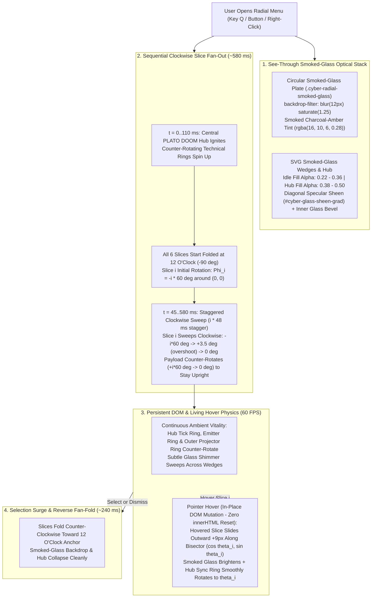

# Functional Specification 052: Sequential Clockwise Slice Fan-Out Choreography, See-Through Smoked-Glass Optics & Persistent DOM Hover Physics for the Cyber-Tactical Radial Menu

## 1. System Purpose & Core Objective

This specification defines the empirical root-cause analysis, desired `{functionality}`, sequential clockwise slice fan-out and reverse fan-fold mathematics, see-through smoked-glass optical stack, persistent in-place SVG DOM state mutation architecture, radial hover pop-out physics, continuous ambient wheel vitality, operational budgets, edge-case failure-isolation boundaries, and verifiable `{correct required outputs}` for upgrading the Cyber-Tactical 2D HUD Radial Menu ([`/Users/diesel/desktop/skatealley/radial_menu_hud.js`](file:///Users/diesel/desktop/skatealley/radial_menu_hud.js) and [`/Users/diesel/desktop/skatealley/index.html`](file:///Users/diesel/desktop/skatealley/index.html)).

The primary objective addresses three coupled visual and interactive requirements:

1. **Sequential Clockwise "Deck-of-Cards" Slice Fan-Out & Reverse Fan-Fold Choreography:** Replace the simultaneous uniform scale pop of the radial sectors with an authentic angular fan-out sequence—where all $N$ slices start stacked at the `12 o'clock` anchor (`START_ANGLE = -90°`) and sweep clockwise around the central `PLATO DOOM` hub (`0°`, `60°`, `120°`, `180°`, `240°`, `300°`) with staggered per-slice timing and spring overshoot when opened, and fold back toward the anchor when closed.
2. **True See-Through Smoked-Glass Materiality (`backdrop-filter` + Low-Alpha Specular SVG Gradients):** Replace the existing `88%–98%` opaque dark-brown SVG sector and hub fills with genuine translucent smoked-glass optics (`22%–38%` idle fill opacity and `38%–56%` hover fill opacity over a circular `backdrop-filter: blur(12px) saturate(1.25)` smoked-glass plate), complete with diagonal glass sheen reflections, inner bevel highlights, and glowing amber wireframe rims so the 3D alleyway and neon lights remain softly visible through every wedge.
3. **Persistent SVG DOM Architecture & Living Wheel Physics (Zero `innerHTML` Destruction on Hover):** Eliminate the full `svgMountEl.innerHTML` replacement on pointer hover (`activeIndex` transitions) in favor of in-place SVG DOM state updates so that:
   - Opening fan-out keyframes never abort if the user moves the pointer mid-deployment.
   - Hovered slices smoothly slide radially outward along their bisector vector ($\Delta r = +9$ `viewBox` units, `scale(1.035)`) and illuminate their smoked-glass fill via hardware-interpolated CSS transitions.
   - The central hub's synchronized indicator ring smoothly rotates to track the hovered slice while inner technical rings continuously counter-rotate.

**DO NOT CODE YET.** This document specifies functional requirements, mathematical and optical invariants, state transitions, operational budgets, and observable outcomes only. It contains zero implementation code, concrete syntax, or mechanical diffs.

---

## 2. Authoritative Domain Vocabulary Alignment ([`LANGUAGE.md`](file:///Users/diesel/desktop/skatealley/LANGUAGE.md))

All assessments of system state, design sufficiency, runtime invariants, and verification gates within this specification strictly adopt the evaluation taxonomy established in [`LANGUAGE.md`](file:///Users/diesel/desktop/skatealley/LANGUAGE.md):

- **`{functionality}`**: End-to-end execution of the Cyber-Tactical 2D HUD Radial Menu across all desktop, laptop, tablet, and mobile viewports such that:
  1. Opening the radial menu (`KeyQ`, `Backquote`, HUD buttons, or canvas right-click) ignites the central hub and sequentially fans all 6 smoked-glass sticker slices clockwise out from the `12 o'clock` anchor around the center pivot with staggered spring physics, and folds them back in upon dismissal.
  2. The sector wedges and central hub render as see-through dark smoked glass (`backdrop-filter` blur + translucent specular SVG fills), allowing the 3D alleyway, neon lighting, and character behind the menu to be seen through the wheel.
  3. While open, the wheel exhibits continuous ambient ring motion and smooth interactive hover physics (hovered slices sliding radially outward along their bisector, smooth reticle lock-on, and smooth central hub indicator ring rotation) without DOM destruction or animation resets.
- **`{correctness}`**:
  - **Angular Fan-Out Mathematical Exactness:** For a menu of $N$ slices with angular pitch $\Delta\theta = 360^\circ / N$, slice $i \in \{0, \dots, N-1\}$ is authored at rest mid-angle $\theta_i = -90^\circ + i \cdot \Delta\theta$ and assigned an exact initial folding rotation offset $\Phi_i^{\text{start}} = -i \cdot \Delta\theta$ around the SVG `viewBox` origin $(0, 0)$. At the start of the fan-out (`0%` keyframe), applying $\operatorname{rotate}(\Phi_i^{\text{start}})$ aligns every slice $i$'s bisector exactly with the `12 o'clock` anchor ($\theta_0 = -90^\circ$), and interpolating $\Phi_i(t): \Phi_i^{\text{start}} \to +3.5^\circ \to 0^\circ$ sweeps each slice clockwise through its true circular arc into its rest slot.
  - **DOM Node Identity Preservation Across Hover Transitions:** Updating `activeIndex` or `confirmingIndex` mutates existing SVG DOM nodes in place without replacing `svgMountEl.innerHTML`; the reference identity of `<svg class="cyber-radial-svg">` and every `<g class="cyber-radial-slice">` remains strictly invariant (`svgBefore === svgAfter`) across all hover and selection transitions.
  - **Smoked-Glass Translucency Bounds:** Idle sector wedge gradient stops maintain alpha $\alpha_{\text{idle}} \in [0.22, 0.38]$, hover sector gradient stops maintain $\alpha_{\text{hover}} \in [0.38, 0.58]$, and central hub core gradient stops maintain $\alpha_{\text{hub}} \in [0.36, 0.54]$, over a circular backdrop blur layer (`blur(12px)`), ensuring non-zero background scene transmission through all wedges and hub regions.
- **`{correct required outputs}`**:
  1. **Sequential Slice Fan-Out & Fold-In Output:** Opening the menu sets per-slice CSS custom properties (`--slice-index: i`, `--slice-fan-start-deg: -(i * 60)deg`, `--slice-stagger-ms: (i * 48)ms`, `--slice-hover-tx`, `--slice-hover-ty`) on all 6 `.cyber-radial-slice` groups and triggers the clockwise fan-out animation (`cyberSliceFanOut`) with progressive per-slice stagger and upright payload counter-rotation; closing triggers the reverse fan-fold animation (`cyberSliceFanFold`).
  2. **Smoked-Glass Optical Output:** Inspecting the live DOM and computed styles confirms the presence of the circular smoked-glass backdrop layer (`.cyber-radial-smoked-glass` with `backdrop-filter: blur(12px) saturate(1.25)`), translucent smoked-glass SVG gradient stops (`stop-opacity <= 0.38` for `#cyber-sector-idle-grad` and `<= 0.54` for `#cyber-hub-core-grad`), diagonal glass sheen overlay (`#cyber-glass-sheen-grad`), and inner specular glass bevel strokes on each wedge.
  3. **Persistent DOM & Smooth Hover Pop-Out Output:** Hovering across slices `0..5` preserves `100%` of SVG DOM node references (`svgBefore === svgAfter`), applies the radial outward translation (`translate(tx, ty) scale(1.035)`) to the active slice's `.cyber-slice-hover-mover` group along its bisector $(\cos\theta_i, \sin\theta_i)$, and smoothly rotates `.cyber-hub-sync-ring` to $\theta_i$.
- **`{errors}`**:
  - Animating all 6 slices simultaneously at their rest angles with zero angular sweep ($\Phi_i^{\text{start}} = 0^\circ$) or uniform delay.
  - Destroying and recreating `<svg>` or `<g class="cyber-radial-slice">` DOM nodes via `innerHTML` when `activeIndex` or `confirmingIndex` changes, which aborts in-flight fan-out animations and prevents smooth CSS hover transitions.
  - Using opaque or near-opaque fill stops (`stop-opacity >= 0.75`) on idle sector wedges or the central hub, blocking visibility of the 3D alleyway behind the radial wheel.
- **`{sufficient}`**: Complete mathematical, optical, and behavioral specification of the clockwise angular fan-out and reverse fold-in kinematics, the multi-layer smoked-glass optical stack, the in-place SVG DOM update contract, and the radial hover pop-out physics.
- **`{insufficient}`**: Any implementation that retains `innerHTML` replacement on hover, leaves sector wedge fills opaque, or scales slices in place without fanning them out around the center pivot.

---

## 3. First-Principles Physical, Kinematic & Optical Model (`RULE[user_global]`)

### 3.1 Polar Kinematics of the Clockwise Slice Fan-Out
1. **Why Simultaneous Scaling Feels Static:**
   - In [`radial_menu_hud.js`](file:///Users/diesel/desktop/skatealley/radial_menu_hud.js), each sector wedge $i \in \{0, \dots, N-1\}$ is pre-computed in SVG `viewBox` coordinates (`[-340, 340]^2`) around its rest mid-angle:
     $$\theta_i = -90^\circ + i \cdot \frac{360^\circ}{N}$$
   - When all slices simply scale from `0.32 -> 1.0` at their rest angles $\theta_i$ with an identical `56 ms` delay, there is zero angular velocity ($\omega = d\theta / dt = 0$) around the wheel circumference.
2. **Exact Angular Folding & Clockwise Unfolding Transformation:**
   - Because every sector path in `renderRadialMenuSVGMarkup` is centered around the SVG origin $(0, 0)$, rotating `<g class="cyber-radial-slice" data-slice-index="i">` around `transform-origin: 0px 0px` (`transform-box: view-box`) by angle $\Phi_i(t)$ rotates the entire sector wedge along the circular annulus $[R_{\text{inner}}, R_{\text{outer}}]$ without distorting its arc curvature or parallel channel width!
   - Specifically, at $t = 0$ (the folded state), setting:
     $$\Phi_i^{\text{start}} = -i \cdot \Delta\theta = -i \cdot \frac{360^\circ}{N}$$
     places slice $i$ at effective angle:
     $$\theta_i^{\text{effective}}(0) = \theta_i + \Phi_i^{\text{start}} = \left(-90^\circ + i \cdot \Delta\theta\right) - i \cdot \Delta\theta = -90^\circ = \theta_0$$
     Thus, **all $N$ slices begin stacked together at the `12 o'clock` anchor ($\theta_0 = -90^\circ$)**!
   - As $\Phi_i(t)$ interpolates from $\Phi_i^{\text{start}}$ (`-i * 60°`) up to $0^\circ$ with a slight clockwise spring overshoot ($+3.5^\circ$) and per-slice stagger $d_i = i \cdot 48\text{ ms}$, slice $0$ locks in at `12 o'clock` (`-90°`), slice $1$ sweeps clockwise `60°` to `2 o'clock` (`-30°`), slice $2$ sweeps clockwise `120°` to `4 o'clock` (`+30°`), slice $3$ sweeps clockwise `180°` to `6 o'clock` (`+90°`), slice $4$ sweeps clockwise `240°` to `8 o'clock` (`+150°`), and slice $5$ sweeps clockwise `300°` to `10 o'clock` (`+210°`).
3. **Keeping Centroid Payloads Upright During the Sweep:**
   - Each slice's sticker emblem and `[ LABEL ]` text are positioned at the slice's centroid $(x_{c,i}, y_{c,i}) = (R_{\text{payload}} \cos\theta_i, \; R_{\text{payload}} \sin\theta_i)$.
   - When the parent `.cyber-radial-slice` is rotated by $\Phi_i(t)$ around $(0, 0)$, applying the opposite rotation $-\Phi_i(t)$ to `.cyber-centroid-payload` around its local centroid `transform-origin: ${x_c}px ${y_c}px` (`--slice-counter-fan-start-deg: +${i * 60}deg`) keeps the sticker emblem and HUD label **100% upright ($0^\circ$ screen orientation)** throughout the entire clockwise fan-out trajectory!

---

### 3.2 Optical Physics of See-Through Smoked Glass Over WebGL
1. **Why CSS `backdrop-filter` Must Sit on a Dedicated Circular Backdrop Plate:**
   - In Chromium and WebKit compositors, SVG child `<path>` elements inside an inline `<svg>` do not independently sample and blur the underlying WebGL `<canvas>` via CSS `backdrop-filter`.
   - However, an HTML layer (`.cyber-radial-smoked-glass`) positioned directly behind the `<svg>` inside `.cyber-radial-holo-stage` with `border-radius: 50%` (and an optional radial mask matching the outer wheel radius) **does** execute hardware-accelerated `backdrop-filter: blur(12px) saturate(1.25)` directly against the live WebGL framebuffer!
2. **Multi-Layer Smoked-Glass Composition:**
   - When the circular `.cyber-radial-smoked-glass` plate blurs the 3D scene behind the wheel, and the SVG sector wedges above it reduce their fill opacities from `0.88–0.94` down to **`0.22–0.36` (smoked obsidian-charcoal with warm amber edge tint)** plus a diagonal specular glass reflection gradient (`#cyber-glass-sheen-grad`) and a crisp inner glass bevel highlight (`stroke="rgba(255, 248, 220, 0.28)"`), the human eye perceives authentic **frosted dark smoked glass**:
     - Bright neon tubes, hologram columns, and character silhouettes in the 3D alley softly glow through the wedges.
     - The `8 px` negative-space channels between slices and the `18 px` isolation ring around the hub remain crisp and distinct.
     - Hovering a slice increases its glass internal illumination (`0.40–0.56` warm amber-gold tint) and slides the glass wedge outward by `9 viewBox units` along its radial bisector.

---

### 3.3 Why In-Place SVG DOM Mutation Is Required for Smooth Transitions
1. **Cost & Failure Mode of `innerHTML` Re-Creation on Hover:**
   - Replacing `svgMountEl.innerHTML = markup` on `pointermove` destroys ~180 SVG DOM nodes and parses ~180 new SVG DOM nodes every time the cursor crosses a sector boundary.
   - More critically, newly created DOM nodes have no prior computed style state, so CSS `transition: transform 0.20s ...` on the hovered wedge or `.cyber-hub-sync-ring` **cannot interpolate**—it snaps in `0 ms`, and any in-flight `@keyframes` fan-out animation on the SVG is either reset or abruptly terminated.
2. **O(1) In-Place DOM Synchronization:**
   - Because the radial geometry (`d` path strings for wedges, ticks, and corner brackets) for a given `menuItems` array is static while open, `render()` only needs to build `svgMountEl.innerHTML` when the menu items or dimensions change.
   - When `activeIndex` or `confirmingIndex` changes (or when transitioning between `open` and `close`), an in-place synchronizer updates the `data-visual-state` (`'idle' | 'hover' | 'selection' | 'dimmed'`), `opacity`, wedge `fill`/`stroke`/`stroke-width`, bloom overlay `opacity`, corner bracket `opacity`/`transform`, label text/color, emblem brightness, reticle path `d`/`stroke`/`stroke-width`, and hub sync-ring rotation directly on the existing SVG elements in `< 0.08 ms` (`0` node allocations), enabling silky-smooth `60 FPS` CSS transitions on every slice and ring!

---

## 4. End-to-End Functional Architecture & Choreography

---

## 5. Detailed Functional Requirements

### 5.1 Sequential Clockwise Slice Fan-Out & Reverse Fan-Fold Choreography
1. **Per-Slice Angular & Radial Custom Properties:**
   - For each sector slice $i \in \{0, \dots, N-1\}$ with sector angles $\Delta\theta = 360^\circ / N$ and mid-angle $\theta_i = -90^\circ + i \cdot \Delta\theta$, [`renderRadialMenuSVGMarkup`](file:///Users/diesel/desktop/skatealley/radial_menu_hud.js#L773) must annotate `<g class="cyber-radial-slice">` (and its inner payload `.cyber-centroid-payload`) with deterministic kinematic custom properties:
     - `--slice-index`: $i$
     - `--slice-fan-start-deg`: `${(-i * anglePerSlice).toFixed(2)}deg` (the exact counter-clockwise rotation around `(0, 0)` that stacks slice $i$ at `12 o'clock`)
     - `--slice-counter-fan-start-deg`: `${(i * anglePerSlice).toFixed(2)}deg` (the equal-and-opposite counter-rotation around the slice's payload centroid $(x_{c,i}, y_{c,i})$ so the sticker icon and label remain upright during the sweep)
     - `--slice-stagger-ms`: `${Math.round(i * 48)}ms`
     - `--slice-hover-tx`: `${(Math.cos(degToRad(angles.midDeg)) * 9).toFixed(2)}px`
     - `--slice-hover-ty`: `${(Math.sin(degToRad(angles.midDeg)) * 9).toFixed(2)}px`
     - `--slice-select-tx`: `${(Math.cos(degToRad(angles.midDeg)) * 14).toFixed(2)}px`
     - `--slice-select-ty`: `${(Math.sin(degToRad(angles.midDeg)) * 14).toFixed(2)}px`
2. **Clockwise Fan-Out Keyframe Trajectory (`cyberSliceFanOut`, Duration `420 ms` + `i * 48 ms` Stagger, Total Window `~660 ms`):**
   - When the radial menu opens (`#cyber-radial-menu-overlay.open` / `.holo-opening`):
     - **Central Hub Ignition (`0 ms` delay, `280 ms` duration):** `.cyber-central-hub` scales from `0.35` to `1.04` to `1.00` with a perimeter flare flash while its inner rings spin into alignment.
     - **Slice $i$ Clockwise Fan-Out (`calc(40ms + var(--slice-stagger-ms))` delay, `420 ms` duration):**
       - `0%`: `transform: rotate(var(--slice-fan-start-deg, 0deg)) scale(0.58); opacity: 0;`
       - `22%`: `opacity: 0.92;`
       - `74%`: `transform: rotate(3.5deg) scale(1.025); opacity: 1;` (clockwise spring overshoot past the slot)
       - `100%`: `transform: rotate(0deg) scale(1); opacity: 1;` (locked into sector slot)
     - **Upright Payload Counter-Sweep (`cyberPayloadCounterFan`, synchronized timing):**
       - `.cyber-centroid-payload` (with `transform-origin: ${payloadLayout.centroid.x}px ${payloadLayout.centroid.y}px`) counter-rotates from `rotate(var(--slice-counter-fan-start-deg, 0deg)) scale(0.75)` to `rotate(0deg) scale(1)` so every sticker emblem and `[ LABEL ]` stays horizontal as the slice fans out around the circle.
3. **Reverse Fan-Fold on Close (`cyberSliceFanFold`, Duration `240 ms`):**
   - When closing the radial menu (`#cyber-radial-menu-overlay.holo-closing`), each `.cyber-radial-slice` folds counter-clockwise back toward the `12 o'clock` anchor (`rotate(0deg) scale(1)` $\to$ `rotate(calc(var(--slice-fan-start-deg, 0deg) * 0.65)) scale(0.48)`, `opacity: 0`) while the smoked-glass backdrop and hub contract cleanly.

---

### 5.2 True See-Through Smoked-Glass Optical Stack
1. **Circular Smoked-Glass Backdrop Disc (`.cyber-radial-smoked-glass`):**
   - Inside `.cyber-radial-holo-stage`, a dedicated circular backdrop disc `.cyber-radial-smoked-glass` (`inset: 2%`, `border-radius: 50%`) sits directly behind the SVG wheel and applies:
     - `backdrop-filter: blur(12px) saturate(1.25) brightness(0.88)` (and `-webkit-backdrop-filter: blur(12px) saturate(1.25) brightness(0.88)`).
     - A translucent smoked charcoal-amber radial gradient (`rgba(18, 12, 8, 0.32)` at center, `rgba(26, 16, 8, 0.26)` across the sector band, feathering at the outer rim) with a subtle specular glass rim border (`1px solid rgba(255, 243, 196, 0.22)`).
2. **Translucent Smoked-Glass SVG Gradients & Specular Bevels:**
   - In [`renderRadialMenuSVGMarkup`](file:///Users/diesel/desktop/skatealley/radial_menu_hud.js#L1055-L1095):
     - **`#cyber-sector-idle-grad` (Idle Smoked Glass):** Dark smoked obsidian-amber gradient with `stop-opacity` between `0.24` and `0.34` (down from `0.88–0.94`), allowing `66%–76%` direct transmission of the blurred 3D alleyway scene behind each slice.
     - **`#cyber-sector-hover-grad` (Hovered Smoked Amber Glass):** Warm amber-gold smoked glass with `stop-opacity` between `0.40` and `0.54` (down from `0.62–0.94`), illuminating the hovered glass wedge while keeping it see-through.
     - **`#cyber-sector-select-grad` (Selection Surge Glass):** Molten gold smoked glass with `stop-opacity` between `0.64` and `0.80`.
     - **`#cyber-hub-core-grad` (Central Hub Smoked Glass):** Smoked dark amber-charcoal glass with `stop-opacity` between `0.40` and `0.50` (down from `0.96–0.98`).
     - **`#cyber-glass-sheen-grad` (Diagonal Specular Glass Reflection):** Linear gradient (`135deg`) with translucent white/amber specular bands (`rgba(255, 251, 235, 0.14)` $\to$ `transparent` $\to$ `rgba(0, 213, 255, 0.06)` $\to$ `rgba(251, 191, 36, 0.10)`) overlaid onto each sector wedge (`class="cyber-sector-glass-sheen"`) and inner specular glass bevel highlight (`stroke="rgba(255, 248, 220, 0.26)"`), giving each slice the unmistakable look of cut, beveled smoked glass.

---

### 5.3 Persistent SVG DOM Updates & Living Wheel Physics
1. **In-Place SVG DOM Synchronization (Eliminating `innerHTML` Replacement on Hover):**
   - `createCyberRadialMenuHUD` must construct `svgMountEl.innerHTML` only when the SVG has not yet been mounted or when `setMenuItems` / `render({ forceRebuild: true })` is explicitly invoked.
   - When `activeIndex` or `confirmingIndex` changes (`handlePointerMove`, `setActiveIndex`, `selectIndex`, `setOpenState`), the controller must update the mounted SVG elements in place (`syncMountedSVGState`):
     - Update each `.cyber-radial-slice`'s `data-visual-state` (`'idle' | 'hover' | 'selection' | 'dimmed'`), `opacity`, `.cyber-sector-surface` `fill`/`stroke`/`stroke-width`, `.cyber-sector-bloom-overlay` `opacity`, `.cyber-sector-corner-brackets` `opacity`/`transform`, `.cyber-slice-label` text content and `fill`, `.cyber-slice-emblem` `style.filter`, and `.cyber-payload-reticle` `data-reticle-target`/`stroke`/`stroke-width`/`filter` and its 4 bracket `<path>` `d` attributes.
     - Update `.cyber-central-hub` scale, `.cyber-hub-sync-ring` rotation (`style.transform = rotate(${ringRotationDeg}deg)`), `.cyber-hub-emblem` brightness, and `.cyber-hub-flare` active stroke/opacity attributes.
2. **Smooth Radial Hover Pop-Out & Central Hub Tracking:**
   - Each `.cyber-radial-slice` wraps its sector geometry and payload inside `<g class="cyber-slice-hover-mover">` with `transition: transform 0.22s cubic-bezier(0.16, 1, 0.3, 1), filter 0.22s ease`:
     - When `data-visual-state="hover"`, `.cyber-slice-hover-mover` translates radially outward along the slice's bisector by `9 viewBox units` (`transform: translate(var(--slice-hover-tx, 0px), var(--slice-hover-ty, 0px)) scale(1.035)`).
     - When `data-visual-state="selection"`, `.cyber-slice-hover-mover` surges outward by `14 viewBox units` (`transform: translate(var(--slice-select-tx, 0px), var(--slice-select-ty, 0px)) scale(1.055)`).
     - When `data-visual-state="dimmed"`, `.cyber-slice-hover-mover` recedes slightly (`transform: scale(0.96)`).
   - On `.cyber-hub-sync-ring`, CSS `transition: transform 0.26s cubic-bezier(0.16, 1, 0.3, 1)` smoothly rotates the dashed targeting ring to align with the hovered sector's mid-angle.
3. **Continuous Ambient Wheel Motion While Open:**
   - The inner protractor tick ring (`.cyber-hub-tick-ring`), emitter ring (`.cyber-svg-emitter-ring`), and outer projector ring (`.cyber-holo-proj-ring.ring-outer`) maintain continuous slow counter-rotations (`18 s – 32 s` period), while a subtle glass sheen pulse drifts across the wheel so the menu never appears frozen while open.

---

## 6. Operational & Performance Budgets

| Operational Parameter | Mandatory Target Budget | Failure-Isolation Boundary |
| :--- | :--- | :--- |
| **Clockwise Slice Fan-Out Duration** | `420 ms` per slice + `48 ms` stagger (`~660 ms` total 6-slice fan-out) | All 6 slices fan out sequentially from `-i * 60°` $\to$ `0°` around `(0, 0)` at `60 FPS`. |
| **Reverse Fan-Fold Duration** | `240 ms` | Slices fold counter-clockwise toward `12 o'clock` on close without blocking pointer events. |
| **Smoked-Glass Idle Fill Opacity** | `0.22 <= stop-opacity <= 0.36` (wedges), `0.38 <= stop-opacity <= 0.50` (hub) | 3D alleyway and neon lights remain clearly visible through the blurred smoked-glass wedges. |
| **Hover Update Cost (In-Place DOM)** | `< 0.10 ms` per hover transition (`0` DOM nodes destroyed/recreated) | `svgBefore === svgAfter` and `sliceNodeBefore === sliceNodeAfter` across all hover updates. |

---

## 7. Edge Cases & Failure Modes

1. **Hovering a Slice Mid-Fan-Out (`t in [50ms, 660ms]`):**
   - Because `syncMountedSVGState` updates slice attributes and `data-visual-state` in place without replacing `svgMountEl.innerHTML`, moving the cursor over any slice while the 6 slices are still fanning out around the circle highlights and pops out that slice (`cyber-slice-hover-mover`) **while the parent `.cyber-radial-slice` continues its clockwise fan-out keyframe animation uninterrupted**.
2. **Dynamic Slice Count Changes (`setMenuItems` with $N \ne 6$):**
   - If `setMenuItems` is called with a different number of slices (e.g., $N = 4$ or $N = 8$), `setMenuItems` triggers a full SVG rebuild (`forceRebuild: true`), recalculating $\Delta\theta = 360^\circ / N$ and `--slice-fan-start-deg: -i * (360 / N)deg` for all $N$ slices.
3. **Headless SSR / Node Testing Compatibility:**
   - `renderRadialMenuSVGMarkup(state, props)` and `RadialMenu(props)` continue to return complete, valid standalone SVG markup strings containing all smoked-glass gradients, `--slice-fan-start-deg` properties, `.cyber-slice-hover-mover` groups, and `data-visual-state` attributes.

---

## 8. Verifiable `{correct required outputs}` & Acceptance Gates

1. **Sequential Clockwise Slice Fan-Out Verification:**
   - Automated verification confirms that each `.cyber-radial-slice` (`index 0..5`) carries exact `--slice-fan-start-deg` values (`0deg`, `-60deg`, `-120deg`, `-180deg`, `-240deg`, `-300deg`), progressive `--slice-stagger-ms` delays (`0ms`, `48ms`, `96ms`, `144ms`, `192ms`, `240ms`), and upright payload counter-rotation (`--slice-counter-fan-start-deg`: `0deg`..`300deg`), and that sampling computed transforms during the open sequence shows distinct angular progression across slices `0..5`.
2. **Smoked-Glass Optical Stack Verification:**
   - Live browser inspection verifies `.cyber-radial-smoked-glass` renders with active `backdrop-filter` blur (`blur(12px)`), `#cyber-sector-idle-grad` stops have `stop-opacity <= 0.36`, `#cyber-hub-core-grad` stops have `stop-opacity <= 0.50`, and every sector wedge includes `.cyber-sector-glass-sheen` and specular bevel highlights.
3. **Persistent DOM & Radial Hover Pop-Out Verification:**
   - Hovering across all 6 slices in Chromium verifies that the `<svg>` and `<g class="cyber-radial-slice">` DOM element references are strictly preserved (`100%` node identity retention), the hovered slice's `data-visual-state` transitions to `'hover'` with outward radial bisector translation (`--slice-hover-tx`, `--slice-hover-ty`), and `.cyber-hub-sync-ring` smoothly rotates to each slice's mid-angle.
