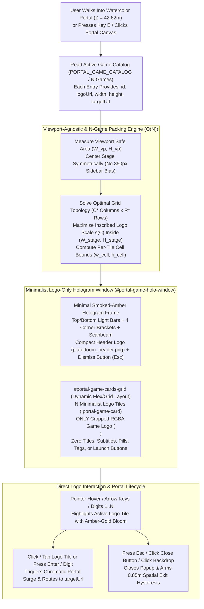

# Functional Specification 053: Minimalist Logo-Only Holographic Arcade Selector & Viewport-Agnostic $N$-Game Auto-Fitting Showcase

## 1. System Purpose & Core Objective

This specification defines the empirical root-cause diagnosis, desired `{functionality}`, first-principles 2D viewport-and-catalog packing mathematics, minimalist logo-only visual architecture, dynamic catalog scaling behavior, interactive selection and launch state transitions, operational budgets, edge-case failure-isolation boundaries, and verifiable `{correct required outputs}` for refining the Back-Alley Watercolor Shader Portal **"Arcade Selector"** holographic pop-up UI ([`/Users/diesel/desktop/skatealley/index.html`](file:///Users/diesel/desktop/skatealley/index.html), [`/Users/diesel/desktop/skatealley/watercolor_shader.js`](file:///Users/diesel/desktop/skatealley/watercolor_shader.js), and [`/Users/diesel/desktop/skatealley/sandbox.js`](file:///Users/diesel/desktop/skatealley/sandbox.js)).

The primary objective addresses two coupled requirements:

1. **Minimalistic, Logo-Only Game Showcase:** Eliminate the visual and textual clutter inside the back-alley watercolor portal holographic pop-up (`#portal-game-holo-stage` / `#portal-game-holo-window`). Every selectable game entry in the showcase must display **only its cropped transparent RGBA game logo** inside a clean, translucent holographic tile—removing all per-card text kickers, hotkey slot pills, card titles, card subtitle descriptions, metadata tag chips, inner boxed logo wells, and bottom launch buttons, as well as removing redundant multi-line instructional paragraphs, duplicate header hotkey tag rows, and footer station pip bars.
2. **Screen-Size-Agnostic & $N$-Game Auto-Fitting Hologram Layout:** Replace the hardcoded desktop sidebar offset (`350px` left padding) and rigid 3-column / 1-column grid with a viewport-aware, catalog-count-aware ($N$-agnostic) responsive showcase layout. Regardless of viewport dimensions or orientation (from compact mobile portrait `375×667` and `390×844` to mobile landscape `844×390`, tablet `768×1024`, desktop `1440×900`, and ultrawide `2560×1440+`), and as more games $N$ are added to the portal catalog ($N = 1, 2, 3, 4, 5, 6, 8, 9, 12, \dots$), the arcade selector hologram must automatically compute and adapt its column/row topology and logo tile sizing so all $N$ game logos naturally fit inside the hologram screen without overflow, clipping, scrollbars, or aspect-ratio distortion.

**DO NOT CODE YET.** This document specifies functional requirements, mathematical packing invariants, visual design constraints, state transitions, operational budgets, and observable outcomes only. It contains zero implementation code, concrete syntax, or mechanical diffs.

---

## 2. Authoritative Domain Vocabulary Alignment ([`LANGUAGE.md`](file:///Users/diesel/desktop/skatealley/LANGUAGE.md))

All assessments of system state, design sufficiency, runtime invariants, and verification gates within this specification strictly adopt the evaluation taxonomy established in [`LANGUAGE.md`](file:///Users/diesel/desktop/skatealley/LANGUAGE.md):

- **`{functionality}`**: End-to-end interactive execution of the Back-Alley Watercolor Shader Portal Arcade Selector across all desktop, tablet, and mobile viewports such that:
  1. Walking through (or interacting with) the back-alley watercolor shader portal materializes a minimalistic, smoked-amber holographic showcase where each available game is represented solely by its cropped RGBA logo.
  2. Hovering, focusing, or navigating via keyboard highlights the active game logo tile with holographic bloom, and clicking/tapping a logo (or pressing `Enter`/`Space` or its numeric hotkey) launches that game's destination URL through the portal.
  3. As the viewport resizes across arbitrary screen dimensions and as the number of registered games $N$ in `PORTAL_GAME_CATALOG` increases, the hologram showcase dynamically arranges and scales all $N$ game logos so they fit cleanly and legibly inside the hologram frame.
- **`{correctness}`**:
  - **Strict Logo-Only Tile Composition:** Each game card/tile in `#portal-game-cards-grid` contains only its cropped RGBA `` visual payload (with accessible `alt` / `aria-label` attributes on the tile and image) and zero visible text nodes, title headings, subtitle paragraphs, slot pills, tag chips, or launch button bars.
  - **Isotropic Logo Aspect-Ratio Preservation:** Every game logo renders with its native cropped aspect ratio $A_i = W_i / H_i$ preserved within $|(w_{\text{rendered},i} / h_{\text{rendered},i}) - A_i| \le 0.02$ (`object-fit: contain`), with all four corners maintaining transparent alpha ($\alpha = 0$).
  - **Universal Viewport & $N$-Game Containment:** For any viewport size $(W_{\text{vp}}, H_{\text{vp}}) \in [320, 3840] \times [360, 2160]$ and any catalog count $N \in [1, 12]$, the hologram window `#portal-game-holo-window` lies 100% within the visible viewport safe area, and all $N$ logo tiles lie 100% within `#portal-game-holo-window` with zero vertical or horizontal clipping (`scrollHeight <= clientHeight + 1`, `scrollWidth <= clientWidth + 1`).
  - **Dynamic Catalog Driven Binding:** Rendering, selection, and keyboard navigation (`ArrowLeft`, `ArrowRight`, `ArrowUp`, `ArrowDown`, `Digit1`–`Digit9`, `Enter`/`Space`, `Escape`) operate dynamically over the live catalog entries rather than assuming a fixed count of 3 games.
- **`{correct required outputs}`**:
  1. **Minimalist DOM & Visual Output:** Inspecting the open `#portal-game-holo-window` confirms that `#portal-game-cards-grid` renders one interactive logo tile per catalog entry containing only the game's cropped RGBA logo image, with zero visible `.portal-game-card-title`, `.portal-game-card-desc`, `.portal-game-slot-pill`, `.portal-game-launch-btn`, `.holo-tag`, or `.holo-pip-btn` elements inside the popup.
  2. **Screen-Size-Agnostic Containment Output:** Across desktop landscape (`1440×900`), tablet (`768×1024`), mobile portrait (`390×844` and `375×667`), and mobile landscape (`844×390`), `#portal-game-holo-stage` centers `#portal-game-holo-window` symmetrically within the viewport (`|center_x - W_vp/2| <= 8px`), and every logo tile is completely visible inside the hologram frame without scrollbars or overflow clipping.
  3. **$N$-Game Scalability Output:** Dynamically supplying $N \in \{3, 4, 5, 6, 8, 9\}$ game specs to the arcade selector automatically populates $N$ logo tiles and re-computes the grid column/row layout so all $N$ logos fit inside `#portal-game-holo-window` across both desktop (`1440×900`) and mobile portrait (`390×844`) viewports.
  4. **Preserved Portal Lifecycle & Routing Output:** Walking into the portal at $Z = 42.6182\text{ m}$ opens the minimalist selector without auto-teleporting; dismissing via `Escape`, backdrop click, or the close button disarms walk-through re-triggering until the player moves outside the $0.85\text{ m}$ hysteresis zone; clicking or activating any logo routes deterministically to that game's target URL (`./skate3_cleanroom/?char=luis`, `./revcdos/`, `./nzportable/`, or any added catalog entry).
- **`{errors}`**:
  - Rendering verbose text titles, subtitle descriptions, slot pills, tag chips, or launch buttons inside the game tiles, or retaining multi-line instructional paragraphs and footer pip button bars that clutter the hologram.
  - Hardcoding `padding-left: 350px` on `#portal-game-holo-stage`, which shifts the hologram off-center and crushes horizontal space on compact viewports.
  - Stacking game tiles in a fixed-height column that exceeds `100dvh` on mobile portrait (`390×844`) or multi-row desktop states and gets clipped by `.holo-window { overflow: hidden }`.
  - Hardcoding 3 static game cards or 3 hotkey branches so that adding a 4th or 5th game to `PORTAL_GAME_CATALOG` fails to render or fit inside the hologram.
- **`{sufficient}`**: Complete mathematical, visual, and behavioral specification of the minimalist logo-only tile contract, the viewport-aware and $N$-game-aware 2D grid packing model, dynamic catalog synchronization, interactive selection/launch/hysteresis workflows, operational budgets, and multi-viewport / multi-$N$ acceptance gates.
- **`{insufficient}`**: Any specification that leaves text/button clutter on the game cards, relies on fixed CSS column counts that break or clip on mobile portrait or when $N > 3$, or fails to verify layout containment across both multiple screen sizes and $N > 3$ catalog entries.

---

## 3. Empirical Root-Cause Diagnosis & First-Principles Physical Modeling (`RULE[user_global]`)

### 3.1 Cognitive & Visual Clutter in the Existing Arcade Selector
1. **Six Redundant Layers Per Game Card:**
   - In the current implementation ([`index.html`](file:///Users/diesel/desktop/skatealley/index.html#L2432-L2564)), each of the 3 game cards stacks six separate visual components:
     1. A top metadata row containing a monospace kicker (`PORTAL_GAME_01 // VERT & STREET`) and a bordered pill (`KEY [1]`).
     2. A nested bordered inner box (`.portal-game-logo-well`, fixed `158px` height) around the logo image.
     3. An uppercase `<h3>` title (`SKATE 3 // PLATODOOM`).
     4. A `
` description (`3D Physics Skatepark & Vert Halfpipe Cleanroom`).
     5. A `.holo-tag-row` badge (`3D SKATE CLEANROOM // VERT & STREET`).
     6. A full-width button (`LAUNCH SKATE 3 →`).
   - Above and below the grid, the window adds a top bar with coordinate telemetry, a boxed header banner with a kicker, `<h2>` title, instructional paragraph, and 3 key-tag chips, plus a footer bar with a status string and 3 station pip buttons (`01 // SKATE 3`, `02 // GTA`, `03 // ZOMBIES`).
   - **Result:** Over 30 distinct text strings, borders, and sub-buttons compete for attention against the 3 game logos, consuming more than `60%` of the window's vertical height on non-logo chrome.

### 3.2 Why the Existing Layout Breaks Across Screen Sizes and $N > 3$ Games
1. **Hardcoded Sidebar Offset (`350px` Left Padding):**
   - `#portal-game-holo-stage` currently applies `padding: 20px 24px 20px 350px` for all viewports wider than `980px`. On a `1000px` viewport, `374px` of horizontal padding leaves only `626px` for the hologram window and centers it at $x = 663\text{ px}$ instead of the screen midpoint $x = 500\text{ px}$. Because `#portal-game-holo-stage` is a modal overlay (`z-index: 64`) that captures focus when the player enters the portal, it must center symmetrically within the full viewport safe area (`100vw × 100dvh`).
2. **Mobile Portrait & Multi-Row Vertical Overflow Clipping:**
   - At viewport widths $\le 860\text{ px}$, `#portal-game-cards-grid` currently collapses to a single column (`grid-template-columns: 1fr`) while `.portal-game-logo-well` remains fixed at `158px` height plus `~120px` of text/buttons per card.
   - For $N = 3$ games on an iPhone viewport (`390×844`), the 3 stacked cards alone require $\approx 860\text{ px}$, and together with the header and chrome require $\approx 1,100\text{ px} > 844\text{ px}$. Because `.holo-window` enforces `overflow: hidden`, the bottom game card is clipped off-screen.
   - Even on a `1440×900` desktop monitor, if $N = 7$ or $N = 9$ games are added to a rigid 3-column grid with fixed-height cards, the 3 rows exceed the `900px` viewport height and clip.

### 3.3 First-Principles 2D Optimal Grid Packing Model ($O(N)$ Screen-Size & $N$-Game Solver)
To guarantee that any number of games $N \ge 1$ naturally fits inside the hologram showcase across any screen size $(W_{\text{vp}}, H_{\text{vp}})$:

1. **Available Hologram Showcase Budget $(W_{\text{stage}}, H_{\text{stage}})$:**
   - Let the outer viewport safe area be bounded by symmetric horizontal margin $2 M_x$ and vertical margin $2 M_y$ (accounting for `env(safe-area-inset-*)`), and let $H_{\text{chrome}}$ be the compact height of the minimal hologram header/dismissal bar and window padding ($\approx 64\text{–}84\text{ px}$).
   - The maximum available inner showcase dimensions for the logo grid are:
     $$W_{\text{stage}} = \min\!\left(W_{\max},\; W_{\text{vp}} - 2 M_x - 2 P_x\right), \qquad H_{\text{stage}} = \min\!\left(H_{\max},\; H_{\text{vp}} - 2 M_y - H_{\text{chrome}}\right)$$
2. **Optimal $(C^*, R^*)$ Column-Row Partition for $N$ Games:**
   - From [`assets/portal_games/manifest.json`](file:///Users/diesel/desktop/skatealley/assets/portal_games/manifest.json), the cropped RGBA game logos have native aspect ratios $A_1 = 960/803 \approx 1.196$, $A_2 = 960/878 \approx 1.093$, and $A_3 = 960/647 \approx 1.484$ (mean aspect ratio $\bar{A} \approx 1.258$, decoded RGBA total $8.93\text{ MB} \le 12\text{ MB}$).
   - For a catalog of $N$ games with characteristic tile aspect ratio $a_{\text{ref}} \approx 1.22$ and inter-tile gap $g$, any candidate column count $C \in \{1, 2, \dots, N\}$ produces $R = \lceil N / C \rceil$ rows, with per-tile bounding cell dimensions:
     $$w_{\text{cell}}(C) = \frac{W_{\text{stage}} - (C - 1)g}{C}, \qquad h_{\text{cell}}(C) = \frac{H_{\text{stage}} - (R - 1)g}{R}$$
   - The effective linear scale of each logo inside cell $(w_{\text{cell}}(C), h_{\text{cell}}(C))$ is governed by the tighter of its horizontal and vertical bounds:
     $$s(C) = \min\!\left(\frac{w_{\text{cell}}(C)}{a_{\text{ref}}},\; h_{\text{cell}}(C)\right)$$
   - Evaluating $s(C)$ across $C \in \{1, \dots, N\}$ (penalizing configurations with excessive empty cells in the final row when scale is nearly tied) selects the optimal grid topology $(C^*, R^*)$ in $O(N)$ time (`< 0.02 ms` for $N \le 24$):
     - **Landscape / Desktop ($W_{\text{stage}} > H_{\text{stage}}$, e.g. `1440×900` or `844×390`):**
       - $N = 1, 2, 3$: $C^* = N, R^* = 1$ (single horizontal row of large logos).
       - $N = 4$: $C^* = 4, R^* = 1$ (on wide viewports) or $C^* = 2, R^* = 2$ (on squarer viewports).
       - $N = 5, 6$: $C^* = 3, R^* = 2$ (2 balanced rows of up to 3 logos).
       - $N = 7, 8$: $C^* = 4, R^* = 2$.
       - $N = 9$: $C^* = 3, R^* = 3$ or $C^* = 5, R^* = 2$.
     - **Portrait / Mobile ($H_{\text{stage}} > W_{\text{stage}}$, e.g. `390×844` or `375×667`):**
       - $N = 1, 2, 3$: $C^* = 1, R^* = N$ (or $C^* = 2, R^* = 2$ on short portrait screens), with each cell height $h_{\text{cell}} \le H_{\text{stage}} / N$ so all 3 logos fit comfortably inside a single screen without scrolling or clipping.
       - $N = 4$: $C^* = 2, R^* = 2$ (2×2 grid).
       - $N = 5, 6$: $C^* = 2, R^* = 3$ (2 columns × 3 rows).
       - $N = 7, 8, 9$: $C^* = 3, R^* = 3$ (3×3 grid).
3. **Intrinsic Sizing When $N$ Is Small vs. Max-Bounded Sizing When $N$ Grows:**
   - By clamping each cell's maximum target size to a comfortable ceiling ($w_{\text{cell}} \le w_{\max}$, $h_{\text{cell}} \le h_{\max}$) while upper-bounding the grid by $(W_{\text{stage}}, H_{\text{stage}})$, the hologram window `#portal-game-holo-window` tightly wraps the logos when $N$ is small and smoothly expands/subdivides up to the viewport safe bounds as more games are added.

---

## 4. End-to-End Functional Architecture

---

## 5. Detailed Functional Requirements

### 5.1 Minimalistic Logo-Only Showcase Composition
1. **Strict Logo-Only Game Tiles (`.portal-game-card`):**
   - Every game tile inside `#portal-game-cards-grid` must contain **only** its cropped RGBA `` element.
   - All per-card text and sub-chrome must be eliminated:
     - **Zero** `.portal-game-card-top` headers or `.holo-kicker` text spans.
     - **Zero** `.portal-game-slot-pill` (`KEY [1]`) badges.
     - **Zero** nested `.portal-game-logo-well` inner boxes with secondary borders.
     - **Zero** `.portal-game-card-title` (`<h3>`) headings.
     - **Zero** `.portal-game-card-desc` (`
`) descriptions.
     - **Zero** `.holo-tag-row` / `.holo-tag` metadata chips.
     - **Zero** `button.portal-game-launch-btn` (`LAUNCH ... →`) action bars.
   - Each tile acts directly as the interactive button/listitem (`role="listitem"`, `tabindex="0"`, `data-game-id`, `data-game-slot`, `data-target-url`, `aria-label`), framing the transparent RGBA game logo inside a subtle, translucent smoked-amber holographic glass tile that illuminates with a crisp gold border, radial amber glow, and smooth scale lift (`scale(1.05)`) when hovered, focused, or selected.
2. **Streamlined Hologram Frame Chrome (`#portal-game-holo-window`):**
   - Retain the signature Freeman Alley `.holo-window` frame treatment: translucent smoked-amber glass (`backdrop-filter: blur(10px)`), top and bottom `.holo-light-bar` strips, 4 `.holo-corner` L-brackets, and `.holo-scanbeam`.
   - Consolidate the top header into a single compact, minimalist bar displaying only the cropped `#portal-header-logo-img` (`./assets/portal_games/platodoom_header.png`) and the compact `#portal-holo-exit-btn` (`✕` / `ESC` dismiss button)—eliminating the multi-line instructional `
`, the duplicate `.holo-tag-row` (`KEY 1 // SKATE 3`, etc.), the verbose coordinate strings, and the bottom `.holo-footer-bar` pip buttons so the user's focus goes immediately to the game logos.
   - If `#portal-holo-header-title` or `#portal-holo-footer-status` are referenced by accessibility attributes (`aria-labelledby`) or state synchronizers, they must either be visually hidden (`sr-only`) or omitted from visible layout space so zero prose paragraphs or footer bars clutter the hologram.

---

### 5.2 Screen-Size-Agnostic Viewport Centering & Responsive Safe-Area Fitting
1. **Symmetric Full-Viewport Centering (`#portal-game-holo-stage`):**
   - Remove the asymmetric `padding-left: 350px` sidebar offset on `#portal-game-holo-stage`.
   - `#portal-game-holo-stage` must span the full viewport (`100vw × 100dvh`) and center `#portal-game-holo-window` symmetrically in both horizontal and vertical axes using safe-area-aware viewport padding (`max(16px, env(safe-area-inset-*))`), regardless of whether `body.sidebar-collapsed` is set or what screen width is active.
2. **Intrinsic Hologram Sizing Bounded by Viewport Safe Area:**
   - `#portal-game-holo-window` must ditch the rigid `min-height: 420px` and fixed `940px` width assumptions in favor of an intrinsic, viewport-clamped container (`width: fit-content`, `max-width: calc(100vw - 32px)`, `max-height: calc(100dvh - 32px)`) that wraps the computed logo grid tightly while never exceeding the visible screen on any device.

---

### 5.3 $N$-Game Catalog Scalability & Dynamic 2D Grid Packing
1. **Catalog-Driven Tile Generation & Synchronization:**
   - The showcase grid `#portal-game-cards-grid` must dynamically synchronize its child `.portal-game-card` logo tiles against the active catalog list (defaulting to `PORTAL_GAME_CATALOG` in [`watercolor_shader.js`](file:///Users/diesel/desktop/skatealley/watercolor_shader.js#L107-L159), and supporting runtime catalog extensions or custom game arrays passed via `waterColor.availableGames` / `sandbox.portalGameCatalog`).
   - For the baseline 3 games (`skate3`, `gta`, `zombies`), the DOM preserves their deterministic IDs (`#portal-game-card-skate3`, `#portal-game-card-gta`, `#portal-game-card-zombies` and `#portal-game-logo-skate3`, `#portal-game-logo-gta`, `#portal-game-logo-zombies`), while any additional game entry $i$ added to the catalog automatically mounts its corresponding `.portal-game-card` (`id="portal-game-card-${game.id}"`) and `` with full pointer and keyboard event binding.
2. **Deterministic Viewport + $N$-Game Layout Adaptation:**
   - Whenever the portal popup opens, the game catalog count $N$ changes, or the browser viewport resizes (`resize` / `orientationchange`), the layout engine must evaluate the current viewport dimensions $(W_{\text{vp}}, H_{\text{vp}})$ and game count $N$:
     - Compute the optimal column count $C^* \in [1, N]$, row count $R^* = \lceil N / C^* \rceil$, and per-tile cell dimensions $(w_{\text{cell}}, h_{\text{cell}})$ so that all $N$ tiles fit inside the available hologram stage area $(W_{\text{stage}}, H_{\text{stage}})$ with zero overflow.
     - Center trailing-row tiles symmetrically when $N$ is not an exact multiple of $C^*$ (e.g., $N = 5$ in a $3 \times 2$ layout places 3 logos on the top row and centers 2 equally sized logos on the bottom row).
     - Ensure every `.portal-game-logo-img` scales smoothly within its tile (`width: 100%; height: 100%; object-fit: contain`) with `min-width: 0` and `min-height: 0` so no image ever overflows its cell or distorts its aspect ratio.

---

### 5.4 Interactive Selection, Direct Launch & Spatial Hysteresis Contracts
1. **Pointer & Touch Interaction:**
   - Hovering (`pointerenter`) a `.portal-game-card` logo tile sets `waterColor.setHoveredGame(gameId)` and `sandbox.selectPortalGame(gameId)`, illuminating that logo tile as `.selected`.
   - Clicking or tapping a `.portal-game-card` logo tile immediately invokes `sandbox.launchPortalGame(gameId, { source: 'card-click' })`, triggering the chromatic portal surge and navigating to the game's resolved `targetUrl`.
2. **Dynamic Keyboard Navigation (`1..9`, Arrow Keys, `Enter`, `Escape`):**
   - Pressing `Digit1`–`Digit9` (or `Numpad1`–`Numpad9`) while the popup is open resolves the corresponding catalog index `0..8` from the active catalog and launches that game if present.
   - Pressing `ArrowRight` / `ArrowLeft` steps forward / backward by $1$ across the active catalog; pressing `ArrowDown` / `ArrowUp` steps by the active column stride $C^*$ (or $\pm 1$ in single-row/single-column layouts) with modular wraparound.
   - Pressing `Enter`, `NumpadEnter`, or `Space` launches the currently selected game.
   - Pressing `Escape`, clicking `#portal-holo-exit-btn`, or clicking the `#portal-game-holo-stage` backdrop outside `#portal-game-holo-window` closes the popup and engages `walkThroughDisarmedUntilExit = true` until the character moves outside the $0.85\text{ m}$ portal aperture hysteresis band.

---

## 6. Operational & Performance Budgets

| Subsystem / Operation | Mandatory Operational Budget | Failure-Isolation Boundary |
| :--- | :--- | :--- |
| **2D Grid Packing & Resize Solver** | $\le 0.25\text{ ms}$ per evaluation for $N \le 24$ games | Pure $O(N)$ arithmetic + CSS custom property update; zero synchronous layout-thrashing loops. |
| **DOM Sync on Popup Open / Selection** | $\le 0.50\text{ ms}$ per open or selection transition | Reuses existing `.portal-game-card` DOM nodes when catalog length/IDs are unchanged (`0` redundant image reloads). |
| **Decoded RGBA Logo Texture Footprint** | $\le 12.0\text{ MB}$ total for baseline catalog (`8.93 MB` measured) | All logos use `decoding="async"` and tightly cropped transparent RGBA bounds (`corner alpha == 0`). |
| **Viewport & Window Containment** | `0 px` horizontal or vertical clipping across `320×568` to `2560×1440` for $N \in [1, 12]$ | `winEl.scrollHeight <= winEl.clientHeight + 1`, `winEl.scrollWidth <= winEl.clientWidth + 1`, and `winRect` 100% inside viewport. |
| **Minimum Rendered Logo Dimension** | $\ge 56\text{ px}$ width and $\ge 44\text{ px}$ height for $N \le 9$ on `390×844` mobile and $\ge 110\text{ px}$ on `1440×900` desktop | Guarantees every game logo remains visually recognizable and touch-target compliant (`>= 44×44 px`). |

---

## 7. Edge Cases & Failure Modes

1. **Non-Rectangular Catalog Counts ($N = 1, 2, 3, 5, 7, 10, 11$):**
   - When $N$ does not evenly divide $C^*$ (for example, $N = 5$ with $C^* = 3$ columns and $R^* = 2$ rows), the 2 tiles on the second row must keep the exact same cell width and height $(w_{\text{cell}}, h_{\text{cell}})$ as the 3 tiles on the first row while centering horizontally within the row, rather than stretching to $50\%$ width or hugging the left edge.
2. **Mobile Portrait (`390×844`, `375×667`) vs. Ultra-Short Mobile Landscape (`844×390`, `667×375`):**
   - On tall portrait viewports, the packing solver naturally favors fewer columns and more rows ($1 \times 3$ or $2 \times 2$ for $N = 3..4$; $2 \times 3$ for $N = 5..6$).
   - On short landscape viewports (`height = 375px`), vertical stage height $H_{\text{stage}}$ is constrained (`~270px`), so the solver automatically favors wider single-row or two-row arrangements ($3 \times 1$ for $N = 3$; $4 \times 1$ or $4 \times 2$ for $N = 4..8$) and scales cell heights down so the hologram window never clips vertically.
3. **Varying Logo Aspect Ratios ($A_i \in [0.65, 2.50]$):**
   - Because each logo image uses isotropic containment (`object-fit: contain`) inside a padded flex cell with `min-width: 0; min-height: 0`, wide wordmark logos (`zombies_logo.png`, $A = 1.484$) and taller emblem logos (`gta_logo.png`, $A = 1.093$) harmonize visually at comparable perceived area without clipping or distortion.
4. **Dynamic Catalog Mutation at Runtime:**
   - If a caller or test adds or removes games (e.g., expanding the catalog from $3$ to $6$ or $9$ games while open or before opening), the selector rebuilds only the changed card list, preserves `selectedGameId` if still present in the catalog (or defaults deterministically to `catalog[0].id`), and immediately re-runs the grid packing solver.
5. **Standing Inside the Portal Plane on Dismissal:**
   - Dismissing the minimalist popup while `activeChar` remains at $Z \approx 42.6182\text{ m}$ keeps `walkThroughDisarmedUntilExit = true` so the popup never enters an infinite re-open loop on the next `step(dt)` tick.

---

## 8. Acceptance Criteria & Verification Gates (`{correct required outputs}`)

- **`AC-01` (Minimalist Logo-Only Tile & Hologram Chrome Verification):**
  - When `#portal-game-holo-stage` is open, every `.portal-game-card` in `#portal-game-cards-grid` contains only its cropped RGBA `` with zero visible text titles, descriptions, kickers, slot pills, tag chips, or launch buttons (`card.innerText.trim() === ''`), and the hologram window contains zero footer pip button bars or multi-line instructional paragraphs.
- **`AC-02` (Cropped Transparent RGBA Logo Integrity):**
  - All rendered game logos (`#portal-game-logo-skate3`, `#portal-game-logo-gta`, `#portal-game-logo-zombies`, plus `#portal-header-logo-img`) load with `naturalWidth > 200`, `naturalHeight > 100`, `cornerAlphas == [0, 0, 0, 0]`, and preserve their native aspect ratios within $\pm 2\%$.
- **`AC-03` (Screen-Size-Agnostic Centering & Containment Across Viewports):**
  - Across at least 4 distinct viewport geometries—Desktop (`1440×900`), Tablet (`768×1024`), Mobile Portrait (`390×844`), and Mobile Landscape (`844×390`)—`#portal-game-holo-window` is horizontally centered within the viewport (`|winCenterX - viewportWidth / 2| <= 8px`), fits 100% inside the viewport (`top >= 8`, `left >= 8`, `right <= viewportWidth - 8`, `bottom <= viewportHeight - 8`), and exhibits zero internal clipping (`scrollHeight <= clientHeight + 1`, `scrollWidth <= clientWidth + 1`).
- **`AC-04` ($N$-Game Auto-Fitting Scalability Verification for $N = 3, 4, 6, 9$):**
  - When the catalog is populated with $N = 3, 4, 6,$ and $9$ games on both Desktop (`1440×900`) and Mobile Portrait (`390×844`), `#portal-game-cards-grid` renders all $N$ logo tiles, adapts its column/row topology $(C^*, R^*)$, and fits all $N$ logo tiles completely inside `#portal-game-holo-window` without overlapping, overflowing, or dropping below the minimum touch target / legibility bounds.
- **`AC-05` (Direct Logo Launch, Keyboard Navigation & Portal Hysteresis Parity):**
  - Clicking any logo tile (or pressing `Digit1`..`DigitN` / `Arrow*` + `Enter`) selects and launches the corresponding game's `targetUrl`; pressing `Escape`, clicking `#portal-holo-exit-btn`, or clicking the stage backdrop closes the popup and enforces the $0.85\text{ m}$ `walkThroughDisarmedUntilExit` spatial hysteresis contract with zero console or page errors.
