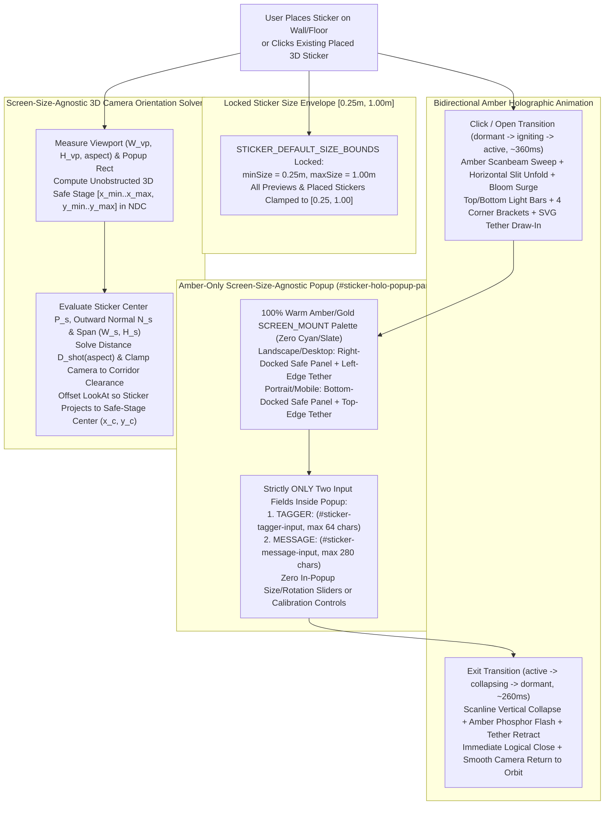

# Functional Specification 054: Amber-Only Holographic Sticker Message Popups, Exclusive `TAGGER:` / `MESSAGE:` Field Contract, Locked `[0.25, 1.00]` Size Envelope, Bidirectional Holographic Ignition/Collapse Animation, and Screen-Size-Agnostic Popup & Camera Framing

## 1. System Purpose & Core Objective

This specification defines the empirical root-cause diagnosis, desired `{functionality}`, first-principles 3D perspective frustum and 2D viewport safe-area mathematics, pure warm-amber chromatic and diegetic frame invariants, strict two-field form contract, locked size bounds (`min = 0.25`, `max = 1.00`), bidirectional holographic ignition and collapse animation lifecycle, operational budgets, edge-case failure-isolation boundaries, and verifiable `{correct required outputs}` for refining the Placed Sticker Holographic Message Popup system ([`/Users/diesel/desktop/skatealley/index.html`](file:///Users/diesel/desktop/skatealley/index.html), [`/Users/diesel/desktop/skatealley/sandbox.js`](file:///Users/diesel/desktop/skatealley/sandbox.js), and [`/Users/diesel/desktop/skatealley/holographic_stickers.js`](file:///Users/diesel/desktop/skatealley/holographic_stickers.js)).

The specification governs six coupled requirements:

1. **Pure Amber-Hue Holographic Visual Identity:** Eliminate all cyan, sky-blue, and slate-navy hues from the sticker popup overlay, panel, controls, and 3D-to-2D SVG tether. Establish 100% chromatic and structural parity with Freeman Alley's signature warm smoked-amber / gold holographic terminals (`SCREEN_MOUNT` palette).
2. **Exclusive `"TAGGER:"` and `"MESSAGE:"` Input Fields:** Remove all in-popup transform and calibration controls (size sliders/inputs/step buttons, rotation sliders/inputs/step buttons, bounds readouts, and min/max capture buttons) from the sticker popup so that the **only** fields present in the popup are `"TAGGER:"` and `"MESSAGE:"`.
3. **Locked Sticker Size Envelope (`minSize = 0.25`, `maxSize = 1.00`):** Lock the system-wide sticker size bounds at a minimum size of `0.25` ($0.25\text{ m}$) and a maximum size of `1` ($1.00\text{ m}$), enforcing this envelope across placement previews, placed sticker records, and HUD controls.
4. **Screen-Size-Agnostic Popup Layout & Tether Attachment:** Ensure the holographic popup panel and its SVG Bezier tether adapt cleanly across all viewport dimensions and aspect ratios—from compact mobile portrait (`320×568`, `375×667`, `390×844`) and ultra-short mobile landscape (`667×375`, `844×390`) to tablet (`768×1024`), desktop (`1440×900`), and ultrawide (`2560×1440+`)—with zero viewport clipping, zero internal scrollbar overflow, and orientation-aware tether anchoring.
5. **Screen-Size-Agnostic 3D Camera Orientation & Safe-Stage Framing:** Whenever a sticker is placed or clicked to open its popup, smoothly orient and position the 3D camera using an aspect-ratio-aware, surface-normal-aware frustum solver so the active 3D sticker is framed clearly inside the **unobstructed 3D viewport safe stage** (outside the popup panel's screen footprint) at every screen size and orientation, and smoothly return the camera to its third-person orbit pose upon popup dismissal.
6. **Bidirectional Holographic Ignition & Collapse Animation:** Replace instantaneous visibility toggling with a cohesive holographic projection animation both when the popup is opened (clicked/placed) and when it is exited (dismissed via close button, `Escape`, or scene backdrop click).

**DO NOT CODE YET.** This document specifies functional requirements, mathematical frustum and layout invariants, visual design constraints, state transitions, operational budgets, and observable outcomes only. It contains zero implementation code, concrete syntax, or mechanical diffs.

---

## 2. Authoritative Domain Vocabulary Alignment ([`LANGUAGE.md`](file:///Users/diesel/desktop/skatealley/LANGUAGE.md))

All assessments of system state, design sufficiency, runtime invariants, and verification gates within this specification strictly adopt the evaluation taxonomy established in [`LANGUAGE.md`](file:///Users/diesel/desktop/skatealley/LANGUAGE.md):

- **`{functionality}`**: End-to-end interactive execution of the Placed Sticker Holographic Popup across all desktop, tablet, and mobile viewports such that:
  1. Placing a sticker on any calibrated wall or floor surface or clicking an existing placed sticker triggers a holographic ignition animation that materializes an amber-hued terminal containing only the `"TAGGER:"` and `"MESSAGE:"` fields while smoothly orienting the 3D camera to frame the sticker inside the unobstructed viewport safe area.
  2. Submitting a tagger handle and message persists the metadata on the sticker and updates the holographic readout.
  3. Dismissing the popup triggers a holographic collapse animation and smoothly transitions the camera back to third-person orbit.
  4. All sticker sizing operates strictly within the locked $[0.25, 1.00]$ size envelope.
- **`{correctness}`**:
  - **Strict Two-Field Popup Contract:** Querying the popup container (`#sticker-holo-popup-panel`) for form field controls (`input`, `textarea`, `select`) yields **exclusively** the `"TAGGER:"` text input (`#sticker-tagger-input`) and the `"MESSAGE:"` text area (`#sticker-message-input`), associated with exact visible uppercase labels `"TAGGER:"` and `"MESSAGE:"`. Zero size or rotation inputs/sliders exist inside the popup.
  - **Strict Amber Chromatic Purity:** Every rendered layer of `#sticker-holo-popup-overlay`, `#sticker-holo-popup-panel`, and `#sticker-holo-tether-svg` (backgrounds, borders, box-shadows, scanlines, light bars, corner brackets, scanbeam, badges, labels, inputs, buttons, saved readout card, and SVG tether gradient/glow/dots) resolves strictly to warm amber/gold/cream hues (`#fbbf24`, `#f59e0b`, `#fcd34d`, `#fde68a`, `#fef3c7`, `#fffbeb`, and warm dark umber/amber glass `rgba(28..68, 10..32, 2..8, alpha)`) with zero cyan (`rgb(0, 213, 255)`, `rgb(56, 189, 248)`, `rgb(103, 232, 249)`) or cool slate-blue (`rgb(2, 24, 36)`, `rgb(15, 23, 42)`) computed styles.
  - **Locked Size Envelope Invariance:** Across all sticker state getters (`STICKER_DEFAULT_SIZE_BOUNDS`, `getSizeBounds()`, `getTelemetry()`, and `getStickerSystemState()`), `minSize === 0.25` and `maxSize === 1.0` (`1.00`), and any requested sticker size $S$ is deterministically clamped to $[0.25, 1.00]$.
  - **Universal Viewport & Frustum Containment:** Across viewport aspect ratios $a = W_{\text{vp}} / H_{\text{vp}} \in [0.42, 2.60]$ (including `375×667`, `390×844`, `844×390`, `768×1024`, `1440×900`, and `2560×1440`), `#sticker-holo-popup-panel` lies 100% within the visible viewport safe area with zero internal clipping, while the focused 3D sticker projects into the unobstructed 3D viewport safe stage outside `#sticker-holo-popup-panel`'s bounding rectangle (`NDC_x` $\in [-0.86, +0.86]$, `NDC_y` $\in [-0.86, +0.86]$, zero overlap between projected sticker center and popup panel rect).
  - **Bidirectional Holographic Lifecycle:** Opening and closing the popup transitions deterministically through observable holographic animation phases (`dormant` $\to$ `igniting` $\to$ `active` $\to$ `collapsing` $\to$ `dormant`) rather than snapping instantaneously on close.
- **`{correct required outputs}`**:
  1. **Amber-Only Computed Style & Tether Output:** Inspecting computed styles of `#sticker-holo-popup-panel`, its child labels/inputs/buttons/light-bars/corners/scanbeam, and `#sticker-holo-tether-svg` confirms warm amber/gold RGB tokens and zero cyan/blue RGB tokens.
  2. **Exclusive Field Audit Output:** Inspecting `#sticker-holo-popup-panel` confirms exactly 2 form fields (`#sticker-tagger-input` and `#sticker-message-input`) and exact label texts `["TAGGER:", "MESSAGE:"]`, with zero size/rotation sliders or calibration buttons inside the popup.
  3. **Locked Bounds Telemetry Output:** `STICKER_DEFAULT_SIZE_BOUNDS.minSize === 0.25`, `STICKER_DEFAULT_SIZE_BOUNDS.maxSize === 1.0`, `sandbox.holographicStickers.getSizeBounds()` reports `{ minSize: 0.25, maxSize: 1.0 }`, and attempting to resize a sticker to `0.10` or `2.50` clamps deterministically to `0.25` and `1.00`, respectively.
  4. **Multi-Viewport Popup & Camera Framing Output:** Across Desktop (`1440×900`), Tablet (`768×1024`), Mobile Portrait (`390×844`), and Mobile Landscape (`844×390`), opening the popup on a placed wall or floor sticker positions the panel 100% inside the viewport and orients the 3D camera so the sticker projects inside the unobstructed safe stage with `stickerWorldNormal · viewDirFromSticker > 0.35` and zero occlusion by `#sticker-holo-popup-panel`.
  5. **Holographic Click/Exit Animation Output:** Opening a sticker popup engages the holographic entry animation state (`igniting` $\to$ `active`) with animated panel expansion, scanbeam sweep, and SVG tether draw-in; exiting the popup engages the holographic collapse state (`collapsing` $\to$ `dormant`) over a bounded collapse window (`220–320 ms`) while immediately releasing logical open state (`sandbox.isStickerPopupOpen === false`) and returning the camera to orbit.
- **`{errors}`**:
  - Retaining any cyan (`#00d5ff`, `#38bdf8`, `#67e8f9`) or navy-slate (`#0f172a`, `rgba(2, 24, 36, ...)`) colors on the popup panel, inputs, labels, or SVG tether.
  - Leaving size sliders, rotation sliders, number inputs, step buttons, or min/max calibration buttons inside `#sticker-holo-popup-panel`, or using lowercase/mixed-case field labels instead of `"TAGGER:"` and `"MESSAGE:"`.
  - Allowing `maxSize` to default to `2.50` or allowing sticker sizes outside `[0.25, 1.00]`.
  - Failing to orient the 3D camera when a sticker popup opens, or using a fixed desktop camera offset that clips the sticker off-screen or buries it behind `#sticker-holo-popup-panel` on mobile portrait (`390×844`) or mobile landscape (`844×390`).
  - Toggling `display: none` synchronously on exit so that closing the popup snaps instantly with zero holographic exit animation.
- **`{sufficient}`**: Complete mathematical, visual, and behavioral specification of the amber-only holographic terminal theme, the strict `"TAGGER:"`/`"MESSAGE:"` field contract, the locked `[0.25, 1.00]` size envelope, the bidirectional holographic ignition/collapse state machine, the screen-size-agnostic popup layout and tether solver, the surface-normal-aware and safe-stage-aware 3D camera frustum solver, operational budgets, and multi-viewport verification criteria.
- **`{insufficient}`**: Any specification that leaves residual cyan styles, retains transform inputs in the popup, omits camera orientation on sticker popup open/close, relies on a fixed camera offset that fails on portrait or short-landscape viewports, or snaps the popup closed without an exit animation.

---

## 3. Empirical Root-Cause Diagnosis & First-Principles Physical Modeling (`RULE[user_global]`)

### 3.1 Chromatic & Structural Divergence of the Existing Sticker Popup
1. **Residual Cyan/Slate Theme Tokens:**
   - In the current implementation ([`index.html`](file:///Users/diesel/desktop/skatealley/index.html#L1954-L2102) and [`index.html`](file:///Users/diesel/desktop/skatealley/index.html#L2657-L2821)), `#sticker-holo-popup-panel` uses a dark cyan-navy gradient (`rgba(2, 24, 36, 0.94)` to `rgba(4, 36, 54, 0.95)`), a cyan border (`rgba(0, 213, 255, 0.82)`), cyan outer/inner glow (`rgba(0, 213, 255, 0.32)`), cyan scanlines (`rgba(0, 213, 255, 0.04)`), cyan field labels (`#67e8f9`), cyan input borders (`rgba(0, 213, 255, 0.55)`), and a cyan-to-amber SVG tether (`#00d5ff`).
   - Unlike the Freeman Alley `SCREEN_MOUNT` projection windows and the `DOOM_HEAD` hologram terminal, `#sticker-holo-popup-panel` also omits the diegetic `.holo-light-bar.top`, `.holo-light-bar.bottom`, four `.holo-corner` L-brackets (`tl`, `tr`, `bl`, `br`), and `.holo-scanbeam` elements.

### 3.2 Form Clutter & Uncalibrated `[0.25, 2.50]` Size Bounds
1. **In-Popup Transform & Calibration Clutter:**
   - `#sticker-holo-popup-panel` currently embeds a `TRANSFORM • ROTATE & RESIZE` sub-panel containing 4 extra `<input>` controls (`#sticker-popup-size-slider`, `#sticker-popup-size-input`, `#sticker-popup-rot-slider`, `#sticker-popup-rot-input`) and 6 calibration/step buttons (`-`, `+`, `↺`, `↻`, `Set Current as Min Size`, `Set Current as Max Size`), adding `~135 px` of vertical height and competing with the core message-leaving workflow.
   - Eliminating this block leaves **only** the `"TAGGER:"` and `"MESSAGE:"` fields inside the popup, reducing the popup's intrinsic vertical footprint to `~250–300 px` and substantially increasing the unobstructed 3D viewport area on compact screens.
2. **Unlocked `maxSize = 2.50`:**
   - [`STICKER_DEFAULT_SIZE_BOUNDS`](file:///Users/diesel/desktop/skatealley/holographic_stickers.js#L1294-L1302) currently defines `minSize: 0.25` and `maxSize: 2.50` (with `absMinLimit: 0.05` and `absMaxLimit: 10.0`). At `2.50 m` height, wide stickers such as `doom_tag` (aspect ratio $2.8037$) span $7.01\text{ m}$ horizontally, which exceeds realistic wall decal proportions. Locking `minSize = 0.25` and `maxSize = 1.00` bounds sticker height to $[0.25\text{ m}, 1.00\text{ m}]$ and maximum sticker width to $\le 2.804\text{ m}$.

### 3.3 Lack of Camera Framing & Screen-Size-Biased Popup/Tether Geometry
1. **Absence of Camera Orientation When Clicking/Placing a Sticker:**
   - Currently, [`openStickerPopup`](file:///Users/diesel/desktop/skatealley/sandbox.js#L12649-L12670) toggles the DOM overlay without orienting or positioning the 3D camera. If a user clicks a sticker near the right edge of a desktop screen or the lower half of a mobile screen, the popup opens directly on top of the 3D sticker, occluding the very sticker the user is tagging, or leaves the camera viewing the wall/floor at a steep grazing angle.
2. **Perspective Frustum & Safe-Stage Mathematics Across Screen Sizes:**
   - With vertical field of view $\text{FOV}_y = 52^\circ$, the vertical frustum half-tangent is constant:
     $$t_y = \tan\!\left(\frac{52^\circ}{2}\right) \approx 0.48773$$
   - The horizontal frustum half-tangent scales linearly with viewport aspect ratio $a = W_{\text{vp}} / H_{\text{vp}}$:
     $$t_x(a) = a \cdot t_y$$
   - On a `1440×900` desktop viewport ($a = 1.60$), $t_x \approx 0.7804$ ($\text{FOV}_x \approx 75.9^\circ$), and the popup docks on the **right** side of the viewport, leaving the **left/center** viewport unobstructed.
   - On a `390×844` mobile portrait viewport ($a \approx 0.462$), $t_x \approx 0.2254$ ($\text{FOV}_x \approx 25.4^\circ$), and the popup docks as a compact **bottom sheet**, leaving the **upper** portion of the viewport unobstructed across the full screen width.
   - On an `844×390` mobile landscape viewport ($a \approx 2.164$, $H_{\text{vp}} = 390\text{ px}$), the viewport is wide but vertically compact; the popup docks on the right with compact vertical spacing so it fits within `390 px` height while leaving the left `~55–62%` of the viewport unobstructed.
   - Therefore, a screen-size-agnostic camera solver must:
     1. Measure the live viewport $(W_{\text{vp}}, H_{\text{vp}})$ and the popup panel's screen footprint to determine the **unobstructed 3D safe stage** $[x_{\min}, x_{\max}] \times [y_{\min}, y_{\max}] \subset [-1, +1]^2$ in Normalized Device Coordinates (NDC), with safe-stage center $(x_c, y_c)$ and half-extents $(\Delta x_{\text{safe}}, \Delta y_{\text{safe}})$.
     2. Compute an outward viewing approach vector $\hat{v}_{\text{cam}}$ from the sticker's 3D center $\vec{P}_s$ and surface normal $\hat{N}_s$:
        - For **wall stickers** ($|n_y| < 0.85$): approach from in front of the wall along $+\hat{N}_s$ (blended with a slight longitudinal corridor component so the camera maintains comfortable distance even when cross-corridor width between left and right walls is $\approx 3.4\text{ m}$).
        - For **floor stickers** ($|n_y| \ge 0.85$): approach from an elevated three-quarter downward viewing angle ($\approx 52^\circ\text{–}62^\circ$ above the floor along the sticker's local $-U_s$ / corridor sightline) so the floor sticker is viewed face-on without triggering the vertical gimbal singularity at $\vec{Y}_{\text{world}} = (0, 1, 0)$.
     3. Solve the required framing distance $D_{\text{req}}(a)$ so the sticker's physical span $(W_s, H_s)$ (plus surrounding wall/floor context margin) fits inside $(\Delta x_{\text{safe}}, \Delta y_{\text{safe}})$:
        $$D_{\text{horiz}}(a) = \frac{0.72 \cdot W_s + 0.32}{\Delta x_{\text{safe}} \cdot t_x(a)}, \qquad D_{\text{vert}} = \frac{0.72 \cdot H_s + 0.28}{\Delta y_{\text{safe}} \cdot t_y}$$
        $$D_{\text{shot}}(a) = \operatorname{clamp}\!\big(\max(D_{\text{horiz}}(a),\, D_{\text{vert}}),\; 1.25\text{ m},\; 3.80\text{ m}\big)$$
     4. Clamp the candidate world camera position $\vec{P}_{\text{cam}}$ to the navigable corridor wall clearance bounds (`[minWallX + 0.24 m, maxWallX - 0.24 m]` for interior alley $Z \ge 0$, and above `floorY + 0.45 m`), compute the true camera-to-sticker distance $D_{\text{actual}} = \|\vec{P}_{\text{cam}} - \vec{P}_s\|$ and orthonormal camera basis $(\vec{F}_0, \vec{R}_0, \vec{U}_0)$ directed at $\vec{P}_s$, and shift the world `lookAt` target so $\vec{P}_s$ projects onto the safe-stage center $(x_c, y_c)$ in NDC:
        $$\vec{P}_{\text{lookAt}} = \vec{P}_s - \big(x_c \cdot D_{\text{actual}} \cdot t_x(a)\big)\,\vec{R}_0 - \big(y_c \cdot D_{\text{actual}} \cdot t_y\big)\,\vec{U}_0$$

### 3.4 Why the Existing Popup Lacks a Holographic Exit Animation
1. **Synchronous `display: none` Termination:**
   - Currently, `#sticker-holo-popup-overlay` uses `display: none` when inactive and `display: block` when `.active` is present. When `closeStickerPopup()` removes `.active`, the browser immediately tears down the layout box (`display: none`) on the same frame, canceling any CSS transition or keyframe animation (`0 ms` exit duration).
2. **Decoupling Logical Open State from Visual Projection Lifecycle:**
   - To provide a responsive holographic animation both when clicked (`igniting` $\to$ `active`) and when exited (`collapsing` $\to$ `dormant`) without breaking synchronous callers or rapid keyboard dismissal, the overlay must remain mounted in a non-interactive layer (`pointer-events: none`) and transition through explicit visual states (`data-holo-state="dormant" | "igniting" | "active" | "collapsing"`). When `closeStickerPopup()` is called, logical state (`isStickerPopupOpen = false`) updates immediately while the visual overlay runs its `~260 ms` holographic collapse animation (vertical scanline compression, amber phosphor afterglow flash, corner bracket retraction, and SVG tether withdrawal) before settling into `dormant`.

---

## 4. End-to-End Functional Architecture

---

## 5. Detailed Functional Requirements

### 5.1 Pure Amber-Hue Holographic Palette & Diegetic Frame Chrome
1. **Zero Cyan / Slate-Blue Tokens Across Popup & Tether:**
   - Every visual surface, border, shadow, gradient, scanline, text element, badge, input control, button, readout card, and SVG tether node inside `#sticker-holo-popup-overlay`, `#sticker-holo-popup-panel`, and `#sticker-holo-tether-svg` must use **only** warm amber, gold, cream, and dark smoked-umber hues:
     - **Panel Background (`#sticker-holo-popup-panel`):** Translucent smoked-amber glass gradient (`linear-gradient(135deg, rgba(38, 18, 4, 0.88) 0%, rgba(64, 30, 6, 0.84) 48%, rgba(44, 20, 4, 0.90) 100%)`) with `backdrop-filter: blur(12px)`.
     - **Panel Border & Dual-Layer Holographic Bloom:** `1.5px solid rgba(252, 211, 77, 0.92)` (`#fcd34d`) with warm amber outer/inner glow (`0 18px 48px rgba(0, 0, 0, 0.85), 0 0 28px rgba(245, 158, 11, 0.34), 0 0 54px rgba(217, 119, 6, 0.22), inset 0 0 22px rgba(245, 158, 11, 0.16)`).
     - **Scanline & Coordinate Reticle Mesh (`#sticker-holo-popup-panel::before`):** Repeating `4px` horizontal amber scanlines (`rgba(245, 158, 11, 0.07)`) layered over a `36px × 36px` orthogonal amber coordinate reticle grid (`rgba(245, 158, 11, 0.05)`).
     - **Diegetic Structural Frame Elements:** `#sticker-holo-popup-panel` must include:
       - Top and bottom ignited pill light bars (`.holo-light-bar.top` and `.holo-light-bar.bottom` in `#fbbf24` / `#fef08a` / `#fffbeb`).
       - Four L-shaped corner reticle brackets (`.holo-corner.tl`, `.holo-corner.tr`, `.holo-corner.bl`, `.holo-corner.br` in `#f59e0b` with amber drop-shadow).
       - A sweeping horizontal scanbeam (`.holo-scanbeam` in warm amber-gold gradient).
     - **Labels, Inputs, Readout & Buttons:**
       - Field labels (`.sticker-holo-label` for `"TAGGER:"` and `"MESSAGE:"`): bold uppercase monospace in `#fbbf24` / `#fcd34d` with warm amber text-shadow (`0 0 8px rgba(245, 158, 11, 0.55)`).
       - Input & Textarea (`.sticker-holo-input`, `.sticker-holo-textarea`): dark smoked-amber well (`rgba(28, 12, 2, 0.90)`), `1.5px solid rgba(245, 158, 11, 0.62)` border, `#fffbeb` text, warm amber placeholder (`rgba(253, 230, 138, 0.48)`), focusing to `#fcd34d` border with `0 0 14px rgba(245, 158, 11, 0.38)` glow.
       - Saved Tag & Message Readout (`#sticker-saved-readout`): smoked-amber card (`rgba(68, 30, 6, 0.68)`), `1px solid rgba(245, 158, 11, 0.60)` border, `#fbbf24` tagger header, `#fde68a` metadata, and `#fffbeb` message body.
       - Primary Submit Button (`#sticker-save-message-btn`): warm gold-amber holographic CTA (`linear-gradient(90deg, rgba(217, 119, 6, 0.72), rgba(180, 83, 9, 0.72))`), `1.5px solid rgba(252, 211, 77, 0.92)` border, `#fffbeb` bold monospace text, and amber hover bloom.
       - Header Action / Dismiss Buttons (`#sticker-reposition-btn`, `#sticker-delete-btn`, `#sticker-close-popup-btn`): warm amber/bronze surfaces (`rgba(45, 18, 3, 0.82)`) with `1px solid rgba(245, 158, 11, 0.65)` borders and `#fde68a` / `#fffbeb` text (no cyan, blue, or crimson-pink accents that violate the amber-hues-only mandate).
     - **SVG Bezier Tether (`#sticker-holo-tether-svg`):**
       - `#sticker-tether-grad` stops use `#fbbf24` (`0%`), `#fef08a` (`50%`), and `#f59e0b` (`100%`).
       - `#sticker-holo-tether-glow` stroke uses `rgba(245, 158, 11, 0.34)`.
       - `#sticker-holo-tether-origin-dot` uses `fill="#fbbf24"` and `stroke="#fffbeb"`.
       - `#sticker-holo-tether-panel-dot` uses `fill="#f59e0b"` and `stroke="#fef08a"`.

---

### 5.2 Exclusive `"TAGGER:"` and `"MESSAGE:"` Field Contract Inside the Popup
1. **Strict Two-Field Inventory:**
   - Inside `#sticker-holo-popup-panel`, the **only** data entry fields permitted are:
     1. **`TAGGER:`** — Single-line text input (`#sticker-tagger-input`, `type="text"`, `maxlength="64"`, `aria-label="TAGGER:"`), paired with `<label for="sticker-tagger-input" class="sticker-holo-label">TAGGER:</label>`.
     2. **`MESSAGE:`** — Multi-line textarea (`#sticker-message-input`, `maxlength="280"`, `aria-label="MESSAGE:"`), paired with `<label for="sticker-message-input" class="sticker-holo-label">MESSAGE:</label>`.
2. **Elimination of In-Popup Transform & Calibration Controls:**
   - Remove the entire in-popup `TRANSFORM • ROTATE & RESIZE` control block from `#sticker-holo-popup-panel`, including `#sticker-popup-size-slider`, `#sticker-popup-size-input`, `#sticker-popup-size-down-btn`, `#sticker-popup-size-up-btn`, `#sticker-popup-rot-slider`, `#sticker-popup-rot-input`, `#sticker-popup-rot-ccw-btn`, `#sticker-popup-rot-cw-btn`, `#sticker-popup-set-min-btn`, `#sticker-popup-set-max-btn`, and `#sticker-popup-bounds-pill`.
   - Clean up all DOM synchronization and listener bindings so no orphaned references to removed in-popup transform controls remain.

---

### 5.3 Locked Sticker Size Envelope (`minSize = 0.25`, `maxSize = 1.00`)
1. **Authoritative Bounds Lock:**
   - Lock `STICKER_DEFAULT_SIZE_BOUNDS` in [`holographic_stickers.js`](file:///Users/diesel/desktop/skatealley/holographic_stickers.js) to:
     - `minSize: 0.25`
     - `maxSize: 1.0` (`1.00`)
     - `defaultSize: 0.65` (within $[0.25, 1.00]$)
     - `absMinLimit: 0.25`
     - `absMaxLimit: 1.0` (`1.00`)
2. **Deterministic Clamping Across All Paths:**
   - `normalizeStickerSizeBounds` and `setSizeBounds` must enforce `minSize = 0.25` and `maxSize = 1.0` so that the locked bounds $[0.25, 1.00]$ cannot be widened outside $[0.25, 1.00]$.
   - `clampStickerSize(size)` must clamp every sticker preview and placed sticker size $S$ to $S \in [0.25, 1.00]$.
   - All HUD size inputs/sliders (`#sticker-cur-size-slider`, `#sticker-cur-size-input`, `#sticker-min-size-slider`, `#sticker-min-size-input`, `#sticker-max-size-slider`, `#sticker-max-size-input`) and telemetry readouts (`#tel-stickers`) must reflect the locked `[0.25m, 1.00m]` bounds.

---

### 5.4 Screen-Size-Agnostic Popup Layout, Safe-Area Containment & SVG Tether Routing
1. **Responsive Multi-Viewport Docking & Sizing:**
   - **Desktop & Standard Landscape Viewports ($W_{\text{vp}} > 768\text{ px}$ and $a = W_{\text{vp}}/H_{\text{vp}} \ge 0.95$):**
     - `#sticker-holo-popup-panel` docks on the right safe area (`right: clamp(16px, 2.5vw, 32px)`, `top: 50%`, `width: clamp(300px, 34vw, 410px)`, `max-height: calc(100dvh - 32px)`).
   - **Portrait / Mobile Viewports ($W_{\text{vp}} \le 768\text{ px}$ or $a < 0.95$):**
     - `#sticker-holo-popup-panel` docks symmetrically as a compact bottom sheet (`left: max(12px, env(safe-area-inset-left, 12px))`, `right: max(12px, env(safe-area-inset-right, 12px))`, `bottom: max(12px, env(safe-area-inset-bottom, 12px))`, `width: auto`, `max-width: 480px`, `margin: 0 auto`, `max-height: min(48dvh, 360px)`), leaving the upper $\ge 48\%$ of the portrait viewport completely unobstructed for viewing the 3D sticker.
   - **Ultra-Short Landscape Viewports ($H_{\text{vp}} \le 460\text{ px}$ and $W_{\text{vp}} > H_{\text{vp}}$, e.g., `844×390`, `667×375`):**
     - Compact internal padding, single-row textarea height (`min-height: 40px`), and condensed header/footer spacing ensure `#sticker-holo-popup-panel` fits 100% inside the `375px–390px` vertical viewport with zero vertical overflow (`scrollHeight <= clientHeight + 1`).
2. **Viewport-Agnostic SVG Bezier Tether Attachment:**
   - On each frame while the popup is visible (including during entry/exit animations and camera transitions), `updateStickerHoloPopupTether()` projects the active 3D sticker's world anchor $\vec{P}_s$ to screen coordinates $(s_x, s_y)$ and attaches the panel endpoint $(p_x, p_y)$ to the nearest facing border of `#sticker-holo-popup-panel`:
     - When `#sticker-holo-popup-panel` is right-docked (`rect.left > vw * 0.35`), the tether attaches to the **left border** (`px = rect.left`, `py = clamp(sy, rect.top + 28, rect.bottom - 28)`), curving smoothly from $(s_x, s_y)$ into $(p_x, p_y)$.
     - When `#sticker-holo-popup-panel` is bottom-docked on portrait/mobile (`rect.left <= vw * 0.35` and `rect.top > vh * 0.35`), the tether attaches to the **top border** (`px = clamp(sx, rect.left + 28, rect.right - 28)`, `py = rect.top`), curving smoothly downward from the 3D sticker in the upper safe stage into the top edge of the bottom hologram sheet.
3. **Floating HUD Mutual Exclusion While Popup Is Active:**
   - While `#sticker-holo-popup-overlay` is open (`sandbox.isStickerPopupOpen === true`), competing bottom floating HUD widgets (`#doom-mp3-hud` and `#mobile-touch-controls`) are suppressed (`opacity: 0; pointer-events: none;`) and automatically restored when the popup closes, preventing any widget collision on mobile or compact viewports.

---

### 5.5 Screen-Size-Agnostic 3D Camera Orientation & Safe-Stage Framing
1. **Automatic Camera Focus Transition on Sticker Open & Return on Exit:**
   - Opening the sticker popup (`sandbox.openStickerPopup(placedId)`—triggered either by placing a new sticker or clicking an existing placed sticker in 3D) activates `stickerPopupCameraState`:
     - Captures the current camera position and `lookAt` target (`fromPos`, `fromLookAt`) and smoothly interpolates (`transitionProgress: 0 -> 1` over `0.42 s` with cubic ease-out $1 - (1 - t)^3$; or immediately when `{ immediate: true }` is passed) to the computed target pose `computeStickerPopupCameraPose(record)`.
   - While `sandbox.isStickerPopupOpen === true`, `updateCameraController(dt)` continuously evaluates `computeStickerPopupCameraPose(record)` so that if the user resizes the browser window or rotates a mobile device between portrait and landscape while the popup is open, the camera immediately adapts its distance and `lookAt` framing to the new viewport aspect ratio and safe stage.
   - Closing the sticker popup (`sandbox.closeStickerPopup()`) transitions `stickerPopupCameraState` into `returningToOrbit = true`, smoothly interpolating the camera back to `computeThirdPersonCameraPose()` over `0.42 s` (or immediately when `{ immediate: true }` is passed).
2. **Surface-Normal-Aware & Safe-Stage-Centered Camera Solver (`computeStickerPopupCameraPose`):**
   - Given the active placed sticker record with world position $\vec{P}_s = (x_s, y_s, z_s)$, outward surface normal $\hat{N}_s = (n_x, n_y, n_z)$, width $W_s$, height $H_s$, and surface zone:
     1. **Unobstructed Safe-Stage Box in NDC:**
        - Measure live viewport $(W_{\text{vp}}, H_{\text{vp}})$, aspect $a = W_{\text{vp}} / H_{\text{vp}}$, $t_y = \tan(\text{FOV}_y / 2)$, and $t_x(a) = a \cdot t_y$.
        - **Portrait / Bottom-Sheet Mode ($W_{\text{vp}} \le 768\text{ px}$ or $a < 0.95$):**
          - Safe horizontal band: $x_{\text{NDC}} \in [-0.80, +0.80]$ ($x_c = 0.0, \; \Delta x_{\text{safe}} = 0.80$).
          - Safe vertical band above the bottom panel: derive $y_{\min}$ from `panelRect.top` (defaulting to $+0.06$ if unmeasured) and $y_{\max} \approx +0.78$, yielding safe vertical center $y_c = \frac{1}{2}(y_{\min} + y_{\max}) \in [+0.32, +0.46]$ and half-height $\Delta y_{\text{safe}} = \max(0.28, \frac{1}{2}(y_{\max} - y_{\min}))$.
        - **Landscape / Right-Docked Mode ($W_{\text{vp}} > 768\text{ px}$ and $a \ge 0.95$):**
          - Derive the right panel's left edge $x_{\text{panel,left}}$ in NDC from `panelRect.left` (or computed panel width), setting $x_{\max} = \operatorname{clamp}(x_{\text{panel,left}} - 0.06, -0.05, +0.44)$ and $x_{\min} = -0.82$, yielding safe horizontal center $x_c = \frac{1}{2}(x_{\min} + x_{\max}) \in [-0.44, -0.18]$ and half-width $\Delta x_{\text{safe}} = \max(0.34, \frac{1}{2}(x_{\max} - x_{\min}))$.
          - Safe vertical band: $y_{\text{NDC}} \in [-0.68, +0.72]$ ($y_c = +0.02, \; \Delta y_{\text{safe}} = 0.70$).
     2. **Required Framing Distance $D_{\text{shot}}(a)$:**
        - Using the sticker's physical width $W_s$ and height $H_s$:
          $$D_{\text{horiz}}(a) = \frac{0.72 \cdot W_s + 0.32}{\Delta x_{\text{safe}} \cdot t_x(a)}, \qquad D_{\text{vert}} = \frac{0.72 \cdot H_s + 0.28}{\Delta y_{\text{safe}} \cdot t_y}$$
          $$D_{\text{shot}}(a) = \operatorname{clamp}\!\big(\max(D_{\text{horiz}}(a),\, D_{\text{vert}}),\; 1.25\text{ m},\; 3.80\text{ m}\big)$$
     3. **Surface-Normal Approach & Corridor Wall Clearance:**
        - **Wall Stickers ($|n_y| < 0.85$):**
          - Step outward from $\vec{P}_s$ along $+\hat{N}_s$ by $D_{\text{shot}}(a)$ at elevation $Y_{\text{cam}} = \operatorname{clamp}(y_s + 0.04, \text{floorY} + 0.55, 6.20)$.
          - If the sticker is inside the alley corridor ($z_s \ge -0.05$) and clamping $X_{\text{cam}}$ to `[resolveAlleyWallProfileX('left', z) + 0.26, resolveAlleyWallProfileX('right', z) - 0.26]` limits the perpendicular cross-corridor distance $d_\perp < D_{\text{shot}}(a)$, blend a longitudinal corridor offset $\Delta z = \pm\sqrt{\max(0, D_{\text{shot}}(a)^2 - d_\perp^2)} \cdot 0.65$ (preferring the open corridor direction toward the player/camera) so the camera achieves a comfortable three-quarter viewing distance without ever clipping into the opposite alley wall.
        - **Floor Stickers ($|n_y| \ge 0.85$):**
          - Construct the sticker's in-plane tangent basis $(\hat{T}_s, \hat{U}_s)$ from `computeStickerSurfaceBasis(normal, rotationRad)`.
          - Position the camera at an elevated three-quarter vantage $\vec{P}_{\text{cam}} = \vec{P}_s + \hat{N}_s \cdot (0.78 \, D_{\text{shot}}(a)) - \hat{U}_s \cdot (0.62 \, D_{\text{shot}}(a))$, clamped to corridor wall clearance (`[minWallX + 0.26, maxWallX - 0.26]`) and minimum floor clearance (`floorY + 0.85 m`), so the floor sticker is viewed clearly from above and behind its bottom edge without gimbal lock.
     4. **Exact Frustum Safe-Stage Centering (`lookAt` Offset):**
        - From the clamped camera position $\vec{P}_{\text{cam}}$, compute the unit sightline $\vec{F}_0 = \operatorname{normalize}(\vec{P}_s - \vec{P}_{\text{cam}})$, true distance $D_{\text{actual}} = \|\vec{P}_s - \vec{P}_{\text{cam}}\|$, camera right vector $\vec{R}_0 = \operatorname{normalize}(\vec{F}_0 \times \vec{Y}_{\text{world}})$, and camera up vector $\vec{U}_0 = \vec{R}_0 \times \vec{F}_0$.
        - Compute the world `lookAt` target:
          $$\vec{P}_{\text{lookAt}} = \vec{P}_s - \big(x_c \cdot D_{\text{actual}} \cdot t_x(a)\big)\,\vec{R}_0 - \big(y_c \cdot D_{\text{actual}} \cdot t_y\big)\,\vec{U}_0$$
        - This guarantees that $\vec{P}_s$ projects to $(x_c, y_c)$ inside the unobstructed 3D safe stage on every screen size and aspect ratio.

---

### 5.6 Bidirectional Holographic Animation Effect on Click (Entry) & Exit
1. **Stateful Holographic Projection Lifecycle (`data-holo-state`):**
   - `#sticker-holo-popup-overlay` and `#sticker-holo-popup-panel` must implement a four-phase holographic lifecycle:
     1. **`dormant`**: Overlay is hidden (`visibility: hidden; opacity: 0; pointer-events: none; aria-hidden="true"`).
     2. **`igniting` $\to$ `active` (On Click / Placement Open, `~360 ms`):**
        - Setting `openStickerPopup()` transitions the overlay through the holographic materialization sequence:
          - **Panel Holographic Unfold:** Animates from a compressed horizontal amber projection slit (`scaleX(0.86) scaleY(0.04) translateY(...)`, `opacity: 0`, `filter: brightness(2.4) blur(6px)`) through an amber phosphor expansion flare (`scaleX(1.02) scaleY(0.96)`, `filter: brightness(1.45) blur(0px)`) to its settled `scale(1)` geometry (`opacity: 1`, `filter: brightness(1)`).
          - **Light-Bar & Corner-Bracket Lock-In:** Top and bottom `.holo-light-bar` strips ignite outward from center (`scaleX(0.15)` $\to$ `scaleX(1)`), the four `.holo-corner` brackets snap into place, and `.holo-scanbeam` sweeps vertically across the `"TAGGER:"` and `"MESSAGE:"` fields.
          - **SVG Tether Beam Ignition:** `#sticker-holo-tether-path` and `#sticker-holo-tether-glow` animate their stroke draw-in and opacity from the 3D sticker origin dot (`#sticker-holo-tether-origin-dot`) to the panel anchor dot (`#sticker-holo-tether-panel-dot`).
     3. **`collapsing` $\to$ `dormant` (On Exit via Close Button, `Escape`, or Backdrop Click, `~260 ms`):**
        - Calling `closeStickerPopup()` immediately sets `stickerPopupState.isOpen = false` and `sandbox.isStickerPopupOpen = false` (so logical state queries and keyboard handlers reflect closure without delay) and starts the camera's smooth return to orbit (`stickerPopupCameraState.returningToOrbit = true`).
        - Simultaneously, unless `{ immediate: true }` is specified, `#sticker-holo-popup-overlay` enters `.closing` (`data-holo-state="collapsing"`, `pointer-events: none`) for `260 ms`:
          - **Panel Holographic Collapse:** The panel compresses vertically into a bright amber horizontal scanline slit (`scaleX(1.03) scaleY(0.03)`, `filter: brightness(2.1) blur(3px)`, `opacity: 0`), corner brackets retract inward, and the SVG tether beam retracts back toward the 3D sticker before transitioning to `dormant`.
        - If `openStickerPopup()` is called while a collapse timer is pending, the pending collapse timer is canceled immediately and the popup re-ignites cleanly.
2. **Backdrop Click Dismissal:**
   - Clicking on the 3D canvas outside `#sticker-holo-popup-panel` (when not clicking another 3D placed sticker) while the popup is open cleanly invokes `sandbox.closeStickerPopup()`, triggering both the holographic collapse animation and the camera return to orbit.

---

## 6. Operational & Performance Budgets

| Subsystem / Operation | Mandatory Operational Budget | Failure-Isolation Boundary |
| :--- | :--- | :--- |
| **Per-Frame Camera & Tether Projection** | $\le 0.05\text{ ms}$ per frame (`O(1)` vector math, `0` per-frame heap allocations) | Reuses module-scope `THREE.Vector3` scratch registers inside `updateCameraController` and `updateStickerHoloPopupTether`. |
| **Holographic Ignition Animation (`open`)** | $360\text{ ms}$ GPU-composited (`transform`, `opacity`, `filter`); $< 16.6\text{ ms}$ initial trigger latency | Immediate DOM state transition on click/placement tick; zero main-thread layout thrashing. |
| **Holographic Collapse Animation (`exit`)** | $260\text{ ms}$ visual collapse; $0\text{ ms}$ logical state release (`isStickerPopupOpen = false`) | Pending collapse timer deterministically cleared if `openStickerPopup` is re-invoked before completion. |
| **Camera Focus & Return Transition** | $0.42\text{ s}$ cubic ease-out ($1 - (1 - t)^3$); supports `{ immediate: true }` for instant test/mode hops | Smoothly interpolates both `camera.position` and `currentLookAt` without quaternion flips or gimbal lock. |
| **Viewport & Safe-Stage Containment** | `0 px` popup overflow across `320×568` to `2560×1440`; 3D sticker center projects inside unobstructed safe stage (`NDC` $\in [-0.84, +0.84]^2$ outside panel rect) | Verified across Desktop (`1440×900`), Tablet (`768×1024`), Mobile Portrait (`390×844`), and Mobile Landscape (`844×390`). |

---

## 7. Edge Cases & Failure-Isolation Boundaries

1. **Stickers Placed on Opposite Corridor Walls (Narrow Cross-Corridor Width $\approx 3.4\text{ m}$) on Portrait Phones ($a \approx 0.46$):**
   - On a narrow portrait screen (`390×844`), framing a `1.00 m` sticker requires a camera distance of $\approx 2.2\text{ m}\text{–}2.8\text{ m}$. If the sticker is on the Left Alley Wall ($X \approx -1.73\text{ m}$) and the Right Alley Wall is at $X \approx +2.04\text{ m}$, clamping the camera's $X$ coordinate to maintain $0.26\text{ m}$ clearance from the Right Wall caps the perpendicular distance.
   - Blending a longitudinal corridor offset $\Delta z$ along the alley axis and computing the camera's `lookAt` basis $(\vec{F}_0, \vec{R}_0, \vec{U}_0)$ **after** corridor wall clamping guarantees that the camera never clips into the opposite brick wall and that the sticker still projects to the exact center $(x_c, y_c)$ of the upper unobstructed safe stage.
2. **Floor-Mounted Stickers ($|n_y| \ge 0.85$) and Vertical Gimbal Avoidance:**
   - A sticker placed on the alley or street floor has outward normal $\hat{N}_s \approx (0, +1, 0)$, parallel to `WORLD_UP = (0, 1, 0)`. Positioning the camera along an elevated three-quarter sightline ($\approx 52^\circ\text{–}62^\circ$ above the horizontal plane along the sticker's local $-U_s$ / corridor direction) guarantees $\|\vec{F}_0 \times \vec{Y}_{\text{world}}\| \ge 0.45$, preventing any `lookAt` roll instability while keeping the floor sticker clearly readable and centered in the safe stage.
3. **Rapid Open $\to$ Close $\to$ Re-Open Interactions:**
   - If a user closes the popup (`collapsing` state active) and clicks another placed sticker within `< 260 ms`, `openStickerPopup()` cancels the pending collapse timer, switches `activePlacedId` to the newly clicked sticker, restarts the holographic ignition animation cleanly, and retargets `stickerPopupCameraState` from the camera's current interpolated position (`camera.position`) without any visual jump.
4. **Switching Modes (`scroll`, `mount-focus`, `doom-chat`, `portal-selector`, `radial-menu`):**
   - Opening the sticker popup automatically closes `DOOM_HEAD` chat or the radial menu if open; conversely, entering `DOOM_HEAD` chat, `mount-focus`, `startStickerPlacement`, or `setMode` cleanly closes the sticker popup and releases `stickerPopupCameraState`.
5. **Out-of-Range Size Inputs or Legacy Callers:**
   - Any programmatic call to `placeStickerAt({ sizeMeters: 2.5 })`, `resizeStickerToMeters(5.0)`, `resizeStickerToMeters(0.05)`, or `setStickerSizeBounds({ minSize: 0.1, maxSize: 3.0 })` is deterministically clamped to the locked $[0.25, 1.00]$ envelope.

---

## 8. Acceptance Criteria & Verification Gates (`{correct required outputs}`)

- **`AC-01` (Pure Amber-Hue Chromatic & Structural Parity):**
  - Computed styles across `#sticker-holo-popup-overlay`, `#sticker-holo-popup-panel` (including `.holo-light-bar.top`, `.holo-light-bar.bottom`, `.holo-corner.tl/.tr/.bl/.br`, `.holo-scanbeam`, `.sticker-holo-label`, `.sticker-holo-input`, `.sticker-holo-textarea`, `#sticker-save-message-btn`, `#sticker-saved-readout`, and header buttons), and `#sticker-holo-tether-svg` (`#sticker-tether-grad`, `#sticker-holo-tether-glow`, `#sticker-holo-tether-origin-dot`, `#sticker-holo-tether-panel-dot`) resolve 100% to warm amber/gold/umber tokens with **zero** cyan (`rgb(0, 213, 255)`, `rgb(56, 189, 248)`, `rgb(103, 232, 249)`) or cool slate-navy (`rgb(2, 24, 36)`, `rgb(15, 23, 42)`) computed colors.
- **`AC-02` (Exclusive `"TAGGER:"` and `"MESSAGE:"` Field Contract):**
  - Querying `#sticker-holo-popup-panel` for `input, textarea, select` returns **exclusively** `[#sticker-tagger-input, #sticker-message-input]`, and querying `label` elements inside `#sticker-holo-popup-panel` returns **exclusively** `["TAGGER:", "MESSAGE:"]`. Zero size or rotation sliders/inputs or min/max calibration buttons exist inside `#sticker-holo-popup-panel`.
- **`AC-03` (Locked `minSize = 0.25` and `maxSize = 1.00` Size Bounds):**
  - `STICKER_DEFAULT_SIZE_BOUNDS.minSize === 0.25` and `STICKER_DEFAULT_SIZE_BOUNDS.maxSize === 1.0`; `sandbox.holographicStickers.getSizeBounds()` reports `minSize: 0.25` and `maxSize: 1.0`; resizing or placing stickers at `0.10` or `2.50` clamps deterministically to `0.25` and `1.00`.
- **`AC-04` (Screen-Size-Agnostic Popup Containment & Orientation-Aware Tether):**
  - Across Desktop (`1440×900`), Tablet (`768×1024`), Mobile Portrait (`390×844`), and Mobile Landscape (`844×390`), `#sticker-holo-popup-panel` lies 100% within the viewport (`top >= 8`, `left >= 8`, `right <= vw - 8`, `bottom <= vh - 8`) with zero internal overflow (`scrollHeight <= clientHeight + 1`), and `#sticker-holo-tether-svg` attaches to the left edge of the right-docked panel on landscape viewports and to the top edge of the bottom-docked panel on portrait viewports.
- **`AC-05` (Screen-Size-Agnostic Camera Orientation & Safe-Stage Framing):**
  - Across Desktop (`1440×900`), Tablet (`768×1024`), Mobile Portrait (`390×844`), and Mobile Landscape (`844×390`), clicking or placing a sticker on the Left Wall, Right Wall, Exterior Facade, or Floor smoothly orients the 3D camera (`stickerPopupCameraState`) so the 3D sticker center projects inside the unobstructed safe stage (`NDC_x` $\in [-0.84, +0.84]$, `NDC_y` $\in [-0.84, +0.84]$, outside the bounding box of `#sticker-holo-popup-panel`) with the camera viewing the sticker's front face (`normal · viewDir > 0.35`) and staying strictly within corridor wall clearance.
- **`AC-06` (Bidirectional Holographic Ignition & Collapse Animation):**
  - Clicking/opening a sticker popup transitions `data-holo-state` through `igniting` $\to$ `active` with animated holographic expansion, scanbeam sweep, and tether draw-in; exiting the popup (via close button, `Escape`, or backdrop click) immediately sets `sandbox.isStickerPopupOpen === false`, transitions `data-holo-state` through `collapsing` (`~260 ms` holographic scanline collapse) $\to$ `dormant`, and smoothly returns the camera to third-person orbit with zero console or page errors.
