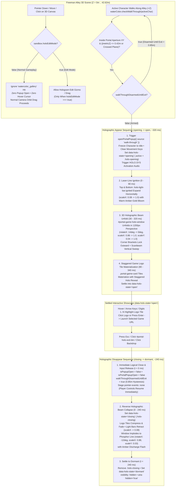

# Functional Specification 055: Walk-In-Only Watercolor Portal Popup Activation & Bidirectional Holographic Appear/Disappear Choreography

## 1. System Purpose & Core Objective

This specification defines the empirical root-cause diagnosis, desired `{functionality}`, 3D spatial walk-through trigger contracts, click-and-hover isolation invariants, bidirectional holographic materialization and collapse choreography, operational and frame-time budgets, edge-case failure-isolation boundaries, and verifiable `{correct required outputs}` for refining the Back-Alley Watercolor Shader Portal Holographic Game Selector Pop-Up ([`/Users/diesel/desktop/skatealley/watercolor_shader.js`](file:///Users/diesel/desktop/skatealley/watercolor_shader.js), [`/Users/diesel/desktop/skatealley/sandbox.js`](file:///Users/diesel/desktop/skatealley/sandbox.js), [`/Users/diesel/desktop/skatealley/hologram_columns.js`](file:///Users/diesel/desktop/skatealley/hologram_columns.js), and [`/Users/diesel/desktop/skatealley/index.html`](file:///Users/diesel/desktop/skatealley/index.html)).

The specification governs two tightly coupled functional objectives:

1. **Walk-In-Only Portal Activation (Removing Click-to-Popup & Replacing Legacy SkateRoom Auto-Launch with the Popup):**
   - Eliminate all 3D viewport click-to-open and pointer-hover activation paths on the back-alley "Water Color" shader canvas during normal gameplay (`holoEditMode === false`). Clicking, tapping, or beginning a camera orbit drag on the 3D watercolor canvas from anywhere in Freeman Alley must **never** open the holographic game selector popup, select the canvas in the hologram editor, trigger column-selection audio, or display a clickable pointer cursor / cyan hover frame.
   - Ensure the watercolor portal holographic pop-up (`#portal-game-holo-stage` / `#portal-game-holo-window`) triggers **exclusively when the active character physically walks into the watercolor shader portal aperture** at the back of Freeman Alley ($Z \approx 42.6182\text{ m}$)—replacing the legacy automatic SkateRoom launch on portal walk-in with the interactive holographic game selector popup (from which the user can then select and launch Skate 3, GTA Vice City, or Zombies).
2. **Bidirectional Holographic Appear & Disappear Animation Choreography:**
   - Replace the current flat, glitch-clobbered visibility toggle on `#portal-game-holo-stage` and `#portal-game-holo-window` with a multi-stage, GPU-composited HOLO.SYS holographic projection sequence both when the popup **appears** (materializes upon portal walk-in) and when it **disappears** (collapses/dematerializes upon dismissal via `Escape`, close button, or backdrop click).

**DO NOT CODE YET.** This document specifies functional requirements, spatial and temporal invariants, state transitions, operational budgets, and observable outcomes only. It contains zero implementation code, concrete syntax, or mechanical diffs.

---

## 2. Authoritative Domain Vocabulary Alignment ([`LANGUAGE.md`](file:///Users/diesel/desktop/skatealley/LANGUAGE.md))

All assessments of system state, design sufficiency, runtime invariants, and verification gates within this specification strictly adopt the evaluation taxonomy established in [`LANGUAGE.md`](file:///Users/diesel/desktop/skatealley/LANGUAGE.md):

- **`{functionality}`**: End-to-end execution of the Back-Alley Watercolor Shader Portal within the live Freeman Alley 3D environment across all desktop, tablet, and mobile viewports such that:
  1. Clicking, tapping, or dragging across the 3D watercolor shader canvas during normal gameplay (`holoEditMode === false`) never opens the portal popup and allows unobstructed 3D camera orbit look.
  2. Walking the active character into the watercolor portal plane at $Z \approx 42.6182\text{ m}$ does not auto-navigate to SkateRoom; instead, it materializes the minimalist holographic game selector popup via a multi-stage 3D holographic appear animation.
  3. Dismissing the popup (via `Escape`, the `✕` close button, or clicking the stage backdrop) collapses the hologram via a reverse holographic disappear animation while immediately releasing player locomotion controls and enforcing the $0.85\text{ m}$ spatial exit hysteresis band.
- **`{correctness}`**:
  - **Strict Walk-In Trigger Exclusivity in 3D Gameplay:** With `holoEditMode === false`, 3D raycast hits against `WaterColorCanvasMesh` (`watercolor_gallery`) on `pointerdown`, `pointerup`, `click`, or `pointermove` produce zero popup activations, zero `hoveredHoloColumnId` assignments, zero `body.mount-pointer-hover` cursor changes, and zero cyan frame highlight mutations. Furthermore, pressing `KeyE` while merely in proximity outside the portal plane or clicking removed legacy SkateRoom HUD shortcuts does not bypass the walk-in portal contract.
  - **Walk-In Popup Replacement of SkateRoom Auto-Launch:** Crossing or penetrating the watercolor portal aperture ($|x_{\text{metric}}| \le \frac{W}{2} + 0.35\text{ m}$, $|y_{\text{metric}}| \le \frac{H}{2} + 0.65\text{ m}$, and $|z_{\text{metric}}| \le 0.42\text{ m}$ or plane zero-crossing) transitions `isPopupOpen` to `true` while keeping `isTeleporting === false` and `teleportCount === 0` until the user explicitly activates a game logo tile inside the open popup.
  - **Deterministic 5-State Holographic Animation Lifecycle (`dormant` $\to$ `opening` $\to$ `open` $\to$ `closing` $\to$ `dormant`):**
    - Opening transitions the popup through `opening` (`280–360 ms`) into `open`, unfolding `#portal-game-holo-window` in 3D perspective space from a compressed horizontal emitter line (`scaleY <= 0.06`, tilted `rotateX`) to its settled `scale(1)` plane without being overridden by `.holo-glitch-active` transforms.
    - Closing transitions the popup from `open` (or `opening`) into `closing` (`200–260 ms`) before reaching `dormant`, collapsing `#portal-game-holo-window` back into a compressed horizontal phosphor line and retracting the `.holo-light-bar` strips while immediately setting logical open state (`isPopupOpen`, `isPortalPopupOpen`) to `false` and releasing pointer capture (`pointer-events: none`).
- **`{correct required outputs}`**:
  1. **3D Click Rejection & Camera Orbit Continuity Output:** Dispatching `pointerdown` and `click` events onto the 3D screen projection of `WaterColorCanvasMesh` when `holoEditMode === false` leaves `sandbox.isPortalPopupOpen === false`, `sandbox.waterColor.isPopupOpen === false`, `sandbox.waterColor.popupOpenCount === 0`, and `sandbox.hoveredHoloColumnId === null`, while allowing `pointerdown` + `pointermove` on the canvas to rotate the 3D orbit camera normally.
  2. **Walk-In Materialization Output:** Advancing `activeChar` into the portal aperture at $(X \approx 0.1341\text{ m}, Z \approx 42.6182\text{ m})$ returns `true` from `checkWalkThrough(activeChar)`, increments `popupOpenCount`, leaves `teleportCount === 0` and `isTeleporting === false`, and transitions `#portal-game-holo-stage` / `#portal-game-holo-window` through `data-holo-state="opening"` to `data-holo-state="open"`.
  3. **Holographic Appear Animation Telemetry Output:** During the `opening` phase, live computed styles on `#portal-game-holo-window`, `.holo-light-bar`, `.holo-scanbeam`, and `.portal-game-card` confirm active 3D perspective unfolding (`perspective: 1200px` on `#portal-game-holo-stage`, non-identity 3D/scale matrix transitioning to identity `scale(1)` in `open` state, `.holo-light-bar.ignited` expanding from `scaleX(0.08)` to `scaleX(1)`, and staggered card materialization) with zero `!important` transform clobbering from `.holo-glitch-active`.
  4. **Holographic Disappear Animation & Hysteresis Output:** Dismissing the open popup via `Escape`, `#portal-holo-exit-btn`, or stage backdrop click immediately sets `sandbox.isPortalPopupOpen === false`, `sandbox.waterColor.isPopupOpen === false`, and `sandbox.waterColor.walkThroughDisarmedUntilExit === true`, while `#portal-game-holo-stage` and `#portal-game-holo-window` enter `data-holo-state="closing"` (`.holo-closing`) with `pointer-events: none` for `200–260 ms` before settling into `data-holo-state="dormant"` (`visibility: hidden`, `aria-hidden="true"`).
- **`{errors}`**:
  - Opening `#portal-game-holo-stage` when the user clicks or taps `WaterColorCanvasMesh` in the 3D scene (`source: 'canvas-click'`).
  - Leaving `WaterColorCanvasMesh` hover-interactive (`cursor: pointer` or cyan selection border) when `holoEditMode === false`.
  - Automatically navigating to `./skate3_cleanroom/` upon walking into the watercolor portal instead of opening the game selector popup.
  - Applying `transform: translate(...) !important` via `.holo-window.holo-glitch-active` onto `#portal-game-holo-window`, which cancels its 3D appear and disappear transitions on Frame 0.
  - Hiding `#portal-game-holo-stage` (`visibility: hidden`) on the exact frame `closePortalGameSelectorPopup` is invoked, cutting off the holographic disappear animation.
- **`{sufficient}`**: Complete behavioral, spatial, temporal, and visual specification of the walk-in-only trigger contract, 3D click/hover isolation outside edit mode, the 5-state holographic appear/disappear state machine, non-destructive glitch compositing, spatial exit hysteresis, operational budgets, and end-to-end verification gates.
- **`{insufficient}`**: Any specification that leaves 3D click-to-open active, breaks camera orbit dragging when clicking over the watercolor shader, allows glitch CSS rules to override the popup's 3D transform transitions, or hides the popup instantaneously on close without a disappear animation.

---

## 3. Empirical Root-Cause Diagnosis & First-Principles Physical Modeling (`RULE[user_global]`)

### 3.1 Root Cause 1: Why Clicking in the Alley Currently Pops Up the Watercolor Hologram
1. **Unbounded Raycast Interception on `WaterColorCanvasMesh`:**
   - The watercolor portal canvas (`WaterColorCanvasMesh`, `holoColumnId = 'watercolor_gallery'`) is scaled $5.0 \times 5.0$ ($8.40\text{ m}$ wide $\times 15.90\text{ m}$ tall at $Z = 42.6182\text{ m}$), occupying the entire back horizon of Freeman Alley.
   - Because `watercolor_gallery` is registered in `sandbox.hologramColumns` so its transform can be adjusted when Hologram Edit Mode (`KeyG`) is enabled, `WaterColorCanvasMesh` resides in `sandbox.hologramColumns.raycastTargets`.
   - In the global `pointerdown` handler ([`sandbox.js`](file:///Users/diesel/desktop/skatealley/sandbox.js#L16814-L16849)), `pointerRaycaster` intersects `sandbox.hologramColumns.raycastTargets` with **infinite maximum distance** and immediately executes `sandbox.openPortalGameSelectorPopup({ source: 'canvas-click' })` whenever `hitId === 'watercolor_gallery'` and `!sandbox.holoEditMode`.
   - **Physical Consequence:** A player standing at the alley entrance ($Z = 3.0\text{ m}$, nearly $40\text{ m}$ away from the portal) who clicks in the center of the viewport simply to drag the camera and look around hits `WaterColorCanvasMesh` at $Z = 42.6182\text{ m}$, which aborts the camera drag and pops up the game selector overlay.
2. **Hover & Selection Fallthrough When `holoEditMode === false`:**
   - In `pointermove` ([`sandbox.js`](file:///Users/diesel/desktop/skatealley/sandbox.js#L16980-L16985)), raycasting `sandbox.hologramColumns.raycastTargets` while `holoEditMode === false` sets `sandbox.hoveredHoloColumnId = 'watercolor_gallery'`, which toggles `document.body.classList.toggle('mount-pointer-hover', true)` (`cursor: pointer`) and calls `sandbox.hologramColumns.setHoveredColumn('watercolor_gallery')` (turning the portal's crisp white frame border cyan).
   - In `pointerdown` ([`sandbox.js`](file:///Users/diesel/desktop/skatealley/sandbox.js#L16850-L16883)), if the `canvas-click` branch is removed without guarding the rest of the `hasHoloHit` block, clicking `watercolor_gallery` while `holoEditMode === false` falls through to `sandbox.selectHologramColumnForEdit('watercolor_gallery')` and plays `'holo-column-select'` audio.
   - Therefore, when `holoEditMode === false`, `watercolor_gallery` must be completely ignored by both `pointerdown` and `pointermove` hologram-column hit handlers so the watercolor portal behaves purely as a 3D walk-through spatial portal.
3. **Legacy Non-Walk Triggers (`KeyE` Proximity & `#hud-enter-skateroom-btn`):**
   - [`interactNearestWallMount()`](file:///Users/diesel/desktop/skatealley/sandbox.js#L13901-L13904) currently opens the portal popup when the user presses `KeyE` anywhere within $4.50\text{ m}$ of the portal (`isNearPortal`), and [`index.html`](file:///Users/diesel/desktop/skatealley/index.html#L3062) / [`sandbox.js`](file:///Users/diesel/desktop/skatealley/sandbox.js#L17685-L17690) retains a `#hud-enter-skateroom-btn` button (`🛹 Enter SkateRoom (Skate 3)`) wired to `openPortalGameSelectorPopup({ source: 'hud-button' })`. To enforce the user's requirement that the popup only appears when walked into (and that the legacy SkateRoom launch is removed and replaced by walking into the portal popup), these non-walk triggers must be removed.

---

### 3.2 Root Cause 2: Why the Popup Currently Lacks a Holographic Appear/Disappear Animation
Empirical inspection of [`index.html`](file:///Users/diesel/desktop/skatealley/index.html#L425-L470), [`index.html`](file:///Users/diesel/desktop/skatealley/index.html#L847-L927), and [`sandbox.js`](file:///Users/diesel/desktop/skatealley/sandbox.js#L11935-L12103) identifies three compounding defects:

1. **Defect A — Frame-0 CSS `transform` Clobbering by `.holo-window.holo-glitch-active` (`!important`):**
   - When the portal popup opens, `sandbox.portalGlitchBoostRemainingSec` is set to `0.24` (`0.16` on close), and `updatePortalGameHoloPopupUI(0.0)` runs synchronously on the very same frame.
   - With `boost = 1.0`, `evaluateHologramScreenFlickerAndGlitch` produces `flk.glitchIntensity > 0.05` on Frame 0, adding the class `.holo-glitch-active` to `#portal-game-holo-window`.
   - In [`index.html` (L461–L464)](file:///Users/diesel/desktop/skatealley/index.html#L461-L464), `.holo-window.holo-glitch-active` declares `transform: translate(var(--holo-glitch-shift-x, 0px), 0px) !important;`. Because of `!important`, this rule overrides `#portal-game-holo-window`'s 3D/scale `transform` on Frame 0, destroying any opening or closing CSS `transform` animation.
2. **Defect B — Missing 3D `perspective` & Flattened `scale(0.98)` Override:**
   - `#portal-game-holo-stage` ([`index.html` L847–L870](file:///Users/diesel/desktop/skatealley/index.html#L847-L870)) omits `perspective: 1200px`, so any `rotateX(...)` on `#portal-game-holo-window` projects orthographically without 3D foreshortening.
   - `#portal-game-holo-window` ([`index.html` L882–L897](file:///Users/diesel/desktop/skatealley/index.html#L882-L897)) overrides `.holo-window`'s 3D beam unfold with `transform: scale(0.98)` $\to$ `transform: scale(1)`, reducing the entire geometric transition to an imperceptible `2%` scale step.
3. **Defect C — Synchronous Class Stripping on Close (`0 ms` Disappear Phase):**
   - When `closePortalGameSelectorPopup` is called ([`sandbox.js` L13680–L13695](file:///Users/diesel/desktop/skatealley/sandbox.js#L13680-L13695)), `syncPortalGamePopupDOM()` immediately removes `.active` from `#portal-game-holo-stage` and `#portal-game-holo-window` and removes `.ignited` from `.holo-light-bar`. Without an explicit `.holo-closing` phase that keeps `#portal-game-holo-stage` visually rendered (`visibility: visible`, `pointer-events: none`) while `#portal-game-holo-window` executes a reverse holographic collapse (`scaleY -> 0.03`, `scaleX -> 0.88`, `rotateX(-12deg)`), the popup vanishes without a holographic dematerialization sequence.

---

## 4. End-to-End Functional Architecture & Lifecycle Choreography

---

## 5. Detailed Functional Requirements

### 5.1 Walk-In-Only Portal Trigger & Removal of Click / SkateRoom Launch Shortcuts
1. **Complete Removal of 3D Canvas Click-to-Popup (`holoEditMode === false`):**
   - Clicking or tapping `WaterColorCanvasMesh` (`holoColumnId === 'watercolor_gallery'`) in the 3D viewport when `sandbox.holoEditMode === false` must **never** invoke `openPortalGameSelectorPopup` or `openPortalPopup`.
   - When `sandbox.holoEditMode === false`, raycast hits on `watercolor_gallery` must be excluded/ignored in both the `pointerdown` and `pointermove` hologram-column handlers so that:
     - Clicking and dragging on the 3D canvas while looking down the alley smoothly orbits the camera (`cameraOrbit.isDragging = true`) without being intercepted by `watercolor_gallery`.
     - Clicking `watercolor_gallery` does not select it in `sandbox.hologramColumns` or trigger `'holo-column-select'` audio.
     - Hovering the pointer over `watercolor_gallery` leaves `sandbox.hoveredHoloColumnId === null`, does not apply `body.mount-pointer-hover` (`cursor: pointer`), and preserves the portal's crisp white frame border (`0xffffff`).
   - When `sandbox.holoEditMode === true` (toggled via `KeyG`), `watercolor_gallery` remains selectable and draggable via the 3D transform gizmo and Hologram Editor HUD.
2. **Walk-In Portal Trigger Replacing Legacy SkateRoom Auto-Launch:**
   - Walking `activeChar` into the watercolor portal plane at $Z \approx 42.6182\text{ m}$ (`checkWalkThrough(activeChar)` in [`watercolor_shader.js`](file:///Users/diesel/desktop/skatealley/watercolor_shader.js#L1151-L1223)) must exclusively open the holographic game selector popup (`openPortalPopup({ source: 'walk-through' })`) rather than auto-launching SkateRoom (`teleportToSkateRoom`).
   - Navigating to SkateRoom (`./skate3_cleanroom/?char=luis`), GTA Vice City (`./revcdos/`), or Zombies (`./nzportable/`) occurs **only** when the user selects and activates a game logo inside the open holographic popup.
3. **Removal of Non-Walk Portal Triggers:**
   - Remove the `KeyE` portal proximity open branch in `interactNearestWallMount()` so pressing `KeyE` while standing outside the portal plane does not open the popup (while preserving `KeyE` for closing the popup if already open, and preserving `KeyE` for wall screen mounts).
   - Remove the legacy `#hud-enter-skateroom-btn` (`🛹 Enter SkateRoom (Skate 3)`) button from the Locomotion HUD section in [`index.html`](file:///Users/diesel/desktop/skatealley/index.html#L3062-L3064) and its click listener in [`sandbox.js`](file:///Users/diesel/desktop/skatealley/sandbox.js#L17685-L17690) so SkateRoom is launched through the walk-in watercolor portal popup rather than a HUD button.
4. **Spatial Exit Hysteresis Preservation (`0.85 m` Re-Arm Band):**
   - When the user closes the popup while `activeChar` is still inside the portal aperture ($|z_{\text{metric}}| \le 0.85\text{ m}$), `walkThroughDisarmedUntilExit` must remain `true` so subsequent `step(dt)` frames do not re-open the popup in place.
   - Once `activeChar` walks outside the hysteresis zone ($|z_{\text{metric}}| > 0.85\text{ m}$ or outside `insideApertureXY`), `walkThroughDisarmedUntilExit` resets to `false`, re-arming the portal for the next walk-in.

---

### 5.2 Bidirectional Holographic Appear & Disappear Animation Choreography
1. **5-State Lifecycle Machine (`dormant` | `opening` | `open` | `closing`):**
   - `#portal-game-holo-stage` and `#portal-game-holo-window` must expose a deterministic lifecycle state via `data-holo-state` (`"dormant"`, `"opening"`, `"open"`, `"closing"`) and corresponding CSS classes (`.active`, `.holo-opening`, `.holo-open`, `.holo-closing`), plus state inspection on `sandbox.portalPopupAnimState` / `waterColor.getState()`.
   - `#portal-game-holo-stage` must establish a 3D projection frustum (`perspective: 1200px`) so 3D tilts (`rotateX`) on `#portal-game-holo-window` render with authentic depth foreshortening.
2. **Non-Destructive Glitch & Flicker Compositing (Eliminating the `!important` Transform Conflict):**
   - Ambient and boost hologram flicker/glitch effects updated by `updatePortalGameHoloPopupUI` (`--holo-flicker-gain`, `--holo-glitch-shift-x`) must **never** apply `transform: translate(...) !important` onto `#portal-game-holo-window`.
   - Instead, horizontal glitch tear shifts (`--holo-glitch-shift-x`) must be applied either to the inner `.holo-content-layer` or composed cleanly via CSS variables so `#portal-game-holo-window`'s 3D appear and disappear `transform` animations execute smoothly from Frame 0 without interference.
3. **Holographic Appear (Materialization) Sequence (`opening` $\to$ `open`, Duration `320 ms`):**
   - When the popup opens:
     1. **Stage Backdrop & Emitter Ignition (`0 ms – 100 ms`):**
        - `#portal-game-holo-stage` transitions from `opacity: 0` to `opacity: 1` (`visibility: visible`, `pointer-events: auto`).
        - The top and bottom `.holo-light-bar` strips ignite from a narrow central laser seed (`scaleX(0.08)`, `opacity: 0.2`) to full horizontal width (`scaleX(1.0)`, `opacity: 1.0`) with high-luminance amber-gold bloom (`0 0 24px rgba(251, 191, 36, 0.98)`).
     2. **3D Holographic Window Beam Unfold (`0 ms – 320 ms`):**
        - `#portal-game-holo-window` animates from a compressed, forward-tilted holographic emitter slit:
          $$\text{Initial (`0\%`): } \texttt{ translateY(16px) rotateX(15deg) scaleX(0.84) scaleY(0.04) }, \quad \text{opacity} = 0, \quad \text{brightness} = 1.85$$
          through an vertical beam expansion with subtle spring overshoot:
          $$\text{Mid (`68\%`): } \texttt{ translateY(-2px) rotateX(-1.5deg) scaleX(1.015) scaleY(1.02) }, \quad \text{opacity} = 1, \quad \text{brightness} = 1.22$$
          to its settled orthographic projection plane:
          $$\text{Settled (`100\%`): } \texttt{ translateY(0px) rotateX(0deg) scaleX(1) scaleY(1) }, \quad \text{opacity} = 1, \quad \text{brightness} = 1.0$$
        - Simultaneously, the 4 `.holo-corner` L-brackets snap outward into their corner positions and `.holo-scanbeam` executes a high-intensity vertical ignition sweep across the window.
     3. **Staggered Game Logo Tile Reveal (`70 ms – 320 ms`):**
        - Each `.portal-game-card` tile in `#portal-game-cards-grid` receives a deterministic stagger index (`--card-stagger-idx: 0, 1, 2, ...`, `~38 ms` per card, capped so total stagger $\le 160\text{ ms}$ for large $N$) and animates from a compressed holographic state (`opacity: 0`, `transform: translateY(10px) scale(0.88)`, `filter: brightness(1.7) blur(3px)`) into its crisp settled tile state (`opacity: 1`, `transform: translateY(0) scale(1)`, `filter: brightness(1) blur(0px)`).
     4. **Transition to `open` (`t = 320 ms`):**
        - Upon completion of the `320 ms` materialization window, `data-holo-state` transitions from `"opening"` to `"open"` (`.holo-opening` removed, `.holo-open` active), where hover/selection transforms operate with zero entrance-keyframe restarts.
4. **Holographic Disappear (Dematerialization / Collapse) Sequence (`closing` $\to$ `dormant`, Duration `240 ms`):**
   - When the popup is closed (via `Escape`, `#portal-holo-exit-btn`, or stage backdrop click):
     1. **Immediate Logical Close & Control Handback (`t = 0 ms`):**
        - `sandbox.isPortalPopupOpen` and `sandbox.waterColor.isPopupOpen` immediately become `false`, `walkThroughDisarmedUntilExit` becomes `true`, and `#portal-game-holo-stage` immediately switches to `pointer-events: none` so the player can walk and orbit the camera without waiting for the visual fade-out.
        - HOLO.SYS deactivation/collapse audio telemetry triggers immediately.
     2. **Reverse Holographic Beam Collapse (`0 ms – 240 ms`):**
        - `#portal-game-holo-stage` and `#portal-game-holo-window` enter `data-holo-state="closing"` (`.holo-closing`), keeping `visibility: visible` during the `240 ms` collapse window:
          - `.portal-game-card` tiles rapidly de-energize (`opacity -> 0`, `scale(0.90)` over `0–130 ms`).
          - `.holo-light-bar` top and bottom strips retract horizontally back toward the center (`scaleX(1.0 -> 0.06)`, `opacity -> 0`).
          - `#portal-game-holo-window` collapses vertically into a thin, brightest-at-center horizontal phosphor line before vanishing:
            $$\text{Start (`0\%`): } \texttt{ translateY(0px) rotateX(0deg) scaleX(1) scaleY(1) }, \quad \text{opacity} = 1, \quad \text{brightness} = 1.0$$
            $$\text{Mid (`55\%`): } \texttt{ translateY(6px) rotateX(-8deg) scaleX(0.94) scaleY(0.08) }, \quad \text{opacity} = 0.88, \quad \text{brightness} = 1.75$$
            $$\text{End (`100\%`): } \texttt{ translateY(12px) rotateX(-14deg) scaleX(0.76) scaleY(0.01) }, \quad \text{opacity} = 0, \quad \text{brightness} = 2.0$$
     3. **Settled `dormant` State (`t = 240 ms`):**
        - Once the `240 ms` collapse timer completes (unless cancelled by a subsequent re-open), `.holo-closing` is removed, `data-holo-state` becomes `"dormant"`, `#portal-game-holo-stage` becomes `visibility: hidden`, and `aria-hidden` is `"true"`.

---

## 6. Operational & Performance Budgets

| Subsystem / Operation | Mandatory Operational Budget | Failure-Isolation Boundary |
| :--- | :--- | :--- |
| **Holographic Appear Duration (`opening` $\to$ `open`)** | `280 ms – 360 ms` (`320 ms` nominal) | 100% GPU-composited (`transform`, `opacity`, `filter`); `0` main-thread layout reflows during animation frames. |
| **Holographic Disappear Duration (`closing` $\to$ `dormant`)** | `200 ms – 260 ms` (`240 ms` nominal) | Immediate `pointer-events: none` and logical `isPopupOpen = false` at `t = 0 ms`; zero input blocking during visual collapse. |
| **Main-Thread Per-Frame Overhead During Animation** | $\le 0.20\text{ ms/frame}$ at `60 FPS` (`16.67 ms` frame budget) | CSS keyframe/transition driven; no per-frame DOM reconstruction (`replaceChildren`) while animating. |
| **3D Canvas Raycast Exclusion (`holoEditMode === false`)** | `0` popup triggers on click; `< 0.05 ms` filter cost | `watercolor_gallery` hits ignored in `pointerdown` and `pointermove` unless `sandbox.holoEditMode === true`. |

---

## 7. Edge Cases & Failure Modes

1. **Rapid Re-Open While `closing` Is Still Animating (`0 ms – 240 ms` Window):**
   - If the popup is in `data-holo-state="closing"` and is re-opened before the `240 ms` collapse timer expires (e.g., player steps out and back in, or programmatic `openPortalGameSelectorPopup` call), the pending close timer must be deterministically cancelled (`clearTimeout`), `.holo-closing` must be cleared immediately, and the popup must transition cleanly into `data-holo-state="opening"`.
2. **Rapid Dismissal While `opening` Is Still Animating (`0 ms – 320 ms` Window):**
   - If the player presses `Escape` or clicks the backdrop while `data-holo-state="opening"` is mid-flight, the pending open timer must be cancelled immediately and the popup must transition directly from its current state into `data-holo-state="closing"` without getting stuck in `.holo-opening`.
3. **Hovering / Selecting Cards Immediately After Open:**
   - Calling `selectPortalGame(gameId)` or hovering `.portal-game-card` tiles must only toggle `.selected` and `aria-selected` attributes on existing `.portal-game-card` nodes without rebuilding `#portal-game-cards-grid` or restarting the `.holo-opening` keyframe animation.
4. **Camera Orbit Drag Starting Over the Watercolor Portal (`holoEditMode === false`):**
   - When the user presses and drags the mouse/touch over the 3D watercolor portal canvas in normal play mode, `pointerdown` must fall through to the camera orbit controller (`cameraOrbit.isDragging = true`) so the user can freely look around the back alley.
5. **Hologram Edit Mode (`KeyG` Enabled) Compatibility:**
   - When the developer/user enables Hologram Edit Mode (`sandbox.holoEditMode === true`), `WaterColorCanvasMesh` must still be selectable and draggable via the 3D gizmo and HUD sliders without opening the game selector popup.
6. **Reduced-Motion Accessibility (`prefers-reduced-motion: reduce`):**
   - Under `prefers-reduced-motion: reduce`, 3D tilt/scale amplitudes are attenuated while preserving the `opening` $\to$ `open` and `closing` $\to$ `dormant` state machine contracts.

---

## 8. Acceptance Criteria & Verification Gates (`{correct required outputs}`)

- **`AC-01` (Removal of 3D Click-to-Popup & Hover Leak Outside Edit Mode):**
  - With `sandbox.holoEditMode === false`, clicking or dispatching `pointerdown` / `pointermove` onto the 3D screen coordinates of `WaterColorCanvasMesh` at any distance in Freeman Alley leaves `sandbox.isPortalPopupOpen === false`, `sandbox.waterColor.isPopupOpen === false`, `sandbox.hoveredHoloColumnId === null`, and `document.body.classList.contains('mount-pointer-hover') === false`, while permitting normal camera orbit dragging.
- **`AC-02` (Removal of Legacy SkateRoom HUD Button & Non-Walk `KeyE` Trigger):**
  - `#hud-enter-skateroom-btn` is no longer present in the DOM, and pressing `KeyE` (`interactNearestWallMount()`) while standing near (but outside) the watercolor portal aperture does not open the popup.
- **`AC-03` (Walk-In-Only Portal Activation Replacing SkateRoom Auto-Launch):**
  - Walking `activeChar` into the watercolor portal plane at $Z = 42.6182\text{ m}$ (`checkWalkThrough(activeChar)`) opens `#portal-game-holo-stage` (`sandbox.isPortalPopupOpen === true`, `sandbox.waterColor.isPopupOpen === true`) with `sandbox.waterColor.isTeleporting === false` and `sandbox.waterColor.teleportCount === 0`.
- **`AC-04` (Holographic Appear Choreography Verification):**
  - Upon portal walk-in, `#portal-game-holo-stage` and `#portal-game-holo-window` enter `data-holo-state="opening"` (`.holo-opening`), `#portal-game-holo-stage` has `perspective: 1200px`, `.holo-light-bar.top` and `.holo-light-bar.bottom` have `.ignited`, `#portal-game-holo-window` animates from a compressed 3D holographic transform (unbound by any `!important` glitch override) to its settled `data-holo-state="open"` (`scale(1)`) state within `~320 ms`, and all `.portal-game-card` tiles materialize with staggered indices.
- **`AC-05` (Holographic Disappear Choreography & Spatial Hysteresis Verification):**
  - Dismissing the popup via `Escape`, `#portal-holo-exit-btn`, or backdrop click immediately sets `sandbox.isPortalPopupOpen === false`, `sandbox.waterColor.isPopupOpen === false`, and `sandbox.waterColor.walkThroughDisarmedUntilExit === true`, transitions `#portal-game-holo-stage` and `#portal-game-holo-window` into `data-holo-state="closing"` (`.holo-closing`) with `pointer-events: none` while executing the `~240 ms` reverse holographic collapse animation, and settles into `data-holo-state="dormant"` (`visibility: hidden`, `aria-hidden="true"`).
  - Stepping outside $|z_{\text{metric}}| > 0.85\text{ m}$ re-arms `walkThroughDisarmedUntilExit = false`, and walking back into the portal plane re-triggers the full `opening` $\to$ `open` holographic appear sequence.
