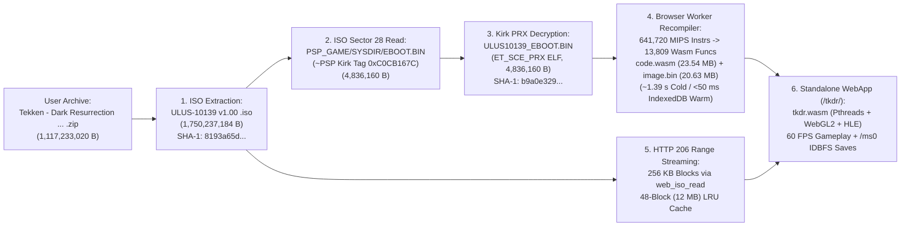

# Functional Specification 057: Standalone WebAssembly/WebGL2 Web Application Hosting for Decompiled *Tekken: Dark Resurrection* (`tkdr-recomp` at `/tkdr/`)

## 1. System Purpose & Core Objective

This specification defines the desired `{functionality}`, empirical binary and cryptographic verification baseline, Kirk PRX `EBOOT.BIN` decryption requirements, in-browser MIPS-to-WebAssembly recompilation pipeline, HTTP `206 Partial Content` byte-range disc streaming architecture, Cross-Origin Isolation (`COOP`/`COEP`) security header contract, operational and latency budgets, edge-case failure-isolation boundaries, and verifiable `{correct required outputs}` for hosting the decompiled PSP game ***Tekken: Dark Resurrection* (`ULUS-10139` v1.00)** from [`https://github.com/gasparegas/tkdr-recomp`](https://github.com/gasparegas/tkdr-recomp) and the local zipped ISO archive [`/Users/diesel/Desktop/SkateAlley/Tekken - Dark Resurrection (US) (2006) (Versus Fighting) (ISO) (PSP).zip`](file:///Users/diesel/Desktop/SkateAlley/Tekken%20-%20Dark%20Resurrection%20(US)%20(2006)%20(Versus%20Fighting)%20(ISO)%20(PSP).zip) as a **standalone, playable browser web application**.

### Architectural Invariant: Strict Standalone WebApp Execution (Zero Three.js Alley Integration)
*Tekken: Dark Resurrection* (`tkdr-recomp`) **MUST** execute as its own standalone HTML5/WebGL2/WebAssembly web application served at its own dedicated route (`/tkdr/` via [`/Users/diesel/Desktop/SkateAlley/scripts/serve_skatealley.py`](file:///Users/diesel/Desktop/SkateAlley/scripts/serve_skatealley.py) and/or via `tkdr-recomp`'s standalone HTTP server [`tools/serve.py`](file:///Users/diesel/.gemini/antigravity-cli/brain/9b118eda-fbcd-4e95-838e-a83a5769b3a9/scratch/tkdr-recomp/tools/serve.py)). Under no circumstances may the assistant attempt to embed, project, parse, or render *Tekken: Dark Resurrection* inside the Three.js Freeman Alley 3D scene ([`/Users/diesel/Desktop/SkateAlley/index.html`](file:///Users/diesel/Desktop/SkateAlley/index.html) / [`/Users/diesel/Desktop/SkateAlley/sandbox.js`](file:///Users/diesel/Desktop/SkateAlley/sandbox.js)).

**DO NOT CODE YET.** This document specifies functional requirements, physical payload and cryptographic invariants, state transitions, operational budgets, and observable outcomes only. It contains zero implementation code, concrete syntax, or mechanical diffs.

---

## 2. Authoritative Domain Vocabulary Alignment ([`LANGUAGE.md`](file:///Users/diesel/Desktop/SkateAlley/LANGUAGE.md))

All assessments of system state, operational constraints, and verification gates within this specification strictly adhere to the authoritative taxonomy established in [`LANGUAGE.md`](file:///Users/diesel/Desktop/SkateAlley/LANGUAGE.md):

- **`{functionality}`**: End-to-end standalone web hosting and browser execution of *Tekken: Dark Resurrection* (`ULUS-10139` v1.00) using the [`gasparegas/tkdr-recomp`](https://github.com/gasparegas/tkdr-recomp) WebAssembly runtime (`tkdr.wasm` + `tkdr.js`), the in-browser Allegrex MIPS-to-WebAssembly static recompiler (`recomp/*`), the Redump-verified ISO extracted from [`Tekken - Dark Resurrection (US) (2006) (Versus Fighting) (ISO) (PSP).zip`](file:///Users/diesel/Desktop/SkateAlley/Tekken%20-%20Dark%20Resurrection%20(US)%20(2006)%20(Versus%20Fighting)%20(ISO)%20(PSP).zip), and the Kirk-decrypted `ULUS10139_EBOOT.BIN` executable extracted from sector 28 of that ISO, enabling immediate browser boot, 60 FPS WebGL2 rendering, audio playback, controller/keyboard/touch input, and IndexedDB `/ms0` save persistence.
- **`{correctness}`**:
  - Exact cryptographic hash parity for both required game artifacts prior to execution:
    1. Uncompressed ISO disc image (`1,750,237,184` bytes, CRC32 `0x3ffd7a9d`, **SHA-1 `8193a65dee49685db49284408c89bdb35324bc32`**).
    2. Decrypted `ET_SCE_PRX` ELF executable `ULUS10139_EBOOT.BIN` (`4,836,160` bytes, **SHA-1 `b9a0e3292738a833f4f8077e3959c3a0652c42cd`**), preserving the full `max(elf_size, psp_size)` buffer layout expected by `tkdr-recomp`'s SHA-1 verifier and `ET_SCE_PRX` segment/section loader.
  - Deterministic delivery of Cross-Origin Isolation headers (`Cross-Origin-Opener-Policy: same-origin` and `Cross-Origin-Embedder-Policy: require-corp`) on all `/tkdr/*` document, script, worker, and WebAssembly responses so `window.crossOriginIsolated === true` and the 48-worker `SharedArrayBuffer` pthread pool (`768 MB` shared heap) initializes without failure.
  - Accurate `HTTP 206 Partial Content` byte-range serving (`Accept-Ranges: bytes`, `Content-Range: bytes start-end/1750237184`) so the Emscripten disc reader (`web_iso_read`) fetches `256 KB` sectors on demand without transferring the entire `1.75 GB` ISO upfront.
  - Strict compliance with `tkdr-recomp` licensing and repository hygiene by excluding all game-derived binaries (`.iso`, `.cso`, `.zip`, `.bin`, `.elf`, `.data`) from Git tracking via [`.gitignore`](file:///Users/diesel/Desktop/SkateAlley/.gitignore).
- **`{correct required outputs}`**:
  1. **Staged Standalone WebApp (`/Users/diesel/Desktop/SkateAlley/tkdr/`)**: Contains the complete `tkdr-recomp` web application (`index.html`, `tkdr.html`, `tkdr.js`, `tkdr.wasm`, `disc.mjs`, `config.json`, `recomp/*`) alongside git-ignored local links/files for `game.iso` (`1,750,237,184` bytes, SHA-1 `8193a65dee49685db49284408c89bdb35324bc32`), `eboot.bin` (`4,836,160` bytes, SHA-1 `b9a0e3292738a833f4f8077e3959c3a0652c42cd`), and a complete `game.zip` bundle containing both the ISO and decrypted EBOOT.
  2. **Live HTTP & Range-Streaming Endpoints**: Navigating to `http://localhost:3002/tkdr/` (or `http://localhost:8080/tkdr/` via [`scripts/serve_skatealley.py`](file:///Users/diesel/Desktop/SkateAlley/scripts/serve_skatealley.py), or via `tkdr-recomp`'s `tools/serve.py` on a dedicated port) serves the standalone webapp with `Cross-Origin-Opener-Policy: same-origin` and `Cross-Origin-Embedder-Policy: require-corp`, automatically loads `/tkdr/eboot.bin` and streams `/tkdr/game.iso` via HTTP `206` byte ranges, and reports `"tkdr_webapp": true` on `/api/health`.
  3. **Observable Browser Execution & Telemetry**: Opening the webapp in Chromium with WebGL2 compiles `13,809` guest functions into `23,544,922` bytes of WebAssembly (`code.wasm`) and `20,629,396` bytes of guest memory (`image.bin`), transitions the document to active gameplay (`document.body.classList.contains("started") === true`), advances the Emscripten frame counter (`Module._web_frames() > 0` and `Module._web_time() > 0`), and exposes deterministic status telemetry on `window.__TKDR_STATUS__` with zero unhandled `{errors}`.
- **`{errors}`**:
  - Attempting to render, embed, or wire *Tekken: Dark Resurrection* into the Three.js Freeman Alley scene (`index.html` / `sandbox.js`).
  - Serving the raw user `.zip` archive directly to `tkdr-recomp` without extracting and decrypting `PSP_GAME/SYSDIR/EBOOT.BIN`, which causes `tkdr-recomp` to halt with `the decrypted EBOOT of ULUS-10139 v1.00 is missing`.
  - Truncating the decrypted `EBOOT.BIN` to `elf_size` (`4,835,824` bytes, SHA-1 `24b7f09db51a86a72fe3860f672617294b07fb2b`) instead of the full `psp_size` buffer (`4,836,160` bytes, SHA-1 `b9a0e3292738a833f4f8077e3959c3a0652c42cd`) required by `EBOOT_SHA1` in `tkdr-recomp`.
  - Omitting `Cross-Origin-Opener-Policy: same-origin` or `Cross-Origin-Embedder-Policy: require-corp` headers on `/tkdr/*` responses, causing `SharedArrayBuffer is not defined` fatal initialization failures.
- **`{sufficient}`**: Complete specification of the cryptographic hashes, ISO sector extraction and Kirk decryption pipeline, in-browser recompilation outputs, HTTP `206` byte-range streaming contract, COOP/COEP header boundaries, operational budgets, and live browser verification criteria.
- **`{insufficient}`**: Any specification or implementation that leaves the user stuck at a manual file-picker prompt complaining about a missing decrypted EBOOT, fails to set COOP/COEP headers, or couples the webapp to the Three.js alley scene.

---

## 3. First-Principles Physical, Cryptographic & Runtime Model

### 3.1 Empirical Game Artifact & Cryptographic Inventory

| Artifact Role | Source / Location | Exact Byte Size | Cryptographic Identifier / Magic | Functional Contract in `tkdr-recomp` |
| :--- | :--- | :---: | :---: | :--- |
| **Source `.zip` Archive** | [`Tekken - Dark Resurrection (US) (2006) (Versus Fighting) (ISO) (PSP).zip`](file:///Users/diesel/Desktop/SkateAlley/Tekken%20-%20Dark%20Resurrection%20(US)%20(2006)%20(Versus%20Fighting)%20(ISO)%20(PSP).zip) | `1,117,233,020 B` (`1.04 GiB`) | ZIP Deflate (Method `8`), 1 entry | Contains the unmodified Redump ISO of *Tekken: Dark Resurrection* (USA). |
| **Uncompressed UMD ISO** | Extracted from `.zip` $\rightarrow$ `/tkdr/game.iso` | `1,750,237,184 B` (`1.63 GiB`) | CRC32: `0x3ffd7a9d` **SHA-1: `8193a65dee49685db49284408c89bdb35324bc32`** | Streamed in `256 KB` (`262,144 B`) blocks via HTTP `206 Partial Content` range requests (`USRDIR/TKPDATA0.BIN` [`412 MB`], `TKPDATA1.BIN` [`844 MB`], PMF/H.264 movies, ATRAC3+ audio). |
| **Encrypted Disc EBOOT** | Inside ISO at `PSP_GAME/SYSDIR/EBOOT.BIN` (LBA `28`, offset `0xE000`) | `4,836,160 B` (`4.61 MiB`) | Magic: `~PSP` (`0x5053507E`) Module: `tkpsp`, `comp_attr = 0` `elf_size = 4,835,824`, `psp_size = 4,836,160` Kirk Tag at `0xD0`: `0xC0CB167C` | Cannot be loaded directly by `tkdr-recomp` because the repository excludes Sony Kirk decryption keys. |
| **Decrypted PRX Executable** | Decrypted via Kirk PRX engine $\rightarrow$ `/tkdr/eboot.bin` (`ULUS10139_EBOOT.BIN`) | `4,836,160 B` (`4.61 MiB`) | Magic: `\x7fELF` (`ET_SCE_PRX = 0xFFA0`) **SHA-1: `b9a0e3292738a833f4f8077e3959c3a0652c42cd`** | Consist of `4,835,824` decrypted ELF bytes (`0..4835823`) followed by the trailing `336` bytes (`4835824..4836159`) from the `psp_size` buffer, matching PPSSPP's `DumpFileIfEnabled` output and `EBOOT_SHA1`. |
| **In-Browser Recompiled Wasm** | Generated in browser Worker & cached in IndexedDB (`tkdr-recomp`) | `code.wasm`: `23,544,922 B` `image.bin`: `20,629,396 B` `game.txt`: `281` lines (`280` HLE stubs) | Base: `0x08804000`, Entry: `0x089F34A8` `641,720` MIPS instructions $\rightarrow$ `13,809` functions | Written into Emscripten MEMFS (`/game/code.wasm`, `/game/image.bin`, `/game/game.txt`), compiled once via `WebAssembly.compile()`, and shared across all PSP pthread Workers via `Module.tkShareGameModule`. |

### 3.2 Web Application Runtime Inventory (`tkdr-recomp` Hostable Bundle)

| File Path in `/tkdr/` | Size (`Bytes`) | Role in Browser Runtime |
| :--- | :---: | :--- |
| `index.html` & `tkdr.html` | `~32–36 KB` | Standalone HTML5 shell hosting `#canvas` (`480:272` aspect ratio, up to `4×` internal resolution `1920×1088`), status/loading overlays, IndexedDB `/ms0` save synchronization, Worker recompilation orchestrator, and disc reader bindings. |
| `tkdr.js` | `230,442 B` | Emscripten JavaScript runtime glue managing the 48-worker pthread pool (`PTHREAD_POOL_SIZE=48`), `768 MB` shared WebAssembly memory, SDL2 input/audio bridges, and `game_lib.js` dynamic dispatch. |
| `tkdr.wasm` | `2,672,263 B` | Compiled WebAssembly runtime containing the PSP kernel thread scheduler, 31-library / 280-function HLE table, VFPU interpreter, WebGL2 & multi-threaded software GE renderer, ImGui settings UI (`F1`), ATRAC3/3+ audio decoder, and FFmpeg 7.1.1 H.264 movie decoder. |
| `disc.mjs` | `13,046 B` | Browser ES module providing ISO/CSO sector reading (`openDisc`), HTTP byte-range file abstraction (`httpFile`), ZIP/ZIP64 central directory parsing (`zipEntries`), and OPFS CSO block compression (`storeDisc` / `writeCso`). |
| `recomp/elf.mjs` | `5,733 B` | Parses the `ET_SCE_PRX` ELF (`ULUS10139_EBOOT.BIN`), maps segments to base `0x08804000`, and applies `SHT_PRXRELOC` (`0x700000A0`) MIPS relocations (`R_MIPS_32`, `R_MIPS_26`, `R_MIPS_HI16`, `R_MIPS_LO16`). |
| `recomp/mips.mjs` & `analyze.mjs` | `12,395 B` | Decodes all `641,720` Allegrex, FPU, and VFPU instructions, extracts `7,310` `.eh_frame` FDE boundaries plus `jal` and vtable targets (`13,809` total functions), and resolves `388` `.rodata` jump tables. |
| `recomp/wasm.mjs` & `wasmgen.mjs` | `36,647 B` | Emits valid binary WebAssembly bytecode (`23.54 MB`) with one Wasm function per guest MIPS function and a binary-search `dispatch(ctx, addr)` table exported to the runtime. |
| `recomp/index.mjs`, `worker.mjs`, `nids.json` | `14,369 B` | Validates `EBOOT_SHA1`, maps 280 imported PSP NIDs to human-readable HLE symbol names, and runs `recompile()` off the main thread inside a module Web Worker. |

### 3.3 First-Principles I/O & Startup Latency Comparison

1. **Primary Mode — On-Demand HTTP `206` Byte-Range Streaming (`isoUrl = "./game.iso"` + `eboot = "./eboot.bin"`)**:
   - **EBOOT Fetch & Verification:** `4,836,160` bytes over loopback HTTP $\approx 8\text{–}20\text{ ms}$; WebCrypto SHA-1 digest $\approx 12\text{ ms}$.
   - **MIPS-to-WebAssembly Recompilation:**
     - *Cold Start (no IndexedDB cache):* Worker analysis + `23.54 MB` Wasm emission takes **`~1,390 ms`** (empirically measured on host), followed by `WebAssembly.compile()` (`~350–600 ms`).
     - *Warm Start (IndexedDB `tkdr-recomp` cache hit):* Key `<EBOOT_SHA1>-<recompiler_version>` loads pre-generated `{ image, gameTxt, code }` from IndexedDB in **`< 60 ms`**.
   - **ISO Sector Streaming:** `web_iso_read` in `tkdr.wasm` requests `256 KB` (`262,144` byte) aligned blocks via `Range: bytes=off-(off+262143)` into a 48-block (`12 MB`) in-memory LRU cache. Booting to the Namco logo / opening FMV reads $\sim 16\text{–}32$ blocks (`4–8 MB`), requiring **`< 50 ms`** over local HTTP.
   - **Total Compound Startup Time:** **`~1.8–2.5 seconds` (cold)** and **`< 0.8 seconds` (warm)**.
2. **Secondary Mode — Archive/File-Picker Ingestion (`game.zip` / Drag-and-Drop)**:
   - Because Deflate streams inside a `.zip` do not support random-access seeking without decompression, loading from a `.zip` requires streaming all `1,750,237,184` uncompressed ISO bytes through `DecompressionStream("deflate-raw")` and re-compressing `6,837` blocks (`256 KB` each, 4 blocks in parallel) into the browser's Origin Private File System (`game.cso`, `~1.11 GB`), requiring **`~30–60 seconds`** on first run before subsequent runs start immediately from OPFS.
   - Therefore, the hosted webapp **MUST** default to **Primary Mode (On-Demand HTTP `206` Byte-Range Streaming)** when `/tkdr/game.iso` and `/tkdr/eboot.bin` are reachable on the local server, while retaining full support for `?iso=...&eboot=...`, `/tkdr/game.zip` (`config.json`), OPFS resume, and drag-and-drop file selection.

---

## 4. Detailed Functional Outcomes & Hosting Architecture

### 4.1 Automated Game Asset Extraction & Decryption Pipeline
1. **Idempotent Local Game Provisioning (`/Users/diesel/Desktop/SkateAlley/tkdr/`)**:
   - From the user's source archive [`/Users/diesel/Desktop/SkateAlley/Tekken - Dark Resurrection (US) (2006) (Versus Fighting) (ISO) (PSP).zip`](file:///Users/diesel/Desktop/SkateAlley/Tekken%20-%20Dark%20Resurrection%20(US)%20(2006)%20(Versus%20Fighting)%20(ISO)%20(PSP).zip):
     1. Extract the uncompressed ISO image (`1,750,237,184` bytes) to `/Users/diesel/Desktop/SkateAlley/tkdr/game.iso` and verify its SHA-1 equals `8193a65dee49685db49284408c89bdb35324bc32`.
     2. Read the encrypted `PSP_GAME/SYSDIR/EBOOT.BIN` (`4,836,160` bytes at ISO LBA sector `28`, byte offset `57,344` / `0xE000`) and decrypt it via the Kirk PRX decryption engine (`pspDecryptPRX` preserving the `4,836,160`-byte `max(elf_size, psp_size)` buffer) into `/Users/diesel/Desktop/SkateAlley/tkdr/eboot.bin` (and `/Users/diesel/Desktop/SkateAlley/tkdr/ULUS10139_EBOOT.BIN`), verifying its SHA-1 equals `b9a0e3292738a833f4f8077e3959c3a0652c42cd`.
     3. Ensure both `tkdr/game.iso` and `tkdr/eboot.bin` (along with any `.cso`, `.elf`, `.bin`, `.zip` files inside `tkdr/`) are listed in [`.gitignore`](file:///Users/diesel/Desktop/SkateAlley/.gitignore) so copyrighted game data is never committed to Git.

### 4.2 Standalone WebApp Route (`/tkdr/`) & Cross-Origin Isolation Contract
1. **Cross-Origin Isolation Headers (`COOP` / `COEP` / `CORP`)**:
   - Both [`/Users/diesel/Desktop/SkateAlley/scripts/serve_skatealley.py`](file:///Users/diesel/Desktop/SkateAlley/scripts/serve_skatealley.py) (for all requests under `/tkdr/` and `/tkdr/*`) and `tkdr-recomp`'s standalone server (`tools/serve.py`) **MUST** emit:
     - `Cross-Origin-Opener-Policy: same-origin`
     - `Cross-Origin-Embedder-Policy: require-corp`
     - `Cross-Origin-Resource-Policy: same-origin`
   - Scoping `COOP`/`COEP` to `/tkdr/*` on [`scripts/serve_skatealley.py`](file:///Users/diesel/Desktop/SkateAlley/scripts/serve_skatealley.py) guarantees `window.crossOriginIsolated === true` for `tkdr.wasm`'s `SharedArrayBuffer` pthreads without interfering with any other standalone route on the server.
2. **Chunked HTTP `206 Partial Content` Streaming for Large ISO Reads**:
   - When serving `/tkdr/game.iso` (`1.75 GB`), the HTTP server must support `Range: bytes=<start>-<end>` requests (both `GET` and `HEAD`), streaming responses in bounded chunks (e.g. `1 MiB` buffer writes) rather than reading the entire file into Python heap memory, and gracefully handling client socket disconnects (`BrokenPipeError`, `ConnectionResetError`).
3. **Auto-Start Local Stream Discovery & Zero-Friction Boot**:
   - When a user opens `http://localhost:3002/tkdr/` (or `http://localhost:3002/tkdr/tkdr.html`, `http://localhost:8080/tkdr/`, or the standalone `tools/serve.py` URL):
     - If `?iso=` and `?eboot=` query parameters are not explicitly provided, the page automatically probes the local server endpoints (`./game.iso` via `Range: bytes=0-0` expecting `HTTP 206` and `./eboot.bin` via `GET`/`HEAD` expecting `HTTP 200`).
     - When `./game.iso` and `./eboot.bin` are present on the local host, the webapp automatically sets `Module.isoUrl` to `./game.iso`, fetches `./eboot.bin`, hides the manual file-picker box (`#pick`), recompiles the EBOOT in the background Worker (or loads the cached WebAssembly module from IndexedDB), and boots directly into *Tekken: Dark Resurrection* without requiring the user to manually locate or drop files.
     - If `./game.iso` or `./eboot.bin` are absent (e.g. on a static public host without local game files), the webapp cleanly falls back to `config.json` / OPFS saved files / the `#pick` drag-and-drop file selector.
4. **Web Audio Unlock & Input Handling**:
   - Because browser autoplay policies suspend `AudioContext` instances created before a user gesture, the webapp must automatically resume any suspended SDL2/Emscripten `AudioContext` on the first `pointerdown`, `click`, `keydown`, or `touchstart` event so ATRAC3+ music and arcade sound effects play cleanly.
   - Full keyboard controls (`Arrows` D-pad, `Enter` Start, `Space` Select, `Z/X/C/S` `□/✕/○/△`, `Q/W` `L/R`, `F1` Settings overlay, `F2` FPS overlay, `F` Fullscreen), gamepad/arcade-stick input, and mobile touch controls remain active as designed in `tkdr-recomp`.
5. **Observable Runtime Telemetry (`window.__TKDR_STATUS__`) & Health Endpoint**:
   - The `/tkdr/` page exposes a live status object `window.__TKDR_STATUS__` containing:
     - `crossOriginIsolated` (`boolean`): `window.crossOriginIsolated`
     - `runtimeReady` (`boolean`): `true` once `tkdr.wasm` calls `onRuntimeInitialized`
     - `isoReady` (`boolean`): `true` once `Module.isoUrl` or `Module.discRead` is bound
     - `ebootSha1` (`string`): verified SHA-1 of the loaded EBOOT (`"b9a0e3292738a833f4f8077e3959c3a0652c42cd"`)
     - `recompiledFunctions` (`number`): `13809`
     - `wasmCodeBytes` (`number`): `23544922`
     - `started` (`boolean`): `true` once `Module.callMain([])` has launched
     - `frames` (`number`): live frame count from `Module._web_frames()`
     - `guestTimeSec` (`number`): live guest clock from `Module._web_time()`
     - `errors` (`Array<string>`): any fatal initialization or compilation errors
   - [`scripts/serve_skatealley.py`](file:///Users/diesel/Desktop/SkateAlley/scripts/serve_skatealley.py)'s `/api/health` endpoint reports `"tkdr_webapp": true` and includes `"tkdr_webapp"` in its `components` list when `/tkdr/index.html`, `/tkdr/tkdr.wasm`, `/tkdr/game.iso`, and `/tkdr/eboot.bin` are present and verified.

---

## 5. Operational & Performance Budgets

| Metric / Resource | Target Operational Budget | Physical Basis & Enforcement Boundary |
| :--- | :--- | :--- |
| **Cold Boot Time (First Visit)** | $\le 4.0\text{ s}$ from page navigation to `started === true` | `4.84 MB` EBOOT fetch ($\le 30\text{ ms}$) + Worker MIPS-to-Wasm emit (`~1.39 s`) + `WebAssembly.compile` (`~0.5 s`) + initial `256 KB` ISO range reads ($\le 100\text{ ms}$). |
| **Warm Boot Time (Cached Visit)** | $\le 1.2\text{ s}$ from page navigation to `started === true` | IndexedDB cache hit on `<EBOOT_SHA1>-<version>` bypasses Worker recompilation. |
| **HTTP `206` Block Read Latency** | $\le 15\text{ ms}$ p95 per `256 KB` range request on localhost | Backed by `48 × 256 KB` (`12 MB`) LRU block cache in `web.c` to eliminate redundant HTTP roundtrips. |
| **WebAssembly Shared Memory** | `768 MB` initial `SharedArrayBuffer` + `48` Worker pool | Matches `tkdr.wasm` compile flags (`-sINITIAL_MEMORY=768MB -sPTHREAD_POOL_SIZE=48`). |
| **Rendering Frame Rate** | `60 FPS` target (`>= 30 FPS` in headless software/SwiftShader CI, `60 FPS` on hardware WebGL2) | Verified via `Module._web_frames()` progression and `Module._web_time()` advancement during boot and title/FMV playback. |
| **Git Repository Footprint** | `0 B` of copyrighted game data tracked in Git | `.gitignore` strictly excludes `tkdr/*.iso`, `tkdr/*.cso`, `tkdr/*.bin`, `tkdr/*.elf`, `tkdr/*.zip`, `tkdr/*.data`. |

---

## 6. Edge Cases, Failure Modes & Deterministic Recovery Requirements

1. **Raw User `.zip` Missing Decrypted `EBOOT.BIN`**:
   - *Condition:* User provides [`Tekken - Dark Resurrection (US) (2006) (Versus Fighting) (ISO) (PSP).zip`](file:///Users/diesel/Desktop/SkateAlley/Tekken%20-%20Dark%20Resurrection%20(US)%20(2006)%20(Versus%20Fighting)%20(ISO)%20(PSP).zip), which contains only the `.iso` with an encrypted `~PSP` `EBOOT.BIN`.
   - *Requirement:* The provisioning pipeline automatically extracts sector 28 from the `.iso` and decrypts `EBOOT.BIN` via the Kirk PRX engine to produce the exact `4,836,160`-byte `ULUS10139_EBOOT.BIN` (`SHA-1: b9a0e3292738a833f4f8077e3959c3a0652c42cd`). Furthermore, if a user drops an ISO-only `.zip` or `.iso` onto `#pick` while `./eboot.bin` is hosted on the server, the page automatically supplies `./eboot.bin` as a fallback candidate so manual drops never fail due to a missing EBOOT.
2. **Truncated `elf_size` (`4,835,824 B`) vs. Full `psp_size` (`4,836,160 B`) EBOOT Buffer**:
   - *Condition:* Standard Kirk decryption returns `elf_size = 4,835,824` bytes (`SHA-1: 24b7f09db51a86a72fe3860f672617294b07fb2b`), whereas `tkdr-recomp` checks `SHA-1 == b9a0e3292738a833f4f8077e3959c3a0652c42cd` (the `4,836,160`-byte buffer dumped by PPSSPP where bytes `4,835,824..4,836,159` retain the trailing `336` bytes of the `psp_size` buffer).
   - *Requirement:* The decryption step **MUST** emit the full `4,836,160`-byte buffer and assert `SHA-1 == b9a0e3292738a833f4f8077e3959c3a0652c42cd` before staging `/tkdr/eboot.bin`. Fail fast with a diagnostic error if the SHA-1 does not match.
3. **Missing Cross-Origin Isolation (`window.crossOriginIsolated === false`)**:
   - *Condition:* Page is opened over an HTTP server that omits `Cross-Origin-Opener-Policy: same-origin` or `Cross-Origin-Embedder-Policy: require-corp`.
   - *Requirement:* Both [`scripts/serve_skatealley.py`](file:///Users/diesel/Desktop/SkateAlley/scripts/serve_skatealley.py) and `tkdr/tools/serve.py` emit the mandatory `COOP` and `COEP` headers on every `/tkdr/*` response. If `window.crossOriginIsolated` is ever `false` at runtime, `#status` and `window.__TKDR_STATUS__.errors` must immediately surface an actionable diagnostic (`"Cross-Origin Isolation (COOP/COEP) is required for SharedArrayBuffer pthreads"`).
4. **Large Range Request Memory Spike in Python HTTP Server**:
   - *Condition:* An HTTP client sends an open-ended `Range: bytes=0-` request against the `1.75 GB` `/tkdr/game.iso`.
   - *Requirement:* [`scripts/serve_skatealley.py`](file:///Users/diesel/Desktop/SkateAlley/scripts/serve_skatealley.py)'s `_try_serve_range` must stream file ranges in bounded chunks (e.g. `1 MiB` per loop iteration) rather than calling `f.read(length)` for a multi-hundred-megabyte range in a single allocation.

---

## 7. Verifiable `{correct required outputs}` & Acceptance Criteria

1. **Cryptographic & Binary Artifact Verification**:
   - `/Users/diesel/Desktop/SkateAlley/tkdr/game.iso` exists (`1,750,237,184` bytes) with SHA-1 `8193a65dee49685db49284408c89bdb35324bc32`.
   - `/Users/diesel/Desktop/SkateAlley/tkdr/eboot.bin` exists (`4,836,160` bytes, `\x7fELF` header) with SHA-1 `b9a0e3292738a833f4f8077e3959c3a0652c42cd`.
   - All `tkdr-recomp` web runtime and recompiler files (`index.html`, `tkdr.html`, `tkdr.js`, `tkdr.wasm`, `disc.mjs`, `recomp/index.mjs`, `recomp/elf.mjs`, `recomp/mips.mjs`, `recomp/analyze.mjs`, `recomp/wasm.mjs`, `recomp/wasmgen.mjs`, `recomp/worker.mjs`, `recomp/nids.json`) are present in `/Users/diesel/Desktop/SkateAlley/tkdr/`.
2. **HTTP Server, COOP/COEP & Byte-Range Verification**:
   - `GET /api/health` on the running server returns `HTTP 200 OK` with `"tkdr_webapp": true`.
   - `HEAD /tkdr/tkdr.html` and `HEAD /tkdr/tkdr.wasm` return `Cross-Origin-Opener-Policy: same-origin` and `Cross-Origin-Embedder-Policy: require-corp`.
   - `GET /tkdr/game.iso` with header `Range: bytes=32768-34815` (ISO9660 Primary Volume Descriptor at sector 16) returns `HTTP 206 Partial Content`, `Content-Range: bytes 32768-34815/1750237184`, `Content-Length: 2048`, and payload starting with `\x01CD001\x01\x00PSP GAME`.
3. **Live Browser End-to-End Execution Verification (Playwright)**:
   - Navigating to `http://localhost:3002/tkdr/` (or `http://localhost:8080/tkdr/`) in Chromium verifies:
     - `window.crossOriginIsolated === true`
     - `window.__TKDR_STATUS__.ebootSha1 === "b9a0e3292738a833f4f8077e3959c3a0652c42cd"`
     - `window.__TKDR_STATUS__.recompiledFunctions === 13809`
     - `window.__TKDR_STATUS__.started === true` and `document.body.classList.contains("started") === true`
     - `Module._web_frames() > 60` and `Module._web_time() > 1.0` (confirming the guest PSP kernel scheduler, HLE libraries, and WebGL2 GE renderer are actively executing frames in the browser)
     - `window.__TKDR_STATUS__.errors.length === 0`
     - Zero modifications to the Freeman Alley Three.js scene (`index.html` / `sandbox.js`).
