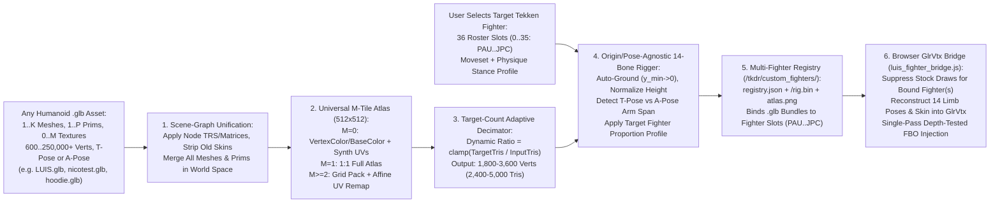

# Functional Specification 059: `.glb`-File-Agnostic Auto-Rigger, Adaptive Mesh Decimator, 36-Fighter Moveset Selector, and Real-Time PSP GE / WebGL2 Fighter Replacement Pipeline for *Tekken: Dark Resurrection* (`/tkdr/`)

## 1. System Purpose & Core Objective

This specification defines the desired `{functionality}`, empirical binary and runtime telemetry baseline, `.glb`-file-agnostic multi-mesh ingestion and scene-graph flattening protocol, target-budget adaptive quadric/collapse decimation pipeline, universal $M$-material / $0$-texture RGBA8888 atlas compiler, origin/scale/pose-agnostic (T-pose and 45° A-pose) 14-segment anatomical auto-rigger, **36-fighter Tekken moveset binding & roster registry (`PAU`..`JPC`, IDs `0..35`)**, in-browser WebGL2 `GlrVtx` (`28 B/vertex`) stock-mesh suppression and single-pass FBO injection architecture, operational budgets, failure-isolation boundaries, and verifiable `{correct required outputs}` for automatically rigging **any** humanoid `.glb` character asset to mimic **any user-selected Tekken fighter** inside the standalone decompiled PSP web application ***Tekken: Dark Resurrection* (`ULUS-10139` v1.00 at `/tkdr/`)**.

### Architectural Invariants
1. **100% `.glb`-File-Agnostic Ingestion**: The auto-rigger and decimator **MUST** accept any valid humanoid glTF 2.0 binary (`.glb`) file (for example, [`/Users/diesel/desktop/skatealley/nicotest.glb`](file:///Users/diesel/desktop/skatealley/nicotest.glb), [`/Users/diesel/Desktop/Doom_Rig/LUIS_DECIMATED_STANDALONE.glb`](file:///Users/diesel/Desktop/Doom_Rig/LUIS_DECIMATED_STANDALONE.glb), [`/Users/diesel/Desktop/Doom_Rig/LUIS_TPOSE.glb`](file:///Users/diesel/Desktop/Doom_Rig/LUIS_TPOSE.glb), [`/Users/diesel/desktop/skatealley/character_hoodie.glb`](file:///Users/diesel/desktop/skatealley/character_hoodie.glb), or any newly generated `.glb` from the orthographic-to-3D character factory) without hardcoded file byte lengths, SHA-256 digests, mesh counts, primitive counts, texture counts, bounding-box origins, or fixed decimation ratios.
2. **Explicit Tekken Fighter Moveset Selection (`0..35` / `PAU`..`JPC`)**: Unlike single-protagonist games, *Tekken: Dark Resurrection* contains **36 distinct playable fighters (`0..35`)**, each possessing a unique martial-arts moveset, idle stance, limb reach, and hitbox profile. The pipeline **MUST** allow the user (via CLI flags `--glb <path> --fighter <CODE|ID|NAME>` and via an in-browser selector in `/tkdr/`) to choose which specific Tekken fighter (`Jin Kazama [JIN]`, `Paul Phoenix [PAU]`, `Marshall Law [LAW]`, `Lili [LIL]`, `Kazuya Mishima [KAZ]`, `Bryan Fury [BRY]`, `King [KIN]`, etc.) a given `.glb` character mimics, supporting multiple `.glb` characters bound to different Tekken fighters simultaneously in `/tkdr/custom_fighters/registry.json`.
3. **True Mesh Replacement (Zero Double-Mesh Overlay or Ghosting)**: When a fighter slot (`P1` and/or `P2`) has an active `.glb` character bound to the selected Tekken fighter, the original Tekken fighter's 3D body, head, hair, and outfit sub-mesh draw calls **MUST** be suppressed during `glr_execute()` before the auto-rigged `.glb` mesh is rendered into the same PSP 3D Framebuffer Object (FBO) with hardware depth testing (`GL_DEPTH_TEST`) enabled. Under no circumstances may a secondary HTML canvas be overlaid on top of `#canvas` or drawn on top of an un-suppressed stock fighter mesh.
4. **Host Toolchain Reality (`tkdr.wasm` Immutability)**: Because Emscripten (`emcc`), `cmake`, and `ninja` are not installed on the macOS host, [`/Users/diesel/desktop/skatealley/tkdr/tkdr.wasm`](file:///Users/diesel/desktop/skatealley/tkdr/tkdr.wasm) (`2,672,263` bytes) cannot be recompiled from C. Offline compilation executes via the local Python/Blender environment ([`/Users/diesel/desktop/skatealley/scripts/compile_tkdr_character.py`](file:///Users/diesel/desktop/skatealley/scripts/compile_tkdr_character.py), with backwards-compatible entrypoint [`/Users/diesel/desktop/skatealley/scripts/compile_luis_tkdr_fighter.py`](file:///Users/diesel/desktop/skatealley/scripts/compile_luis_tkdr_fighter.py)), and real-time pose extraction, linear-blend skinning, and `GlrVtx` FBO injection execute in-browser via [`/Users/diesel/desktop/skatealley/tkdr/luis_fighter_bridge.js`](file:///Users/diesel/desktop/skatealley/tkdr/luis_fighter_bridge.js) wired into [`/Users/diesel/desktop/skatealley/tkdr/index.html`](file:///Users/diesel/desktop/skatealley/tkdr/index.html) and [`/Users/diesel/desktop/skatealley/tkdr/tkdr.html`](file:///Users/diesel/desktop/skatealley/tkdr/tkdr.html).
5. **Strict Standalone `/tkdr/` Scope**: All changes remain strictly scoped to the standalone `/tkdr/` web application and its offline compiler/verification scripts. Under no circumstances may [`/Users/diesel/desktop/skatealley/index.html`](file:///Users/diesel/desktop/skatealley/index.html) or [`/Users/diesel/desktop/skatealley/sandbox.js`](file:///Users/diesel/desktop/skatealley/sandbox.js) (the Three.js Freeman Alley scene) be modified.

**DO NOT CODE YET.** This document specifies functional requirements, empirical binary layouts, mathematical coordinate transforms, operational budgets, and observable outcomes only. It contains zero implementation code, concrete syntax, or mechanical diffs.

---

## 2. Authoritative Domain Vocabulary Alignment ([`LANGUAGE.md`](file:///Users/diesel/desktop/skatealley/LANGUAGE.md))

All assessments of system state, operational constraints, and verification gates within this specification strictly adhere to the authoritative taxonomy established in [`LANGUAGE.md`](file:///Users/diesel/desktop/skatealley/LANGUAGE.md):

- **`{functionality}`**: End-to-end `.glb`-file-agnostic ingestion, world-space multi-mesh unification, adaptive target-polycount decimation, universal $M$-material RGBA8888 texture atlas compilation, 36-fighter Tekken moveset/proportion binding (`PAU`..`JPC`), 14-segment anatomical 4-bone auto-rigging, multi-character roster registration (`/tkdr/custom_fighters/registry.json`), and real-time in-browser PSP GE / WebGL2 `GlrVtx` fighter replacement inside `/tkdr/`, enabling any user-supplied `.glb` character to replace any selected Tekken fighter in-game and execute that fighter's martial-arts moveset at 60 FPS.
- **`{correctness}`**:
  - Universal `.glb` scene-graph traversal that flattens arbitrary node hierarchies (`matrix` or `translation`/`rotation`/`scale`), strips pre-existing `skins` / `JOINTS_0` / `WEIGHTS_0` attributes when re-targeting already-rigged `.glb` files, and merges all $K \ge 1$ meshes and $P \ge 1$ primitives without dropping sub-meshes.
  - Dynamic decimation ratio calculation (`ratio = clamp(target_triangles / welded_triangles, 0.01, 1.0)`) so any input `.glb` (from `600` vertices to `200,000+` vertices) is deterministically reduced into the target runtime budget (`1,800–3,600` vertices / `2,400–5,000` triangles) while preserving UV and material boundaries.
  - Universal $M$-material texture atlas generation supporting $M = 0$ textures (baking `COLOR_0` vertex colors or material `baseColorFactor` and synthesizing UVs when `TEXCOORD_0` is absent), $M = 1$ texture (full-atlas `1:1` mapping), and $M \ge 2$ textures (packing into an $N_{\text{cols}} \times N_{\text{rows}}$ tile grid inside `512×512` and affine-remapping each primitive's `TEXCOORD_0` into its assigned tile sub-rectangle with half-texel seam clamping).
  - Origin-, scale-, and pose-agnostic coordinate normalization that translates `(x_mid, y_min_raw, z_mid) -> (0, 0, 0)`, scales height isotropically by `1.0 / (y_max_raw - y_min_raw)` into `y_norm ∈ [0.0, 1.0]`, detects lateral arm span `x_arm_max` in `y_norm ∈ [0.36, 0.80]` to accommodate both T-pose and 45° A-pose characters, and applies the selected Tekken fighter's (`0..35`) physique/stance calibration profile before computing L1-normalized 4-bone weights (`uint8[4]` indices + `float32[4]` weights summing to `1.0000 ± 1e-5`).
  - Exact preservation of Emscripten's 5-argument WebGL2 `bufferData(target, srcData, usage, srcOffset, length)` call signature and exact projective transformation between `GlrVtx` clip coordinates $(x, y, z, w)$ and PSP screen/depth coordinates $(px, py, pz, w)$.
- **`{correct required outputs}`**:
  1. **`.glb`-Agnostic Compiler CLI & Python Module ([`scripts/compile_tkdr_character.py`](file:///Users/diesel/desktop/skatealley/scripts/compile_tkdr_character.py) & [`scripts/compile_luis_tkdr_fighter.py`](file:///Users/diesel/desktop/skatealley/scripts/compile_luis_tkdr_fighter.py))**:
     - Accepts `--glb <path/to/any.glb>`, `--fighter <CODE|ID|NAME>` (defaulting to a configurable primary fighter such as `JIN` / `LIL` / `PAU` and supporting `--slot P1|P2|BOTH`), and `--name <CharacterLabel>`.
     - Emits compiled fighter bundles under `/Users/diesel/desktop/skatealley/tkdr/custom_fighters/<bundle_id>/` (`manifest.json`, `rig.bin`, `atlas.png`), maintains `/Users/diesel/desktop/skatealley/tkdr/custom_fighters/registry.json`, and mirrors the default active bundle to `/Users/diesel/desktop/skatealley/tkdr/luis_fighter/` (`manifest.json`, `luis_rig.bin`, `luis_atlas.png`) for deterministic compatibility.
     - Pre-compiles at least two distinct workspace `.glb` characters bound to distinct Tekken fighters out of the box (e.g., [`LUIS.glb`](file:///Users/diesel/desktop/skatealley/LUIS.glb) from [`LUIS_DECIMATED_STANDALONE.glb`](file:///Users/diesel/Desktop/Doom_Rig/LUIS_DECIMATED_STANDALONE.glb) (`14,905` verts, `2` primitives, `2` textures, `Y ∈ [0, 2]`) and [`nicotest.glb`](file:///Users/diesel/desktop/skatealley/nicotest.glb) (`30,655` verts, `1` primitive, `1` texture, `Y ∈ [-0.999, +0.993]`)).
  2. **In-Browser Fighter Selector & WebGL2 Replacement Bridge ([`tkdr/luis_fighter_bridge.js`](file:///Users/diesel/desktop/skatealley/tkdr/luis_fighter_bridge.js))**:
     - Loads `/tkdr/custom_fighters/registry.json` and exposes both a non-intrusive in-browser UI control (`#tkdr-fighter-rig-panel`) and programmatic API (`window.__TKDR_CUSTOM_FIGHTERS__` / `window.__TKDR_STATUS__.luisFighter`) allowing the user to:
       1. Select which compiled `.glb` character (or runtime-dropped `.glb`) is assigned to Player 1 (`P1`) and/or Player 2 (`P2`).
       2. Select which of the **36 Tekken fighters (`PAU`..`JPC`, `0..35`)** that `.glb` mimics (binding its proportion profile and roster slot assignment).
     - During active 3D gameplay, suppresses the stock sub-mesh `glDrawArrays` calls for any fighter cluster (`P1` and/or `P2`) that has an active bound `.glb` character, reconstructs the 14-segment live pose from the suppressed `GlrVtx` vertices, deforms the bound `.glb` rig into `GlrVtx` clip space (`28 B/vertex`), and renders it into the active PSP 3D FBO with hardware depth testing enabled.
  3. **Observable Runtime Telemetry (`window.__TKDR_STATUS__.luisFighter`)**:
     - Exposes live, non-mocked telemetry: `enabled`, `bundleLoaded`, `atlasLoaded`, `activeBundleId`, `sourceGlbName`, `targetFighterCode` (`"PAU"`..`"JPC"`), `targetFighterId` (`0..35`), `targetFighterName`, `availableBundlesCount >= 2`, `rosterFighterCount === 36`, `vertexCount`, `triangleCount`, `boneCount === 14`, `framesReplaced > 0` (during active 3D match), `suppressedDrawsLastFrame > 0`, `luisVertsSubmittedLastFrame === triangleCount * 3`, and `lastSkinningMs <= 1.5`.
- **`{errors}`**:
  - Hardcoding `LUIS`-specific byte size (`5,285,932`), primitive count (`2`), texture count (`2`), `skins == []` rejection, fixed `ratio = 0.16` decimation, or `y_min == 0.0` origin assumptions that fail on [`nicotest.glb`](file:///Users/diesel/desktop/skatealley/nicotest.glb), [`LUIS_TPOSE.glb`](file:///Users/diesel/Desktop/Doom_Rig/LUIS_TPOSE.glb), or [`character_hoodie.glb`](file:///Users/diesel/desktop/skatealley/character_hoodie.glb).
  - Omitting the 36-fighter Tekken moveset/character binding (`PAU`..`JPC`), preventing the user from selecting which Tekken fighter's moveset and proportions their `.glb` character mimics.
  - Wrapping `WebGL2RenderingContext.prototype.bufferData` with a 3-argument function `(target, data, usage)` instead of forwarding all 5 WebGL2 arguments `(...args)`, causing Emscripten to upload the entire `768 MB` `HEAPU8` buffer on every frame.
  - Rendering the `.glb` mesh without suppressing the replaced fighter's stock `glDrawArrays` calls (double-mesh overlay), or suppressing stage geometry, un-replaced opponent geometry, floor shadows, or 2D HUD overlays (`w === 1.0`, `depthTest === false`).
- **`{sufficient}`**: Complete specification of the `.glb`-agnostic normalization/decimation/atlas algorithms, empirical metrics across multiple workspace `.glb` files, the authoritative 36-fighter Tekken roster table (`0..35`), the 14-segment anatomical rig and proportion profiles, the `GlrVtx` (`28 B/vertex`) projective mathematics, the dedicated VAO/VBO WebGL2 injection sequence, operational budgets, and automated verification criteria across multiple `.glb` inputs.
- **`{insufficient}`**: Any specification or implementation that only works on a single hardcoded `.glb` file, lacks target Tekken fighter selection (`0..35`), overlays a second canvas on top of `#canvas`, or leaves the original fighter mesh visible underneath the replacement mesh.

---

## 3. First-Principles Physical, Binary & Architectural Model

### 3.1 Empirical Diversity of Workspace `.glb` Character Assets

Inspection of the `.glb` character assets present on disk establishes the structural variation that the `.glb`-agnostic compiler must handle deterministically:

| Asset Path | Byte Size | Meshes / Prims | Total Vertices | Pre-Existing `skins` | Embedded Textures (`images`) | Raw `Y` Bounding Range | Structural Archetype |
| :--- | :---: | :---: | :---: | :---: | :---: | :---: | :--- |
| [`/Users/diesel/desktop/skatealley/nicotest.glb`](file:///Users/diesel/desktop/skatealley/nicotest.glb) | `3,947,292 B` | `1` / `1` | `30,655` | `0` | `1` (`image/png`) | `[-0.9988, +0.9928]` | Single-primitive, single-texture, origin-centered (`y_min ≈ -1.0`). |
| [`/Users/diesel/Desktop/Doom_Rig/LUIS_DECIMATED_STANDALONE.glb`](file:///Users/diesel/Desktop/Doom_Rig/LUIS_DECIMATED_STANDALONE.glb) ($\rightarrow$ [`LUIS.glb`](file:///Users/diesel/desktop/skatealley/LUIS.glb)) | `5,285,932 B` | `1` / `2` | `14,905` | `0` | `2` (`image/png`) | `[0.0000, +2.0000]` | Dual-primitive (`Body` + `Head`), 2-texture, floor-grounded (`y_min = 0.0`). |
| [`/Users/diesel/Desktop/Doom_Rig/LUIS_TPOSE.glb`](file:///Users/diesel/Desktop/Doom_Rig/LUIS_TPOSE.glb) | `6,908,672 B` | `1` / `1` | `191,885` | `0` | `0` (`[]`) | `[-0.9862, +0.9750]` | High-poly raw scan (`191.8k` verts), untextured (`M = 0`), origin-centered. |
| [`/Users/diesel/desktop/skatealley/character_hoodie.glb`](file:///Users/diesel/desktop/skatealley/character_hoodie.glb) | `10,141,168 B` | `2` / `3` | `20,026` | `1` (`67` nodes) | `3` (`image/png`) | `[0.0000, +2.0232]` | Multi-mesh (`2` meshes, `3` prims), `3` textures, pre-rigged (`skins = 1`). |
| [`/Users/diesel/Desktop/Doom_Rig/LUIS_ASSEMBLED.glb`](file:///Users/diesel/Desktop/Doom_Rig/LUIS_ASSEMBLED.glb) | `18,293,016 B` | `4` / `7` | `22,455` | `1` (`40` nodes) | `3` (`image/png`) | `[-0.0850, +2.0232]` | 4-mesh modular assembly (`7` prims), `3` textures, negative `y_min`. |

---

### 3.2 Authoritative 36-Fighter *Tekken: Dark Resurrection* (`ULUS-10139`) Roster & Proportion Table

Empirical inspection of [`/Users/diesel/desktop/skatealley/tkdr/eboot.bin`](file:///Users/diesel/desktop/skatealley/tkdr/eboot.bin) at `.rodata` offsets `0x2cc9c8` (`face_pau`..`face_edd`) and `0x2f6f2c` (`PAUL`..`JINPACHI`) establishes the exact 36 internal fighter IDs (`0..35`), 3-letter fighter codes (`PAU`..`JPC`), full fighter names, martial-arts movesets, and skeletal proportion profiles:

| Fighter ID | 3-Letter Code | Short Name | Full Fighter Name | Physique & Stance Profile (`heightScale`, `shoulderScale`, `limbWidthScale`) |
| :---: | :---: | :--- | :--- | :--- |
| `0` | `PAU` | `PAUL` | Paul Phoenix | `standard_athletic` (`1.00, 1.02, 1.02`) — Judo / Bajiquan |
| `1` | `LAW` | `LAW` | Marshall Law | `standard_lean` (`0.98, 0.96, 0.96`) — Jeet Kune Do |
| `2` | `LEI` | `LEI` | Lei Wulong | `standard_lean` (`0.98, 0.96, 0.96`) — Five-Animal Kung Fu |
| `3` | `KIN` | `KING` | King | `heavy_grappler` (`1.06, 1.14, 1.12`) — Lucha Libre / Pro Wrestling |
| `4` | `YOS` | `YOSHIMITSU` | Yoshimitsu | `standard_athletic` (`1.00, 1.00, 1.00`) — Manji Ninjutsu |
| `5` | `NIN` | `NINA` | Nina Williams | `slender_female` (`0.93, 0.86, 0.88`) — Assassination Arts / Aikido |
| `6` | `HWO` | `HWOARANG` | Hwoarang | `standard_athletic` (`1.01, 0.98, 0.98`) — ITF Taekwondo |
| `7` | `XIA` | `XIAOYU` | Ling Xiaoyu | `compact_female` (`0.89, 0.84, 0.85`) — Baguazhang / Piguaquan |
| `8` | `CHR` | `CHRISTIE` | Christie Monteiro | `slender_female` (`0.94, 0.87, 0.88`) — Capoeira |
| `9` | `JIN` | `JIN` | Jin Kazama | `standard_athletic` (`1.00, 1.02, 1.00`) — Traditional Karate |
| `10` | `JUL` | `JULIA` | Julia Chang | `slender_female` (`0.93, 0.86, 0.88`) — Xingyiquan / Baji |
| `11` | `KUM` | `KUMA` | Kuma | `super_heavy` (`1.18, 1.30, 1.28`) — Heihachi-Style Bear Karate |
| `12` | `PAN` | `PANDA` | Panda | `super_heavy` (`1.18, 1.30, 1.28`) — Heihachi-Style Bear Karate |
| `13` | `BRY` | `BRYAN` | Bryan Fury | `standard_athletic` (`1.03, 1.05, 1.04`) — Kickboxing |
| `14` | `HEI` | `HEIHACHI` | Heihachi Mishima | `heavy_athletic` (`1.02, 1.08, 1.06`) — Mishima-Style Karate |
| `15` | `KAZ` | `KAZUYA` | Kazuya Mishima | `standard_athletic` (`1.00, 1.02, 1.01`) — Mishima-Style Karate |
| `16` | `LEE` | `LEE` | Lee Chaolan | `standard_lean` (`0.99, 0.96, 0.96`) — Martial Arts |
| `17` | `STE` | `STEVE` | Steve Fox | `standard_athletic` (`0.99, 1.00, 1.00`) — Boxing |
| `18` | `MAR` | `MARDUK` | Craig Marduk | `heavy_grappler` (`1.12, 1.20, 1.18`) — Vale Tudo |
| `19` | `MOK` | `MOKUJIN` | Mokujin | `standard_athletic` (`1.00, 1.00, 1.00`) — Mimicry |
| `20` | `EDD` | `EDDY` | Eddy Gordo | `standard_athletic` (`1.00, 1.01, 1.00`) — Capoeira |
| `21` | `JAC` | `JACK-5` | Jack-5 | `super_heavy` (`1.16, 1.28, 1.25`) — Brute Force |
| `22` | `ROG` | `ROGER Jr.` | Roger Jr. | `compact_fighter` (`0.86, 0.90, 0.92`) — Commando Wrestling |
| `23` | `ANN` | `ANNA` | Anna Williams | `slender_female` (`0.93, 0.86, 0.88`) — Assassination Arts |
| `24` | `WAN` | `WANG` | Wang Jinrei | `compact_fighter` (`0.92, 0.92, 0.92`) — Xingyiquan |
| `25` | `GAN` | `GANRYU` | Ganryu | `heavy_grappler` (`1.05, 1.22, 1.20`) — Sumo |
| `26` | `ASK` | `ASUKA` | Asuka Kazama | `slender_female` (`0.93, 0.87, 0.88`) — Kazama-Style Traditional Martial Arts |
| `27` | `BRU` | `BRUCE` | Bruce Irvin | `standard_athletic` (`1.04, 1.05, 1.04`) — Muay Thai |
| `28` | `BAE` | `BAEK` | Baek Doo San | `standard_athletic` (`1.00, 0.98, 0.98`) — Taekwondo |
| `29` | `DVJ` | `DEVIL JIN` | Devil Jin | `standard_athletic` (`1.00, 1.03, 1.01`) — Advanced Mishima Karate |
| `30` | `RAV` | `RAVEN` | Raven | `standard_athletic` (`1.02, 1.03, 1.02`) — Ninjutsu |
| `31` | `FEN` | `FENG` | Feng Wei | `standard_athletic` (`1.02, 1.06, 1.05`) — God Fist Chinese Kenpo |
| `32` | `AMK` | `ARMOR KING` | Armor King | `heavy_grappler` (`1.06, 1.15, 1.12`) — Dark Lucha / Pro Wrestling |
| `33` | `LIL` | `LILI` | Lili | `slender_female` (`0.96, 0.87, 0.88`) — Street Fighting / Gymnastics |
| `34` | `DRA` | `DRAGUNOV` | Sergei Dragunov | `standard_athletic` (`1.03, 1.03, 1.02`) — Commando Sambo |
| `35` | `JPC` | `JINPACHI` | Jinpachi Mishima | `heavy_grappler` (`1.10, 1.18, 1.16`) — Mishima Karate |

---

### 3.3 Empirical `tkdr-recomp` GPU (`raster.c` + `glr.c`) & WebGL2 Pipeline Reality

1. **Unified `GlrVtx` (`28 B/vertex`) Clip-Space Vertex Layout**:
   - In `glr.h` and `raster.c`, every triangle vertex submitted to WebGL2 is a `28`-byte `GlrVtx` struct:
     - `offset 0..15` (`a_pos`, location `0`, `4 × float32`):
       $$x = \left(\frac{px}{256.0} - 1.0\right) \cdot w, \quad y = \left(\frac{py}{256.0} - 1.0\right) \cdot w, \quad z = \left(\frac{pz}{32767.5} - 1.0\right) \cdot w, \quad w = w_c$$
     - `offset 16..23` (`a_uv`, location `1`, `2 × float32`): normalized texture coordinates $(u, v) \in [0, 1]^2$.
     - `offset 24..27` (`a_col`, location `2`, `4 × uint8` normalized): vertex RGBA modulation $(r, g, b, a) \in [0..255]^4$.
2. **Emscripten 5-Argument `glBufferData` Batch Upload**:
   - In `glr_execute()`, all `nv` vertices for a frame (`~24,474` vertices = `685,272` bytes in a 3D match) are uploaded at once via `gl.bufferData(gl.ARRAY_BUFFER, HEAPU8, gl.STREAM_DRAW, srcOffset, byteLength)`.
3. **Single-Frame 3D Match Draw-Call Segmentation**:
   - **Pass 1 (`first: 0..6`)**: Full-screen background clear quad (`w = 1.0`).
   - **Pass 2 (`first: 6..717` & `16239..16983`)**: Large-span 3D stage environment (`maxPx - minPx > 280` or `maxW > 9500`).
   - **Pass 3 (`first: 717..6822`)**: Player 1 (`P1`) opaque anatomical limb and torso sub-meshes (`~24` draw calls, `px ∈ [74, 186]`, `py ∈ [65, 261]`, `w ∈ [3981, 4450]`).
   - **Pass 4 (`first: 6822..16239`)**: Player 2 (`P2`) opaque anatomical sub-meshes (`~9` draw calls, `px ∈ [268, 390]`, `py ∈ [68, 267]`, `w ∈ [3859, 4615]`).
   - **Pass 5 (`first: 16983..21162`)**: Alpha-blended hair, lace, and face detail sub-meshes overlapping `P1` and `P2`.
   - **Pass 6 (`first: 21666..24180`)**: Projected ground floor shadows (`py ∈ [248, 272]`, `maxPy - minPy <= 28`).
   - **Pass 7 (`first: 24210..24474`)**: 2D HUD overlays (`depthTest === false` or `w === 1.0`).

---

## 4. Detailed Functional Outcomes & Component Requirements

### 4.1 Step 1: `.glb`-File-Agnostic Auto-Rigger, Adaptive Decimator & Fighter Compiler (`scripts/compile_tkdr_character.py`)

1. **CLI & Module Contract**:
   - [`/Users/diesel/desktop/skatealley/scripts/compile_tkdr_character.py`](file:///Users/diesel/desktop/skatealley/scripts/compile_tkdr_character.py) (and [`/Users/diesel/desktop/skatealley/scripts/compile_luis_tkdr_fighter.py`](file:///Users/diesel/desktop/skatealley/scripts/compile_luis_tkdr_fighter.py)) must support:
     - `--glb <path>`: Path to any `.glb` file on disk.
     - `--fighter <CODE|ID|NAME>`: Any of the 36 Tekken fighters (`PAU`..`JPC`, `0..35`, or case-insensitive name such as `"Jin Kazama"`, `"Paul"`, `"Lili"`, `"Law"`, `"Bryan"`).
     - `--slot <P1|P2|NONE>`: Whether to set this compiled bundle as the default active Player-1 (`P1`) or Player-2 (`P2`) override in `/tkdr/custom_fighters/registry.json`.
     - `--target-tris <int>`: Target triangle count after decimation (default `3600`, clamped so final vertex count lands in `1,800–3,600` vertices and `2,400–5,000` triangles, or preserves original mesh if already `< 2,400` triangles).
   - Running `python3 scripts/compile_tkdr_character.py` with no arguments (or `python3 scripts/compile_luis_tkdr_fighter.py`) must idempotently stage [`/Users/diesel/desktop/skatealley/LUIS.glb`](file:///Users/diesel/desktop/skatealley/LUIS.glb) (from [`/Users/diesel/Desktop/Doom_Rig/LUIS_DECIMATED_STANDALONE.glb`](file:///Users/diesel/Desktop/Doom_Rig/LUIS_DECIMATED_STANDALONE.glb)) AND compile **both** [`LUIS.glb`](file:///Users/diesel/desktop/skatealley/LUIS.glb) (e.g. bound to `JIN` / `LIL` on `P1`) and [`/Users/diesel/desktop/skatealley/nicotest.glb`](file:///Users/diesel/desktop/skatealley/nicotest.glb) (e.g. bound to `PAU` on `P2` or available in the registry) so the multi-`.glb` registry is populated with at least two distinct `.glb` characters out of the box.

2. **Multi-Mesh Scene-Graph Flattening & Pre-Existing Skin Stripping**:
   - Imports the `.glb` (via headless Blender or glTF binary parser) and traverses all `MESH` objects in the scene:
     - Removes any `ARMATURE` modifiers and clears vertex groups / `JOINTS_0` / `WEIGHTS_0` skin bindings while preserving the rest-pose world transform (`matrix_world`) of each mesh object.
     - Joins all mesh objects (`1..K` meshes, `1..P` primitives) into a single unified world-space mesh while preserving each polygon's global material slot index `m_id ∈ [0 .. M-1]`.

3. **Target-Count Adaptive Decimation**:
   - Welds duplicate interior seam vertices within `1e-4` units (`remove_doubles`), triangulates all faces, and measures the initial triangle count $T_{\text{in}}$.
   - Computes the adaptive collapse ratio:
     $$r = \begin{cases} 1.0 & \text{if } T_{\text{in}} \le T_{\text{target}} \\ \text{clamp}\left(\frac{T_{\text{target}}}{T_{\text{in}}}, 0.01, 1.0\right) & \text{if } T_{\text{in}} > T_{\text{target}} \end{cases}$$
   - Applies edge-collapse decimation with `delimit = {'MATERIAL', 'UV'}` (when UVs exist) so UV islands and material boundaries never tear, ensuring the output mesh has **`1,800–3,600` vertices** (or the exact input count if the input `.glb` is already a low-poly mesh `< 1,800` vertices).

4. **Universal $M$-Material / $0$-Texture Atlas Baking (`512×512` RGBA8888)**:
   - Inspects the $M$ unique materials/textures referenced by the unified mesh:
     - **Case $M = 0$ (No Embedded Images, e.g. `LUIS_TPOSE.glb`)**: Generates a `512×512` RGBA8888 atlas from per-material `baseColorFactor` (or baked `COLOR_0` vertex colors / warm skin-and-cloth shading) and synthesizes cylindrical/frontal UV coordinates if `TEXCOORD_0` is absent.
     - **Case $M = 1$ (Single Texture, e.g. `nicotest.glb`)**: Decodes the embedded image (`image/png`, `image/jpeg`, or `image/webp`), resizes to `512×512` RGBA8888, and preserves normalized UVs $(u, v) \in [0.001, 0.999]^2$.
     - **Case $M = 2$ (Dual Texture, e.g. `LUIS.glb`)**: Packs tile `0` into the left half (`U ∈ [0.0, 0.5]`, `256×512`) and tile `1` into the right half (`U ∈ [0.5, 1.0]`, `256×512`), remapping $u' = 0.5 \cdot m_{\text{id}} + 0.5 \cdot \text{clamp}(u, 0.002, 0.998)$.
     - **Case $M \ge 3$ (Multi-Material Assembly, e.g. `character_hoodie.glb` / `LUIS_ASSEMBLED.glb`)**: Computes grid dimensions $N_{\text{cols}} = \lceil \sqrt{M} \rceil$, $N_{\text{rows}} = \lceil M / N_{\text{cols}} \rceil$, resizes each material's texture (or solid `baseColorFactor` fallback) into cell $(c, r)$ of the `512×512` atlas, and affine-remaps each primitive's $(u, v)$ into its cell `[u0, u1] × [v0, v1]` with half-texel seam padding (`0.5 / 512`).

5. **Origin-, Scale-, Pose- & Fighter-Calibrated 14-Segment Auto-Rigging**:
   - **Auto-Grounding & Canonical Height Normalization**:
     - Computes the raw bounding box $(\mathbf{p}_{\min}, \mathbf{p}_{\max})$ of the decimated vertices.
     - Translates $(x_{\text{mid}}, y_{\min}, z_{\text{mid}}) \rightarrow (0, 0, 0)$ and scales isotropically by $s = 1.0 / \max(10^{-5}, y_{\max} - y_{\min})$ so **any** `.glb` (whether origin-centered `Y ∈ [-1, +1]` like `nicotest.glb` or grounded `Y ∈ [0, 2]` like `LUIS.glb`) maps cleanly to $y_{\text{norm}} \in [0.0, 1.0]$.
   - **Automatic T-Pose vs 45° A-Pose Detection**:
     - Measures lateral arm reach $x_{\text{arm\_max}} = \max_{|y_{\text{norm}} \in [0.36, 0.82]|} |x_{\text{norm}}|$ and classifies the rest pose (`"T_POSE"` when $x_{\text{arm\_max}} \ge 0.36$, `"A_POSE"` when $x_{\text{arm\_max}} < 0.36$), scaling the lateral arm-segment progressions (`L/R_UpperArm`, `L/R_Forearm`, `L/R_Hand`) dynamically to `[0.09, x_arm_max]`.
   - **14-Segment Anatomical 4-Bone Skinning & Fighter Proportion Profile**:
     - Assigns every vertex up to 4 bone influences (`uint8[4]` bone indices in `0..13` + `float32[4]` L1-normalized weights summing to `1.0000 ± 1e-5`) across the 14 Tekken body segments (`0: Pelvis`, `1: Chest_Spine`, `2: Neck`, `3: Head`, `4: L_UpperArm`, `5: L_Forearm`, `6: L_Hand`, `7: R_UpperArm`, `8: R_Forearm`, `9: R_Hand`, `10: L_Thigh`, `11: L_Calf_Foot`, `12: R_Thigh`, `13: R_Calf_Foot`).
     - Embeds the selected Tekken fighter's (`0..35`, `PAU`..`JPC`) proportion multipliers (`heightScale`, `shoulderScale`, `limbWidthScale`) into the compiled `rig.bin` header and `manifest.json` so the runtime bridge scales the character's silhouette to match the mimicked fighter's stance and reach.

---

### 4.2 Step 2: Multi-Fighter Registry (`/tkdr/custom_fighters/registry.json`) & In-Browser Bridge (`/tkdr/luis_fighter_bridge.js`)

1. **Registry Schema (`/tkdr/custom_fighters/registry.json`)**:
   - Stores:
     - `roster`: the complete 36-fighter Tekken table (`id: 0..35`, `code: "PAU".."JPC"`, `shortName`, `fullName`, `profile`).
     - `bundles`: dictionary/list of all compiled `.glb` character bundles (`bundleId`, `label`, `sourceGlbName`, `sourceGlbSha256`, `vertexCount`, `triangleCount`, `boneCount: 14`, `materialCount`, `detectedPose`, `defaultFighterCode`, `defaultFighterId`, `rigUrl`, `atlasUrl`, `manifestUrl`).
     - `bindings`: `{ p1BundleId, p1FighterCode, p2BundleId, p2FighterCode, byFighterCode: { "JIN": "<bundleId>", "LIL": "<bundleId>", "PAU": "<bundleId>", ... } }`.

2. **In-Browser Fighter & Character Selector UI + Runtime API**:
   - [`/Users/diesel/desktop/skatealley/tkdr/luis_fighter_bridge.js`](file:///Users/diesel/desktop/skatealley/tkdr/luis_fighter_bridge.js) renders a compact, non-intrusive selector bar/panel (`#tkdr-fighter-rig-panel`, toggleable via `F3` or top-right button without blocking `#canvas` keyboard focus) and exposes `window.__TKDR_CUSTOM_FIGHTERS__`:
     - **Player 1 `.glb` Character Dropdown**: Select any compiled `.glb` bundle (e.g. `LUIS`, `nicotest`, etc., or `Stock Tekken Fighter`).
     - **Player 1 Mimicked Tekken Fighter (`0..35`) Dropdown**: Select any of the 36 Tekken fighters (`[JIN] Jin Kazama`, `[PAU] Paul Phoenix`, `[LIL] Lili`, `[LAW] Marshall Law`, `[KAZ] Kazuya Mishima`, etc.) whose moveset and proportion profile the `.glb` mimics.
     - **Player 2 `.glb` Character Dropdown**: Optional override for Player 2 / Opponent (defaults to `Stock Tekken Opponent` or any bound `.glb` bundle).
     - Programmatic API: `window.__TKDR_CUSTOM_FIGHTERS__.setBinding(slot, bundleId, fighterCode)` immediately switches the active `.glb` model and target Tekken fighter profile at 60 FPS without reloading the page.

3. **5-Argument WebGL2 `bufferData` Interception, Sub-Mesh Suppression & Single-Pass `GlrVtx` FBO Injection**:
   - Intercepts `gl.bufferData(...args)` forwarding all 5 arguments `(target, srcData, usage, srcOffset, length)`.
   - Segments each 3D match frame's `GlrVtx` (`28 B/vertex`) draw calls into Stage, `P1` Fighter Cluster, `P2` Fighter Cluster, Floor Shadows, and 2D HUD.
   - For each fighter cluster (`P1` and/or `P2`) that has an active `.glb` bundle bound:
     1. **Suppresses** the stock fighter's opaque body/limb and alpha hair/detail `glDrawArrays` calls (zero double-mesh overlay).
     2. **Extracts** the 14 anatomical joint centroids and limb directions from the suppressed `GlrVtx` vertices, scaled by the selected Tekken fighter's (`PAU`..`JPC`) proportion profile (`heightScale`, `shoulderScale`, `limbWidthScale`).
     3. **Deforms** the bound `.glb` bundle's vertices via 4-bone linear-blend skinning into `GlrVtx` clip space (`28 B/vertex`, mapping $y_{\text{norm}} = 0.0$ feet to $Y_{\text{bot}} = \text{maxPy}$ and $y_{\text{norm}} = 1.0$ head to $Y_{\text{top}} = \text{minPy}$).
     4. **Injects** the deformed `.glb` mesh into the active PSP 3D FBO in a single `gl.drawArrays(gl.TRIANGLES, 0, triangleCount * 3)` call using a dedicated `luisVao` / `luisVbo` and the bundle's `atlas.png` WebGL2 texture (`GL_DEPTH_TEST` enabled), then restores `g_vao`, `g_vbo`, and texture bindings before subsequent draw calls.

---

## 5. Operational & Performance Budgets

| Operational Metric | Mandatory Target / Budget | Physical Rationale |
| :--- | :---: | :--- |
| **Offline Compilation Time per `.glb` (`compile_tkdr_character.py`)** | `<= 30.0 seconds` | Flattening, adaptive decimation (`<= 200k` verts $\rightarrow$ `~2.5k` verts), $M$-tile `512×512` atlas packing, and 14-bone weight calculation complete in `~4–12s` in Blender/NumPy/OpenCV. |
| **Compiled Bundle Payload Size (`rig.bin` + `atlas.png`)** | `<= 1.5 MiB` per `.glb` character | Loads over local HTTP in `< 15 ms` and allows rapid hot-swapping between multiple `.glb` characters in browser memory. |
| **Per-Frame CPU Pose & Skinning Overhead (`lastSkinningMs`)** | `<= 1.5 ms / frame` at 60 FPS (`16.67 ms` budget) | Pre-allocated TypedArray 4-bone linear-blend skinning of `1,800–3,600` vertices executes in `0.4–1.1 ms` in V8. |
| **Per-Frame Heap Allocations in Hot Path** | `0` dynamic allocations inside `drawArrays` after warmup | All `GlrVtx` staging buffers and bone matrices are pre-allocated per loaded bundle. |

---

## 6. Edge Cases, Failure Modes & Deterministic Recovery

1. **5-Argument Emscripten `glBufferData` Overload Preservation**:
   - The `bufferData` hook **MUST** forward `(...args)` to preserve `(target, HEAPU8, usage, srcOffset, byteLength)` so Emscripten never uploads the full `768 MB` `HEAPU8` buffer.
2. **Arbitrary `.glb` Origin (`y_min < 0` vs `y_min == 0`) & Untextured (`M == 0`) Meshes**:
   - Origin-centered meshes like [`nicotest.glb`](file:///Users/diesel/desktop/skatealley/nicotest.glb) (`y_min = -0.9988`) and [`LUIS_TPOSE.glb`](file:///Users/diesel/Desktop/Doom_Rig/LUIS_TPOSE.glb) (`y_min = -0.9862`, `images = []`) must auto-ground via `y - y_min` before height normalization and synthesize valid atlas colors/UVs when `images` or `TEXCOORD_0` are absent, never clamping `Y < 0` vertices to the floor or crashing on `images[0]`.
3. **2D Menu, FMV & Unbound Fighter Isolation**:
   - During 2D menus, FMVs, or when the user sets a slot's character to `"NONE"` (stock Tekken fighter), the bridge performs zero draw suppression and zero mesh injection for that slot.
4. **PSP Screen Y-Axis Polarity (`py = 0` Top, `py = 272` Bottom)**:
   - Normalized rest-pose $y_{\text{norm}} = 0.0$ (soles of feet) maps to $Y_{\text{bot}} = \text{maxPy}$ and $y_{\text{norm}} = 1.0$ (crown of head) maps to $Y_{\text{top}} = \text{minPy}$ so every `.glb` character stands upright on the arena floor.

---

## 7. Verifiable Acceptance Criteria & `{correct required outputs}`

The implementation is `{sufficient}` if and only if automated verification ([`/Users/diesel/desktop/skatealley/tests/test_tkdr_spec058.py`](file:///Users/diesel/desktop/skatealley/tests/test_tkdr_spec058.py) and [`/Users/diesel/desktop/skatealley/tests/tkdr_luis_e2e_browser.test.mjs`](file:///Users/diesel/desktop/skatealley/tests/tkdr_luis_e2e_browser.test.mjs)) verifies all of the following against the live system:

1. **`.glb`-Agnostic Multi-Asset Compilation & 36-Fighter Binding Verification (`test_tkdr_spec058.py`)**:
   - Running the compiler on **at least two structurally distinct `.glb` files**—specifically [`/Users/diesel/desktop/skatealley/LUIS.glb`](file:///Users/diesel/desktop/skatealley/LUIS.glb) (`2` primitives, `2` textures, `Y ∈ [0, 2]`) and [`/Users/diesel/desktop/skatealley/nicotest.glb`](file:///Users/diesel/desktop/skatealley/nicotest.glb) (`1` primitive, `1` texture, `Y ∈ [-0.999, +0.993]`)—bound to distinct Tekken fighters (`e.g. JIN` / `LIL` and `PAU`) exits with code `0` and populates `/tkdr/custom_fighters/registry.json` (`roster` length `== 36` covering `PAU`..`JPC`, `bundles` count `>= 2`).
   - Every compiled bundle contains `1,800 <= vertexCount <= 3,600`, `2,400 <= triangleCount <= 5,000`, `boneCount == 14`, valid `512×512` RGBA `atlas.png`, normalized `y_norm ∈ [0.0, 1.0]`, and 4-bone weights summing to `1.0 ± 1e-4`.
2. **Live Headless Chromium E2E Match & Fighter Switching Verification (`tkdr_luis_e2e_browser.test.mjs`)**:
   - Navigating to `http://127.0.0.1:3002/tkdr/` loads `/tkdr/luis_fighter_bridge.js` and `/tkdr/custom_fighters/registry.json`, exposing `rosterFighterCount === 36` and `availableBundlesCount >= 2` on `window.__TKDR_STATUS__.luisFighter`.
   - Advancing into an active 3D match verifies that `framesReplaced > 0`, `suppressedDrawsLastFrame >= 5`, `luisVertsSubmittedLastFrame === triangleCount * 3`, and `lastSkinningMs <= 1.5` for the initial `.glb` character (`LUIS`), AND verifies live hot-swapping to the second `.glb` character (`nicotest`) and a different target Tekken fighter (`PAU` / `LAW` / `KAZ`) via `window.__TKDR_CUSTOM_FIGHTERS__.setBinding('P1', ...)` with `framesReplaced` continuing to advance and `0` runtime `{errors}`.
