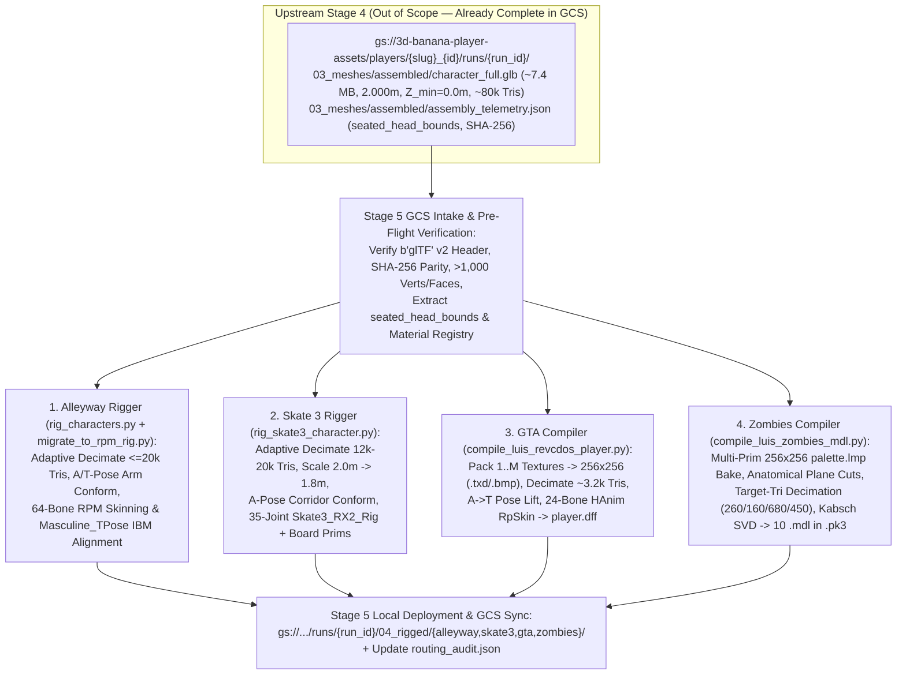

# Functional Specification 061: `.glb`-File-Agnostic Automated Multi-Game Character Rigging & Compilation Pipeline from Google Cloud Storage (`03_meshes/assembled/character_full.glb`) for The Alleyway, Skate 3, GTA: Vice City, and Zombies

## 1. System Purpose & Core Objective

This specification defines the desired `{functionality}`, upstream Google Cloud Storage (`gs://3d-banana-player-assets`) intake and output contracts, `.glb`-file-agnostic geometric normalization and adaptive decimation budgets, multi-material texture atlas synthesis rules, pose-aware skeletal skinning mathematics, failure-isolation boundaries, and verifiable `{correct required outputs}` for upgrading the four character rigging and compilation pipelines in `/Users/diesel/desktop/skatealley/scripts/` so that **any pre-assembled humanoid `.glb` character asset** stored in Google Cloud Storage (`03_meshes/assembled/character_full.glb`) is automatically rigged and compiled for **four strictly scoped target game environments**:

1. **The Alleyway (`/` Freeman Alley Three.js Hub)**: 64-bone Ready Player Me (RPM) glTF 2.0 character rig ([`scripts/rig_characters.py`](file:///Users/diesel/desktop/skatealley/scripts/rig_characters.py) & [`scripts/migrate_to_rpm_rig.py`](file:///Users/diesel/desktop/skatealley/scripts/migrate_to_rpm_rig.py)).
2. **Skate 3 (`/skate3_cleanroom/`)**: 35-joint `Skate3_RX2_Rig` glTF 2.0 character + skateboard rig and `SKPK` streaming `.part` archive ([`scripts/rig_skate3_character.py`](file:///Users/diesel/desktop/skatealley/scripts/rig_skate3_character.py)).
3. **GTA: Vice City (`/revcdos/`)**: 24-bone RenderWare HAnim `RpSkin` `player.dff` geometry, 9-mip DXT1 `player.txd` texture dictionary, and 8-bit paletted `player.bmp` skin ([`scripts/compile_luis_revcdos_player.py`](file:///Users/diesel/desktop/skatealley/scripts/compile_luis_revcdos_player.py)).
4. **Zombies (`/nzportable/` Nazi Zombies: Portable)**: 10 Quake `IDPO` v6 vertex-animated `.mdl` zombie models (`211` full-zombie frames and `127` crawler frames) baked to the 256-color `gfx/palette.lmp` colormap and packaged into `nzp/luis_zombies.pk3` ([`scripts/compile_luis_zombies_mdl.py`](file:///Users/diesel/desktop/skatealley/scripts/compile_luis_zombies_mdl.py)).

### Architectural & Scope Invariants

1. **Strict Separation of Concerns — Head/Body Assembly is Out of Scope (`INV-NO-REASSEMBLE-01`)**:
   - Combining separate `head.glb` and `body.glb` meshes (neck/collar cross-sectional profiling, head scaling, collar seating, grounding to $Z_{\min} = 0.000\text{m}$, and standardization to `2.000m` stature) is performed exclusively by the dedicated upstream Stage 4 assembly step ([`/Users/diesel/desktop/Greek/assemble_characters.py`](file:///Users/diesel/desktop/Greek/assemble_characters.py)).
   - Under no circumstances may any of the four game riggers perform head-onto-body assembly, neck guillotine truncation, or raw `03_meshes/head/head.glb` + `03_meshes/body/body.glb` stitching. Each rigger **MUST** consume the already-assembled unified character `.glb` emitted by Stage 4 (`03_meshes/assembled/character_full.glb`).
2. **Authoritative GCS Intake & Output Sync (`INV-GCS-RIG-01`)**:
   - For any player run `{run_prefix} = players/{player_slug}_{player_id}/runs/{run_id}` in `gs://3d-banana-player-assets` (authenticated via [`/Users/diesel/desktop/Greek/gcs_service_account.json`](file:///Users/diesel/desktop/Greek/gcs_service_account.json)), the four riggers **MUST** locate and pull the pre-assembled mesh from:
     `gs://3d-banana-player-assets/players/{player_slug}_{player_id}/runs/{run_id}/03_meshes/assembled/character_full.glb`
     alongside its companion telemetry manifest:
     `gs://3d-banana-player-assets/players/{player_slug}_{player_id}/runs/{run_id}/03_meshes/assembled/assembly_telemetry.json`
   - Upon completing game-specific decimation, texture compilation, and skeletal rigging, each rigger **MUST** write its deliverables to the local game runtime directories in `/Users/diesel/desktop/skatealley/` **and** upload its rigged deliverables and verification telemetry back to GCS under `gs://3d-banana-player-assets/players/{player_slug}_{player_id}/runs/{run_id}/04_rigged/{alleyway,skate3,gta,zombies}/`, updating `routing_audit.json`.
3. **100% `.glb`-File-Agnostic Processing (`INV-AGNOSTIC-RIG-01`)**:
   - All `LUIS`- and `PLATODOOM`-specific hardcodings—including exact file byte-length checks (`5,285,932` bytes), hardcoded `len(prims) == 2` or `len(images) == 2` assertions, `mat_ids == 1` head-partitioning assumptions, fixed edge-collapse decimation ratios (`0.16`, `0.048..0.076`), and hardcoded character-name branches (`is_doom = (character_name == "PLATODOOM")`, `"45degreeluis"`)—**MUST** be eliminated across all four riggers.
4. **Strict Four-Game Scope (`INV-FOUR-TARGETS-01`)**:
   - This specification and its downstream implementation are strictly scoped to **The Alleyway**, **Skate 3**, **GTA: Vice City**, and **Zombies**. No other game directories (such as `/tkdr/` or `/melee/`) may be modified.

**DO NOT CODE YET.** This document specifies desired behaviors, cloud path contracts, mathematical and binary invariants, operational budgets, edge cases, and observable verification criteria only. It contains zero implementation code, concrete syntax, or mechanical diffs.

---

## 2. Authoritative Domain Vocabulary Alignment ([`LANGUAGE.md`](file:///Users/diesel/desktop/skatealley/LANGUAGE.md))

All assessments of system state, operational constraints, and verification gates within this specification strictly adhere to the authoritative taxonomy established in [`LANGUAGE.md`](file:///Users/diesel/desktop/skatealley/LANGUAGE.md):

- **`{functionality}`**: End-to-end, unattended `.glb`-file-agnostic retrieval of the Stage 4 pre-assembled character mesh (`gs://3d-banana-player-assets/players/{player_slug}_{player_id}/runs/{run_id}/03_meshes/assembled/character_full.glb` and `assembly_telemetry.json`) and automatic compilation of that character into four game-ready rigged formats:
  1. **The Alleyway**: 64-bone Ready Player Me (RPM) `.glb` (`character_hoodie.glb` / `characters/<player_slug>.glb`) compatible with the 82-clip animation library in [`sandbox.js`](file:///Users/diesel/desktop/skatealley/sandbox.js).
  2. **Skate 3**: 35-joint `Skate3_RX2_Rig` `.glb` + skateboard primitives (`7, 8, 9`) packaged into `skate3_cleanroom/parts/char_<player_slug>.part` and registered in [`skate3_cleanroom/pack.json`](file:///Users/diesel/desktop/skatealley/skate3_cleanroom/pack.json).
  3. **GTA: Vice City**: 24-bone RenderWare HAnim `player.dff`, 9-mip DXT1 `player.txd`, and 8-bit paletted `player.bmp` staged in `revcdos/ vice city data/` and `revcdos/vc-assets/local/`.
  4. **Zombies**: 10 vertex-deformed Quake `IDPO` v6 `.mdl` files (`zfull.mdl`, `zcfull.mdl`, `zbody.mdl`, `zhead.mdl`, `zlarm.mdl`, `zrarm.mdl`, `zcbody.mdl`, `zchead.mdl`, `zclarm.mdl`, `zcrarm.mdl`) packaged into `nzportable/nzp/luis_zombies.pk3` and `nzportable/user_assets/progs/ai_zombie.mdl`.
- **`{correctness}`**:
  - Exact GCS path resolution and cryptographic (`SHA-256` + byte-length) verification of `03_meshes/assembled/character_full.glb` against `03_meshes/assembled/assembly_telemetry.json` and `routing_audit.json`.
  - Target-triangle adaptive decimation (`ratio = clamp(target_tris / input_tris, 0.01, 1.0)`) rather than fixed ratios, because Stage 4 outputs un-decimated assembled meshes (`~79,996` triangles in `nicotest_nt01/run_01`) that would overflow game engine vertex/triangle limits under legacy fixed ratios.
  - Multi-primitive ($1..P$) and multi-material ($0..M$) texture handling across all four targets, preserving original UV layers in glTF targets (Alleyway, Skate 3) and dynamically packing or sampling $1..M$ material textures into `256×256` atlases/skins in single-page engine targets (GTA, Zombies).
  - Purely geometric and telemetry-guided (`seated_head_bounds` / `_IS_HEAD_PART`) anatomical partitioning and A-pose/T-pose rest-corridor conformance, ensuring zero reliance on primitive ordering (`mat_ids == 1`) and zero shoulder/forearm twisting when animated.
  - Strict binary header, bone count, inverse-bind-matrix ($W_{\text{bind}} \cdot \text{IBM} = I_4$), vertex weight normalization ($\sum_{k=0}^{3} w_k = 1.0000$), and triangle budget compliance across all four game engines.
- **`{correct required outputs}`**:
  1. **`.glb`-Agnostic Alleyway RPM Rigger ([`scripts/rig_characters.py`](file:///Users/diesel/desktop/skatealley/scripts/rig_characters.py) & [`scripts/migrate_to_rpm_rig.py`](file:///Users/diesel/desktop/skatealley/scripts/migrate_to_rpm_rig.py))** producing a 64-bone RPM `.glb` (`<= 20,000` triangles, `0` embedded animations, `max |W_bind * IBM - I_4| < 1e-4`) locally and in `gs://.../04_rigged/alleyway/`.
  2. **`.glb`-Agnostic Skate 3 Rigger ([`scripts/rig_skate3_character.py`](file:///Users/diesel/desktop/skatealley/scripts/rig_skate3_character.py))** producing a `1.8000m` 35-joint `Skate3_RX2_Rig` `.glb` + `skate3_cleanroom/parts/char_<player_slug>.part` (`SKPK` framing) + updated [`skate3_cleanroom/pack.json`](file:///Users/diesel/desktop/skatealley/skate3_cleanroom/pack.json) locally and in `gs://.../04_rigged/skate3/`.
  3. **`.glb`-Agnostic GTA: Vice City Compiler ([`scripts/compile_luis_revcdos_player.py`](file:///Users/diesel/desktop/skatealley/scripts/compile_luis_revcdos_player.py))** producing `player.dff` (RenderWare `0x1803FFFF`, 24 HAnim bones, `1,800..4,200` verts, `2,400..3,800` tris), `player.txd` (`45,056` bytes), and `player.bmp` (`66,612` bytes) locally and in `gs://.../04_rigged/gta/`.
  4. **`.glb`-Agnostic Zombies MDL Compiler ([`scripts/compile_luis_zombies_mdl.py`](file:///Users/diesel/desktop/skatealley/scripts/compile_luis_zombies_mdl.py))** producing all 10 `IDPO` v6 `.mdl` files inside `nzportable/nzp/luis_zombies.pk3` (plus `ai_zombie.mdl`) with `<= 1,500` triangles per `.mdl` and zero fullbright palette indices (`240..255`), locally and in `gs://.../04_rigged/zombies/`.
  5. **Updated GCS Run Manifest (`routing_audit.json`)** recording `stage5_rigging_status: "COMPLETE"` and the verified GCS URIs, SHA-256 digests, byte sizes, and polygon/bone telemetry for all four game targets.
- **`{errors}`**:
  - Attempting to re-assemble `head.glb` and `body.glb` inside any of the four riggers or looking for input meshes anywhere other than `03_meshes/assembled/character_full.glb` in GCS mode.
  - Retaining any hardcoded `LUIS` byte-size check (`5,285,932`), primitive-count lock (`len(prims) == 2`), material-index head mask (`mat_ids == 1` or `m == 1`), raw un-normalized bounding box assumption, or fixed decimation ratio (`0.16`, `0.048..0.076`).
  - Emitting a Skate 3 `.glb` missing `NORMAL` attributes, missing skateboard primitives (`7, 8, 9`), or outside the `1.8000m` height contract.
  - Emitting a Zombies `.mdl` exceeding Quake `IDPO` v6 limits (`>= 2,000` triangles or `>= 1,024` vertices) or containing fullbright palette indices (`240..255`).
  - Emitting an Alleyway `.glb` with non-RPM bone names, non-identity $W_{\text{bind}} \cdot \text{IBM}$, or embedded animations that override [`sandbox.js`](file:///Users/diesel/desktop/skatealley/sandbox.js)'s external animation library.
- **`{sufficient}`**: Complete, unambiguous specification of the GCS intake/output paths, the physical properties of `03_meshes/assembled/character_full.glb`, the mathematical normalization/decimation/atlas/skinning rules for each of the four target engines, operational budgets, failure-isolation invariants, and live verification gates.
- **`{insufficient}`**: Any specification that conflates Stage 4 assembly with Stage 5 rigging, omits exact GCS object keys, or leaves `LUIS`-specific geometry/material assumptions in place.

---

## 3. First-Principles Pipeline Architecture & Empirical Baseline

### 3.1 Empirical Contract of the Upstream GCS Input (`03_meshes/assembled/character_full.glb`)

Live inspection of `gs://3d-banana-player-assets/players/nicotest_nt01/runs/run_01/03_meshes/assembled/` (generated by [`/Users/diesel/desktop/Greek/assemble_characters.py`](file:///Users/diesel/desktop/Greek/assemble_characters.py)) establishes the exact physical and structural baseline that the four riggers receive:

| Property | Upstream Stage 4 Contract (`character_full.glb` & `assembly_telemetry.json`) | Live Measurement (`nicotest_nt01/runs/run_01`) | Architectural Impact on the 4 Game Riggers |
| :--- | :--- | :--- | :--- |
| **GCS Object Key** | `players/{player_slug}_{player_id}/runs/{run_id}/03_meshes/assembled/character_full.glb` | `7,412,988` bytes (`7.07 MB`), SHA-256 `658605ce...` | Must be fetched once per run into local cache (`<output_dir>/meshes/assembled/character_full.glb`) and verified against `assembly_telemetry.json` before rigging. |
| **Stature & Grounding (`INV-STD-01`)** | Grounded at `0.000m` ($Y_{\min} = 0.000\text{m}$ in glTF $+Y$-up, $Z_{\min} = 0.000\text{m}$ in Blender $+Z$-up), total height `2.000m`, laterally centered ($X_{\text{mid}} = 0.0, Z_{\text{mid}} = 0.0$). | `Y ∈ [0.0000, 2.0000]`, `X ∈ [-0.6108, +0.6108]`, `Z ∈ [-0.1850, +0.1850]` | Already unified and `2.000m` tall; **zero** head/body assembly may be performed. Skate 3 scales `2.000m -> 1.8000m`; GTA maps `[0.0, 2.0] -> [-1.031, +0.922]`. |
| **Polygon Density (`INV-NO-DECIMATE-01`)** | **Un-decimated** full-resolution merged mesh (`decimation_applied: false`). | `54,969` glTF vertices (`39,804` welded Blender vertices), `79,996` triangles (`39,996` body + `40,000` head). | Fixed decimation ratios (`0.16` in GTA $\rightarrow 12,800$ tris; `0.072` on `40,000` head tris in Zombies $\rightarrow 2,880$ tris) **fail** on `80,000`-triangle inputs. Every rigger **MUST** compute adaptive ratios from target triangle budgets. |
| **Primitives & Materials (`INV-MAT-UV-01`)** | Single unified mesh node containing $P \ge 1$ primitives (`<CHAR>_Body_Material`, `<CHAR>_Head_Material`, plus optional `<CHAR>_Hand_Material`) with `POSITION`, `NORMAL`, `TEXCOORD_0` (`UVMap`). | `2` primitives (`prim 0`: Body, `prim 1`: Head), `2` PNG textures (`NICOTEST_Body_BaseColor`, `NICOTEST_Head_BaseColor`). | Must support arbitrary $P \ge 1$ primitives and $M \ge 0$ textures without assuming `prim[0]` is body or `prim[1]` is head (`mat_ids == 1`). |
| **Head Bounds & Tagging** | `assembly_telemetry.json` provides `seating.seated_head_bounds` (`x_span`, `y_span`, `z_span` prior to final `standard_scale`) and `_IS_HEAD_PART` vertex group metadata. | `prim 1` glTF `Y ∈ [1.6446, 2.0000]`, `X ∈ [-0.1472, +0.1453]`, `Z ∈ [-0.1552, +0.1174]`. | Provides exact geometric bounds for rigid cranial skinning (Alleyway, Skate 3, GTA) and neck guillotine slicing (Zombies) independent of material slot order. |
| **Rest Arm Pose** | Preserves the synthesized body's native arm angle (typically **~45° A-pose** from Hunyuan3D-2mv orthographic synthesis, or T-pose for studio scans). | Lateral half-span $|X_{\max}| = 0.6108\text{m}$ at `2.000m` height ($\approx 45^\circ$ downward A-pose). | Each rigger must measure the actual upper-arm/forearm vector in the mesh and conform either the armature or the mesh arms to the target engine's bind pose before skinning. |

---

## 4. Detailed Functional Requirements

### 4.1 Shared GCS Intake, Pre-Flight Validation & Output Synchronization Contract (`INV-GCS-RIG-01`)

1. **Dual Invocation Modes (GCS Run Identity Mode & Local `.glb` Path Mode)**:
   - Each of the four riggers (and any unified Stage 5 batch runner) **MUST** support two deterministic CLI invocation modes:
     - **GCS Run Mode**: Accepts `--gcs-bucket <bucket>` (default `"3d-banana-player-assets"`), `--player-name <name>`, `--player-id <id>`, `--run-id <run_id>`, optional `--output-dir <local_run_dir>`, and optional `--gcs-credentials <json_path>`.
     - **Direct `.glb` Path Mode**: Accepts `--glb <local_or_gs_uri>` (plus optional `--telemetry <assembly_telemetry.json>` and `--char-id <slug>`), enabling standalone compilation of any local `.glb` file or direct `gs://` URI.
2. **GCS Path Resolution & Single-Download Local Caching**:
   - In GCS Run Mode, player identity resolution sanitizes `player_name` into lowercase `player_slug` and resolves:
     $$\text{run\_prefix} = \text{players}/\{\text{player\_slug}\}\_\{\text{player\_id}\}/\text{runs}/\{\text{run\_id}\}$$
   - The rigger resolves the authoritative upstream Stage 4 objects:
     - **Assembled Mesh URI**: `gs://<bucket>/{run_prefix}/03_meshes/assembled/character_full.glb`
     - **Assembly Telemetry URI**: `gs://<bucket>/{run_prefix}/03_meshes/assembled/assembly_telemetry.json`
     - **Run Audit URI**: `gs://<bucket>/{run_prefix}/routing_audit.json`
   - If `<output_dir>/meshes/assembled/character_full.glb` already exists locally and its byte size and `SHA-256` match `assembly_telemetry.json` (`output.size_bytes` and `output.sha256`), the rigger reuses the cached file without redundant network transfer; otherwise it downloads `03_meshes/assembled/character_full.glb` and `03_meshes/assembled/assembly_telemetry.json` from GCS and verifies exact byte-size and `SHA-256` parity.
3. **Pre-Flight Binary & Anatomical Gate (`< 0.2s`)**:
   - Before invoking Blender or mesh compilation, each rigger validates `character_full.glb`:
     - Starts with the 12-byte glTF 2.0 header (`magic == b"glTF"`, `version == 2`, `declared_length == actual_file_size`).
     - Contains $\ge 1$ mesh definition with total vertices $> 1,000$ and total faces $> 1,000$, and contains zero synthetic placeholder metadata (`extras.shape` in `{"radius", "sphere", "icosphere"}`).
4. **GCS Stage 5 Output Upload & `routing_audit.json` Registry**:
   - When invoked in GCS Run Mode, each rigger uploads its compiled game deliverables and a per-target `rig_telemetry.json` manifest to `gs://<bucket>/{run_prefix}/04_rigged/<target>/` with custom object metadata (`player_name`, `player_slug`, `player_id`, `player_folder`, `run_id`, `target_game`, `sha256`) and verifies remote byte-size parity:
     - **Alleyway**: `04_rigged/alleyway/character_rigged.glb`, `04_rigged/alleyway/rig_telemetry.json`
     - **Skate 3**: `04_rigged/skate3/skater_rigged.glb`, `04_rigged/skate3/char_{player_slug}.part`, `04_rigged/skate3/rig_telemetry.json`
     - **GTA: Vice City**: `04_rigged/gta/player.dff`, `04_rigged/gta/player.txd`, `04_rigged/gta/player.bmp`, `04_rigged/gta/rig_telemetry.json`
     - **Zombies**: `04_rigged/zombies/luis_zombies.pk3`, `04_rigged/zombies/ai_zombie.mdl`, `04_rigged/zombies/rig_telemetry.json`
   - Updates `routing_audit.json` (locally and at `gs://<bucket>/{run_prefix}/routing_audit.json`) with `stage5_rigging_status: "COMPLETE"` and `stage5_rigged.<target>` entries recording all local paths, `gs://` URIs, `SHA-256` hashes, vertex/triangle counts, bone counts, and elapsed seconds.

---

### 4.2 Target 1: The Alleyway (`/` Freeman Alley Three.js Hub) — `.glb`-Agnostic 64-Bone RPM Rigger

1. **Elimination of Legacy Assembly & Hardcoded Character Branches**:
   - [`/Users/diesel/desktop/skatealley/scripts/rig_characters.py`](file:///Users/diesel/desktop/skatealley/scripts/rig_characters.py) and [`/Users/diesel/desktop/skatealley/scripts/migrate_to_rpm_rig.py`](file:///Users/diesel/desktop/skatealley/scripts/migrate_to_rpm_rig.py) **MUST** support ingesting any pre-assembled `.glb` (`character_full.glb`) directly without running `Luis_BODY_COLOR.glb` + `LUIS_HEAD_COLOR.glb` or `PLATODOOM_RAW.glb` + `PLATODOOM_HEAD.glb` + `DOOM_HAND.glb` assembly.
   - All `is_doom = (character_name == "PLATODOOM")` conditionals for spine/neck Z-heights and rest-pose vectors **MUST** be replaced by geometric landmark discovery on the input mesh.
2. **Height Verification & Seam-Safe Adaptive Decimation (`<= 20,000` Triangles)**:
   - Verifies or normalizes the imported unified mesh so that $Z_{\min} = 0.000\text{m}$ (Blender $+Z$-up) and height is `2.000m` ($\pm 0.002\text{m}$), centered at $(X_{\text{mid}}, Y_{\text{mid}}) = (0, 0)$.
   - Welds interior duplicate vertices (`1e-4m` threshold) and measures initial triangle count $T_{\text{in}}$.
   - If $T_{\text{in}} > 20,000$ (such as `79,996` triangles in `character_full.glb`), applies seam-safe collapse decimation with `DELIMIT = {'UV', 'MATERIAL'}` and adaptive ratio $r = 19,500 / T_{\text{in}}$ so the output mesh contains $\le 20,000$ triangles while preserving all UV seams, material slots (`<CHAR>_Body_Material`, `<CHAR>_Head_Material`), and textures.
3. **Automatic Arm-Pose Discovery & 64-Bone RPM Skeletal Fitting**:
   - Samples the mesh's left and right arm vertices ($|X| \in [0.18\text{m}, 0.85\text{m}]$) by radial cross-section to discover the true 3D shoulder, elbow, wrist, and fingertip centers and the unit arm axis vector $\hat{\mathbf{u}}_{\text{arm}}$ (automatically adapting to ~45° A-pose meshes like `nicotest_nt01`, ~30° A-pose meshes, or horizontal T-pose meshes).
   - Discovers anatomical groin/hip height, knee height, ankle height, and neck/head height from cross-sectional width profiles and `assembly_telemetry.json`'s `seated_head_bounds` (when available).
   - Constructs the **64-bone Ready Player Me (RPM)** hierarchy (`Hips`, `Spine`, `Spine1`, `Spine2`, `Neck`, `Head`, `HeadTop_End`, `LeftEye`, `RightEye`, `LeftShoulder`, `LeftArm`, `LeftForeArm`, `LeftHand`, 15 left finger bones, `RightShoulder`, `RightArm`, `RightForeArm`, `RightHand`, 15 right finger bones, `LeftUpLeg`, `LeftLeg`, `LeftFoot`, `LeftToeBase`, `LeftToe_End`, `RightUpLeg`, `RightLeg`, `RightFoot`, `RightToeBase`, `RightToe_End`).
4. **Isolated 4-Bone Skinning & RPM Bind-Pose Alignment**:
   - Computes isolated anatomical 4-bone vertex weights (`JOINTS_0`, `WEIGHTS_0`):
     - Head vertices (identified via `_IS_HEAD_PART`, `seated_head_bounds`, or cranial region $Z \ge Z_{\text{neck}}$ within $|X| \le 0.22\text{m}$) receive 100% rigid/smooth `Head` + `Neck` weights with zero shoulder or arm bleed.
     - Left-side limb vertices ($X > +0.02\text{m}$) receive strictly zero `Right*` bone weights, and right-side limb vertices ($X < -0.02\text{m}$) receive strictly zero `Left*` bone weights.
     - Every vertex's top-4 weights are L1-normalized to `1.0000 ± 1e-4`.
   - Aligns the armature's rest pose and local bone quaternions (`rotation_quaternion`) to [`/Users/diesel/desktop/skatealley/assets/rpm/Masculine_TPose.glb`](file:///Users/diesel/desktop/skatealley/assets/rpm/Masculine_TPose.glb) (rotating A-pose arms into the RPM T-pose rest pose via armature deformation before baking rest pose) and recomputes all 64 `inverseBindMatrices` so:
     $$\| W_{\text{bind}}(j) \cdot \text{IBM}(j) - I_4 \|_{\infty} < 10^{-4} \quad \forall j \in \{0..63\}$$
5. **Alleyway Output Contract**:
   - Exports binary glTF 2.0 (`.glb`) with **zero embedded animations** (`len(gltf.animations) == 0`) to `/Users/diesel/desktop/skatealley/character_hoodie.glb` (or `--output <path>` / `/Users/diesel/desktop/skatealley/characters/<player_slug>.glb`) and syncs to `gs://<bucket>/{run_prefix}/04_rigged/alleyway/character_rigged.glb`.

---

### 4.3 Target 2: Skate 3 (`/skate3_cleanroom/`) — `.glb`-Agnostic 35-Joint `Skate3_RX2_Rig` & `.part` Compiler

1. **Multi-Node / Multi-Primitive Ingestion & Normal Synthesis**:
   - [`/Users/diesel/desktop/skatealley/scripts/rig_skate3_character.py`](file:///Users/diesel/desktop/skatealley/scripts/rig_skate3_character.py) **MUST** traverse and flatten all scene nodes and mesh primitives in `03_meshes/assembled/character_full.glb` without assuming a single primitive or hardcoded `LUIS` filename.
   - If the input mesh exceeds `20,000` triangles (`~79,996` triangles in `character_full.glb`), applies seam-safe adaptive decimation (`DELIMIT = {'UV', 'MATERIAL'}`) to reduce the character mesh into `12,000–20,000` triangles (`< 32,768` vertices per primitive) while preserving all materials and UV maps.
   - If any primitive lacks a `NORMAL` accessor, computes area-weighted smooth vertex normals and writes normalized `FLOAT` `VEC3` `NORMAL` accessors.
2. **Canonical `1.8000m` Scaling & Automatic A-Pose Corridor Conformance**:
   - Uniformly scales and translates all character primitives from `2.000m` into Skate 3's exact `1.8000m` skater coordinate envelope ($Y_{\min} = 0.0000\text{m}, Y_{\max} = 1.8000\text{m}$, centered laterally at $X = 0.0\text{m}$ and $Z = -0.0133\text{m}$ to align with `Skate3_RX2_Rig`'s `Pelvis`).
   - Measures the actual upper-arm (`LeftArm` $\to$ `LeftForeArm`) and forearm (`LeftForeArm` $\to$ `LeftHand`) centroid vectors in the scaled character mesh instead of checking `"45degreeluis" in input_path.lower()`.
   - When the measured arm or forearm axis deviates by $> 3.0^\circ$ from `Skate3_RX2_Rig`'s A-pose bone corridor (`LeftArm = [+0.1604, +1.4256, -0.0442] -> LeftForeArm = [+0.3510, +1.2369, -0.0457] -> LeftHand = [+0.5629, +1.0785, -0.0038]`), smoothly rotates the arm/forearm vertices around the shoulder and elbow pivots with a $0.06\text{m}$ cosine-blended shoulder/elbow transition before computing skin weights.
3. **35-Joint `Skate3_RX2_Rig` Skinning & Skateboard Primitive Attachment**:
   - Computes 4-influence skin weights (`JOINTS_0` `UNSIGNED_SHORT` `VEC4`, `WEIGHTS_0` `FLOAT` `VEC4` summing to `1.0000 ± 1e-5`) across all character primitives using the 24 active deformation joints while keeping the 11 socket/IK/camera joints (`joints[24..34]`, including `Sk8board` at index `25`) at strictly `0.0` weight on character body/head primitives.
   - Enforces bilateral symmetry (`Left*` weights $= 0$ for $X < -0.02\text{m}$; `Right*` weights $= 0$ for $X > +0.02\text{m}$) and rigid `Head`/`Neck` weighting on the head primitive / `seated_head_bounds`.
   - Appends the 3 canonical skateboard primitives (deck, trucks, wheels, `1,844` vertices total) bound 100.0% (`weight = [1, 0, 0, 0]`) to joint `25` (`Sk8board`) along with their PBR materials and textures.
4. **Animation Deformation Audit & `.part` Packaging**:
   - Evaluates the rigged character across Skate 3 `.abin` animation clips (`Push_Regular`, `Ollie`, `Kickflip`, `Idle`) and verifies zero NaN/Inf vertices, zero origin-spike vertices, and maximum deformed triangle edge length $< 0.35\text{m}$.
   - Packages the rigged `.glb` into `skate3_cleanroom/parts/char_<player_slug>.part` using the exact 33-byte `SKPK` single-entry header (`\x19\x00\x00\x00assets/private/skater.glb` + `<Q` uint64 payload byte length + raw `.glb` bytes), updates [`/Users/diesel/desktop/skatealley/skate3_cleanroom/pack.json`](file:///Users/diesel/desktop/skatealley/skate3_cleanroom/pack.json) (and stages `/Users/diesel/desktop/skatealley/skate3_cleanroom/assets/private/skater.glb`), and syncs both the `.glb` and `.part` to `gs://<bucket>/{run_prefix}/04_rigged/skate3/`.

---

### 4.4 Target 3: GTA: Vice City (`/revcdos/`) — `.glb`-Agnostic 24-Bone RenderWare `player.dff` / `player.txd` / `player.bmp` Compiler

1. **Removal of `LUIS` Byte-Length, Primitive-Count & Fixed-Ratio Locks**:
   - [`/Users/diesel/desktop/skatealley/scripts/compile_luis_revcdos_player.py`](file:///Users/diesel/desktop/skatealley/scripts/compile_luis_revcdos_player.py) **MUST** eliminate:
     - The `len(glb) != 5285932` assertion.
     - The `len(prims) != 2` and `len(images) < 2` assertions.
     - The fixed `ratio = 0.16` decimation parameter.
     - The `mat_ids == 1` head-identification check.
2. **Dynamic $M$-Material `256×256` `"player"` Texture Atlas & Paletted Skin Synthesis**:
   - Inspects all $M$ materials/textures across the $P$ primitives of the input `.glb`:
     - **$M = 1$ (Single Texture)**: Resizes the image to `256×256` RGBA and keeps normalized UVs $(u, v) \in [0.002, 0.998]^2$.
     - **$M = 2$ (Dual Texture, e.g., `<CHAR>_Body_BaseColor` + `<CHAR>_Head_BaseColor` in `character_full.glb`)**: Packs texture `0` into the left `128×256` half ($u' \in [0.002, 0.498]$) and texture `1` into the right `128×256` half ($u' \in [0.502, 0.998]$).
     - **$M \ge 3$ (Multi-Material Assembly)**: Packs all $M$ textures into an $N_{\text{cols}} \times N_{\text{rows}}$ grid inside `256×256` and affine-remaps each primitive's `TEXCOORD_0` into its assigned cell with half-texel seam padding (`0.5 / 256`).
     - **$M = 0$ (Untextured / Factor-Only)**: Synthesizes a `256×256` atlas from per-material `baseColorFactor` or `COLOR_0` vertex colors.
   - Emits:
     - `player.txd` (`45,056` bytes): RenderWare `0x16` Texture Dictionary containing the `"player"` `Raster` (`256×256`, DXT1 compressed across 9 mipmap levels `256×256` $\to$ `1×1`).
     - `player.bmp` (`66,612` bytes): Standard Windows `BM` 8-bit indexed bitmap (`256×256` pixels + 256-entry RGBQuad palette) for `reVC`'s runtime player skin loader.
3. **Target-Budget Adaptive Decimation (`~3,200` Triangles)**:
   - Joins all primitives in Blender while preserving material assignments and welded UV seams, measures initial triangle count $T_{\text{in}}$ (`~79,996` in `character_full.glb`), and computes the adaptive collapse ratio:
     $$r = \begin{cases} 1.0 & \text{if } T_{\text{in}} \le T_{\text{target}} \\ \text{clamp}\left(\frac{T_{\text{target}}}{T_{\text{in}}}, 0.01, 1.0\right) & \text{if } T_{\text{in}} > T_{\text{target}} \end{cases}$$
     where $T_{\text{target}} = 3,200$ triangles (configurable via `--target-tris`).
   - Applies edge-collapse decimation with `DELIMIT = {'UV', 'MATERIAL'}` (iteratively adjusting if necessary) so the resulting mesh strictly contains **`1,800–4,200` vertices** and **`2,400–3,800` triangles**.
4. **Bounds Normalization, A-Pose-to-T-Pose Elevation & 24-Bone HAnim `RpSkin` Weighting**:
   - Normalizes raw mesh bounds $(\mathbf{p}_{\min}, \mathbf{p}_{\max})$ into canonical height $y_{\text{norm}} \in [0.0, 2.0]$ centered at $(x_{\text{mid}}, z_{\text{mid}}) = (0, 0)$ before applying the piecewise vertical and lateral mapping into RenderWare `player.dff` space ($Z_{\text{dff}} \in [-1.031, +0.922]$).
   - **A-Pose Arm Elevation**: Measures the vertical drop of arm vertices ($|X_{\text{norm}}| > 0.22\text{m}$). If the input mesh is in a ~45° A-pose (arm tips at $Y_{\text{norm}} < 1.38\text{m}$, as in `character_full.glb`), smoothly rotates the left and right arm vertices upward around the shoulder pivots $(\pm 0.185\text{m}, 1.62\text{m})$ into the horizontal T-pose bind corridor ($Z_{\text{dff}} \approx +0.448\text{m}$) prior to skinning so `reVC`'s HAnim bone matrices deform the arms cleanly without shoulder collapse.
   - Computes 4-influence skin weights across the 24 RenderWare HAnim bones (`0: Root`, `1: Pelvis`, `2: Spine`, `3: Spine1`, `4: Neck`, `5: Head`, `6:B Brow`, `7: Jaw`, `21..26: R Clavicle..R Finger01`, `31..36: L Clavicle..L Finger01`, `41..44: L Thigh..L Toe0`, `51..54: R Thigh..R Toe0`) using purely geometric anatomical regions and `seated_head_bounds` ($Z_{\text{dff}} > 0.56\text{m}, |X_{\text{dff}}| < 0.18\text{m}$ for `Head`/`Jaw`/`B Brow`), never `mat_ids == 1`.
   - Enforces $\sum_{k=0}^{3} w_k = 1.0000 \pm 10^{-6}$, verifies deformation against `ped.ifp` animation frames (`max edge <= 0.45m`), and writes `player.dff`, `player.txd`, and `player.bmp` to `/Users/diesel/desktop/skatealley/revcdos/ vice city data/models/generic/`, `/Users/diesel/desktop/skatealley/revcdos/ vice city data/skins/`, `/Users/diesel/desktop/skatealley/revcdos/vc-assets/local/`, and `gs://<bucket>/{run_prefix}/04_rigged/gta/`.

---

### 4.5 Target 4: Zombies (`/nzportable/` Nazi Zombies: Portable) — `.glb`-Agnostic 10-Model Quake `IDPO` v6 `.mdl` & `.pk3` Compiler

1. **Multi-Material `256×256` Hemisphere Skin Baker (`gfx/palette.lmp`)**:
   - [`/Users/diesel/desktop/skatealley/scripts/compile_luis_zombies_mdl.py`](file:///Users/diesel/desktop/skatealley/scripts/compile_luis_zombies_mdl.py) **MUST** support any number of primitives ($P \ge 1$) and embedded textures ($M \ge 0$) in `03_meshes/assembled/character_full.glb`:
     - Normalizes all primitives into canonical `2.000m` height ($Y \in [0.000, 2.000]$, centered at $X=0, Z=0$) prior to skin baking and anatomical slicing.
     - During `256×256` Front (`X ∈ [0..127]`) / Back (`X ∈ [128..255]`) orthographic hemisphere projection, each rasterized triangle samples **its own primitive's material texture** (`images_rgb[mat_id]`, or material `baseColorFactor` if untextured) at its barycentrically interpolated `TEXCOORD_0` $(u, v)$.
     - Quantizes the resulting `256×256` RGB image into Quake palette indices `0..239` using `/Users/diesel/desktop/skatealley/nzportable/nzp/gfx/palette.lmp` (`768` bytes), strictly excluding fullbright indices `240..255`.
2. **Geometric & Telemetry-Driven 5-Part Anatomical Slicing (Zero `m == 1` Assumption)**:
   - Replaces the legacy `m == 1` head filter with geometric anatomical slicing informed by `assembly_telemetry.json`'s `seated_head_bounds` (or default neck plane $Y_{\text{neck}} = 1.64\text{m}$ when telemetry is absent):
     - **`head`**: Triangles whose centroids lie above the neck plane ($Y \ge Y_{\text{neck}}$ and $|X| \le 0.22\text{m}$, or belonging to `_IS_HEAD_PART` / `seated_head_bounds`).
     - **`l_arm`**: Non-head triangles in the left upper-limb corridor ($X \ge +0.205\text{m}$ and $Y \ge 0.95\text{m}$).
     - **`r_arm`**: Non-head triangles in the right upper-limb corridor ($X \le -0.205\text{m}$ and $Y \ge 0.95\text{m}$).
     - **`body`**: Remaining torso, pelvis, and leg triangles ($Y < Y_{\text{neck}}$ and outside the severed arm corridors).
     - **`crawler_body`**: Upper-torso subset of `body` ($Y \ge 0.665\text{m}$) with severed leg stumps.
3. **Target-Triangle Adaptive Decimation Per Body Part (`IDPO` v6 Safe Budget)**:
   - Because `character_full.glb` contains `~79,996` triangles (`~40,000` head tris + `~39,996` body tris), fixed decimation ratios (`0.048..0.076`) would produce `> 2,800` triangles on the head alone and breach Quake `IDPO` v6's hard `2,000`-triangle ceiling.
   - For each of the 5 sliced parts $k \in \{\text{head}, \text{l\_arm}, \text{r\_arm}, \text{body}, \text{crawler\_body}\}$, computes an adaptive collapse ratio from its initial triangle count $T_{\text{in}}^{(k)}$:
     $$r_k = \begin{cases} 1.0 & \text{if } T_{\text{in}}^{(k)} \le T_{\text{target}}^{(k)} \\ \text{clamp}\left(\frac{T_{\text{target}}^{(k)}}{T_{\text{in}}^{(k)}}, 0.004, 1.0\right) & \text{if } T_{\text{in}}^{(k)} > T_{\text{target}}^{(k)} \end{cases}$$
     with target triangle budgets:
     - $T_{\text{target}}^{(\text{head})} = 260$ triangles
     - $T_{\text{target}}^{(\text{l\_arm})} = 160$ triangles
     - $T_{\text{target}}^{(\text{r\_arm})} = 160$ triangles
     - $T_{\text{target}}^{(\text{body})} = 680$ triangles
     - $T_{\text{target}}^{(\text{crawler\_body})} = 450$ triangles
   - Guarantees that even the combined full-zombie model (`zfull.mdl` = `body` + `head` + `l_arm` + `r_arm`) totals **`~1,260` triangles** (strictly $\le 1,500$ triangles and $< 1,000$ vertices), well inside Quake `IDPO` v6's `< 2,000` triangle and `< 1,024` vertex limits.
4. **12-Part Virtual Zombie Rig & Multi-Frame Kabsch SVD Deformation (`211` & `127` Frames)**:
   - Assigns smooth 12-part virtual zombie weights (`pelvis`, `lower_torso`, `upper_torso`, `head`, `l_upper_arm`, `l_forearm`, `r_upper_arm`, `r_forearm`, `l_thigh`, `l_shin`, `r_thigh`, `r_shin`) to each decimated sub-mesh, Automatically adapting arm rest centers to the mesh's detected A-pose or T-pose arm corridor.
   - Extracts rigid per-part transforms $(\mathbf{R}_{f,p}, \mathbf{t}_{f,p})$ via Kabsch SVD ($\det(\mathbf{R}_{f,p}) = +1.0$) across all `211` frames of the full zombie template and all `127` frames of the crawler template, deforms every vertex per frame, quantizes positions into `uint8[3]` + per-frame `scale`/`origin` vectors and `162`-entry `anorms.h` normal indices, and writes all 10 `IDPO` v6 (`version = 6`, `magic = b"IDPO"`) `.mdl` files:
     - `progs/ai/zfull.mdl`, `progs/ai/zbody.mdl`, `progs/ai/zhead.mdl`, `progs/ai/zlarm.mdl`, `progs/ai/zrarm.mdl` (`211` frames each)
     - `progs/ai/zcfull.mdl`, `progs/ai/zcbody.mdl`, `progs/ai/zchead.mdl`, `progs/ai/zclarm.mdl`, `progs/ai/zcrarm.mdl` (`127` frames each)
   - Packages all 10 `.mdl` files into `/Users/diesel/desktop/skatealley/nzportable/nzp/luis_zombies.pk3` (and updates `/Users/diesel/desktop/skatealley/nzportable/nzp/game.pk3` + `/Users/diesel/desktop/skatealley/nzportable/user_assets/progs/ai_zombie.mdl`), and uploads `luis_zombies.pk3`, `ai_zombie.mdl`, and `rig_telemetry.json` to `gs://<bucket>/{run_prefix}/04_rigged/zombies/`.

---

## 5. Operational & Performance Budgets

| Pipeline Stage / Target | Latency Budget | Output Size & Geometry Budget | Enforcement & Telemetry Gate |
| :--- | :--- | :--- | :--- |
| **GCS Intake & Pre-Flight Validation (`03_meshes/assembled/character_full.glb`)** | $< 3.0\text{s}$ (download) / $< 0.2\text{s}$ (cached) | Input `.glb` $> 1,000$ verts & $> 1,000$ faces; exact `SHA-256` parity with `assembly_telemetry.json` | Fails fast prior to spawning Blender if `b"glTF"` magic, `SHA-256`, or topology check fails. |
| **Target 1: The Alleyway (`rig_characters.py` + `migrate_to_rpm_rig.py`)** | $< 12.0\text{s}$ | $\le 20,000$ triangles, `64` RPM bones, `0` embedded animations, `max |W_bind * IBM - I_4| < 1e-4` | Verified via glTF binary/JSON audit and `04_rigged/alleyway/rig_telemetry.json`. |
| **Target 2: Skate 3 (`rig_skate3_character.py`)** | $< 10.0\text{s}$ | `12,000–20,000` character tris + `1,844` board verts, `35` joints (`24` deform + `11` socket), height `1.8000m ± 0.002m` | Verified against `.abin` clips (`max edge < 0.35m`) and `SKPK` `.part` header check. |
| **Target 3: GTA: Vice City (`compile_luis_revcdos_player.py`)** | $< 8.0\text{s}$ | `1,800–4,200` verts, `2,400–3,800` tris, `24` HAnim bones; `player.txd = 45,056 B`; `player.bmp = 66,612 B` | Verified against `ped.ifp` animation frames (`max edge <= 0.45m`) and RenderWare `0x1803FFFF` chunk audit. |
| **Target 4: Zombies (`compile_luis_zombies_mdl.py`)** | $< 8.0\text{s}$ | 10 `IDPO` v6 `.mdl`s: `zfull <= 1,500` tris (`211` frames), parts `160–680` tris, palette indices `0..239` | Verified via `IDPO` v6 binary parser across all 10 `.mdl` files in `luis_zombies.pk3`. |
| **Stage 5 GCS Upload & `routing_audit.json` Sync** | $< 5.0\text{s}$ (4-worker parallel upload) | Remote byte-size & `SHA-256` parity across all `04_rigged/*` objects | Updates `stage5_rigging_status: "COMPLETE"` in local and GCS `routing_audit.json`. |

---

## 6. Edge Cases, Failure Modes & Fail-Fast Invariants

1. **INV-NO-REASSEMBLE-01 (Strict Prohibition on Head/Body Re-Assembly)**:
   - None of the four riggers may import or stitch separate `03_meshes/head/head.glb` and `03_meshes/body/body.glb` files in GCS mode. If `03_meshes/assembled/character_full.glb` is missing from `gs://<bucket>/players/{player_slug}_{player_id}/runs/{run_id}/`, the rigger must fail fast with an actionable `FileNotFoundError` identifying the missing Stage 4 assembled object URI.
2. **INV-ADAPTIVE-DECIMATE-01 (Protection Against High-Poly `80k+` and Low-Poly `< 2k` Inputs)**:
   - When an input `.glb` has `80,000+` triangles (such as `character_full.glb`), adaptive collapse ratios must reduce the mesh into each game's target triangle window (`<= 20k` Alleyway, `12k–20k` Skate 3, `~3.2k` GTA, `160–680` per part in Zombies). Conversely, if an input `.glb` already has fewer triangles than a target budget ($T_{\text{in}} \le T_{\text{target}}$), the decimation ratio must clamp to `1.0` so low-poly meshes are never over-decimated into degenerate slivers.
3. **INV-MULTI-MAT-01 (Arbitrary $P$-Primitive & $M$-Texture Handling)**:
   - Input `.glb` files with $M = 1$ texture (single unified material), $M = 2$ textures (`Body` + `Head` from `assemble_characters.py`), $M \ge 3$ textures (`Body` + `Head` + `Hand` or multi-garment meshes), or $M = 0$ textures (`baseColorFactor` / vertex colors only) must compile cleanly across all four targets without `IndexError` or unmapped UV islands.
4. **INV-POSE-CONFORM-01 (A-Pose vs. T-Pose Rest-Pose Conformance)**:
   - Because Stage 4 assembled characters (`character_full.glb`) typically arrive in a ~45° downward A-pose ($|X_{\max}| \approx 0.61\text{m}$ at `2.0m` height), whereas T-pose scans arrive with $|X_{\max}| \approx 0.85\text{m}$, each rigger must geometrically measure the arm vector and conform either the skeleton or the mesh arms prior to binding. Binding a 45° A-pose mesh directly to a horizontal T-pose HAnim/RPM rest bone without conformance is a structural `{error}`.
5. **INV-GEOM-PARTITION-01 (Zero Material-Index Head Assumptions)**:
   - Identifying head vertices via `mat_ids == 1` or `m == 1` is prohibited. Head vs. body partitioning in GTA, Zombies, Skate 3, and Alleyway must use `assembly_telemetry.json`'s `seated_head_bounds` / `_IS_HEAD_PART` vertex group and geometric anatomical neck planes ($Y_{\text{norm}} \ge Y_{\text{neck}}, |X_{\text{norm}}| \le 0.22\text{m}$) so single-material ($M=1$) and arbitrarily ordered multi-material ($M \ge 2$) `.glb` files rig identically.

---

## 7. Acceptance Criteria & Verification Gates (`{correct required outputs}`)

| Gate ID | Evaluation Parameter | Measurable Verification Criteria |
| :--- | :--- | :--- |
| **AC-01** | `{functionality}` & `{correctness}` | **GCS Stage 4 Intake (`INV-GCS-RIG-01`, `INV-NO-REASSEMBLE-01`):** Given `--gcs-bucket 3d-banana-player-assets --player-name nicotest --player-id nt01 --run-id run_01`, all 4 riggers resolve and pull `gs://3d-banana-player-assets/players/nicotest_nt01/runs/run_01/03_meshes/assembled/character_full.glb` (`7,412,988` B) and `assembly_telemetry.json` without touching `03_meshes/head/head.glb` or `03_meshes/body/body.glb`. |
| **AC-02** | `{correct required outputs}` | **Alleyway 64-Bone RPM Rig (`rig_characters.py` / `migrate_to_rpm_rig.py`):** Produces a valid binary glTF 2.0 `.glb` from `character_full.glb` with exactly `64` RPM bones (`Hips`..`RightToe_End`), $\le 20,000$ triangles, `0` embedded animations, $\max \|W_{\text{bind}} \cdot \text{IBM} - I_4\| < 10^{-4}$, and normalized 4-bone weights, synced to `gs://.../04_rigged/alleyway/`. |
| **AC-03** | `{correct required outputs}` | **Skate 3 35-Joint Rig & `.part` (`rig_skate3_character.py`):** Produces a `1.8000m` (`±0.002m`) `.glb` with `35` joints (`Skate3_RX2_Rig`), `NORMAL` attributes on all primitives, appended skateboard primitives (`7, 8, 9`), valid `.abin` deformation (`max edge < 0.35m`), and a valid `SKPK` `skate3_cleanroom/parts/char_nicotest.part`, synced to `gs://.../04_rigged/skate3/`. |
| **AC-04** | `{correct required outputs}` | **GTA: Vice City `player.dff` / `.txd` / `.bmp` (`compile_luis_revcdos_player.py`):** Compiles `character_full.glb` (`79,996` tris, `2` materials) into `player.dff` (`1,800–4,200` verts, `2,400–3,800` tris, `24` HAnim bones, `ped.ifp` verified), `player.txd` (`45,056` B), and `player.bmp` (`66,612` B), synced to `gs://.../04_rigged/gta/`. |
| **AC-05** | `{correct required outputs}` | **Zombies 10-Model `.mdl` & `.pk3` (`compile_luis_zombies_mdl.py`):** Compiles `character_full.glb` (`79,996` tris, `2` materials) into all 10 `IDPO` v6 `.mdl` files inside `nzportable/nzp/luis_zombies.pk3` with `zfull.mdl <= 1,500` tris (`211` frames), `zcfull.mdl <= 1,000` tris (`127` frames), and palette indices strictly in `0..239`, synced to `gs://.../04_rigged/zombies/`. |
| **AC-06** | `{correctness}` | **Cross-`.glb` Agnosticism Proof:** All 4 riggers succeed without code changes across structurally diverse `.glb` inputs—including the GCS-assembled `character_full.glb` (`54,969` glTF verts, `79,996` tris, `2` materials, A-pose) and a second distinct `.glb` archetype (e.g. `LUIS_DECIMATED_STANDALONE.glb` or single-material `nicotest.glb`)—and update `routing_audit.json` in GCS. |

---

## 8. Execution Gate

- **DO NOT CODE YET.** No production code or script modifications may proceed until [`functional_specification_061.md`](file:///Users/diesel/desktop/skatealley/functional_specification_061.md) is reviewed and explicitly authorized by the user.
