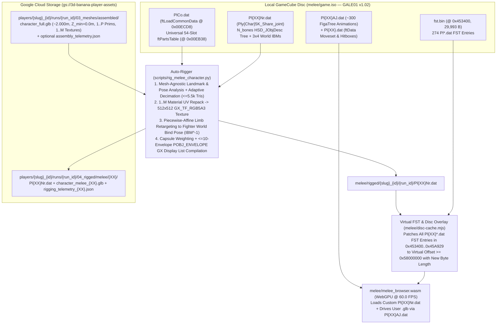

# Functional Specification 063: `.glb`-File-Agnostic & Fighter-Agnostic *Super Smash Bros. Melee* Character Auto-Rigger, Skeleton Retargeting Compiler & Live Virtual FST Overlay from Google Cloud Storage (`03_meshes/assembled/character_full.glb`)

## 1. System Purpose & Core Objective

This specification defines the desired `{functionality}`, upstream Google Cloud Storage (`gs://3d-banana-player-assets`) intake and output contracts, `.glb`-file-agnostic geometric normalization and adaptive decimation budgets, fighter-agnostic skeletal extraction and retargeting mathematics (`PlCo.dat` universal `ftPartsTable` + `Pl<XX>Nr.dat` `HSD_JObjDesc` Inverse Bind Matrices), GameCube GX `POBJ_ENVELOPE` display-list and `GX_TF_RGB5A3` texture compilation invariants, virtual File System Table (`fst.bin`) disc overlay behavior in [`melee/disc-cache.mjs`](file:///Users/diesel/desktop/skatealley/melee/disc-cache.mjs), user selection workflow in [`melee/index.html`](file:///Users/diesel/desktop/skatealley/melee/index.html) / [`melee/shell.mjs`](file:///Users/diesel/desktop/skatealley/melee/shell.mjs), operational performance budgets, and verifiable `{correct required outputs}` for rigging any pre-assembled humanoid character asset (`03_meshes/assembled/character_full.glb`) onto any user-selected *Super Smash Bros. Melee* fighter (`GALE01` v1.02) so the user plays as their own `.glb` character driven by that fighter's native `Pl<XX>AJ.dat` skeletal animations inside `/melee/`.

### Architectural & Scope Invariants

1. **Strict Standalone `/melee/` Scope (`INV-MELEE-STANDALONE-02`)**:
   - All runtime rigging, virtual FST overlay mounting, UI controls, and server endpoints **MUST** remain strictly scoped to the standalone `/melee/` web application ([`melee/index.html`](file:///Users/diesel/desktop/skatealley/melee/index.html), [`melee/shell.mjs`](file:///Users/diesel/desktop/skatealley/melee/shell.mjs), [`melee/disc-cache.mjs`](file:///Users/diesel/desktop/skatealley/melee/disc-cache.mjs)), its dedicated rigging/compilation utility ([`scripts/rig_melee_character.py`](file:///Users/diesel/desktop/skatealley/scripts/rig_melee_character.py)), and [`scripts/serve_skatealley.py`](file:///Users/diesel/desktop/skatealley/scripts/serve_skatealley.py).
   - Zero modifications may be made to the Freeman Alley Three.js application ([`index.html`](file:///Users/diesel/desktop/skatealley/index.html), [`sandbox.js`](file:///Users/diesel/desktop/skatealley/sandbox.js)) or any other game directory (`/skate3_cleanroom/`, `/revcdos/`, `/nzportable/`, `/tkdr/`).
2. **Strict Separation of Concerns — Upstream Stage 4 Assembly is Out of Scope (`INV-NO-REASSEMBLE-02`)**:
   - Head/body assembly, neck seating, grounding to $0.000\text{ m}$, and standardization to $2.000\text{ m}$ standing stature are performed exclusively by Stage 4 ([`functional_specification_059.md`](file:///Users/diesel/desktop/skatealley/functional_specification_059.md)).
   - The *Melee* auto-rigger **MUST** consume the already-assembled unified character `.glb` at `gs://3d-banana-player-assets/players/{player_slug}_{player_id}/runs/{run_id}/03_meshes/assembled/character_full.glb` (alongside its optional companion `assembly_telemetry.json`).
3. **Skeleton-Only Extraction & Zero Costume-Slot Selection (`INV-SKELETON-ONLY-01`)**:
   - Because the user's assembled GCS `character_full.glb` provides the complete visual mesh and textures, the user **MUST NOT** be asked to select a *Melee* costume color slot (`Nr`, `Re`, `Bu`, etc.).
   - The user selects strictly:
     1. **Which GCS `character_full.glb` asset** they want to use (`{player_slug}_{player_id}` / `{run_id}`), and
     2. **Which playable *Super Smash Bros. Melee* fighter (`Pl<XX>`)** they want to be rigged as (`26` playable roster fighters across `Ca`, `Dk`, `Fx`, `Gw`, `Kb`, `Kp`, `Lk`, `Lg`, `Mr`, `Ms`, `Mt`, `Ns`, `Pe`, `Pk`, `Pp`, `Pr`, `Ss`, `Ys`, `Zd`, `Sk`, `Fc`, `Cl`, `Dr`, `Fe`, `Pc`, `Gn`).
   - From the chosen *Melee* fighter, the auto-rigger discards the original Nintendo polygon meshes and textures and extracts **strictly the fighter's 3D skeleton (`HSD_JObjDesc` bone hierarchy `Ply<CharName>5K_Share_joint` and $3\times 4$ world-space Inverse Bind Matrices `ibm_ptr`)** together with the universal anatomical bone map (`ftPartsTable` in `PlCo.dat`).
   - At runtime inside `/melee/`, the virtual FST overlay redirects **all** skin/costume FST entries for that chosen fighter (`Pl<XX>Nr.dat`, `Pl<XX>Re.dat`, `Pl<XX>Bu.dat`, `Pl<XX>Gr.dat`, `Pl<XX>Ye.dat`, `Pl<XX>Bk.dat`, `Pl<XX>Wh.dat`, `Pl<XX>Or.dat`, `Pl<XX>La.dat`, `Pl<XX>Aq.dat`, `Pl<XX>Pi.dat`, `Pl<XX>Gy.dat`) to the user's compiled `.dat` archive so that selecting that fighter in-game always loads the user's rigged `.glb` driven by that fighter's `Pl<XX>AJ.dat` skeletal animations.
4. **100% `.glb`-File-Agnostic & Fighter-Agnostic Processing (`INV-DOUBLE-AGNOSTIC-01`)**:
   - The auto-rigger **MUST** contain zero hardcoded assumptions about the input `.glb` (arbitrary vertex/triangle counts, arbitrary $P \ge 1$ primitives, arbitrary $M \ge 1$ material textures, A-pose or T-pose rest arms, presence or absence of `_IS_HEAD_PART` or `assembly_telemetry.json`).
   - The auto-rigger **MUST** contain zero per-fighter hardcoded bone index tables; all bone discovery and anatomical correspondence across the 26 playable fighters **MUST** be derived dynamically at runtime from `PlCo.dat` (`ftLoadCommonData` universal `ftPartsTable` at `0x00EB38`) and the target `Pl<XX>Nr.dat`'s `HSD_JObjDesc` hierarchy and Inverse Bind Matrices (`ibm_ptr`).

**DO NOT CODE YET.** This document specifies desired functional behavior, cloud storage contracts, mathematical and binary format invariants, operational budgets, failure modes, and verification gates only.

---

## 2. Authoritative Domain Vocabulary Alignment ([`LANGUAGE.md`](file:///Users/diesel/desktop/skatealley/LANGUAGE.md))

All assessments of system state, operational constraints, and verification gates within this specification strictly adhere to [`LANGUAGE.md`](file:///Users/diesel/desktop/skatealley/LANGUAGE.md):

- **`{functionality}`**: End-to-end, `.glb`-file-agnostic and fighter-agnostic intake of any Stage 4 assembled character asset (`gs://3d-banana-player-assets/players/{player_slug}_{player_id}/runs/{run_id}/03_meshes/assembled/character_full.glb`), dynamic extraction of any user-selected *Super Smash Bros. Melee* fighter's 3D skeleton (`PlCo.dat` + `Pl<XX>Nr.dat` inside [`melee/game.iso`](file:///Users/diesel/desktop/skatealley/melee/game.iso)), automated pose/proportion retargeting and multi-bone envelope skinning of the user's `.glb` onto that fighter's `HSD_JObjDesc` bones, compilation of both a playable HAL SysDolphin `Pl<XX>Nr.dat` archive and a companion rigged `.glb`, synchronization back to `gs://3d-banana-player-assets/players/{player_slug}_{player_id}/runs/{run_id}/04_rigged/melee/{fighter_code}/`, and live zero-recompilation mounting inside `/melee/` via [`melee/disc-cache.mjs`](file:///Users/diesel/desktop/skatealley/melee/disc-cache.mjs) so the user plays as their `.glb` character animated by the chosen fighter's `Pl<XX>AJ.dat` moveset at `60.0 FPS`.
- **`{correctness}`**:
  - Exact GCS discovery, retrieval, and SHA-256 integrity validation of `03_meshes/assembled/character_full.glb`.
  - Exact binary parsing of `fst.bin` (`0x453400`), `PlCo.dat` (`ftLoadCommonData` at `0x00ECD8`, universal `ftPartsTable` at `0x00EB38`), and the selected fighter's `Pl<XX>Nr.dat` (`Ply<CharName>5K_Share_joint` `HSD_JObjDesc` tree) from [`melee/game.iso`](file:///Users/diesel/desktop/skatealley/melee/game.iso), including automatic bone-count offset correction ($\Delta = w_2 - N_{\text{bones}}$ on fighters such as Kirby `PlKbNr.dat` where `w2 = 59` vs. $N_{\text{bones}} = 46$) and spatial/topological centerline verification of `NeckN`/`HeadN` and limb chains.
  - Strict preservation of 100% of the selected fighter's `HSD_JObjDesc` bone count ($N_{\text{bones}}$), depth-first topological order (`0 .. N_bones - 1`), local rest transforms (`rotation`, `scale`, `position`), $3\times 4$ world-space Inverse Bind Matrices (`ibm_ptr` at `+0x38`), and per-bone `HSD_DObjDesc` linked-list lengths, guaranteeing binary compatibility with `Pl<XX>.dat` (`ftData` `model_lookup_tables`) and `Pl<XX>AJ.dat` (`FigaTree` animation tracks).
  - Adaptive quadric decimation of arbitrary-density `.glb` inputs to the GameCube GX / WebGPU target triangle budget (`3,500 .. 6,500` triangles), multi-material UV atlas packing into a single `512×512` `GX_TF_RGB5A3` texture (`524,288 B`), **proportion-preserving retargeting** (uniform stature scaling $s = H_{\text{fighter}} / 2.000$ + pure $\text{SO}(3)$ limb rotation alignment without crushing or warping human limb lengths) to the fighter's world-space bind pose ($B_i = \text{IBM}_i^{-1}$), and smooth multi-bone skinning ($\sum w_k = 1.0$, quantized to $10\%$ steps, with rigid `1.0` cranial weighting to `HeadN`).
  - Automatic full-3D and full-color override for Mr. Game & Watch (`Gw`) by patching `PlGw.dat`'s `ftGw_DatAttrs` (`ext_attr` at data offset `0x3778`: setting `+0x00` Z-scale from `0.01f` to `1.0f` and `+0x04..+0x10` costume RGBA tints to `0xFFFFFFFF`) alongside `PlGwNr.dat` in the virtual FST overlay.
  - Strict compliance with the GameCube GX hardware skinning limit of $\le 10$ unique `HSD_EnvelopeDesc` combinations per `HSD_PObjDesc` batch (`GX_PNMTX0..GX_PNMTX9`, `GX_VA_PNMTXIDX` $\in \{0, 3, 6, \dots, 27\}$), 32-byte display-list alignment, `pc_vtx_array_scan` vertex buffer index bounds inside [`melee/melee_browser.wasm`](file:///Users/diesel/desktop/skatealley/melee/melee_browser.wasm), and `Module.discFile.size` virtual ceiling expansion in [`melee/disc-cache.mjs`](file:///Users/diesel/desktop/skatealley/melee/disc-cache.mjs) so `browser_disc_read` in [`melee/melee_browser.js`](file:///Users/diesel/desktop/skatealley/melee/melee_browser.js) permits reads at virtual offsets $\ge \text{0x58000000}$.
- **`{correct required outputs}`**:
  1. **`.glb`-Agnostic & Fighter-Agnostic *Melee* Auto-Rigger ([`scripts/rig_melee_character.py`](file:///Users/diesel/desktop/skatealley/scripts/rig_melee_character.py))**: CLI and callable backend service that intakes any GCS `character_full.glb` (by GCS run identifier, `gs://` URI, or local path) and any of the 26 playable *Melee* fighter codes (`Ca` .. `Gn`), emitting:
     - Compiled HAL SysDolphin archive `melee/rigged/{player_slug}_{player_id}/{run_id}/Pl{XX}Nr.dat` (with valid 32-byte `HSD_ArchiveHeader`, relocated pointers, preserved `Ply<CharName>5K_Share_joint` skeleton, `GX_TF_RGB5A3` texture atlas, and `POBJ_ENVELOPE` GX display lists).
     - Companion standalone glTF 2.0 rigged file `melee/rigged/{player_slug}_{player_id}/{run_id}/character_melee_{XX}.glb` containing the user's mesh bound to the target fighter's `HSD_JObjDesc` glTF `Skin` (`max |W_bind * IBM - I_4| < 1e-4`).
     - Rigging verification manifest `melee/rigged/{player_slug}_{player_id}/{run_id}/rigging_telemetry_{XX}.json`, synced to `gs://3d-banana-player-assets/players/{player_slug}_{player_id}/runs/{run_id}/04_rigged/melee/{XX}/` and recorded in `routing_audit.json`.
  2. **Virtual FST & Disc Overlay Engine ([`melee/disc-cache.mjs`](file:///Users/diesel/desktop/skatealley/melee/disc-cache.mjs))**: Dynamically patches the cached `fst.bin` table (`0x453400..0x45A929`) in memory to redirect all costume FST entries (`Pl<XX>*.dat`) of any active rigged fighter to a virtual disc address region ($\ge \text{0x58000000}$) backed by the compiled `Pl<XX>Nr.dat` buffer, bypassing original ISO file-size limits without modifying [`melee/game.iso`](file:///Users/diesel/desktop/skatealley/melee/game.iso) on disk or recompiling [`melee/melee_browser.wasm`](file:///Users/diesel/desktop/skatealley/melee/melee_browser.wasm).
  3. **GCS Character & *Melee* Fighter Selector API & UI ([`scripts/serve_skatealley.py`](file:///Users/diesel/desktop/skatealley/scripts/serve_skatealley.py), [`melee/index.html`](file:///Users/diesel/desktop/skatealley/melee/index.html), [`melee/shell.mjs`](file:///Users/diesel/desktop/skatealley/melee/shell.mjs))**:
     - HTTP API endpoints (`GET /api/melee/gcs-characters`, `GET /api/melee/fighters`, `POST /api/melee/rig`) that list available GCS `character_full.glb` assets, list all 26 playable *Melee* fighters with their extracted bone counts, trigger or serve cached auto-rigging for `(gcs_character, fighter_code)`, and return the compiled `.dat` overlay URL.
     - Interactive selector in [`melee/index.html`](file:///Users/diesel/desktop/skatealley/melee/index.html) / [`melee/shell.mjs`](file:///Users/diesel/desktop/skatealley/melee/shell.mjs) (plus URL query parameter support `?player=<slug_id>&run=<run_id>&fighter=<XX>`) allowing the user to pick their GCS character and target *Melee* fighter and launch directly into `/melee/` playing as their rigged `.glb`.
  4. **Automated End-to-End Verification Suite ([`tests/verify_melee_autorigger.mjs`](file:///Users/diesel/desktop/skatealley/tests/verify_melee_autorigger.mjs))**: Verifies `.glb`-agnostic and fighter-agnostic compilation across multiple distinct fighters (`Ca`, `Mr`, `Fx`, `Ms`, `Lk`, `Kb`) and verifies live WebGPU gameplay inside `/melee/` with the custom rigged `.dat` overlay mounted at $\ge 58\text{ FPS}$ (`0` Wasm traps, `0` WebGPU validation errors).
- **`{errors}`**:
  - Exposing or requiring a costume color slot selector in the user workflow.
  - Hardcoding bone indices for specific fighters instead of reading `PlCo.dat` (`0x00EB38`) and `Pl<XX>Nr.dat` (`Ply<CharName>5K_Share_joint`), or hardcoding vertex/primitive/material counts for specific `.glb` files.
  - Modifying the target fighter's `HSD_JObjDesc` bone count, topological order, or local rest transforms (`rotation`, `scale`, `position`), which corrupts `Pl<XX>AJ.dat` `FigaTree` track indexing and `Pl<XX>.dat` hitbox attachments.
  - Emitting any `HSD_PObjDesc` containing $> 10$ unique `HSD_EnvelopeDesc` entries, unaligned GX display lists (`byte_length % 32 != 0`), or vertex indices that fail `pc_vtx_array_scan`.
  - Overwriting [`melee/game.iso`](file:///Users/diesel/desktop/skatealley/melee/game.iso) in-place (which truncates `.dat` archives larger than the original costume slot) instead of mounting via the virtual FST overlay in [`melee/disc-cache.mjs`](file:///Users/diesel/desktop/skatealley/melee/disc-cache.mjs).
- **`{sufficient}`**: Complete, implementation-free specification of the GCS intake/sync contracts, `PlCo.dat` + `Pl<XX>Nr.dat` skeletal extraction, `.glb`-agnostic landmark discovery and pose retargeting, `POBJ_ENVELOPE` GX display-list and texture compilation, virtual FST overlay architecture, HTTP API / UI selector contracts, operational budgets, and live WebGPU verification gates.
- **`{insufficient}`**: Any specification that only exports a static `.glb` preview without compiling a playable `Pl<XX>Nr.dat` archive mounted inside the live `/melee/` runtime, or that relies on manual per-character or per-`.glb` configuration.

---

## 3. End-to-End Architecture & Empirical Binary Model

### 3.1 Authoritative Fighter Mapping Table (`PlCo.dat` + `Pl<XX>Nr.dat` on `GALE01` v1.02)

Every playable fighter in [`melee/game.iso`](file:///Users/diesel/desktop/skatealley/melee/game.iso) is uniquely identified by its two-letter archive code `<XX>` and its internal `ftkind` index (`0 .. 26`) in `PlCo.dat`'s `ftPartsTable` array at offset `0x00EB38` (`ftLoadCommonData + 0x10`):

| Fighter Name | Code `<XX>` | `PlCo.dat` `ftkind` | Base Skeleton File (`Pl<XX>Nr.dat`) | Root Skeleton Symbol (`HSD_JObjDesc` Count $N_{\text{bones}}$) | All FST Costume Entries Redirected by Virtual Overlay |
| :--- | :---: | :---: | :--- | :--- | :--- |
| **Mario** | `Mr` | `0` | `PlMrNr.dat` | `PlyMario5K_Share_joint` (`61` bones) | `PlMrNr.dat`, `PlMrYe.dat`, `PlMrBk.dat`, `PlMrBu.dat`, `PlMrGr.dat` |
| **Fox** | `Fx` | `1` | `PlFxNr.dat` | `PlyFox5K_Share_joint` (`73` bones) | `PlFxNr.dat`, `PlFxOr.dat`, `PlFxLa.dat`, `PlFxGr.dat` |
| **Captain Falcon** | `Ca` | `2` | `PlCaNr.dat` | `PlyCaptain5K_Share_joint` (`63` bones) | `PlCaNr.dat`, `PlCaRe.dat`, `PlCaBu.dat`, `PlCaGr.dat`, `PlCaGy.dat`, `PlCaWh.dat` |
| **Donkey Kong** | `Dk` | `3` | `PlDkNr.dat` | `PlyDonkey5K_Share_joint` (`75` bones) | `PlDkNr.dat`, `PlDkRe.dat`, `PlDkBu.dat`, `PlDkGr.dat`, `PlDkBk.dat` |
| **Kirby** | `Kb` | `4` | `PlKbNr.dat` | `PlyKirby5K_Share_joint` (`46` bones) | `PlKbNr.dat`, `PlKbYe.dat`, `PlKbBu.dat`, `PlKbRe.dat`, `PlKbGr.dat`, `PlKbWh.dat` |
| **Bowser** | `Kp` | `5` | `PlKpNr.dat` | `PlyKoopa5K_Share_joint` (`76` bones) | `PlKpNr.dat`, `PlKpRe.dat`, `PlKpBu.dat`, `PlKpBk.dat` |
| **Link** | `Lk` | `6` | `PlLkNr.dat` | `PlyLink5K_Share_joint` (`75` bones) | `PlLkNr.dat`, `PlLkRe.dat`, `PlLkBu.dat`, `PlLkBk.dat`, `PlLkWh.dat` |
| **Sheik** | `Sk` | `7` | `PlSkNr.dat` | `PlySeak5K_Share_joint` (`58` bones) | `PlSkNr.dat`, `PlSkRe.dat`, `PlSkBu.dat`, `PlSkGr.dat`, `PlSkWh.dat` |
| **Ness** | `Ns` | `8` | `PlNsNr.dat` | `PlyNess5K_Share_joint` (`63` bones) | `PlNsNr.dat`, `PlNsYe.dat`, `PlNsBu.dat`, `PlNsGr.dat` |
| **Peach** | `Pe` | `9` | `PlPeNr.dat` | `PlyPeach5K_Share_joint` (`114` bones) | `PlPeNr.dat`, `PlPeYe.dat`, `PlPeWh.dat`, `PlPeBu.dat`, `PlPeGr.dat` |
| **Ice Climbers (Popo/Nana)** | `Pp` | `10` / `11` | `PlPpNr.dat` | `PlyPopo5K_Share_joint` (`49` bones) | `PlPpNr.dat`, `PlPpGr.dat`, `PlPpOr.dat`, `PlPpRe.dat`, `PlNnNr.dat`, `PlNnYe.dat`, `PlNnAq.dat`, `PlNnWh.dat` |
| **Pikachu** | `Pk` | `12` | `PlPkNr.dat` | `PlyPikachu5K_Share_joint` (`53` bones) | `PlPkNr.dat`, `PlPkRe.dat`, `PlPkBu.dat`, `PlPkGr.dat` |
| **Samus** | `Ss` | `13` | `PlSsNr.dat` | `PlySamus5K_Share_joint` (`60` bones) | `PlSsNr.dat`, `PlSsPi.dat`, `PlSsBk.dat`, `PlSsGr.dat`, `PlSsLa.dat` |
| **Yoshi** | `Ys` | `14` | `PlYsNr.dat` | `PlyYoshi5K_Share_joint` (`70` bones) | `PlYsNr.dat`, `PlYsRe.dat`, `PlYsBu.dat`, `PlYsYe.dat`, `PlYsPi.dat`, `PlYsAq.dat` |
| **Jigglypuff** | `Pr` | `15` | `PlPrNr.dat` | `PlyPurin5K_Share_joint` (`50` bones) | `PlPrNr.dat`, `PlPrRe.dat`, `PlPrBu.dat`, `PlPrGr.dat`, `PlPrYe.dat` |
| **Mewtwo** | `Mt` | `16` | `PlMtNr.dat` | `PlyMewtwo5K_Share_joint` (`68` bones) | `PlMtNr.dat`, `PlMtRe.dat`, `PlMtBu.dat`, `PlMtGr.dat` |
| **Luigi** | `Lg` | `17` | `PlLgNr.dat` | `PlyLuigi5K_Share_joint` (`61` bones) | `PlLgNr.dat`, `PlLgWh.dat`, `PlLgAq.dat`, `PlLgPi.dat` |
| **Marth** | `Ms` | `18` | `PlMsNr.dat` | `PlyMars5K_Share_joint` (`90` bones) | `PlMsNr.dat`, `PlMsRe.dat`, `PlMsGr.dat`, `PlMsBk.dat`, `PlMsWh.dat` |
| **Zelda** | `Zd` | `19` | `PlZdNr.dat` | `PlyZelda5K_Share_joint` (`118` bones) | `PlZdNr.dat`, `PlZdRe.dat`, `PlZdBu.dat`, `PlZdGr.dat`, `PlZdWh.dat` |
| **Young Link** | `Cl` | `20` | `PlClNr.dat` | `PlyClink5K_Share_joint` (`79` bones) | `PlClNr.dat`, `PlClRe.dat`, `PlClBu.dat`, `PlClWh.dat`, `PlClBk.dat` |
| **Dr. Mario** | `Dr` | `21` | `PlDrNr.dat` | `PlyDrmario5K_Share_joint` (`86` bones) | `PlDrNr.dat`, `PlDrRe.dat`, `PlDrBu.dat`, `PlDrGr.dat`, `PlDrBk.dat` |
| **Falco** | `Fc` | `22` | `PlFcNr.dat` | `PlyFalco5K_Share_joint` (`67` bones) | `PlFcNr.dat`, `PlFcRe.dat`, `PlFcBu.dat`, `PlFcGr.dat` |
| **Pichu** | `Pc` | `23` | `PlPcNr.dat` | `PlyPichu5K_Share_joint` (`46` bones) | `PlPcNr.dat`, `PlPcRe.dat`, `PlPcBu.dat`, `PlPcGr.dat` |
| **Mr. Game & Watch** | `Gw` | `24` | `PlGwNr.dat` | `PlyGamewatch5K_Share_joint` (`53` bones) | `PlGwNr.dat`, `PlGwRe.dat`, `PlGwBu.dat`, `PlGwGr.dat` |
| **Ganondorf** | `Gn` | `25` | `PlGnNr.dat` | `PlyGanon5K_Share_joint` (`84` bones) | `PlGnNr.dat`, `PlGnRe.dat`, `PlGnBu.dat`, `PlGnGr.dat`, `PlGnLa.dat` |
| **Roy** | `Fe` | `26` | `PlFeNr.dat` | `PlyEmblem5K_Share_joint` (`92` bones) | `PlFeNr.dat`, `PlFeRe.dat`, `PlFeBu.dat`, `PlFeGr.dat`, `PlFeYe.dat` |

---

## 4. Detailed Functional Requirements

### 4.1 Stage 1 — Agnostic GCS Character Intake & Mesh Normalization

1. **GCS Discovery & Retrieval (`gs://3d-banana-player-assets`)**:
   - Using service account credentials at [`/Users/diesel/desktop/Greek/gcs_service_account.json`](file:///Users/diesel/desktop/Greek/gcs_service_account.json) (when available), the system must be able to:
     - Enumerate all player runs in `gs://3d-banana-player-assets/players/{player_slug}_{player_id}/runs/{run_id}/` that contain a valid `03_meshes/assembled/character_full.glb`.
     - Download `03_meshes/assembled/character_full.glb` and optional `03_meshes/assembled/assembly_telemetry.json` into a deterministic local cache path (`melee/rigged/{player_slug}_{player_id}/{run_id}/input/character_full.glb`), verifying SHA-256 parity against `assembly_telemetry.json` when present.
     - Support offline/local fallback onto any locally cached `character_full.glb` (or repository `.glb` test fixture) when GCS credentials or network connectivity are unavailable.
2. **`.glb`-Agnostic Geometry Extraction & Canonical Frame Normalization**:
   - Parse all mesh nodes and primitives ($P \ge 1$) from the input `.glb`, concatenating vertex positions, vertex normals, UV coordinates (`TEXCOORD_0`), and primitive material indices into unified arrays.
   - Automatically detect and normalize coordinate axes so the character stands upright along $+Y$ (glTF standard, matching *Melee*'s $+Y$-up world bind space), faces $+Z$, has soles grounded at $Y_{\min} = 0.000\text{ m}$, is laterally centered at $(X_{\text{mid}}, Z_{\text{mid}}) = (0.0, 0.0)$, and has canonical height $H_{\text{src}} = 2.000\text{ m}$.
3. **Adaptive Target-Triangle Quadric Decimation**:
   - Because upstream `character_full.glb` assets are un-decimated (`~50,000 .. 90,000` triangles), fixed decimation ratios are prohibited.
   - Compute an adaptive target triangle count $T_{\text{target}} = 4,500$ triangles (bounded within $[3,000, \; 6,500]$ triangles) and decimate while preserving UV seams and anatomical boundaries so that the resulting mesh fits well within GameCube GX display-list and `pc_vtx_array_scan` vertex index budgets.
4. **Multi-Material ($1..M$) Unified `512×512` Texture Atlas Synthesis**:
   - Extract all base-color textures across all $M \ge 1$ materials (`Body`, `Head`, `Hands`, etc., or vertex/material base colors if untextured).
   - Dynamically pack the $M$ material textures into a single power-of-two `512×512` RGBA atlas (e.g., horizontal or grid tiles with UV coordinate remapping per primitive) and encode it into GameCube GX tiled **`GX_TF_RGB5A3` (`fmt = 5`, 16-bpp in $4\times 4$ pixel tiles, `524,288` bytes total)**:
     - Opaque pixels ($\alpha \ge 224$): `0x8000 | ((R >> 3) << 10) | ((G >> 3) << 5) | (B >> 3)` (15-bit RGB555).
     - Translucent pixels ($\alpha < 224$): `((A >> 5) << 12) | ((R >> 4) << 8) | ((G >> 4) << 4) | (B >> 4)` (3-bit Alpha + 12-bit RGB444).

### 4.2 Stage 2 — Fighter-Agnostic Skeleton Extraction (`PlCo.dat` + `Pl<XX>Nr.dat`)

1. **Dynamic FST & Archive Parsing from [`melee/game.iso`](file:///Users/diesel/desktop/skatealley/melee/game.iso)**:
   - Read the GameCube FST offset (`0x424`) and size (`0x428`) from [`melee/game.iso`](file:///Users/diesel/desktop/skatealley/melee/game.iso) and locate `PlCo.dat` and the selected fighter's `Pl<XX>Nr.dat`.
2. **Universal Anatomical Bone Mapping via `PlCo.dat` (`0x00EB38`) + Topological/Spatial Verification**:
   - Parse `PlCo.dat`, read the 33-entry `ftPartsTable` pointer array at `0x00EB38`, and extract the selected fighter's `part_to_bone[54]` (`w1`), `bone_to_part` (`w0`), and table bone count `w2`.
   - **Automatic Bone-Count Offset Correction ($\Delta = w_2 - N_{\text{bones}}$)**:
     - On fighters whose `PlCo.dat` `ftPartsTable` entry includes auxiliary high-poly/copy-state bones omitted from `Pl<XX>Nr.dat` (specifically **Kirby `PlKbNr.dat`**, where `w2 = 59` vs. $N_{\text{bones}} = 46$, $\Delta = 13$, as well as `Lk` and `Cl` where $\Delta = 1$), any `part_to_bone[slot]` index exceeding the split threshold (`> 8` on `Kb`) or $\ge N_{\text{bones}}$ must be corrected by $-\Delta$ and verified against the `HSD_JObjDesc` parent-child subtrees of `HipN`/`BodyN` so Kirby's true 4-bone Left Arm (`22..26`), Right Arm (`27..31`), Left Leg (`32..37`, hip origin at $Y = 5.00$), Right Leg (`38..43`), and Top/Crown (`5→6→7`, $Y = 10.60$) resolve accurately within `[0, N_bones - 1]`.
   - **Centerline Spatial Verification for `NeckN` / `HeadN`**:
     - Verify that resolved `NeckN` (`slot 32`) and `HeadN` (`slot 33`) lie on the fighter's lateral centerline ($|X| < 0.25$) above `BodyN`/`BustN`. If `PlCo.dat` maps `NeckN` to an off-centerline limb child or marks `HeadN` as `0xFF` (e.g., **Mr. Game & Watch `PlGwNr.dat`**, where `slot 32` is `18` at $X = +4.95$ and `slot 33` is `0xFF`), automatically resolve the true centerline cranial chain directly from the `HSD_JObjDesc` children of `BodyN`/`BustN` with $|X| < 0.25$ and $Y > Y_{\text{BodyN}}$ (e.g., `Bone 6 → Bone 19 [Neck, Y=8.60] → Bone 20 [Head, Y=9.41]` on `Gw`, or `Bone 5 → Bone 6 → Bone 7` on `Kb`).
   - Resolve the 17 primary humanoid anatomical joint slots:
     - **Pelvis / Root Torso:** `HipN` (`slot 4`), `BodyN` (`slot 5`), `WaistN` (`slot 16`), `BustN` (`slot 17`). (If `WaistN`/`BustN` are `0xFF`, automatically fall back along the parent chain in `HSD_JObjDesc` to `BodyN` or `HipN`).
     - **Neck & Cranium:** Centerline-verified `NeckN` (`slot 32`), `HeadN` (`slot 33`).
     - **Left Arm Chain ($+X$):** `LShoulderN` (`slot 18`), `LShoulderJA` (`slot 19`), `LArmJ` (`slot 20`), `LHandN` (`slot 21`).
     - **Right Arm Chain ($-X$):** `RShoulderN` (`slot 36`), `RShoulderJA` (`slot 37`), `RArmJ` (`slot 38`), `RHandN` (`slot 39`).
     - **Left Leg Chain ($+X, -Y$):** `LLegJA` (`slot 6`), `LKneeJ` (`slot 7`), `LFootJA` (`slot 9`), `LToeN` (`slot 10`).
     - **Right Leg Chain ($-X, -Y$):** `RLegJA` (`slot 11`), `RKneeJ` (`slot 12`), `RFootJA` (`slot 14`), `RToeN` (`slot 15`).
3. **World-Space Bind Pose Recovery (`HSD_JObjDesc` Tree + $\text{IBM}^{-1}$)**:
   - Walk `Ply<CharName>5K_Share_joint` in `Pl<XX>Nr.dat` in exact depth-first order (`child` at `+0x08`, `next` at `+0x0C`) to index all $N_{\text{bones}}$ `HSD_JObjDesc` nodes (`64 B` each).
   - Compute each bone's world-space bind matrix $W_b \in \mathbb{R}^{4\times 4}$ both via Forward Kinematics of its local Euler `rotation` (`+0x14`), `scale` (`+0x20`), and `position` (`+0x2C`), and by inverting its $3\times 4$ Inverse Bind Matrix (`ibm_ptr` at `+0x38`) when non-null:
     $$B_b = \begin{bmatrix} \text{IBM}_b \\ 0 & 0 & 0 & 1 \end{bmatrix}^{-1}, \qquad \mathbf{p}_b = B_b[0..2, \; 3]$$
   - If any target anatomical bone has `ibm_ptr == 0` in the original `Pl<XX>Nr.dat`, allocate and populate its $3\times 4$ Inverse Bind Matrix as $W_b^{-1}[0..2, \; 0..3]$ in the output `.dat` so it can serve as a valid `POBJ_ENVELOPE` deform bone.

### 4.3 Stage 3 — Proportion-Preserving Pose Retargeting & Multi-Bone Envelope Skinning

1. **`.glb`-Agnostic Anatomical Landmark & Arm-Angle Detection on Source Mesh**:
   - From the normalized $2.000\text{ m}$ source `.glb` mesh (and `seated_head_bounds` / `_IS_HEAD_PART` if present), automatically identify the source character's anatomical joint centers in source space:
     - Pelvis/Groin bifurcation $\mathbf{q}_{\text{Hip}}$, Waist $\mathbf{q}_{\text{Waist}}$, Chest $\mathbf{q}_{\text{Bust}}$, Neck base $\mathbf{q}_{\text{Neck}}$, Head center $\mathbf{q}_{\text{Head}}$,
     - Left/Right Shoulder pivots $\mathbf{q}_{\text{LShoulder}}, \mathbf{q}_{\text{RShoulder}}$, Elbows $\mathbf{q}_{\text{LElbow}}, \mathbf{q}_{\text{RElbow}}$, Wrists $\mathbf{q}_{\text{LHand}}, \mathbf{q}_{\text{RHand}}$ (automatically tracing the actual arm corridor angle whether the input `.glb` is in a $45^\circ$ A-pose or a $0^\circ$ T-pose),
     - Left/Right Hip joints $\mathbf{q}_{\text{LLeg}}, \mathbf{q}_{\text{RLeg}}$, Knees $\mathbf{q}_{\text{LKnee}}, \mathbf{q}_{\text{RKnee}}$, Ankles $\mathbf{q}_{\text{LFoot}}, \mathbf{q}_{\text{RFoot}}$, and Toes $\mathbf{q}_{\text{LToe}}, \mathbf{q}_{\text{RToe}}$.
2. **Proportion-Preserving Uniform Scaling & Pure-Rotation (`SO(3)`) Limb Alignment (`INV-PROPORTION-PRESERVE-01`)**:
   - **Prohibition on Per-Limb Squash/Stretch Warping**: To prevent human `.glb` characters from being crushed into stubby-legged blobs or stretched into gorilla proportions on stylized/spherical fighters (`Kb`, `Pr`, `Pk`, `Pc`, `Mr`, `Dk`, `Pp`), non-uniform per-bone length scaling is strictly prohibited.
   - Instead, transform the source `.glb` into the fighter's world bind space using:
     1. **Uniform Stature Scale ($s_{\text{unif}}$)**: Scale all source vertices uniformly by a single isotropic scalar $s_{\text{unif}} = H_{\text{fighter}} / 2.000\text{ m}$ anchored at the fighter's foot sole height $Y_{\text{foot}}$, preserving 100% of the human character's natural head-to-torso-to-leg proportions.
     2. **Pure $\text{SO}(3)$ Rotational Limb Alignment**: Rotate each limb segment around its proximal joint pivot using a pure orthonormal rotation matrix $R_{\text{seg}} \in \text{SO}(3)$ ($\det(R_{\text{seg}}) = +1$, $\|R_{\text{seg}}\mathbf{v}\| = \|\mathbf{v}\|$) that aligns the source limb vector ($\mathbf{q}_{\text{parent}} \rightarrow \mathbf{q}_{\text{child}}$) with the target fighter's bind-pose limb direction ($\mathbf{p}_{\text{parent}} \rightarrow \mathbf{p}_{\text{child}}$), smoothly blended across joint boundaries with quaternion slerp / dual-quaternion skinning.
     3. **Vertex Normal Preservation**: Rotate vertex normals by the same blended orthonormal rotation $R_{\text{vtx}} \in \text{SO}(3)$ and re-normalize to unit length.
3. **Smooth Capsule-Distance Skin Weighting & 10-Envelope Batch Partitioning**:
   - Compute smooth skinning weights for every vertex across the resolved anatomical deform bone segments ($\le 3$ bone influences per vertex, quantized to multiples of $0.10$ with $\sum w_k = 1.00$):
     - **Rigid Cranial Preservation (`weight = 1.0`)**: All cranial/facial vertices (`_IS_HEAD_PART` or above the neck plane) are weighted $100\%$ rigidly (`1.0`) to the centerline-verified `HeadN` bone so the character's 3D face and UV photo texture never stretch or distort.
   - **Strict 10-Envelope Hardware Partitioning (`INV-GX-10ENV-01`)**:
     - Group all mesh triangles by their required unique `HSD_EnvelopeDesc` bone-weight combinations.
     - Greedily pack triangles into linked `HSD_PObjDesc` batches such that **no `HSD_PObjDesc` batch ever references more than `10` unique envelopes (`GX_PNMTX0` .. `GX_PNMTX9`, i.e., `GX_VA_PNMTXIDX` values `0, 3, 6, 9, 12, 15, 18, 21, 24, 27`)**.

### 4.4 Stage 4 — HAL SysDolphin `Pl<XX>Nr.dat` Binary Compilation (Plus `PlGw.dat` Full-3D/Color Override)

1. **In-Place Skeleton Cloning & `HSD_DObjDesc` Slot-Chain Preservation**:
   - Clone the selected fighter's base `Pl<XX>Nr.dat` data section and relocation table so that **100% of the fighter's `HSD_JObjDesc` nodes (`Ply<CharName>5K_Share_joint`), bone flags, bone order, local transforms, Inverse Bind Matrices, and `Ply<CharName>5K_Share_matanim_joint` structure remain intact at their exact offsets**.
   - **Preserve Per-Bone `HSD_DObjDesc` Linked-List Lengths**: Because `Pl<XX>.dat` (`ftData` `model_lookup_tables`) indexes into specific `HSD_DObjDesc` list positions on each bone to toggle eye/hand/prop visibility during gameplay (e.g., the 27 `DObj` slots on Bone 1 of `PlGwNr.dat`), preserve the exact number of linked `HSD_DObjDesc` nodes on every `JObj` bone—attaching the custom rigged `HSD_MObjDesc` + `HSD_PObjDesc` chain to the active primary body `DObj` slot and setting `pobj = 0` on the remaining auxiliary costume `DObj` slots so `model_lookup_tables` indexing never dereferences NULL or hides the custom character.
2. **Mr. Game & Watch (`Gw`) Full-3D & Full-Color `PlGw.dat` Companion Patch**:
   - When compiling for Mr. Game & Watch (`Gw`, `ftkind = 24`), automatically generate a companion patched `PlGw.dat` buffer (from `PlGw.dat` in [`melee/game.iso`](file:///Users/diesel/desktop/skatealley/melee/game.iso)) that updates `ftGw_DatAttrs` (`ext_attr` at data offset `0x3778`, file offset `0x3798`):
     - Patch `ext_attr + 0x00` (`x0_z_scale`) from `0x3C23D70A` (`0.01f`) to **`0x3F800000` (`1.0f`)** so the character renders in full 3D depth instead of a 2D pancake.
     - Patch `ext_attr + 0x04 .. 0x10` (`x4_col[0..3]` costume RGBA multipliers) from solid black/red/blue/green (`0x000000FF`, `0x6E0000FF`, `0x00006EFF`, `0x006E00FF`) to **`0xFFFFFFFF` (`RGBA(255, 255, 255, 255)`)** so the `.glb`'s `512×512` `GX_TF_RGB5A3` photo texture renders in 100% full color.
3. **Appending the Custom Rigged `HSD_DObjDesc` / `HSD_MObjDesc` / `HSD_TObjDesc` / `HSD_PObjDesc` Graph**:
   - Append to the archive data buffer:
     - **Vertex Attribute Buffers (`GX_VA_POS`, `GX_VA_NRM`, `GX_VA_TEX0`)**: 32-byte-aligned big-endian `f32` (or quantized `s16`/`u16`) arrays of positions, normals, and UVs, together with the 4-entry `HSD_VtxDescList` (`24 B` each: `GX_VA_PNMTXIDX` direct `u8`, `GX_VA_POS` indexed `u16`, `GX_VA_NRM` indexed `u16`, `GX_VA_TEX0` indexed `u16`, terminated by `GX_VA_NULL = 0xFF`).
     - **`GX_TF_RGB5A3` Texture Buffer & `HSD_ImageDesc` / `HSD_TObjDesc` / `HSD_MObjDesc`**: 32-byte-aligned `512×512` `GX_TF_RGB5A3` tiled image data (`524,288 B`), referenced by `HSD_ImageDesc` (`width = 512`, `height = 512`, `format = 5`), `HSD_TObjDesc` (`GX_TEXMAP0`, `GX_CLAMP`/`GX_REPEAT`), and `HSD_MObjDesc` (`HSD_Material` with white diffuse/ambient `0xFFFFFFFF` and `alpha = 1.0`).
     - **Linked `HSD_PObjDesc` Chain & `HSD_EnvelopeDesc` Tables**: For each $\le 10$-envelope triangle batch, emit the `HSD_EnvelopeDesc` lists (`{ u32 joint_jobj_offset, f32 weight }` terminated by `{ 0, 0.0f }`), the NULL-terminated `envelope_p` pointer array, the 32-byte-aligned big-endian GX display list (`0x90 = GX_DRAW_TRIANGLES`, `u16 vertex_count`, followed by `vertex_count` 7-byte records `[u8 pnmtx_idx, u16 pos_idx, u16 nrm_idx, u16 uv_idx]`, padded with `0x00 = GX_NOP` to a multiple of `32` bytes), and the `HSD_PObjDesc` (`flags = 0xA001` = `POBJ_CULLBACK | POBJ_ENVELOPE | 0x0001`, `n_display = dl_bytes >> 5`).
     - Set the `JObj` flags on the host bone to include `JOBJ_SKELETON_ROOT | JOBJ_ENVELOPE_MODEL` (`0x00000040 | 0x00000020` as used by the base `Pl<XX>Nr.dat`).
4. **Relocation Table & `HSD_ArchiveHeader` Finalization**:
   - Register every newly appended internal pointer offset in the archive's big-endian relocation table, strip any dead relocations that pointed inside overwritten pointer fields, and serialize the final 32-byte `HSD_ArchiveHeader` (`file_size`, `data_size`, `nb_reloc`, `nb_public`, `nb_extern`, `"001B"`) followed by the data section, relocation table, public symbol table, extern symbol table, and string table.
   - Verify the compiled `Pl<XX>Nr.dat` in-memory with a strict `HSD_ArchiveParse` + `pc_vtx_array_scan` simulator before writing to disk.

### 4.5 Stage 5 — Virtual FST & Disc Overlay in [`melee/disc-cache.mjs`](file:///Users/diesel/desktop/skatealley/melee/disc-cache.mjs)

1. **Zero-Truncation Virtual Disc Address Space & `Module.discFile.size` Ceiling Expansion**:
   - In [`melee/disc-cache.mjs`](file:///Users/diesel/desktop/skatealley/melee/disc-cache.mjs), reserve virtual disc offsets above the physical `1,459,978,240`-byte (`0x57058000`) GameCube ISO boundary starting at `0x58000000` (with `16 MB = 0x01000000` stride per virtual slot).
   - Because `browser_disc_read(dst, offset, size)` in [`melee/melee_browser.js`](file:///Users/diesel/desktop/skatealley/melee/melee_browser.js) checks `if (!file || offset + size > file.size) return -1;` before invoking `Module.readDisc(offset, size)`, registering any virtual overlay must dynamically expand `Module.discFile.size` (and the disc cache's internal bounds ceiling) to `Math.max(physicalDiscSize, maxVirtualOverlayEnd)` so virtual reads at $\ge \text{0x58000000}$ are never rejected.
2. **Dynamic `fst.bin` (`0x453400`) Entry Patching**:
   - Provide an API on the disc reader (`registerDiscOverlay(fstFileNames, uint8ArrayBuffer)`) that:
     - Parses the ISO's `fst.bin` (`0x453400`, `29,993 B`),
     - Locates every matching FST entry in `fstFileNames` (e.g., all costume files `Pl<XX>Nr.dat`, `Pl<XX>Re.dat`, `Pl<XX>Bu.dat`, etc. for the selected fighter `<XX>`, plus `PlGw.dat` when `<XX> == "Gw"` and `PlNn*.dat` when `<XX> == "Pp"`),
     - Rewrites each matching FST entry's 4-byte big-endian `file_offset` (`+0x04`) to the virtual overlay base address (`0x58000000 + slot * 0x01000000`) and its 4-byte big-endian `file_length` (`+0x08`) to `uint8ArrayBuffer.byteLength`, and
     - Intercepts any `read(offset, size)` call overlapping `0x453400..0x45A929` (serving the patched `fst.bin` bytes) or overlapping `0x58000000+` (serving the custom `.dat` bytes directly from memory).

### 4.6 Stage 6 — User Fighter & GCS Character Selection Workflow (`/melee/` UI & HTTP API)

1. **HTTP Endpoints in [`scripts/serve_skatealley.py`](file:///Users/diesel/desktop/skatealley/scripts/serve_skatealley.py)**:
   - `GET /api/melee/fighters`: Returns the JSON catalog of all 26 playable *Super Smash Bros. Melee* fighters (`code`, `name`, `ftkind`, `bone_count`, `root_symbol`).
   - `GET /api/melee/gcs-characters`: Lists available assembled `character_full.glb` characters from `gs://3d-banana-player-assets/players/*/runs/*/03_meshes/assembled/character_full.glb` alongside locally cached runs in `melee/rigged/`.
   - `POST /api/melee/rig`: Accepts `{ "player_id": "<slug_id>", "run_id": "<run_id>", "fighter": "<XX>", "glb_path": "<optional_local_or_gs_uri>" }`, executes [`scripts/rig_melee_character.py`](file:///Users/diesel/desktop/skatealley/scripts/rig_melee_character.py) if not already cached, and returns `{ "status": "ok", "fighter": "<XX>", "dat_url": "/melee/rigged/.../Pl<XX>Nr.dat", "glb_url": "/melee/rigged/.../character_melee_<XX>.glb", "fst_targets": ["Pl<XX>Nr.dat", ...], "telemetry": { ... } }`.
2. **Pre-Boot & Runtime Selector in [`melee/index.html`](file:///Users/diesel/desktop/skatealley/melee/index.html) & [`melee/shell.mjs`](file:///Users/diesel/desktop/skatealley/melee/shell.mjs)**:
   - Provide a clean **Custom Character Auto-Rigger** panel in `/melee/` with strictly two dropdown selectors and one action button:
     1. **GCS Character Asset Selector** (lists available GCS `character_full` player runs),
     2. ***Super Smash Bros. Melee* Fighter Selector** (lists all 26 playable fighters — **no costume color selector**), and
     3. **"Rig & Play as Character"** button (plus automatic pre-boot rigging when `?player=<slug_id>&run=<run_id>&fighter=<XX>` or `?rig_fighter=<XX>` is passed in the URL).
   - When triggered, `/melee/` compiles/fetches the custom `Pl<XX>Nr.dat`, registers the virtual FST overlay in [`melee/disc-cache.mjs`](file:///Users/diesel/desktop/skatealley/melee/disc-cache.mjs) across all `Pl<XX>*.dat` entries for that fighter, and boots (or reloads) [`melee/melee_browser.wasm`](file:///Users/diesel/desktop/skatealley/melee/melee_browser.wasm) so selecting that fighter in-game renders the user's rigged `.glb` animated by `Pl<XX>AJ.dat`.

---

## 5. Operational & Performance Budgets

| Operation / Boundary | Mandatory Target Budget | Failure Threshold (`{errors}`) |
| :--- | :--- | :--- |
| **GCS `character_full.glb` Fetch** | $\le 3.5\text{ s}$ cold download (`~7 MB`); $\le 50\text{ ms}$ local cache hit | Uncaught network hang or corrupted `.glb` header |
| **Single-Fighter Auto-Rigging & `Pl<XX>Nr.dat` Compilation** | $\le 4.5\text{ s}$ end-to-end (`80k` tris $\rightarrow$ `~4.5k` tris + `512×512` `RGB5A3` + `POBJ_ENVELOPE` GX display lists) | $> 10.0\text{ s}$ compilation latency |
| **Compiled `Pl<XX>Nr.dat` Output Size** | `650 KB .. 2,500 KB` (served from virtual offset $\ge \text{0x58000000}$) | $> 16\text{ MB}$ virtual slot overflow or unaligned (`% 32 != 0`) GX buffers |
| **Max Envelopes per `HSD_PObjDesc` Batch** | $\le 10$ unique `HSD_EnvelopeDesc` entries (`GX_PNMTX0..9`) | $\ge 11$ envelopes in any single `HSD_PObjDesc` (causes GX matrix index corruption) |
| **In-Game WebGPU Frame Rate with Custom Rigged Fighter** | $\ge 58.0\text{ FPS}$ steady-state (`60.0 FPS` nominal), `p99 <= 22.0 ms` | $< 55.0\text{ FPS}$, Wasm `RuntimeError`, or `pc_vtx_array_scan` assertion failure |

---

## 6. Edge Cases, Failure Modes & Deterministic Recovery

1. **Compact / Non-Standard Proportions & `PlCo.dat` Offset Correction (`Kirby`, `Mr. Game & Watch`, `Jigglypuff`, `Pichu`, `Pikachu`, `Bowser`, `Yoshi`)**:
   - Fighters whose `PlCo.dat` `part_to_bone[54]` marks intermediate spine (`WaistN`/`BustN`) or `HeadN` slots as `0xFF`, or shifts bone indices by $\Delta = w_2 - N_{\text{bones}}$ (`Kb` where `w2 = 59` vs. $N_{\text{bones}} = 46$), or maps `NeckN` off-centerline (`Gw` where `slot 32 = 18` at $X = +4.95$), must deterministically resolve their true in-bounds `HSD_JObjDesc` chains (`[0, N_bones - 1]`) via $-\Delta$ correction and spatial centerline/limb subtree verification so 100% of vertices receive normalized weights ($\sum w_k = 1.0$) on valid `HSD_JObjDesc` bones without crushing human limb proportions.
2. **Mr. Game & Watch (`PlGw`) Full-3D & Full-Color Restoration**:
   - Selecting Mr. Game & Watch (`Gw`) must preserve all 27 `HSD_DObjDesc` slots on Bone 1 in `PlGwNr.dat` and simultaneously mount a patched `PlGw.dat` (`ext_attr` at `0x3778`: `x0_z_scale = 1.0f`, `x4_col[0..3] = 0xFFFFFFFF`) in the virtual FST overlay so the character renders in full 3D depth and full photo texture color.
3. **Ice Climbers (`PlPp` / `PlNn`) Dual-Climber Skeleton**:
   - Selecting Ice Climbers (`Pp`) must automatically redirect both Popo (`PlPp*.dat`) and Nana (`PlNn*.dat`, compiling a companion `PlNnNr.dat` from `PlyNana5K_Share_joint` when needed) so both climbers render without crash.
4. **Multi-Primitive / Untextured / Single-Texture `.glb` Inputs**:
   - Whether `character_full.glb` contains `1` merged texture, `2` textures (`Body` + `Head`), `5` material slots, or `0` textures (baseColorFactor only), the atlas baker must deterministically synthesize a valid `512×512` `GX_TF_RGB5A3` image without assuming `len(primitives) == 2`.
5. **Strict Fail-Fast Validation Before Mounting**:
   - Before writing `Pl<XX>Nr.dat` or mounting it in [`melee/disc-cache.mjs`](file:///Users/diesel/desktop/skatealley/melee/disc-cache.mjs), the compiler must verify:
     1. `file_size == len(bytes)` and `data_size % 4 == 0`,
     2. All relocation table pointers lie strictly within `[0, data_size - 4]` and point to target offsets within `[0, data_size]`,
     3. Root symbol `Ply<CharName>5K_Share_joint` has the exact same bone count $N_{\text{bones}}$ and per-bone `HSD_DObjDesc` chain lengths as the original `Pl<XX>Nr.dat`, and
     4. Every `HSD_PObjDesc` display list passes `pc_vtx_array_scan` bounds verification (`max_pos_idx < n_pos_verts`, `max_nrm_idx < n_nrm_verts`, `max_uv_idx < n_uv_verts`, `pnmtx_idx in {0,3,6,9,12,15,18,21,24,27}`).
   - Any violation must abort immediately with a diagnostic error rather than serving a corrupt archive to `melee_browser.wasm`.

---

## 7. Verifiable Acceptance Gates (`{correct required outputs}`)

1. **Gate 1 — Multi-Fighter Agnostic Rigging & Binary Integrity Verification**:
   - Execute [`scripts/rig_melee_character.py`](file:///Users/diesel/desktop/skatealley/scripts/rig_melee_character.py) on an assembled `character_full.glb` (e.g., `nicotest_nt01/runs/run_01`) across at least **7 structurally distinct *Melee* fighters** spanning standard humanoids, sword fighters, compact/spherical skeletons, and Mr. Game & Watch (e.g., `Ca` Captain Falcon [`63` bones], `Mr` Mario [`61` bones], `Fx` Fox [`73` bones], `Ms` Marth [`90` bones], `Lk` Link [`75` bones], `Kb` Kirby [`46` bones], and `Gw` Mr. Game & Watch [`53` bones + `PlGw.dat` full-3D/color patch]).
   - Verify that every generated `Pl<XX>Nr.dat` preserves the exact bone count $N_{\text{bones}}$ and per-bone `HSD_DObjDesc` counts, has $\le 10$ envelopes per `HSD_PObjDesc`, passes `pc_vtx_array_scan` bounds checks, preserves human stature proportions without limb-length crushing, and produces a valid companion `character_melee_<XX>.glb` (`max |W_bind * IBM - I_4| < 1e-4`).
2. **Gate 2 — GCS `04_rigged/melee/` Synchronization Verification**:
   - When GCS credentials are active, verify that compiled deliverables (`Pl<XX>Nr.dat`, `character_melee_<XX}.glb`, and `rigging_telemetry_<XX>.json`) are uploaded to `gs://3d-banana-player-assets/players/{player_slug}_{player_id}/runs/{run_id}/04_rigged/melee/{XX}/` and recorded in `routing_audit.json`.
3. **Gate 3 — Live WebGPU In-Game Verification inside `/melee/` ([`tests/verify_melee_autorigger.mjs`](file:///Users/diesel/desktop/skatealley/tests/verify_melee_autorigger.mjs))**:
   - Launch `/melee/` in headless Chromium WebGPU with a custom-rigged fighter overlay active (e.g., `?player=nicotest_nt01&run=run_01&fighter=Ca&autostart=vs-cpu4`), verify that [`melee/disc-cache.mjs`](file:///Users/diesel/desktop/skatealley/melee/disc-cache.mjs) intercepts the `fst.bin` and `PlCa*.dat` reads and serves the custom-rigged `PlCaNr.dat` from virtual offset `0x58000000`, and verify live in-game rendering and `PlCaAJ.dat` animation execution at $\ge 58.0\text{ FPS}$ (`0` page errors, `0` Wasm traps, non-black WebGPU swapchain).
