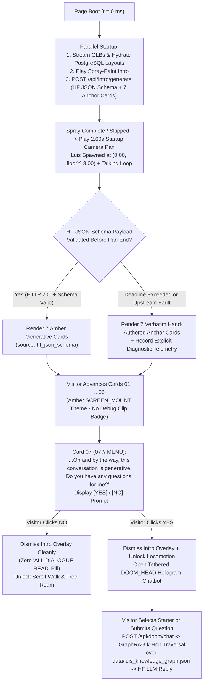

# Functional Specification 065: Final-Stage Production Curation — Seven Wall Screen Mounts, MathPod Copy, Amber Generative Welcome Sequence (`JSON Schema`), Unified GraphRAG Engine, and Production HUD Removal

## 1. System Purpose & Core Objective

This specification defines the desired `{functionality}`, spatial and typographic invariants, external HTTP and JSON Schema contracts, multi-hop GraphRAG retrieval requirements, operational and latency budgets, failure-isolation boundaries, and verifiable `{correct required outputs}` for the final production curation of Freeman Alley (`SkateAlley`) across both the local origin and the dedicated Server SSH Mac (`egg@10.0.0.62` exposed via Cloudflare HTTPS tunnel).

The scope unifies seven tightly coupled user-facing deliverables:

1. **Seven Curated Wall Screen Mounts** (updating Stations `01`–`06` and introducing a seventh Right-Wall station, `REJECTION STATION // MACHINE LEARNING`, positioned across from Station `03` with a full-length `"What the hell does this mean, Luis?"` narrative pane).
2. **Six Curated MathPod Hologram Descriptions** (`POD-01`, `POD-02`, `POD-03`, `POD-04`, `POD-05`, and `POD-07`).
3. **Seven-Card Amber-Themed, Screen-Size-Agnostic, Anchor-Constrained Generative Welcome Sequence** governed by a strict Hugging Face LLM JSON Schema contract, terminating at Card `07` with a **`Yes` / `No`** question prompt that launches the **`DOOM_HEAD` hologram chatbot popup** on `Yes` and cleanly unlocks the alley (with zero `"ALL DIALOGUE READ"` pill) on `No`.
4. **Unified Property-Graph Retrieval Engine (GraphRAG)** backed by an external, hot-reloadable biographical seed dataset (`data/luis_knowledge_graph.json`) powering both the post-intro `"Yes"` Q&A flow and all `DOOM_HEAD` conversations and conversation starters.
5. **Simplified Visitor-Facing `"Interact"` Prompt** (`Press E or Click to Inspect`).
6. **Complete Production Removal of the `"Freeman Alley Scrolly-Walk"` Side Panel** and all authoring/debug overlays, gizmos, and keyboard shortcuts.
7. **Deterministic Player Spawn, Startup Camera-Pan Execution, and Canonical Scene-Layout Parity** across local and Server SSH Mac deployments.

**DO NOT CODE YET.** This document specifies functional outcomes, mathematical and spatial invariants, external JSON Schema and HTTP API contracts, operational budgets, and acceptance criteria only. It contains zero implementation code, concrete programming syntax, or mechanical diffs.

---

## 2. Authoritative Domain Vocabulary Alignment ([`LANGUAGE.md`](file:///Users/diesel/desktop/skatealley/LANGUAGE.md))

All assessments of system state, design completeness, operational constraints, and verification gates strictly adopt the evaluation taxonomy established in [`LANGUAGE.md`](file:///Users/diesel/desktop/skatealley/LANGUAGE.md):

- **`{functionality}`**:
  1. Visitors entering Freeman Alley experience the spray-paint intro followed deterministically by the `2.60 s` startup camera pan toward Luis stationed at `(0.00, floorY, 3.00)`, transitioning seamlessly into a 7-card amber/orange holographic welcome sequence anchored to Luis's hand-authored biographical copy and synthesized via a JSON-Schema-constrained Hugging Face LLM call.
  2. Completing Card `07` presents an interactive `Yes` / `No` choice answering *"Do you have any questions for me?"*: choosing `Yes` opens the tethered `DOOM_HEAD` hologram chatbot powered by real multi-hop GraphRAG retrieval over Luis's biographical/technical knowledge graph; choosing `No` dismisses the dialogue overlay cleanly with zero post-intro status pill and unlocks corridor scrolling and free-roam exploration.
  3. Walking or scrolling down the corridor showcases all **7** curated wall screen mounts (including the new Right-Wall `REJECTION STATION // MACHINE LEARNING` across from Station `03` with its full recruitment story) and **6** updated MathPod holograms, with clean visitor-facing interaction prompts (`Press E or Click to Inspect`) and zero developer side-panel chrome (`Freeman Alley Scrolly-Walk`).
- **`{correctness}`**:
  - **Collision-Free 7th Wall Mount Geometry & Monotonic Scroll Mapping:** Because [`freeman_alley.glb`](file:///Users/diesel/desktop/skatealley/freeman_alley.glb) contains only six baked `SCREEN_MOUNT_01..06` locator nodes and the Right Wall at `Z = 12.87 m .. 15.32 m` (`Y = 0.96 m .. 3.34 m`) is occupied by `HOLO-COL-04` (`gun_tag`), the 7th wall mount is synthesized flush to the calibrated Right Wall brick profile at **`Z = 16.35 m, Y = 1.75 m`** (`outwardNormal = (-1, 0, 0)`, spanning `Z = 15.55 m .. 17.15 m`), achieving zero 3D polygon intersection while preserving strictly monotonic scroll-corridor progression (`5.00 m → 10.00 m → 15.00 m → 16.35 m → 20.00 m → 26.00 m → 32.00 m`).
  - **Dual-Tier Typography Fidelity (Zero Silent Clipping):** All 3D in-world textures remain crisp and legible within their physical pixel budgets, while the focused 2D holographic inspection window provides unbounded vertical scrollability so long-form copy (`935` characters on `REJECTION STATION // MACHINE LEARNING`) renders in full without overflow or truncation.
  - **Anchor-Locked Generative Intro Schema:** Every Hugging Face intro-generation response validates against a strict 7-card JSON Schema that preserves Luis's mandatory factual beats, proper nouns, and signature punchlines (*"Hi Eli!"*, *"Philosophy and Religion during the COVID era"*, *"e/acc, baby."*, *"DON’T BE A DICKHEAD, DEVON!"*, and Card `07`'s closing question) without hallucinating biographical claims.
  - **Real Property-Graph Retrieval (Zero Mock Retrieval Stubs):** GraphRAG executes genuine entity-alias and lexical seed scoring followed by bounded $k$-hop weighted breadth-first subgraph traversal over a schema-validated JSON property graph (`data/luis_knowledge_graph.json`), never reverting to hardcoded dummy strings or fake retrieval functions (`RULE[user_global]`).
- **`{correct required outputs}`**:
  1. Seven active wall screen mounts (`01 OF 07` through `07 OF 07`) rendered in-world and navigable via 7 station pips in the focused holographic modal, with `REJECTION STATION // MACHINE LEARNING` mounted on the Right Wall across from Station `03` and rendering both its technical summary and full `"What the hell does this mean, Luis?"` narrative block.
  2. Six active MathPod callouts (`POD-01`, `POD-02`, `POD-03`, `POD-04`, `POD-05`, `POD-07`) displaying the exact curated descriptions with `overflowDetected === false`.
  3. `POST /api/intro/generate` returning `HTTP 200 OK` with a JSON-Schema-valid 7-card payload (plus explicit `source` and `latencyMs` telemetry), rendered inside an amber-only, viewport-agnostic intro card devoid of both the `🎙 TALK_CONVERSATION_*` debug badge and the `"✓ ALL DIALOGUE READ"` pill, and presenting functional `Yes` / `No` buttons on Card `07`.
  4. `GET /api/graphrag/status`, `POST /api/graphrag/query`, `POST /api/doom/chat`, and `POST /api/doom/starters` returning `HTTP 200 OK` with multi-hop GraphRAG subgraph lineage telemetry (`datasetVersion`, `retrievedNodes`, `retrievedEdges`, `retrievalLatencyMs`) grounding `DOOM_HEAD` answers in `data/luis_knowledge_graph.json`.
  5. Production DOM and viewport completely free of the `"Freeman Alley Scrolly-Walk"` sidebar, Scene Cutter toolbar, and Director POV overlay, with symmetric `0.00 m` lateral camera framing on focused MathPod popups and `"Press E or Click to Inspect"` displayed on wall-mount hover/proximity.
- **`{errors}`**:
  - Crashing startup with a missing GLTF node assertion because `SCREEN_MOUNT_07` is absent from [`freeman_alley.glb`](file:///Users/diesel/desktop/skatealley/freeman_alley.glb).
  - Intersecting `HOLO-COL-04` (`gun_tag`, `Z = 12.87 m .. 15.32 m`) on the Right Wall or introducing a zero-delta `ΔZ = 0.00 m` stall segment into the scroll-walk spline.
  - Truncating or hiding `"What the hell does this mean, Luis?"` inside the focused station view, or overflowing fixed-height containers on small viewports.
  - Leaving cyan (`#00d5ff` / `#38bdf8`) borders, badges, or shadows on the intro dialogue cards, leaving the `"ALL DIALOGUE READ"` pill visible, or leaving the `🎙 TALK_CONVERSATION_*` debug clip label visible in production.
  - Implementing fake/mock GraphRAG functions that return static canned strings instead of executing real graph traversal over `data/luis_knowledge_graph.json`, or silently swallowing Hugging Face / GraphRAG failures without diagnostic telemetry (`RULE[user_global]`).
  - Leaving the `"Freeman Alley Scrolly-Walk"` side panel or unguarded scene-editing hotkeys (`B`, `X`, `C`, `K`, `F`, `H`, `T`, `Tab`) active in production.
- **`{sufficient}`**: Complete functional, spatial, typographic, schema, and operational specification enabling deterministic implementation and end-to-end live verification across `localhost:3002` and `egg@10.0.0.62` without guesswork.
- **`{insufficient}`**: Any specification that assumes `SCREEN_MOUNT_07` exists in [`freeman_alley.glb`](file:///Users/diesel/desktop/skatealley/freeman_alley.glb), ignores the `155`-character 3-line 3D wall canvas cap on `935`-character copy, leaves LLM intro generation unanchored from Luis's 7 hand-written cards, or substitutes mock stubs for GraphRAG traversal.

---

## 3. First-Principles Physical, Spatial & Latency Modeling (`RULE[user_global]`)

### 3.1 Spatial Audit of [`freeman_alley.glb`](file:///Users/diesel/desktop/skatealley/freeman_alley.glb) & Live Right-Wall Occupancy
1. **GLTF Locator Inventory:** Binary node inspection of [`freeman_alley.glb`](file:///Users/diesel/desktop/skatealley/freeman_alley.glb) confirms exactly **6** baked wall-mount empties:
   - `SCREEN_MOUNT_01`: Left Wall (`L`), `Z = 5.00 m`, `Y = 1.75 m`, `Normal = (+1, 0, 0)`
   - `SCREEN_MOUNT_02`: Right Wall (`R`), `Z = 10.00 m`, `Y = 1.75 m`, `Normal = (-1, 0, 0)`
   - `SCREEN_MOUNT_03`: Left Wall (`L`), `Z = 15.00 m`, `Y = 1.75 m`, `Normal = (+1, 0, 0)`
   - `SCREEN_MOUNT_04`: Right Wall (`R`), `Z = 20.00 m`, `Y = 1.75 m`, `Normal = (-1, 0, 0)`
   - `SCREEN_MOUNT_05`: Right Wall (`R`), `Z = 26.00 m`, `Y = 1.75 m`, `Normal = (-1, 0, 0)`
   - `SCREEN_MOUNT_06`: Right Wall (`R`), `Z = 32.00 m`, `Y = 1.75 m`, `Normal = (-1, 0, 0)`
2. **Right-Wall Clearance Math Across From `SCREEN_MOUNT_03` (`Z = 15.00 m`):**
   - Live PostgreSQL scene-layout telemetry (`GET /api/scene-layout`, `updatedAtMs: 1793479748065`) shows `HOLO-COL-04` (`gun_tag`) mounted on the Right Wall at `Z = 14.10 m, Y = 2.15 m` with physical dimensions `2.4503 m W × 2.3760 m H`, occupying **`Z ∈ [12.874 m, 15.324 m]`** and **`Y ∈ [0.962 m, 3.338 m]`**.
   - Every wall screen mount occupies `1.60 m W × 0.98 m H` (`±0.80 m` in `Z`, `Y ∈ [1.26 m, 2.24 m]` when centered at `Y = 1.75 m`).
   - Placing the 7th mount (`REJECTION STATION // MACHINE LEARNING`) on the Right Wall at **`Z = 16.35 m, Y = 1.75 m`** spans **`Z ∈ [15.55 m, 17.15 m]`**:
     - Clears `HOLO-COL-04` (`gun_tag`, ends `15.324 m`) by **`+0.226 m`**.
     - Clears `HOLO-COL-11` (`doomlambo_vid`, `Y ∈ [3.998 m, 9.341 m]`) vertically by **`+1.758 m`**.
     - Clears `HOLO-COL-08` (`soulja_tag`, `Z ∈ [19.189 m, 20.673 m]`, `Y ∈ [2.654 m, 4.094 m]`) and `SCREEN_MOUNT_04` (`Z ∈ [19.20 m, 20.80 m]`) by **`+2.05 m`**.
     - Sits visually directly across/diagonal from `SCREEN_MOUNT_03` (`Z = 15.00 m` Left Wall) while maintaining strictly increasing corridor `Z` knots (`15.00 m → 16.35 m → 20.00 m`).

### 3.2 Typography & Pixel-Area Audit Across 3D Canvases and 2D Overlays

| Target Surface | Physical Pixel Grid & Font Measure | Character Capacity | Curated Copy Length | Physical Fit & Required Architectural Behavior |
| :--- | :--- | :---: | :---: | :--- |
| **MathPod 3D Callouts (`POD-01..05, 07`)** | `1024×512` canvas, `952 px` body width, `18 px` sans-serif, `3` lines | `~175 chars` | **`136–154 chars`** | **100% Native Fit** inside 3 lines with zero truncation (`overflow === false`). |
| **Wall Mounts `01`–`05` (3D & 2D)** | `1280×720` 3D canvas (`640 px` left column, `19.5 px` font) + 2D modal | `~155 chars` (3 lines) | **`88–148 chars`** | **100% Native Fit** inside 3 lines on both 3D wall canvas and 2D modal. |
| **Wall Mount `06` (`MULTI-MODAL DL`)** | `1280×720` 3D canvas (`640 px` left column) + 2D modal | `~255 chars` (5 lines) | **`244 chars`** | Expand 3D wall canvas body wrap allowance up to **5 lines** (adjusting tag-chip vertical offset dynamically) so all `244 chars` fit verbatim in-world and in 2D. |
| **Wall Mount `07` (`REJECTION STATION`)** | `1280×720` 3D canvas + focused 2D modal | `~255 chars` on 3D placard; unbounded scroll in 2D modal | **`407 chars` (tech) + `528 chars` (story) = `935 chars`** | Render a crisp 4-line technical summary + amber `[INSPECT — READ "WHAT THE HELL DOES THIS MEAN, LUIS?"]` cue on the 3D brick-wall placard, and render **100% of both the `407`-char description and `528`-char narrative** inside a vertically scrollable 2D focused stage. |
| **Welcome Intro Cards (`01`–`07`)** | Fluid 2D amber holographic overlay across `320×568` to `3840×2160` | Up to `420 chars` per card | **`84–378 chars`** | Fluid `clamp()` typography, `max-width: min(620px, calc(100vw - 24px))`, `max-height: min(72dvh, 460px)` with internal body scroll on ultra-short landscape viewports (`≤ 380 px` height). |

### 3.3 Network Latency & Compute Complexity Modeling
1. **Hugging Face LLM Inference Throughput:**
   - Live empirical benchmark against `POST /api/doom/chat` (`Qwen/Qwen3.8-27B` via Hugging Face Router) measured **`344.7 ms`** end-to-end for `53` prompt tokens and `44` completion tokens (`~81 tokens/s`).
   - Generating a structured 7-card JSON Schema payload (`~550–750` output tokens) requires **`2.8 s – 6.2 s`** on a warm router and up to **`10.0 s`** under cold-router spikes.
   - **Pre-Fetch Absorption Window:** Initial `.glb` streaming + the procedural spray-paint intro + the `2.60 s` startup camera pan provides a **`6.0 s – 8.5 s`** window prior to Card `01` display. Initiating `POST /api/intro/generate` asynchronously at `t = 0 ms` (page boot) hides warm LLM generation latency completely. If a visitor clicks `SKIP INTRO` early (at `t < 3.0 s`) or if the upstream router exceeds a strict pre-dialogue deadline, the system fails over deterministically to the 7 hand-authored anchor cards with explicit telemetry (`introSource: "canonical_anchor_deadline"` or `"canonical_anchor_error"`).
2. **In-Memory Property-Graph Retrieval (GraphRAG) Complexity:**
   - For a personal/portfolio knowledge graph of scale $|V| \le 2,500$ nodes and $|E| \le 10,000$ directed edges (`data/luis_knowledge_graph.json` payload size `< 1.5 MB`), tokenized inverted-index + alias lookup + $k$-hop ($k \le 3$) weighted breadth-first traversal runs in $O(|Q| + |V| + |E|)$ time, completing in **`< 3.0 ms`** per query in pure Python standard library with zero external vector-database roundtrips.
   - Serializing the top-$M$ ranked subgraph nodes and lineage triples (`M ≤ 14` nodes, `≤ 24` edges, capped at `≤ 1,400` prompt tokens) adds `< 25 ms` of upstream prompt prefill latency to `Qwen/Qwen3.8-27B`, keeping total GraphRAG + LLM chat turnaround inside **`0.6 s – 2.8 s`**.

---

## 4. End-to-End System Workflow



---

## 5. Detailed Functional Requirements

### 5.1 Pillar 1: Seven Curated Wall Screen Mounts & Virtual Right-Wall Station

1. **Corridor Ordering, Spatial Coordinates & Monotonic Scroll Windows:**
   The corridor SHALL present **7** holographic project stations in strictly increasing `Z` order from entrance (`Z = 3.00 m`) to back-alley terminal (`Z = 37.80 m`), updating station badges to `01 OF 07` .. `07 OF 07` and rendering 7 interactive station navigation pips:

   | Corridor Order & Code | Locator Identifier & Source | Wall & World Pose (`Y = 1.75 m`) | Scroll Progress Window | Kicker & Primary Title |
   | :---: | :--- | :--- | :---: | :--- |
   | **`01`** | `SCREEN_MOUNT_01` (GLTF) | Left (`L`), `Z = 5.00 m`, `Normal = +X` | `0.05 – 0.16` | **Title:** `GRAPHRAG POLICY ENGINE` |
   | **`02`** | `SCREEN_MOUNT_02` (GLTF) | Right (`R`), `Z = 10.00 m`, `Normal = -X` | `0.19 – 0.30` | **Title:** `DIGITAL TWIN PERSONA` |
   | **`03`** | `SCREEN_MOUNT_03` (GLTF) | Left (`L`), `Z = 15.00 m`, `Normal = +X` | `0.33 – 0.44` | **Title:** `QUANTITATIVE MODELING AND STATISTICAL ARBITRAGE` |
   | **`04` (Rejection Station)** | `SCREEN_MOUNT_07` (Procedural Right-Wall Locator) | Right (`R`), **`Z = 16.35 m`**, `Normal = -X` *(across from `SCREEN_MOUNT_03`)* | `0.46 – 0.56` | **Kicker / Title:** `REJECTION STATION // MACHINE LEARNING` |
   | **`05` (Station 04)** | `SCREEN_MOUNT_04` (GLTF) | Right (`R`), `Z = 20.00 m`, `Normal = -X` | `0.59 – 0.70` | **Kicker / Title:** `STATION 04 // AI DATA ANALYTICS DASHBOARDS AND ALIGNMENT RESEARCH` |
   | **`06` (Station 05)** | `SCREEN_MOUNT_05` (GLTF) | Right (`R`), `Z = 26.00 m`, `Normal = -X` | `0.73 – 0.84` | **Kicker / Title:** `STATION 05 // GENERATIVE PIPELINES` |
   | **`07` (Station 06)** | `SCREEN_MOUNT_06` (GLTF) | Right (`R`), `Z = 32.00 m`, `Normal = -X` | `0.86 – 0.96` | **Kicker / Title:** `STATION 06 // MULTI-MODAL DEEP LEARNING` |

2. **Authoritative Station Copy Requirements:**
   - **Screen Mount 1 (`SCREEN_MOUNT_01`):**
     - **Title:** `GRAPHRAG POLICY ENGINE`
     - **Description:** `GRAPHRAG LLM for Lymphemeda Treatment Act Medicare Qualifications. Made as a tool for a friend working at a Durable Medical Goods company. Hi Eli!`
   - **Screen Mount 2 (`SCREEN_MOUNT_02`):**
     - **Title:** `DIGITAL TWIN PERSONA`
     - **Description (unchanged):** `Digital persona finetuned on philosophy and MF DOOM, with Twitter and LinkedIn accounts.`
   - **Screen Mount 3 (`SCREEN_MOUNT_03`):**
     - **Title:** `QUANTITATIVE MODELING AND STATISTICAL ARBITRAGE`
     - **Description:** `Bayesian state space model of mean reverting, cointegrated financial assets. The model passed a $50,000 TopStepXFA application. See video for details.`
   - **Rejection Station (`SCREEN_MOUNT_07`, Right Wall at `Z = 16.35 m` across from `SCREEN_MOUNT_03`):**
     - **Header / Title:** `REJECTION STATION // MACHINE LEARNING`
     - **Primary Technical Description:** `Applying feature engineering and high-dimensional embeddings to train models for classification, regression, clustering, and anomaly detection. Built and deployed a Hugging Face resume classifier that extracts 1,024-dimensional feature vectors from a frozen bge-large-en-v1.5 backbone and dynamically swaps lightweight Linear SVM heads (LinearSVC) to evaluate candidates across 9 distinct job roles.`
     - **Secondary Narrative Callout Block:**
       - **Heading:** `What the hell does this mean, Luis?`
       - **Body:** `I cold emailed the CEO of a data analytics company asking for a job and was redirected to their talent acquisition team. The talent acquisition team rejected my application within minutes, so I built a resume scanner using classical machine learning, and sent it back to them within the hour. I found one of the people in charge of talent acquisition through LinkedIn, and they were a film major from NYU. Talent Acquisition is very likely hiding really good engineers from you. MAKE IT MAKE SENSE!`
   - **Screen Mount 4 (`SCREEN_MOUNT_04`):**
     - **Kicker / Title:** `STATION 04 // AI DATA ANALYTICS DASHBOARDS AND ALIGNMENT RESEARCH`
     - **Description:** `Turning structured/unstructured datasets into live analytics and structured context to guide, coordinate, and align autonomous agent swarms.`
   - **Screen Mount 5 (`SCREEN_MOUNT_05`):**
     - **Kicker / Title:** `STATION 05 // GENERATIVE PIPELINES`
     - **Description:** `Feeding extracted data and context into chained AI models to automate content production, code generation, and workflow execution.`
   - **Screen Mount 6 (`SCREEN_MOUNT_06`):**
     - **Kicker / Title:** `STATION 06 // MULTI-MODAL DEEP LEARNING`
     - **Description:** `Working with diverse open-source deep learning models (Transformers, CNNs, Autoencoders, and Diffusion) for tasks ranging from anomaly detection and unstructured data mining to computer vision, audio cloning, and 3D synthesis.`

3. **3D Wall Canvas & 2D Focused Stage Rendering Contract:**
   - On the `1280×720` in-world 3D holographic canvas, description wrapping SHALL accommodate up to **5 lines** (dynamically positioning technology tags below the final wrapped description line) so `STATION 06` renders in full without ellipsis, while `REJECTION STATION // MACHINE LEARNING` renders a clean 4-line summary (`bge-large-en-v1.5` 1,024-D embeddings + 9 `LinearSVC` role heads) accompanied by a high-contrast amber inspection prompt (`[PRESS E OR CLICK — READ "WHAT THE HELL DOES THIS MEAN, LUIS?"]`).
   - Inside the 2D focused holographic stage (`#holo-popup-window`), the primary data column SHALL support smooth vertical scrolling (`overflow-y: auto` with styled amber scrollbar and touch momentum scrolling) and SHALL conditionally render an amber-bordered narrative callout card whenever a station defines a secondary narrative block (displaying **`What the hell does this mean, Luis?`** and its full story verbatim on `REJECTION STATION // MACHINE LEARNING`, and hiding the narrative container cleanly on stations without one).
   - Existing CTA links on Stations `01`–`03` remain active; Stations `04`–`06` and `REJECTION STATION` preserve clean telemetry metrics and hide or omit placeholder spec links where external project URLs are not yet assigned.

---

### 5.2 Pillar 2: Six Curated MathPod Hologram Descriptions

The six active corridor MathPod callouts (`POD-01`, `POD-02`, `POD-03`, `POD-04`, `POD-05`, and `POD-07`) SHALL display the following exact body descriptions while preserving their live 3D procedural animations and real-time 4-cell telemetry grids:

1. **`POD-01` (`POD-01 // GRAPH-THEORY` — `3D GRAPH THEORY HOLOGRAM`):**
   `Modeling relational data as nodes and edges to analyze network topology, find shortest paths, and measure connectivity across complex systems.`
2. **`POD-02` (`POD-02 // MATRIX-RANK` — `MATRIX RANK SOLVER HOLOGRAM`):**
   `Performing Gaussian elimination and row reduction to identify linearly independent features, determine matrix rank, and solve linear systems.`
3. **`POD-03` (`POD-03 // GRADIENT-DESCENT` — `GRADIENT DESCENT HOLOGRAM`):**
   `Visualizing how SGD, Momentum, and Adam optimizers navigate non-convex loss landscapes and escape saddle points to minimize model error.`
4. **`POD-04` (`POD-04 // NEURAL-NETWORK` — `NEURAL NETWORK HOLOGRAM`):**
   `Forward propagation through a multi-layer perceptron, applying linear weights and non-linear activations to map input features to class probabilities.`
5. **`POD-05` (`POD-05 // CLUSTERING` — `CLUSTERING ALGORITHM HOLOGRAM`):**
   `Unsupervised learning via K-Means and Gaussian Mixture Models to partition unlabeled data into distinct groups based on feature similarity.`
6. **`POD-07` (`POD-07 // POKER-GAME-THEORY` — `POKER / GAME THEORY HOLOGRAM`):**
   `Imperfect-information game solving using Counterfactual Regret Minimization (CFR) to compute Nash equilibrium strategies and maximize expected value (EV).`

---

### 5.3 Pillar 3: Seven-Card Amber-Themed, Screen-Size-Agnostic, Anchor-Constrained Generative Welcome Sequence

1. **Authoritative Seven Anchor Cards:**
   The canonical 7-card welcome sequence—used both as the immutable factual/voice anchor template handed to the Hugging Face LLM generator and as the deterministic zero-latency fallback deck—SHALL consist of:

   | Card Index & ID | Header Title | Authoritative Anchor Copy | Mandatory Anchor Beats Preserved Under Generation |
   | :---: | :--- | :--- | :--- |
   | **`1` (`card_01`)** | `01 // WELCOME` | `Welcome to my portfolio! My name’s Luis, I’m 26 and I build software that feels like magic.` | Name (`Luis`), age (`26`), builds software that feels like magic. |
   | **`2` (`card_02`)** | `02 // ABOUT ME` | `My free time is split between hiking, swimming, eating good food and building. I studied corporate finance and accounting in college, but changed my major to Philosophy and Religion during the COVID era. I speedran AI psychosis with GPT3.5 back in 2022, and have been accelerating ever since. e/acc, baby.` | Hiking/swimming/good food/building; corporate finance & accounting → Philosophy and Religion during COVID; GPT-3.5 in 2022; `e/acc, baby.` |
   | **`3` (`card_03`)** | `03 // PROJECTS & ARCHITECTURE` | `Down this alley you will find some of my work on display, alongside descriptions of where I excel in the technical stack.` | Work on display down the alley + technical stack strengths. |
   | **`4` (`card_04`)** | `04 // EXPLORE THE ALLEY` | `Recently, a “reverse engineer anything” repo popped up on Github that led me and a bunch of other nerds to reverse-engineer— well— everything. From toilet sensors and smartTVs, to video games and critical infrastructure.` | GitHub "reverse engineer anything" repo; toilet sensors, smart TVs, video games, critical infrastructure. |
   | **`5` (`card_05`)** | `05 // GAMES` | `Let’s steer clear of reverse engineering critical infrastructure for now, and stick to games. Down the alleyway, you’ll find some decompiled games you can play, as well as a generative pipeline I created to put yourself in-game!` | Steer clear of critical infrastructure; decompiled playable games down the alley + generative pipeline to put yourself in-game. |
   | **`6` (`card_06`)** | `06 // GENERATIVE PIPELINE` | `You can skate, commit grand theft auto, fight in Super Smash Bros, kill zombies, or just join me in the alleyway.` | Skate, Grand Theft Auto, Super Smash Bros, kill zombies, or join Luis in the alleyway. |
   | **`7` (`card_07`)** | `07 // MENU` | `You can use the menu to leave a message in the alleyway for myself and others to see. Job recruiters will be visiting the alleyway so TREAD LIGHTLY. I MEAN IT. DON’T BE A DICKHEAD, DEVON! You can also check out my GitHub, send me an email, or follow me on Twitter.`<br/><br/>`Oh and by the way, this conversation is generative. Do you have any questions for me?` | Menu to leave a message in the alleyway; job recruiters warning + `DON’T BE A DICKHEAD, DEVON!`; GitHub/email/Twitter; closing generative disclosure + question `"Do you have any questions for me?"` |

   *(Note: Any stale 3-card `intro_dialogue_boxes` entry previously cached in browser `localStorage` or `skatealley_scene_layouts` MUST be invalidated/superseded by a versioned storage key `v2` so returning browsers never display the legacy 3-card placeholder text.)*

2. **Authoritative Hugging Face Intro-Generation JSON Schema Contract (`POST /api/intro/generate`):**
   - The server endpoint `POST /api/intro/generate` SHALL pass the 7 authoritative anchor cards, a compact biographical context summary from `data/luis_knowledge_graph.json`, and the following **JSON Schema (`https://json-schema.org/draft/2020-12/schema`)** to the Hugging Face chat-completions router (`response_format: { "type": "json_schema", ... }` with server-side schema enforcement and deterministic validation):

   ```json
   {
     "$schema": "https://json-schema.org/draft/2020-12/schema",
     "title": "FreemanAlleyGenerativeIntroDeck",
     "type": "object",
     "additionalProperties": false,
     "required": ["schema_version", "cards"],
     "properties": {
       "schema_version": {
         "type": "string",
         "const": "1.0"
       },
       "cards": {
         "type": "array",
         "minItems": 7,
         "maxItems": 7,
         "items": {
           "type": "object",
           "additionalProperties": false,
           "required": [
             "index",
             "id",
             "header",
             "body",
             "requires_question_prompt"
           ],
           "properties": {
             "index": {
               "type": "integer",
               "minimum": 1,
               "maximum": 7
             },
             "id": {
               "type": "string",
               "enum": [
                 "card_01",
                 "card_02",
                 "card_03",
                 "card_04",
                 "card_05",
                 "card_06",
                 "card_07"
               ]
             },
             "header": {
               "type": "string",
               "enum": [
                 "01 // WELCOME",
                 "02 // ABOUT ME",
                 "03 // PROJECTS & ARCHITECTURE",
                 "04 // EXPLORE THE ALLEY",
                 "05 // GAMES",
                 "06 // GENERATIVE PIPELINE",
                 "07 // MENU"
               ]
             },
             "body": {
               "type": "string",
               "minLength": 45,
               "maxLength": 440
             },
             "requires_question_prompt": {
               "type": "boolean"
             }
           }
         }
       }
     }
   }
   ```

   - **Server-Side Post-Generation Validation Invariants:** Before returning `HTTP 200 OK`, the server MUST verify that:
     1. Exactly 7 cards are present in monotonic index order `1..7` with matching `id` and `header` enums.
     2. `requires_question_prompt` is `false` for Cards `1..6` and `true` for Card `7`.
     3. Card `7`'s `body` preserves the recruiter/Devon warning (`DEVON`) and concludes with a direct question inviting visitor Q&A (`?`).
     4. If the upstream LLM returns malformed JSON or violates any schema invariant, the endpoint returns a structured `HTTP 502` diagnostic error (`SCHEMA_VALIDATION_FAILED`) rather than silently emitting corrupted dialogue cards.

3. **Amber `SCREEN_MOUNT` Visual Theme & Chrome Cleanup:**
   - **Amber/Orange Hues Exclusively:** Every visual element of `#intro-dialogue-card`—outer smoked-glass background (`rgba(20, 9, 2, 0.90)`), glowing wireframe border (`#f59e0b` / `#fbbf24`), corner brackets, top/bottom light-bar accents, `DIALOGUE X / 7` counter pill, header title, body typography (`#fef3c7` / `#fffbeb`), progress pips, and action buttons—SHALL use the exact amber/orange palette of the `SCREEN_MOUNT` holograms. Zero cyan, blue, or emerald accents may appear anywhere in `#intro-dialogue-overlay`.
   - **Remove Animation Debug Badge:** `#intro-dialogue-clip-badge` (`🎙 TALK_CONVERSATION_06 (1/4)`) SHALL be hidden/removed from production UI.
   - **Remove Post-Intro Unlocked Pill:** `#intro-scroll-unlocked-pill` (`"✓ ALL DIALOGUE READ • SCROLL DOWN TO WALK INTO ALLEY ↓"`) SHALL be permanently removed so that once the intro concludes, `#intro-dialogue-overlay` hides completely (`display: none`) leaving an unobstructed 3D viewport.

4. **Screen-Size-Agnostic Responsive Envelope:**
   - `#intro-dialogue-overlay` and `#intro-dialogue-card` SHALL adapt smoothly across all viewport dimensions (`320 px` narrow mobile portrait, `568×320` short mobile landscape, tablets, laptops, and `4K` displays) using safe-area insets (`env(safe-area-inset-bottom)`), fluid width (`min(600px, calc(100vw - 24px))`), fluid `clamp()` font sizing, bounded card height (`max-height: min(68dvh, 420px)`), and internal scrollable body text if a short landscape viewport constrains vertical space, ensuring the footer buttons (`Continue` or `Yes` / `No`) are 100% reachable without clipping or overlap with mobile touch controls.

5. **Final Card (`07 // MENU`) `Yes` / `No` Question Prompt & `DOOM_HEAD` Handoff:**
   - On Cards `1..6`, clicking the card, clicking `Continue (X/7) →`, or pressing `Space` / `Enter` advances to the next card.
   - On **Card `7` (`07 // MENU`)**, whole-card tap-to-dismiss is disabled so the visitor explicitly chooses between two high-contrast amber holographic action buttons in the card footer/prompt bar:
     - **`Yes — Ask a Question` (`Yes`)**:
       1. Immediately completes and hides `#intro-dialogue-overlay` (`scrollLocked = false`, `phase = 'ready-to-scroll'`).
       2. Invokes `DOOM_HEAD` dialogue mode (`#doom-holo-chat-overlay`), framing Luis and `DOOM_Companion` at spawn with the live amber SVG tether, pre-loading GraphRAG-grounded conversation starters and focusing the chat input so the visitor can ask any question immediately.
     - **`No — Explore the Alley` (`No`)**:
       1. Immediately completes and hides `#intro-dialogue-overlay` (`scrollLocked = false`, `phase = 'ready-to-scroll'`) with zero post-intro pill.
       2. Leaves the camera at the settled Pan-End pose ready for immediate scroll-walk or WASD/touch free-roam exploration.

---

### 5.4 Pillar 4: Unified Property-Graph Retrieval Engine (GraphRAG) & Seed Dataset (`data/luis_knowledge_graph.json`)

1. **External Hot-Reloadable Knowledge Graph Dataset (`data/luis_knowledge_graph.json`):**
   - A structured property-graph JSON file at `data/luis_knowledge_graph.json` (`dataset_version: "0.1.0-seed"`) SHALL store typed nodes and typed directed edges representing Luis's verified biography, projects, technical stack, mathematical domains, and reverse-engineered game ports.
   - The server SHALL watch the file's modification timestamp (`mtime`) and automatically reload and re-index the graph in memory whenever `data/luis_knowledge_graph.json` is edited on disk, allowing Luis to expand his skills and experience dataset later with zero code changes or server restarts.
   - **Authoritative Seed Graph Schema (`data/luis_knowledge_graph.json`):**
     - **Node Categories (`type`):** `Person`, `Education`, `Skill`, `Technology`, `ModelArchitecture`, `ProjectStation`, `MathPod`, `GamePort`, `Pipeline`, `Story`, `ContactChannel`.
     - **Node Fields:** `id` (unique slug), `type`, `label`, `aliases` (array of lowercase search synonyms/acronyms), `summary` (concise factual statement), `attributes` (key-value metadata such as dimensions, metrics, URLs, year), and `priority` (`0.1 .. 1.0`).
     - **Directed Edge Fields:** `source` (node `id`), `target` (node `id`), `relation` (e.g., `BUILT`, `USES_MODEL`, `APPLIES_MATH`, `STUDIED`, `DEPLOYED_ON`, `MOTIVATED_BY`, `PORTED_GAME`, `FEATURES_PIPELINE`), `weight` (`0.1 .. 1.0`), and `evidence` (1-sentence relationship context).
     - **Initial `0.1.0-seed` Population:** Must encode 100% real, verified entities and relationships extracted from the 7 Screen Mounts (including the Lymphemeda/Eli GraphRAG Policy Engine, Digital Twin Persona, Bayesian SSM `$50,000 TopStepXFA`, AI Data Analytics & Agent Swarms, Generative Pipelines, Multi-Modal Deep Learning, and the `bge-large-en-v1.5` + `LinearSVC` Rejection Station story), the 6 MathPods (`POD-01..05, 07`), the 7 Intro Cards (age 26, Finance/Accounting → Philosophy & Religion during COVID, 2022 GPT-3.5 `e/acc`, reverse-engineering repo, 5 playable games, 3D avatar generative pipeline), and Freeman Alley's own architecture.

2. **Real Multi-Hop GraphRAG Retrieval Algorithm (`RULE[user_global]`):**
   For every incoming visitor query (in `POST /api/doom/chat`, `POST /api/doom/starters`, and `POST /api/graphrag/query`):
   1. **Seed Entity Resolution:** Tokenize the visitor's latest message (and recent 2-turn conversation window), compute exact/substring alias matches plus IDF-weighted lexical overlap against all node `label`, `aliases`, `summary`, and `attributes` fields, and select the top $S$ seed nodes ($S \le 5$). If a broad/greeting query yields zero high-confidence lexical seeds, anchor on the root `Person:luis` hub and top-priority `ProjectStation` / `Skill` neighbors.
   2. **Bounded $k$-Hop Weighted Subgraph Expansion:** Execute breadth-first traversal outward from the seed set up to depth $k = 2$ hops (configurable $k \in [1, 3]$) across both outgoing and incoming edges, propagating path relevance score $R(v) = R(u) \cdot w(e) \cdot \gamma^{d}$ (decay $\gamma = 0.72$) and retaining the top $M \le 14$ nodes and $E_{\max} \le 24$ highest-scoring connecting lineage edges.
   3. **Structured Context Serialization & Grounded System Prompting:** Serialize the retrieved subgraph as deterministic `[ENTITY]` and `[LINEAGE_PATH]` blocks (capped at $\le 1,400$ tokens) injected into the system prompt of `DOOM_HEAD`, instructing the model to ground all factual claims about Luis's background, skills, projects, and tech stack strictly in the retrieved GraphRAG subgraph while maintaining its signature `DOOM_HEAD` persona.
   4. **Telemetry & Inspection API:**
      - `POST /api/doom/chat` and `POST /api/doom/starters` SHALL include a `graphrag` metadata object in their `HTTP 200` JSON responses (`datasetVersion`, `seedNodeIds`, `retrievedNodeCount`, `retrievedEdgeCount`, `hops`, `retrievalLatencyMs`).
      - `GET /api/graphrag/status` SHALL return graph health (`ready: true`, `datasetVersion`, `nodeCount`, `edgeCount`, `categories`, `lastLoadedAtMs`).
      - `POST /api/graphrag/query` (`{ "query": "...", "maxHops": 2 }`) SHALL return the exact retrieved subgraph nodes, edges, lineage text, and latency in milliseconds for deterministic verification.

---

### 5.5 Pillar 5: Visitor-Facing `"Interact"` Prompt Refinement

Whenever the player is in Free-Roam Mode (`sandbox.mode === 'freeroam'`) and either approaches within proximity interaction range ($\le 3.5\text{ m}$ horizontal distance) of a mounted wall screen or hovers the pointer over a mounted wall screen, the bottom-right amber interaction pill (`#mount-proximity-prompt`) SHALL display the `[E]` keycap icon followed strictly by:

**`Press E or Click to Inspect`**

Internal locator identifiers (`SCREEN_MOUNT_0X`), station debug titles, and live meter-distance readouts (`(2.1m)`) SHALL NOT appear in the visitor prompt.

---

### 5.6 Pillar 6: Complete Production Removal of `"Freeman Alley Scrolly-Walk"` Side Panel & Authoring Chrome

In standard production execution (whenever no explicit developer authoring query flag such as `?dev=1` is present in the URL):

1. **DOM Chrome Suppression:**
   - The `"Freeman Alley Scrolly-Walk"` control sidebar (`#sandbox-hud`), the Straight-Line Scene Cutter viewport overlay (`#scene-cutter-overlay`), and the First-Person Camera POV Director overlay (`#director-pov-overlay`) SHALL NOT render or occupy layout/pointer space in production (`display: none`, `aria-hidden="true"`, zero pointer interception).
   - 3D director gizmos (`directorRootGroup`, `TransformControls`, column/pod drag handles) SHALL remain detached and invisible.
2. **Symmetric Full-Viewport Camera Framing:**
   - Focusing any MathPod callout popup SHALL use `0.00 m` lateral HUD-clearance offset (eliminating the legacy `0.18 m` rightward shift that previously compensated for the `320 px` left sidebar) so focused popups center symmetrically in the viewport.
3. **Production Keyboard Shortcut Hardening:**
   - Scene-editing and debug hotkeys—specifically Sidebar Toggle (`B`), Scene Cutter (`X`), Camera POV (`C`), Director 3D Handles (`K`), No-Clip Fly Mode (`F`), Character Shader Test (`H`), Forced Dialogue Loop (`T`), Pan Keyframe Capture (`[` / `]`), and Character Swap (`Tab`)—SHALL be disabled in production so accidental keypresses by visitors or recruiters cannot open debug tools, swap out Luis's avatar, or break corridor framing.
   - Visitor navigation and interaction keys (`W/A/S/D`, `Arrow` keys, `Space`, `E`, `Q` radial menu, `M` audio mute, `Escape` exit focus/modal, and `1..9` inside active game-selector modals) remain fully active.

---

### 5.7 Pillar 7: Deterministic Player Spawn, Initial Camera-Pan Sequence & Scene-Layout Parity

1. **Authoritative Player Spawn & Startup Camera Pan:**
   - Player Spawn defaults strictly to **`(0.00, floorY, 3.00)`** facing down-alley (`yaw = 0.00 rad`), using Luis's primary hoodie character (`character_hoodie.glb`) accompanied by `DOOM_Companion`.
   - Immediately upon completion (or visitor `SKIP INTRO`) of `#spray-paint-loader-overlay` at `scrollProgress <= 0.01`, the Startup Camera Pan SHALL always execute along its `2.60 s` eased trajectory from **`startPos = (0.00, 2.40, -1.50)`** (`startLookAt = (0.00, 1.40, 3.00)`) to **`endPos = (0.36, 1.50, 1.55)`** (`endLookAt = (0.00, 1.45, 3.00)`), locking scroll input during flight and handing off deterministically upon completion to Card `01` (`01 // WELCOME`) of the 7-card amber dialogue sequence while Luis performs his ordered talking animation cycle.
2. **Canonical Scene-Layout Parity Across Localhost & Server SSH Mac (`egg@10.0.0.62`):**
   - The live PostgreSQL-persisted `holo_columns` and `math_pods` placements (`updatedAtMs: 1793479748065`) SHALL be baked into the repository's default catalog tables as well as synchronized to `egg@10.0.0.62`, guaranteeing identical 3D placement even on cold static loads before `/api/scene-layout` resolves.

---

## 6. Operational & Performance Budgets

| Subsystem / Operation | Mandatory Operational Budget | Measurement & Enforcement Boundary |
| :--- | :---: | :--- |
| **GraphRAG Subgraph Query (`k = 2` hops over `≤ 2,500` nodes)** | **`< 5.0 ms` p95** (`< 15.0 ms` p99) | Server-side wall-clock timer reported in `graphrag.retrievalLatencyMs` |
| **Generative 7-Card Intro Pre-Fetch (`POST /api/intro/generate`)** | Dispatched at `t = 0 ms`; **bounded pre-card wait `≤ 1.2 s`** after camera pan settles (`8.0 s` hard upstream timeout) | Parallel execution during spray intro + `2.60 s` pan; deterministic anchor-deck failover on timeout |
| **`DOOM_HEAD` GraphRAG Chat Turn (`POST /api/doom/chat`)** | **`< 3.5 s` p95** warm (`12.0 s` hard upstream timeout) | End-to-end GraphRAG retrieval + HF router completion reported in `latencyMs` |
| **3D Scene Steady-State Frame Rate (7 Wall Mounts + 6 MathPods)** | **`60 FPS` target** (`≥ 50 FPS` floor on desktop WebGL2; `0` per-frame canvas re-rasterizations when station state is static) | Canvas textures rasterize once on station build/mutation via signature caching |
| **Responsive Viewport Compatibility Envelope** | **`320×568` to `3840×2160`** with **`0 px`** horizontal overflow and **`100%`** button reachability | Verified across mobile portrait, mobile landscape, tablet, and desktop viewports |
| **PostgreSQL + HTTP Health Parity (`localhost:3002` & `egg@10.0.0.62`)** | **`HTTP 200 OK`** across `/api/health`, `/api/graphrag/status`, `/api/scene-layout`, `/api/stickers` in **`< 120 ms`** LAN | Live telemetry verification against both local daemon and Cloudflare HTTPS tunnel |

---

## 7. Edge Cases, Failure Modes & Deterministic Recovery Boundaries

1. **Visitor Skips Spray-Paint Intro Before Hugging Face Finishes Generating Cards:**
   - *Scenario:* Visitor clicks `SKIP INTRO` at `t = 0.8 s`, finishes the `2.60 s` camera pan at `t = 3.4 s`, while `POST /api/intro/generate` is still in flight (`t = 4.5 s`).
   - *Required Behavior:* At pan completion (`t = 3.4 s`), if the in-flight request does not resolve within a strict `600 ms` grace window, Card `01` renders immediately using the canonical anchor Card `01` (`01 // WELCOME` — which already matches Luis's anchor beat). If the schema-validated HF deck resolves while the visitor is still on Card `01`, Cards `02..07` seamlessly adopt the validated generative cards; if not, the full 7-card anchor deck continues deterministically with `introSource` recorded in telemetry. Card text currently being read by the visitor MUST NEVER mutate mid-read.
2. **Hugging Face Router Unavailable, Rate-Limited (`HTTP 429/502/503`), or Static GitHub Pages Offline Mode:**
   - *Scenario:* `HF_TOKEN` is unreachable, upstream router returns `5xx`, or visitor opens a purely static mirror with tunnel offline.
   - *Required Behavior:*
     - For the **Welcome Intro**: `POST /api/intro/generate` fails fast with an explicit error code (`UPSTREAM_HF_ERROR` / `NETWORK_UNREACHABLE`); the client logs diagnostic telemetry (`sandbox.introGenerationTelemetry`) and renders the 7 hand-authored anchor cards immediately so the welcome sequence never hangs or displays an empty card (`RULE[user_global]`).
     - For **`DOOM_HEAD` Chat**: `POST /api/doom/chat` surfaces the explicit diagnostic fault inside `#doom-holo-status-pill` and as a `HOLO.SYS // DIAGNOSTIC FAULT` message bubble—never swallowing the error or fabricating fake assistant replies.
3. **Malformed or Missing `data/luis_knowledge_graph.json`:**
   - *Scenario:* A manual JSON edit introduces a syntax error or dangling edge reference (`target` node ID missing) in `data/luis_knowledge_graph.json`.
   - *Required Behavior:* The GraphRAG loader validates JSON syntax, required node fields, and referential edge integrity on load/reload. If an edit on disk fails validation, `/api/graphrag/status` and `/api/health` immediately surface `graphrag_ready: false` with the exact line/node diagnostic error (`HTTP 503` on `/api/graphrag/query`) instead of silently serving partial or corrupted graph state.
4. **Stale Browser `localStorage` Containing Legacy 3-Card Intro or Old Spawn Override:**
   - *Scenario:* A returning visitor or developer browser has `skatealley_intro_dialogue_boxes_v1` (3 cyan-era cards) in `localStorage`.
   - *Required Behavior:* Migrating intro storage to a `v2` schema key and ignoring any cached deck whose length is `< 7` guarantees all returning browsers immediately upgrade to the 7-card amber sequence.
5. **Short Mobile Landscape Viewport (`e.g., 667×375` or `568×320`) on Card `02` / Card `07`:**
   - *Scenario:* Card `07` contains two paragraphs (`378` characters) plus the `Yes` / `No` button bar on a `320 px`-tall phone screen.
   - *Required Behavior:* `#intro-dialogue-card` caps total height to `calc(100dvh - 24px)` using a flex-column layout with fixed header and fixed `Yes` / `No` footer while `#intro-dialogue-text` scrolls vertically inside the card body, keeping `Yes` and `No` tap targets (`≥ 44 px` height) visible on screen at all times.
6. **Station `07` (`REJECTION STATION`) Long-Form Narrative Scrolling vs. Corridor Wheel Scroll:**
   - *Scenario:* Visitor opens `REJECTION STATION // MACHINE LEARNING` in focused mode and scrolls the mouse wheel or touch-drags to read `"What the hell does this mean, Luis?"`.
   - *Required Behavior:* Wheel and touch-scroll events inside `#holo-popup-window` when `mount-focus` is active scroll the station's narrative pane exclusively (`stopPropagation` to corridor scroll controller) and never move Luis down the alley behind the modal.

---

## 8. Acceptance Criteria & Verification Gates

- **`AC-01` (Seven Wall Screen Mounts & Collision-Free Right-Wall Rejection Station):**
  - Live runtime initializes `7` wall mounts (`01 OF 07` .. `07 OF 07`) with `0` startup errors.
  - `SCREEN_MOUNT_07` (`REJECTION STATION // MACHINE LEARNING`) mounts flush on the Right Wall at `Z = 16.35 m, Y = 1.75 m` (`Normal = -X`) across from `SCREEN_MOUNT_03` (`Z = 15.00 m` Left Wall) with zero bounding-box overlap against `HOLO-COL-04` (`gun_tag`, `Z ≤ 15.324 m`).
  - All 7 stations display the exact titles and descriptions specified in §5.1, and focusing `REJECTION STATION // MACHINE LEARNING` renders both the full `bge-large-en-v1.5` + `LinearSVC` description and the complete `"What the hell does this mean, Luis?"` narrative block inside a scrollable data pane.
- **`AC-02` (Six MathPod Callout Descriptions & Zero Typography Overflow):**
  - Inspecting `POD-01`, `POD-02`, `POD-03`, `POD-04`, `POD-05`, and `POD-07` confirms every callout matches §5.2 verbatim and reports `overflowDetected === false` on its `1024×512` 3D typography canvas.
- **`AC-03` (Amber-Only, Screen-Size-Agnostic 7-Card Intro Chrome):**
  - Computed styles across `#intro-dialogue-overlay` and all descendants contain **zero** cyan/blue colors (`rgb(0, 213, 255)` / `rgb(56, 189, 248)` absent), matching the `SCREEN_MOUNT` amber/orange palette.
  - `#intro-dialogue-clip-badge` (`🎙 TALK_CONVERSATION_*`) and `#intro-scroll-unlocked-pill` (`"✓ ALL DIALOGUE READ..."`) never appear at any phase of startup, dialogue progression, or post-dialogue alley exploration.
  - Playwright viewport matrix tests at `320×568`, `568×320`, `768×1024`, and `1440×900` verify zero horizontal overflow and `100%` visibility/clickability of progression and `Yes` / `No` buttons across all 7 cards.
- **`AC-04` (JSON-Schema Generative Intro & Anchor Preservation):**
  - `POST /api/intro/generate` returns `HTTP 200 OK` with a 7-card JSON object passing the §5.3.2 JSON Schema validator, preserving the mandatory anchor beats (including `"e/acc"`, `"DEVON"`, and Card `07`'s closing question) and reporting `model`, `latencyMs`, and `schemaValid: true`.
- **`AC-05` (Card `07` `Yes` / `No` Prompt -> `DOOM_HEAD` Handoff vs. Clean Alley Unlock):**
  - Advancing through Cards `01..06` reaches Card `07` (`07 // MENU`), which displays `Yes` and `No` buttons instead of a generic `Continue` button.
  - Clicking **`Yes`** hides `#intro-dialogue-overlay`, unlocks scroll/locomotion, and opens `#doom-holo-chat-overlay` (`isDoomChatOpen === true`) tethered to `DOOM_Companion`.
  - Clicking **`No`** hides `#intro-dialogue-overlay` completely (`display: none`), displays zero `"ALL DIALOGUE READ"` pill, and unlocks immediate corridor scrolling.
- **`AC-06` (Real Multi-Hop GraphRAG Retrieval Over `data/luis_knowledge_graph.json`):**
  - `GET /api/graphrag/status` returns `HTTP 200 OK` with `ready: true`, `datasetVersion: "0.1.0-seed"`, `nodeCount >= 25`, `edgeCount >= 40`, and referential integrity verified.
  - Querying `POST /api/doom/chat` with questions such as *"Tell me about the resume scanner Luis built after getting rejected"* or *"What did Luis study in college and what games did he reverse engineer?"* executes $k$-hop GraphRAG traversal (`retrievalLatencyMs < 15 ms`, `retrievedNodeCount >= 3`) and returns grounded `DOOM_HEAD` responses citing the exact facts from `data/luis_knowledge_graph.json` (`bge-large-en-v1.5`, `LinearSVC`, `9` roles, NYU film major TA story; Finance/Accounting → Philosophy & Religion; Skate 3, GTA Vice City, Melee, Zombies).
- **`AC-07` (Refined `"Interact"` Prompt Copy):**
  - Hovering or walking within `3.5 m` of any mounted wall screen in Free-Roam Mode displays `#mount-proximity-prompt` with text strictly equal to `Press E or Click to Inspect` alongside the `E` keycap badge.
- **`AC-08` (Production Removal of `#sandbox-hud` & Authoring Hotkeys):**
  - Loading the production URL (`/` without `?dev=1`) confirms `#sandbox-hud`, `#scene-cutter-overlay`, and `#director-pov-overlay` are absent/hidden, pressing `B`, `X`, `C`, `K`, `F`, `H`, `T`, or `Tab` triggers zero debug/editor state mutations, and focusing a MathPod popup frames the callout with `0.00 m` lateral sidebar offset.
- **`AC-09` (Deterministic Spawn, Camera Pan & Remote SSH Mac Parity):**
  - Fresh browser load spawns Luis (`character_hoodie.glb`) at `(0.00, floorY, 3.00)`, plays the `2.60 s` startup camera pan after spray-intro completion/skip, and enters Card `01`.
  - Both `http://localhost:3002` and `https://dsl-nest-nations-lover.trycloudflare.com` (`egg@10.0.0.62:3002`) pass `AC-01` through `AC-08` with identical 3D hologram column, MathPod, and 7-station layouts.
