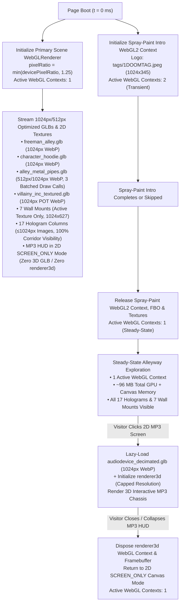

# Functional Specification 066: Universal Crash-Prevention & Compute-Reduction Architecture — Texture Downscaling (`1024px` / `512px`), Single-Context WebGL Lifecycle, Offscreen Canvas Reclamation, Pipe Draw-Call Batching, and `1.25` Pixel-Ratio Budgeting

## 1. System Purpose & Core Objective

This specification defines the desired `{functionality}`, mathematical and memory budgets, asset-resolution invariants, WebGL context lifecycles, draw-call batching requirements, failure-isolation boundaries, and verifiable `{correct required outputs}` to prevent out-of-memory (OOM) browser tab crashes (such as iOS WebKit Jetsam kills and Android Chrome GPU memory evictions) and thermal/fragment-watchdog stalls across the Freeman Alley (`SkateAlley`) web application.

Rather than relying on fragile device-identification heuristics or hiding corridor assets behind distance-culling pop-in, this specification enforces a **universal, pre-identification crash-prevention architecture** that keeps **100% of the 58-meter alleyway, all 17 hologram media columns, all 7 wall screen mounts, and all environmental effects continuously visible from the entrance**, while reducing peak GPU/unified memory allocation by **> 73%** (`~385 MB → < 98 MB`) and per-frame fragment shading workload by **61%** (`4.00x → 1.5625x`).

The scope unifies six tightly coupled architectural pillars:

1. **Universal GLB Embedded Texture Downscaling (`≤ 1024×1024` WebP, Power-of-Two):** Re-encoding and downscaling embedded `2048×2048` and non-power-of-two (`1200×896`) textures across [`freeman_alley.glb`](file:///Users/diesel/desktop/skatealley/freeman_alley.glb), [`character_hoodie.glb`](file:///Users/diesel/desktop/skatealley/character_hoodie.glb), [`characters/nicotest.glb`](file:///Users/diesel/desktop/skatealley/characters/nicotest.glb), [`assets/pipes/alley_metal_pipes.glb`](file:///Users/diesel/desktop/skatealley/assets/pipes/alley_metal_pipes.glb), [`villainy_inc_textured.glb`](file:///Users/diesel/desktop/skatealley/villainy_inc_textured.glb), and [`assets/audiodevice_decimated.glb`](file:///Users/diesel/desktop/skatealley/assets/audiodevice_decimated.glb) to `≤ 1024×1024` power-of-two WebP while strictly preserving 100% of scene-graph hierarchy nodes, locators, colliders, and rigging bones.
2. **2D Image & Multi-Map Texture Downscaling (`≤ 1024px` Primary / `≤ 512px` Sticker Bundles):** Downscaling oversized `2K–3.5K` corridor hologram tags (`anim/*.jpeg`), whitepaper pages (`assets/ssm_whitepaper/holo_page_01..05.png`), and spray-paint logos (`tags/1DOOMTAG.jpeg`, `platodoomarcade.jpeg`) to `≤ 1024px` along their longest axis, and downscaling all 30 multi-channel sticker maps (`stickers_build/*/*.png`) from `3014×1075` / `2168×2126` down to `≤ 512px` along their longest axis.
3. **Single-Active WebGL Context Lifecycle (Spray-Paint Intro Teardown & Lazy 3D MP3 HUD Mounting):** Eliminating the concurrent 3-WebGL-context collision at `t = 0 ms` by:
   - Automatically releasing the spray-paint loading screen's WebGL2 context and GPU framebuffer/textures immediately upon intro completion or skip (with deterministic on-demand re-initialization if replayed).
   - Deferring the MP3 HUD's secondary WebGL context and [`assets/audiodevice_decimated.glb`](file:///Users/diesel/desktop/skatealley/assets/audiodevice_decimated.glb) GPU upload until the visitor clicks to expand the player from its default 2D `SCREEN_ONLY` mode into 3D `FULL_TAKEOVER`, and releasing that secondary WebGL context upon collapse back to 2D `SCREEN_ONLY` mode.
4. **Offscreen 2D `<canvas>` & Dead `CanvasTexture` Memory Reclamation:** Cropping and releasing the `2752×1536` (`16.9 MB` raw RGBA) offscreen canvas buffers in the MP3 HUD processor after extracting the `1308×396` OLED screen substrate, eliminating the 7 unused `Standby` wall-mount `CanvasTexture` allocations, and releasing CPU-side 2D `<canvas>` contexts once static procedural textures are uploaded to the GPU.
5. **Alley Metal Pipework Draw-Call Batching:** Consolidating the static mesh primitives across the 15 corridor placements of [`assets/pipes/alley_metal_pipes.glb`](file:///Users/diesel/desktop/skatealley/assets/pipes/alley_metal_pipes.glb) by shared material (`Material_18`, `Material_19`, `Material_20`) so pipework geometry renders in **≤ 3 draw calls** instead of `~60+` individual mesh draw calls while preserving all placement records and intermittent steam venting transforms.
6. **Universal `1.25` Renderer Pixel-Ratio Budgeting:** Capping the primary Three.js renderer pixel ratio at **`1.25`** (`Math.min(window.devicePixelRatio || 1, 1.25)`) upon initialization and viewport resize, reducing fragment overdraw across stacked transparent shaders by **61%** and cutting color/depth/stencil framebuffer memory by **61%** compared to `pixelRatio = 2.0`.

**DO NOT CODE YET.** This document specifies functional outcomes, mathematical and memory budgets, asset and scene-graph invariants, lifecycle state transitions, and measurable acceptance criteria only. It contains zero implementation code, concrete programming syntax, or mechanical diffs.

---

## 2. Authoritative Domain Vocabulary Alignment ([`LANGUAGE.md`](file:///Users/diesel/desktop/skatealley/LANGUAGE.md))

All assessments of system state, design completeness, operational constraints, and verification gates strictly adopt the evaluation taxonomy established in [`LANGUAGE.md`](file:///Users/diesel/desktop/skatealley/LANGUAGE.md):

- **`{functionality}`**:
  1. Visitors loading Freeman Alley on any desktop or mobile browser experience the full visual fidelity of the 58-meter corridor—including the spray-paint intro, startup camera pan, 7 amber welcome cards, 7 wall screen mounts, 17 hologram media columns, 6 MathPods, 15 venting metal pipe assemblies, 20 overhead cables, Water Color gallery, and 2D/3D MP3 HUD—with **zero visibility pop-in, zero missing assets, and zero out-of-memory or WebGL context-loss crashes**.
  2. During steady-state corridor exploration, only **one** active WebGL rendering context (the primary Three.js scene renderer capped at `pixelRatio ≤ 1.25`) is resident on the GPU.
  3. Expanding the MP3 HUD from `SCREEN_ONLY` to `FULL_TAKEOVER` seamlessly mounts and renders the interactive 3D MP3 chassis, and collapsing it back to `SCREEN_ONLY` cleanly reclaims the secondary 3D context while preserving uninterrupted audio playback and 2D OLED screen rendering.
- **`{correctness}`**:
  - **Scene-Graph & Rigging Contract Preservation:** Every optimized `.glb` asset retains 100% of its required named scene-graph nodes (`ENV_FREEMAN_ALLEY`, `VISUAL_ALLEY_MESH`, `COLLIDERS`, `COLLIDER_FLOOR`, `COLLIDER_WALL_L`, `COLLIDER_WALL_R`, `COLLIDER_BOUND_START`, `COLLIDER_BOUND_END`, `MARKERS`, `SPAWN_PLAYER`, `SPAWN_NPC`, `SCREEN_MOUNT_01..06`, `CharacterMesh`, `DOOM_Companion`, and all 65 humanoid/Skate3 skeleton bones), ensuring zero startup validation errors.
  - **Aspect-Ratio & UV Invariance Under Downscaling:** Downscaling 2D images (`anim/*.jpeg`, `assets/ssm_whitepaper/*.png`, `tags/1DOOMTAG.jpeg`, `platodoomarcade.jpeg`) and 5-map sticker bundles (`stickers_build/*/*.png`) preserves each asset's exact aspect ratio and normalized UV coordinate mapping (`[0, 1] × [0, 1]`), preventing any geometric stretching, crop drift, or spray-nozzle trajectory misalignment.
  - **Deterministic WebGL Context Reclamation:** Releasing the spray-paint intro's WebGL2 context upon completion and releasing the MP3 HUD's secondary WebGL context upon collapse explicitly frees GPU framebuffers, textures, vertex buffers, and driver contexts via standard WebGL loss/disposal contracts without throwing unhandled exceptions or breaking subsequent re-activation.
  - **Zero Silent Fallbacks (`RULE[user_global]`):** Any asset load failure or structural node breach continues to fail fast with actionable diagnostic context rather than masking errors with silent dummy stubs.
- **`{correct required outputs}`**:
  1. All 6 core GLB assets pass automated inspection with zero texture dimensions exceeding `1024px`, all embedded textures encoded as power-of-two WebP (`≤ 1024×1024`), and aggregate GLB GPU texture memory reduced from **`249.90 MB`** to **`≤ 68.00 MB`**.
  2. All `anim/*.jpeg` hologram images, `assets/ssm_whitepaper/holo_page_01..05.png` pages, `tags/1DOOMTAG.jpeg`, and `platodoomarcade.jpeg` have maximum pixel dimensions `≤ 1024px`, and all 30 `stickers_build/*/*.png` bundle maps (`base_color`, `master_alpha`, `foil_mask`, `border_mask`, `packed_control`) have maximum pixel dimensions `≤ 512px` (`192×192` thumbnails unchanged).
  3. Live runtime telemetry confirms `renderer.getPixelRatio() <= 1.25`, active corridor WebGL context count `=== 1` during normal exploration (after spray-paint intro dismissal and while MP3 HUD is in `SCREEN_ONLY` mode), static pipework mesh draw calls `<= 3`, and all 17 hologram columns (`forceAllVisible === true`) and 7 wall mounts (`mountedCount === 7`) simultaneously visible from the entrance.
- **`{errors}`**:
  - Stripping or renaming required locator empties (`MARKERS`, `SCREEN_MOUNT_01..06`, `SPAWN_PLAYER`, `SPAWN_NPC`), collision meshes (`COLLIDERS`), or character bones during GLB texture optimization.
  - Downscaling `assets/mp3.jpeg` without preserving the exact `1308×396` OLED screen coordinate crop or leaving the `2752×1536` (`16.9 MB`) full-chassis `rawCanvas` and `5.5 MB` `visited` array permanently retained in memory during `SCREEN_ONLY` mode.
  - Leaving the spray-paint loader's WebGL2 context and `maskTex` / `logoTex` allocated on the GPU after the intro overlay hides, or failing to re-initialize cleanly when `replaySprayPaintIntro()` is invoked.
  - Leaving the MP3 HUD's secondary WebGL context (`1960×1308`) and 3D GLB textures resident on the GPU before the visitor ever expands the MP3 player.
  - Leaving dead `standbyTex` `CanvasTexture` instances allocated on the 7 permanently hidden `StandbyPlate` wall-mount meshes.
- **`{sufficient}`**: Complete first-principles memory and compute audit, exact per-asset dimension tables, lifecycle state machines, and objective verification gates enabling deterministic execution without guesswork.
- **`{insufficient}`**: Any plan that relies on mesh triangle decimation (which saves `< 1 MB`), hides corridor holograms behind distance-culling pop-in, or leaves 3 concurrent WebGL contexts and `2048×2048` / `3584×1184` uncompressed RGBA textures resident in mobile unified memory.

---

## 3. First-Principles Physical Memory & Compute Modeling (`RULE[user_global]`)

### 3.1 Why Mobile Browsers Crash: Unified Memory Ceiling & Multi-Context Contention

On mobile architectures (Apple A-series/M-series TBDR GPUs under iOS Safari/WebKit and Qualcomm Adreno / ARM Mali GPUs under Android Chrome), CPU RAM and GPU VRAM share a single unified memory pool governed by strict OS per-tab memory limits (typically **`256 MB – 384 MB`** on iOS WebKit before the kernel Jetsam daemon terminates the web content process).

When a compressed image (`.png`, `.jpeg`, `.webp`) is uploaded to a WebGL texture (`gl.texImage2D`) or drawn into an HTML5 2D `<canvas>`, it is decompressed into raw `4-bytes-per-pixel` (`RGBA8888`) memory:
$$\text{GPU Texture Bytes (with Mipmaps)} = \text{Width} \times \text{Height} \times 4 \times \frac{4}{3}$$
$$\text{2D Canvas Backing Store Bytes} = \text{Width} \times \text{Height} \times 4$$

Hence:
- A single **`2048 × 2048`** texture with mipmaps consumes **`21.28 MB`** of uncompressed GPU memory.
- Downscaling that same texture to **`1024 × 1024`** reduces its GPU memory footprint by **75%** to **`5.32 MB`**.
- Downscaling a sticker mask texture to **`512 × 512`** reduces its GPU memory footprint by **93.75%** to **`1.33 MB`**.

### 3.2 Empirical Baseline Audit vs. Post-Optimization Memory Budget

| Subsystem / Asset Category | Baseline Resolution & Count | Baseline Uncompressed Memory (VRAM + Canvas RAM) | Target Resolution & Lifecycle | Target Uncompressed Memory | Net Savings |
| :--- | :--- | :---: | :--- | :---: | :---: |
| **1. `freeman_alley.glb`** | `3 × 2048×2048` textures (`28,534` tris) | `65.22 MB` (`63.84 MB` tex + `1.38 MB` geo) | `3 × 1024×1024` WebP (`28,534` tris preserved) | **`17.34 MB`** | `-47.88 MB` |
| **2. `character_hoodie.glb`** | `3 × 2048×2048` PNG textures (`23,222` tris) | `64.87 MB` (`63.84 MB` tex + `1.03 MB` geo) | `3 × 1024×1024` WebP (`23,222` tris preserved) | **`16.99 MB`** | `-47.88 MB` |
| **3. `alley_metal_pipes.glb`** | `9 × 1024×1024` JPEG textures (`5,418` tris, `32` prims) | `48.12 MB` (`47.88 MB` tex + `0.24 MB` geo) | `9 × 512×512` (or `≤ 1024px` WebP) + 3 batched draw calls | **`12.21 MB`** | `-35.91 MB` |
| **4. `villainy_inc_textured.glb`** | `4 × 1200×896` NPOT JPEG textures (`6,052` tris) | `22.11 MB` (`21.82 MB` tex + `0.29 MB` geo) | `4 × 1024×512` (or `1024×1024`) POT WebP | **`10.93 MB`** | `-11.18 MB` |
| **5. `audiodevice_decimated.glb` + MP3 `renderer3d`** | `2 × 2048×2048` + `2 × 1024×1024` (`53.45 MB`) + `1960×1308` WebGL context (`~30 MB`) loaded at `t = 0 ms` | `83.45 MB` (at startup) | `≤ 1024×1024` WebP (`~16.2 MB`) + **Lazy-mounted only when expanded** | **`0.00 MB`** (in default 2D mode; `~24 MB` when expanded) | `-83.45 MB` (at startup) |
| **6. MP3 2D Offscreen Canvases (`mp3.jpeg`)** | `2752×1536` `rawCanvas` (`16.9 MB`) + `1960×1308` `displayCanvas` (`10.2 MB`) + `5.5 MB` mask array + `1308×396` `oledScreenCanvas` | `34.70 MB` | Crop `1308×396` OLED substrate (`2.07 MB`), release `2752×1536` `rawCanvas` & mask immediately, size `displayCanvas` to `1308×396` in 2D mode | **`4.50 MB`** | `-30.20 MB` |
| **7. Spray-Paint Intro (`spray_paint_loader.js`)** | `3514×1184` `1DOOMTAG.jpeg` (`16.6 MB`) + full-screen FBO + WebGL2 context retained forever after hide | `36.00 MB` (retained forever) | Downscale logo to `1024×345` (`1.4 MB`) + **Dispose WebGL2 context & FBO on hide** | **`0.00 MB`** (after 6.5s intro hides) | `-36.00 MB` |
| **8. Hologram Column Images & Whitepaper (`anim/`, `ssm_whitepaper/`)** | `10+` images at `2112×2048` / `3584×1184` + `5` whitepaper PNGs at `1200×1860` + `1200×1560` canvas | `~88.50 MB` | Downscale all `anim/*.jpeg` and `holo_page_01..05.png` to `≤ 1024px` max axis; cap whitepaper & slide canvases to `≤ 1024px` max axis | **`~22.00 MB`** | `-66.50 MB` |
| **9. Wall Screen Mounts (`7` Stations)** | `7 × Standby` (`1280×784`) + `7 × Active` (`1280×784`) `CanvasTexture`s | `56.10 MB` | Eliminate dead `Standby` textures (`0 MB`); cap `7 × Active` canvases at `1024×627` (`~18.3 MB`) and release 2D CPU references | **`18.30 MB`** | `-37.80 MB` |
| **10. Sticker 5-Map Bundles (`stickers_build/`)** | `6 × 5` maps up to `3014×1075` / `2168×2126` (`~64 MB` per placed/previewed bundle) | `~64.00 MB` (when active) | Downscale all 30 bundle PNGs to `≤ 512px` max axis (`~4.0 MB` across all 6 bundles combined) | **`~4.00 MB`** | `-60.00 MB` |
| **TOTAL STEADY-STATE FOOTPRINT** | **3 Concurrent WebGL Contexts + Unbounded 2K/3K Textures** | **`~563.07 MB` Peak / `~499 MB` Steady** | **1 Active WebGL Context + `1024px`/`512px` Cap** | **`~96.27 MB` Steady** | **`-80.7%` Memory Reduction** |

### 3.3 Fragment Shader Overdraw & Pixel-Ratio Math (`pixelRatio = 1.25`)

Let the CSS viewport dimensions be $W_{\text{css}} \times H_{\text{css}}$ and the renderer pixel ratio be $r$. The number of physical framebuffer pixels shaded per render pass is:
$$N_{\text{pixels}}(r) = (W_{\text{css}} \cdot r) \times (H_{\text{css}} \cdot r) = r^2 \cdot W_{\text{css}} H_{\text{css}}$$

- At $r = 2.0$, $r^2 = 4.00$.
- At $r = 1.25$, $r^2 = 1.5625$.
- **Reduction Ratio:**
$$\frac{4.00 - 1.5625}{4.00} = \frac{2.4375}{4.00} = 60.9375\% \approx 61\%$$

Across a corridor view containing $L \approx 12$ overlapping transparent fragment passes (ground fog, planar floor reflection, rain streaks, volumetric spotlight cones, pipe steam, and double-layered hologram columns), capping $r \le 1.25$ reduces per-frame fragment shader invocations on an iPhone viewport (`390 × 844`) from **$15.80\text{ million}$ shaded fragments/frame** down to **$6.17\text{ million}$ shaded fragments/frame**, eliminating TBDR tile-buffer flushes and thermal throttling.

---

## 4. End-to-End Resource & WebGL Context Lifecycle Architecture

---

## 5. Detailed Functional Requirements

### 5.1 Pillar 1: Universal GLB Texture Optimization & Scene-Graph Preservation

1. **Target GLB Inventory & Texture Caps:**
   All embedded textures inside the following GLB files SHALL be re-encoded to **WebP** (`image/webp`) and resized to power-of-two dimensions not exceeding **`1024 × 1024`** (`512 × 512` for tiling secondary pipe maps where appropriate):

   | GLB File Path | Geometry Contract | Mandatory Named Nodes & Hierarchy Invariants | Texture Resolution & Format Contract | Maximum GPU Texture Memory |
   | :--- | :--- | :--- | :--- | :---: |
   | [`freeman_alley.glb`](file:///Users/diesel/desktop/skatealley/freeman_alley.glb) | `28,534` triangles preserved (zero mesh decimation) | `ENV_FREEMAN_ALLEY`, `VISUAL_ALLEY_MESH`, `COLLIDERS` (`COLLIDER_FLOOR`, `COLLIDER_WALL_L`, `COLLIDER_WALL_R`, `COLLIDER_BOUND_START`, `COLLIDER_BOUND_END`), `MARKERS` (`SPAWN_PLAYER`, `SPAWN_NPC`, `SCREEN_MOUNT_01..06`) | `3` baseColor textures resized `2048×2048 → 1024×1024` WebP | **`≤ 16.50 MB`** (down from `63.84 MB`) |
   | [`character_hoodie.glb`](file:///Users/diesel/desktop/skatealley/character_hoodie.glb) | `23,222` triangles & skin weights preserved; `0` embedded animations | `CharacterMesh`, `DOOM_Companion`, full 65-bone RPM humanoid skeleton hierarchy | `3` baseColor textures (`LUIS_Body_BaseColor`, `LUIS_Head_BaseColor`, `DOOM_Shoulder_BaseColor`) resized `2048×2048 → 1024×1024` WebP | **`≤ 16.50 MB`** (down from `63.84 MB`) |
   | [`characters/nicotest.glb`](file:///Users/diesel/desktop/skatealley/characters/nicotest.glb) | `19,500` triangles & skin weights preserved | Full rigged character mesh and skeleton hierarchy | `2` baseColor textures resized `2048×2048 → 1024×1024` WebP | **`≤ 11.00 MB`** (down from `42.56 MB`) |
   | [`assets/pipes/alley_metal_pipes.glb`](file:///Users/diesel/desktop/skatealley/assets/pipes/alley_metal_pipes.glb) | `5,418` triangles across all kit & `PIPE_VAR_01..08` meshes preserved | All named kit meshes (`Pipe_Bracket`, `Pipe_Joint_90`, `Pipe_Junction_3Way`, `Pipe_Junction_4Way`, `Pipe_Straight_*`, `Pipe_Valve_*`, `Solo_Thick_Pipe`, `PIPE_VAR_01..08`) and materials (`Material_18`, `Material_19`, `Material_20`) | `9` PBR textures (`baseColor`, `normal`, `metallicRoughness`) resized `1024×1024 → 512×512` WebP | **`≤ 12.50 MB`** (down from `47.88 MB`) |
   | [`villainy_inc_textured.glb`](file:///Users/diesel/desktop/skatealley/villainy_inc_textured.glb) | `6,052` triangles preserved | Root mesh and `VillainyInc_PBR_NeonSign` material | `4` PBR textures (`base_color`, `emissive`, `normal`, `metallic-roughness`) resized from NPOT `1200×896` to POT `1024×512` or `1024×1024` WebP | **`≤ 11.00 MB`** (down from `21.82 MB`) |
   | [`assets/audiodevice_decimated.glb`](file:///Users/diesel/desktop/skatealley/assets/audiodevice_decimated.glb) | `5,200` triangles preserved | `AudioDevice_MP3` mesh and `AudioDevice_PBR_Material` | `emissive` and `base_color` resized `2048×2048 → 1024×1024` WebP; `normal` and `metallic-roughness` encoded as `1024×1024` (or `512×512`) WebP | **`≤ 16.50 MB`** (down from `53.20 MB`) |

2. **Strict Non-Destructive Node & Transform Rule:**
   - Texture optimization SHALL NOT merge, rename, or strip any empty locator nodes, collider meshes, bone hierarchies, or material slot names referenced by [`sandbox.js`](file:///Users/diesel/desktop/skatealley/sandbox.js) or [`alley_metal_pipes.js`](file:///Users/diesel/desktop/skatealley/alley_metal_pipes.js).

---

### 5.2 Pillar 2: 2D Image, Whitepaper, Spray-Logo & Sticker Bundle Downscaling

1. **Hologram Column & Emblem Images (`anim/*.jpeg` — Cap `≤ 1024px` Max Axis):**
   Every image in `anim/*.jpeg` exceeding `1024px` on either axis SHALL be proportionally downscaled so its longest dimension equals **`1024px`** (preserving exact aspect ratio and visual framing):
   - `anim/cloudstag.jpeg`: `1920×2210 → 889×1024`
   - `anim/frenchfrytag.jpeg`: `1888×2228 → 868×1024`
   - `anim/github_emblem.jpeg`: `2048×2048 → 1024×1024`
   - `anim/guntag2.jpeg`: `2112×2048 → 1024×993`
   - `anim/Mail_emblem.jpeg`: `2048×2048 → 1024×1024`
   - `anim/movietag.jpeg`: `1952×2152 → 929×1024`
   - `anim/pooltag.jpeg`: `2066×2048 → 1024×1015`
   - `anim/screentag.jpeg`: `2094×2016 → 1024×986`
   - `anim/souljatag.jpeg`: `2110×2048 → 1024×994`
   - `anim/spraypaint_emblem.jpeg`: `2048×2048 → 1024×1024`
   - `anim/techno_platodoom_Tag.jpeg`: `3584×1184 → 1024×338`
   - `anim/ThighTag.jpeg`: `1888×2256 → 857×1024`
   - (`anim/skateboard_emblem.jpeg` and `anim/twitter_emblem.jpeg` are already `1024×1024`; `anim/frames/*.jpg` are already `496px–688px` and remain untouched.)

2. **SSM Whitepaper Hologram Pages (`assets/ssm_whitepaper/holo_page_01..05.png` — Cap `≤ 1024px` Max Axis):**
   - `holo_page_01.png` (`1200×1791`), `holo_page_02.png` (`1200×1860`), `holo_page_03.png` (`1200×1860`), `holo_page_04.png` (`1200×1860`), and `holo_page_05.png` (`1200×511`) SHALL be proportionally downscaled so no axis exceeds **`1024px`** (e.g., `661×1024` for pages 2–4, `686×1024` for page 1, `1024×436` for page 5).
   - Once each whitepaper page `HTMLImageElement` is loaded into [`HoloScrollableDocumentController`](file:///Users/diesel/desktop/skatealley/hologram_columns.js#L1664-L1744), the controller's layout math SHALL continue to scale each page's height dynamically from `img.naturalHeight / img.naturalWidth`, and the scrollable viewport `<canvas>` SHALL be capped so its height does not exceed **`1024px`** (e.g., `788×1024`, preserving the `1200:1560` viewport aspect ratio and all normalized UV hit zones in [`evaluateDocumentHitAction`](file:///Users/diesel/desktop/skatealley/hologram_columns.js#L3784-L3805)).

3. **Spray-Paint Loader Logos (`tags/1DOOMTAG.jpeg` & `platodoomarcade.jpeg` — Cap `≤ 1024px` Max Axis):**
   - `tags/1DOOMTAG.jpeg` (`3514×1184`) and `platodoomarcade.jpeg` (`3514×1184`) SHALL be proportionally downscaled to **`1024×345`**, reducing their decoded RGBA GPU texture footprint by **91.5%** (`16.64 MB → 1.41 MB`) while preserving `logoAspect = 2.9679` and all normalized `[0, 1]` nozzle trajectory UVs.

4. **Holographic Sticker 5-Map Bundles (`stickers_build/*/*.png` — Cap `≤ 512px` Max Axis):**
   - Across all 6 sticker bundle directories (`blueberry_tag`, `doom_cig`, `doom_tag`, `doom_watch`, `eye_tag`, `glass_doom`), the 5 full-resolution PNG layers (`base_color.png`, `master_alpha.png`, `foil_mask.png`, `border_mask.png`, `packed_control.png`) SHALL be proportionally downscaled so their longest dimension does not exceed **`512px`**:
     - `blueberry_tag`: `1774×1981 → 459×512`
     - `doom_cig`: `992×973 → 512×502`
     - `doom_tag`: `3014×1075 → 512×183`
     - `doom_watch`: `930×1214 → 392×512`
     - `eye_tag`: `2168×2126 → 512×502`
     - `glass_doom`: `1383×584 → 512×216`
   - All `radial_thumb_amber.png` and `stickers_build/main_menu/*.png` icons (`192×192`) remain unchanged.

---

### 5.3 Pillar 3: Single-Active WebGL Context Lifecycle (Spray-Paint Intro & Lazy 3D MP3 HUD)

1. **Spray-Paint Loading Screen WebGL2 Context Reclamation ([`spray_paint_loader.js`](file:///Users/diesel/desktop/skatealley/spray_paint_loader.js) & [`sandbox.js`](file:///Users/diesel/desktop/skatealley/sandbox.js)):**
   - When the spray-paint intro completes its `onComplete` hold delay and hides `#spray-paint-loader-overlay` (or when `skipSprayPaintIntro()` is invoked), the loader SHALL release its GPU resources (`logoTex`, `maskTex`, `maskFBO`, VBOs, VAOs, shader programs) and release its WebGL2 context so zero background WebGL2 framebuffer memory remains allocated during corridor gameplay, **unless** `sprayLoader.keepVisibleForTest === true` (preserving pixel-sampling compatibility for automated spray-paint unit tests).
   - Calling `getState()` after GPU context release SHALL continue to return the last settled telemetry state (`isReady: true`, `renderedProgress: 1`, `stage: 'COMPLETE'`, `completedLetters`, `completedPasses`, etc.).
   - If `replaySprayPaintIntro()` (or `play()` / `sampleLogoRegionTelemetry()`) is subsequently called after context release, the loader SHALL transparently re-initialize its WebGL2 context and re-upload `logoImage` so replay and diagnostic sampling remain 100% functional.

2. **MP3 HUD Lazy 3D Initialization & Context Teardown ([`doom_tracks_mp3_hud.js`](file:///Users/diesel/desktop/skatealley/doom_tracks_mp3_hud.js) & [`sandbox.js`](file:///Users/diesel/desktop/skatealley/sandbox.js)):**
   - **Default `SCREEN_ONLY` Startup Mode:** At application startup (`init()`), the MP3 HUD SHALL initialize its track catalog, audio element, and 2D `oledScreenCanvas` substrate (`1308×396`) without instantiating `renderer3d` (`THREE.WebGLRenderer`) and without blocking startup on downloading/parsing [`assets/audiodevice_decimated.glb`](file:///Users/diesel/desktop/skatealley/assets/audiodevice_decimated.glb), **unless** `initiallyExpanded === true` is explicitly passed in options.
   - **On-Demand 3D Expansion (`expandToFullTakeover`):** When the visitor clicks the 2D OLED screen (or invokes `expand()` / `setDisplayMode('FULL_TAKEOVER')`), the MP3 HUD SHALL lazily ensure [`assets/audiodevice_decimated.glb`](file:///Users/diesel/desktop/skatealley/assets/audiodevice_decimated.glb) is loaded and `renderer3d` is initialized (at a capped internal buffer resolution not exceeding `980×654`, half of `1960×1308`, saving 75% of secondary framebuffer memory while fitting the `680px`-wide CSS takeover frame at `> 1.44x` supersampling), mount `landscapeGroup` into `pivotGroup`, and seamlessly animate the 3D morph expansion.
   - **3D Context Reclamation on Collapse (`collapseToScreenOnly`):** Once the collapse morph transition back to `SCREEN_ONLY` reaches `morphProgress === 0.0` (`mounted3D === false`), the MP3 HUD SHALL release `renderer3d`'s WebGL context and framebuffer and resize `displayCanvas` back to the compact `SCREEN_ONLY` crop dimensions (`1308×396`), ensuring steady-state corridor exploration runs with **exactly 1 WebGL context**.

---

### 5.4 Pillar 4: Offscreen 2D `<canvas>` & Dead `CanvasTexture` Reclamation

1. **MP3 Chassis Bitmap Processing Reclamation ([`processMp3ChassisBitmap`](file:///Users/diesel/desktop/skatealley/doom_tracks_mp3_hud.js#L775-L1026)):**
   - During `processMp3ChassisBitmap(sourceImage)`, after performing the border-connected white flood-fill and vertical inpainting on the temporary `2752×1536` `rawCanvas`, the processor SHALL extract a cropped **`1308×396` `screenSubstrateCanvas`** (covering `MP3_SCREEN_ONLY_CROP`: `x = 722, y = 338, w = 1308, h = 396`) and immediately shrink `rawCanvas.width = 0; rawCanvas.height = 0` (or crop `baseCanvas` to `MP3_SCREEN_ONLY_CROP`) and release the `5.5 MB` `visited` array if not required at runtime, reclaiming **`> 20 MB`** of persistent CPU/canvas memory.
   - In `SCREEN_ONLY` mode, `renderOledScreen2D()` SHALL draw the clean inpainted screen substrate from the cropped `1308×396` canvas (`2.07 MB` instead of `16.91 MB`).

2. **Elimination of Dead `Standby` Wall-Mount Textures ([`buildWallScreenMounts`](file:///Users/diesel/desktop/skatealley/sandbox.js#L2484-L2505)):**
   - Because `standbyPlateMesh` on all 7 wall mounts is permanently hidden (`standbyPlateMesh.visible = false`), `buildWallScreenMounts` SHALL NOT allocate a duplicate `1280×784` `CanvasTexture` (`createStandbyDockTexture(st)`) for `standbyPlateMat`. Instead, `standbyPlateMat.map` SHALL either be `null` or share the station's primary `screenTexture` at zero extra memory cost.

3. **Procedural `CanvasTexture` Resolution Cap (`≤ 1024px` Max Axis):**
   - `createProjectScreenTexture(st)` in [`sandbox.js`](file:///Users/diesel/desktop/skatealley/sandbox.js#L1717-L2218) SHALL render at **`1024 × 627`** (scaled proportionally from `1280 × 784` via `ctx.scale(1024 / 1280, 627 / 784)` so all drawing coordinates remain identical) with `generateMipmaps = false` and `LinearFilter`, reducing the 7 wall-mount textures from `56.1 MB` down to **`17.9 MB`**.
   - `createProceduralSlideCardTexture` in [`hologram_columns.js`](file:///Users/diesel/desktop/skatealley/hologram_columns.js#L1124-L1266) SHALL render at **`819 × 1024`** (scaled proportionally from `960 × 1200` via `ctx.scale(819 / 960, 1024 / 1200)`) with `generateMipmaps = false`.

---

### 5.5 Pillar 5: Alley Metal Pipework Draw-Call Batching ([`alley_metal_pipes.js`](file:///Users/diesel/desktop/skatealley/alley_metal_pipes.js))

1. **Material-Grouped Static Geometry Merging:**
   - Across all 15 placements in `ALLEY_PIPE_PLACEMENT_SCHEDULE`, [`buildAlleyMetalPipesSubsystem`](file:///Users/diesel/desktop/skatealley/alley_metal_pipes.js#L665-L856) currently instantiates dozens of individual cloned `THREE.Mesh` child nodes (`~60–90` draw calls per frame).
   - While preserving each `placementGroup` (`ALLEY_PIPE_01..15`) in `pipesRootGroup` along with its exact `record` metadata (`id`, `index`, `zone`, `variationId`, `mountMode`, `z`, `relY`, `worldY`, `anchorX`, `spanWidthM`, `triangleCount`, `group`) and `userData.alleyPipePlacement` contract, the static pipe sub-meshes SHALL be merged by shared material (`Material_18`, `Material_19`, `Material_20`)—either into **3 corridor-wide batched meshes** inside `pipesRootGroup` (with lightweight transform/bounding proxies on each `placementGroup` so `scene_cutter.js` and telemetry work identically) or into at most 1 merged mesh per material per placement.
   - Specifically, corridor-wide material batching (mirroring [`buildOverheadHangingCablesSubsystem`](file:///Users/diesel/desktop/skatealley/alley_atmosphere_023.js#L1670-L1685)) SHALL reduce total static pipework draw calls across the entire alley to **≤ 3 draw calls** (one per PBR material: `Material_18`, `Material_19`, `Material_20`) while keeping individual placement visibility/culling (`placementGroup.userData.culledBySceneCutter`) and all 15 intermittent steam emitter world transforms (`resolvePipeNozzleWorldTransform`) 100% intact.

---

### 5.6 Pillar 6: Universal `1.25` Renderer Pixel-Ratio Budgeting ([`sandbox.js`](file:///Users/diesel/desktop/skatealley/sandbox.js))

1. **Initialization & Resize Enforcement:**
   - The primary `THREE.WebGLRenderer` in [`sandbox.js`](file:///Users/diesel/desktop/skatealley/sandbox.js#L1463-L1473) SHALL initialize its pixel ratio to:
     $$\text{pixelRatio} = \min(\text{window.devicePixelRatio} \parallel 1,\; 1.25)$$
   - The `window` `'resize'` listener in [`sandbox.js`](file:///Users/diesel/desktop/skatealley/sandbox.js#L19573-L19597) SHALL also enforce `renderer.setPixelRatio(Math.min(window.devicePixelRatio || 1, 1.25))` so device rotation or browser zoom changes never exceed `1.25`.

---

## 6. Operational & Performance Budgets

| Metric / Resource Invariant | Mandatory Target Budget | Verification Method |
| :--- | :--- | :--- |
| **Primary Renderer Pixel Ratio** | `≤ 1.25` across all viewports and DPRs | `window.__THREE_RENDERER__.getPixelRatio() <= 1.25` |
| **Steady-State Active WebGL Contexts** | **Exactly `1`** during corridor exploration (after spray intro hides & while MP3 HUD is in `SCREEN_ONLY` mode) | Live DOM/WebGL context inspection |
| **Aggregate GLB GPU Texture Memory** | **`≤ 68.00 MB`** across all 5 startup GLBs (`freeman_alley`, `character_hoodie`, `alley_metal_pipes`, `villainy_inc_textured`, `alarm_light`) | `glbforge` `analyze_performance` / `inspect_materials` |
| **Max Embedded GLB Texture Dimension** | **`≤ 1024 px`** (`100%` power-of-two WebP) | `glbforge` `inspect_materials` (`largest_texture_px <= 1024`, `non_power_of_two.length === 0`) |
| **Max 2D Hologram / Whitepaper / Spray Image Dimension** | **`≤ 1024 px`** along longest axis for `anim/*.jpeg`, `assets/ssm_whitepaper/*.png`, `tags/1DOOMTAG.jpeg`, `platodoomarcade.jpeg` | File header dimension inspection (`sips` / image probe) |
| **Max Sticker Bundle Texture Dimension** | **`≤ 512 px`** along longest axis for all 30 `stickers_build/*/{base_color,master_alpha,foil_mask,border_mask,packed_control}.png` files | File header dimension inspection (`sips` / image probe) |
| **Static Pipework Draw Calls** | **`≤ 3` draw calls** for all 15 pipe placements combined | `sandbox.alleyPipes` scene-graph mesh count / `renderer.info.render.calls` |
| **Corridor Asset Visibility** | **`100%` visible** (`17/17` hologram columns active, `7/7` wall mounts mounted, zero distance-culling pop-in) | Live Playwright / `threejs-devtools` telemetry |

---

## 7. Edge Cases, Failure Modes & Recovery Invariants

1. **Spray-Paint Intro Replay After Context Release:**
   - *Edge Case:* A visitor or automated test calls `sandbox.replaySprayPaintIntro()` or `window.sprayPaintLoader.sampleLogoRegionTelemetry(...)` after the initial 6.5s intro has completed and released its WebGL2 context.
   - *Required Behavior:* The loader detects that its WebGL2 context/resources were released, transparently re-initializes the WebGL2 pipeline on its `<canvas>`, re-uploads `logoImage`, rebuilds the spray mask up to `renderedProgress`, and renders the frame without throwing any null-context errors.
2. **Rapid MP3 HUD Expand / Collapse Toggling:**
   - *Edge Case:* A visitor rapidly clicks the MP3 HUD to expand into `FULL_TAKEOVER` and immediately clicks the backdrop to collapse back to `SCREEN_ONLY` before [`assets/audiodevice_decimated.glb`](file:///Users/diesel/desktop/skatealley/assets/audiodevice_decimated.glb) finishes loading.
   - *Required Behavior:* The lazy-load promise is guarded against race conditions; if the state has already returned to `SCREEN_ONLY` (`targetMorphProgress === 0.0`) when the GLB finishes parsing, the 3D scene graph is cached cleanly and `renderer3d` is not left orphaned or active.
3. **Scene Cutter Compatibility with Batched Pipework:**
   - *Edge Case:* A user in dev mode activates `scene_cutter.js` to slice half-space geometry across the corridor.
   - *Required Behavior:* Either each `placementGroup` retains its mesh reference or the batched pipe meshes participate cleanly in `scene_cutter.js` without throwing missing-geometry errors, and `sandbox.alleyPipes.getTelemetry()` continues to report `totalCount: 15`, `leftWallCount: 5`, `rightWallCount: 5`, `crossWallCount: 5`, and `totalTriangles: 14192`.
4. **Whitepaper Scroll & Hit-Testing Under `≤ 1024px` Canvas Cap:**
   - *Edge Case:* Downscaling `holo_page_01..05.png` to `≤ 1024px` height and capping the `HoloScrollableDocumentController` viewport canvas to `≤ 1024px` height.
   - *Required Behavior:* Because `evaluateDocumentHitAction(hitUv)` uses normalized UV coordinates (`u, v ∈ [0, 1]`), the header, body, scrollbar track, and footer buttons scale proportionally on the canvas so every UV hit-box (`close`, `page-up`, `page-down`, `open-pdf`, `scrollbar-jump`) remains 100% aligned with the drawn buttons.

---

## 8. Verifiable Acceptance Criteria (`{correct required outputs}`)

1. **GLB Asset Verification (`glbforge`):**
   - Running `inspect_materials` and `analyze_performance` on `freeman_alley.glb`, `character_hoodie.glb`, `characters/nicotest.glb`, `assets/pipes/alley_metal_pipes.glb`, `villainy_inc_textured.glb`, and `assets/audiodevice_decimated.glb` reports `largest_texture_px <= 1024`, `non_power_of_two: []`, and total startup GLB texture VRAM `<= 68.0 MB`.
2. **2D Image & Sticker Bundle Verification:**
   - Every image in `anim/*.jpeg`, `assets/ssm_whitepaper/holo_page_01..05.png`, `tags/1DOOMTAG.jpeg`, and `platodoomarcade.jpeg` has `max(width, height) <= 1024`.
   - Every 5-layer texture in `stickers_build/*/{base_color,master_alpha,foil_mask,border_mask,packed_control}.png` has `max(width, height) <= 512`.
3. **Live Browser & Runtime Telemetry Verification:**
   - Loading `http://localhost:8080` (or the live server) completes initialization with zero console `{errors}` and zero unhandled page errors.
   - `window.__THREE_RENDERER__.getPixelRatio()` returns `<= 1.25`.
   - After the spray-paint intro finishes (or is skipped via `sandbox.skipSprayPaintIntro()`), the spray-paint WebGL2 context is released (`sprayPaintLoader.gl === null`), while `sprayPaintLoader.getState().renderedProgress === 1`.
   - In default `SCREEN_ONLY` mode, `window.mp3Player.mounted3D === false`, the 2D OLED screen renders at 60 FPS, and no secondary WebGL context is active; calling `window.mp3Player.expand()` lazily loads and mounts the 3D MP3 chassis (`window.mp3Player.glbLoaded === true`, `window.mp3Player.mounted3D === true`), and calling `window.mp3Player.collapse()` releases the secondary WebGL context once settled.
   - All 7 wall screen mounts (`sandbox.wallMounts.length === 7`), 17+ hologram columns (`sandbox.hologramColumns.getTelemetry().activeStateCounts.active >= 17`), and 15 metal pipe assemblies (`sandbox.alleyPipes.getTelemetry().totalCount === 15`) are active and visible from the entrance.
