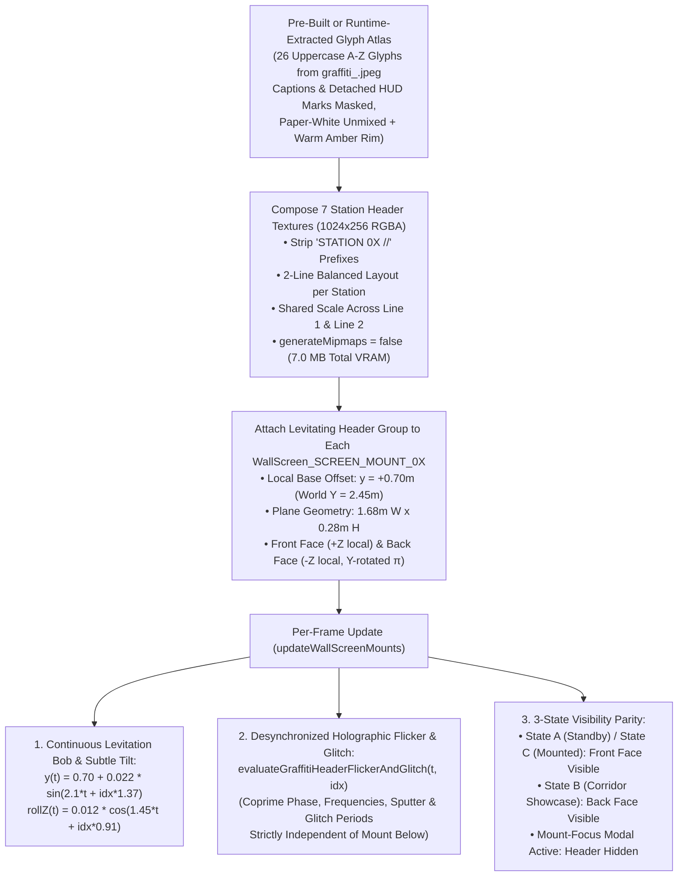

# Functional Specification 067: Levitating 3D Cyber-Drip Graffiti Screen Mount Headers — 26-Glyph Alphabet Atlas Extraction (`graffiti_.jpeg`), Stripped `"STATION 0X"` Titles, Desynchronized Holographic Flicker/Glitch Optics, and `0.414 m` Vertical Clearance Envelope

## 1. System Purpose & Core Objective

This specification defines the desired `{functionality}`, first-principles spatial and typographic math, continuous paper-white alpha-unmixing invariants, desynchronized holographic flicker/glitch dynamics, GPU memory budgets, and verifiable `{correct required outputs}` for adding **3D levitating Cyber-Drip Graffiti headers** above all **7 wall screen mounts** (`SCREEN_MOUNT_01` through `SCREEN_MOUNT_07`) in the Freeman Alley (`SkateAlley`) 3D corridor.

The scope unifies five tightly coupled architectural pillars:

1. **26-Glyph Cyber-Drip Graffiti Alphabet Extraction & Paper-White Alpha Unmixing ([`graffiti_.jpeg`](file:///Users/diesel/desktop/skatealley/graffiti_.jpeg)):** Extracting all 26 uppercase graffiti glyphs (`A`–`Z`) from the [`graffiti_.jpeg`](file:///Users/diesel/desktop/skatealley/graffiti_.jpeg) reference sheet while deterministically masking out the small sans-serif printed caption letters (`A`–`Z`) beneath each glyph, top-border drip tips intruding from the row above, the `"CYBER-DRIP GRAFFITI ALPHABET"` title banner, and detached corner HUD reticle/barcode artifacts, and unmixing the off-white paper backdrop (`RGB ≈ [245.5, 243.5, 241.2]`) into a halo-free RGBA glyph atlas with warm amber-gold edge illumination.
2. **Stripped `"STATION 0X"` Alphabetic Header Schedule Across All 7 Wall Screen Mounts:** Removing all `"STATION 0X //"` prefixes so every screen mount displays a bold, pure alphabetic (`[A-Z]` + spaces) 2-line Cyber-Drip Graffiti header levitating above its top bezel, and normalizing the station titles on Stations `04`–`06` (`SCREEN_MOUNT_04..06`) to omit `"STATION 0X //"` prefixes consistently.
3. **3D Levitating Header Placement, Continuous Hover Oscillation & 3-State Mount Lifecycle Parity:** Mounting each header above its corresponding screen mount (`screenWidth = 1.60 m`, `screenHeight = 0.98 m`, mount center `Y = 1.75 m`, top bezel edge `Y = 2.24 m`) inside the empirically verified **`Y ∈ [2.28 m, 2.62 m]`** (`0.414 m`) vertical clearance band so it levitates with a continuous vertical sinusoidal hover bob without intersecting `HOLO-COL-08` (`soulja_tag`, bottom edge `Y = 2.654 m` at `Z = 20.00 m`) or overhead pipes/cables, while remaining readable in both corridor `showcase` (`State B`) and wall `standby`/`mounted` (`State A`/`State C`) orientations.
4. **Desynchronized (Independent) Holographic Flicker, Glitch Tear & Scanbeam Dynamics:** Driving each levitating graffiti header with its own holographic shader and temporal oscillator whose carrier frequencies, sputter periods, glitch-band tear intervals, tear directions, and vertical scanbeam sweeps are **mathematically desynchronized (incommensurate)** from the screen mount below (`header.flickerGain !== mount.flickerGain`, `header.glitchIntensity !== mount.glitchIntensity`, `header.scanbeamY !== mount.scanbeamY`).
5. **Spec 066 Memory & Draw-Call Budget Compliance:** Compositing each station's multi-letter graffiti header into a single compact `1024 × 256` texture (`generateMipmaps = false`, `1.00 MB` RGBA per station, `7.00 MB` total across all 7 stations), releasing all temporary full-sheet `2752 × 1536` (`16.91 MB`) CPU/canvas buffers immediately after glyph extraction, and rendering each station's active header face in **1 draw call** (`7` draw calls total across the corridor).

**DO NOT CODE YET.** This document specifies functional outcomes, mathematical and spatial invariants, glyph-atlas coordinate contracts, desynchronized optical equations, memory budgets, and acceptance criteria only. It contains zero implementation code, concrete programming syntax, or mechanical diffs.

---

## 2. Authoritative Domain Vocabulary Alignment ([`LANGUAGE.md`](file:///Users/diesel/desktop/skatealley/LANGUAGE.md))

All assessments of system state, design completeness, operational constraints, and verification gates strictly adopt the evaluation taxonomy established in [`LANGUAGE.md`](file:///Users/diesel/desktop/skatealley/LANGUAGE.md):

- **`{functionality}`**:
  1. Visitors exploring Freeman Alley (in either scroll-walk mode or free-roam mode) see a bold, 2-line **Cyber-Drip Graffiti** header composed from [`graffiti_.jpeg`](file:///Users/diesel/desktop/skatealley/graffiti_.jpeg) levitating in 3D space directly above the top bezel of each of the **7 wall screen mounts** (`SCREEN_MOUNT_01` through `SCREEN_MOUNT_07`).
  2. All `"STATION 0X //"` prefixes are stripped from the headers so only pure alphabetic `[A-Z]` project titles are rendered above each mount.
  3. Each levitating header exhibits continuous vertical hover levitation plus a holographic phosphor flicker, horizontal scanline glitch shear, chromatic split, and sweeping scanbeam that operate **independently of (not synced with)** the screen mount directly beneath it.
  4. Clicking or pressing `E` while targeting a levitating header inspects/focuses its bound screen mount station, and when the focused 2D station modal is open (`mode === 'mount-focus'`), the 3D levitating header hides alongside its parent 3D mount so zero 3D geometry bleeds through the 2D modal overlay.
- **`{correctness}`**:
  - **Artifact-Free 26-Glyph Isolation:** Every extracted glyph `A`–`Z` excludes 100% of the small sans-serif printed caption letters (`A`–`Z`) at the bottom of each cell, excludes top-border drip tips intruding from the row above (`H`, `J`, `L`, `O`, `W`, `Y`), excludes the `"CYBER-DRIP GRAFFITI ALPHABET"` header and `TAG 1..3` markers, and excludes detached HUD barcode/reticle/crosshair blocks while preserving 100% of each letter's attached paint drips, aerosol overspray mist, and golden-amber scanline core.
  - **Mathematical Desynchronization from Screen Mount Below:** For every station $i \in \{1 \dots 7\}$ and any timestamp $t \ge 0$, the header's optical state vector $(\text{flickerGain}_{\text{hdr}}, \text{glitchIntensity}_{\text{hdr}}, \text{tearOffsetUvX}_{\text{hdr}}, \text{scanbeamY}_{\text{hdr}})$ is evaluated using coprime/incommensurate phase offsets, carrier frequencies, sputter periods, and glitch periods distinct from `evaluateHologramScreenFlickerAndGlitch(t, i)`, ensuring the header and screen mount never flicker, sputter, glitch-tear, or scan-sweep in lockstep.
  - **Collision-Free Vertical Envelope (`Y ∈ [2.28 m, 2.62 m]`):** Every levitating header remains strictly above its mount's top bezel (`Y = 2.24 m`) and strictly below `HOLO-COL-08` (`Y = 2.654 m` at `Z = 20.00 m`) throughout its entire vertical hover oscillation cycle.
  - **Zero Silent Fallbacks (`RULE[user_global]`):** Missing glyph atlas assets or unmapped alphabetic characters fail fast with actionable diagnostic telemetry rather than silently rendering blank quads or fallback system fonts.
- **`{correct required outputs}`**:
  1. All 7 wall screen mounts (`SCREEN_MOUNT_01..07`) expose a verified `headerMesh` / `headerGroup` record containing `headerText`, `headerLines`, `isLevitating: true`, `isFlickering: true`, `hasGlitchEffect: true`, `syncedWithMount: false`, and live optical telemetry (`headerFlickerGain`, `headerGlitchIntensity`, `headerScanbeamY`, `headerHoverOffsetY`).
  2. Empirical time-series sampling across $t \in [0, 20]\text{ s}$ confirms `headerFlickerGain !== mount.flickerGain`, `headerGlitchIntensity !== mount.glitchIntensity`, and `headerScanbeamY !== mount.scanbeamY` on all 7 stations, with non-identical sputter and glitch trigger timestamps.
  3. All 7 header textures have dimensions **`1024 × 256`** (`≤ 1024px` max axis per Spec 066), `generateMipmaps === false`, and zero retained `2752 × 1536` temporary `<canvas>` backing stores after initialization.
- **`{errors}`**:
  - Leaving `"STATION 01"`, `"STATION 04"`, `"STATION 05"`, `"STATION 06"`, or `"//"` in the levitating header strings.
  - Sharing or reusing the screen mount's `uFlickerGain`, `uGlitchIntensity`, `uTearOffsetUvX`, or `uScanbeamY` uniforms on the levitating header so that the header and mount flicker or glitch simultaneously.
  - Failing to mask out the small printed reference letters (`A`–`Z`) at the bottom of each glyph cell in [`graffiti_.jpeg`](file:///Users/diesel/desktop/skatealley/graffiti_.jpeg) or leaving detached barcode/crosshair HUD marks floating next to repeated letters.
  - Placing the levitating header above `Y = 2.65 m` where it would intersect `HOLO-COL-08` (`soulja_tag`) at `Z = 20.00 m`, or below `Y = 2.24 m` where it would overlap the screen mount's top bezel.
  - Rendering individual 3D meshes per character (`~180` draw calls) or retaining uncompressed `2752 × 1536` (`16.91 MB`) canvases in memory in violation of [`functional_specification_066.md`](file:///Users/diesel/desktop/skatealley/functional_specification_066.md).
- **`{sufficient}`**: Complete pixel-level glyph coordinate table for all 26 letters `A`–`Z`, exact stripped 2-line header schedule for all 7 mounts, first-principles vertical clearance math, desynchronized flicker/glitch equations, and Spec 066 memory budgets.
- **`{insufficient}`**: Any specification that guesses glyph coordinates without empirical pixel inspection of [`graffiti_.jpeg`](file:///Users/diesel/desktop/skatealley/graffiti_.jpeg), synchronizes header flicker with the screen mount below, or ignores the `0.414 m` vertical clearance ceiling at `SCREEN_MOUNT_04`.

---

## 3. First-Principles Physical, Spatial, Typographic & Memory Modeling (`RULE[user_global]`)

### 3.1 Empirical Pixel Audit of [`graffiti_.jpeg`](file:///Users/diesel/desktop/skatealley/graffiti_.jpeg) (`2752 × 1536 px`)

1. **Source Image Structure:**
   - Dimensions: **`2752 × 1536`** pixels (`3` channels, sRGB JPEG, `2,473,545` bytes on disk, `16.91 MB` raw RGBA when decoded).
   - Background Substrate: Warm off-white studio paper with empirically measured mean color:
     $$\mathbf{C}_{\text{bg}} = (245.5,\; 243.5,\; 241.2)$$
   - Foreground Content: 26 uppercase glyphs (`A`–`Z`) arranged in 4 horizontal rows:
     - **Row 1 (`A`–`G`, 7 glyphs):** `y ∈ [66, 442]`
     - **Row 2 (`H`–`N`, 7 glyphs):** `y ∈ [455, 842]`
     - **Row 3 (`O`–`U`, 7 glyphs):** `y ∈ [860, 1208]`
     - **Row 4 (`V`–`Z`, 5 glyphs):** `y ∈ [1212, 1530]`
2. **Non-Glyph Annotations Requiring Deterministic Masking:**
   - **Top Banner (`y ∈ [0, 62]`):** `"CYBER-DRIP GRAFFITI ALPHABET"` and top-margin rules.
   - **Left/Right Margin Tags (`x < 145` and `x > 2585`):** `[ TAG 1 ]`, `[ TAG 2 ]`, `[ TAG 3 ]`, and corner crop marks.
   - **Per-Cell Printed Sub-Labels (`A`–`Z`):** Beneath every graffiti glyph sits a small (`22–47 px W × 31–35 px H`) printed sans-serif caption letter at `y ≈ 411` (Row 1), `y ≈ 807` (Row 2), `y ≈ 1175` (Row 3), and `y ≈ 1491` (Row 4). Because adjacent paint drips extend alongside these caption letters, masking ONLY the exact `[capX, capY, capW, capH]` caption bounding box (rather than cropping the entire bottom band of the row) preserves 100% of the long vertical paint drips!
   - **Inter-Row Drip Tip Intrusions:** Long vertical paint drips from `A`, `C`, `E` (Row 1), `H` (Row 2), and `P`, `S` (Row 3) extend `5–20 px` across the row divider into the top border of `H`, `J`, `L`, `O`, `W`, and `Y`. Connected-component filtering removes any small component touching the top cell boundary (`relY <= 4`, `width <= 25 px`, `height <= 45 px`).
   - **Detached Corner HUD Reticles & Barcodes:** Several cells (`A`, `B`, `C`, `D`, `E`, `G`, `H`, `L`, `M`, `O`, `Q`, `R`, `S`, `T`, `W`, `X`, `Y`, `Z`) contain tiny detached decorative barcode strips, `[ ]` brackets, or crosshair circles in their outer corners. Retaining only connected components of strong ink (`||C - C_bg||_2 > 65`, `area >= 550 px²`, excluding flat barcode bars with `height <= 18 px` and `width >= 45 px`) dilated by a `26 px` elliptical overspray halo and a `15 × 65 px` vertical drip kernel preserves 100% of the graffiti letter, its dot (`I`), its aerosol splatters, and its vertical paint drips while eliminating all detached HUD clutter.

3. **Authoritative 26-Glyph Coordinate & Caption-Mask Table (`2752 × 1536` Reference Grid):**

   | Glyph | Row | Cell Bounds `[x1, y1, x2, y2]` | Core Ink Bounds `[gx1, gy1, gx2, gy2]` | Printed Caption Mask `[cx, cy, cw, ch]` |
   | :---: | :-: | :---: | :---: | :---: |
   | **`A`** | 1 | `[145, 66, 535, 442]` | `[151, 70, 535, 442]` | `[344, 407, 37, 39]` |
   | **`B`** | 1 | `[535, 66, 918, 442]` | `[535, 67, 918, 442]` | `[704, 407, 35, 39]` |
   | **`C`** | 1 | `[918, 66, 1245, 442]` | `[918, 95, 1237, 442]` | `[1063, 407, 33, 39]` |
   | **`D`** | 1 | `[1245, 66, 1590, 442]` | `[1281, 102, 1587, 433]` | `[1413, 407, 34, 39]` |
   | **`E`** | 1 | `[1590, 66, 1955, 442]` | `[1620, 104, 1955, 442]` | `[1771, 407, 32, 39]` |
   | **`F`** | 1 | `[1955, 66, 2264, 442]` | `[1955, 88, 2264, 408]` | `[2073, 407, 32, 39]` |
   | **`G`** | 1 | `[2264, 66, 2575, 442]` | `[2264, 94, 2575, 442]` | `[2394, 407, 35, 39]` |
   | **`H`** | 2 | `[150, 455, 558, 842]` | `[180, 455, 558, 842]` | `[346, 803, 35, 43]` |
   | **`I`** | 2 | `[558, 455, 848, 842]` | `[558, 493, 845, 833]` | `[695, 803, 15, 43]` |
   | **`J`** | 2 | `[848, 455, 1187, 842]` | `[848, 455, 1187, 842]` | `[1026, 803, 32, 43]` |
   | **`K`** | 2 | `[1187, 455, 1530, 842]` | `[1192, 457, 1526, 842]` | `[1368, 803, 36, 43]` |
   | **`L`** | 2 | `[1530, 455, 1882, 842]` | `[1557, 455, 1877, 842]` | `[1714, 803, 30, 43]` |
   | **`M`** | 2 | `[1882, 455, 2244, 842]` | `[1902, 472, 2244, 831]` | `[2047, 803, 42, 43]` |
   | **`N`** | 2 | `[2244, 455, 2585, 842]` | `[2244, 455, 2585, 842]` | `[2394, 803, 35, 43]` |
   | **`O`** | 3 | `[150, 860, 502, 1208]` | `[176, 860, 502, 1208]` | `[346, 1171, 35, 41]` |
   | **`P`** | 3 | `[502, 860, 835, 1208]` | `[509, 860, 832, 1206]` | `[686, 1171, 34, 41]` |
   | **`Q`** | 3 | `[835, 860, 1235, 1208]` | `[857, 860, 1235, 1208]` | `[1027, 1171, 34, 41]` |
   | **`R`** | 3 | `[1235, 860, 1568, 1208]` | `[1235, 860, 1568, 1184]` | `[1379, 1171, 34, 41]` |
   | **`S`** | 3 | `[1568, 860, 1912, 1208]` | `[1568, 894, 1912, 1208]` | `[1728, 1171, 34, 41]` |
   | **`T`** | 3 | `[1912, 860, 2252, 1208]` | `[1912, 893, 2252, 1169]` | `[2083, 1171, 34, 41]` |
   | **`U`** | 3 | `[2252, 860, 2585, 1208]` | `[2282, 860, 2585, 1208]` | `[2403, 1171, 34, 41]` |
   | **`V`** | 4 | `[390, 1212, 768, 1530]` | `[390, 1212, 768, 1480]` | `[593, 1487, 38, 43]` |
   | **`W`** | 4 | `[768, 1212, 1205, 1530]` | `[768, 1212, 1198, 1530]` | `[985, 1487, 55, 43]` |
   | **`X`** | 4 | `[1205, 1212, 1585, 1530]` | `[1267, 1225, 1580, 1500]` | `[1404, 1487, 39, 43]` |
   | **`Y`** | 4 | `[1585, 1212, 1965, 1530]` | `[1626, 1212, 1965, 1500]` | `[1789, 1487, 37, 43]` |
   | **`Z`** | 4 | `[1965, 1212, 2390, 1530]` | `[1965, 1226, 2390, 1526]` | `[2169, 1487, 33, 43]` |

### 3.2 Spatial Clearance Audit Above All 7 Wall Screen Mounts (`Y ∈ [2.28 m, 2.62 m]`)

1. **Screen Mount Geometry Baseline:**
   - Every wall screen mount has physical dimensions $W_{\text{mount}} = 1.60\text{ m}$ and $H_{\text{mount}} = 0.98\text{ m}$, centered vertically at $Y_{\text{mount}} = 1.75\text{ m}$.
   - Thus, the top bezel of every mounted screen sits at:
     $$Y_{\text{bezel\_top}} = 1.75\text{ m} + \frac{0.98\text{ m}}{2} = 2.24\text{ m}$$
2. **Overhead Obstacle Clearance Audit Across All 7 Stations:**
   - At `SCREEN_MOUNT_04` (`Z = 20.00 m`, Right Wall `R`), `HOLO-COL-08` (`soulja_tag`) is mounted at `Z = 19.93 m, Y = 3.374 m` with height `1.440 m`, placing its bottom edge at:
     $$Y_{\text{holo08\_bottom}} = 3.374\text{ m} - 0.720\text{ m} = 2.654\text{ m}$$
   - The vertical clearance window between the top bezel of `SCREEN_MOUNT_04` (`2.240 m`) and the bottom edge of `HOLO-COL-08` (`2.654 m`) is:
     $$\Delta Y_{\text{clearance}} = 2.654\text{ m} - 2.240\text{ m} = 0.414\text{ m}\;(41.4\text{ cm})$$
   - All other 6 stations (`Z = 5.00, 10.00, 15.00, 16.35, 26.00, 32.00 m`) have $\ge 0.85\text{ m}$ of vertical clearance above $Y = 2.24\text{ m}$.
3. **Levitating Header Physical Envelope:**
   - Sizing each levitating header plane to:
     $$W_{\text{hdr}} = 1.68\text{ m},\quad H_{\text{hdr}} = 0.28\text{ m}\quad(\text{aspect ratio } 6.0 : 1 \text{ or } 1.60\text{ m} \times 0.30\text{ m})$$
   - Centering the header at local vertical offset $\Delta Y_{\text{base}} = +0.70\text{ m}$ above the mount center ($Y_{\text{center}} = 1.75 + 0.70 = 2.45\text{ m}$) with a vertical levitation bob amplitude $A_{\text{bob}} = \pm 0.022\text{ m}$ ($2.2\text{ cm}$):
     - **Minimum bottom edge during hover trough:**
       $$Y_{\min} = 2.45\text{ m} - 0.14\text{ m} - 0.022\text{ m} = 2.288\text{ m} > 2.240\text{ m}\quad(+4.8\text{ cm clear above mount bezel})$$
     - **Maximum top edge during hover peak:**
       $$Y_{\max} = 2.45\text{ m} + 0.14\text{ m} + 0.022\text{ m} = 2.612\text{ m} < 2.654\text{ m}\quad(+4.2\text{ cm clear below HOLO-COL-08})$$
   - This guarantees **zero 3D polygon intersection** across all 7 stations throughout the entire levitation cycle.

---

## 4. End-to-End Architecture & Lifecycle Workflow

---

## 5. Detailed Functional Requirements

### 5.1 Pillar 1: Stripped `"STATION 0X"` Header Schedule Across All 7 Screen Mounts

1. **Mandatory Stripping of `"STATION 0X //"` Prefixes:**
   - All `"STATION 0X //"` prefixes (and non-alphabetic `"//"` separators) SHALL be stripped from the levitating headers, and the `title` fields of Stations `04`–`06` (`SCREEN_MOUNT_04`, `SCREEN_MOUNT_05`, `SCREEN_MOUNT_06`) in [`HOLO_PROJECT_STATIONS`](file:///Users/diesel/desktop/skatealley/sandbox.js#L565-L776) SHALL also drop their redundant `"STATION 04 // "`, `"STATION 05 // "`, and `"STATION 06 // "` prefixes so station titles are clean across both 3D and 2D surfaces.
2. **Authoritative 7-Station Cyber-Drip Graffiti Header Schedule:**

   | Corridor Order | Mount Identifier | Wall & World Z | Stripped Station `title` | Levitating Header Line 1 (`[A-Z]`) | Levitating Header Line 2 (`[A-Z]`) |
   | :---: | :--- | :---: | :--- | :--- | :--- |
   | **`01`** | `SCREEN_MOUNT_01` | Left (`L`), `Z = 5.00 m` | `GRAPHRAG POLICY ENGINE` | `GRAPHRAG` | `POLICY ENGINE` |
   | **`02`** | `SCREEN_MOUNT_02` | Right (`R`), `Z = 10.00 m` | `DIGITAL TWIN PERSONA` | `DIGITAL TWIN` | `PERSONA` |
   | **`03`** | `SCREEN_MOUNT_03` | Left (`L`), `Z = 15.00 m` | `QUANTITATIVE MODELING AND STATISTICAL ARBITRAGE` | `QUANTITATIVE MODELING` | `STATISTICAL ARBITRAGE` |
   | **`04`** | `SCREEN_MOUNT_07` | Right (`R`), `Z = 16.35 m` | `REJECTION STATION // MACHINE LEARNING` | `REJECTION STATION` | `MACHINE LEARNING` |
   | **`05`** | `SCREEN_MOUNT_04` | Right (`R`), `Z = 20.00 m` | `AI DATA ANALYTICS DASHBOARDS AND ALIGNMENT RESEARCH` | `AI DATA ANALYTICS` | `ALIGNMENT RESEARCH` |
   | **`06`** | `SCREEN_MOUNT_05` | Right (`R`), `Z = 26.00 m` | `GENERATIVE PIPELINES` | `GENERATIVE` | `PIPELINES` |
   | **`07`** | `SCREEN_MOUNT_06` | Right (`R`), `Z = 32.00 m` | `MULTI-MODAL DEEP LEARNING` | `MULTI MODAL` | `DEEP LEARNING` |

3. **Uniform Two-Line Scale Invariant:**
   - For each station's 2-line header composited into its `1024 × 256` texture canvas, both Line 1 and Line 2 SHALL be scaled by a single shared factor:
     $$s = \min\!\left(\frac{984}{\max(W_{\text{line1}}, W_{\text{line2}})},\; \frac{128}{\max(H_{\text{line1}}, H_{\text{line2}})}\right)$$
     and horizontally centered within the `1024 px` width so every word in a given station's header renders at an identical cap-height and drip proportion.

---

### 5.2 Pillar 2: Continuous Paper-White Alpha-Unmixing & Warm Amber Rim Illumination

1. **Paper-White Background Unmixing:**
   - Given a pixel color $\mathbf{C}(x, y) \in [0, 255]^3$ inside the allowed glyph mask of cell $c$ and the paper background color $\mathbf{C}_{\text{bg}} = (245.5, 243.5, 241.2)$, the Euclidean color distance is:
     $$d(x, y) = \left\|\mathbf{C}(x, y) - \mathbf{C}_{\text{bg}}\right\|_2$$
   - The core ink opacity $\alpha_{\text{ink}}(x, y)$ and unmixed foreground color $\mathbf{C}_{\text{unmixed}}(x, y)$ are:
     $$\alpha_{\text{ink}}(x, y) = \text{smoothstep}(22.0,\; 95.0,\; d(x, y))$$
     $$\mathbf{C}_{\text{unmixed}}(x, y) = \text{clamp}\!\left(\frac{\mathbf{C}(x, y) - (1 - \alpha_{\text{ink}}(x, y))\mathbf{C}_{\text{bg}}}{\max(\alpha_{\text{ink}}(x, y),\; 0.15)},\; 0,\; 255\right)$$
2. **Warm Amber-Gold Aerosol Rim & Scanline Contrast Preservation:**
   - Because the interior strokes of [`graffiti_.jpeg`](file:///Users/diesel/desktop/skatealley/graffiti_.jpeg) combine deep espresso-black ink with glowing amber horizontal scanlines and golden aerosol mist, an amber rim weight:
     $$\alpha_{\text{rim}}(x, y) = 0.58 \cdot \text{smoothstep}(14.0,\; 75.0,\; d(x, y)) \cdot (1.0 - 0.65\,\alpha_{\text{ink}}(x, y))$$
     with amber color $\mathbf{C}_{\text{amber}} = (251, 191, 36)$ (`#fbbf24`) SHALL be blended around the stroke perimeter and overspray mist:
     $$\alpha_{\text{total}}(x, y) = \text{clamp}\!\left(\alpha_{\text{ink}}(x, y) + \alpha_{\text{rim}}(x, y),\; 0.0,\; 1.0\right)$$
     ensuring the dark ink silhouette and paint drips pop with high legibility against the dark brick alley walls while preserving the original dark-core + amber-scanline cyber-drip aesthetic.

---

### 5.3 Pillar 3: Desynchronized (Independent) Holographic Flicker & Glitch Dynamics

1. **Strict Desynchronization Contract (`syncedWithMount === false`):**
   - Each levitating graffiti header SHALL be driven by a dedicated evaluator `evaluateGraffitiHeaderFlickerAndGlitch(timeSec, stationIndex, interactiveBoost)` whose phase, frequencies, sputter cycle, glitch period, tear shear direction, and scanbeam speed are **strictly distinct and incommensurate** with [`evaluateHologramScreenFlickerAndGlitch`](file:///Users/diesel/desktop/skatealley/alley_atmosphere_023.js#L670-L723):

   | Optical Parameter | Screen Mount Evaluator (`evaluateHologramScreenFlickerAndGlitch`) | Levitating Header Evaluator (`evaluateGraffitiHeaderFlickerAndGlitch`) | Desynchronization Guarantee |
   | :--- | :--- | :--- | :--- |
   | **Temporal Phase Offset** | $\phi_{\text{mount}} = \text{idx} \times 1.6180339$ | $\phi_{\text{hdr}} = \text{idx} \times 2.7182818 + 1.137$ | Irrational offset ($e - \varphi$) prevents phase alignment |
   | **Carrier Hum Frequencies** | $7.5\text{ Hz}$ (`sin`), $14.2\text{ Hz}$ (`cos`) | $11.3\text{ Hz}$ (`sin`), $18.7\text{ Hz}$ (`cos`) | Coprime carrier frequencies prevent beat lockstep |
   | **Sputter Period $P_{\text{sputter}}$** | $2.60 + (\text{idx} \bmod 3) \times 0.85\text{ s}$ | $1.93 + ((\text{idx} + 1) \bmod 4) \times 0.71\text{ s}$ | Distinct periods & windows (`[0.31, 0.41]` vs `[0.10, 0.19]`) |
   | **Glitch Period $P_{\text{glitch}}$** | $2.80 + (\text{idx} \bmod 2) \times 0.90\text{ s}$ | $2.17 + ((\text{idx} + 2) \bmod 3) \times 0.67\text{ s}$ | Distinct glitch intervals (`<= 0.16s` vs `<= 0.14s`) |
   | **Horizontal Tear Shear** | `sin(t * 43.0 + idx)` in bands `[0.18..0.26]`, `[0.52..0.61]`, `[0.81..0.88]` | `cos(t * 59.0 + idx * 2.3)` in bands `[0.12..0.24]`, `[0.46..0.58]`, `[0.74..0.86]` | Independent shear timing, direction & UV bands |
   | **Scanbeam Sweep Period** | Downward over $4.00\text{ s}$ | Upward/Downward over $2.73\text{ s}$ | Independent scanbeam position at all times $t$ |

2. **Holographic Header Shader Optics:**
   - The levitating header `ShaderMaterial` (`createGraffitiHeaderHolographicMaterial`) SHALL sample the station's `1024 × 256` RGBA graffiti texture, apply horizontal UV tear displacement and gold/burnt-amber chromatic split during header glitch spikes, modulate RGB with fine horizontal holographic scanlines, a sweeping warm-gold scanbeam, and an emissive amber rim boost so both the dark graffiti strokes and amber scanline highlights remain vivid in 3D space.
   - Foreground character occlusion stencil rejection (`applyCharacterOcclusionStencilReject`) SHALL be applied so the player character cleanly occludes the header when standing in front of it.

---

### 5.4 Pillar 4: 3D Levitation Kinematics, Orientation & Raycast Interaction

1. **Continuous Levitation Hover Kinematics:**
   - Within each station's `panelOffsetGroup`, the levitating header subgroup (`${st.mountName}_LevitatingHeaderGroup`) SHALL oscillate smoothly above the top bezel (`Y = 2.24 m`) according to:
     $$y_{\text{hdr}}(t) = 0.70 + 0.022 \sin(2.10\,t + \text{idx} \times 1.37)\;\text{m}$$
     $$\theta_{z,\text{hdr}}(t) = 0.010 \cos(1.45\,t + \text{idx} \times 0.91)\;\text{rad}$$
     $$z_{\text{hdr}} = 0.014\;\text{m}\quad(\text{standing slightly proud of the mount bezel plane})$$
2. **Front/Back Face Parity Across All 3 Mount States:**
   - Each levitating header group SHALL contain:
     - `headerFrontMesh` (`+Z` local normal, `position.z = +0.014 m`): visible whenever `frontFaceMesh.visible === true` (`State A` standby and `State C` docking/mounted on the corridor wall).
     - `headerBackMesh` (`-Z` local normal, `rotation.y = Math.PI`, `position.z = -0.014 m`): visible whenever `backFaceMesh.visible === true` (`State B` active corridor showcase ahead of the character), ensuring the graffiti text is never mirror-flipped when viewed from the camera!
   - When `isFocusedOverlayActive === true` (`sandbox.mode === 'mount-focus'` on that station), both `headerFrontMesh` and `headerBackMesh` SHALL hide alongside the 3D screen mount.
3. **Raycast & Click/Inspect Integration:**
   - Both `headerFrontMesh` and `headerBackMesh` SHALL carry `userData.mountName = st.mountName`, `userData.stationIndex = st.index`, and `userData.isGraffitiHeader = true`, and SHALL be registered in `raycastTargets` so hovering or clicking a levitating header highlights and focuses its bound screen mount station.

---

### 5.5 Pillar 5: Memory, Asset & Draw-Call Budgets ([`functional_specification_066.md`](file:///Users/diesel/desktop/skatealley/functional_specification_066.md))

1. **Compact Atlas & Downscaled Source Compliance (`≤ 1024px` Max Axis):**
   - To comply with [`functional_specification_066.md`](file:///Users/diesel/desktop/skatealley/functional_specification_066.md), a pre-processed, halo-free RGBA glyph atlas (`assets/graffiti_alphabet_atlas.png`, `≤ 1024 × 572 px`, accompanied by `assets/graffiti_alphabet_atlas.json` glyph metadata) SHALL be generated deterministically from [`graffiti_.jpeg`](file:///Users/diesel/desktop/skatealley/graffiti_.jpeg) (and [`graffiti_.jpeg`](file:///Users/diesel/desktop/skatealley/graffiti_.jpeg) or the runtime fallback loader SHALL release any temporary 2D `<canvas>` immediately after texture upload).
2. **Per-Station Header Texture Budget:**
   - Each of the 7 station header textures SHALL be capped at **`1024 × 256`** pixels (`1.00 MB` uncompressed RGBA, `generateMipmaps = false`, `THREE.LinearFilter`), totaling **`7.00 MB`** across all 7 stations and adding only **7 draw calls** to the scene.

---

## 6. Verification & Acceptance Criteria

1. **Glyph Isolation & Stripped Prefix Verification:**
   - Automated inspection of all 7 stations in `sandbox.wallMounts` confirms `mount.headerText` and `mount.headerLines` contain only uppercase `[A-Z]` and spaces, with zero `"STATION 0X"` or `"//"` substrings, and non-transparent pixel coverage verified across both header lines.
2. **Desynchronized Flicker & Glitch Verification:**
   - Automated multi-timestamp evaluation across $t \in \{0.15, 0.73, 1.42, 2.31, 3.68, 5.12\}\text{ s}$ for all 7 stations confirms `mount.headerFlickerGain !== mount.flickerGain`, `mount.headerGlitchIntensity !== mount.glitchIntensity`, and `mount.headerScanbeamY !== mount.scanbeamY` (`mount.headerSyncedWithMount === false`).
3. **3D Spatial Clearance & Levitation Verification:**
   - Live runtime telemetry confirms every station's levitating header world bounding box satisfies $Y_{\min} \ge 2.26\text{ m}$ (above the $2.24\text{ m}$ screen mount top bezel) and $Y_{\max} \le 2.63\text{ m}$ (below `HOLO-COL-08`'s $2.654\text{ m}$ bottom edge at `Z = 20.00 m`), and confirms `mount.headerHoverOffsetY` varies deterministically over time.
4. **Spec 066 Memory & Draw-Call Invariance:**
   - Live browser telemetry confirms all 7 header textures have dimensions `1024 × 256` (`generateMipmaps === false`), `renderer.getPixelRatio() <= 1.25`, and active steady-state WebGL context count `=== 1`.
