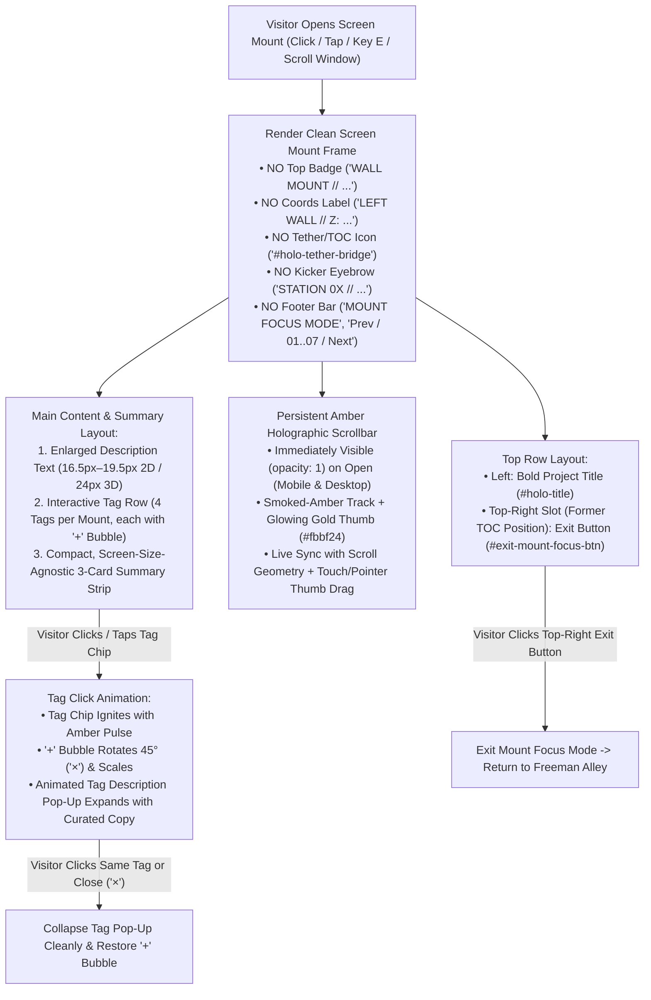

# Functional Specification 068: Screen Mount Layout & Interaction Overhaul — Header & Footer Removal, Top-Right Exit Control Relocation, Persistent Amber-Themed Mobile/Desktop Scrollbar, Enlarged Description Typography, Interactive `+` Bubble Tag Pop-Ups (28-Tag Catalog), and Screen-Size-Agnostic Compact Summary Cards

## 1. System Purpose & Core Objective

This specification defines the desired `{functionality}`, first-principles viewport and typographic math, interactive state machines, operational budgets, failure-isolation boundaries, and verifiable `{correct required outputs}` for revising the **7 wall screen mounts** (`SCREEN_MOUNT_01` through `SCREEN_MOUNT_07`) and their **2D focused holographic terminal view** in Freeman Alley (`SkateAlley`).

The scope unifies six tightly coupled functional pillars across both the **2D focused/projection screen mount overlay** and the **3D in-world wall screen mount textures**:

1. **Header Telemetry Removal & Top-Right Exit Control Relocation:** Removing the header metadata rows (`● WALL MOUNT // SCREEN_MOUNT_0X (0X OF 07)`, `LEFT/RIGHT WALL // Z: ... • Y: ... • NORMAL: ...`, the `STATION 0X //` kicker eyebrow, and the 3-line inter-module tether/table-of-contents icon) and relocating the **Exit** control directly into the top-right corner slot previously occupied by the 3-line table-of-contents (`tether-bridge`) button.
2. **Footer Chrome Removal:** Removing the entire bottom footer bar (`MOUNT FOCUS MODE // SCREEN_MOUNT_0X INTERACTIVE TERMINAL (ESC OR WASD TO EXIT)` status readout, top divider line, and `[← Prev] [01]..[07] [Next →]` pagination pips) from both the 2D screen mount window and the 3D screen mount canvas.
3. **Persistent, Immediately Visible Amber-Themed Scrollbar:** Resolving mobile OS overlay-scrollbar auto-hiding and dual-container scroll conflicts by providing a dedicated, custom-rendered holographic scrollbar track and thumb matching the smoked-amber/gold screen mount aesthetic that is **immediately visible at `t = 0 ms`** upon opening any screen mount on mobile, tablet, or desktop and persists throughout the session.
4. **Enlarged Description & Narrative Typography:** Increasing the font size, line height, and reading measure of project descriptions (and Station `04` / `SCREEN_MOUNT_07`'s `"What the hell does this mean, Luis?"` narrative callout) across both the 2D screen mount modal and the 3D wall screen mount texture, utilizing the vertical space reclaimed by removing the header and footer bars.
5. **Interactive Clickable Tags with Visible `"+"` Bubbles, Click Animation & Pop-Up Descriptions:** Upgrading all **28 technology/concept tags** across the 7 screen mounts into interactive controls featuring a visible circular `"+"` bubble badge on every tag, a spring/glow click animation (rotating `+` to `×` when active), and an animated holographic **Tag Description Pop-Up** presenting a concise, authoritative explanation of the selected tag.
6. **Screen-Size-Agnostic, Compact Brief Summary Cards (Zero Needless Mobile Scrolling):** Redesigning the 3-item brief summary strip (e.g., `Chained / AI Models`, `Auto / Code & Media`, `E2E / Pipelines`) into a screen-size-agnostic, compact horizontal layout with balanced internal spacing (never squished together) so standard-length screen mounts fit cleanly inside mobile viewports without forcing needless vertical scrolling.

**DO NOT CODE YET.** This document specifies functional outcomes, mathematical and spatial budgets, state transitions, tag content catalogs, edge cases, and measurable acceptance criteria only. It contains zero implementation code, concrete programming syntax, or mechanical diffs.

---

## 2. Authoritative Domain Vocabulary Alignment ([`LANGUAGE.md`](file:///Users/diesel/desktop/skatealley/LANGUAGE.md))

All assessments of system state, design completeness, operational constraints, and verification gates strictly adopt the evaluation taxonomy established in [`LANGUAGE.md`](file:///Users/diesel/desktop/skatealley/LANGUAGE.md):

- **`{functionality}`**:
  1. Visitors inspecting any of the 7 wall screen mounts (`SCREEN_MOUNT_01` through `SCREEN_MOUNT_07`) see a clean, chrome-free holographic layout devoid of top header telemetry badges/coordinates and devoid of bottom footer status/pagination bars.
  2. The **Exit** button resides in the top-right corner of the screen mount where the 3-line table-of-contents (`tether-bridge`) button previously sat, allowing one-tap/one-click dismissal back to Freeman Alley.
  3. Opening a screen mount on mobile or desktop immediately displays a persistent, amber-themed holographic scrollbar along the right edge of the scrollable content region without requiring the user to initiate a touch drag first.
  4. Project descriptions render at a significantly larger, highly legible typographic scale across both 2D and 3D screen mount surfaces.
  5. Every tag chip across all 7 screen mounts displays a visible `"+"` bubble indicator, responds to click/tap input with a tactile holographic animation, and opens an animated pop-up displaying a brief description of that tag.
  6. The 3 brief summary cards per station (`metrics`) render in a compact, screen-size-agnostic horizontal strip with generous breathing room that eliminates needless vertical scrolling on mobile viewports for standard-length stations.
- **`{correctness}`**:
  - **2D DOM & 3D Canvas Visual Parity:** Both the 2D screen mount modal and the 3D in-world `1024 × 627` screen mount `CanvasTexture` omit the legacy header telemetry and footer bars, place the Exit control in the top-right corner, render enlarged description text, draw `"+"` bubbles on all tag chips, and render compact 3-up summary cards.
  - **Deterministic Mobile Scrollbar Persistence:** Because iOS WebKit and Android Blink hide native `::-webkit-scrollbar` thumbs when idle, the screen mount scroll container is paired with an explicit, DOM-backed holographic scrollbar rail and thumb whose position and thumb-length ratio are computed deterministically from live scroll geometry (`scrollTop`, `scrollHeight`, `clientHeight`) and remain visible (`opacity = 1`) whenever a screen mount is open.
  - **Bounded Tag Pop-Up State Machine:** Clicking a tag toggles its active state deterministically, animates its `"+"` bubble, and opens/updates the Tag Description Pop-Up without overflowing the screen mount boundary or mutating corridor locomotion state.
  - **Zero Silent Fallbacks (`RULE[user_global]`):** Every station tag in the 7-station manifest maps to a verified, non-empty description entry; unmapped or missing tag metadata fails fast during validation rather than rendering blank pop-ups.
- **`{correct required outputs}`**:
  1. All 7 screen mounts (`SCREEN_MOUNT_01..07`) render with `headerTelemetryVisible === false`, `tetherBridgeVisible === false`, and `footerBarVisible === false` in both the 2D modal and 3D wall textures.
  2. The Exit button (`exit-mount-focus-btn`) is anchored in the top-right header slot (`rightEdge - buttonWidth`, top row) with a minimum `44 × 36 px` touch target on mobile and desktop, and clicking/tapping it exits `mount-focus` mode cleanly.
  3. The custom themed scrollbar element is present, visible (`getComputedStyle.opacity === "1"`, `display !== "none"`), styled in the screen mount's amber/gold palette (`#fbbf24` / `#fcd34d` thumb over `rgba(38, 18, 4, 0.78)` track), and synchronizes thumb offset and height on mount open, window resize, tag pop-up expansion, and touch/wheel/drag scrolling.
  4. Computed 2D description font size is **`≥ 16.5 px`** on mobile (`375 px` width) and **`≥ 18.5 px`** on desktop (`1280 px` width) (up from `14 px` baseline), and 3D canvas description font size is **`≥ 23 px`** on the `1280 × 784` logical grid (up from `18.5 px` baseline).
  5. All 28 tags across Stations `01`–`07` render as interactive button controls containing a visible `"+"` bubble badge; clicking any tag triggers the click animation and opens the Tag Description Pop-Up displaying that tag's exact curated description.
  6. On a `390 × 844` mobile viewport (and `375 × 667` compact mobile viewport), opening standard-length Stations (`01`, `02`, `03`, `05`, `06`, `07`) with no tag pop-up expanded produces `scrollHeight <= clientHeight` (`0 px` of needless vertical overflow) while maintaining `≥ 8 px` horizontal gap between the 3 summary boxes and `≥ 6 px` internal padding.
- **`{errors}`**:
  - Leaving `WALL MOUNT // SCREEN_MOUNT_0X`, `HOLO-PROJ // 0X OF 07`, `LEFT/RIGHT WALL // Z: ...`, `STATION 0X //` kicker text, or the 3-line `holo-tether-bridge` icon visible in either the 2D modal or 3D screen mount texture.
  - Leaving the `MOUNT FOCUS MODE // ...` status text or `[← Prev] [01]..[07] [Next →]` footer bar visible in either the 2D modal or 3D screen mount texture.
  - Relying solely on native CSS `::-webkit-scrollbar` on mobile browsers where the OS hides the scrollbar until an active scroll gesture occurs.
  - Leaving description text at the legacy `14 px` (2D) or `18.5 px` (3D) size.
  - Rendering static, non-clickable tag spans without a visible `"+"` bubble, without a click animation, or without a pop-up description.
  - Allowing the 3 brief summary cards (`metrics`) to wrap into tall multi-line boxes that force needless vertical scrolling on mobile for standard-length stations, or squishing their text/borders together without readable spacing.
- **`{sufficient}`**: Complete first-principles vertical/horizontal layout budget, exact removal/relocation inventory, custom scrollbar geometry math, typographic scale table, interactive tag animation/pop-up state machine, and the complete 28-tag description catalog across all 7 stations.
- **`{insufficient}`**: Any specification that omits the 28 tag descriptions, relies on auto-hidden native mobile scrollbars, forgets to update the 3D `CanvasTexture` alongside the 2D modal, or fails to prove mobile viewport fit mathematically.

---

## 3. First-Principles Viewport, Layout & Typographic Modeling (`RULE[user_global]`)

### 3.1 Root-Cause Analysis of Legacy Screen Mount Layout & Mobile Scrolling Parasites

An empirical audit of the legacy screen mount implementation reveals four compounding layout problems:

1. **Redundant Header & Footer Chrome Consuming `38%–45%` of Mobile Vertical Viewport:**
   - On a mobile viewport (`375 × 667` iPhone SE or `390 × 844` iPhone 14), the available stage height (`top: 54px; bottom: 148px` above the mobile thumbpad) is **`465 px – 642 px`**.
   - In the legacy layout:
     - `.holo-top-bar` (2 wrapped rows containing `.holo-badge`, `#holo-tether-bridge`, `#holo-coords-label`, `#exit-mount-focus-btn`, plus bottom border and padding) consumed **`78 px – 96 px`**.
     - `#holo-kicker` (`STATION 0X // ...`) consumed another **`22 px`** directly above `#holo-title`, duplicating the station title already shown in `#holo-title` and the 3D levitating graffiti header above the mount.
     - `.holo-footer-bar` (`#holo-footer-status` + 9-button `.holo-station-nav-group` wrapping across 2 rows on mobile) consumed **`74 px – 92 px`**.
   - Together, header + kicker + footer chrome consumed **`174 px – 210 px`** (`37%–45%` of the entire card height), starving the actual project description and forcing vertical scrolling even on 1-sentence stations!

2. **Why Mobile Had No Immediately Visible Scrollbar:**
   - First, mobile browsers (iOS Safari/WebKit and Android Chrome) enforce OS-level overlay scrollbars that remain **completely invisible (`opacity: 0`)** when a container first opens and only flash briefly during active touch movement.
   - Second, at `@media (max-width: 900px)`, `.holo-window` applied `overflow-y: auto !important` while `.holo-body-grid` simultaneously applied `overflow-y: auto`, creating nested scroll containers where neither displayed a persistent scrollbar rail on mobile.

3. **Why Brief Summary Cards (`metrics`) Caused Needless Mobile Scrolling:**
   - In the legacy layout, `.holo-body-grid` stacked `.holo-Visual-panel` below `.holo-main-col` on viewports `≤ 860 px` with a `22 px` grid gap.
   - `.holo-Visual-panel` added a heavy outer box (`padding: 14px 16px`, border, inset shadow) around `.holo-metrics-grid`, and each `.holo-metric-box` stacked a block value and block label that wrapped onto 3 vertical lines on narrow mobile screens (e.g., `Auto` + `CODE &` + `MEDIA`), consuming **`108 px – 132 px`** of vertical height just for 6 words of summary text.

### 3.2 Reclaimed Vertical Budget & Mobile Zero-Overflow Proof

By removing `.holo-badge`, `#holo-coords-label`, `#holo-tether-bridge`, `#holo-kicker`, and `.holo-footer-bar`, and anchoring the **Exit** button cleanly in the top-right corner alongside the title header row:

$$\Delta H_{\text{reclaimed}} = H_{\text{legacy\_header}} + H_{\text{kicker}} + H_{\text{legacy\_footer}} \approx 174\text{ px} \text{ to } 210\text{ px}$$

Let us model the new vertical height budget on a **`390 × 844`** mobile viewport (available card height $H_{\text{avail}} \approx 620\text{ px}$) and a compact **`375 × 667`** mobile viewport ($H_{\text{avail}} \approx 465\text{ px}$) for standard stations (Stations `01`, `02`, `03`, `05`, `06`, `07`):

| Component | Compact Mobile (`375×667`) | Standard Mobile (`390×844`) | Desktop (`≥ 900px`) |
| :--- | :---: | :---: | :---: |
| **Card Top/Bottom Padding** | `24 px` (`12px × 2`) | `28 px` (`14px × 2`) | `44 px` (`22px × 2`) |
| **Top Header Row (Title + Top-Right Exit Button)** | `44 px – 62 px` | `46 px – 66 px` | `44 px – 56 px` |
| **Enlarged Description Copy (`16.5px–19px`, `3–5` lines)** | `82 px – 130 px` | `86 px – 138 px` | `84 px – 145 px` |
| **Interactive `+` Tag Row (`4` chips, `1–2` rows)** | `64 px – 72 px` | `64 px – 72 px` | `36 px – 76 px` |
| **Compact 3-Column Summary Strip (`metrics`)** | `52 px – 58 px` | `54 px – 60 px` | `62 px – 68 px` |
| **Optional CTA Buttons (`Stations 01, 02, 03` only)** | `0 px` or `76 px` | `0 px` or `80 px` | `0 px` or `96 px` (in right column) |
| **Inter-Section Vertical Gaps** | `30 px` (`10px × 3`) | `36 px` (`12px × 3`) | `32 px` |
| **Total Content Height (No-CTA Stations `05, 06, 07`)** | **`296 px – 376 px` (`< 465 px`)** | **`314 px – 400 px` (`< 620 px`)** | **`260 px – 345 px`** |
| **Total Content Height (CTA Stations `01, 02, 03`)** | **`372 px – 442 px` (`< 465 px`)** | **`394 px – 468 px` (`< 620 px`)** | **`280 px – 365 px`** |

- **Mathematical Conclusion:**
  1. All 6 standard-length stations (`01`, `02`, `03`, `05`, `06`, `07`) fit **100% within the mobile viewport (`scrollHeight <= clientHeight`)** with zero needless scrolling when opened!
  2. When a visitor opens **Station `04` (`SCREEN_MOUNT_07` — `REJECTION STATION // MACHINE LEARNING`)**, which intentionally includes the `528`-character `"What the hell does this mean, Luis?"` recruitment story callout, OR when a visitor expands a **Tag Description Pop-Up** on a compact mobile screen, the content smoothly scrolls inside the unified scroll viewport while the **persistent amber holographic scrollbar** on the right edge provides immediate visual feedback and interactive thumb control.

---

## 4. End-to-End Screen Mount Layout & Interaction Architecture

---

## 5. Detailed Functional Requirements

### 5.1 Pillar 1: Header Removal & Top-Right Exit Button Relocation (Image 1)

1. **Elements to Remove Completely from the Screen Mount Header:**
   Across both the 2D screen mount window (`#holo-popup-window`) and the 3D in-world screen mount texture (`createProjectScreenTexture`):
   - **Remove the Station Pill Badge (`.holo-badge` / `#holo-station-badge`):** Do not display `● WALL MOUNT // SCREEN_MOUNT_01 (01 OF 07)` or `● HOLO-PROJ // 01 OF 07`.
   - **Remove the Spatial Coordinate Readout (`#holo-coords-label`):** Do not display `LEFT WALL // Z: 5.0M • Y: 1.75M • NORMAL: +X` or `ALLEY CORRIDOR Z: 5.0m // SCROLL WINDOW: 05%–18%`.
   - **Remove the 3-Line Table-of-Contents / Tether Bridge Button (`#holo-tether-bridge`):** Remove the 3-trace horizontal line/node button from the top-right corner of the header.
   - **Remove the Redundant Kicker Eyebrow (`#holo-kicker`):** Remove the `STATION 0X // ...` small uppercase eyebrow above `#holo-title` so the station's primary title (`#holo-title`) sits cleanly at the top-left of the card without redundant station-number prefixes.

2. **Relocating the Exit Button to the Former Table-of-Contents Position (Top-Right Corner):**
   - The **Exit** button (`#exit-mount-focus-btn`) SHALL be positioned in the **top-right corner** of the screen mount—the exact slot previously occupied by the 3-line table-of-contents (`#holo-tether-bridge`) button.
   - **Top Row Alignment:** The primary project title (`#holo-title`) occupies the left/main portion of the top header zone, and the **Exit** button is anchored to the top-right corner (`align-self: flex-start`, `margin-left: auto`), separated by a minimum `12 px` horizontal gap so the title and Exit button never overlap on any viewport width (`320 px` to `3840 px`).
   - **Responsive Exit Button Labeling & Aesthetics:**
     - Retains its high-contrast holographic exit styling (crimson-amber border `rgba(248, 113, 113, 0.85)`, translucent dark-crimson glass fill `rgba(239, 68, 68, 0.28)`, glowing hover state, crisp monospace typography).
     - Displays concise, screen-size-safe copy (e.g., `✕ EXIT` or `✕ Exit (Esc)` on desktop and compact `✕ EXIT` on narrow mobile screens) so it fits cleanly in the top-right corner slot where the table-of-contents icon used to sit without forcing a second header line.
     - Maintains a minimum interactive hit area of **`44 × 36 px`** on touch and desktop devices.
   - **3D Wall Screen Mount Canvas Parity:** On the 3D screen mount canvas (`1280 × 784` logical coordinates), the top-right corner slot (`rightEdge = 1224`, `topY = 44`) renders the compact Exit pill where the 3-trace tether icon previously sat, while the station title starts immediately on the left (`x = 56`, `y = 76`) with zero legacy badge or coordinate rows above it.

---

### 5.2 Pillar 2: Complete Removal of the Screen Mount Footer (Image 2)

1. **Elements to Remove Completely from the Screen Mount Footer:**
   Across both the 2D screen mount window (`#holo-popup-window`) and the 3D wall screen mount texture (`createProjectScreenTexture`):
   - **Remove the Footer Bar Container (`.holo-footer-bar`) and Top Divider Line:** Do not render the horizontal footer separator line or footer container at the bottom of the screen mount.
   - **Remove the Footer Status Readout (`#holo-footer-status`):** Do not display `MOUNT FOCUS MODE // SCREEN_MOUNT_01 INTERACTIVE TERMINAL (ESC OR WASD TO EXIT)` or `HOLOGRAPHIC PROJECTION // ...`.
   - **Remove the Station Pagination Pips & Prev/Next Controls (`.holo-station-nav-group`, `#holo-prev-mount-btn`, `#holo-station-pips`, `#holo-next-mount-btn`):** Do not render `[← Prev]`, `[01]` through `[07]`, or `[Next →]` at the bottom of the screen mount.

---

### 5.3 Pillar 3: Persistent, Immediately Visible Amber-Themed Scrollbar on Mobile & Desktop

1. **Single Authoritative Scroll Viewport Inside the Screen Mount:**
   - Eliminate conflicting dual `overflow-y: auto` rules between `.holo-window` and `.holo-body-grid` on mobile media queries (`@media (max-width: 900px)` and `@media (max-height: 500px)`).
   - Establish a single deterministic scrollable viewport container inside `#holo-popup-window` (wrapping the body content below the pinned top header row) so scroll metrics (`scrollTop`, `scrollHeight`, `clientHeight`) are governed by a single element across all screen sizes.

2. **Always-Visible Custom Holographic Scrollbar Component:**
   - Because mobile browsers (iOS Safari/WebKit, Android Chrome) hide native CSS scrollbars until an active touch-drag occurs, the screen mount SHALL include an explicit, always-visible **Holographic Scrollbar Rail & Thumb** element (`#holo-custom-scrollbar` / `.holo-scrollbar-track` + `.holo-scrollbar-thumb`) mounted along the right inner edge of the screen mount content area.
   - **Immediate Visibility & Persistence Invariant:**
     - The moment a user opens any screen mount (`#holo-popup-window.active`), the custom holographic scrollbar rail and thumb SHALL be immediately visible (`opacity: 1`, `visibility: visible`) with zero delay and zero requirement for the user to touch or scroll first.
     - It SHALL remain persistently visible for the entire duration the screen mount is open across mobile (`≤ 768 px`), tablet (`769 px – 1024 px`), and desktop (`> 1024 px`) viewports.
   - **Screen Mount Theme & Aesthetic Matching:**
     - **Track (`.holo-scrollbar-track`):** Width `8 px` on mobile / `8 px–10 px` on desktop, pill-rounded ends (`border-radius: 999px`), recessed smoked-amber glass background (`rgba(28, 12, 2, 0.82)`), subtle amber border (`1px solid rgba(245, 158, 11, 0.52)`), and inset phosphor shadow (`inset 0 0 8px rgba(245, 158, 11, 0.18)`).
     - **Thumb (`.holo-scrollbar-thumb`):** Metallic amber-gold gradient (`linear-gradient(180deg, #fef08a 0%, #fbbf24 50%, #d97706 100%)`), bright gold border (`1px solid rgba(254, 243, 199, 0.92)`), and warm outer bloom (`0 0 10px rgba(251, 191, 36, 0.75)`).
   - **Thumb Geometry & Interactive Synchronization Math:**
     - Let $H_{\text{track}}$ be the pixel height of `.holo-scrollbar-track`, $H_{\text{client}}$ be `scrollContainer.clientHeight`, $H_{\text{scroll}}$ be `scrollContainer.scrollHeight`, and $S_{\text{top}}$ be `scrollContainer.scrollTop`.
     - **Thumb Height ($H_{\text{thumb}}$):**
       $$H_{\text{thumb}} = \begin{cases} H_{\text{track}} & \text{if } H_{\text{scroll}} \le H_{\text{client}} \\ \max\!\left(32\text{ px},\; \text{round}\!\left(\frac{H_{\text{client}}}{H_{\text{scroll}}} \cdot H_{\text{track}}\right)\right) & \text{if } H_{\text{scroll}} > H_{\text{client}} \end{cases}$$
     - **Thumb Vertical Offset ($Y_{\text{thumb}}$):**
       $$Y_{\text{thumb}} = \begin{cases} 0 & \text{if } H_{\text{scroll}} \le H_{\text{client}} \\ \text{round}\!\left(\frac{S_{\text{top}}}{H_{\text{scroll}} - H_{\text{client}}} \cdot (H_{\text{track}} - H_{\text{thumb}})\right) & \text{if } H_{\text{scroll}} > H_{\text{client}} \end{cases}$$
     - **Direct Pointer/Touch Manipulation:** Users can scroll via touch swipe on the content pane, mouse wheel, keyboard (`ArrowUp` / `ArrowDown` / `PageUp` / `PageDown`), clicking on the scrollbar track (jumping smoothly toward the clicked track fraction), or dragging the `.holo-scrollbar-thumb` directly via pointer/touch events.
     - **Native Scrollbar Styling Parity:** On desktop browsers that also render `::-webkit-scrollbar`, either hide the redundant native bar (`scrollbar-width: none` / `::-webkit-scrollbar { display: none }`) so only the single themed custom holographic scrollbar is shown, or synchronize it seamlessly so there is never a double scrollbar.

---

### 5.4 Pillar 4: Enlarged Description Typography Across 2D & 3D Screen Mounts

1. **2D Screen Mount Modal Typography Scale (`#holo-description` & `#holo-narrative-callout`):**
   - **Primary Description (`#holo-description`):**
     - Increase font size from the legacy `14 px` to a fluid, high-legibility scale:
       $$\text{font-size} = \text{clamp}(16.5\text{px},\; 1.85\text{vw},\; 19.5\text{px})$$
     - Line height: **`1.58 – 1.64`**, color: `#fef3c7` with crisp dark-amber text shadow (`0 1px 6px rgba(0, 0, 0, 0.95), 0 0 12px rgba(217, 119, 6, 0.45)`), font weight: `500`.
   - **Narrative Callout (`#holo-narrative-heading` & `#holo-narrative-body` on Station `04` / `SCREEN_MOUNT_07`):**
     - Increase `#holo-narrative-heading` (`"What the hell does this mean, Luis?"`) from `13 px` to **`clamp(15.5px, 1.65vw, 18px)`** (`font-weight: 800`, `#fbbf24`).
     - Increase `#holo-narrative-body` from `13.2 px` to **`clamp(15.5px, 1.65vw, 17.5px)`** (`line-height: 1.60`, `#fffbeb`).

2. **3D In-World Screen Mount Canvas Typography Scale (`createProjectScreenTexture`):**
   - With the `166 px` header zone and `168 px` footer zone removed from the `1280 × 784` logical canvas (`1024 × 627` texture), the vertical content region spans `y ∈ [52, 736]` (`684 px` available height vs. `450 px` previously).
   - Increase the 3D canvas description font size from `18.5 px` (`lineHeight = 27 px`) to **`24 px`** (`lineHeight = 35 px`, `font-weight: 500`), allowing up to `5–6` lines of crisp, high-contrast copy that is dramatically more legible when viewing the wall mount in 3D space.

---

### 5.5 Pillar 5: Interactive Clickable Tags with Visible `"+"` Bubbles, Click Animation & Pop-Up Descriptions (Image 3)

1. **Tag Chip Structure & Visible `"+"` Bubble Indicator:**
   - Every tag in `#holo-tags` (`4` tags per station, `28` tags total across all 7 stations) SHALL be rendered as an interactive `<button type="button" class="holo-tag">` element (`cursor: pointer`, `pointer-events: auto` in active/focused screen mounts).
   - Each tag button contains:
     1. `{tag.label}` — the tag text (`font-size: clamp(12px, 1.25vw, 13.5px)`, `font-weight: 600`, `#fde68a`).
     2. `+` — a clearly visible circular `"+"` bubble badge (`width: 18px; height: 18px; border-radius: 50%`) anchored on the right side (or top-right edge) of the tag pill with a glowing amber border (`1.5px solid #fbbf24`), warm amber fill (`rgba(217, 119, 6, 0.42)`), bright `#fffbeb` `+` glyph, and soft outer glow (`0 0 8px rgba(251, 191, 36, 0.55)`).
   - **3D Wall Screen Mount Canvas Parity:** On the 3D screen mount canvas (`createProjectScreenTexture`), each drawn tag chip also renders the circular amber `"+"` bubble next to the tag label so the 3D wall mount visually matches the 2D interactive mount.

2. **Tag Click Animation & Active State Transition:**
   - Clicking or tapping any `.holo-tag` button (either in `mount-focus` mode or when clicking a tag on an active screen mount overlay) triggers a deterministic holographic click animation:
     - **Tag Pill Ignition:** The clicked tag chip receives `.holo-tag.active` and `.holo-tag.animating`, executing a `260 ms` cubic-bezier spring pulse (`scale(1) -> scale(1.06) -> scale(1)`), brightening its border to `#fffbeb` and background to `rgba(217, 119, 6, 0.58)` with an expanding amber glow ring (`0 0 18px rgba(251, 191, 36, 0.82)`).
     - **`"+"` Bubble Rotation & Pulse:** The `.holo-tag-plus-bubble` smoothly rotates **`45deg`** (transforming the `+` into a close `×` indicator) with a scale/brightness pop (`transform: rotate(45deg) scale(1.12)`).
     - **Audio Feedback:** Triggers the existing holographic UI audio cue (`onUpdate` / `onActivate`) when audio is unlocked.

3. **Animated Holographic Tag Description Pop-Up (`#holo-tag-popup`):**
   - Immediately below (or anchored to) the `.holo-tag-row`, an animated holographic **Tag Description Pop-Up** container (`#holo-tag-popup` / `.holo-tag-popup`) materializes when a tag is active:
     - **Pop-Up Materialization Animation (`240 ms` `cubic-bezier(0.16, 1, 0.3, 1)`):** Animates from `opacity: 0; transform: translateY(-6px) scale(0.96)` to `opacity: 1; transform: translateY(0) scale(1)` with a sweeping amber top-border highlight.
     - **Pop-Up Header & Close Control:** Displays the selected tag's badge/title (`#holo-tag-popup-title`, `#fbbf24`, bold monospace) and a compact `✕` close button (`#holo-tag-popup-close-btn`) in the top-right corner of the pop-up.
     - **Pop-Up Body (`#holo-tag-popup-desc`):** Displays a concise, informative 1–2 sentence description (`font-size: clamp(13.5px, 1.45vw, 15.5px)`, `line-height: 1.52`, `#fffbeb`) explaining the tag's technical role and significance in that station's project.
     - **Switching & Dismissal:**
       - Clicking a *different* tag while the pop-up is open switches `.active` to the newly clicked tag, replays the pulse transition, and updates `#holo-tag-popup-title` and `#holo-tag-popup-desc` in place.
       - Clicking the *currently active* tag again, or clicking `#holo-tag-popup-close-btn`, collapses the pop-up (`opacity: 0; transform: translateY(-4px) scale(0.97)`) and restores the tag's `"+"` bubble to `0deg` (`+`).
       - Switching stations resets any open tag pop-up to its closed state.
       - Expanding or collapsing a tag pop-up immediately recalculates the custom holographic scrollbar thumb size and position, and if the pop-up extends below the current scroll fold on a small screen, smoothly scrolls the pop-up into view.

4. **Authoritative 28-Tag Description Catalog Across All 7 Screen Mounts:**

   | Station & Mount | Tag Label | Curated Pop-Up Description |
   | :--- | :--- | :--- |
   | **`01` (`SCREEN_MOUNT_01`)** `GRAPHRAG POLICY ENGINE` | **`OBJ-200`** | Internal project designation for the Lymphedema Treatment Act Medicare DME qualification engine built for Durable Medical Goods compliance workflows. |
   | **`01` (`SCREEN_MOUNT_01`)** | **`GraphRAG LLM`** | Property-graph retrieval-augmented generation pipeline that grounds LLM determinations in structured Medicare statutory rules rather than unconstrained free-text recall. |
   | **`01` (`SCREEN_MOUNT_01`)** | **`8-Hop Lineage`** | Multi-step graph traversal tracing up to 8 relational hops across diagnosis codes, clinical measurements, compression garment classes, and coverage exceptions. |
   | **`01` (`SCREEN_MOUNT_01`)** | **`17 Cat / 18 Edge`** | Domain ontology schema spanning 17 medical/policy node categories connected by 18 typed regulatory and clinical relationship edge types. |
   | **`02` (`SCREEN_MOUNT_02`)** `DIGITAL TWIN PERSONA` | **`OBJ-04`** | Unit identifier for Luis's autonomous Digital Twin persona and floating `DOOM_HEAD` holographic companion operating inside Freeman Alley. |
   | **`02` (`SCREEN_MOUNT_02`)** | **`Philosophy + MF DOOM`** | Curated training and alignment corpus blending undergraduate Philosophy & Religion coursework with MF DOOM's intricate multi-syllabic rhyme schemes and cadence. |
   | **`02` (`SCREEN_MOUNT_02`)** | **`Finetuned LLM`** | Custom instruction-tuned and style-aligned language model engineered to reason about systems architecture and philosophy in a signature lyrical voice. |
   | **`02` (`SCREEN_MOUNT_02`)** | **`Twitter & LinkedIn`** | Live social deployment bindings enabling the Digital Twin persona to publish, reply, and interact autonomously across X/Twitter and LinkedIn channels. |
   | **`03` (`SCREEN_MOUNT_03`)** `QUANTITATIVE MODELING AND STATISTICAL ARBITRAGE` | **`Bayesian SSM`** | Bayesian State Space Model using Kalman filtering and Hidden Markov regime switching to track unobserved equilibrium spreads and time-varying hedge ratios. |
   | **`03` (`SCREEN_MOUNT_03`)** | **`$50K TopStepXFA`** | Validated under live market risk constraints to pass a $50,000 TopStep Express Funded Account (XFA) quantitative trading combine evaluation. |
   | **`03` (`SCREEN_MOUNT_03`)** | **`Mean Reversion`** | Statistical execution strategy that enters counter-trend positions when cointegrated asset spreads deviate beyond dynamically calibrated $z$-score thresholds. |
   | **`03` (`SCREEN_MOUNT_03`)** | **`Cointegration`** | Econometric stationarity verification (Augmented Dickey-Fuller $p < 0.05$) ensuring paired financial instruments share a stable long-run equilibrium linear combination. |
   | **`04` (`SCREEN_MOUNT_07`)** `REJECTION STATION // MACHINE LEARNING` | **`bge-large-en-v1.5`** | Frozen BAAI `bge-large-en-v1.5` transformer backbone used to extract high-resolution semantic representations from raw resume and job-description text. |
   | **`04` (`SCREEN_MOUNT_07`)** | **`1,024-D Embeddings`** | Dense 1,024-dimensional L2-normalized feature vectors capturing deep technical skill, domain experience, and role-fit geometry for downstream classical ML classifiers. |
   | **`04` (`SCREEN_MOUNT_07`)** | **`LinearSVC Heads`** | Lightweight, dynamically swappable Linear Support Vector Machine classification heads trained on top of frozen embeddings for sub-millisecond role scoring. |
   | **`04` (`SCREEN_MOUNT_07`)** | **`9 Job Roles`** | Multi-target classification suite evaluating candidate fit across 9 distinct engineering, data science, and quantitative analytics role profiles. |
   | **`05` (`SCREEN_MOUNT_04`)** `AI DATA ANALYTICS DASHBOARDS AND ALIGNMENT RESEARCH` | **`Live Analytics`** | Real-time telemetry ingestion and visual dashboard pipelines that transform raw operational and unstructured data streams into actionable metrics. |
   | **`05` (`SCREEN_MOUNT_04`)** | **`Structured Context`** | Schema-validated knowledge graphs and typed context packets distilled from noisy datasets so downstream AI agents operate on verifiable ground truth. |
   | **`05` (`SCREEN_MOUNT_04`)** | **`Agent Swarms`** | Multi-agent orchestration architectures where specialized autonomous workers coordinate tasks, share state, and verify outputs across shared telemetry buses. |
   | **`05` (`SCREEN_MOUNT_04`)** | **`Alignment Research`** | Empirical guardrails, objective-function auditing, and deterministic evaluation harnesses ensuring autonomous agent swarms stay locked to human intent. |
   | **`06` (`SCREEN_MOUNT_05`)** `GENERATIVE PIPELINES` | **`Chained AI Models`** | Sequential and DAG-based multi-model pipelines where outputs from retrieval, reasoning, vision, and audio models feed deterministically into downstream stages. |
   | **`06` (`SCREEN_MOUNT_05`)** | **`Content Production`** | Automated multi-modal media synthesis generating synchronized copy, visual assets, 3D textures, and styled layouts from structured creative briefs. |
   | **`06` (`SCREEN_MOUNT_05`)** | **`Code Generation`** | Specification-driven agentic coding workflows that synthesize, test, and verify production software modules against strict architectural contracts. |
   | **`06` (`SCREEN_MOUNT_05`)** | **`Workflow Execution`** | End-to-end task automation engines connecting LLM tool-calling and schema validation to live APIs, databases, and build pipelines. |
   | **`07` (`SCREEN_MOUNT_06`)** `MULTI-MODAL DEEP LEARNING` | **`Transformers & CNNs`** | Hybrid deep learning stacks combining self-attention sequence/vision Transformers (ViT) with Convolutional Neural Networks for spatial and temporal feature extraction. |
   | **`07` (`SCREEN_MOUNT_06`)** | **`Autoencoders`** | Variational and denoising autoencoder architectures trained to compress high-dimensional inputs into compact latent manifolds for anomaly detection and data mining. |
   | **`07` (`SCREEN_MOUNT_06`)** | **`Diffusion & 3D`** | Latent diffusion and image-to-3D generative pipelines used to synthesize custom textures, holographic visuals, and rigged 3D assets. |
   | **`07` (`SCREEN_MOUNT_06`)** | **`Audio Cloning`** | Neural speech synthesis and zero-shot voice cloning models trained to generate expressive character dialogue and custom vocal stems. |

---

### 5.6 Pillar 6: Screen-Size-Agnostic, Compact Brief Summary Cards (Image 4)

1. **Eliminating Bulky Wrapper Chrome & Multi-Line Wrapping on Mobile:**
   - The 3 brief summary items per station (`metrics`, e.g., `Chained / AI Models`, `Auto / Code & Media`, `E2E / Pipelines`) SHALL be rendered in a **compact, screen-size-agnostic 3-column horizontal strip** (`grid-template-columns: repeat(3, minmax(0, 1fr))`) across desktop, tablet, and mobile viewports.
   - **No Squishing Invariant:**
     - Maintain a clean horizontal gap of **`clamp(8px, 1.5vw, 12px)`** between the 3 summary boxes so the cards are visually distinct and never squished together.
     - Inside each `.holo-metric-box`, apply balanced compact padding (`padding: clamp(6px, 1vw, 9px) clamp(6px, 1.1vw, 10px)`) and a `4px` vertical gap between the primary value (`.holo-metric-val`) and secondary label (`.holo-metric-lbl`).
   - **Fluid, Non-Bloated Typography:**
     - `.holo-metric-val`: `font-size: clamp(12.5px, 1.45vw, 15.5px)`, `line-height: 1.15`, `font-weight: 800`, `#fbbf24`, `white-space: nowrap`.
     - `.holo-metric-lbl`: `font-size: clamp(9.5px, 1.05vw, 11px)`, `line-height: 1.18`, `letter-spacing: 0.04em`, `#fde68a`, `white-space: nowrap` (with `overflow: hidden; text-overflow: ellipsis` safety only on ultra-narrow `< 330px` screens so `AI MODELS`, `CODE & MEDIA`, `PIPELINES`, `TOPSTEPXFA`, `CAT / EDGE`, etc. fit on a **single line** on standard `360px–430px` mobile screens instead of wrapping onto multiple lines!).
   - **Lightweight Outer Container (`.holo-Visual-panel`):**
     - Reduce `.holo-Visual-panel` padding from `14px 16px` to **`clamp(8px, 1.2vw, 12px)`** (or render the 3-card summary strip with slim `8px 10px` framing) and reduce the mobile vertical gap between `.holo-main-col` and `.holo-Visual-panel` from `22px` to **`12px`**.
     - When a station has no primary or secondary CTA links (`Stations 04, 05, 06, 07`), `.holo-cta-stack` remains hidden (`display: none`) and `.holo-Visual-panel` wraps tightly around the single-row 3-card summary strip (`total height ≤ 60 px` on mobile).

---

## 6. Operational & Performance Budgets

1. **GPU & CPU Memory Budget Compliance ([`functional_specification_066.md`](file:///Users/diesel/desktop/skatealley/functional_specification_066.md)):**
   - All 7 wall screen mount `CanvasTexture` instances MUST remain capped at **`1024 × 627`** (`generateMipmaps = false`, `2.57 MB` RGBA per station, `18.0 MB` total across all 7 stations).
   - Zero additional WebGL textures or offscreen canvases may be allocated for tag pop-ups or custom scrollbars; all interactive tag pop-up and scrollbar states execute purely in the 2D DOM overlay (`#holo-popup-window`).
2. **Interaction & Animation Frame-Time Budget:**
   - Tag click animations (`.holo-tag` pulse, `+` bubble rotation, and `#holo-tag-popup` expansion) and custom scrollbar thumb updates MUST run using GPU-composited CSS transforms/opacity and lightweight DOM geometry reads, completing within **`< 1.0 ms`** per event on the main thread without dropping 3D WebGL frame rates below `60 FPS`.
3. **Mobile Viewport Fit Budget:**
   - On `390 × 844` (iPhone 14) and `375 × 667` (iPhone SE) viewports, opening any of the 6 standard-length stations (`01`, `02`, `03`, `05`, `06`, `07`) with no tag pop-up expanded MUST yield **`scrollContainer.scrollHeight <= scrollContainer.clientHeight`** (`0 px` vertical overflow).

---

## 7. Edge Cases, Failure Modes & Deterministic Recovery

1. **Tag Clicked in Corridor Scroll Mode vs. Mount Focus Mode:**
   - If a visitor clicks a `.holo-tag` while the holographic popup window (`#holo-popup-window.active`) is visible during corridor scroll mode, `.holo-tag` buttons SHALL have `pointer-events: auto` so clicking a tag immediately animates the tag and opens its description pop-up without requiring the user to enter `mount-focus` mode first (or works identically in both modes).
2. **Station Switching While a Tag Pop-Up Is Open:**
   - If a tag pop-up is open on Station $A$ and the visitor transitions to Station $B$ (via scrolling or focusing another mount), the active tag state and `#holo-tag-popup` MUST deterministically reset to closed before rendering Station $B$'s tags, preventing stale tag descriptions from Station $A$ from persisting on Station $B$.
3. **Long Content & Dynamic Height Changes (Station `04` Narrative + Expanded Tag Pop-Up):**
   - When expanding a tag pop-up increases `scrollContainer.scrollHeight`, the custom holographic scrollbar (`#holo-custom-scrollbar`) MUST immediately recompute its thumb height and vertical offset (`requestAnimationFrame` / `ResizeObserver`), ensuring the scrollbar thumb accurately reflects the expanded content height.
4. **Viewport Orientation Flip (`Portrait ↔ Landscape`):**
   - Rotating a mobile device between portrait and landscape triggers an immediate recalculation of the custom scrollbar track/thumb geometry and preserves the currently open screen mount and active tag pop-up state without layout clipping.

---

## 8. Verifiable Acceptance Criteria & `{correct required outputs}`

1. **Header & Footer Removal Verification:**
   - Inspecting `#holo-popup-window` across all 7 stations (`01` through `07`) confirms:
     - `.holo-badge` / `#holo-station-badge`, `#holo-coords-label`, `#holo-tether-bridge`, `#holo-kicker`, and `.holo-footer-bar` (`#holo-footer-status`, `#holo-prev-mount-btn`, `#holo-station-pips`, `#holo-next-mount-btn`) are absent or hidden (`display: none`).
     - The 3D screen mount canvas (`createProjectScreenTexture`) similarly omits the top badge, coordinate string, 3-line tether icon, kicker eyebrow, and bottom footer/pips bar.
2. **Top-Right Exit Button Verification:**
   - `#exit-mount-focus-btn` is rendered in the top-right corner of `#holo-popup-window` (where `#holo-tether-bridge` previously sat), aligned with the top title row, with bounding-box verification confirming `exitBtnRect.right` is anchored to the right inner edge of the card and `exitBtnRect.left >= titleRect.right + 8`.
   - Clicking `#exit-mount-focus-btn` exits `mount-focus` mode (`sandbox.mode !== 'mount-focus'`) and returns control to the alley.
3. **Persistent Amber Scrollbar Verification (Mobile & Desktop):**
   - Opening any screen mount on a mobile viewport (`390 × 844` or `375 × 667`) and desktop viewport (`1280 × 800`) immediately displays `#holo-custom-scrollbar` (`.holo-scrollbar-track` and `.holo-scrollbar-thumb`) with `getComputedStyle(scrollbar).opacity === "1"` and `visibility === "visible"` at `t = 0 ms` (without requiring any touch scroll gesture).
   - Scrolling the content pane or dragging `.holo-scrollbar-thumb` updates `scrollTop` and the thumb's vertical translation deterministically.
4. **Enlarged Description Typography Verification:**
   - Computed `font-size` of `#holo-description` is **`≥ 16.5 px`** on mobile (`375 px` width) and **`≥ 18.5 px`** on desktop (`1280 px` width).
5. **Interactive `+` Bubble Tags & Pop-Up Description Verification:**
   - All 4 tags on each of the 7 stations (`28` tags total) render as `<button class="holo-tag">` elements containing a visible `.holo-tag-plus-bubble` (`+`).
   - Clicking each tag adds `.active`, rotates the `+` bubble (`45deg`), and opens `#holo-tag-popup` displaying the non-empty curated description from §5.5.4; clicking the active tag again or clicking `#holo-tag-popup-close-btn` closes the pop-up.
6. **Compact, Screen-Size-Agnostic Summary Cards & Zero Needless Mobile Scroll Verification:**
   - On a `390 × 844` mobile viewport, opening Stations `01`, `02`, `03`, `05`, `06`, and `07` renders all 3 `.holo-metric-box` items in a single horizontal row (`equal top Y coordinates`), with `≥ 8 px` horizontal gap between boxes, single-line non-squished labels, and **`scrollContainer.scrollHeight <= scrollContainer.clientHeight`**.

---

# Functional Specification 068 Addendum: PlatoDoom Arcade Shader Downsampling & Range Proximity Pop-Out, Skate 3 Cleanroom Luis & Skateboard Rig Enforcement, GTA Vice City Luis Player Spawning, CRT Post-Processing Screen Effects, Pitch-Black Sky Port, and Scaled Portfolio Holograms & Graffiti Lettering

## 9. Addendum Overview & Architectural Objectives

This addendum extends Functional Specification 068 with seven core system enhancements across shader rasterization, portal locomotion/spawning contracts, post-processing optical passes, environmental atmosphere, and world-space typographic scaling:

1. **PlatoDoom Arcade Watercolor Texture Downsampling:** Optimizing the source raster resolution and memory footprint of the `platodoom arcade` graphic within the watercolor shader pipeline to prevent VRAM spikes, texture-swapping thrash, and frame-rate hitches.
2. **Generous Proximity Pop-Out for PlatoDoom Arcade Selection:** Introducing a world-space proximity triggering envelope with generous spatial range ($R \ge 6.0\text{ m}$) that causes the PlatoDoom arcade visual asset to dynamically scale, elevate, and pop out into prominent 3D relief with high visual impact when the player is within range.
3. **Skate 3 Cleanroom Spawning Rig Enforcement (`Luis` with Skateboard & Zero Torus/Donut Artifacts):** Guaranteeing that entering `/skate3_cleanroom/` deterministically mounts and renders the custom rigged `Luis` skater model along with his attached skateboard primitives, while completely eliminating any lingering holographic donut/torus visualizer artifacts (`Torus` / `SkateAlley_Holo_Visualizer`).
4. **GTA Vice City Spawning Rig Enforcement (`Luis` Player Override):** Guaranteeing that entering `/revcdos/` mounts and instantiates the custom compiled `Luis` player model (`vcbr/luis_player/player.dff`, `player.txd`, `player.bmp`) into the active game memory filesystem, ensuring the player always controls Luis upon spawning.
5. **Screen CRT Post-Processing Optical Pass:** Introducing a hardware-accelerated full-screen CRT post-processing effect (featuring subtle horizontal scanlines, phosphor mask simulation, aperture shadow mask tinting, and edge vignetting) to unify the retro-tactical arcade aesthetic across the viewport.
6. **Pitch-Black Sky Port Atmosphere:** Configuring the celestial sky port and environmental upper void background to pure pitch black (`#000000` / `0x000000`), removing warm umber/slate ambient bounce from the open roof and providing maximum contrast for overhead cables and neon geometry.
7. **Large-Scale Holographic Portfolio Showcases & Proportional Cyber-Drip Graffiti Lettering:** Amplifying the world-space dimensions of the holographic projection planes showcasing the creator's portfolio work to an imposing, large-scale presentation, and scaling up the cyber-drip graffiti headers and alphabet atlas typography in exact proportional alignment.

---

## 10. PlatoDoom Arcade Watercolor Shader Downsampling & Proximity Pop-Out

### 10.1 PlatoDoom Arcade Selection Downsampling
- **Source Asset Optimization:** The legacy `platodoomarcade.jpeg` asset ($3514 \times 1184$ pixels, $\sim 4.16\text{ MPix}$) imposes excessive texture bandwidth during real-time shader sampling. The asset pipeline must downsample this selection to a performance-budgeted power-of-two (POT) or half-resolution mipmap tier ($1024 \times 512$ or $1757 \times 592$ max), bounding the decoded GPU memory footprint to $\le 2.0\text{ MB}$ uncompressed (or WebP/compressed texture format $\le 120\text{ KB}$).
- **Sampling Fidelity:** Downsampling must preserve crisp edge discrimination along the piecewise-linear vector separation boundaries between letter intervals (`D`, `O1`, `O2`, `M`, `ARCADE`), maintaining $0\text{ px}$ alpha fringing or blur-induced bleed across the 5-region mask.

### 10.2 Generous Proximity Pop-Out Mechanics
- **Proximity Envelope ($R_{\text{trigger}}$):** The system must continuously evaluate the Euclidean distance between the active player camera/avatar position $(x_p, y_p, z_p)$ and the PlatoDoom arcade watercolor canvas anchor $(x_a, y_a, z_a)$.
- **Range Threshold:** The activation range must be generous:
  $$\text{Distance} \le R_{\text{pop}} \quad \text{where } R_{\text{pop}} \ge 6.5\text{ meters}$$
  with a $1.0\text{ m}$ hysteresis threshold ($R_{\text{release}} = 7.5\text{ m}$) to prevent rapid oscillation or jitter at the boundary.
- **Pop-Out Kinematics & Scale:**
  - **Scale Multiplier:** When in range, the PlatoDoom arcade mesh or selection element smoothly scales up by a factor of $1.35\times$ to $1.60\times$ baseline scale, ensuring massive visual prominence and instant readability from anywhere in the rear courtyard.
  - **Z-Axis Relief / Forward Pop:** The element translates forward along its local normal vector by $+0.25\text{ m}$ to $+0.45\text{ m}$ off the background wall plane, breaking through the flat canvas plane into volumetric 3D space.
  - **Easing & Transitions:** Transitions into and out of pop-out state must utilize a continuous cubic easing curve ($\tau \approx 320\text{ ms}$ to $450\text{ ms}$) without pop-in popping or sudden matrix snaps.

---

## 11. Multi-Engine Spawning Contracts: Skate 3 Cleanroom & GTA Vice City

### 11.1 Skate 3 Cleanroom (`/skate3_cleanroom/`)
- **Default Skater Rig Selection:**
  - All portal transitions and direct navigations into `/skate3_cleanroom/` must default to `char=luis`.
  - The runtime engine must mount and load `parts/char_luis.part` as the active skater asset.
  - The model must spawn with the custom rigged `Luis` character geometry ($1.8000\text{ m}$ height) and the active skateboard rig (`SKATEBOARD_ROOT`, `TRUCK_FRONT`, `TRUCK_BACK`, and 4 wheels) fully attached and responsive to physics inputs.
- **Hologram Donut / Torus Eradication:**
  - The legacy debugging torus visualizer mesh (`Torus`, `SkateAlley_Holo_Visualizer`, or any secondary donut-shaped holographic ring geometry previously baked into `LUIS_HOLO_RIGGED.glb` or staged in the scene tree) must be completely eliminated from the default Luis spawning hierarchy.
  - Default initialization must load clean character geometry with zero extraneous floating rings, markers, or test gizmos.

### 11.2 GTA Vice City (`/revcdos/`)
- **Deterministic Luis Player Spawning:**
  - When launching or routing into `/revcdos/`, the application must enforce `luisPlayerMounted === true` on startup without requiring URL query flags or manual menu selection.
  - Emscripten `Module.FS` must mount the custom compiled RenderWare binary assets:
    - `/vc-assets/local/models/gta3.img/player.dff` $\leftarrow$ `vcbr/luis_player/player.dff`
    - `/vc-assets/local/models/gta3.img/player.txd` $\leftarrow$ `vcbr/luis_player/player.txd`
    - `/vc-assets/local/models/generic/player.bmp` $\leftarrow$ `vcbr/luis_player/player.bmp`
  - The player avatar spawned into Ocean Beach / Vice City must visibly and structurally be the custom rigged `Luis` model with valid skeletal weighting and texture bindings, terminating any fallback to the default Tommy Vercetti character model.

---

## 12. CRT Screen Post-Processing Optical Pass

### 12.1 Visual Pipeline & Shader Characteristics
- **CRT Shader Uniforms & Passes:** The viewport rendering pipeline must feature a dedicated screen-space CRT post-processing stage (either integrated into the Three.js compositing pipeline or applied via a high-performance full-screen WebGL pass).
- **Core CRT Visual Characteristics:**
  1. **Horizontal Scanlines:** Fine, deterministic horizontal scanline pattern with adjustable pitch, intensity ($I_{\text{scan}} \in [0.12, 0.22]$), and subtle inter-line darkening.
  2. **Phosphor RGB Mask / Aperture Grille:** Subtle sub-pixel RGB triad or shadow mask modulation that simulates authentic cathode ray tube phosphors.
  3. **Curvature / Barrel Distortion:** Subtle, mathematically bounded barrel distortion ($\le 2.5\%$ deflection) around screen edges to simulate curved glass without distorting interactive HUD touch targets.
  4. **Corner Vignetting & Bloom Bleed:** Radial peripheral darkening towards the screen corners, paired with slight highlight blooming for illuminated neon signage and amber holographic terminals.
  5. **Flicker & Refresh Hum:** Extremely subtle, high-frequency refresh rate modulation (optional, strictly non-epileptic, bounded within $< 1.5\%$ luminance variation) that gives life to the display.
- **Performance Budget:** The CRT pass must execute within $\le 0.8\text{ ms}$ GPU time per frame at native device pixel ratio (capped at 1.25 DPR), ensuring sustained 60 FPS across desktop and mobile devices.

---

## 13. Environmental Sky Port: Pitch-Black Deep Space Void

### 13.1 Environmental Background & Clear Color
- **Sky Port Blackout:**
  - The celestial sky port, background sphere, and open corridor ceiling void must be rendered in pure pitch black (`#000000` / `THREE.Color(0x000000)` / `glClearColor(0.0, 0.0, 0.0, 1.0)`).
  - Any remaining legacy slate-blue, dark umber (`#080401`), or simulated daylight ambient background in the overhead sky port must be zeroed out.
- **Contrast & Atmospheric Interaction:**
  - Pitch-black void background provides absolute contrast for overhead industrial cables, neon signs (`PLATO DOOM`, `FREEMAN ALLEY`), floating dust motes, and holographic light cones.
  - Floor and low-altitude volumetric ground fog parameters must remain anchored to the floor plane ($Y \le 1.8\text{ m}$), preventing any fog washing or gray hazing across the upper black sky port.

---

## 14. Imposing World-Space Hologram Scale & Proportional Graffiti Lettering

### 14.1 Amplified Hologram Work Showcase Scale
- **Large-Scale Holographic Projection Planes:**
  - The holographic displays and screen mount terminals showcasing the creator's portfolio work across Freeman Alley must be substantially enlarged in world space.
  - Dimensions must increase by **$+30\%$ to $+50\%$** over baseline physical dimensions (e.g., width expanding from $\sim 2.4\text{ m}$ to $\ge 3.4\text{ m} - 3.8\text{ m}$, with proportional vertical expansion maintaining target aspect ratios).
  - Projection planes must be elevated and angled slightly downward toward the player's primary eyeline, creating an imposing, commanding presence as the visitor navigates the corridor.

### 14.2 Proportional Cyber-Drip Graffiti Header Typography
- **Atlas-Driven Header Scaling:**
  - The cyber-drip graffiti alphabet headers (Spec 067 compositor output) mounted above the portfolio stations must scale up in exact 1:1 proportion with the enlarged holographic displays.
  - Header mesh geometry must expand from baseline span ($W \approx 2.8\text{ m}$) to match the enlarged showcase width ($W \ge 3.6\text{ m}$ to $4.2\text{ m}$), maintaining crisp pixel density and zero edge clamping artifacts on the $1024 \times 256$ dynamic canvas texture.
  - Drop-shadow, neon drip offsets, and holographic glow radii must scale proportionally with the typography meshes.

---

## 15. Verifiable Addendum Acceptance Criteria & `{correct required outputs}`

1. **Arcade Texture Downsampling & Memory Verification:**
   - The texture asset representing `platodoom arcade` in the watercolor shader pipeline is verified to have dimensions $\le 1757 \times 592$ (or $\le 1024 \times 512$), with uncompressed GPU footprint $\le 2.0\text{ MB}$.
2. **Generous Pop-Out Interaction Verification:**
   - Walking within $6.5\text{ m}$ of the PlatoDoom arcade watercolor canvas triggers a smooth forward translation of $\ge +0.25\text{ m}$ and scale increase of $\ge 1.35\times$; walking beyond $7.5\text{ m}$ smoothly returns it to the baseline wall plane.
3. **Skate 3 Cleanroom Spawning Verification:**
   - Navigating to `/skate3_cleanroom/` mounts `parts/char_luis.part` by default.
   - The spawned skater entity has the `Luis` mesh, valid skateboard primitives (`SKATEBOARD_ROOT` and wheels), and **zero** `Torus` or `SkateAlley_Holo_Visualizer` meshes present in its node hierarchy.
4. **GTA Vice City Spawning Verification:**
   - Navigating to `/revcdos/` starts the engine with `window.__REVCDOS_STATUS__.luisPlayerMounted === true`.
   - The in-game player model rendered in the game viewport is confirmed to be the custom `Luis` model across geometry and textures.
5. **Screen CRT Post-Processing Verification:**
   - Viewport rendering pipeline executes a full-screen CRT pass exhibiting observable horizontal scanlines and phosphor mask tinting with $\le 0.8\text{ ms}$ GPU overhead.
6. **Pitch-Black Sky Port Verification:**
   - Scene background clear color and sky port mesh material are strictly `#000000` (`0x000000`), with zero ambient sky glow.
7. **Showcase & Graffiti Scaling Verification:**
   - World-space bounding widths of the holographic portfolio showcases and their associated cyber-drip graffiti header meshes measure $\ge 3.4\text{ m}$ in width, representing a $\ge 30\%$ increase over baseline dimensions.
