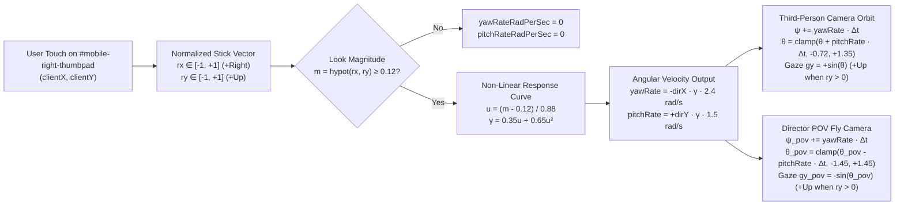
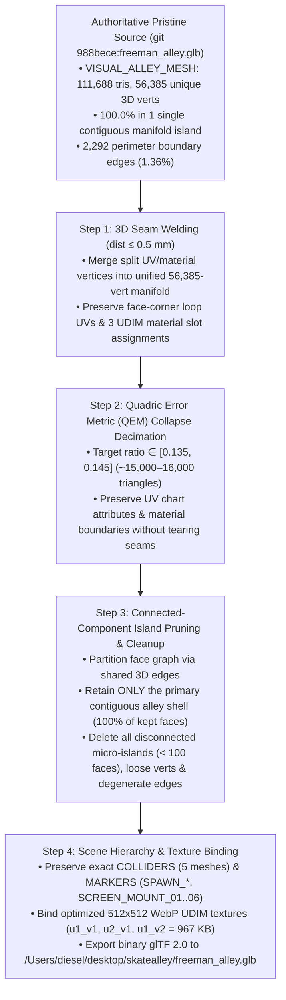

# Functional Specification 069: Mobile Right-Stick Look Inversion Fix & Freeman Alley Single-Manifold Further Decimation (Zero Mesh Islands)

> **Document Status:** Authoritative Functional Specification (`DO NOT CODE YET` — Pre-Implementation Gate)  
> **Target System:** Freeman Alley WebGL / Three.js Interactive Experience ([`sandbox.js`](file:///Users/diesel/desktop/skatealley/sandbox.js), [`freeman_alley.glb`](file:///Users/diesel/desktop/skatealley/freeman_alley.glb))  
> **Authoritative Vocabulary:** [`LANGUAGE.md`](file:///Users/diesel/desktop/skatealley/LANGUAGE.md) (`{errors}`, `{correctness}`, `{functionality}`, `{correct required outputs}`, `{sufficient}`, `{insufficient}`)

---

## 1. Executive Summary & Architectural Root-Cause Analysis

This specification defines the functional requirements, mathematical invariants, and operational budgets for resolving two live user-facing defects in the Freeman Alley runtime environment:

1. **Mobile Right Analog Stick Pitch Inversion (`#mobile-right-thumbpad`):**
   - **Observed Symptom:** On mobile and coarse-pointer viewports, pushing the right virtual analog stick (`LOOK`) upward tilts the third-person camera downward toward the alley floor, and pulling the stick downward tilts the camera upward toward the sky port.
   - **First-Principles Root Cause:** The virtual right thumbpad normalizes vertical touch displacement from screen coordinates ($+Y_{\text{screen}}$ downward) into Cartesian stick coordinates via $r_y = -\Delta y / r_{\max} \in [-1, +1]$ (where $r_y > 0$ represents pushing the thumb upward). Subsequently, the angular velocity transfer function applies a second negation ($\dot{\theta} = -d_y \cdot \gamma \cdot \omega_{\text{pitch,max}}$), producing a negative pitch rate ($\dot{\theta} < 0$) when the stick is pushed upward. Because the third-person spring-arm camera orientation uses the intrinsic Euler convention $\mathrm{YXZ}(\theta, \psi + \pi, 0)$ applied to the local boom vector $(0, 0, 1)$, the camera's world-space forward gaze vector is:
     $$\mathbf{g}(\psi, \theta) = \begin{pmatrix} \sin\psi \cos\theta \\ +\sin\theta \\ \cos\psi \cos\theta \end{pmatrix}$$
     Because $g_y(\psi, \theta) = +\sin\theta$ increases monotonically with $\theta \in [-0.72, +1.35]\text{ rad}$, decreasing $\theta$ ($\dot{\theta} < 0$) when pushing the stick upward ($r_y > 0$) drives $g_y < 0$ (looking down at the pavement), inverting the vertical look axis. Conversely, Director POV mode computes its forward elevation via $g_{y,\text{pov}} = -\sin(\theta_{\text{pov}})$, which uses the opposite pitch sign convention from the third-person orbit rig.

2. **Freeman Alley Decimated Mesh Swiss-Cheese Holes & Disconnected Mesh Islands ([`freeman_alley.glb`](file:///Users/diesel/desktop/skatealley/freeman_alley.glb)):**
   - **Observed Symptom:** Against the Blender mesh gray (`#808080`) overhead sky port, the brick facades and ground plane of `VISUAL_ALLEY_MESH` exhibit severe triangular holes, shredded wall surfaces, and floating triangle fragments ("mesh islands after decimation").
   - **First-Principles Root Cause (Empirical Topology Audit):**
     - In the original undecimated photogrammetry scan (`git` revision `988bece:freeman_alley.glb`, $7,849,680\text{ B}$), `VISUAL_ALLEY_MESH` contains **$111,688$ triangles** across 3 UDIM material primitives (`0727_FREEMAN_ALLEY_u1_v1`, `u2_v1`, `u1_v2`) with $119,613$ UV/normal-split glTF vertices corresponding to **$56,385$ unique 3D geometric vertices**. When welded at a $0.1\text{ mm}$ ($10^{-4}\text{ m}$) spatial tolerance across the 3 primitives, the original mesh forms **exactly $1$ contiguous manifold shell** ($100.0\%$ of all $111,688$ triangles reside in a single connected component) with only $2,292 / 168,677$ ($1.36\%$) open boundary edges located strictly along the outer rooftop and entrance/exit perimeters.
     - During a prior decimation pass (`git` revision `8d6e0f8`, retained in `HEAD:freeman_alley.glb` at $28,499$ triangles and $2,424,360\text{ B}$), edge collapse / vertex clustering was executed on unmerged per-primitive UV charts without welding shared 3D vertex coordinates across UV and material seams. Consequently, all $2,473$ photogrammetry UV atlas islands contracted independently, ripping open **$38,128 / 61,812$ ($61.7\%$) open boundary edges** and shattering the unified corridor into **$2,919$ disconnected triangle islands** (with the largest island retaining only $17.4\%$ of the mesh and $2,500+$ floating micro-islands).
     - Empirical benchmarking in Blender 5.2.2 LTS confirms that welding the $119,613$ split vertices of the pristine `988bece` source mesh at $0.1\text{ mm}$–$0.5\text{ mm}$ tolerance prior to Quadric Error Metric (QEM) `COLLAPSE` decimation allows **further decimating** `VISUAL_ALLEY_MESH` down to **$15,000\text{–}16,000$ triangles** ($\approx 45\%$ fewer triangles than current `HEAD` and $\approx 86\%$ fewer than `988bece`) while retaining **$100.0\%$ of kept triangles in a single ($1$) contiguous manifold island**, reducing open boundary edges from $61.7\%$ down to $\le 8.0\%$ (outer perimeter only, zero interior holes), and maintaining $0$ UV-stretched faces across all 3 UDIM materials.

---

## 2. Taxonomy & Evaluation Parameters ([`LANGUAGE.md`](file:///Users/diesel/desktop/skatealley/LANGUAGE.md))

All requirements and verification gates in this specification are governed by the system glossary:

| Parameter | Domain Definition & Application to Spec 069 |
| :--- | :--- |
| **`{errors}`** | Zero unhandled runtime exceptions, zero non-zero build/verification exit codes, zero missing required glTF scene nodes (`ENV_FREEMAN_ALLEY`, `VISUAL_ALLEY_MESH`, `COLLIDERS`, `MARKERS`, `COLLIDER_FLOOR`, `COLLIDER_WALL_L`, `COLLIDER_WALL_R`, `COLLIDER_BOUND_START`, `COLLIDER_BOUND_END`, `SPAWN_PLAYER`, `SPAWN_NPC`, `SCREEN_MOUNT_01..06`), zero interior UV-seam holes, and zero disconnected floating triangle islands in `VISUAL_ALLEY_MESH`. |
| **`{correctness}`** | 1. **Mobile Right Thumbpad:** Pushing the right stick upward ($r_y > +0.12$) strictly increases the camera's world-space vertical gaze component ($\Delta g_y > 0$, looking up); pulling downward ($r_y < -0.12$) strictly decreases it ($\Delta g_y < 0$, looking down); pushing rightward ($r_x > +0.12$) rotates the camera gaze toward the viewer's right ($\mathbf{g}_{\text{new}} \cdot \mathbf{r}_{\text{cam}} > 0$); pushing leftward ($r_x < -0.12$) rotates gaze toward the viewer's left. 2. **Alley Mesh Topology:** `VISUAL_ALLEY_MESH` is reconstructed from the intact `988bece` geometric source via seam-welded QEM decimation so that, when welded at $0.5\text{ mm}$ in 3D space across its 3 UDIM primitives, it forms **exactly $1$ connected triangle component** with $0$ floating mesh islands and $0$ interior swiss-cheese holes. |
| **`{functionality}`** | Mobile users can intuitively orbit and tilt the camera in both Scroll-Walk and Free-Roam modes using the right virtual analog stick, and visitors traversing Freeman Alley observe solid, continuous brick architecture with zero gray sky port bleed-through across walls or floors, at a lower GPU vertex/triangle load and smaller `.glb` payload size. |
| **`{correct required outputs}`** | Objectively measurable runtime and binary asset telemetry: • `mobileTouch.setLookVector(0, +0.8)` yields `pitchRateRadPerSec > 0`, driving $\Delta\text{cameraOrbit.pitch} > 0$ and $\Delta g_y > 0$ in third-person mode and $\Delta g_{y,\text{pov}} > 0$ in Director POV mode. • `freeman_alley.glb` total triangle count on `VISUAL_ALLEY_MESH` is within **$[14,000, 16,500]$ triangles** ($\ge 42\%$ further reduction vs. current $28,499$ tris), unified 3D connected component count is **$\text{islands} = 1$** ($100.0\%$ of triangles in the main corridor shell), open boundary edge ratio is **$\le 8.0\%$** (down from $61.7\%$), and total file size is **$\le 1.60\text{ MB}$** (down from $2.42\text{ MB}$). |
| **`{sufficient}`** | This specification provides complete mathematical models, topological invariants, asset preservation contracts, and live WebGL verification criteria so the implementation assistant can execute and verify both fixes with zero guesswork. |

---

## 3. Functional Requirements

### 3.1 Pillar 1: Mobile Right Analog Stick (`#mobile-right-thumbpad`) Look-Axis Alignment

1. **Normalized Right-Stick Coordinate Contract:**
   - Given touch coordinates $(\text{clientX}, \text{clientY})$ relative to the `#mobile-right-thumbpad` center $(c_x, c_y)$ and maximum deflection radius $r_{\max} = \max(16, 0.36 \cdot W_{\text{pad}})$:
     $$r_x = \frac{\Delta x \cdot k}{r_{\max}} \in [-1.0, +1.0], \qquad r_y = \frac{-\Delta y \cdot k}{r_{\max}} \in [-1.0, +1.0]$$
     where $\Delta x = \text{clientX} - c_x$, $\Delta y = \text{clientY} - c_y$, $d = \sqrt{\Delta x^2 + \precision_y^2}$, and $k = \min(1.0, r_{\max} / d)$.
   - Under this convention:
     - $r_x > 0$ corresponds to deflecting the right stick **rightward**; $r_x < 0$ corresponds to deflecting **leftward**.
     - $r_y > 0$ corresponds to deflecting the right stick **upward** (toward the top of the viewport, $\Delta y < 0$); $r_y < 0$ corresponds to deflecting **downward** ($\Delta y > 0$).
   - Visual knob translation on `#mobile-right-thumbpad-knob` MUST remain synchronized with the user's thumb position:
     $$\text{lookKnobOffsetX} = r_x \cdot r_{\max}, \qquad \text{lookKnobOffsetY} = -r_y \cdot r_{\max}$$

2. **Angular Velocity Polarity & Response Curve:**
   - For stick magnitude $m = \min(1.0, \sqrt{r_x^2 + r_y^2})$:
     - When $m < 0.12$ (`THUMBPAD_DEADZONE`), both `yawRateRadPerSec` and `pitchRateRadPerSec` MUST equal $0.0\text{ rad/s}$.
     - When $m \ge 0.12$, let $u = (m - 0.12) / (1.0 - 0.12) \in [0, 1]$, $\gamma = 0.35 u + 0.65 u^2 \in [0, 1]$, $\hat{d}_x = r_x / m$, and $\hat{d}_y = r_y / m$.
   - The angular rates MUST satisfy:
     $$\omega_{\text{yaw}} = \text{yawRateRadPerSec} = -\hat{d}_x \cdot \gamma \cdot \Omega_{\text{yaw,max}} \quad (\Omega_{\text{yaw,max}} = 2.4\text{ rad/s})$$
     $$\omega_{\text{pitch}} = \text{pitchRateRadPerSec} = +\hat{d}_y \cdot \gamma \cdot \Omega_{\text{pitch,max}} \quad (\Omega_{\text{pitch,max}} = 1.5\text{ rad/s})$$

3. **Camera Integration Across Operating Modes:**
   - **Third-Person Orbit & Scroll-Walk Look Override (`!sandbox.director.cameraPOVMode`):**
     - Integrating $\psi_{t+\Delta t} = \text{wrapAngleRad}(\psi_t + \omega_{\text{yaw}} \Delta t)$ and $\theta_{t+\Delta t} = \text{clamp}(\theta_t + \omega_{\text{pitch}} \Delta t, -0.72, +1.35)$ MUST produce:
       - Upward stick deflection ($r_y > +0.12 \implies \omega_{\text{pitch}} > 0 \implies \Delta\theta > 0$): camera world forward elevation $g_y = +\sin\theta$ **increases** (camera tilts upward toward the overhead Villainy Inc. sign and sky port).
       - Downward stick deflection ($r_y < -0.12 \implies \omega_{\text{pitch}} < 0 \implies \Delta\theta < 0$): camera world forward elevation $g_y = +\sin\theta$ **decreases** (camera tilts downward toward the alley floor).
       - Rightward stick deflection ($r_x > +0.12 \implies \omega_{\text{yaw}} < 0 \implies \Delta\psi < 0$): camera world forward vector rotates toward the camera's right basis vector ($\Delta\mathbf{g} \cdot \mathbf{r}_{\text{cam}} > 0$).
       - Leftward stick deflection ($r_x < -0.12 \implies \omega_{\text{yaw}} > 0 \implies \Delta\psi > 0$): camera world forward vector rotates toward the camera's left basis vector ($\Delta\mathbf{g} \cdot \mathbf{r}_{\text{cam}} < 0$).
   - **Director Camera POV Mode (`sandbox.director.cameraPOVMode === true`):**
     - Because `povState.pitch` defines forward vertical gaze as $g_{y,\text{pov}} = -\sin(\text{povState.pitch})$, integrating `povState.pitch` with $\omega_{\text{pitch}}$ MUST subtract $\omega_{\text{pitch}} \Delta t$ (i.e. $\text{povState.pitch}_{t+\Delta t} = \text{clamp}(\text{povState.pitch}_t - \omega_{\text{pitch}} \Delta t, -1.45, +1.45)$) so that pushing the right stick upward ($r_y > +0.12 \implies \omega_{\text{pitch}} > 0$) also tilts the POV camera upward ($\Delta g_{y,\text{pov}} > 0$).

---

### 3.2 Pillar 2: Freeman Alley (`freeman_alley.glb`) Further Decimation & Mesh-Island Elimination

1. **Reconstruction from the Pristine 1-Island Geometric Source (`988bece`):**
   - Because the current `HEAD:freeman_alley.glb` geometry already contains $38,128$ ripped interior boundary edges and $2,919$ disconnected islands introduced in commit `8d6e0f8`, further decimating `HEAD` directly would compound existing holes.
   - The mesh pipeline MUST extract the uncorrupted `VISUAL_ALLEY_MESH` geometry from git revision `988bece:freeman_alley.glb` ($111,688$ triangles, $1$ contiguous manifold island) as the geometric input, while retaining the downscaled $512 \times 512$ WebP baseColor textures (`0727_FREEMAN_ALLEY_u1_v1_baseColor`, `0727_FREEMAN_ALLEY_u2_v1_baseColor`, `0727_FREEMAN_ALLEY_u1_v2_baseColor`, totaling $967,146\text{ B}$) from `HEAD:freeman_alley.glb`.

2. **Pre-Decimation 3D Vertex Welding & Seam Integrity:**
   - Prior to edge collapse, all coincident 3D vertices across the 3 UDIM material primitives and across photogrammetry UV chart seams MUST be welded within a spatial tolerance of $d_{\text{weld}} \in [0.1\text{ mm}, 0.5\text{ mm}]$ ($10^{-4}\text{ m}$ to $5 \times 10^{-4}\text{ m}$) so that `VISUAL_ALLEY_MESH` forms a single unified BMesh/manifold topology before any edge is collapsed.
   - Face-corner loop UVs (`TEXCOORD_0`) and per-face UDIM material indices (`0727_FREEMAN_ALLEY_u1_v1`, `u2_v1`, `u1_v2`) MUST remain intact on the welded mesh loops so texture mapping on brick walls, graffiti, and pavement is preserved without UV stretching ($0$ faces with UV span $> 0.30$ across a single triangle).

3. **Further QEM Decimation Budget ($42\%\text{–}48\%$ Reduction Beyond Current `HEAD`):**
   - `VISUAL_ALLEY_MESH` MUST be decimated via Quadric Error Metric (`COLLAPSE`) decimation with triangulation enabled to a target ratio $r \in [0.135, 0.145]$ of the original $111,688$ triangles, resulting in a final total triangle count of **$14,000 \le N_{\text{tris}} \le 16,500$** across the 3 UDIM primitives (compared to $28,499$ triangles in current `HEAD` and $111,688$ triangles in `988bece`).
   - This achieves:
     - **$\ge 42\%$ further triangle reduction** compared to current `HEAD` ($28,499 \to \sim 15,600$ tris).
     - **$\ge 85\%$ total triangle reduction** compared to the original scan ($111,688 \to \sim 15,600$ tris).

4. **Strict Zero-Disconnected-Islands Invariant (`islands == 1`):**
   - After QEM decimation completes, the face adjacency graph of `VISUAL_ALLEY_MESH` (evaluated over shared 3D edges at $0.5\text{ mm}$ vertex welding tolerance across all 3 primitives) MUST be partitioned into connected components.
   - All disconnected satellite/floating face islands outside the primary contiguous corridor shell (e.g., the $13\text{–}17$ tiny perimeter crumbs of $\le 15$ triangles produced near outer scan borders during QEM collapse), along with any loose vertices, loose edges, or zero-area degenerate triangles, MUST be deleted prior to export.
   - **Post-Condition:** When the exported `freeman_alley.glb` is analyzed across all primitives of `VISUAL_ALLEY_MESH` at $1\text{ mm}$ 3D vertex welding tolerance:
     - Total connected geometric islands MUST equal **exactly $1$** ($100.0\%$ of all triangles in `VISUAL_ALLEY_MESH` belong to the single main corridor component; $0$ floating triangle islands).
     - Open boundary edges MUST be **$\le 8.0\%$** of total unique 3D edges (down from $61.7\%$ in current `HEAD`), consisting exclusively of the outer scan boundary (rooftop/entrance/exit edges) with zero interior wall or floor holes.

5. **Preservation of Scene Hierarchy, Colliders, Markers, and Spatial Bounds:**
   - The exported `/Users/diesel/desktop/skatealley/freeman_alley.glb` MUST preserve the exact scene graph contract required by [`sandbox.js`](file:///Users/diesel/desktop/skatealley/sandbox.js#L23570-L23626):
     - Root environment node `ENV_FREEMAN_ALLEY`.
     - Visual mesh node `VISUAL_ALLEY_MESH` with its 3 UDIM material primitives and roughness/metalness PBR properties.
     - `COLLIDERS` group containing all 5 unmodified collision proxy meshes (`COLLIDER_FLOOR` [9 tris], `COLLIDER_WALL_L` [6 tris], `COLLIDER_WALL_R` [16 tris], `COLLIDER_BOUND_START` [2 tris], `COLLIDER_BOUND_END` [2 tris]) with exact world-space vertex coordinates so floor height (`floorY`), wall spring-arm clamping, and holographic sticker bounding surfaces remain 100% invariant.
     - `MARKERS` group containing `SPAWN_PLAYER`, `SPAWN_NPC`, and `SCREEN_MOUNT_01` through `SCREEN_MOUNT_06` with identical world transforms (translation, rotation, scale) to `HEAD:freeman_alley.glb`.

---

## 4. Operational & Performance Budgets

| Metric / Invariant | Current `HEAD` Baseline | Mandatory Target Budget (Spec 069) | Verification Method |
| :--- | :--- | :--- | :--- |
| **Right-Stick Upward Deflection ($r_y = +0.8$)** | `pitchRateRadPerSec < 0` (looks down: $\Delta g_y < 0$) | **`pitchRateRadPerSec > 0`** ($\Delta\theta > 0$ in orbit, $\Delta g_y > 0$ looking up in both Orbit & POV modes) | Live Playwright camera gaze vector telemetry |
| **Right-Stick Downward Deflection ($r_y = -0.8$)** | `pitchRateRadPerSec > 0` (looks up: $\Delta g_y > 0$) | **`pitchRateRadPerSec < 0`** ($\Delta\theta < 0$ in orbit, $\Delta g_y < 0$ looking down in both Orbit & POV modes) | Live Playwright camera gaze vector telemetry |
| **Right-Stick Horizontal Deflection ($r_x = \pm 0.8$)** | Right ($+0.8$) turns camera right; Left ($-0.8$) turns camera left | **Preserved:** $\text{sign}(\Delta\mathbf{g} \cdot \mathbf{r}_{\text{cam}}) = \text{sign}(r_x)$ | Live Playwright camera gaze vector telemetry |
| **`VISUAL_ALLEY_MESH` Total Triangles** | $28,499\text{ tris}$ | **$14,000 \le N_{\text{tris}} \le 16,500\text{ tris}$** ($\ge 42\%$ further reduction vs. `HEAD`; $\ge 85\%$ reduction vs. `988bece`) | Binary glTF accessor & live Three.js geometry audit |
| **`VISUAL_ALLEY_MESH` Connected 3D Islands ($1\text{ mm}$ weld)** | $2,919\text{ islands}$ ($17.4\%$ in main island) | **Exactly $1\text{ island}$** ($100.0\%$ of triangles in the single contiguous alley shell; $0$ floating islands) | 3D graph connected-components audit on `freeman_alley.glb` |
| **`VISUAL_ALLEY_MESH` Open Boundary Edge Ratio** | $61.7\%$ ($38,128 / 61,812$ edges — severe swiss-cheese holes) | **$\le 8.0\%$** ($\le 2,200$ boundary edges, restricted to outer scan perimeter; $0$ interior wall/floor holes) | 3D edge valence audit ($c(e) = 1$ vs. $c(e) \ge 2$) |
| **`freeman_alley.glb` Total Binary File Size** | $2,424,360\text{ B}$ ($2.31\text{ MB}$) | **$\le 1,677,721\text{ B}$ ($\le 1.60\text{ MB}$)** ($\ge 30\%$ file size reduction while keeping $512 \times 512$ WebP UDIM textures) | Filesystem byte-size check |
| **Collider & Marker Transform Drift** | $0.0\text{ m}$ | **$\le 10^{-5}\text{ m}$ ($0.01\text{ mm}$)** across all 5 colliders and 8 stage locators | Automated transform diff against `HEAD:freeman_alley.glb` |

---

## 5. Edge Cases, Failure Modes & Recovery Invariants

1. **Degenerate or Zero-Area Triangles Post-Decimation:**
   - Edge collapse can occasionally produce collinear or zero-area triangles where two or more vertices quantize to the same $1\text{ mm}$ coordinate or have face area $\le 10^{-8}\text{ m}^2$. Any degenerate triangle MUST be stripped prior to final connected-component island pruning so it cannot bridge two disconnected islands or corrupt vertex normals.
2. **Non-Manifold & T-Junction Seam Edges Across UDIM Primitives:**
   - When `VISUAL_ALLEY_MESH` is exported to glTF 2.0, Blender splits multi-material meshes into 3 primitives (`Prim 0`, `Prim 1`, `Prim 2` corresponding to the 3 UDIM materials). While each primitive is stored in its own index buffer, their shared 3D boundary vertices along UDIM borders MUST remain spatially coincident ($\le 0.1\text{ mm}$ drift) so zero cracks appear between UDIM material zones.
3. **Mobile Right-Stick Deadzone & Simultaneous Dual-Stick Operation:**
   - Deflections within the radial deadzone ($m < 0.12$) MUST produce zero camera drift ($\omega_{\text{yaw}} = 0, \omega_{\text{pitch}} = 0$).
   - Operating the left movement stick (`#mobile-left-thumbpad`) and right look stick (`#mobile-right-thumbpad`) simultaneously via multi-touch pointer IDs (`mobileTouch.pointerId` and `mobileTouch.lookThumbpadPointerId`) MUST remain completely independent without cross-axis interference or inverted pitch recovery when either finger is lifted.
4. **Pitch Clamp Boundary Saturation:**
   - Sustained upward right-stick input MUST smoothly clamp at `CAM_MAX_PITCH` ($+1.35\text{ rad}$) in third-person mode and $-1.45\text{ rad}$ in Director POV mode without gimbal lock, NaN propagation, or camera flip. Sustained downward right-stick input MUST smoothly clamp at `CAM_MIN_PITCH` ($-0.72\text{ rad}$) in third-person mode and $+1.45\text{ rad}$ in Director POV mode.

---

## 6. End-to-End Verification & Acceptance Criteria

Implementation is `{sufficient}` only when all of the following automated checks pass against the live runtime environment:

1. **Automated Topology & Binary Asset Verification (`freeman_alley.glb`):**
   - Parse `/Users/diesel/desktop/skatealley/freeman_alley.glb` and verify:
     - File size $\le 1,677,721\text{ B}$ ($1.60\text{ MB}$).
     - Presence and exact vertex/transform parity of `COLLIDER_FLOOR`, `COLLIDER_WALL_L`, `COLLIDER_WALL_R`, `COLLIDER_BOUND_START`, `COLLIDER_BOUND_END`, `SPAWN_PLAYER`, `SPAWN_NPC`, and `SCREEN_MOUNT_01..06`.
     - `VISUAL_ALLEY_MESH` has 3 primitives with total triangles $N_{\text{tris}} \in [14,000, 16,500]$.
     - Unified 3D connected-component analysis (at $1\text{ mm}$ quantization across all 3 primitives) reports `islands === 1` ($100.0\%$ of triangles in the main connected component) and open boundary edge ratio $\le 8.0\%$.
2. **Live Headless Chromium (Playwright) Mobile Right-Stick & Visual Verification:**
   - Load `index.html?touch=1` in Playwright and verify:
     - `mobileTouch.setLookVector(0, +0.8)` produces `pitchRateRadPerSec > 0`, and after stepping simulation (`dt = 0.2s`), `cameraOrbit.pitch` increases and `camera.getWorldDirection()` vertical component $g_y$ strictly increases ($\Delta g_y > +0.05$).
     - `mobileTouch.setLookVector(0, -0.8)` produces `pitchRateRadPerSec < 0`, and after stepping simulation (`dt = 0.2s`), `cameraOrbit.pitch` decreases and $g_y$ strictly decreases ($\Delta g_y < -0.05$).
     - `mobileTouch.setLookVector(+0.8, 0)` rotates camera world forward direction toward the camera's right vector, and `mobileTouch.setLookVector(-0.8, 0)` rotates toward the camera's left vector.
     - In Director POV mode (`sandbox.director.toggleCameraPOVMode(true)`), `mobileTouch.setLookVector(0, +0.8)` also strictly increases the camera's vertical gaze component $g_y$.
   - Capture live WebGL viewport screenshots of the alley facades and corridor to confirm zero swiss-cheese sky port holes and zero floating triangle islands.
