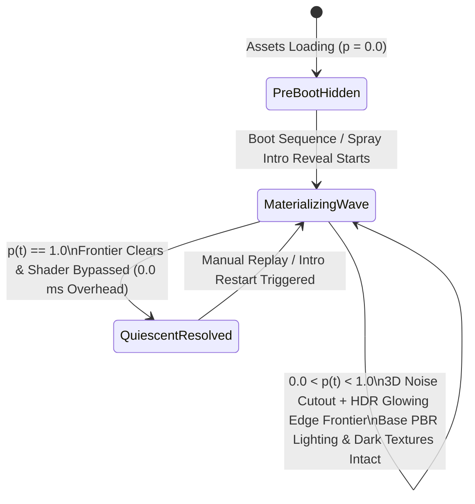
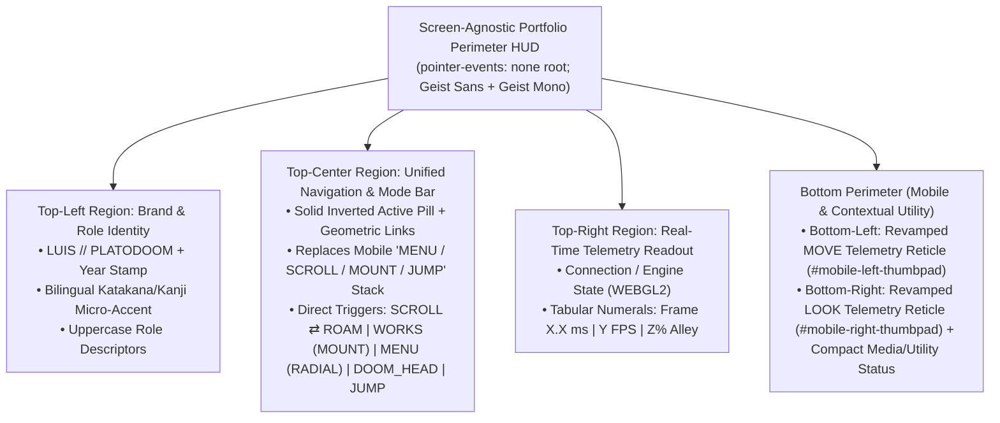
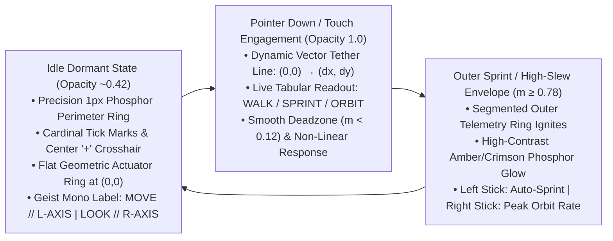
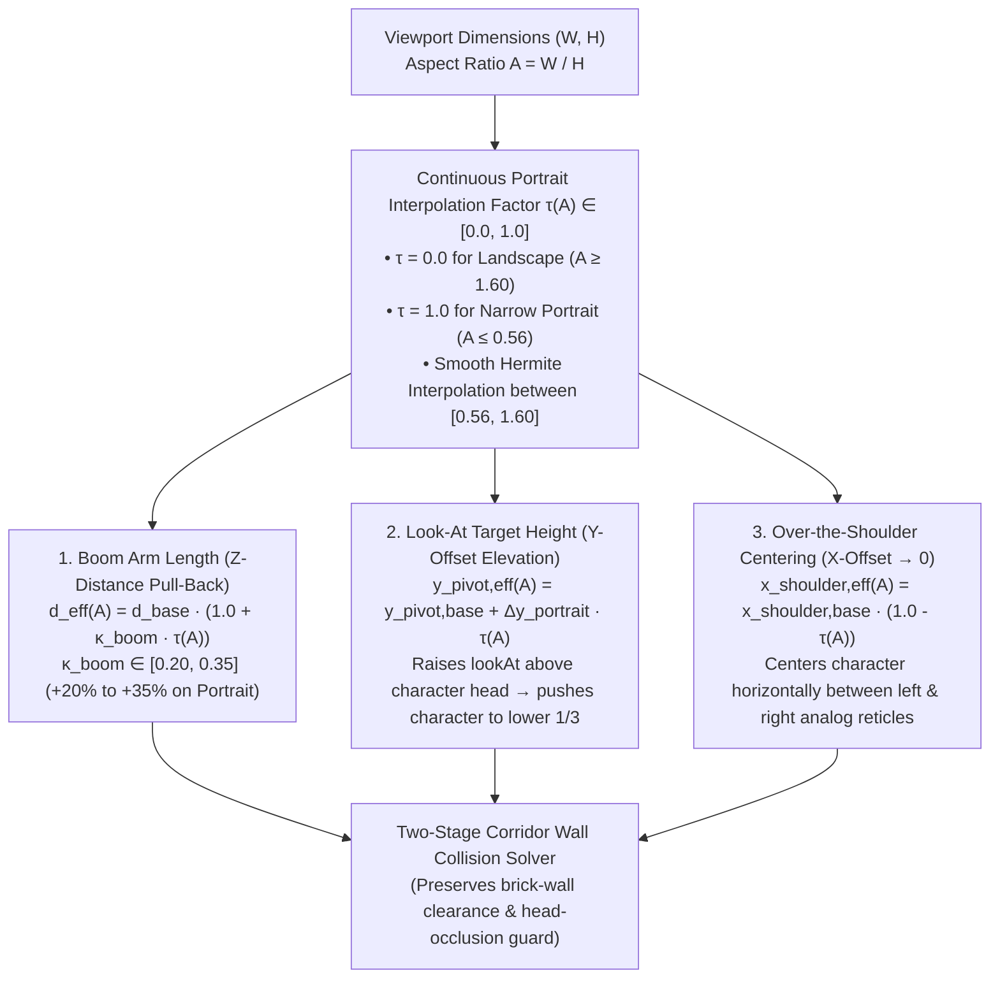

# Functional Specification 070: Scene-Wide Boot-Up 3D Materialization (Glowing Bloom-Edge Dissolve), Screen-Agnostic Portfolio HUD & Mobile Control Unification (with Revamped Telemetry Analog Sticks), and Aspect-Ratio Dynamic Camera Follow-Offset Scaling

> **Document Status:** Authoritative Functional Specification (`DO NOT CODE YET` — Pre-Implementation Gate)  
> **Target System:** Freeman Alley Interactive 3D Portfolio Runtime ([`index.html`](file:///Users/diesel/desktop/skatealley/index.html), [`sandbox.js`](file:///Users/diesel/desktop/skatealley/sandbox.js), [`alley_atmosphere_023.js`](file:///Users/diesel/desktop/skatealley/alley_atmosphere_023.js))  
> **Source Requirements:** User Boot-Up Materialization Directive (`wass08/r3f-objects-dissolve` paradigm), [`hud.md`](file:///Users/diesel/desktop/skatealley/hud.md) (Refined to Replace Legacy Mobile Menu/Scroll UI & Revamp Analog Sticks), [`dynamic_cam.md`](file:///Users/diesel/desktop/skatealley/dynamic_cam.md)  
> **Authoritative Vocabulary:** [`LANGUAGE.md`](file:///Users/diesel/desktop/skatealley/LANGUAGE.md) (`{errors}`, `{correctness}`, `{functionality}`, `{correct required outputs}`, `{sufficient}`, `{insufficient}`)

---

## 1. System Overview & Unified Architectural Objective

This specification defines the end-to-end functional behavior, mathematical invariants, choreography, operational budgets, and failure-isolation boundaries for four synchronized presentation, control, and camera systems in the Freeman Alley 3D portfolio experience:

1. **Pillar 1 — Scene-Wide Boot-Up 3D Materialization & Glowing Bloom-Edge Dissolve System:**
   - When loading into the scene during the boot-up sequence, every 3D architectural, prop, character, and holographic element in Freeman Alley materializes from void space through a 3D procedural noise dissolve frontier rimmed by a high-luminance glowing bloom edge (modeled after Wawa Sensei's `r3f-objects-dissolve` / `DissolveMaterial` paradigm).
   - All PBR models (`freeman_alley.glb` brick walls and pavement, rigged characters and companions, overhead `villainy_inc_textured.glb` neon sign and steel suspension cables, bilateral alarm light fixtures, industrial metal pipework, overhead hanging cables, and wall screen mount chassis) retain 100% of their native dark albedo textures, normal maps, roughness/metalness response, skeletal skinning, and dynamic scene lighting on materialized surfaces while the glowing dissolve frontier sweeps across them.
   - All custom shader and holographic subsystems in the alley (7 wall screen mount hologram displays, 7 interactive math hologram pods, 17 holographic media columns, the watercolor gallery showcase, neon wall-corner accent lines, and atmospheric lighting fixtures) synchronize with the same boot-up materialization timeline so the entire alleyway assembles as one unified physical and holographic environment.

2. **Pillar 2 — Screen-Agnostic Portfolio Perimeter HUD & Replacement of Legacy Mobile Menu/Scroll Controls ([`hud.md`](file:///Users/diesel/desktop/skatealley/hud.md)):**
   - A lightweight, screen-agnostic Heads-Up Display (HUD) frames the outer perimeter of the 3D viewport, combining Swiss neo-grotesque minimalism (`Geist Sans`) with retro-industrial tabular telemetry (`Geist Mono`).
   - **Full Replacement of Legacy Mobile "Menu / Scroll / Mount / Jump" UI:** On mobile and tablet viewports, the Screen-Agnostic Portfolio HUD **completely replaces** the legacy lower-left vertical action button stack (`#mobile-touch-actions`: `JUMP`, `MOUNT`, `MENU` / `SCROLL`) and redundant mode banners. All navigation, mode switching (`SCROLL` $\leftrightarrow$ `ROAM`), radial command menu toggling (`MENU`), exhibit inspection (`MOUNT` / `WORKS`), and contextual actions are unified into the perimeter HUD bar so the lower viewport is completely freed from button clutter.
   - During the boot-up sequence (and on localized navigation hover/tap micro-interactions), all HUD text elements—including the telemetry labels on the revamped mobile analog sticks—enter the viewport through a synchronized, zero-jitter **Glyph Materialization (Cipher Decode)** wave that scrambles through technical block glyphs before locking into resolved typography without shifting layout geometry by a single pixel.

3. **Pillar 3 — Revamped Dual Virtual Analog Sticks (Precision Telemetry Reticle Architecture):**
   - The mobile left (`MOVE`) and right (`LOOK`) virtual analog sticks (`#mobile-left-thumbpad` and `#mobile-right-thumbpad`) are completely redesigned from bulky, sky-blue gradient arcade bubbles into **engineered, retro-industrial precision telemetry reticles** that match the Screen-Agnostic Portfolio HUD aesthetic.
   - Featuring ultra-thin phosphor hairlines, cardinal/intercardinal calibration ticks, a dynamic center-to-puck vector tether line, `Geist Mono` tabular state/coordinate micro-readouts, symmetric bottom-corner perimeter anchoring, and an idle-to-active luminance envelope, the revamped sticks deliver responsive 360° movement, sprint-ring hysteresis, and non-inverted camera look without obstructing the central 3D viewport.

4. **Pillar 4 — Aspect-Ratio Adaptive Dynamic Camera Follow-Offset Scaling ([`dynamic_cam.md`](file:///Users/diesel/desktop/skatealley/dynamic_cam.md)):**
   - The third-person follow camera continuously adapts its spatial framing as a function of viewport aspect ratio ($A = W / H$).
   - As the viewport narrows from desktop landscape ($A \ge 16:9$) toward mobile portrait ($A < 1.0$), the camera rig deterministically interpolates three follow-offset axes:
     1. **Boom Arm Length (`Z-Distance`):** Pulls back by $20\%\text{–}35\%$ to give the player spatial breathing room around the character.
     2. **Look-At Target Height (`Y-Offset`):** Elevates the look-at pivot above the character's head, pushing the character into the lower third of the vertical frame—perfectly between the symmetric bottom-corner analog reticles—so exhibits ahead remain unobstructed.
     3. **Over-the-Shoulder (`X-Offset`):** Smoothly centers any asymmetric horizontal shoulder offset to $0.0\text{ m}$ so the character is never pushed off the lateral edge of a narrow phone viewport.

---

## 2. Authoritative Taxonomy & Evaluation Parameters ([`LANGUAGE.md`](file:///Users/diesel/desktop/skatealley/LANGUAGE.md))

Every requirement, state transition, and verification gate in this document is governed by the system glossary in [`LANGUAGE.md`](file:///Users/diesel/desktop/skatealley/LANGUAGE.md):

| Evaluation Parameter | Strict Domain Definition & Application to Spec 070 |
| :--- | :--- |
| **`{errors}`** | Zero unhandled runtime exceptions, zero WebGL shader compilation or linker errors (`gl.getShaderInfoLog` / `gl.getProgramInfoLog`), zero missing uniform bindings, zero depth-buffer sorting inversions on opaque alley geometry, zero horizontal or vertical layout shifts ($\text{CLS} = 0.000$) during HUD glyph scrambling, zero legacy floating `#mobile-touch-actions` button columns obscuring the lower-left viewport on mobile, and zero silent exception fallbacks. |
| **`{correctness}`** | 1. **3D Materialization Math:** Every scene mesh progresses deterministically from fully unmaterialized ($p = 0.0$) through a noise-modulated glowing edge frontier of thickness $w_{\text{edge}} > 0$ and HDR bloom emission $I_{\text{edge}} > 1.0$ to fully materialized ($p = 1.0$), preserving base PBR textures, lighting, and skeletal deformations. 2. **HUD Cipher Decode & Mobile Control Unification:** Every character slot transitions deterministically through `Dormant` $\to$ `Active Scramble` (throttled to $2\text{–}4$ frames per glyph swap) $\to$ `Resolved` while locking bounding-box dimensions; the perimeter HUD directly governs mobile mode/menu/mount/action triggers in place of the retired `#mobile-touch-actions` stack. 3. **Revamped Analog Stick Math & Visuals:** Left and right telemetry reticles map 2D pointer deflection into deadzone-filtered, non-linear movement and look vectors with live vector-tether rendering, sprint-threshold hysteresis, and non-inverted vertical pitch. 4. **Dynamic Follow-Offset Math:** For any viewport aspect ratio $A = W / H$, effective boom distance $d_{\text{eff}}(A)$, pivot elevation $y_{\text{pivot,eff}}(A)$, and shoulder offset $x_{\text{shoulder,eff}}(A)$ satisfy monotonic interpolation bounds while respecting corridor wall-collision clamping. |
| **`{functionality}`** | Visitors loading into Freeman Alley on desktop or mobile experience a cohesive boot sequence in which the entire 3D alleyway and character materialize with a glowing bloom frontier synchronized with the startup camera pan and the perimeter HUD's cipher-decode sequence; mobile users navigate modes, menus, and exhibits seamlessly through the unified perimeter HUD and control locomotion/camera orbit via precision telemetry analog reticles while the aspect-adaptive camera frames the character cleanly between the bottom thumb zones. |
| **`{correct required outputs}`** | Objectively measurable runtime telemetry and observable states: • Global materialization progress $p(t) \in [0.0, 1.0]$ reaches $1.000$ at completion of the boot materialization window, with post-completion shader bypass returning steady-state materialization overhead to $0.0\text{ ms}$. • HUD perimeter regions complete their 3-beat boot decode within $\le 1,300\text{ ms}$ with $0\text{ px}$ bounding-box jitter and clean DOM restoration. • On mobile viewports (e.g., $390 \times 844$), the legacy `#mobile-touch-actions` column is absent/replaced by the perimeter HUD navigation & action pills, while `#mobile-left-thumbpad` and `#mobile-right-thumbpad` render as symmetric bottom-perimeter telemetry reticles. • Switching viewport from $1920 \times 1080$ ($A = 1.778$) to $390 \times 844$ ($A = 0.462$) increases desired boom distance by $20\%\text{–}35\%$, raises look-at target Y-offset above head level, and reduces $|\text{effectiveShoulderOffsetX}|$ to $0.000\text{ m}$. |
| **`{sufficient}`** | This document specifies all mathematical formulas, state machines, visual/optical contracts, timing budgets, ergonomic layouts, accessibility rules, and edge-case behaviors so a coding assistant can implement and verify the complete system without guesswork or narrow stubs. |
| **`{insufficient}`** | Any implementation that strips PBR textures or skinning during dissolve, leaves permanent multi-octave 3D noise running after $p = 1.0$, causes transparent depth-sorting artifacts on `VISUAL_ALLEY_MESH`, shifts HUD word layout during proportional font scrambling, retains the legacy blue `#mobile-touch-actions` stack or chunky blue gradient thumbsticks, or clips the camera through alley walls on portrait screens. |

---

## 3. First-Principles Feasibility Analysis & Architectural Guardrails

Before specifying component behavior, three physical, ergonomic, and GPU-architectural constraints must be enforced from first principles (`RULE[user_global]`):

### 3.1 Pushback Against Naive Permanent Alpha-Blended Dissolve on Opaque Corridor Geometry
In the reference sandbox (`wass08/r3f-objects-dissolve`), `DissolveMaterial` sets `transparent: true` on a single isolated prop in empty space, computes 5-octave 3D Simplex FBM noise (`gln_sfbm`) on every fragment indefinitely, and writes `csm_DiffuseColor.a = alpha + border`. Applying that naive pattern verbatim to the entire Freeman Alley scene would introduce two severe architectural defects:

1. **Z-Buffer Corruption on Multi-Primitive Architectural Meshes:**
   - Setting `transparent: true` with standard alpha blending on `VISUAL_ALLEY_MESH` (3 UDIM material primitives spanning $58\text{ m}$ of brick walls and floor), rigged characters, and pipework disables standard opaque depth sorting or causes back-wall triangles to render over foreground walls and character limbs whenever draw order varies.
   - **Mandatory Architectural Remediation:** During the materialization transition ($0.0 \le p < 1.0$), unmaterialized fragments ($S(\mathbf{x}) < \tau(p) - w_{\text{edge}}$) MUST be culled via **hardware fragment discard** (`alphaTest` / `discard`) while keeping depth testing and depth writes active (`depthWrite: true`, `depthTest: true`) on all opaque PBR surfaces. This guarantees 100% hardware Z-buffer accuracy with zero inside-out triangle sorting artifacts.
2. **Elimination of Post-Boot Fragment Shader Parasite ($0.0\text{ ms}$ Steady-State Cost):**
   - Evaluating 5-octave 3D Simplex noise across $100\%$ of screen pixels ($2.07 \times 10^6$ pixels at $1080\text{p}$) on every frame forever after the boot sequence has already finished ($p = 1.0$) wastes $2.5\text{–}4.5\text{ ms/frame}$ of GPU ALU bandwidth for zero visual change.
   - **Mandatory Architectural Remediation:**
     - During the active boot-up materialization window ($0.0 \le p < 1.0$), procedural 3D noise evaluation is bounded to **2 to 3 octaves** of 3D Simplex/Perlin FBM (or analytic 3D gradient noise combined with a spatial corridor sweep), which is visually indistinguishable from 5 octaves at the glowing dissolve edge while cutting ALU instructions by $> 50\%$.
     - Once an object's materialization progress reaches $p = 1.0$, the materialization subsystem MUST deterministically transition into a **Quiescent Resolved State** (either bypassing the noise branch via a fast uniform gate or restoring the clean unwrapped PBR material state) so steady-state exploration incurs **$0.00\text{ ms}$** of ongoing fragment shader overhead.

### 3.2 First-Principles Mobile Viewport Budget & Elimination of Lower-Left Control Crowding
On a standard portrait mobile viewport ($390 \times 844\text{ CSS px}$):
- Previously, the lower-left quadrant housed both the $120\text{ px}$ left thumbpad (`left: 14px`) AND the $56\text{ px}$ vertical action button column (`#mobile-touch-actions` at `left: 140px`, spanning $14\text{ px} \to 196\text{ px}$ horizontally, i.e., **$> 50\%$ of the entire screen width** on a $390\text{ px}$ phone!), while the right thumbpad floated asymmetrically at `bottom: 112px–142px`.
- This layout created severe accidental thumb-mispresses between the left stick's right-deflection zone and the `JUMP / MOUNT / MENU` buttons, obstructed the lower-center character framing, and visually clashed with the HUD.
- **Mandatory Architectural Remediation:**
  1. Retire the legacy lower-left `#mobile-touch-actions` button column (`JUMP`, `MOUNT`, `MENU` / `SCROLL`) and fold all mode/navigation/menu/action controls into the **Screen-Agnostic Portfolio HUD** perimeter frame.
  2. Anchor the revamped left (`MOVE`) and right (`LOOK`) telemetry analog sticks symmetrically in the bottom-left and bottom-right safe-area corners (`bottom: calc(clamp(12px, 2.5vw, 22px) + env(safe-area-inset-bottom, 0px))`), leaving the central corridor between them completely open for the character (positioned in the lower third via `dynamic_cam.md`).

### 3.3 Compatibility of Aspect-Ratio Boom Pull-Back with Narrow Corridor Geometry
Freeman Alley has a physical corridor width of approximately $2.7\text{ m}\text{–}3.4\text{ m}$ between `COLLIDER_WALL_L` and `COLLIDER_WALL_R`.
- Pulling the camera boom arm back by $20\%\text{–}35\%$ on portrait viewports ($A < 1.0$) increases the unobstructed desired distance $d_{\text{desired}}(A)$ when the camera looks down the longitudinal alley axis ($\pm Z$).
- When the user orbits the camera perpendicular to the brick walls ($\pm X$), the existing two-stage spring-arm wall-collision solver (`CAM_SPRING_ARM_PROBE_RADIUS`) MUST evaluate *after* the aspect-ratio offset scaling is applied. This ensures the portrait camera achieves the full $20\%\text{–}35\%$ pull-back along the corridor while never penetrating the brick walls during lateral rotation.

---

## 4. Pillar 1: Scene-Wide Boot-Up 3D Materialization & Glowing Bloom-Edge Dissolve System

### 4.1 Non-Destructive PBR Material Extension Contract
1. **Preservation of Base Surface Optics:**
   - Every standard/PBR mesh in the alley MUST preserve its existing material properties throughout and after the materialization transition:
     - Diffuse/albedo textures (`map`, including the 3 UDIM WebP textures on `VISUAL_ALLEY_MESH`, character clothing/skin textures on `character_hoodie.glb`, and weathered iron/neon textures on `villainy_inc_textured.glb`).
     - Normal maps (`normalMap`), roughness/metalness maps (`roughnessMap`, `metalnessMap`), ambient occlusion (`aoMap`), and vertex colors.
     - Skeletal bone skinning (`skinning: true` on `character_hoodie.glb` and `DOOM_Companion`), morph targets, shadow casting (`castShadow`), shadow receiving (`receiveShadow`), and scene fog (`FogExp2`) integration.
2. **Shader Injection / Wrapping Paradigm:**
   - Rather than replacing PBR materials with flat unlit shaders, the materialization effect wraps or extends the existing PBR shader pipeline (following the `THREE-CustomShaderMaterial` / `onBeforeCompile` material-extension paradigm from `DissolveMaterial.jsx`) so that:
     - All fragments inside the materialized region render with the model's exact dark textures and scene lighting.
     - Fragments within the narrow frontier band emit an intense, bloom-exciting glowing edge color.
     - Fragments ahead of the frontier are discarded cleanly.

### 4.2 Mathematical Formulation of the 3D Dissolve Frontier & Glowing Edge
For any surface fragment at world-space (or object-local/corridor-normalized) 3D coordinate $\mathbf{x} = (x, y, z)$:

1. **Normalized 3D Fractal Brownian Motion (FBM) Noise Field:**
   - Let $N(\mathbf{x}) \in [0.0, 1.0]$ be a continuous, normalized 3D procedural noise field (Simplex or Perlin FBM with $2\text{–}3$ octaves, spatial frequency $\nu \in [0.45, 1.85]\text{ m}^{-1}$, lacunarity $2.0$, and gain $0.5$).
   - To create a cohesive directional wave that sweeps through Freeman Alley from the entrance focal zone (`SPAWN_PLAYER` / camera pan trajectory) down the corridor and upward from the pavement, the effective scalar field $S(\mathbf{x}) \in [0.0, 1.0]$ blends normalized spatial progression $G(\mathbf{x}) \in [0.0, 1.0]$ with the 3D noise field $N(\mathbf{x})$:
     $$S(\mathbf{x}) = \operatorname{clamp}\!\Big(\alpha_{\text{spatial}} \cdot G(\mathbf{x}) + (1 - \alpha_{\text{spatial}}) \cdot N(\nu \mathbf{x}),\; 0.0,\; 1.0\Big)$$
     where $\alpha_{\text{spatial}} \in [0.0, 0.45]$ controls directional wave coherence and $(1 - \alpha_{\text{spatial}})$ preserves the organic, jagged 3D noise islands characteristic of Wawa Sensei's dissolve effect.

2. **Thresholding, Cutout Discard, and Glowing Edge Band:**
   - Given an object's or subsystem's current materialization progress $p \in [0.0, 1.0]$ and edge border thickness $w_{\text{edge}} \in [0.04, 0.14]$ (default $w_{\text{edge}} = 0.085$):
     - At $p = 0.0$: $100\%$ of fragments are unmaterialized and discarded (`discard`).
     - At $p = 1.0$: $100\%$ of fragments are fully materialized with zero border tint ($b = 0.0$) and zero discarded pixels.
     - For $0.0 < p < 1.0$, let the moving threshold be $\tau(p) = (1.0 + w_{\text{edge}}) \cdot (1.0 - p)$:
       - **Unmaterialized Void Region ($S(\mathbf{x}) < \tau(p) - w_{\text{edge}}$):** The fragment is immediately discarded (`discard`), allowing the dark void or background behind the mesh to show through cleanly while keeping hardware depth testing accurate for surviving fragments.
       - **Glowing Dissolve Frontier Band ($\tau(p) - w_{\text{edge}} \le S(\mathbf{x}) < \tau(p)$):** The fragment lies on the active materialization boundary. A smooth or stepped edge weight $b(\mathbf{x}, p) \in (0.0, 1.0]$ is computed across the band width $w_{\text{edge}}$, with a hot inner core and luminous falloff.
       - **Materialized Interior Region ($S(\mathbf{x}) \ge \tau(p)$):** The fragment renders its native PBR diffuse color, textures, and lighting with $b(\mathbf{x}, p) = 0.0$.

3. **HDR Emissive Edge Luminance & Bloom Coupling:**
   - Along the frontier band ($b(\mathbf{x}, p) > 0$), the fragment's output color and/or emissive radiance is mixed toward an HDR glowing edge color $\mathbf{C}_{\text{edge}} = \mathbf{c}_{\text{tint}} \cdot I_{\text{bloom}}$, where:
     - Base spectral tint $\mathbf{c}_{\text{tint}}$ defaults to warm cyber-amber / molten orange-gold (`#eb5a13` / `#ff6b1a` / `#fbbf24`) for physical alley architecture and characters, or matches the subsystem's signature accent palette (e.g., amber/cyan for holographic mounts and pods).
     - HDR bloom intensity multiplier $I_{\text{bloom}} \in [4.0, 12.0]$ drives high-contrast luminance along the dissolving rim so the edge visibly radiates a glowing halo against the dark alley textures.

### 4.3 Exhaustive Scene Coverage ("Everything in the Alley")
When loading into the scene during the boot-up sequence, the materialization effect MUST encompass **every visible 3D subsystem** in Freeman Alley:

| Scene Category | Target Meshes / Subsystems in Freeman Alley | Materialization Behavior During Boot-Up |
| :--- | :--- | :--- |
| **1. Corridor Architecture** | `VISUAL_ALLEY_MESH` (`0727_FREEMAN_ALLEY_u1_v1`, `u2_v1`, `u1_v2` brick walls, graffiti, and ground plane) + planar floor reflection mesh | Materializes from the entrance throat ($Z \approx 0\text{ m}$) down the corridor toward $Z \approx 58\text{ m}$ with a warm amber-orange (`#eb5a13` / `#ff7a18`) glowing 3D noise frontier while preserving all dark brick/graffiti textures and roughness. |
| **2. Characters & Companion** | Active player character (`character_hoodie.glb` / variant) at `SPAWN_PLAYER`, secondary character (if visible), and floating `DOOM_Companion` head | Skinned meshes and companion head materialize over $p \in [0.0, 1.0]$ with full skeletal animation (`IDLE_DEFAULT` / levitation) intact and a glowing amber-gold dissolve rim. |
| **3. Overhead Entrance Sign & Hardware** | `VILLAINY_INC_OVERHEAD_SIGN` (`villainy_inc_textured.glb`) + 4 steel suspension cables and wall anchor plates | Sign chassis, neon letters, and suspension rods materialize via 3D noise dissolve; neon emissive intensity and local point-light fill ramp up in lockstep with $p$. |
| **4. Industrial Alley Props & Fixtures** | 8 bilateral Dark Amber Alarm Light Fixtures (`alarm_light.glb`), 15 Metal Pipework Assemblies (`alley_metal_pipes.glb`), 20 Overhead Hanging Cables (`OVERHEAD_CABLE_01..20`), and Entrance Lamppost (`lamppostLight`) | All PBR metal/glass meshes dissolve in via the shared 3D noise materialization shader; attached point/spot lights and volumetric cones scale their intensity proportionally to local materialization progress $p$. |
| **5. Wall Screen Mounts (`SCREEN_MOUNT_01..07`)** | 7 structural frames, bezels, smoked glass backplates, high-bloom accents, and unopened 4-frame amber hologram preview planes | Structural PBR frames materialize via the 3D noise dissolve frontier; holographic display planes and 4-frame amber preview textures ignite and sweep in synchronously with a glowing amber border. |
| **6. Interactive Holograms & Gallery Exhibits** | 7 Interactive 3D Math Hologram Pods (`mathPods`), 17 2D Holographic Media Columns (`hologramColumns`), Water Color Gallery Showcase & Portal Selector (`waterColor`), Placed Die-Cut Stickers (`holographicStickers`), and Neon Wall-Corner Accents (`neonWallCorners`) | Custom shader uniforms (`uProgress` / opacity / scanline ignition envelope) are driven by the master boot materialization timeline so every hologram, math pod, and neon corner line materializes with a glowing frontier in unison with the surrounding brick walls. |

### 4.4 Boot-Up Materialization Choreography & Timeline Synchronization
1. **Trigger Point:**
   - While the initial asset loader (`#spray-paint-loader-overlay`) is active and covering the viewport, the 3D scene is staged at $p = 0.0$ (with shader programs pre-warmed during asset finalization so zero first-frame shader-compile hitch occurs upon reveal).
   - At the exact moment the loading screen begins its reveal transition into the live 3D alley (whether via normal completion of the spray-paint loader, immediate skip via `Esc` / `#spray-loader-skip-btn`, or direct boot when loader is bypassed) and `playStartupPan()` commences:
     - The master scene materialization controller initiates the boot-up materialization wave from $p = 0.0 \to 1.0$ over a configurable duration $T_{\text{materialize}} \in [2.4\text{ s}, 3.6\text{ s}]$ (default **$2.8\text{ s}$**, synchronized with the $3.5\text{ s}$ startup camera pan so the alley finishes solidifying just before the camera settles into the intro dialogue card).
2. **Spatial & Staggered Wave Progression:**
   - Materialization sweeps smoothly from the foreground entrance camera trajectory (`SPAWN_PLAYER`, `VILLAINY_INC_OVERHEAD_SIGN`, foreground brick walls) down the corridor depth ($+Z$) and from the ground upward ($+Y$), so the viewer watches the alleyway, pipes, neon corners, screen mounts, math pods, and character assemble organically in front of the panning camera.
3. **Completion & Deterministic Quiescence:**
   - At $t \ge T_{\text{materialize}}$, every scene object reaches $p = 1.000$.
   - The materialization controller transitions to `phase = 'resolved'`, disabling per-fragment noise evaluation so runtime frame time returns to baseline ($\le 16.6\text{ ms}$).
   - A public diagnostic and replay interface MUST be exposed on the runtime state (`sandbox.sceneMaterialization` or equivalent telemetry state) reporting `{ phase, progress, durationMs, activeMeshCount, resolvedMeshCount }` and supporting deterministic scrubbing (`setProgress(p)`) and re-triggering (`playBootMaterialization()`).

---

## 5. Pillar 2: Screen-Agnostic Portfolio HUD & Replacement of Legacy Mobile Menu/Scroll System ([`hud.md`](file:///Users/diesel/desktop/skatealley/hud.md))

### 5.1 Screen-Agnostic Spatial Architecture & Regional Allocation
The Portfolio HUD acts as a persistent, fixed perimeter overlay framing the 3D viewport (`#viewport-container`) across all aspect ratios from compact mobile screens ($320\text{ px}$ width) to 4K/ultrawide monitors ($3840\text{ px}+$):

1. **Perimeter Anchoring & Fluid Safe-Area Scaling:**
   - UI modules are anchored to the outer perimeter corners and edges of the viewport using fluid safe-area inset margins (`env(safe-area-inset-*)` + proportional viewport clamp margins).
   - Typography, spacing, and widget dimensions scale smoothly between minimum and maximum thresholds using fluid `clamp()` expressions based on viewport width so elements are never illegible on mobile or oversized on ultrawide displays.
2. **Pointer-Event Passthrough Invariant:**
   - The root HUD frame container MUST remain completely transparent to pointer, mouse, wheel, and touch events (`pointer-events: none`) so dragging, orbiting, scrolling, and raycasting against the 3D alley canvas work unimpeded across the entire viewport.
   - Only discrete interactive child controls (navigation pills/links, action triggers, audio/utility controls) capture pointer events (`pointer-events: auto`).
3. **Four Perimeter Regions:**
   - **Top-Left Region (Identity & Role Header):**
     - Primary identity/branding header (`LUIS // PLATODOOM`), copyright/year stamp (`©2026`), bilingual sub-header accent (Katakana/Kanji technical micro-label), and concise uppercase role descriptors.
     - On compact mobile portrait screens ($\le 640\text{ px}$), the Top-Left identity header compacts gracefully into a sleek single- or two-line badge so it never collides with the Top-Right telemetry readout or Top-Center navigation bar.
   - **Top-Center Region (Unified Navigation & Mobile Action Bar):**
     - Features a high-contrast active state (**solid pill container with inverted text**) alongside minimalist uppercase geometric text links.
     - Directly unifies desktop navigation and mobile mode/action controls (see §5.2).
   - **Top-Right Region (Real-Time System Telemetry Readout):**
     - Single-line real-time system diagnostics readout displaying connection/engine status, corridor scroll/depth progress (`00%–100%`), frame time in milliseconds (`Frame: X.X ms`), and live frame rate (`Y FPS`).
   - **Bottom-Right Region (Contextual Hardware Utility / Media Status Module):**
     - Compact hardware-inspired utility and media status readout featuring compartmentalized borders, playback/state indicators, elapsed time, and bitrate/format micro-labels, docked cleanly along the perimeter so it never overlaps the bottom-right `LOOK` analog reticle on mobile.

### 5.2 Complete Replacement of Legacy Mobile "Menu / Scroll / Mount / Jump" System
On mobile and touch devices (`body.mobile-touch-enabled` / coarse pointer / narrow viewports), the Screen-Agnostic Portfolio HUD **completely replaces and retires** the legacy lower-left `#mobile-touch-actions` button column (`JUMP`, `MOUNT`, `MENU` / `SCROLL`) and legacy mode banners:

1. **Elimination of Lower-Left Button Stack Clutter:**
   - The legacy floating vertical column of 3 blue rounded buttons (`#mobile-touch-actions` at `left: 140px; bottom: 14px`) MUST NOT render as a floating block next to the left thumbstick.
   - Instead, all mode, navigation, and contextual actions live inside the **Screen-Agnostic Portfolio HUD's Top Perimeter Bar** (and contextual HUD prompts):
     - **`SCROLL` / `ROAM` Mode Toggle Pill:** Displays the current locomotion state (`SCROLL` when in corridor scroll-walk mode with live `00%–100%` progress, or `ROAM` when in interactive free-roam mode) using the HUD's solid inverted active pill. Tapping it toggles cleanly between Scroll-Walk and Free-Roam modes.
     - **`WORKS` / `MOUNT` Action Link:** Focuses the nearest or active wall screen mount (`SCREEN_MOUNT_01..07`), or displays `EXIT` (with high-contrast amber/crimson active highlight) when currently inspecting a focused wall mount or hologram popup.
     - **`MENU` Command Link:** Toggles the Cyber-Tactical Radial Command Menu (`#cyber-radial-menu-overlay`, `aria-expanded="true|false"`), replacing the legacy lower-left `MENU` button.
     - **`CHAT` / `DOOM` Link:** Opens or closes the `DOOM_HEAD` multi-turn holographic terminal.
     - **Contextual `JUMP` / Action Trigger:** Accessible via a clean perimeter micro-pill in the HUD bar (or double-tap / contextual action trigger) so programmatic and touch jump triggers remain 100% functional without a permanent 3-button column crowding the left thumbstick.
2. **Backwards-Compatible DOM Contract:**
   - Any existing event listeners or telemetry hooks referencing `#mobile-action-mode-btn`, `#mobile-action-interact-btn`, or `#mobile-action-jump-btn` MUST either bind directly to the unified Portfolio HUD perimeter controls (preserving those semantic IDs or delegating cleanly) so zero existing tests or interaction flows break while the visual layout is 100% unified inside the Screen-Agnostic Portfolio HUD.

### 5.3 Typography, Visual Hierarchy & Luminescence
1. **Primary Display & Navigation (`Geist Sans`):**
   - **Brand Header:** Bold weight (`700`), tightly tracked negative letter-spacing (`-0.03em` to `-0.04em`), high-impact scale.
   - **Role Descriptors & Sub-Labels:** Medium/SemiBold weight (`500`–`600`), uppercase, tightly stacked line height (`1.15`–`1.25`), slightly muted opacity relative to the main brand header.
   - **Navigation & Action Links:** SemiBold weight (`600`), uppercase, clean geometric alignment.
2. **Telemetry & Dynamic Counters (`Geist Mono`):**
   - Used for all system diagnostics, FPS counters, frame timers, scroll percentages, analog stick telemetry readouts, and numerical counters.
   - **Mandatory Tabular Numerals:** All numeric readouts MUST enforce fixed-width tabular spacing (`font-variant-numeric: tabular-nums`) so rapidly updating values (frame times in `ms`, `FPS`, scroll `%`, stick deflection vectors) never cause horizontal layout shifts.
3. **Color & Phosphor Luminescence:**
   - High-contrast monochromatic signal palette (vivid CRT amber/crimson phosphor over deep void black) with subtle ambient text glow (`text-shadow` phosphor bleed) so characters remain crisp and legible over both dark brick walls and bright holographic bloom regions.

### 5.4 Glyph Materialization (Cipher Decode) Lifecycle & Cadence Rules
Rather than fading or sliding in, every HUD text element materializes character-by-character through a controlled digital cipher decode sequence:

1. **Three-State Character Lifecycle:**
   - **State 1 — Dormant (Pre-Materialization):** The character slot is visually hidden, yet its exact final layout footprint is already reserved so surrounding UI containers never shift.
   - **State 2 — Active Scramble (Materializing):** The character slot cycles through the curated technical/block glyph pool:
     $$\mathcal{G}_{\text{cipher}} = \{\texttt{█},\; \texttt{▓},\; \texttt{▒},\; \texttt{░},\; \texttt{/},\; \texttt{\textbackslash},\; \texttt{|},\; \texttt{\_},\; \texttt{+},\; \texttt{\#},\; \texttt{0},\; \texttt{1},\; \texttt{<},\; \texttt{>}\}$$
     During this active scramble window, the character exhibits a transient visual **"hot" state** (elevated highlight luminance and/or subtle phosphor block background tint) simulating an active CRT/LCD write cycle.
   - **State 3 — Resolved (Locked-In):** Scrambling terminates, the transient hot highlight clears, and the character settles permanently into its final `Geist Sans` or `Geist Mono` glyph.
2. **Temporal & Cadence Rules:**
   - **Directional Wave Progression:** Within each text string, characters enter the active scramble phase in a staggered wave from left to right, with bounded randomized lock-in variance ($\pm 15\%$) so the decode feels organic rather than mechanical.
   - **Frame-Stepped Scramble Rate (Anti-Blur Throttling):** Glyph swaps during the active scramble state MUST NOT occur on every display refresh tick. Swaps MUST be throttled to update once every **$2\text{ to }4\text{ frames}$** ($\approx 33\text{ ms}\text{–}66\text{ ms}$ at $60\text{ Hz}$) so individual cipher symbols register distinctly to the human eye on $60\text{ Hz}\text{–}120\text{ Hz}+$ monitors.
   - **Duration Scaling:**
     - Short strings (e.g., 4–7 character navigation links and analog stick labels): total resolve duration $\in [300\text{ ms}, 450\text{ ms}]$.
     - Longer strings (e.g., role descriptors and telemetry readouts): total resolve duration $\in [600\text{ ms}, 900\text{ ms}]$.
   - **Whitespace Preservation:** Spaces (` `) and line breaks (`\n`) MUST be ignored by the scramble engine and never display random glyphs.
3. **Zero-Jitter Layout Stability Invariant (`CLS == 0`):**
   - Because `Geist Sans` is a proportional typeface, replacing a narrow character like `I` with a wide block glyph like `█` in raw inline flow would cause words to expand and contract horizontally.
   - **Strict Invariant:** The bounding box (`width` and `height`) of every text element and word MUST remain $100\%$ locked at its final resolved dimensions throughout the entire materialization sequence ($\Delta\text{width} = 0\text{ px}$, $\Delta\text{height} = 0.0\text{ px}$). Scrambling glyphs must never push adjacent words, wrap lines prematurely, or trigger container reflows.

### 5.5 Boot Choreography, Hover/Tap Re-Triggers & Accessibility
1. **Staggered 3-Beat Boot Sequence (Synchronized with Scene Reveal):**
   - **Beat 1 ($0\text{ ms} - 100\text{ ms}$ start delay):** Top-left primary brand identity and top-right telemetry readout begin materializing simultaneously.
   - **Beat 2 ($150\text{ ms} - 250\text{ ms}$ start delay):** Top-center unified navigation/mode links stagger in sequentially from left to right.
   - **Beat 3 ($200\text{ ms} - 400\text{ ms}$ start delay):** Secondary role descriptors, bilingual sub-labels, bottom-right utility status labels, and mobile analog stick telemetry micro-labels materialize last.
2. **Micro-Interaction Re-Triggers:**
   - **Navigation Hover / Mode Switch State:** Hovering pointer over an inactive navigation item (or switching active mode on mobile/desktop) triggers a rapid, localized re-materialization of that specific label at $\approx 2\times$ boot speed ($\sim 180\text{ ms}\text{–}240\text{ ms}$) without affecting adjacent navigation items or shifting container widths.
   - **Dynamic Telemetry Transition:** Once Beat 1's initial telemetry decode finishes, the telemetry module transitions seamlessly into a live data binding where only the tabular numeric values (`ms`, `FPS`, `%`) update in place without re-scrambling the static labels.
3. **Accessibility & DOM Cleanliness:**
   - **`prefers-reduced-motion: reduce`:** When reduced motion is enabled at the OS/browser level, the glyph scramble sequence is bypassed and all HUD text renders immediately in its resolved state.
   - **Screen Reader Integrity:** Assistive technologies MUST only ever read the final semantic text string; all intermediate scramble glyphs (`█▓/01`) MUST be hidden from the accessibility tree (`aria-hidden="true"`).
   - **DOM Cleanliness:** Immediately upon a text element reaching its `Resolved` state, all temporary per-character scramble wrapper nodes and transient highlight styles MUST be cleaned up, leaving pure, lightweight text in the DOM.

---

## 6. Pillar 3: Revamped Dual Virtual Analog Sticks (Precision Telemetry Reticle Architecture)

### 6.1 Visual & Aesthetic Overhaul (Retiring the Legacy Blue Gradient Bubbles)
To unify the mobile touch controls with the Screen-Agnostic Portfolio HUD (`hud.md`), `#mobile-left-thumbpad` (`MOVE`) and `#mobile-right-thumbpad` (`LOOK`) MUST be revamped from heavy sky-blue gradient circles into **tactile, retro-industrial precision telemetry reticles**:

1. **Monochromatic Phosphor & Void Palette:**
   - Replaces legacy sky-blue (`rgba(56, 189, 248, ...)`) and neon-green (`#4ade80`) fills with the HUD's dark void glass (`rgba(8, 10, 14, 0.62)` with subtle backdrop blur) and crisp monochromatic amber/crimson phosphor hairlines (`#f59e0b` / `#fbbf24` / `#ff4224` and warm ivory `#fef3c7` highlights).
2. **Engineered Reticle Geometry & Compartmentalized Sub-Elements:**
   - **Outer Calibration Ring:** Precision $1\text{ px}$ circular (or chamfered-corner) phosphor boundary with cardinal ($0^\circ, 90^\circ, 180^\circ, 270^\circ$) and intercardinal micro-tick marks and subtle corner/arc brackets.
   - **Inner Sprint / Slew Threshold Ring (`.mobile-thumbpad-sprint-ring`):** Fine segmented telemetry ring at $78\%$ radius (`THUMBPAD_SPRINT_THRESHOLD = 0.78`) marking the transition from analog walk to full sprint (left stick) or precision aim to fast camera slew (right stick).
   - **Center Origin Reticle (`.mobile-thumbpad-crosshair`):** Minimalist precision `+` crosshair and deadzone ring ($12\%$ radius) marking $(0, 0)$.
   - **Dynamic Vector Tether Line:** When a stick is deflected outside the deadzone ($m \ge 0.12$), a crisp $1.5\text{ px}$ phosphor vector line (or directional axis indicator) visually connects the center origin $(0, 0)$ to the current actuator puck position $(\text{knobOffsetX}, \text{knobOffsetY})$.
   - **Tactile Actuator Puck (`#mobile-left-thumbpad-knob`, `#mobile-right-thumbpad-knob`):** Replaces the bulky 48px 3D gradient sphere with a flat-engineered precision target reticle (a crisp phosphor ring with a high-contrast center pip and subtle radial phosphor bleed that intensifies when active or sprinting).
3. **`Geist Mono` Tabular Telemetry Micro-Labels:**
   - Each analog reticle displays a tightly tracked `Geist Mono` (`tabular-nums`) header/footer micro-readout:
     - **Left Stick (`#mobile-left-thumbpad-label`):** Displays `MOVE` in idle state, transitioning to `WALK` or `SPRINT` (alongside optional live normalized magnitude or axis telemetry) when deflected.
     - **Right Stick (`#mobile-right-thumbpad-label`):** Displays `LOOK` in idle state, transitioning to `ORBIT` / `AIM` when deflected.
   - During the initial boot sequence (Beat 3), these labels participate in the HUD's **Glyph Materialization (Cipher Decode)** sequence.

### 6.2 Symmetric Bottom-Perimeter Ergonomics & Idle-to-Active Opacity Envelope
1. **Symmetric Bottom-Corner Anchoring:**
   - With `#mobile-touch-actions` retired from the bottom-left and absorbed into the top perimeter HUD, both analog reticles anchor symmetrically in the bottom safe-area corners:
     - **Left Stick (`#mobile-left-thumbpad`):** Anchored at `left: calc(clamp(14px, 3vw, 24px) + env(safe-area-inset-left, 0px))` and `bottom: calc(clamp(14px, 3vw, 24px) + env(safe-area-inset-bottom, 0px))`.
     - **Right Stick (`#mobile-right-thumbpad`):** Anchored symmetrically at `right: calc(clamp(14px, 3vw, 24px) + env(safe-area-inset-right, 0px))` and `bottom: calc(clamp(14px, 3vw, 24px) + env(safe-area-inset-bottom, 0px))` (dynamically shifting cleanly if and only if an expanded bottom-right media drawer requires clearance, while defaulting to symmetric bottom alignment on mobile).
   - **Fluid Proportional Sizing:** Both reticles scale smoothly with viewport dimensions via `clamp(96px, 24vw, 118px)` on portrait/mobile viewports (and `clamp(88px, 18vh, 104px)` on compact landscape viewports `max-height: 500px`).
2. **Idle Dormancy vs. Active Illumination:**
   - When untouched (`!active` and `!lookThumbpadActive`), the analog reticles rest at a calm, low-profile translucent opacity ($\approx 0.42\text{–}0.52$) so the 3D alleyway remains unobstructed.
   - Immediately upon `pointerdown` / active deflection, the engaged reticle transitions (< $90\text{ ms}$) to $1.00$ opacity with heightened border phosphor luminance.

### 6.3 Analog Transfer Curves, Auto-Free-Roam & Polarity Invariants
1. **Left Stick (`MOVE`) Transfer Law:**
   - Normalized stick vector $(l_x, l_y) \in [-1, +1]^2$ with magnitude $m_L = \min(1.0, \sqrt{l_x^2 + l_y^2})$:
     - Deadzone ($m_L < 0.12$): `zone = 'deadzone'`, `walkSpeedFactor = 0.0`, `isSprinting = false`.
     - Analog Walk Band ($0.12 \le m_L < 0.78$): `zone = 'walk'`, `isSprinting = false`, $\text{walkSpeedFactor} = \operatorname{clamp}(0.35 + 0.65 \cdot \frac{m_L - 0.12}{0.78 - 0.12},\; 0.35,\; 1.0)$.
     - Outer Sprint Ring ($m_L \ge 0.78$): `zone = 'sprint'`, `isSprinting = true`, `walkSpeedFactor = 1.0`.
   - Deflecting the left stick beyond the deadzone ($m_L \ge 0.12$) while in Scroll-Walk mode automatically transitions the runtime into interactive Free-Roam mode (`enterFreeRoamMode()`).
2. **Right Stick (`LOOK`) Transfer Law & Non-Inverted Pitch Polarity:**
   - Normalized stick vector $(r_x, r_y) \in [-1, +1]^2$ (where $r_x > 0$ is rightward thumb deflection and $r_y > 0$ is upward thumb deflection) with magnitude $m_R = \min(1.0, \sqrt{r_x^2 + r_y^2})$:
     - Deadzone ($m_R < 0.12$): `yawRateRadPerSec = 0.0`, `pitchRateRadPerSec = 0.0`.
     - Active Orbit ($m_R \ge 0.12$): Non-linear precision curve $u = \frac{m_R - 0.12}{0.88}$, $\gamma = 0.35 u + 0.65 u^2$:
       $$\omega_{\text{yaw}} = -\frac{r_x}{m_R} \cdot \gamma \cdot \Omega_{\text{yaw,max}} \quad (2.4\text{ rad/s}), \qquad \omega_{\text{pitch}} = +\frac{r_y}{m_R} \cdot \gamma \cdot \Omega_{\text{pitch,max}} \quad (1.5\text{ rad/s})$$
     - Pushing the right stick upward ($r_y > +0.12$) strictly tilts the camera gaze upward ($\Delta g_y > 0$) in both third-person orbit and Director POV modes.

---

## 7. Pillar 4: Aspect-Ratio Adaptive Dynamic Camera Follow-Offset Scaling ([`dynamic_cam.md`](file:///Users/diesel/desktop/skatealley/dynamic_cam.md))

### 7.1 Continuous Aspect-Ratio Interpolation Parameter $\tau(A)$
Let $W$ and $H$ denote the active viewport width and height in CSS pixels, and let $A = W / H$ denote the viewport aspect ratio.
1. Define the landscape anchor $A_{\text{land}} = 1.60$ (e.g., $16:10$ / $16:9$ desktop monitors where $A \ge 1.60$) and the narrow portrait anchor $A_{\text{port}} = 0.56$ (e.g., $9:16$ / $390 \times 844$ mobile portrait viewports where $A \le 0.56$).
2. The normalized portrait interpolation factor $\tau(A) \in [0.0, 1.0]$ is defined continuously as:
   $$u(A) = \operatorname{clamp}\!\left(\frac{A_{\text{land}} - A}{A_{\text{land}} - A_{\text{port}}},\; 0.0,\; 1.0\right), \qquad \tau(A) = u(A)^2 \big(3.0 - 2.0\, u(A)\big)$$
   - On desktop landscape viewports ($A \ge 1.60$): $\tau(A) = 0.0$, preserving the exact authored desktop camera framing (`characterCameraState`).
   - On mobile portrait viewports ($A \le 0.56$): $\tau(A) = 1.0$, applying full portrait follow-offset scaling.
   - On intermediate tablet / split-screen viewports ($0.56 < A < 1.60$): $\tau(A)$ interpolates smoothly with zero step discontinuities during window resizing or device orientation flips.

### 7.2 Three Coupled Follow-Offset Scaling Laws ([`dynamic_cam.md`](file:///Users/diesel/desktop/skatealley/dynamic_cam.md))
Given the baseline camera parameters $(d_{\text{base}}, y_{\text{pivot,base}}, x_{\text{shoulder,base}})$ from `characterCameraState`:

1. **Boom Arm Length (`Z-Distance` Pull-Back: $+20\%$ to $+35\%$ on Portrait):**
   - The effective desired boom distance $d_{\text{desired,eff}}(A)$ scales according to:
     $$d_{\text{desired,eff}}(A) = d_{\text{base}} \cdot \big(1.0 + \kappa_{\text{boom}} \cdot \tau(A)\big), \qquad \kappa_{\text{boom}} \in [0.20, 0.35] \quad (\text{default }\kappa_{\text{boom}} = 0.28)$$
   - Pulling the camera back by $28\%$ on portrait screens ($d_{\text{base}} = 1.85\text{ m} \to d_{\text{desired,eff}} \approx 2.368\text{ m}$) provides breathing room around the character so the player can see surrounding obstacles, math pods, and wall mounts.

2. **Look-At Target Height (`Y-Offset` Elevation Above Character Head):**
   - The effective look-at pivot height $y_{\text{pivot,eff}}(A)$ above the character's ground contact point scales upward on portrait screens:
     $$y_{\text{pivot,eff}}(A) = y_{\text{pivot,base}} + \Delta y_{\text{portrait}} \cdot \tau(A), \qquad \Delta y_{\text{portrait}} \in [+0.24\text{ m},\; +0.40\text{ m}] \quad (\text{default }\Delta y_{\text{portrait}} = +0.32\text{ m})$$
   - Raising the look-at target from the baseline upper-chest/head height ($1.48\text{ m}$) to $\approx 1.80\text{ m}$ (above the character's head crown at $\sim 1.72\text{ m}$) projects the character into the **lower third** of the vertical portrait viewport, framed cleanly between the bottom-left and bottom-right analog reticles while opening a clear view of the portfolio exhibits ahead.

3. **Over-the-Shoulder (`X-Offset` Horizontal Centering to $0$):**
   - Any asymmetric horizontal over-the-shoulder offset $x_{\text{shoulder,base}}$ (such as `ots_right` $+0.36\text{ m}$ or `ots_left` $-0.36\text{ m}$) is damped toward $0.0\text{ m}$ as the viewport narrows:
     $$x_{\text{shoulder,eff}}(A) = x_{\text{shoulder,base}} \cdot \big(1.0 - \tau(A)\big)$$
   - At $\tau(A) = 1.0$ ($A \le 0.56$), $x_{\text{shoulder,eff}} = 0.000\text{ m}$, ensuring the character is centered horizontally between the dual analog reticles and never pushed off the left or right edge of a phone screen.

### 7.3 Integration with Spring-Arm Wall Clamping & User/Editor Overrides
1. **Non-Destructive Base State Preservation:**
   - Dynamic follow-offset scaling MUST be evaluated as a pure view-aspect transform inside the camera pose solver (`computeThirdPersonCameraPose`) without overwriting the user's persisted `characterCameraState` in `localStorage` or PostgreSQL (`skatealley_character_camera_v1`). Resizing a browser window from portrait back to $16:9$ landscape must immediately restore the exact baseline desktop offsets ($\tau = 0.0$).
2. **Spring-Arm Collision Ordering:**
   - Stage 1 (Spine-to-Shoulder Socket Sweep) and Stage 2 (Shoulder-to-Eye Longitudinal Boom Sweep) in `computeThirdPersonCameraPose` MUST use $(x_{\text{shoulder,eff}}(A), y_{\text{pivot,eff}}(A), d_{\text{desired,eff}}(A))$ as their input targets prior to raycasting against `env.wallSegments` and `env.colliderMeshList`, guaranteeing zero wall clipping at all aspect ratios.

---

## 8. Operational & Performance Budgets

| Subsystem / Metric | Mandatory Operational Target / Budget |
| :--- | :--- |
| **Steady-State Frame Time (Post-Boot, $p = 1.0$)** | $\le 16.6\text{ ms}$ ($\ge 60\text{ FPS}$) at $1920 \times 1080$; **$0.00\text{ ms}$** residual shader cost from the boot materialization system once $p = 1.0$. |
| **Active Boot Materialization Frame Time ($0 < p < 1$)** | $\le 16.6\text{ ms}$ ($\ge 60\text{ FPS}$) across the $2.8\text{ s}$ materialization window; zero shader-compilation frame spikes $> 50\text{ ms}$ during transition start. |
| **HUD Boot Cipher Decode Total Duration** | $\le 1,300\text{ ms}$ from Beat 1 start to Beat 3 final character resolution (including analog stick telemetry labels). |
| **HUD Glyph Scramble Cadence** | Throttled to $2\text{–}4$ frames per glyph swap ($\approx 15\text{–}30\text{ swaps/sec}$ max); never unthrottled per-frame swaps. |
| **HUD Cumulative Layout Shift (CLS)** | **$0.000$** ($\Delta\text{width} = 0.0\text{ px}$, $\Delta\text{height} = 0.0\text{ px}$ on all HUD text bounding boxes during boot decode and hover/tap re-triggers). |
| **Mobile Lower-Viewport Unobstructed Corridor Width** | Central region between `#mobile-left-thumbpad` and `#mobile-right-thumbpad` is $100\%$ free of legacy `#mobile-touch-actions` button stacks. |
| **Dynamic Camera Aspect-Ratio Evaluation Cost** | $\le 0.02\text{ ms/frame}$ ($O(1)$ arithmetic per frame in `computeThirdPersonCameraPose` with zero heap allocations). |
| **Portrait Camera Framing Bounds ($A = 390/844 \approx 0.462$)** | Desired boom distance $= d_{\text{base}} \times [1.20, 1.35]$; Look-at target Y-offset $= y_{\text{pivot,base}} + [0.24\text{ m}, 0.40\text{ m}]$; Effective shoulder X-offset $= 0.000\text{ m}$ ($\pm 0.005\text{ m}$). |

---

## 9. Edge Cases, Failure Modes & Recovery Contracts

1. **Early Skip of Spray-Paint Loading Screen (`Esc` or Skip Button):**
   - If the user skips the spray-paint loading screen early, the 3D scene materialization wave ($p: 0.0 \to 1.0$) and the HUD 3-beat glyph materialization sequence MUST still trigger cleanly at the moment the loading overlay hides, synchronized with `playStartupPan()`.
2. **User Skips or Interrupts Startup Camera Pan Early:**
   - If the user skips the startup pan or enters Free-Roam mode (e.g., by deflecting the left analog reticle or tapping the HUD `ROAM` pill) before $T_{\text{materialize}}$ elapses, the materialization wave accelerates smoothly ($\ge 3\times$ rate or completes within $\le 350\text{ ms}$) to $p = 1.0$ so gameplay is never obstructed by partially dissolved geometry.
3. **Character Variant Swap or Lazy Asset Load Post-Boot:**
   - If the user swaps characters (`Hoodie` $\leftrightarrow$ `Tunic` or Skate 3 rig variant) after the initial boot sequence has already completed ($p = 1.0$), newly staged or swapped meshes either inherit the resolved state ($p = 1.0$) or play a fast localized $600\text{ ms}$ character materialization burst that deterministically resolves to $p = 1.0$.
4. **Rapid Hover / Tap on HUD Navigation & Mode Links:**
   - Rapidly moving the cursor or tapping across multiple HUD navigation/action links must cancel or cleanly supersede any in-flight cipher scramble on the same link without leaking timers, duplicating DOM spans, or corrupting the label string.
5. **Simultaneous Dual-Thumb Multi-Touch on Revamped Analog Reticles:**
   - Independent `pointerId` tracking on `#mobile-left-thumbpad` and `#mobile-right-thumbpad` MUST allow simultaneous left-thumb movement/sprinting and right-thumb camera orbiting while still permitting taps on the top perimeter HUD bar without dropping active thumbstick capture.
6. **Live Device Orientation Flip (`Portrait` $\leftrightarrow$ `Landscape`) & Window Resize:**
   - Rotating a mobile device or resizing the browser window must immediately update $\tau(A)$ and reposition the perimeter HUD and bottom-corner analog reticles on the very next frame without camera snapping or NaN propagation.
7. **`prefers-reduced-motion: reduce` Accessibility Override:**
   - When the operating system requests reduced motion:
     - HUD glyph scrambling is bypassed and all HUD text renders immediately in its resolved semantic state.
     - Scene boot materialization completes immediately ($p = 1.0$) or via a gentle $\le 400\text{ ms}$ uniform reveal without high-frequency strobing.

---

## 10. Observable Verification Matrix (`{correct required outputs}`)

To certify `{sufficient}` implementation against live WebGL and DOM telemetry, the completed system must satisfy the following objective verification checks:

1. **Scene-Wide 3D Boot Materialization Verification:**
   - At $t = 0.0\text{ s}$ of scene reveal ($p = 0.0$), all alley meshes (`VISUAL_ALLEY_MESH`, `character_hoodie`, `VILLAINY_INC_OVERHEAD_SIGN`, `alarmLights`, `alleyPipes`, `overheadCables`, `wallMounts`, `mathPods`, `hologramColumns`, `waterColor`) are registered in the materialization controller and exhibit active dissolve state.
   - At $p = 0.50$, WebGL canvas inspection confirms the glowing amber-orange dissolve frontier (`#eb5a13` / `#ff6b1a` HDR rim) is visible across the alley geometry while materialized regions retain their dark brick/character PBR textures and scene lighting with zero depth-sorting inversion.
   - At $p = 1.00$, all scene meshes report `resolved === true`, the dissolve frontier is $0.0$, and steady-state frame time is $\le 16.6\text{ ms}$.
2. **Perimeter HUD & Legacy Mobile UI Replacement Verification:**
   - All perimeter HUD regions render with `pointer-events: none` on the root wrapper and `pointer-events: auto` on interactive child links.
   - On mobile viewports ($390 \times 844$), the legacy lower-left vertical button stack (`#mobile-touch-actions`) is completely replaced by the unified Top Perimeter HUD bar (`SCROLL`/`ROAM`, `WORKS`/`MOUNT`, `MENU`, `JUMP` triggers), leaving the lower-center viewport unobstructed.
   - Bounding-box measurements (`getBoundingClientRect()`) sampled at $t = 0\text{ ms}$ (`Dormant`), $t = 250\text{ ms}$ (`Active Scramble`), and $t = 1,400\text{ ms}$ (`Resolved`) confirm $\Delta\text{width} = 0.0\text{ px}$ and $\Delta\text{height} = 0.0\text{ px}$.
3. **Revamped Telemetry Analog Sticks Verification:**
   - `#mobile-left-thumbpad` and `#mobile-right-thumbpad` render symmetrically in the bottom-left and bottom-right safe-area corners using the monochromatic phosphor reticle theme (1px calibration ring, cardinal ticks, flat target puck, dynamic vector tether line, and `Geist Mono` tabular state labels).
   - Deflecting left stick updates `MOVE` $\to$ `WALK` $\to$ `SPRINT` and drives character velocity; deflecting right stick upward ($r_y > +0.12$) drives `pitchRateRadPerSec > 0` and tilts camera gaze upward ($\Delta g_y > 0$).
4. **Aspect-Ratio Dynamic Camera Follow-Offset Verification:**
   - At desktop landscape ($1920 \times 1080$, $A = 1.778 \implies \tau = 0.0$): effective camera targets match baseline `characterCameraState` ($d_{\text{eff}} = d_{\text{base}}$, $y_{\text{pivot,eff}} = y_{\text{pivot,base}}$, $x_{\text{shoulder,eff}} = x_{\text{shoulder,base}}$).
   - At mobile portrait ($390 \times 844$, $A = 0.462 \implies \tau = 1.0$): effective desired boom distance increases by $20\%\text{–}35\%$ ($d_{\text{eff}} / d_{\text{base}} \in [1.20, 1.35]$), effective look-at target height increases by $\Delta y_{\text{portrait}} \in [+0.24\text{ m}, +0.40\text{ m}]$ (projecting the character into the lower third of the viewport between the two analog reticles), and effective horizontal shoulder offset equals $0.000\text{ m}$.
