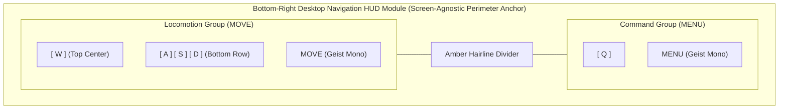

# Functional Specification 072: Post-Dialogue Desktop `WASD` & `Q` Navigation HUD Module, Forced One-Time `WASD` + `Q` Key Intro Sequence, and Strict Mobile Analog Stick Mutual Exclusivity

> **Document Status:** Authoritative Functional Specification (`DO NOT CODE YET` — Pre-Implementation Gate)  
> **Target System:** Freeman Alley WebGL / Three.js Interactive 3D Portfolio Experience  
> **Authoritative Vocabulary:** [`LANGUAGE.md`](file:///Users/diesel/desktop/skatealley/LANGUAGE.md) (`{errors}`, `{correctness}`, `{functionality}`, `{correct required outputs}`, `{sufficient}`, `{insufficient}`)  
> **Builds Upon:** [`hud.md`](file:///Users/diesel/desktop/skatealley/hud.md), [`functional_specification_070.md`](file:///Users/diesel/desktop/skatealley/functional_specification_070.md), [`functional_specification_071.md`](file:///Users/diesel/desktop/skatealley/functional_specification_071.md)

---

## 1. System Overview & Unified Functional Objective

Currently, once the startup camera pan and initial 7-card intro dialogue sequence conclude on desktop viewports, visitors are dropped into Freeman Alley with zero on-screen guidance signaling how to walk through the corridor (`WASD`) or summon the Cyber-Tactical Radial Command Menu (`Q`).

This specification defines the end-to-end desired `{functionality}`, visual/optical contracts, choreography, state transitions, operational budgets, and edge-case protections for three tightly coupled capabilities:

1. **Pillar 1 — Screen-Agnostic Bottom-Right Desktop `WASD` & `Q` Navigation HUD Instruction Module:**
   - Immediately after the initial dialogue sequence finishes on desktop viewports, a persistent, compact, screen-agnostic control legend materializes in the **bottom-right corner** of the viewport.
   - Displays tactile **`W` `A` `S` `D`** directional keycaps (signaling alley locomotion / portfolio navigation) paired with a **`Q`** keycap (signaling the Radial Command Menu), rendered in the **exact visual aesthetic and animation language** as the Perimeter HUD: frosted obsidian glass substrate, warm cyber-amber phosphor borders and luminescence, `Geist Sans` + `Geist Mono` tabular typography, multi-stage **CRT Phosphor Flicker-On** ignition, and **Zero-Jitter Glyph Materialization (Cipher Decode)**.
   - Dynamically mirrors live user keypresses (`W`, `A`, `S`, `D`, `Q`) in real time using the HUD's high-contrast solid inverted phosphor active state, and scales fluidly across all desktop aspect ratios (`901×501` compact windows through `1440×900`, `2560×1440`, and `3840×2160` / ultrawide displays) with zero overlap against surrounding HUD modules.

2. **Pillar 2 — Post-Dialogue Forced One-Time Desktop `WASD` + `Q` Key Intro Sequence:**
   - Immediately upon loading into the alley after the initial dialogue sequence on desktop, a dedicated **Desktop Key Intro** sequence materializes with the **exact same HUD aesthetic, CRT Phosphor Flicker-On, and Zero-Jitter Cipher Decode animations**.
   - Forces the desktop visitor to actuate **each of the five navigation keys—`W`, `A`, `S`, `D`, and `Q`—just once per key** (in any order, via physical keyboard press or direct pointer click on the rendered keycaps) before general passive scrolling and secondary portfolio overlays unlock.
   - Each first actuation of `W`, `A`, `S`, `D`, or `Q` executes the key's real runtime action (moving the character in the alley for `W`/`A`/`S`/`D`; toggling the Cyber-Tactical Radial Menu for `Q`) while permanently locking that keycap into its verified solid-phosphor HUD state with a localized tactile Cipher Decode pulse.
   - The instant all 5 keys (`W`, `A`, `S`, `D`, and `Q`) have each been actuated once (`05 / 05`), the forced intro plays a brief resolved confirmation pulse and dissolves cleanly out of the viewport for the remainder of the session, leaving the persistent bottom-right `WASD` + `Q` HUD instruction docked for ongoing reference.

3. **Pillar 3 — Strict Desktop-vs-Mobile Mutual Exclusivity (`XOR` Partition):**
   - On **mobile / touch viewports**, neither the persistent bottom-right `WASD` / `Q` HUD instruction **nor** the forced post-dialogue `WASD` / `Q` key intro may ever appear, animate, capture input, or gate navigation.
   - On mobile, post-dialogue bottom-perimeter navigation controls consist **solely of the left (`MOVE`) and right (`LOOK`) virtual analog telemetry reticles**.
   - Conversely, on **desktop viewports**, the virtual analog sticks remain hidden and only the desktop `WASD` / `Q` HUD instruction and one-time `WASD` / `Q` key intro operate.

---

## 2. Authoritative Taxonomy & Evaluation Parameters ([`LANGUAGE.md`](file:///Users/diesel/desktop/skatealley/LANGUAGE.md))

Every requirement, state transition, and verification gate in this document is governed strictly by [`LANGUAGE.md`](file:///Users/diesel/desktop/skatealley/LANGUAGE.md):

| Evaluation Parameter | Strict Domain Definition & Application to Spec 072 |
| :--- | :--- |
| **`{errors}`** | Any appearance of the `WASD`/`Q` bottom-right instruction or `WASD`/`Q` key intro on mobile viewports; any appearance of either `WASD`/`Q` component while the startup camera pan or initial 7-card dialogue sequence is still active; any appearance of mobile virtual analog sticks alongside desktop `WASD`/`Q` instructions; failure to require each of `W`, `A`, `S`, `D`, and `Q` once on desktop post-dialogue load; keyboard input deadlock when `Q` opens the Radial Menu before all `WASD` keys are completed; intercepting keystrokes typed inside the `DOOM_HEAD` chat text field; layout shift (`CLS > 0.000`) during glyph scrambling; bounding-box overlap between HUD regions; or any unhandled runtime exception or silent fallback. |
| **`{correctness}`** | 1. **Lifecycle Timing:** Strict dormancy (`opacity = 0`, `visibility: hidden`, non-interactive) throughout startup pan and initial dialogue, followed by immediate post-dialogue ignition. 2. **Set-Completion Logic:** Deterministic 5-element boolean completion set $\mathcal{K} \subseteq \{\text{W}, \text{A}, \text{S}, \text{D}, \text{Q}\}$ where each key transitions monotonically from `awaiting` $\to$ `verified` on its first valid actuation, invariant to permutation order and idempotent under repeated presses of an already-verified key. 3. **Mutual Exclusivity:** Exact boolean partition between Mobile Touch Mode (analog sticks only, zero `WASD`/`Q` UI or gating) and Desktop Mode (`WASD`/`Q` intro + persistent bottom-right `WASD`/`Q` instruction, zero analog sticks), preserved dynamically across viewport resizes. 4. **Zero-Jitter HUD Animation Parity:** Pre-locked pixel dimensions (`<= 0.5px` delta) across all Cipher Decode waves and multi-stage CRT Phosphor Flicker-On transitions. |
| **`{functionality}`** | Desktop visitors finishing the intro dialogue immediately understand and physically experience both character movement (`WASD`) and the Radial Command Menu (`Q`) through a cohesive, HUD-native interactive onboarding check, and retain an unobtrusive, screen-agnostic bottom-right `WASD` + `Q` reference throughout their visit—while mobile visitors go straight from the dialogue sequence into dual-analog-stick exploration without ever seeing keyboard prompts. |
| **`{correct required outputs}`** | Objectively measurable runtime states across desktop (`1440×900`, `1280×720`, `2560×1440`) and mobile (`390×844`, `375×667`) viewports: • Pre-dialogue & active-dialogue: both desktop `WASD`/`Q` modules report `hidden` (`opacity === 0`) and `0` completed keys. • Post-dialogue on desktop: both the `WASD`/`Q` key intro and bottom-right `WASD`/`Q` instruction materialize immediately via CRT Phosphor Flicker-On + Cipher Decode (`CLS = 0.000`); passive scroll and secondary overlays remain gated until each of `W`, `A`, `S`, `D`, and `Q` is actuated once (`completedCount: 5 / 5`), after which the intro dismisses permanently and full navigation unlocks while the bottom-right `WASD`/`Q` module stays visible in the bottom-right quadrant. • Post-dialogue on mobile: `WASD`/`Q` intro and bottom-right `WASD`/`Q` instruction remain `display: none` / `visibility: hidden` (`isGating === false`), while solely the left and right analog reticles flicker on in the bottom corners. |
| **`{sufficient}`** | Zero ambiguity remains across visual styling, fluid responsive geometry, animation keyframes/timings, state transitions, Radial Menu / `DOOM_HEAD` chat cross-subsystem interactions, accessibility rules, and measurable verification outputs. |
| **`{insufficient}`** | Rendering static plain-text `WASD`/`Q` labels that lack HUD phosphor styling or Cipher Decode/Flicker-On animations; showing keyboard instructions on mobile; allowing passive scroll to bypass the one-time 5-key check on desktop; trapping `WASD` input when `Q` opens the Radial Menu; or leaving permanent per-frame scramble loops running after text resolution. |

---

## 3. First-Principles Feasibility & Cross-Subsystem Architectural Analysis

Evaluating the requested behavior against the live Freeman Alley runtime exposes four physical and state-machine constraints that MUST be resolved at their architectural root cause (`RULE[user_global]`):

### 3.1 Elimination of Radial Menu (`Q`) vs. Locomotion (`WASD`) Input Deadlock
- **Physical Conflict:** Pressing `Q` toggles the Cyber-Tactical Radial Menu overlay in the center of the viewport. In the existing keyboard pipeline, while the Radial Menu is open, non-menu keys (including `W`, `A`, `S`, and `D`) are consumed early and prevented from reaching character locomotion—unlike `DOOM_HEAD` chat, sticker popups, math-pod popups, and wall-mount focus, which all automatically dismiss when a movement key is pressed.
- **Consequence During Forced 5-Key Intro:** Because the visitor may press the 5 required keys `{W, A, S, D, Q}` in **any** permutation (e.g., `Q` first, then `W`, `A`, `S`, `D`; or `W`, `A`, `Q`, `S`, `D`), if `Q` opens the Radial Menu and blocks subsequent `WASD` movement or occludes the intro prompt, the user experiences frozen movement or visual collision.
- **Mandatory Architectural Resolution:**
  1. **Movement-Key Dismissal Parity on Radial Menu:** Pressing any `WASD` locomotion key while the Radial Menu is open MUST cleanly close the Radial Menu and immediately apply that movement input in Free-Roam mode—matching the exact behavior of all other overlays in Freeman Alley.
  2. **Non-Overlapping Spatial Layering:** The Forced `WASD` + `Q` Key Intro card MUST dock in the **lower-center perimeter zone** above the Radial Menu's z-plane (`z-index` above the Radial Menu overlay) and below the central Radial Menu wheel footprint, ensuring that when `Q` opens the Radial Menu, both the Radial Menu wheel in the center and the remaining key checklist below it remain simultaneously legible and unobstructed.

### 3.2 Post-Dialogue Card 07 `"YES"` (`DOOM_HEAD` Chat) Deferral & Text-Input Isolation
- **Physical Conflict:** The final card of the startup dialogue sequence offers two choices: `"NO"` (enter Freeman Alley directly) and `"YES"` (immediately open the `DOOM_HEAD` holographic chat terminal and focus its text input field). If a desktop visitor chooses `"YES"` and types a message containing the letters `w`, `a`, `s`, `d`, or `q` into the chat input box, naive global key listeners would falsely register calibration keys or block the chat session the user explicitly requested.
- **Mandatory Architectural Resolution:**
  1. Keystrokes originating while focus resides inside any text-entry element (`<input>`, `<textarea>`, or `contenteditable`) MUST NEVER count toward `WASD`/`Q` intro completion or trigger HUD keycap actuation.
  2. If the initial dialogue concludes directly into `DOOM_HEAD` chat (`"YES"` branch), the Forced `WASD` + `Q` Key Intro enters a **Deferred Post-Dialogue Armed State**: it remains hidden while `DOOM_HEAD` chat is open, and immediately materializes and begins its 5-key check the instant the visitor exits `DOOM_HEAD` chat into the alley. On the standard `"NO"` / direct alley branch, it materializes with `0 ms` deferral upon dialogue completion.

### 3.3 Bi-Directional Desktop $\leftrightarrow$ Mobile Mode Synchronization Across Viewport Resizes
- **Physical Conflict:** Currently, narrowing a desktop browser window below the mobile breakpoint latches mobile touch mode (`enabled = true`), but widening the window back to a full desktop viewport does not release that latch. That asymmetry could leave a desktop browser stuck showing analog sticks instead of `WASD`/`Q` instructions after a window resize.
- **Mandatory Architectural Resolution:** Unless mobile/desktop mode is explicitly pinned via URL query override (`?mobile=1|0` or `?touch=1|0`) or an active hardware coarse/touch pointer session is present, resizing a fine-pointer desktop viewport across the mobile/desktop boundary MUST transition cleanly in **both** directions, preserving a strict `XOR` invariant between mobile analog sticks and desktop `WASD`/`Q` HUD modules at every viewport size.

### 3.4 Screen-Agnostic Viewport Spatial Budget
- Across desktop viewports from compact `901 × 501 CSS px` up to `3840 × 2160 CSS px`:
  - **Top-Left:** Brand & role identity (`LUIS // PLATODOOM` + `AI ENGINEERING | DATA ANALYTICS`).
  - **Top-Center:** Primary 3-pill navigation bar (`WORKS` | `MENU` | `CHAT`).
  - **Top-Right:** Docked `DOOM TRACKS` 3D MP3 player module.
  - **Bottom-Center:** Contextual wall-mount proximity prompt (when near a mount in Free-Roam) and, during initial onboarding only, the compact one-time `WASD` + `Q` Key Intro card.
  - **Bottom-Right:** Persistent Desktop `WASD` + `Q` Navigation HUD Instruction module (~`156px–210px` wide × `78px–106px` tall via fluid `clamp()`).
  - At the tightest desktop viewport (`901 × 501`), the bottom-right module occupies less than `23%` of viewport width and `20%` of viewport height, maintaining `>= 80px` horizontal clearance from bottom-center prompts and `>= 240px` vertical clearance below the top-right MP3 player (`0 px²` bounding-box collision).
  - Steady-state rendering overhead after initial Cipher Decode completion is **`0.00 ms/frame`** (`O(1)` event-driven class updates on keydown/keyup; zero extra WebGL draw calls; `0 B` external network assets).

---

## 4. Visual Aesthetic & Animation Contract (100% Perimeter HUD Parity)

Both the **Persistent Bottom-Right `WASD` + `Q` Instruction Module** (§5) and the **Post-Dialogue Forced `WASD` + `Q` Key Intro** (§6) MUST strictly match the visual design tokens and temporal choreography of the Screen-Agnostic Perimeter HUD:

### 4.1 Surface, Color, and Typographic Tokens
1. **Obsidian Glass Chassis:**
   - Background substrate: translucent deep void obsidian (`rgba(8, 9, 12, 0.82)`) with frosted backdrop blur (`blur(10px)`).
   - Outer border: `1.5px` warm cyber-amber phosphor hairline (`rgba(245, 158, 11, 0.48)`), rounded hardware pill/chassis geometry, ambient drop shadow (`0 8px 24px rgba(0, 0, 0, 0.66)`), and subtle inner phosphor recess glow (`inset 0 0 14px rgba(245, 158, 11, 0.10)`).
2. **Tactile HUD Keycap Anatomy (`W`, `A`, `S`, `D`, `Q`):**
   - **Idle / Awaiting State:** Precision square/chamfered-radius keycap (`border-radius: clamp(6px, 0.55vw, 8px)`) with dark recessed key well (`rgba(14, 12, 10, 0.86)`), `1px–1.5px` amber phosphor border (`rgba(245, 158, 11, 0.52)`), subtle bottom keycap bevel/inset luminance, and crisp uppercase `Geist Sans` bold glyph (`weight: 700–800`) in luminous phosphor ivory (`#fef3c7` / `#fffbeb`) with warm amber text glow (`0 0 8px rgba(245, 158, 11, 0.35)`).
   - **Hover State (Desktop Pointer):** Brightened amber border (`rgba(251, 191, 36, 0.72)`), warm translucent fill (`rgba(245, 158, 11, 0.18)`), `#ffffff` glyph, and localized Cipher Decode re-trigger.
   - **Active / Pressed / Verified State (Inverted Solid Phosphor Pill Parity):** Matches the HUD's `.active-pill` high-contrast inverted state: solid bright phosphor amber fill (`#fbbf24`), pale gold rim (`#fef08a`), deep obsidian glyph text (`#090a0d`, `weight: 800`, zero text-shadow blur), and radiant outer phosphor bloom (`0 0 16px rgba(251, 191, 36, 0.55)`).
3. **Typography:**
   - Keycap glyphs and primary action headers use **`Geist Sans`** (`weight: 700–800`, uppercase, tight geometric alignment).
   - Action micro-labels (`MOVE`, `MENU`), calibration status headers, and numeric completion counters (`00 / 05` .. `05 / 05`) use **`Geist Mono`** (`weight: 600–700`, uppercase, `letter-spacing: 0.07em–0.09em`, `font-variant-numeric: tabular-nums`) in warm amber (`#fbbf24` / `rgba(254, 243, 199, 0.88)`).

### 4.2 Synchronized HUD Animation Language
1. **Multi-Stage CRT Phosphor Flicker-On Ignition (`520 ms` Envelope):**
   - When appearing immediately after the initial dialogue sequence (and when returning from suppressed full-screen overlays), both modules ignite through the HUD's multi-stage CRT Phosphor Flicker-On curve:
     - `0% – 18%`: Cold filament surge (`opacity: 0 -> 0.88`, `scale(0.94 -> 1.015)`, bright `#fef3c7` / `#fbbf24` border bloom).
     - `18% – 34%`: Capacitor dropout dip (`opacity: 0.14`, `scale(0.985)`).
     - `34% – 54%`: Secondary phosphor strike (`opacity: 0.96`, `scale(1.008)`, amber halo).
     - `54% – 72%`: Micro-flicker dip (`opacity: 0.32`).
     - `72% – 100%`: Smooth stabilization into calibrated `1.0` resting optical state.
2. **Zero-Jitter Glyph Materialization / Cipher Decode (`CLS = 0.000`):**
   - Concurrently with ignition, all visible text strings and keycap labels (`W`, `A`, `S`, `D`, `Q`, `MOVE`, `MENU`, and intro prompt/counter labels) materialize through the HUD's 3-phase character lifecycle (`Dormant` $\to$ `Active Scramble` cycling `█ ▓ ▒ ░ / \ | _ + # 0 1 < >` with `#ff4224` / `#ffffff` hot leading-edge highlight throttled to every `2–4` frames $\to$ `Resolved`), locking exact bounding-box `width` and `height` beforehand and restoring pure single-text-node DOM upon completion so layout shift is strictly `0.000` (`<= 0.5px` tolerance).
3. **`prefers-reduced-motion` & Assistive Technology Integrity:**
   - When `prefers-reduced-motion: reduce` is active, flicker keyframes and glyph scrambling bypass immediately to resolved states without altering functional gating or key verification requirements.
   - Intermediate cipher glyphs remain `aria-hidden="true"` while semantic `aria-label` attributes preserve clean screen-reader announcements.

---

## 5. Pillar 1: Screen-Agnostic Bottom-Right Desktop `WASD` & `Q` Instruction Module

### 5.1 Spatial Architecture & Fluid Responsive Scaling
1. **Perimeter Anchoring:**
   - Anchored inside the Perimeter HUD's **bottom-right corner** using safe-area-aware fluid viewport margins:
     - Right inset: `calc(clamp(14px, 2.2vw, 24px) + env(safe-area-inset-right, 0px))`
     - Bottom inset: `calc(clamp(14px, 2.2vh, 24px) + env(safe-area-inset-bottom, 0px))`
   - The overarching HUD container preserves `pointer-events: none`; only the discrete bottom-right instruction pill/keycaps opt into `pointer-events: auto`.
2. **Fluid Screen-Agnostic Sizing Envelope:**
   - Scales continuously across compact laptop windows, standard 16:9/16:10 desktops, and 4K/ultrawide displays without media-query jumps:
     - Individual keycap footprint (`W`, `A`, `S`, `D`, `Q`): `width: clamp(26px, 2.05vw, 34px)`, `height: clamp(26px, 2.05vw, 34px)`, `font-size: clamp(11px, 0.92vw, 14px)`.
     - Intra-cluster key gap: `clamp(3px, 0.3vw, 5px)`.
     - Group micro-labels (`MOVE`, `MENU`): `font-size: clamp(9.5px, 0.78vw, 11.5px)`, `Geist Mono`, uppercase, tabular spacing.
     - Container padding: `clamp(8px, 0.8vw, 12px) clamp(10px, 1.05vw, 16px)` with a `1px` vertical amber phosphor divider (`rgba(245, 158, 11, 0.32)`) separating the inverted-T `WASD` cluster from the `Q` command cluster.
3. **Ergonomic Layout:**
   - **Left Compartment (`WASD` Cluster):** Classic two-row inverted-T arrangement (`W` centered in row 1; `A`, `S`, `D` aligned in row 2) accompanied by the concise uppercase HUD label **`MOVE`**.
   - **Right Compartment (`Q` Cluster):** Tactile **`Q`** keycap vertically balanced alongside the `WASD` cluster and accompanied by the concise uppercase HUD label **`MENU`**.

### 5.2 Lifecycle, Overlay Suppression & Live Interactive Behavior
1. **Pre-Dialogue Dormancy & Immediate Post-Dialogue Materialization:**
   - Remains completely hidden (`opacity: 0`, `visibility: hidden`, `pointer-events: none`) during the startup camera pan (`pan-playing`) and initial 7-card dialogue sequence (`dialogue-active`).
   - Materializes **immediately** once the initial dialogue sequence finishes on desktop (staggered `~160 ms–220 ms` into the post-dialogue HUD boot choreography, matching the MP3 player and HUD decode cadence) via CRT Phosphor Flicker-On + staggered Cipher Decode across `MOVE`, `MENU`, and keycap glyphs.
2. **Full-Screen Overlay Suppression & Return Flicker:**
   - Automatically hides/suppresses (`opacity: 0`, `visibility: hidden`, `pointer-events: none`) whenever a full-screen modal takeover is active (`WORKS` full-screen showcase / `mount-focus-mode`, `DOOM_HEAD` chat / `doom-chat-active`, sticker holographic popup / `sticker-popup-active`, or `DOOM TRACKS` 3D full takeover / `mp3-takeover-active`), and re-executes its CRT Phosphor Flicker-On when returning to the alley—preventing overlap with full-viewport showcases.
3. **Live Keypress Telemetry & Pointer Micro-Interactions:**
   - While pressing/holding physical `W`, `A`, `S`, or `D` on the keyboard, the corresponding bottom-right keycap illuminates in the solid inverted phosphor `.active-pill` state and releases cleanly on `keyup` (and resets cleanly on window `blur` so keys never stick lit).
   - While the Cyber-Tactical Radial Menu (`Q`) is open—or while `Q` is physically held—the bottom-right `Q` keycap illuminates in the solid inverted phosphor `.active-pill` state.
   - Hovering over the module or its keycaps with a desktop pointer triggers a brisk localized Cipher Decode (`360 ms`, `frameStep: 2`, `CLS = 0.000`). Clicking `Q` toggles the Radial Menu; clicking `W`/`A`/`S`/`D` triggers the corresponding directional step/input (and counts toward the post-dialogue intro if still active).

---

## 6. Pillar 2: Post-Dialogue Forced One-Time Desktop `WASD` + `Q` Key Intro Sequence

```mermaid
stateDiagram-v2
    [*] --> PreDialogueDormant: Desktop Load (Pan / Intro Dialogue Active)
    PreDialogueDormant --> DeferredForDoomChat: Dialogue Ends via Card 07 "YES" (DOOM_HEAD Open)
    DeferredForDoomChat --> IntroActive: User Exits DOOM_HEAD Chat into Alley
    PreDialogueDormant --> IntroActive: Dialogue Ends via "NO" / Standard Completion
    IntroActive --> IntroActive: User Presses or Clicks Any Key in {W, A, S, D, Q}\n• Key Executes Live Action (Move / Toggle Menu)\n• First Actuation Locks Keycap -> Solid Amber Verified + Cipher Pulse\n• Counter Advances (k / 5); Secondary Nav & Scroll Remain Gated
    IntroActive --> IntroResolving: 5th Distinct Key Verified (5 / 5 Complete)\n• Header Deciphers Confirmation\n• Brief 380ms–480ms Resolved Hold
    IntroResolving --> SessionCompleted: CRT Phosphor Dissolve-Out (~260ms)\n• Full Portfolio Scroll & Overlays Unlocked\n• Bottom-Right WASD + Q HUD Remains Docked
```

### 6.1 Post-Dialogue Activation & One-Time Session Scope
1. **Trigger Timing:**
   - Activates **immediately** after the initial dialogue sequence finishes on desktop (unless deferred by the Card 07 `"YES"` `DOOM_HEAD` chat branch per §3.2, in which case it activates immediately upon closing `DOOM_HEAD` chat).
   - Runs **once per page load / session initialization** on desktop (and resets back to `PreDialogueDormant` only if an explicit full intro replay is triggered in developer/replay mode).
2. **Spatial Placement (Screen-Agnostic Lower-Center HUD Dock):**
   - Positioned symmetrically at the **bottom-center** of the viewport (`left: 50%`, `transform: translateX(-50%)`, `bottom: calc(clamp(18px, 3vh, 34px) + env(safe-area-inset-bottom, 0px))`), at a z-layer above the Radial Menu overlay (`z-index >= 30`) so it remains completely unobstructed if the user presses `Q` to open the central Radial Menu wheel before finishing `WASD`, while maintaining wide lateral separation from the bottom-right `WASD` + `Q` HUD module.
   - Scales fluidly with `clamp()` typography, keycap dimensions (`clamp(36px, 3.1vw, 46px)` square keycaps), and padding so it fits comfortably on every desktop screen from `901 × 501` to `4K`.

### 6.2 Forced 5-Key Calibration Mechanics (`W`, `A`, `S`, `D`, and `Q` Once Each)
1. **Required Key Set & Order Independence:**
   - The visitor MUST actuate each of the **five distinct keys** in the set $\mathcal{K}_{\text{req}} = \{\text{W}, \text{A}, \text{S}, \text{D}, \text{Q}\}$ **at least once**:
     - `W` (`KeyW` / `'w'`): Move Forward
     - `A` (`KeyA` / `'a'`): Strafe / Move Left
     - `S` (`KeyS` / `'s'`): Move Backward
     - `D` (`KeyD` / `'d'`): Strafe / Move Right
     - `Q` (`KeyQ` / `'q'`): Toggle Radial Command Menu
   - **Any order is valid** (e.g., `W → A → S → D → Q`, `Q → W → D → S → A`, etc.).
   - **Idempotency:** Actuating a key that has already been verified continues to perform its live movement or menu-toggle action, keeps that key's verified visual badge locked on, and never increments the counter past `1` contribution for that key.
   - **Dual Input Acceptance:** Each key in $\mathcal{K}_{\text{req}}$ can be satisfied either by pressing the physical key on the desktop keyboard (`keydown`, ignoring OS auto-repeat ticks for already-held keys) **or** by clicking the corresponding rendered keycap (`W`, `A`, `S`, `D`, `Q`) inside the HUD with a pointer.
2. **Mandatory Gating While Active (`completedCount < 5`):**
   - Until all 5 keys in $\mathcal{K}_{\text{req}}$ have been actuated (`0 <= completedCount < 5`):
     - Passive corridor wheel/trackpad scrolling along the alley scroll track remains locked (`scrollLocked`).
     - Secondary portfolio mode/showcase triggers (`WORKS` showcase button, `CHAT` button, `E` wall-mount focus, and 3D exhibit popup clicks) are held/ignored so the user must complete the 5-key calibration first.
     - Note: Clicking the top-center `MENU` button or pressing `Q` toggles the Radial Menu and satisfies `Q` if `Q` is clicked/pressed; however, Radial Menu slice navigation to external sub-popups (stickers/links) remains gated until all 5 keys are completed, or closes cleanly when the next `WASD` key is pressed.
3. **Live Cause-and-Effect Execution:**
   - **Actuating `W`, `A`, `S`, or `D`:**
     - If the Radial Menu is currently open (from an earlier `Q` actuation), the Radial Menu automatically closes so movement is unobstructed.
     - Transitions the runtime into Free-Roam locomotion (if currently in `scroll` mode) and applies the directional movement impulse so the visitor immediately sees Luis walk/respond in the alley. (When clicked via mouse pointer rather than held on keyboard, applies a clean, bounded directional step impulse of `~180 ms–240 ms` so pointer clicks also produce visible character motion.)
   - **Actuating `Q`:**
     - Toggles the Cyber-Tactical Radial Menu (`#cyber-radial-menu-overlay`) open or closed so the visitor immediately sees what `Q` controls in the portfolio.

### 6.3 Intro HUD Visual Layout & Per-Key Animation Choreography
1. **HUD Card Structure:**
   - **Header Row:** Concise uppercase HUD prompt label (e.g., `CALIBRATE NAVIGATION // PRESS EACH KEY ONCE`) on the left paired with a `Geist Mono` tabular completion badge (`00 / 05` $\to$ `05 / 05`) on the right.
   - **Interactive Key Stage:**
     - **Left Group:** Enlarged tactile inverted-T **`W` / `A` `S` `D`** keycaps with `Geist Mono` caption **`MOVE ALLEY`**.
     - **Amber Vertical Hairline Separator.**
     - **Right Group:** Enlarged tactile **`Q`** keycap with `Geist Mono` caption **`RADIAL MENU`**.
2. **Entrance Choreography (Post-Dialogue Ignition):**
   - Ignites via the `520 ms` **CRT Phosphor Flicker-On** envelope simultaneously with staggered **Zero-Jitter Cipher Decode** (`650 ms–900 ms`, `frameStep: 3`, `CLS = 0.000`) across the header prompt, `00 / 05` counter, keycap glyphs, and group captions.
3. **First-Actuation Key Verification Animation:**
   - On the exact frame a previously unpressed key $k \in \{\text{W}, \text{A}, \text{S}, \text{D}, \text{Q}\}$ is actuated for the first time:
     - Keycap $k$ permanently transitions from its translucent phosphor-outline `awaiting` state to the HUD's **solid inverted bright-amber `verified` state** (`#fbbf24` background, `#fef08a` border, `#090a0d` glyph, phosphor outer glow) with a crisp tactile scale micro-pulse (`1.0 -> 1.08 -> 1.0` over `180 ms`) and a localized **Cipher Decode** flash (`260 ms`, `frameStep: 2`, `CLS = 0.000`) on its glyph.
     - Once verified, releasing the key (`keyup`) does **not** revert the intro keycap back to dim outline—it stays illuminated in its verified solid-amber state so the user has unmistakable visual memory of which keys are done and which keys remain!
     - When all four movement keys (`W`, `A`, `S`, `D`) are verified, the `MOVE ALLEY` caption shifts to bright resolved amber; when `Q` is verified, the `RADIAL MENU` caption shifts to bright resolved amber.
     - The tabular progress readout updates cleanly in place (`01 / 05`, `02 / 05`, ..., `05 / 05`).
4. **5/5 Completion & Dismissal Sequence:**
   - Immediately upon verifying the 5th distinct key (`05 / 05`):
     - Input gating releases (`isGating = false`) so the user has zero post-completion input delay.
     - The header prompt executes a rapid Cipher Decode (`~300 ms`) into a concise resolved confirmation string (e.g., `NAVIGATION ONLINE // READY`), holds briefly (`~380 ms–460 ms` total confirmation beat), and exits via a crisp **CRT Phosphor Collapse / Dissolve-Out** (`~240 ms–280 ms`), transitioning the intro overlay to `display: none` / `visibility: hidden` and cleaning up all temporary nodes.

---

## 7. Pillar 3: Strict Mobile Exclusion & Device-Mode Invariants

1. **Zero `WASD` / `Q` Presence on Mobile (`mobileTouch.enabled === true`):**
   - Whenever the runtime is in Mobile Touch Mode (coarse pointer / touch device, mobile viewport `<= 900px` width or `<= 500px` height, or explicit `?mobile=1` / `?touch=1` parameter):
     - **Persistent Bottom-Right `WASD` + `Q` Instruction Module:** Strictly hidden (`display: none !important`, `visibility: hidden !important`, `pointer-events: none !important`).
     - **Forced Post-Dialogue `WASD` + `Q` Key Intro:** Strictly suppressed—never enters active or gating state (`isGating === false`), never locks scroll or touch navigation, and never renders in the DOM viewport.
     - **Sole Mobile Navigation UI:** Only the left (`MOVE`) and right (`LOOK`) precision telemetry virtual analog sticks render along the bottom perimeter after the initial dialogue sequence.
2. **Dynamic Viewport Mode Transition Handling:**
   - If a viewport transitions from Desktop Mode into Mobile Touch Mode while the Forced `WASD` + `Q` Key Intro is mid-progress (`0 < completedCount < 5`), the intro gate immediately suspends/releases so touch analog sticks are never blocked on mobile.
   - Conversely, on desktop (`mobileTouch.enabled === false`), `#mobile-touch-controls` (virtual analog sticks) remains `display: none`, and only the desktop `WASD` + `Q` systems render.

---

## 8. Operational & Performance Budgets

| Subsystem / Metric | Mandatory Operational Target |
| :--- | :--- |
| **Pre-Dialogue & Active-Dialogue Dormancy** | `100%` hidden (`opacity == 0`, `visibility == 'hidden'`) for both `WASD`/`Q` intro and bottom-right `WASD`/`Q` instruction during `pan-playing` and `dialogue-active` |
| **Post-Dialogue Ignition Latency (Desktop)** | Begins CRT Phosphor Flicker-On + Cipher Decode within `<= 220 ms` of initial dialogue completion (or `<= 50 ms` after closing `DOOM_HEAD` chat if Card 07 `"YES"` was selected) |
| **Required Intro Keys (Desktop Only)** | Exact 5-key set `{W, A, S, D, Q}`, `1` actuation required per key, permutation-invariant, `0` keys required on mobile |
| **Cipher Decode Layout Stability (`CLS`)** | `<= 0.5 px` bounding-box `width`/`height` variance across boot, key-verification, and hover decodes (`CLS = 0.000`) |
| **CRT Phosphor Flicker-On Duration** | `450 ms – 600 ms` multi-stage opacity/luminance keyframe envelope matching HUD & analog stick cadence |
| **Desktop Perimeter Collision Area** | `0 px²` bounding-box overlap between bottom-right `WASD`/`Q` instruction, bottom-center intro/proximity cards, top-right MP3 player, and central Radial Menu across `901×501` through `3840×2160` |
| **Mobile `WASD` / `Q` Leakage** | `0` visible pixels, `0` pointer-capturing nodes, and `0 ms` navigation gating on mobile viewports (`375×667`, `390×844`, `?mobile=1`) |
| **Frame-Time & Steady-State Budget** | Steady `60 FPS` (`<= 16.67 ms` frame time) during intro animations; `0.00 ms/frame` CPU/GPU overhead after cipher decode resolution |

---

## 9. Edge Cases, Failure Isolation & Deterministic Recovery

1. **Modifier Keys & Browser Shortcuts Ignored:** Keypresses accompanied by `metaKey` (`Cmd+W`, `Cmd+Q`), `ctrlKey` (`Ctrl+W`), or `altKey` MUST NEVER be intercepted (`preventDefault` must NOT block browser tab/window shortcuts) and MUST NOT falsely trigger `WASD`/`Q` actuation.
2. **OS Key-Repeat Debouncing:** Holding down `W` continuously (`event.repeat === true`) drives smooth continuous Free-Roam locomotion, illuminates the `W` keycap smoothly without re-triggering rapid glitch/decode loops on every repeat tick, and counts `W` once toward the `1/5` requirement.
3. **Window Blur / Visibility Loss Reset:** If the browser tab loses focus (`blur` or `visibilitychange`) while a movement key is held, active pressed highlights on the bottom-right `WASD`/`Q` HUD reset cleanly to idle while already-verified keys in the one-time intro preserve their completed progress (`completedKeys` state is never lost on tab switch).
4. **Non-QWERTY Physical vs. Logical Key Compatibility:** Key matching resolves physical scancodes (`KeyW`, `KeyA`, `KeyS`, `KeyD`, `KeyQ`) with case-insensitive logical character fallback (`'w'`, `'a'`, `'s'`, `'d'`, `'q'`) when not conflicting, ensuring seamless completion across international keyboard layouts as well as on-screen mouse clicks.
5. **Intro Replay Determinism:** Triggering an explicit full intro replay resets the Perimeter HUD, bottom-right `WASD`/`Q` instruction, and desktop `WASD`/`Q` key intro cleanly back to their pre-dialogue dormant state so the entire post-dialogue sequence can be re-verified deterministically.

---

## 10. Verification Criteria & `{correct required outputs}`

Any downstream implementation of this specification MUST be verified end-to-end against the live WebGL application across desktop (`1440×900`, `1280×720`) and mobile (`390×844`) viewports, confirming the following `{correct required outputs}`:

1. **Pre-Dialogue Dormancy Check (Desktop & Mobile):**
   - While startup camera pan (`pan-playing`) or intro dialogue (`dialogue-active`, Cards `01`–`07`) is active, `#portfolio-perimeter-hud`, the bottom-right `WASD`/`Q` instruction module, and the `WASD`/`Q` key intro overlay all have computed `opacity === "0"` and `visibility === "hidden"`.
2. **Post-Dialogue Desktop Ignition & HUD Aesthetic Check (`1440×900` & `1280×720`):**
   - Completing the initial dialogue (`"NO"` on Card 07) immediately reveals both the Forced `WASD` + `Q` Key Intro and the Bottom-Right `WASD` + `Q` Instruction Module.
   - Both modules execute the multi-stage CRT Phosphor Flicker-On state (`flicker-on` $\to$ `settled`) and Zero-Jitter Cipher Decode (`<= 0.5px` dimension delta, `CLS = 0.000`), using `Geist Sans` / `Geist Mono` typography and HUD phosphor border/substrate tokens.
   - Bottom-right `WASD`/`Q` module bounding box resides strictly inside the bottom-right viewport quadrant (`right >= vw - 260`, `bottom >= vh - 150`, within viewport bounds) with `0 px²` overlap against `#doom-tracks-mp3-hud`, `#portfolio-hud-top-center`, and the Forced Key Intro card.
3. **Forced One-Time `WASD` + `Q` Intro Gating & Order-Independent Completion Check (`1440×900`):**
   - Prior to completing all 5 keys (`completedCount < 5`), wheel-scroll attempts do not advance corridor scroll progress and clicking `WORKS` does not bypass the intro.
   - Pressing `Q` first toggles the Radial Menu open (`isOpen() === true`), marks `Q` verified (`1 / 5`) with solid-amber styling, and leaves the Key Intro card visible and unobstructed; pressing `W` next automatically closes the Radial Menu (`isOpen() === false`), enters Free-Roam mode, moves the character forward, and marks `W` verified (`2 / 5`).
   - Pressing `W` a second time remains at `2 / 5` (idempotent).
   - Completing the remaining keys `A`, `S`, and `D` advances progress deterministically through `3 / 5` $\to$ `4 / 5` $\to$ `5 / 5`, releases input gating immediately, plays the resolved confirmation state, and dismisses the intro overlay (`visibility === "hidden"`), while the Bottom-Right `WASD` + `Q` Instruction Module remains visible and highlights individual `W`/`A`/`S`/`D`/`Q` keycaps live on subsequent keypresses.
4. **Card 07 `"YES"` (`DOOM_HEAD` Chat) Isolation Check (`1440×900`):**
   - Completing Card 07 via `"YES"` opens `DOOM_HEAD` chat; typing `"wasdq"` into `#doom-chat-input` registers `0 / 5` intro keys; closing `DOOM_HEAD` chat immediately triggers the Forced `WASD` + `Q` Key Intro at `0 / 5`.
5. **Strict Mobile Exclusion Check (`390×844` Coarse Touch Viewport):**
   - Completing the initial dialogue on mobile reveals **solely** `#mobile-left-thumbpad` and `#mobile-right-thumbpad` (via their independent CRT Phosphor Flicker-On).
   - Both the Bottom-Right `WASD` + `Q` Instruction Module and the Forced `WASD` + `Q` Key Intro report `display === "none"` or `visibility === "hidden"`, `isGating === false`, and `0` keyboard elements rendered on screen.
