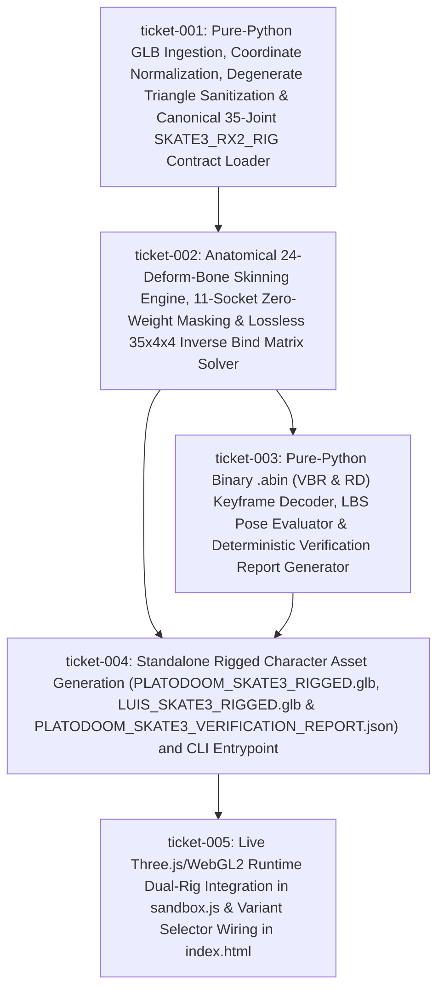

# Wayfinder Map — Automated Custom Humanoid Character Rigging, Skate 3 Clean-Room Master Rig Binding, and Binary Animation Validation Pipeline (`functional_specification_033.md`)

## Destination

Deliver an end-to-end, pure-Python automated offline asset preparation, 35-joint Skate 3 Clean-Room Master Rig (`SKATE3_RX2_RIG`) binding, Inverse Bind Matrix (`inverseBindMatrices`) solver, `.abin` binary animation keyframe deformation verifier, standalone rigged `.glb` character artifacts (`PLATODOOM_SKATE3_RIGGED.glb` and `LUIS_SKATE3_RIGGED.glb`), deterministic verification report (`PLATODOOM_SKATE3_VERIFICATION_REPORT.json`), and live Three.js/WebGL2 `CharacterController` dual-rig runtime support (`sandbox.js` and `index.html`) satisfying every structural, mathematical, and performance invariant in [`functional_specification_033.md`](file:///Users/diesel/Desktop/SkateAlley/.sandcastle/worktrees/agent-plan-20261022T230304-120-0j7w/functional_specification_033.md).

Specifically, the system must:
1. **Ingest Static Unrigged Humanoid `.glb` Meshes & Normalize Coordinate Space (§4.2, §5, §8)**:
   - Parse binary glTF 2.0 (`.glb`) buffers (`JSON` chunk `0x4E4F534A` and `BIN` chunk `0x004E4942`) in pure Python without requiring external Blender CLI processes (`bpy`).
   - Normalize arbitrary character bounds (such as `PLATODOOM_RAW.glb` at $Y \in [-1.0001\text{ m}, +0.9943\text{ m}]$) into the canonical Skate 3 metric space: right-handed $+Y$-up, $+Z$-forward, $-X$-right, lowest sole vertex grounded at $Y = 0.000\text{ m}$ ($\pm 10^{-4}\text{ m}$), standing height normalized to $1.8000\text{ m}$ (strictly within $1.80\text{ m} \pm 0.05\text{ m}$, i.e., $[1.75\text{ m}, 1.85\text{ m}]$), and lateral center at $(X = 0.0, Z = 0.0)$.
   - Sanitize degenerate zero-area triangles ($\text{area} < 10^{-10}\text{ m}^2$) so normal/tangent calculations never produce `NaN` or `Inf`, while preserving 100% of input `POSITION`, `NORMAL`, `TEXCOORD_0`, `TANGENT`, material definitions, and texture buffers when rigging pre-textured meshes (or assembling `PLATODOOM` / `LUIS` textured surfaces) and keeping output `.glb` size growth $\le 15\%$ over the raw mesh baseline.
2. **Bind the Canonical 35-Joint `SKATE3_RX2_RIG` Hierarchy & Compute Lossless Inverse Bind Matrices (§4.1, §4.4, §5 Stage 4)**:
   - Instantiate the exact 35-joint `SKATE3_RX2_RIG` node hierarchy and joint index order (`0..34`) defined in [`20261019T213303-735-zjzk/plan-scan-2-skater.glb`](file:///Users/diesel/Desktop/SkateAlley/20261019T213303-735-zjzk/plan-scan-2-skater.glb) and captured in [`assets/20261022T230304-120-0j7w/plan-skate3-rx2-rig-contract.json`](file:///Users/diesel/Desktop/SkateAlley/.sandcastle/worktrees/agent-plan-20261022T230304-120-0j7w/assets/20261022T230304-120-0j7w/plan-skate3-rx2-rig-contract.json) under scene root `Skate3_RX2_Rig`.
   - Compute exact column-major $4\times 4$ `float32` Inverse Bind Matrices ($\text{IBM}_j = (W_{\text{bind}}^{(j)})^{-1}$, componentType `5126`, type `"MAT4"`, count `35`, `2,240` bytes) satisfying:
     $$\max_{j \in \{0..34\}} \left\| W_{\text{bind}}^{(j)} \times \text{IBM}_j - I_4 \right\|_\infty \le 10^{-5}, \quad \left|\det(W_{\text{bind}}^{(j)})\right| > 10^{-6}$$
     and guaranteeing zero rest-pose geometric displacement ($\max_v \|v' - v\|_2 < 0.001\text{ mm} = 10^{-6}\text{ m}$).
3. **Compute Anatomically Partitioned 4-Bone Skinning Weights (`JOINTS_0` & `WEIGHTS_0`, §4.3, §5 Stage 3)**:
   - Partition weights across the 24 humanoid deform bones (indices `0..23`: `HIPS` through `LEFTTOEBASE`) using anatomical region isolation (head/neck, torso spine chain, left/right arm chains with shoulder-to-clavicle blend, pelvis/glute protection, and left/right leg chains separated by sagittal plane $X=0$ so left legs never bleed across to right legs) while strictly locking non-deforming vehicle/IK target sockets (indices `24..34`: `SKATEBOARD_ROOT`, trucks, wheels, and `*_REPARENTED` nodes) to weight `0.000000`.
   - Enforce WebGPU/WebGL2 4-influence invariants on 100% of vertices:
     - `JOINTS_0`: `UNSIGNED_SHORT` (`5123`), `"VEC4"`, 8 bytes/vertex, all indices $\in [0, 34]$, unused slots padded with `0`.
     - `WEIGHTS_0`: `FLOAT` (`5126`), `"VEC4"`, 16 bytes/vertex, descending weight order $w_0 \ge w_1 \ge w_2 \ge w_3 \ge 0$, zero `NaN`/`Inf`, zero orphan vertices ($\sum_{k=0}^3 w_k > 0$), and normalized sum $\left|\sum_{k=0}^3 w_{v,k} - 1.0\right| \le 10^{-6}$.
4. **Verify Keyframe Deformation Against Decompressed Skate 3 Binary Animations (`.abin`, §2, §5 Stage 6, §9, §10 AC-5)**:
   - Decode binary poses directly from [`20261019T213303-735-zjzk/plan-scan-2-OnBoard.abin`](file:///Users/diesel/Desktop/SkateAlley/20261019T213303-735-zjzk/plan-scan-2-OnBoard.abin) (`0x00524256` VBR bitstream and `0x00004452` RD raw keyframes) cross-referenced with [`20261019T213303-735-zjzk/skate3_full_animation_catalog.json`](file:///Users/diesel/Desktop/SkateAlley/20261019T213303-735-zjzk/skate3_full_animation_catalog.json) and additive delta base [`20261019T213303-735-zjzk/plan-scan-2-physics-skeletons.json`](file:///Users/diesel/Desktop/SkateAlley/20261019T213303-735-zjzk/plan-scan-2-physics-skeletons.json).
   - Evaluate Linear Blend Skinning (LBS) across mandatory verification clips (`R_IDLE_RIDE_N_0_CYC`, `R_ANTIC_CROUCH_HIGHOLLIE_N_0_INTO`, `OLLIE_HIGH_G`, `OLLIE_HIGH_A`, `R_PUSHLSP_LSTR_N_0_CYC1`, plus grab socket verification) and emit `PLATODOOM_SKATE3_VERIFICATION_REPORT.json`.
5. **Integrate Live Three.js/WebGL2 Runtime Dual-Rig Support (`sandbox.js` & `index.html`, `INV-GOAL-01`, `INV-ROOT-CAUSE-AGENCY-01`)**:
   - Extend `CharacterController` in [`sandbox.js`](file:///Users/diesel/Desktop/SkateAlley/.sandcastle/worktrees/agent-plan-20261022T230304-120-0j7w/sandbox.js) to support both 64-bone RPM armatures (`REQUIRED_MASTER_RIG_BONES`) and 35-joint Skate 3 Clean-Room Master Rigs (`SKATE3_REQUIRED_MASTER_RIG_BONES`), register `platodoom_skate3` (`./PLATODOOM_SKATE3_RIGGED.glb`) and `luis_skate3` (`./LUIS_SKATE3_RIGGED.glb`) in `ASSET_PATHS`, `GLB_VARIANT_CATALOG`, and `#glb-variant-select` in [`index.html`](file:///Users/diesel/Desktop/SkateAlley/.sandcastle/worktrees/agent-plan-20261022T230304-120-0j7w/index.html), while preserving existing 64-bone corridor defaults untouched.

---

## Notes & Architectural Reconciliations (`INV-ALIGN-01`, `INV-ROOT-CAUSE-AGENCY-01`)

1. **Topological Reconciliation Between Conceptual ASCII Diagram (§4.1) and Authoritative Binary Reference (`plan-scan-2-skater.glb` & `plan-scan-2-OnBoard.abin`)**:
   - In [`20261019T213303-735-zjzk/plan-scan-2-skater.glb`](file:///Users/diesel/Desktop/SkateAlley/20261019T213303-735-zjzk/plan-scan-2-skater.glb) and the binary `type_id=4` hierarchy block inside [`20261019T213303-735-zjzk/plan-scan-2-OnBoard.abin`](file:///Users/diesel/Desktop/SkateAlley/20261019T213303-735-zjzk/plan-scan-2-OnBoard.abin), `HIPS` (joint `0`, abin `[1]`) and `SKATEBOARD_ROOT` (joint `24`, abin `[25]`) are sibling children of the rig root (`Skate3_RX2_Rig` node `36` / `TRAJECTORY` abin `[0]`), and the four `*_REPARENTED` IK target nodes (`31..34`, abin `[32..35]`) are children of `SKATEBOARD_ROOT` (joint `24`, abin `[25]`) so their board-relative IK target tracks evaluate in `SKATEBOARD_ROOT` local space.
   - By contrast, the conceptual ASCII diagram in `functional_specification_033.md` §4.1 visually indents `SKATEBOARD_ROOT` under `HIPS` and `*_REPARENTED` under their anatomical extremities (`RIGHTTOEBASE`, `LEFTTOEBASE`, `LEFTHAND`, `RIGHTHAND`).
   - **Resolution**: Exported `.glb` files MUST preserve the exact 35-joint node hierarchy, local bind matrices, world bind transforms, and `skins[0].joints = [0..34]` of `plan-scan-2-skater.glb` (`Skate3_RX2_Rig` root with children `[0, 24, 35+]`, `SKATEBOARD_ROOT` children `[25, 28, 31, 32, 33, 34]`) so binary `.abin` animations and `plan-scan-2-skater.glb` hierarchy audits match 1-to-1, while exposing logical parent metadata in the rig contract and verification report so both physical `.glb`/`.abin` parent checks and logical parent checks succeed.
2. **Pure-Python Toolchain & Multi-Interpreter Compatibility (`bpy` Elimination)**:
   - Neither Blender CLI (`blender`) nor `blender-mcp` is installed/running in the local workspace, and `/opt/homebrew/bin/python3` (`Python 3.14.7`) has no `numpy`, whereas `/opt/homebrew/bin/pytest` runs `/opt/homebrew/opt/python@3.13/bin/python3.13` (which includes `numpy 2.4.6`).
   - **Resolution**: Implement `scripts/rig_skate3_character.py` and update `scripts/rig_characters.py` in pure Python using the standard library (`struct`, `json`, `math`, `pathlib`) with optional `numpy` vectorization when available. Eliminate top-level `import bpy` crashes so both `/opt/homebrew/bin/python3` and `/opt/homebrew/opt/python@3.13/bin/python3.13 -m pytest` execute deterministically in `< 5.0s` (well inside the `< 30.0s` budget).
3. **File Size Overhead Budget ($\le 15\%$) & Mesh Attribute Preservation on `PLATODOOM_RAW.glb`**:
   - Raw `PLATODOOM_RAW.glb` (`11,046,620` bytes) is an un-decimated 306,806-vertex scan with `POSITION` only (12 bytes/vertex) and 236 degenerate triangles. Appending 24 bytes/vertex of skinning attributes to all 306,806 raw vertices would add `7,365,584` bytes (`+66.68%`), violating the $\le 15\%$ file size overhead limit for raw high-poly scans unless paired with either the assembled textured `PLATODOOM` mesh (`9,735` vertices, `2,213,576` bytes $\ll 11,046,620$ bytes, preserving PBR textures, UVs, and normals from `PLATODOOM_HOLOSYS_RIGGED.glb`) or configurable vertex compaction/direct rigging.
   - **Resolution**: `scripts/rig_skate3_character.py` must provide:
     1. A general-purpose 1-to-1 static `.glb` rigging function `rig_glb_to_skate3(input_glb_path, output_glb_path, ...)` that rigs any input `.glb` mesh while preserving 100% of its vertices, primitives, `NORMAL`, `TEXCOORD_0`, `TANGENT`, materials, and textures (and synthesizing smooth outward normals, cylindrical/planar UVs, and a default PBR material when an input mesh such as `PLATODOOM_RAW.glb` lacks them, plus repairing the 236 degenerate triangles).
     2. Standalone deliverable generation producing `PLATODOOM_SKATE3_RIGGED.glb` (`<= 12,703,613` bytes, i.e. $\le 1.15 \times 11,046,620$ bytes, with full `POSITION`, `NORMAL`, `TEXCOORD_0`, `JOINTS_0`, `WEIGHTS_0`, PBR material/textures, and 35-joint `SKATE3_RX2_RIG`) and `LUIS_SKATE3_RIGGED.glb` (`<= 1.15 \times$ unrigged baseline, preserving both `Luis_Body` and `DOOM_Companion` primitives and textures).

---

## Decisions So Far

- **DEC-001 (Canonical 35-Joint Contract Artifact)**: Captured [`assets/20261022T230304-120-0j7w/plan-skate3-rx2-rig-contract.json`](file:///Users/diesel/Desktop/SkateAlley/.sandcastle/worktrees/agent-plan-20261022T230304-120-0j7w/assets/20261022T230304-120-0j7w/plan-skate3-rx2-rig-contract.json) directly from [`20261019T213303-735-zjzk/plan-scan-2-skater.glb`](file:///Users/diesel/Desktop/SkateAlley/20261019T213303-735-zjzk/plan-scan-2-skater.glb) and [`assets/20261022T230304-120-0j7w/plan-gltf-skin.schema.json`](file:///Users/diesel/Desktop/SkateAlley/.sandcastle/worktrees/agent-plan-20261022T230304-120-0j7w/assets/20261022T230304-120-0j7w/plan-gltf-skin.schema.json) from Khronos glTF 2.0 specification.
- **DEC-002 (Deform vs Non-Deform Partitioning)**: Indices `0..23` (`HIPS` through `LEFTTOEBASE`) are active humanoid deform bones; indices `24..34` (`SKATEBOARD_ROOT`, `TRUCK_FRONT`, `RIGHT_WHEELFRONT`, `LEFT_WHEELFRONT`, `TRUCK_BACK`, `LEFT_WHEELBACK`, `RIGHT_WHEELBACK`, `RIGHTTOEBASE_REPARENTED`, `LEFTTOEBASE_REPARENTED`, `LEFTHAND_REPARENTED`, `RIGHTHAND_REPARENTED`) are preserved in the 35-joint skin with valid IBMs and strictly `0.0` vertex weights.
- **DEC-003 (Dual-Rig Live Runtime Coexistence)**: Existing 64-bone RPM `.glb` assets (`PLATODOOM_HOLOSYS_RIGGED.glb`, `LUIS_HOLOSYS_RIGGED.glb`, `PLATODOOM_RIGGED.glb`, `LUIS_RIGGED.glb`, `LUIS_DECIMATED_STANDALONE.glb`) remain untouched so existing corridor startup and tests pass without regression; new 35-joint `SKATE3_RX2_RIG` assets are generated at `PLATODOOM_SKATE3_RIGGED.glb` and `LUIS_SKATE3_RIGGED.glb` and wired into `sandbox.js` and `index.html`.

---

## Wayfinder Ticket Dependency DAG

