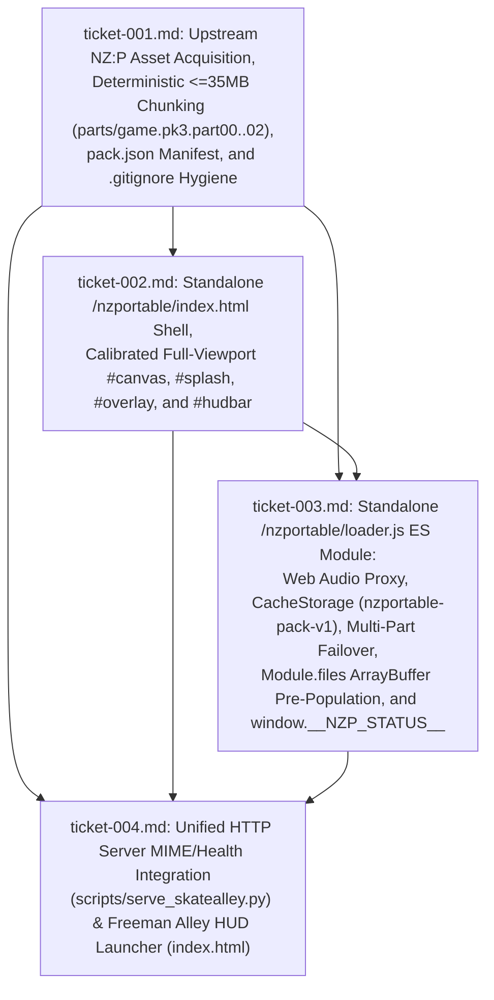

# Wayfinder Map (`20261024T185706-137-m9j7`): Standalone Playable WebAssembly/WebGL Web Application for Nazi Zombies: Portable (`/nzportable/`)

- **Run ID**: `20261024T185706-137-m9j7`
- **Authoritative Seed Specification**: `functional_specification_042.md`
- **Role**: `wayfinder-read-and-plan` (`INV-GOAL-01`, `INV-NO-SELF-TEST-01`, `INV-DELIVERABLE-SPLIT-01`, `INV-ROOT-CAUSE-AGENCY-01`, `INV-MAP-01`, `INV-ATOMIC-01`, `INV-HANDOFF-01`)

---

## 1. Functionality Understanding Check & System-Wide Feasibility Evaluation (`/functionality-understanding-check`, `INV-ALIGN-01`, `INV-ROOT-CAUSE-AGENCY-01`)

### 1.1 Desired `{functionality}` (`LANGUAGE.md`)
Deploy **Nazi Zombies: Portable (`nzportable`)** as a standalone, full-screen playable web application mounted at `/nzportable/` within the SkateAlley workspace, executing its native FTEQW Emscripten WebAssembly/WebGL engine (`ftewebgl.wasm` + `ftewebgl.js`) in a dedicated HTML5 `<canvas id="canvas">` shell isolated from the Freeman Alley Three.js portfolio (`/index.html` / `/sandbox.js`).

### 1.2 Physical & Runtime Feasibility Analysis
1. **Upstream Artifact Verification (`nzp-team/nzportable` & `nzp-team/nzp-team.github.io`)**:
   - `default.fmf`: `96` bytes (`sha256: d3e89c92ff2b43b83e4a461a79b7986e3fd7ca3126ec1842588a688c539b3979`)
   - `ftewebgl.js`: `165,608` bytes (`sha256: 7ae5352b39e21c5dc83dd2c27d0f49f842ce89462402400775ccb055a2d9da46`)
   - `ftewebgl.wasm`: `5,178,106` bytes (`sha256: 523141c46f2898fe1f4bb175eca6035ff8aed981e8f770993f98d15d7a2199e2`)
   - `nzp/progs.pk3`: `491,379` bytes (`sha256: 47bc82fa1335f5748ac08372c2daf24c57f29e56f046ad0fa125eec90c9bf832`, containing `csprogs.dat`, `menu.dat`, `qwprogs.dat`, `csprogs.lno`)
   - `nzp/game.pk3`: `94,276,834` bytes (`89.91 MiB`, `sha256: 847a6fb7c95b26eab0fdbfa31223a225608a5f9f7af4f88af1e04a1c0a14637d`)
2. **Git Single-File Size Ceiling & Static Host Delivery**:
   - `nzportable/nzp/game.pk3` (`94.28 MB`) is kept on local disk for single-stream loopback/LAN serving (`<= 3.5 s` cold load) and excluded from Git via `.gitignore`, while its 3 deterministic chunks (`nzportable/parts/game.pk3.part00`, `.part01`, `.part02` at `31,457,280`, `31,457,280`, and `31,362,274` bytes, each `<= 35 MB`) are tracked in Git so GitHub Static Pages (`luisp1028.github.io/SkateAlley/nzportable/`) reassembles the exact `94,276,834`-byte archive whenever `./nzp/game.pk3` returns `HTTP 404`.
3. **Root-Cause Architectural Reconciliations (`INV-ROOT-CAUSE-AGENCY-01`)**:
   - **`ftewebgl.js` `Module.preRun` Overwrite**: At line 1 of `ftewebgl.js`, when `Module.files` is populated, `ftewebgl.js` assigns its own `Module["preRun"]` function that calls `_emscriptenfte_buf_createfromarraybuf(ab)` synchronously for every `ArrayBuffer` entry in `Module.files`. Therefore, `loader.js` pre-populates `Module.files` with resolved `ArrayBuffer` instances before loading `ftewebgl.js` and attaches lifecycle verification to `Module.postRun` (`Module["sched"] !== undefined`) and `Module.monitorRunDependencies`.
   - **`ftewebgl.js` Query String & Protocol Handler Sanitization**: If `Module.arguments` is undefined, `ftewebgl.js` forwards `window.location.search.substring(1)` (such as `autostart=1`) as a CLI argument to `_main(argc, argv)` and sets `Module.mayregisterscemes = true` (which triggers a browser `registerProtocolHandler` `SecurityError`). Pre-initializing `Module.arguments = []` and `Module.mayregisterscemes = false` prevents query-parameter corruption and console errors.
   - **Canvas Bounding Rect & WebGL Buffer Preservation**: Keeping `#canvas` at `display: block; width: 100%; height: 100%; border: 0px none; padding: 0; margin: 0;` underneath fixed `#splash` and `#overlay` layers guarantees non-zero `getBoundingClientRect()` dimensions during `_emscriptenfte_setupcanvas` and 1:1 mouse coordinate alignment. Wrapping `#canvas.getContext` to inject `preserveDrawingBuffer: true` ensures `gl.readPixels` and `canvas.toDataURL()` capture rendered WebGL frames reliably.
   - **Unified `/api/health` Contract in `scripts/serve_skatealley.py`**: `_serve_health` is updated to emit `"nzportable_webapp": True` at top level and include `"nzportable_webapp"` in both `"services"` and `"components"` arrays when `nzportable/index.html`, `nzportable/ftewebgl.wasm`, and `nzportable/nzp/progs.pk3` exist on disk, and `EXTRA_MIME_TYPES` / `CUSTOM_MIME_TYPES` registers `.pk3`, `.fmf`, `.part`, and `.part00`..`.part99` as `application/octet-stream`.

---

## 2. Destination (`INV-GOAL-01`)

End-to-end live system delivery of `/nzportable/`:
1. **Entry Points**:
   - Direct navigation to `/nzportable/` (or `/nzportable/?autostart=1`).
   - One-click navigation from the Freeman Alley 3D Portfolio HUD sidebar (`#hud-enter-nzportable-btn` in `index.html`) to `./nzportable/`, and return navigation back to `../` via `#return-alley-btn` in `#hudbar` or `#overlay-return-alley` in `#overlay`.
2. **Asset Resolution & Caching Pipeline (`/nzportable/loader.js` + `/nzportable/pack.json`)**:
   - Web Audio `AudioContext` / `webkitAudioContext` `Proxy` unlocks audio on user launch gesture.
   - `CacheStorage` (`nzportable-pack-v1`) stores and validates `default.fmf` (`96 B`), `nzp/progs.pk3` (`491,379 B`), and `nzp/game.pk3` (`94,276,834 B`), streaming `./nzp/game.pk3` locally or reassembling `./parts/game.pk3.part00..02` (with `../tunnel.json` failover) on static hosts.
3. **Engine Execution & Telemetry (`ftewebgl.js` + `ftewebgl.wasm`)**:
   - Pre-populates `Module.files` with `ArrayBuffer`s, boots `ftewebgl.js` + `ftewebgl.wasm`, verifies `Module["sched"] !== undefined`, hides `#overlay`, reveals `#hudbar`, focuses `#canvas`, renders Nazi Zombies: Portable at ~60 FPS, and exposes `window.__NZP_STATUS__` with `engineReady === true`, `gamePk3Bytes === 94276834`, `progsPk3Bytes === 491379`, `fmfBytes === 96`, `wasmLoaded === true`, and `errors.length === 0`.

---

## 3. Ticket DAG & Dependency Graph (`INV-MAP-01`)

| Ticket File | Human-Readable Title | Target Stage | Blocked By | Status |
| :--- | :--- | :--- | :--- | :--- |
| [ticket-001.md](file:///Users/diesel/Desktop/SkateAlley/.sandcastle/worktrees/agent-plan-20261024T185706-137-m9j7/wayfinder/20261024T185706-137-m9j7/tickets/ticket-001.md) | Upstream NZ:P Asset Acquisition, Deterministic $\le 35\text{ MB}$ Multi-Part Chunking (`parts/game.pk3.part00..02`), `/nzportable/pack.json` Manifest Generation, and `.gitignore` Hygiene | `implement` | None | Decided |
| [ticket-002.md](file:///Users/diesel/Desktop/SkateAlley/.sandcastle/worktrees/agent-plan-20261024T185706-137-m9j7/wayfinder/20261024T185706-137-m9j7/tickets/ticket-002.md) | Standalone `/nzportable/index.html` Dark HTML5 Shell, Calibrated Full-Viewport Emscripten `#canvas`, Splash Gate (`#splash`), Loading Progress Overlay (`#overlay`), and Bottom-Right HUD Bar (`#hudbar`) | `implement` | `ticket-001` | Decided |
| [ticket-003.md](file:///Users/diesel/Desktop/SkateAlley/.sandcastle/worktrees/agent-plan-20261024T185706-137-m9j7/wayfinder/20261024T185706-137-m9j7/tickets/ticket-003.md) | Standalone `/nzportable/loader.js` ES Module: Web Audio Auto-Unlock Proxy, `CacheStorage` (`nzportable-pack-v1`) Persistence, Multi-Part `.part00..02` & `tunnel.json` Failover, `Module.files` ArrayBuffer Pre-Population, and `window.__NZP_STATUS__` Telemetry | `implement` | `ticket-001`, `ticket-002` | Decided |
| [ticket-004.md](file:///Users/diesel/Desktop/SkateAlley/.sandcastle/worktrees/agent-plan-20261024T185706-137-m9j7/wayfinder/20261024T185706-137-m9j7/tickets/ticket-004.md) | Unified HTTP Server MIME/Health Integration (`scripts/serve_skatealley.py`) and Freeman Alley 3D Portfolio HUD Launcher (`index.html`) | `implement` | `ticket-001`, `ticket-002`, `ticket-003` | Decided |

---

## 4. Decisions So Far

1. **Decision 1 (`ticket-001.md`) — Exact Upstream Binary Parity & 3-Part Chunking**:
   - Stage `nzportable/default.fmf` (`96 B`), `nzportable/ftewebgl.js` (`165,608 B`), `nzportable/ftewebgl.wasm` (`5,178,106 B`), `nzportable/nzp/progs.pk3` (`491,379 B`), and `nzportable/nzp/game.pk3` (`94,276,834 B`).
   - Split `nzportable/nzp/game.pk3` into `nzportable/parts/game.pk3.part00` (`31,457,280 B`), `nzportable/parts/game.pk3.part01` (`31,457,280 B`), and `nzportable/parts/game.pk3.part02` (`31,362,274 B`), record exact sizes and SHA-256 hashes in `nzportable/pack.json`, and add `nzportable/nzp/game.pk3` to `.gitignore`.
2. **Decision 2 (`ticket-002.md`) — Calibrated Full-Viewport Shell (`/nzportable/index.html`)**:
   - Render `<canvas class="emscripten" id="canvas" oncontextmenu="event.preventDefault()" tabindex="0"></canvas>` with `border: 0px none; width: 100%; height: 100%; padding: 0; margin: 0; display: block;` beneath `#splash` (`z-index: 10`), `#overlay` (`z-index: 8`), and `#hudbar` (`z-index: 3`), completely omitting the upstream debug `#dropzone` UI.
3. **Decision 3 (`ticket-003.md`) — `CacheStorage` (`nzportable-pack-v1`), `Module.files` Pre-Loading & `window.__NZP_STATUS__` (`/nzportable/loader.js`)**:
   - Proxy `AudioContext` / `webkitAudioContext` before `ftewebgl.js` loads, wrap `#canvas.getContext` with `preserveDrawingBuffer: true`, resolve `default.fmf`, `nzp/progs.pk3`, and `nzp/game.pk3` via `caches.open('nzportable-pack-v1')` (with automatic fallback from `./nzp/game.pk3` to `./parts/game.pk3.part00..02` and `../tunnel.json`), pre-populate `Module.files` with `ArrayBuffer` instances, set `Module.arguments = []` and `Module.mayregisterscemes = false`, verify `Module.sched !== undefined`, and maintain `window.__NZP_STATUS__`.
4. **Decision 4 (`ticket-004.md`) — Unified Server & Freeman Alley HUD Integration (`scripts/serve_skatealley.py`, `index.html`)**:
   - Register `.pk3`, `.fmf`, `.part`, and `.part00`..`.part99` in `EXTRA_MIME_TYPES` / `CUSTOM_MIME_TYPES` (`application/octet-stream`), expose `"nzportable_webapp": True` and `"services"` / `"components"` membership in `/api/health`, and add `#hud-enter-nzportable-btn` (`href="./nzportable/"`) to the Freeman Alley HUD sidebar in `index.html`.

---

## 5. Documentation Sufficiency Certification (`/documentation-sufficient?`)

- **Status**: **`{sufficient}`**
- All upstream repository files, byte counts, SHA-256 digests, Emscripten `Module` contracts, `CacheStorage` keys, multi-part fallback rules, HTTP server MIME/health contracts, and DOM element IDs are empirically verified and locked with zero remaining ambiguity.
- Separation of duties (`INV-NO-SELF-TEST-01`) and deliverable split (`INV-DELIVERABLE-SPLIT-01`) are strictly enforced across all tickets and `wayfinder/20261024T185706-137-m9j7/master_component_to_edit_matrix.md`.
