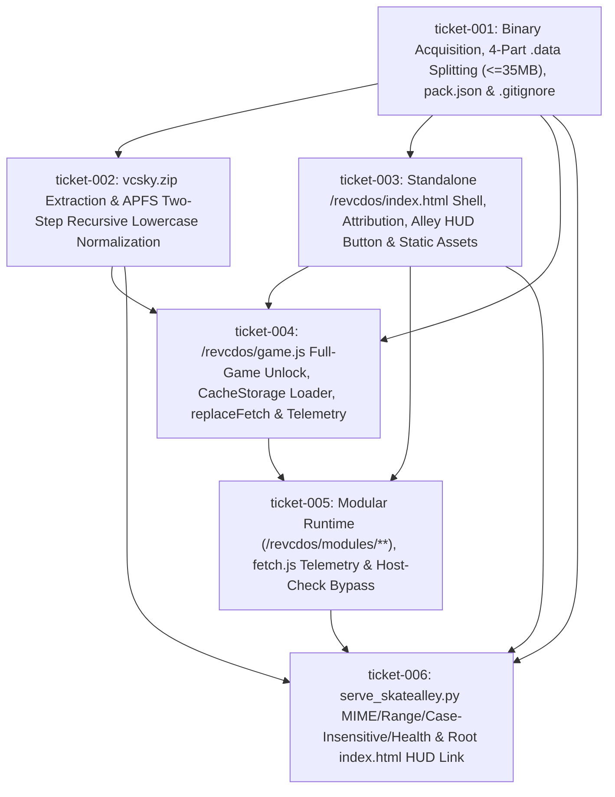

# Wayfinder Map — Run `20261024T194153-999-2zne` (Functional Specification 043: `/revcdos/`)

## 1. Destination (`INV-GOAL-01`)

Deploy **GTA: Vice City (`reVCDOS`)** as a standalone, full-screen playable Emscripten WebAssembly/WebGL2 web application mounted at `/revcdos/` within the SkateAlley workspace, completely isolated from the Freeman Alley Three.js portfolio (`/`):

1. **Native Engine & Preloaded Startup Filesystem**:
   - Serve `revcdos/vcbr/vc-sky-en-v6.wasm` (`7,625,877` B, SHA-256 `db6aa7b9169a638e06b17f7bed5a6b3e473e00ae7bbb47354729fa94b971ebf2`) and `revcdos/vcbr/vc-sky-en-v6.data` (`135,355,111` B, SHA-256 `3da895fd1a0c8e8968d0937da45becc35efc697f13a26a0d0463bd6a22acfff6`), plus 4 deterministic Git-tracked split chunks `revcdos/parts/vc-sky-en-v6.data.part00..03` (`<= 35 MB` each) and `revcdos/pack.json`.
   - Exclude `revcdos/vcbr/vc-sky-en-v6.data`, `revcdos/vcbr/vc-sky-ru-v6.data`, `revcdos/vcsky/`, and `*.zip` in `.gitignore` so zero tracked files exceed GitHub's single-file limit.
2. **On-Demand Streaming Asset Tree (`revcdos/vcsky/fetched/**`)**:
   - Extract `vcsky.zip` (`618,960,890` B, `15,619` entries) into `revcdos/vcsky/`, remove `vcsky.zip`, ensure all 9 subdirectories (`anim`, `audio`, `data`, `models`, `mp3`, `mss`, `skins`, `text`, `txd`) exist under `revcdos/vcsky/fetched/`, and apply a macOS APFS-safe two-step recursive lowercase rename (`old -> .__tmp_case__ -> lower`) so `find revcdos/vcsky -name '*[A-Z]*'` returns zero matches.
3. **Full-Game Auto-Unlock, `CacheStorage` (`revcdos-pack-v1`) & Telemetry (`window.__REVCDOS_STATUS__`)**:
   - Pre-seed `localStorage.setItem('vcsky.haveOriginalGame', 'true')` (unless `?request_original_game=1`) and invoke `ownerShipConfirmed()` on load so `#click-to-play-button` immediately reads `"Click to play"` with `#demo-off-disclaimer` empty/hidden and zero file-upload dialogs.
   - Cache `vcbr/vc-sky-en-v6.data` (`135,355,111` B) in `CacheStorage` (`revcdos-pack-v1`) with automatic fallback to reassembling `parts/vc-sky-en-v6.data.part00..03` and `../tunnel.json` failover.
   - Normalize all on-demand URLs in `replaceFetch(str)` to local `vcsky/...` lowercase paths and expose live runtime state on `window.__REVCDOS_STATUS__` (`{ haveOriginalGame, dataLoadedBytes, wasmReady, mainCalled, fetchedAssetsCount, failedFetchesCount, lastFetchedUrl, lastError, cacheHit }`).
4. **Unified HTTP Server (`scripts/serve_skatealley.py`) & Portfolio Navigation (`index.html`)**:
   - Serve `/revcdos/` with accurate MIME types (`application/wasm`, `application/octet-stream`, `audio/mpeg`), `HTTP 206 Partial Content` range support, startup auto-materialization of `vcbr/vc-sky-en-v6.data` from `parts/vc-sky-en-v6.data.part00..03`, case-insensitive path resolution under `/revcdos/vcsky/`, and `"revcdos_webapp": true` in `/api/health`.
   - Provide `← 3D Portfolio (Alley)` return navigation in `revcdos/index.html` and a `🌴 GTA: Vice City (reVCDOS)` launcher link (`#hud-enter-revcdos-btn`) in root `index.html`.

---

## 2. End-to-End Live Dataflow & Dependency DAG (`INV-MAP-01`)

---

## 3. Notes & Empirical Reconnaissance Findings

- **Dead CDN Verification**:
  - `https://cdn.dos.zone/vcsky/` and `https://br.cdn.dos.zone/vcsky/` return `HTTP 403 Forbidden` (`AccessDenied` from S3 bucket `68bbc47d0de7-br-bundles`).
  - `https://folder.morgen.qzz.io/revcdos.bin` returns `HTTP 525` Cloudflare SSL Handshake Failed.
- **Verified Live Mirror (`https://huggingface.co/spaces/th3w33knd/reVCDOS`)**:
  - `vcbr/vc-sky-en-v6.wasm`: `7,625,877` B (`HTTP 200 OK`, SHA-256 `db6aa7b9169a638e06b17f7bed5a6b3e473e00ae7bbb47354729fa94b971ebf2`).
  - `vcbr/vc-sky-en-v6.data`: `135,355,111` B (`HTTP 200 OK`, SHA-256 `3da895fd1a0c8e8968d0937da45becc35efc697f13a26a0d0463bd6a22acfff6`).
  - `vcsky.zip`: `618,960,890` B (`HTTP 200 OK`, `15,619` entries, including `599` mixed-case entries under `fetched/audio/` and `fetched/models/` plus `sha256sums.txt`).
- **Root-Cause Findings Across Upstream Repositories (`INV-ROOT-CAUSE-AGENCY-01`)**:
  1. `th3w33knd/reVCDOS/dist/modules/asm_consts/en.js` restricted `ASM_CONSTS[980182]` to `localhost`/`127.0.0.1`/`192.168.*`; `Lolendor/reVCDOS/dist/modules/asm_consts/en.js` replaces it with `980182: ($0, $1) => 1` (and `980198: ($0, $1) => 1` in `ru.js`), enabling execution on `10.0.0.62`, `0.0.0.0`, Cloudflare tunnels, and GitHub Pages.
  2. Both upstream `dist/index.html` files referenced `url(https://cdn.dos.zone/vcsky/wasted.png)` on `.wasted-container`; replacing it with `url(cover.jpg)` eliminates the last remaining `cdn.dos.zone` reference in `revcdos/index.html`.
  3. Upstream `dist/game.js` registered a blocking `window.onbeforeunload` handler (`event.preventDefault(); return '';`) that blocks the `← 3D Portfolio (Alley)` return button once the game starts; replacing it with a non-blocking `pagehide` listener calling `Module.syncRevcIni?.()` preserves INI sync while allowing clean navigation back to `../`.

---

## 4. Decisions So Far

| Ticket | Title | Stage | Status | Key Decision Locked |
| :--- | :--- | :---: | :---: | :--- |
| [`ticket-001.md`](file:///Users/diesel/Desktop/SkateAlley/.sandcastle/worktrees/agent-plan-20261024T194153-999-2zne/wayfinder/20261024T194153-999-2zne/tickets/ticket-001.md) | Upstream Binary Acquisition, Multi-Part `.data` Chunking (`<= 35 MB`), `pack.json` Schema & `.gitignore` Hygiene | `implement` | `RESOLVED` | Fetch `vc-sky-en-v6.wasm` (`7,625,877` B) & `vc-sky-en-v6.data` (`135,355,111` B), split `.data` into 4 chunks (`33,838,778` B × 3 + `33,838,777` B), write `revcdos/pack.json`, and ignore raw `.data`/`vcsky/`/`*.zip` in `.gitignore`. |
| [`ticket-002.md`](file:///Users/diesel/Desktop/SkateAlley/.sandcastle/worktrees/agent-plan-20261024T194153-999-2zne/wayfinder/20261024T194153-999-2zne/tickets/ticket-002.md) | On-Demand `vcsky.zip` Extraction & macOS APFS Two-Step Recursive Lowercase Normalization (`revcdos/vcsky/fetched/**`) | `implement` | `RESOLVED` | Extract `vcsky.zip` (`15,619` entries) into `revcdos/vcsky/`, delete zip, ensure all 9 `fetched/` subdirs exist, and run two-step APFS-safe lowercase rename (`old -> .__tmp_case__ -> lower`). |
| [`ticket-003.md`](file:///Users/diesel/Desktop/SkateAlley/.sandcastle/worktrees/agent-plan-20261024T194153-999-2zne/wayfinder/20261024T194153-999-2zne/tickets/ticket-003.md) | Standalone `/revcdos/index.html` Shell, DOS.Zone Attribution, Return-to-Alley HUD Navigation & Static Asset Bundle | `implement` | `RESOLVED` | Stage `revcdos/index.html` with relative `url(cover.jpg)`, `#config-panel`, DOS.Zone Team credits, `← 3D Portfolio (Alley)` HUD button, zero `cdn.dos.zone` references, and companion static assets. |
| [`ticket-004.md`](file:///Users/diesel/Desktop/SkateAlley/.sandcastle/worktrees/agent-plan-20261024T194153-999-2zne/wayfinder/20261024T194153-999-2zne/tickets/ticket-004.md) | `/revcdos/game.js` Launcher Architecture: Full-Game Auto-Unlock, `CacheStorage` (`revcdos-pack-v1`) & Multi-Part `.data` Loader, Lowercase `replaceFetch`, `?autostart=1`, and `window.__REVCDOS_STATUS__` | `implement` | `RESOLVED` | Auto-enable `vcsky.haveOriginalGame = 'true'`, cache `135,355,111`-byte `.data` in `revcdos-pack-v1` with 4-part fallback, lowercase `replaceFetch`, preserve WebGL2 drawing buffer, and expose `window.__REVCDOS_STATUS__`. |
| [`ticket-005.md`](file:///Users/diesel/Desktop/SkateAlley/.sandcastle/worktrees/agent-plan-20261024T194153-999-2zne/wayfinder/20261024T194153-999-2zne/tickets/ticket-005.md) | Modular Emscripten Runtime (`/revcdos/modules/**`): XHR Telemetry Instrumentation (`modules/fetch.js`), Universal Host-Check Bypass (`modules/asm_consts/*.js`), and F3 Cheat Menu (`modules/cheats.js`) | `implement` | `RESOLVED` | Stage all 14 `revcdos/modules/**` scripts, instrument `modules/fetch.js` XHR callbacks to update `window.__REVCDOS_STATUS__`, and set `ASM_CONSTS[980182] = () => 1` in `asm_consts/en.js`. |
| [`ticket-006.md`](file:///Users/diesel/Desktop/SkateAlley/.sandcastle/worktrees/agent-plan-20261024T194153-999-2zne/wayfinder/20261024T194153-999-2zne/tickets/ticket-006.md) | Unified HTTP Server (`scripts/serve_skatealley.py`) MIME Types, Case-Insensitive `/revcdos/vcsky/` Resolver, Auto-Materialization & `/api/health` + Freeman Alley HUD Link (`index.html`) | `implement` | `RESOLVED` | Add `reVCDOS` MIME types, `ensure_revcdos_data`, case-insensitive `/revcdos/vcsky/` `translate_path`, and `"revcdos_webapp": true` in `scripts/serve_skatealley.py`, plus `#hud-enter-revcdos-btn` in root `index.html`. |
