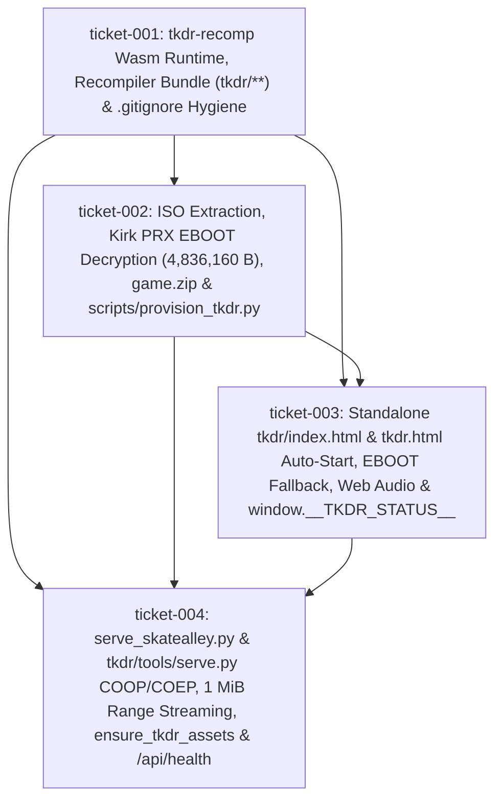

# Wayfinder Map — Run `20261025T195121-592-2unz` (Functional Specification 057: `/tkdr/`)

## 1. Destination (`INV-GOAL-01`)

Deploy decompiled ***Tekken: Dark Resurrection* (`ULUS-10139` v1.00, `tkdr-recomp`)** as a standalone, playable HTML5/WebGL2/WebAssembly web application served at `/tkdr/` via [`scripts/serve_skatealley.py`](file:///Users/diesel/Desktop/SkateAlley/.sandcastle/worktrees/agent-plan-20261025T195121-592-2unz/scripts/serve_skatealley.py) and `tkdr/tools/serve.py`, strictly isolated from the Freeman Alley Three.js 3D scene (`index.html` / `sandbox.js`):

1. **WebAssembly Runtime & In-Browser Allegrex MIPS Recompiler Bundle (`/tkdr/**`)**:
   - Stage `tkdr/tkdr.wasm` (`2,672,263` B), `tkdr/tkdr.js` (`230,442` B), `tkdr/disc.mjs` (`13,046` B), `tkdr/_headers` (`167` B), `tkdr/config.json`, `tkdr/tools/web_config.py` (`1,027` B), and `tkdr/recomp/*` (`analyze.mjs`, `elf.mjs`, `index.mjs`, `mips.mjs`, `nids.json`, `wasm.mjs`, `wasmgen.mjs`, `worker.mjs`) from `gasparegas/tkdr-recomp` (`deploy` branch commit `786460f1c0c4360938d5d4e1dbaac2a23e8601bd`).
   - Enforce `.gitignore` rules (`tkdr/*.iso`, `tkdr/*.cso`, `tkdr/*.bin`, `tkdr/*.elf`, `tkdr/*.zip`, `tkdr/*.data`, `tkdr/*.prx`) so `0 B` of copyrighted game data is ever tracked in Git.
2. **Idempotent ISO Extraction, Kirk PRX `EBOOT.BIN` Decryption & Multi-Worktree Provisioning (`scripts/provision_tkdr.py`)**:
   - Extract `Tekken - Dark Resurrection (US) (2006) (Versus Fighting) (ISO) (PSP).iso` (`1,750,237,184` B, CRC32 `0x3ffd7a9d`, SHA-1 `8193a65dee49685db49284408c89bdb35324bc32`) from `/Users/diesel/Desktop/SkateAlley/Tekken - Dark Resurrection (US) (2006) (Versus Fighting) (ISO) (PSP).zip` (`1,117,233,020` B) into `/Users/diesel/Desktop/SkateAlley/tkdr/game.iso` and `<worktree>/tkdr/game.iso`.
   - Provision the Kirk-decrypted `ET_SCE_PRX` ELF executable (`tkdr/eboot.bin` and `tkdr/ULUS10139_EBOOT.BIN`, `4,836,160` B, SHA-1 `b9a0e3292738a833f4f8077e3959c3a0652c42cd`) preserving the full `max(elf_size, psp_size)` buffer (`4,835,824` decrypted ELF bytes `0..4835823` + `336` trailing bytes `4835824..4836159`), plus a combined `tkdr/game.zip` containing both the ISO and decrypted EBOOT.
3. **Zero-Friction Auto-Start WebApp Shell & Live Telemetry (`tkdr/index.html` & `tkdr/tkdr.html`)**:
   - Automatically probe `./game.iso` (`Range: bytes=0-0` $\rightarrow$ `HTTP 206`) and `./eboot.bin` (`HEAD`/`GET` $\rightarrow$ `HTTP 200`) on load so opening `/tkdr/` immediately hides `#pick`, recompiles `13,809` guest functions into `23,544,922` B of WebAssembly (`code.wasm`) and `20,629,396` B of guest memory (`image.bin`), and boots directly into gameplay (`document.body.classList.contains("started") === true`).
   - Supply `./eboot.bin` as an automatic fallback candidate when a user manually drops an ISO-only `.zip` or `.iso` onto `#pick`, unlock Web Audio on user interaction, and expose `window.__TKDR_STATUS__` (`{ crossOriginIsolated, runtimeReady, isoReady, ebootSha1, recompiledFunctions, wasmCodeBytes, started, frames, guestTimeSec, errors }`).
4. **Cross-Origin Isolation (`COOP`/`COEP`/`CORP`), `1 MiB` Chunked `HTTP 206` Streaming & `/api/health` (`scripts/serve_skatealley.py` & `tkdr/tools/serve.py`)**:
   - Emit `Cross-Origin-Opener-Policy: same-origin`, `Cross-Origin-Embedder-Policy: require-corp`, and `Cross-Origin-Resource-Policy: same-origin` on all `/tkdr/*` responses so `window.crossOriginIsolated === true`.
   - Stream `HTTP 206 Partial Content` byte ranges in bounded `1 MiB` chunks, auto-materialize `tkdr/` assets across Sandcastle worktrees via `ensure_tkdr_assets`, and report `"tkdr_webapp": true` in `/api/health`.

---

## 2. End-to-End Live Dataflow & Dependency DAG (`INV-MAP-01`)

---

## 3. Notes & Empirical Reconnaissance Findings (`INV-ROOT-CAUSE-AGENCY-01`)

- **Pre-Staged Upstream `tkdr-recomp` & Kirk Artifacts Verified on Disk**:
  - `/Users/diesel/.gemini/antigravity-cli/brain/9b118eda-fbcd-4e95-838e-a83a5769b3a9/scratch/tkdr-recomp` contains both `main` (`6b6196b539628bddad821bf850d203d8855e140e`) and `deploy` (`786460f1c0c4360938d5d4e1dbaac2a23e8601bd`), where `deploy:site/` holds the exact compiled `RECOMP_DYNAMIC=ON` WebAssembly runtime (`tkdr.wasm` `2,672,263` B, `tkdr.js` `230,442` B, `disc.mjs` `13,046` B, `recomp/*`).
  - `/Users/diesel/.gemini/antigravity-cli/brain/9b118eda-fbcd-4e95-838e-a83a5769b3a9/scratch/kirk/ULUS10139_EBOOT.BIN` (`4,836,160` B) is already decrypted and verified with exact SHA-1 `b9a0e3292738a833f4f8077e3959c3a0652c42cd` (`4,835,824` B `dec_eboot.elf` + `336` B trailing `enc_eboot.bin[4835824:4836160]`).
  - Empirical execution of `recomp/index.mjs` on `ULUS10139_EBOOT.BIN` completes in `~0.97s`, emitting `13,809` functions, `23,544,922` B `code.wasm`, `20,629,396` B `image.bin`, and `281` lines `game.txt` (`280` HLE stubs).
- **Root-Cause Architectural Remediations (`INV-ROOT-CAUSE-AGENCY-01`)**:
  1. `scripts/serve_skatealley.py` `_try_serve_range` (`L1552`) previously read the entire requested range into memory via `data = f.read(length)`, risking a `1.75 GB` allocation on open-ended `Range: bytes=0-` probes; `ticket-004` replaces this with a bounded `1 MiB` (`1024 * 1024` B) chunk streaming loop.
  2. Upstream `tools/serve.py` only supported `Range` requests when `--iso`/`--eboot`/`--zip` CLI flags were passed and lacked `do_HEAD()` range support; `ticket-004` upgrades `tkdr/tools/serve.py` to serve `HTTP 206` byte ranges (`GET` and `HEAD`) on all files in `tkdr/` alongside `/tkdr/*` prefix routing and `/api/health`.
  3. Because `tkdr/game.iso`, `tkdr/eboot.bin`, `tkdr/ULUS10139_EBOOT.BIN`, and `tkdr/game.zip` are git-ignored via `.gitignore`, downstream Sandcastle worktrees (`review`, `tester`) require `ensure_tkdr_assets` in `scripts/serve_skatealley.py` (backed by `scripts/provision_tkdr.py`) to materialize/hardlink those files from `/Users/diesel/Desktop/SkateAlley/tkdr/` automatically on startup.

---

## 4. Decisions So Far

| Ticket | Title | Stage | Status | Key Decision Locked |
| :--- | :--- | :---: | :---: | :--- |
| [`ticket-001.md`](file:///Users/diesel/Desktop/SkateAlley/.sandcastle/worktrees/agent-plan-20261025T195121-592-2unz/wayfinder/20261025T195121-592-2unz/tickets/ticket-001.md) | Upstream `tkdr-recomp` WebAssembly Runtime & In-Browser Allegrex MIPS Recompiler Bundle Staging (`/tkdr/**`) & `.gitignore` Hygiene | `implement` | `RESOLVED` | Stage `tkdr.wasm` (`2,672,263` B), `tkdr.js` (`230,442` B), `disc.mjs` (`13,046` B), `_headers`, `config.json`, `recomp/*`, and `tools/web_config.py` from `deploy` commit `786460f1...`, and exclude `tkdr/*.iso`, `*.cso`, `*.bin`, `*.elf`, `*.zip`, `*.data`, `*.prx` in `.gitignore`. |
| [`ticket-002.md`](file:///Users/diesel/Desktop/SkateAlley/.sandcastle/worktrees/agent-plan-20261025T195121-592-2unz/wayfinder/20261025T195121-592-2unz/tickets/ticket-002.md) | Idempotent ISO Extraction, Sector-28 Kirk PRX `EBOOT.BIN` Decryption (`4,836,160` B `psp_size` Layout), `game.zip` Bundling & Multi-Worktree Provisioning (`scripts/provision_tkdr.py`) | `implement` | `RESOLVED` | Implement `scripts/provision_tkdr.py` to extract `game.iso` (`1,750,237,184` B, SHA-1 `8193a65d...`), stage Kirk-decrypted `eboot.bin` & `ULUS10139_EBOOT.BIN` (`4,836,160` B, SHA-1 `b9a0e329...`), construct 2-entry `game.zip`, and hardlink-sync `/Users/diesel/Desktop/SkateAlley/tkdr/` with `<worktree>/tkdr/`. |
| [`ticket-003.md`](file:///Users/diesel/Desktop/SkateAlley/.sandcastle/worktrees/agent-plan-20261025T195121-592-2unz/wayfinder/20261025T195121-592-2unz/tickets/ticket-003.md) | Standalone WebApp Shell (`tkdr/index.html` & `tkdr/tkdr.html`): Zero-Friction Local Stream Auto-Start, EBOOT Fallback, Web Audio Unlock & `window.__TKDR_STATUS__` Telemetry | `implement` | `RESOLVED` | Stage byte-identical `tkdr/index.html` and `tkdr/tkdr.html` with automatic `./game.iso` + `./eboot.bin` discovery, manual-drop `./eboot.bin` fallback, COOP/COEP diagnostic check, Web Audio gesture unlock, and `window.__TKDR_STATUS__` live telemetry. |
| [`ticket-004.md`](file:///Users/diesel/Desktop/SkateAlley/.sandcastle/worktrees/agent-plan-20261025T195121-592-2unz/wayfinder/20261025T195121-592-2unz/tickets/ticket-004.md) | HTTP Server Cross-Origin Isolation (`COOP`/`COEP`/`CORP`), `1 MiB` Chunked `HTTP 206` Byte-Range Streaming, Multi-Worktree Auto-Materialization & `/api/health` (`scripts/serve_skatealley.py` & `tkdr/tools/serve.py`) | `implement` | `RESOLVED` | Add `/tkdr/*` `COOP`/`COEP`/`CORP` headers, `1 MiB` chunked range streaming, `ensure_tkdr_assets`, and `"tkdr_webapp": true` in `scripts/serve_skatealley.py`, plus standalone `tkdr/tools/serve.py`. |
