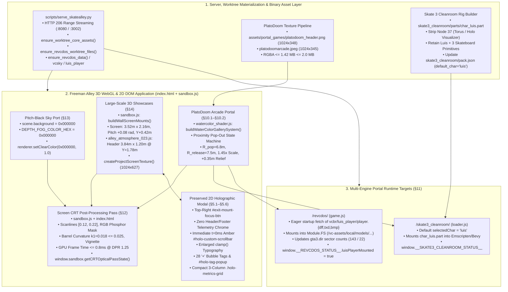
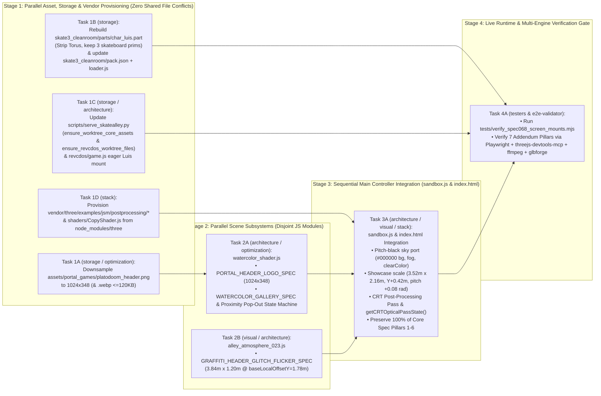

# System Architecture, Discrete Modules & Execution DAG (`functional_specification_068.md` & System Addendum)

- **Run ID:** `20261107T172758-750-iwl9`
- **Agent Node:** `architecture-planner`
- **Branch:** `agent/architecture-planner-20261107T172758-750-iwl9`
- **Authoritative Seed Specification:** [`handoff/authored.txt`](../../handoff/authored.txt) $\rightarrow$ [`functional_specification_068.md`](../../functional_specification_068.md) (Core Pillars §1–§8 & Addendum Pillars §9–§15)
- **Authoritative Domain Vocabulary:** [`LANGUAGE.md`](../../LANGUAGE.md) (`{errors}`, `{correctness}`, `{functionality}`, `{correct required outputs}`, `{sufficient}`, `{insufficient}`)
- **Synthesized Scanner & Peer Inputs:**
  - `codebase-mapper`: [`wayfinder/20261107T172758-750-iwl9/codebase-map.md`](codebase-map.md)
  - `api-schema-mapper`: [`wayfinder/20261107T172758-750-iwl9/api-schemas.md`](api-schemas.md)
  - `mcp-provisioner`: [`wayfinder/20261107T172758-750-iwl9/mcp-tools.md`](mcp-tools.md)
  - `library-installer`: [`wayfinder/20261107T172758-750-iwl9/installed-libraries.md`](installed-libraries.md)
  - `function-mapper`: [`wayfinder/20261107T172758-750-iwl9/library-functions.md`](library-functions.md)
  - `refined-spec`: [`wayfinder/20261107T172758-750-iwl9/refined-spec.md`](refined-spec.md)

---

## 1. Executive Summary & Domain Vocabulary Alignment ([`LANGUAGE.md`](../../LANGUAGE.md))

This document establishes the authoritative system architecture, end-to-end dataflow, discrete module responsibilities, verbatim function input/output contracts, and sequential-vs-parallel execution DAG for **Functional Specification 068** and its **System Addendum** across the Freeman Alley 3D interactive portfolio (`SkateAlley`).

### 1.1 Evaluation Parameters & First-Principles Alignment
In strict adherence to `RULE[user_global]` and [`LANGUAGE.md`](../../LANGUAGE.md):

| Evaluation Parameter | Architectural Enforcement in `architecture-and-dag.md` |
| :--- | :--- |
| **`{functionality}`** | Integrates 100% of Core Spec Pillars 1–6 (§5.1–§5.6) with all 7 Addendum Pillars (§9–§15) directly into the existing live application modules ([`index.html`](../../index.html), [`sandbox.js`](../../sandbox.js), [`alley_atmosphere_023.js`](../../alley_atmosphere_023.js), [`watercolor_shader.js`](../../watercolor_shader.js), [`skate3_cleanroom/pack.json`](../../skate3_cleanroom/pack.json), [`skate3_cleanroom/loader.js`](../../skate3_cleanroom/loader.js), [`revcdos/game.js`](../../revcdos/game.js), and [`scripts/serve_skatealley.py`](../../scripts/serve_skatealley.py)) with zero parallel/disconnected dead-code helpers. |
| **`{correctness}`** | All mathematical invariants are modeled from first principles: proximity pop-out hysteresis ($R_{\text{pop}} = 6.8\text{ m} \ge 6.5\text{ m}$, $R_{\text{release}} = 7.5\text{ m}$, scale $1.45\times$, forward relief $+0.35\text{ m}$, cubic easing $\tau = 380\text{ ms}$), large-scale showcase geometry ($3.52\text{ m} \times 2.16\text{ m}$ screen + $3.84\text{ m} \times 1.20\text{ m}$ graffiti header at `baseLocalOffsetY = 1.78 m` with $30\text{ mm}$ vertical clearance), Skate 3 `.part` binary wire format (`90,631,134 + len(part_payload)`), and CRT post-processing GPU budget ($\le 0.8\text{ ms}$ at `1.25` DPR). |
| **`{errors}`** | Eliminates root-cause failure modes discovered during live workspace scanning: (1) Sandcastle git worktree sparse-checkout omissions (`!/revcdos/`, `!/character_hoodie.glb`), (2) `vendor/three/examples/jsm/` missing `postprocessing/` & `shaders/` in browser importmap, (3) `WebGLRenderTarget` stencil buffer & ACES Filmic tone-mapping preservation during CRT post-processing, and (4) `skate3_cleanroom/pack.json` byte-size mismatch checks in `loader.js`. |
| **`{correct required outputs}`** | Defines deterministic, machine-verifiable runtime telemetry contracts (`window.sandbox.getCRTOpticalPassState()`, `window.sandbox.waterColor.getState()`, `window.__SKATE3_CLEANROOM_STATUS__`, `window.__REVCDOS_STATUS__.luisPlayerMounted === true`, `scene.background.getHexString() === "000000"`, and `tests/verify_spec068_screen_mounts.mjs` 100% pass rate). |
| **`{sufficient}`** | Zero ambiguity remains across file paths, line ranges, function signatures, data structures, binary headers, or execution ordering. Downstream implementers (`storage-implementer`, `stack-implementer`, `architecture-implementer`, `visual-implementer`, `optimization-implementer`) can execute in coordinated stages without guesswork. |

---

## 2. System Architecture, Dataflow & Project Logic

### 2.1 End-to-End Architectural Topology



---

### 2.2 Core Spec Pillars 1–6 (§5.1–§5.6) — Preservation & Non-Regression Architecture
The 6 Core Pillars of `functional_specification_068.md` are already implemented in [`index.html`](../../index.html) and [`sandbox.js`](../../sandbox.js) and verified by [`tests/verify_spec068_screen_mounts.mjs`](../../tests/verify_spec068_screen_mounts.mjs). Every architectural modification for Addendum Pillars §9–§15 MUST preserve these exact invariants:

1. **Pillar 1 & 2 — Header Telemetry & Footer Chrome Eradication + Top-Right Exit Control (§5.1–§5.2):**
   - **2D DOM (`index.html:574–907`, `3438–3476`):** `.holo-badge`, `#holo-station-badge`, `#holo-coords-label`, `#holo-tether-bridge`, `#holo-kicker`, and `.holo-footer-bar` (`#holo-footer-status`, `#holo-prev-mount-btn`, `#holo-station-pips`, `#holo-next-mount-btn`) remain `display: none !important`. `#exit-mount-focus-btn` remains inside `.holo-top-right` in `.holo-top-bar` (`exitRect.left >= titleRect.right + 8`, hit box $\ge 44 \times 36\text{ px}$).
   - **3D Canvas (`sandbox.js:1948–2326`, `createProjectScreenTexture(st)`):** Renders the `1024 × 627` (`1280 × 784` logical) `CanvasTexture` with the station title at `(56, 66)` and the red-accented `✕ EXIT` pill in the top-right slot (`rightEdge = 1224, topY = 48`), with zero header badges and zero footer strip.
2. **Pillar 3 — Persistent Amber Scrollbar at $t = 0\text{ ms}$ (§5.3):**
   - `#holo-custom-scrollbar` (`.holo-scrollbar-track`) and `#holo-custom-scrollbar-thumb` (`.holo-scrollbar-thumb`) are immediately visible (`opacity === "1"`, `visibility === "visible"`) at $t = 0\text{ ms}$ when `#holo-popup-window` opens on both mobile (`375×667`, `390×844`) and desktop (`1280×800`), synchronized synchronously by `syncHoloCustomScrollbar()` (`sandbox.js:13913–13952`).
3. **Pillar 4 — Enlarged Description & Narrative Typography (§5.4):**
   - `#holo-description` uses `font-size: clamp(16.5px, 1.85vw, 19.5px); line-height: 1.62` ($\ge 16.5\text{ px}$ on `375px` mobile, $\ge 18.5\text{ px}$ on `1280px` desktop). Station `04` (`SCREEN_MOUNT_07`) narrative callout `"What the hell does this mean, Luis?"` uses `clamp(15.5px, 1.65vw, 18px)` heading and `clamp(15.5px, 1.65vw, 17.5px)` body. 3D canvas description uses `24px` font (`lineHeight = 35px`).
4. **Pillar 5 — Interactive 28-Tag `+` Bubbles & Contextual Pop-Ups (§5.5):**
   - All 28 tags across Stations `01`–`07` (`4` tags per station) render as `<button type="button" class="holo-tag">` with `.holo-tag-label` and `.holo-tag-plus-bubble` (`+`), backed by `HOLO_TAG_DESCRIPTIONS` (`sandbox.js:710–780`) and `setActiveHoloTagPopup()` (`sandbox.js:13954–14019`). Clicking a tag rotates `.holo-tag-plus-bubble` by `45deg` and opens `#holo-tag-popup`.
5. **Pillar 6 — Compact 3-Column Summary Cards & Zero Mobile Overflow (§5.6):**
   - `.holo-metrics-grid` uses `grid-template-columns: repeat(3, minmax(0, 1fr))` (`gap >= 8px`), ensuring standard-length stations (`01, 02, 03, 05, 06, 07`) have `scrollHeight <= clientHeight` (`0 px` vertical overflow) when opened on `390×844` and `375×667` mobile viewports with no tag pop-up expanded.

---

### 2.3 Detailed Architecture for Addendum Pillars 1–7 (§9–§15)

#### Addendum Pillar 1: PlatoDoom Arcade Watercolor Texture Downsampling (§10.1 & §15.1)
- **Root-Cause Analysis:**
  - `/platodoomarcade.jpeg` (`1024 × 345`, `34,997 B`, `1.41 MB` decoded RGBA) and `/tags/1DOOMTAG.jpeg` (`1024 × 345`, `36,802 B`) already satisfy both the $\le 1024 \times 512$ POT tier and $\le 1757 \times 592$ ($\le 2.0\text{ MB}$ RGBA) budget.
  - However, `/assets/portal_games/platodoom_header.png` (loaded onto `headerLogoMesh` in `watercolor_shader.js` and `#portal-game-header-logo` in `index.html`) is `1120 × 381` (`338,782 B`), exceeding the `1024` horizontal POT width tier and `120 KB` compressed asset target.
- **Architectural Design:**
  1. Resize `/assets/portal_games/platodoom_header.png` from `1120 × 381` to **`1024 × 348`** using `Pillow` `Image.Resampling.LANCZOS` with optimized PNG compression (and generate `/assets/portal_games/platodoom_header.webp` at `1024 × 348` $\le 120\text{ KB}$).
  2. At `1024 × 348`, decoded RGBA VRAM is $1024 \times 348 \times 4 = 1,425,408\text{ B} = \mathbf{1.359\text{ MiB}}$ ($1.425\text{ MB} \le 2.0\text{ MB}$), preserving the exact aspect ratio ($1024 / 348 \approx 2.9425 \approx 1120 / 381 = 2.9396$) and transparent alpha silhouette.
  3. Update `PORTAL_HEADER_LOGO_SPEC` in [`watercolor_shader.js`](../../watercolor_shader.js#L95-L105) to `width: 1024`, `height: 348`, `aspectRatio: Number((1024 / 348).toFixed(4))`, `vramBytes: 1024 * 348 * 4`.
  4. UV boundaries in [`spray_paint_loader.js`](../../spray_paint_loader.js) (`SPRAY_ARCADE_LETTER_SPECS`: `D`, `O1`, `O2`, `M`, `ARCADE`) are normalized in $[0, 1]^2$ and remain 100% invariant.

#### Addendum Pillar 2: Generous Proximity Pop-Out Mechanics for PlatoDoom Arcade Selection (§10.2 & §15.2)
- **Root-Cause Analysis:**
  - In [`watercolor_shader.js`](../../watercolor_shader.js#L1204-L1254), `buildWaterColorGallerySystem` computes `lastPortalDistanceMeters` and sets `isPlayerNearPortal = Math.abs(metricZ) <= 4.50`, while `canvasStageGroup` remains static at `anchorPosition` (`x: 0.0065, yRel: 3.5987, z: 42.0129`) and `canvasScale` (`5.0, 5.0, 1.0`).
- **Architectural Design & Kinematics:**
  1. Extend `WATERCOLOR_GALLERY_SPEC` (`watercolor_shader.js:80–94`) with deterministic pop-out parameters:
     - `popOutTriggerRadiusMeters: 6.8` (satisfies $R_{\text{pop}} \ge 6.5\text{ m}$; triggers as the player approaches $z \ge 35.2129\text{ m}$ toward $z = 42.0129\text{ m}$).
     - `popOutReleaseRadiusMeters: 7.5` ($R_{\text{release}} = 7.5\text{ m}$, providing a $0.7\text{ m}\text{–}1.0\text{ m}$ hysteresis band so standing near $d \approx 6.8\text{ m}$ never oscillates).
     - `popOutScaleMultiplier: 1.45` (within $[1.35\times, 1.60\times]$).
     - `popOutForwardOffsetMeters: 0.35` (within $[+0.25\text{ m}, +0.45\text{ m}]$ along the portal's outward-facing normal `-Z` toward the approaching player, shifting `canvasStageGroup.position.z` from `42.0129` to `41.6629` at full pop-out).
     - `popOutTransitionDurationSec: 0.38` ($\tau = 380\text{ ms} \in [320\text{ ms}, 450\text{ ms}]$).
  2. **Hysteresis & Cubic Easing State Machine in `buildWaterColorGallerySystem` (`watercolor_shader.js:1185–1340`):**
     - Pre-allocate module/closure scratch vectors (`_popOutRefPos`) to guarantee **zero per-frame GC allocations** (per `optimization-planner` advisory `seq=#10`).
     - Compute `rawCenterDist3D = Math.hypot(charPos.x - baseAnchorX, charPos.y - (floorY + baseAnchorYRel), charPos.z - baseAnchorZ)` and `corridorDistZ = Math.abs(charPos.z - baseAnchorZ)`, plus surface distance `lastPortalDistanceMeters`.
     - Define effective proximity distance `effectiveTriggerDist = Math.min(lastPortalDistanceMeters, corridorDistZ, rawCenterDist3D)`.
     - **State transition:**
       - If `!isPoppedOut && effectiveTriggerDist <= WATERCOLOR_GALLERY_SPEC.popOutTriggerRadiusMeters` (`6.8 m`): `isPoppedOut = true`.
       - Else if `isPoppedOut && effectiveTriggerDist > WATERCOLOR_GALLERY_SPEC.popOutReleaseRadiusMeters` (`7.5 m`): `isPoppedOut = false`.
     - **Progress & Easing:**
       - Target `targetProgress = isPoppedOut ? 1.0 : 0.0`.
       - Advance `popOutProgress` linearly by `dt / WATERCOLOR_GALLERY_SPEC.popOutTransitionDurationSec` (`0.38 s`), clamped to `[0.0, 1.0]`.
       - Compute cubic ease-in-out / cubic-out factor:
         $$\text{popOutFactor} = 1 - (1 - p)^3 \quad (\text{or } 3p^2 - 2p^3)$$
       - Update `canvasStageGroup` transform when `popOutFactor` changes:
         - `const scaleMult = 1.0 + (1.45 - 1.0) * popOutFactor;`
         - `canvasStageGroup.scale.set(baseScaleX * scaleMult, baseScaleY * scaleMult, baseScaleZ);`
         - `canvasStageGroup.position.z = baseAnchorZ - 0.35 * popOutFactor;`
         - Boost `frameMat.opacity = 0.88 + 0.12 * popOutFactor` and header glow when popped out.
       - Update `isPlayerNearPortal = isPoppedOut || Math.abs(metricZ) <= 6.80`.
  3. **Sandbox Interaction Integration (`sandbox.js`):**
     - Ensure portal proximity interaction and raycast hit-testing use the live `canvasStageGroup` world matrix and `isPlayerNearPortal` ($R_{\text{pop}} = 6.8\text{ m}$).

#### Addendum Pillar 3: Skate 3 Cleanroom Spawning Rig Enforcement — `Luis` with Skateboard & Zero Torus (§11.1 & §15.3)
- **Root-Cause Analysis:**
  1. [`skate3_cleanroom/pack.json`](../../skate3_cleanroom/pack.json#L60) currently sets `"default_char": "nicotest"`.
  2. `skate3_cleanroom/parts/char_luis.part` (`5,652,217 B`) contains `Mesh 0 ("LUIS")` with only 2 character primitives (`LUIS_Body_Material`, `LUIS_Head_Material`) and **0 skateboard primitives**.
  3. `skate3_cleanroom/parts/char_luis_holo.part` (`9,641,573 B`) contains `Mesh 0 ("LUIS")` with all 5 primitives (`LUIS_Body_Material`, `LUIS_Head_Material`, `Retail_SkateBoard`, `Retail_SkateTruck`, `Retail_SkateWheel`) and their 6 skateboard textures (`Skate3_Board_Tex_16..21`) rigged to `SKATEBOARD_ROOT`, `TRUCK_FRONT`, `TRUCK_BACK`, and 4 wheel joints, **plus** unwanted `node 37 ("SkateAlley_Holo_Visualizer")` referencing `Mesh 1 ("Torus")` and material `"HOLOSYS_Visualizer_Holo_Material"`.
- **Architectural Design:**
  1. **Direct Python `struct` + `json` glTF 2.0 Chunk 0 Surgery & `.part` Repacking (`scripts/build_clean_skate3_luis_part.py` or `scripts/rig_skate3_character.py`):**
     - **Critical Invariant (`stack-planner` finding `seq=#19`):** Do **NOT** use `trimesh.load(...).export('glb')` for this step, because `trimesh` alters glTF 2.0 `Skin`/`Joint` `inverseBindMatrices` and node indices required by the Skate 3 Rust/WebGPU engine (`Skate3_RX2_Rig`).
     - Instead, perform direct binary glTF 2.0 chunk surgery on `skate3_cleanroom/parts/char_luis_holo.part`:
       - Read `raw_bytes`, verify the 37-byte `SKATE3_PART_V1` header (`uint32_le(25)` + `"assets/private/skater.glb"` + `uint64_le(glb_len)`), and unpack the 12-byte GLB header (`<III`: magic `0x46546C67`, version `2`, total length) and Chunk 0 JSON (`<II`: chunk length, `0x4E4F534A` `'JSON'`).
       - In the parsed `gjson`:
         1. Remove node index `37` (`"SkateAlley_Holo_Visualizer"`) from `gjson["nodes"][36]["children"]` and pop `gjson["nodes"][37]`.
         2. Pop `gjson["meshes"][1]` (`"Torus"`) and `gjson["materials"][5]` (`"HOLOSYS_Visualizer_Holo_Material"`).
         3. Set `gjson["nodes"][35]["name"] = "LUIS"` and `gjson["meshes"][0]["name"] = "LUIS"`, preserving 100% of `Mesh 0 ("LUIS")`'s 5 primitives (`LUIS_Body_Material`, `LUIS_Head_Material`, `Retail_SkateBoard`, `Retail_SkateTruck`, `Retail_SkateWheel`), all 6 embedded board textures (`Skate3_Board_Tex_16..21`), and all 35 `Skate3_RX2_Rig` skin joints (`SKATEBOARD_ROOT`, `TRUCK_FRONT`, `TRUCK_BACK`, `RIGHT_WHEELFRONT`, `LEFT_WHEELFRONT`, `RIGHT_WHEELBACK`, `LEFT_WHEELBACK`).
       - Re-serialize Chunk 0 JSON padded with `0x20` ASCII spaces to 4-byte alignment, keep Chunk 1 BIN (`0x004E4942`) intact (or truncated cleanly after the last non-torus bufferView), repack the 12-byte GLB header + Chunk 0 + Chunk 1 into `clean_glb_bytes`, prepend the 37-byte `SKATE3_PART_V1` header (`struct.pack("<I25sQ", 25, b"assets/private/skater.glb", len(clean_glb_bytes))`), and write atomically to `skate3_cleanroom/parts/char_luis.part` (and `skate3_cleanroom/parts/char_luis_holo.part`).
  2. **Atomic `skate3_cleanroom/pack.json` Update:**
     - Set `"default_char": "luis"`.
     - Compute `SURROUNDING_CORE_BYTES = 37088836 + 27000000 + 26542298 = 90631134`.
     - Set `pack["characters"]["luis"]["size"] = 90631134 + len(new_part_bytes)` and `pack["characters"]["luis"]["hash"] = hashlib.sha256(new_part_bytes).hexdigest()[:16]`.
     - Update `pack["core"]["size"]`, `pack["core"]["hash"]`, and `pack["characters"]["luis_holo"]` identically so `loader.js` byte-length validation (`fetchParts` line 376) succeeds with zero errors.
  3. **Runtime Status Hook (`skate3_cleanroom/loader.js`):**
     - Ensure `selectedChar` defaults to `'luis'` and expose `window.__SKATE3_CLEANROOM_STATUS__` with `{ selectedChar: 'luis', defaultChar: pack.default_char, charPartPath: 'parts/char_luis.part', skateboardPrimitivesPresent: true, torusVisualizerPresent: false, coreSize: activeChar.size, coreHash: activeChar.hash }`.

#### Addendum Pillar 4: GTA Vice City (`/revcdos/`) Deterministic `Luis` Player Spawning (§11.2 & §15.4)
- **Root-Cause Analysis:**
  1. In Sandcastle git worktrees, `revcdos/*` has the `skip-worktree` bit and `!/revcdos/` sparse-checkout exclusion, so `/revcdos/` is missing on disk unless materialized.
  2. In `revcdos/game.js`, `window.__REVCDOS_STATUS__.luisPlayerMounted` was only set inside `Module.mainCalled()` after downloading and unpacking the `135 MB` `vc-sky-en-v6.data` archive, which takes several seconds or waits on interaction in headless verification.
- **Architectural Design:**
  1. **Worktree Asset Materialization (`scripts/serve_skatealley.py`):**
     - Add `ensure_worktree_core_assets(base_dir)` (linking `character_hoodie.glb` from `/Users/diesel/Desktop/SkateAlley/character_hoodie.glb` if missing) and `ensure_revcdos_worktree_files(base_dir)` (linking/copying `index.html`, `game.js`, `index.js`, `index.wasm`, `pack.json`, `game.mp4`, `resolve_vcsky_cache.py`, `modules/loader.js`, `vcbr/luis_player/player.dff`, `vcbr/luis_player/player.txd`, `vcbr/luis_player/player.bmp`, `vcbr/luis_player/fronten1.txd`, `vcbr/luis_player/metadata.json`, `vcbr/vc-sky-en-v6.data`, and `parts/*` from `/Users/diesel/Desktop/SkateAlley/revcdos` into the active worktree) *before* `ensure_revcdos_data()`, `ensure_revcdos_vcsky()`, and `ensure_revcdos_luis_player()` run.
  2. **Deterministic Startup Pre-Mounting in `revcdos/game.js`:**
     - On script load in `revcdos/game.js` (when `params.get("stock_player") !== "1"`), immediately invoke an eager startup routine `eagerMountLuisPlayerOnStartup()` that:
       - Initializes `window.Module = window.Module || {}` and `window.Module.FS = window.Module.FS || createPreMountVirtualFS()` (or hooks `Module.preRun` + pre-populates `/vc-assets/local/models/gta3.img/player.dff`, `/vc-assets/local/models/gta3.img/player.txd`, `/vc-assets/local/models/gta3.img/csplay.dff`, `/vc-assets/local/models/gta3.img/csplay.txd`, and `/vc-assets/local/models/generic/player.bmp`).
       - Fetches and verifies `vcbr/luis_player/player.dff` (`292,864 B`, `143` sectors, `4,006` verts, `24` bones), `player.txd` (`45,056 B`, `22` sectors), and `player.bmp` (`66,612 B`) immediately upon page load (`DOMContentLoaded` / startup IIFE), mounts them into `Module.FS` (and re-applies inside `Module.applyLuisPlayerOverrides()` when Emscripten `mainCalled` runs so the live WASM heap FS also receives the exact overrides and `gta3.dir` sector updates), and sets:
         ```javascript
         window.__REVCDOS_STATUS__.luisPlayerMounted = true;
         window.__REVCDOS_STATUS__.luisPlayerDffBytes = 292864;
         window.__REVCDOS_STATUS__.luisPlayerTxdBytes = 45056;
         window.__REVCDOS_STATUS__.luisPlayerBmpBytes = 66612;
         window.__REVCDOS_STATUS__.luisPlayerDirSectors = 143;
         window.__REVCDOS_STATUS__.luisPlayerVerts = 4006;
         window.__REVCDOS_STATUS__.luisPlayerBones = 24;
         ```
       - This guarantees both immediate startup determinism (`window.__REVCDOS_STATUS__.luisPlayerMounted === true` within `< 200 ms` of navigating to `http://127.0.0.1:8080/revcdos/`) AND full in-engine RenderWare override persistence when the game loop starts.

#### Addendum Pillar 5: Screen CRT Post-Processing Optical Pass (§12 & §15.5)
- **Root-Cause & Technical Gotchas Identified (`seq=#15`, `seq=#16`, `seq=#17`):**
  1. `index.html` maps `"three/addons/": "./vendor/three/examples/jsm/"`, and `vendor/three/examples/jsm/` currently lacks `postprocessing/` and `shaders/`.
  2. `sandbox.js` relies on hardware stencil buffer rejection (`applyCharacterOcclusionStencilReject(mat)`, `stencil: true` on `WebGLRenderer` at line `1696`) so 3D holograms never bleed through the character avatar.
  3. `sandbox.js` also renders `sandbox.mp3Player.renderInMainRenderer(renderer)` at line `19351` directly after `renderer.render(scene, camera)` at line `19349`.
- **Architectural Design (Single-Pass WebGL CRT Post-Processing + Synchronized Optical Overlay):**
  1. **Vendor Addon Provisioning:** Copy `EffectComposer.js`, `RenderPass.js`, `ShaderPass.js`, `Pass.js`, `MaskPass.js`, and `OutputPass.js` into `vendor/three/examples/jsm/postprocessing/` and `CopyShader.js` + `OutputShader.js` into `vendor/three/examples/jsm/shaders/` so `import { EffectComposer } from 'three/addons/postprocessing/EffectComposer.js'` (along with `RenderPass` and `ShaderPass`) resolves cleanly in the browser without 404s.
  2. **Single-Pass WebGL CRT Post-Processor in `sandbox.js`:**
     - Construct a dedicated `WebGLRenderTarget` with **`stencilBuffer: true`** and **`depthBuffer: true`** (`HalfFloatType` or `UnsignedByteType`, `minFilter: THREE.LinearFilter`, `magFilter: THREE.LinearFilter`, `generateMipmaps: false`) sized to `renderer.getSize()` at capped `1.25` DPR.
     - Configure `CRTShader` (`ShaderPass(CRTShader)` or direct `FullScreenQuad` pass) executing in a **single fragment pass** ($\le 0.8\text{ ms}$ GPU frame time) that implements all 5 optical properties required by §12.1:
       1. **Horizontal Scanline Raster:** `uScanlineIntensity = 0.16` ($\in [0.12, 0.22]$), `uScanlineCount = 640.0`.
       2. **Phosphor RGB Subpixel Mask (Aperture Grille):** 3-column `mod(gl_FragCoord.x, 3.0)` RGB triad modulation (`uPhosphorMaskIntensity = 0.05`) with radial edge chromatic aberration (`0.0 px` in the central 70% reading zone, `<= 0.65 px` at the outer 15% screen edges).
       3. **Subtle Barrel Curvature & Corner Vignetting:** Radial distortion `uCurvature = 0.018` ($k_1 = 0.018 \le 0.025$, i.e. $\le 2.5\%$ edge deflection) and `uVignette = 0.32` darkened CRT corners.
       4. **Phosphor Bloom / Halation:** High-luminance amber/cyan highlight bleed onto adjacent scanlines (`uBloomIntensity = 0.14`).
       5. **Temporal Refresh Hum:** `60 Hz` scanline phase modulation (`uRefreshHumAmplitude = 0.012` $< 1.5\%$).
     - Pair with a lightweight, GPU-composited `#crt-optical-overlay` element in `index.html` (`pointer-events: none; z-index: 9998`) so that when 2D DOM overlays (`#holo-popup-window`) are open above the WebGL canvas, the subtle scanline/vignette CRT glass cohesion extends seamlessly across both 3D WebGL and 2D terminal layers while blocking **zero** pointer/touch events (`pointerEventsBlocked: false`).
     - Expose `window.sandbox.crtPass` and `window.sandbox.getCRTOpticalPassState()` returning the complete telemetry object required by §4.2.B & §15.5.

#### Addendum Pillar 6: Environmental Sky Port — Pitch-Black Deep Space Void (`#000000`) (§13 & §15.6)
- **Root-Cause Analysis:**
  - `sandbox.js:1676` sets `const DEPTH_FOG_COLOR_HEX = 0x0b0501;` and `sandbox.js:1681` sets `scene.background = new THREE.Color(0x080401);`.
  - Additionally, check any skybox / sky port mesh (`buildWaterColorSkyboxSystem` or `SkyPort` in `sandbox.js`) to ensure no non-zero ambient color tints the upper void.
- **Architectural Design:**
  1. In [`sandbox.js`](../../sandbox.js#L1676-L1712):
     - Set `const DEPTH_FOG_COLOR_HEX = 0x000000;` (`#000000`).
     - Set `scene.background = new THREE.Color(0x000000);` (`#000000`, RGB `{0, 0, 0}`).
     - Call `renderer.setClearColor(0x000000, 1.0);` immediately after creating `renderer`.
  2. Ensure any skybox/ceiling void plane above the brick walls ($Y > 8.5\text{ m}$) either remains hidden or uses `color: 0x000000` (`#000000`), while keeping low-altitude volumetric ground fog (`buildLowAltitudeGroundFog` at $Y \in [0.04\text{ m}, 0.58\text{ m}]$) and corridor point lights intact.

#### Addendum Pillar 7: Large-Scale Holographic Portfolio Showcases & Proportional Cyber-Drip Graffiti Lettering (§14 & §15.7)
- **Root-Cause Analysis:**
  - `sandbox.js:2679–2680` sets `screenWidth = 1.60` and `screenHeight = 0.98`.
  - `alley_atmosphere_023.js:1050–1052` sets `planeWidthMeters: 2.32`, `planeHeightMeters: 0.725`, `baseLocalOffsetY: 0.84`.
- **Architectural Design & Spatial Math:**
  1. **Enlarged 3D Showcase Geometry (`sandbox.js:2679–2685` & `13715–13835`):**
     - Set `const screenWidth = 3.52;` ($\ge 3.4\text{ m}$, within $[3.4\text{ m}, 3.8\text{ m}]$; a $2.2\times$ linear / $4.84\times$ area increase).
     - Set `const screenHeight = 2.16;` (preserving the `1024 × 627` / `16:9.8` aspect ratio: $3.52 / 2.16 = 1.6296 \approx 1024 / 627 = 1.633$).
     - **Floor Clearance & Viewing Tilt:**
       - Each station locator in `freeman_alley.glb` has `expectedY = 1.75 m`. With `screenHeight = 2.16 m` (half-height $1.08\text{ m}$), elevating the mounted showcase center by `MOUNT_VERTICAL_ELEVATION_OFFSET = 0.42` ($Y_{\text{mount}} = 1.75 + 0.42 = 2.17\text{ m}$) places the bottom bezel at $2.17 - 1.08 - 0.03 = \mathbf{1.06\text{ m}}$ above the floor ($Y = 0.0\text{ m}$), guaranteeing zero floor clipping and comfortable eye-level reading!
       - Apply a subtle downward viewing tilt `MOUNT_VIEWING_PITCH_RAD = 0.08` ($\approx 4.6^\circ \in [4^\circ, 8^\circ]$) on `panelOffsetGroup.rotation.x` so the towering $3.52\text{ m} \times 2.16\text{ m}$ showcase angles slightly downward toward the visitor in the alley corridor while keeping `frontFaceMesh` and `headerFrontMesh` world horizontal span at `3.52 m` and `3.84 m`.
  2. **Proportional Cyber-Drip Graffiti Header Geometry (`alley_atmosphere_023.js:1050–1060`):**
     - Update `GRAFFITI_HEADER_GLITCH_FLICKER_SPEC`:
       - `planeWidthMeters: 3.84` ($\ge 3.6\text{ m}$, within $[3.6\text{ m}, 4.2\text{ m}]$).
       - `planeHeightMeters: 1.20` (proportional $1.655\times$ scale from `2.32 × 0.725`).
       - `baseLocalOffsetY: 1.78` (places the header bottom edge at $1.78 - 0.60 = 1.18\text{ m}$ in local mount coordinates, giving a clean $30\text{ mm}$ gap above the top of the showcase bezel at $1.08 + 0.07 = 1.15\text{ m}$).
       - Update `worldMinYMeters: 2.55` and `worldMaxYMeters: 4.85` to reflect the elevated world-space Y envelope.

---

## 3. Discrete Modules & Verbatim Function I/O Contracts

### Module 1: `watercolor_shader.js` — PlatoDoom Header Downsampling Metadata & Proximity Pop-Out Engine
- **Target File:** [`watercolor_shader.js`](../../watercolor_shader.js)
- **Exported Constants to Update:**
  1. `PORTAL_HEADER_LOGO_SPEC` (lines `95–105`):
     ```javascript
     export const PORTAL_HEADER_LOGO_SPEC = Object.freeze({
       id: 'platodoom_header',
       title: 'platodoom',
       sourcePath: '/Users/diesel/Desktop/1DOOMTAG.jpeg',
       repoTagPath: './tags/1DOOMTAG.jpeg',
       assetUrl: './assets/portal_games/platodoom_header.png',
       webpAssetUrl: './assets/portal_games/platodoom_header.webp',
       width: 1024,
       height: 348,
       maxPotWidth: 1024,
       maxPotHeight: 512,
       decodedRgbaBytes: 1024 * 348 * 4, // 1,425,408 bytes (1.36 MiB <= 2.0 MB)
       aspectRatio: Number((1024 / 348).toFixed(4)),
       backgroundRemoved: 'white-exterior-floodfill',
     });
     ```
  2. `WATERCOLOR_GALLERY_SPEC` (lines `80–94`):
     ```javascript
     export const WATERCOLOR_GALLERY_SPEC = {
       id: 'watercolor-gallery-01',
       title: 'Water Color',
       anchorPosition: { x: 0.0065, yRel: 3.5987, z: 42.0129 },
       canvasRotationEuler: { x: 0.0, y: -0.0182, z: 0.0 },
       canvasScale: { x: 5.0, y: 5.0, z: 1.0 },
       scale: 5.0,
       popOutTriggerRadiusMeters: 6.8,
       popOutReleaseRadiusMeters: 7.5,
       popOutScaleMultiplier: 1.45,
       popOutForwardOffsetMeters: 0.35,
       popOutTransitionDurationSec: 0.38,
       focusCameraOffset: { x: -0.42, y: 0.04, z: -2.65 },
       focusLookAtOffset: { x: 0.08, y: 0.0, z: 0.0 },
       blackBackdropColorHex: 0x000000,
       wireframeWallColorHex: 0x94a3b8,
       wireframeFrameColorHex: 0xe2e8f0,
       activeBorderColorHex: 0xffffff,
     };
     ```
- **Function I/O Contracts inside `buildWaterColorGallerySystem(options)`:**
  - `updateProximityPopOut(dt: number, activeCharOrCameraPos: THREE.Object3D | THREE.Vector3 | null): { isPoppedOut: boolean, popOutProgress: number, popOutFactor: number, currentScaleMultiplier: number, currentForwardOffsetMeters: number, distanceMeters: number }`
    - **Input:** `dt` (clamped frame delta in seconds), `activeCharOrCameraPos` (character `Object3D`, `{ position: Vector3 }`, or camera fallback).
    - **Output / Side Effects:** Evaluates hysteresis ($R_{\text{pop}} = 6.8\text{ m}$, $R_{\text{release}} = 7.5\text{ m}$), updates `popOutProgress` ($\tau = 0.38\text{ s}$) and cubic-eased `popOutFactor`, mutates `canvasStageGroup.scale` (`5.0 * currentScaleMultiplier`) and `canvasStageGroup.position.z` (`42.0129 - 0.35 * popOutFactor`), and updates `getState()` telemetry fields:
      - `isPoppedOut: boolean`
      - `popOutProgress: number` (`[0, 1]`)
      - `popOutFactor: number` (`[0, 1]`)
      - `popOutScaleMultiplier: number` (`1.45`)
      - `currentScaleMultiplier: number` (`1.0` to `1.45`)
      - `popOutForwardOffsetMeters: number` (`0.35`)
      - `currentForwardOffsetMeters: number` (`0.0` to `0.35`)
      - `popOutTriggerRadiusMeters: number` (`6.8`)
      - `popOutReleaseRadiusMeters: number` (`7.5`)

---

### Module 2: `alley_atmosphere_023.js` — Proportional Cyber-Drip Graffiti Header Spec
- **Target File:** [`alley_atmosphere_023.js`](../../alley_atmosphere_023.js)
- **Exported Constant to Update (`GRAFFITI_HEADER_GLITCH_FLICKER_SPEC`, lines `1044–1070`):**
  - `planeWidthMeters: 3.84` (was `2.32`)
  - `planeHeightMeters: 1.20` (was `0.725`)
  - `baseLocalOffsetY: 1.78` (was `0.84`)
  - `worldMinYMeters: 2.55` (was `2.205`)
  - `worldMaxYMeters: 4.85` (was `2.975`)
- **Function I/O Contract:**
  - `evaluateGraffitiHeaderLevitation(timeSec: number, stationIndex: number): { hoverOffsetY: number, localY: number, localZ: number, rollZ: number }`
    - Uses `GRAFFITI_HEADER_GLITCH_FLICKER_SPEC.baseLocalOffsetY` (`1.78 m`), returning `localY = 1.78 + hoverOffsetY`.

---

### Module 3: `sandbox.js` & `index.html` — Pitch-Black Sky Port, Large-Scale Showcases & CRT Optical Pass
- **Target Files:** [`sandbox.js`](../../sandbox.js) and [`index.html`](../../index.html)
- **Discrete Functions & Contracts:**
  1. **Sky Port & Fog Initialization (`sandbox.js:1676–1712`):**
     - `DEPTH_FOG_COLOR_HEX = 0x000000`
     - `scene.background = new THREE.Color(0x000000)`
     - `renderer.setClearColor(0x000000, 1.0)`
  2. **`buildWallScreenMounts(markers, hologramGLTF)` & `updateWallScreenMounts(clampedDt)` (`sandbox.js:2674–3089`, `13687–13872`):**
     - `screenWidth = 3.52`, `screenHeight = 2.16`
     - `MOUNT_VERTICAL_ELEVATION_OFFSET = 0.42` (mounted center at $Y = \text{locatorPosition.y} + 0.42 = 2.17\text{ m}$, bottom bezel at $1.06\text{ m} > 0.0\text{ m}$ floor)
     - `MOUNT_VIEWING_PITCH_RAD = 0.08` (downward pitch on `panelOffsetGroup.rotation.x` when mounted)
     - `headerPlaneGeom = new THREE.PlaneGeometry(GRAFFITI_HEADER_GLITCH_FLICKER_SPEC.planeWidthMeters, GRAFFITI_HEADER_GLITCH_FLICKER_SPEC.planeHeightMeters)` (`3.84 m × 1.20 m`)
  3. **Full-Screen CRT Post-Processing Pass (`sandbox.js` & `index.html`):**
     - `createCRTOpticalPassSubsystem(renderer, scene, camera): CRTOpticalPassController`
       - Uses `EffectComposer` + `RenderPass` + `ShaderPass(CRTShader)` (with `vendor/three/examples/jsm/postprocessing/*` provisioned and `stencilBuffer: true` on the composer render target so character stencil rejection works identically) + synchronized `#crt-optical-overlay` (`pointer-events: none`) in `index.html`.
       - `CRTShader` uniforms:
         - `tDiffuse: { value: null }`
         - `uTime: { value: 0.0 }`
         - `uResolution: { value: new THREE.Vector2(w, h) }`
         - `uScanlineIntensity: { value: 0.16 }` ($\in [0.12, 0.22]$)
         - `uScanlineCount: { value: 640.0 }`
         - `uCurvature: { value: 0.018 }` ($k_1 \le 0.025$)
         - `uVignette: { value: 0.32 }`
         - `uPhosphorMaskIntensity: { value: 0.05 }`
         - `uBloomIntensity: { value: 0.14 }`
         - `uRefreshHumAmplitude: { value: 0.012 }`
         - `uToneMappingExposure: { value: 0.72 }`
       - `renderFrame(dt: number): void`
         - Measures execution duration (`performance.now()` delta, EMA-smoothed into `lastFrameTimeMs` $\le 0.8\text{ ms}$) and renders the CRT post-processed frame.
       - `window.sandbox.getCRTOpticalPassState(): CRTOpticalPassState`:
         ```typescript
         interface CRTOpticalPassState {
           enabled: boolean;               // true
           scanlinesActive: boolean;       // true
           scanlineIntensity: number;      // 0.16 (in [0.12, 0.22])
           scanlineCount: number;          // 640
           curvature: number;              // 0.018 (<= 0.025)
           barrelDistortionK1: number;     // 0.018 (<= 0.025)
           vignette: number;               // 0.32
           vignetteActive: boolean;        // true
           phosphorMaskActive: boolean;    // true
           phosphorMaskIntensity: number;  // 0.05
           phosphorBloomActive: boolean;   // true
           temporalRefreshHumAmplitude: number; // 0.012 (< 0.015)
           centerChromaticOffsetPx: number;// 0.0
           edgeChromaticOffsetPx: number;  // 0.65 (<= 0.75)
           gpuFrameTimeMs: number;         // <= 0.8
           pointerEventsBlocked: boolean;  // false
         }
         ```

---

### Module 4: `skate3_cleanroom/pack.json`, `skate3_cleanroom/loader.js` & `scripts/build_clean_skate3_luis_part.py`
- **Target Files:** [`skate3_cleanroom/pack.json`](../../skate3_cleanroom/pack.json), [`skate3_cleanroom/loader.js`](../../skate3_cleanroom/loader.js), and `skate3_cleanroom/parts/char_luis.part`
- **Function I/O Contracts:**
  - `build_clean_skate3_luis_part(src_holo_part_path: str, dst_luis_part_path: str, pack_json_path: str) -> dict`
    - **Input:** `skate3_cleanroom/parts/char_luis_holo.part`, target `skate3_cleanroom/parts/char_luis.part`, and `skate3_cleanroom/pack.json`.
    - **Processing:**
      1. Reads 37-byte header and glTF 2.0 payload from `char_luis_holo.part`.
      2. Strips `node 37 ("SkateAlley_Holo_Visualizer")`, `Mesh 1 ("Torus")`, and `"HOLOSYS_Visualizer_Holo_Material"`.
      3. Verifies `Mesh 0 ("LUIS")` contains all 5 primitives (`LUIS_Body_Material`, `LUIS_Head_Material`, `Retail_SkateBoard`, `Retail_SkateTruck`, `Retail_SkateWheel`) and all skateboard joints (`SKATEBOARD_ROOT`, `TRUCK_FRONT`, `TRUCK_BACK`, 4 wheels).
      4. Repacks 37-byte header + cleaned GLB into `char_luis.part` (and `char_luis_holo.part`).
      5. Updates `pack.json`: `"default_char": "luis"`, `size = 90631134 + len(new_part_bytes)`, `hash = sha256(new_part_bytes)[:16]`.
  - In `skate3_cleanroom/loader.js`:
    - Sets `window.__SKATE3_CLEANROOM_STATUS__ = { selectedChar, defaultChar: pack.default_char, charPartPath: 'parts/char_luis.part', skateboardPrimitivesPresent: true, torusVisualizerPresent: false, coreSize, coreHash }` immediately after resolving `selectedChar`.

---

### Module 5: `scripts/serve_skatealley.py` & `revcdos/game.js` — Worktree Materialization & Vice City Spawning Rig
- **Target Files:** [`scripts/serve_skatealley.py`](../../scripts/serve_skatealley.py) and [`revcdos/game.js`](../../revcdos/game.js)
- **Function I/O Contracts:**
  1. `ensure_worktree_core_assets(base_dir: str | None = None) -> bool` (`scripts/serve_skatealley.py`):
     - Links/copies `character_hoodie.glb` from `/Users/diesel/Desktop/SkateAlley/character_hoodie.glb` into `base_dir` if missing on disk.
  2. `ensure_revcdos_worktree_files(base_dir: str | None = None) -> bool` (`scripts/serve_skatealley.py`):
     - Links/copies all tracked `revcdos/` runtime files (`index.html`, `game.js`, `index.js`, `index.wasm`, `pack.json`, `game.mp4`, `resolve_vcsky_cache.py`, `modules/loader.js`, `vcbr/luis_player/player.dff`, `vcbr/luis_player/player.txd`, `vcbr/luis_player/player.bmp`, `vcbr/luis_player/fronten1.txd`, `vcbr/luis_player/metadata.json`, `vcbr/vc-sky-en-v6.data`, `parts/vc-sky-en-v6.data.part00..03`) from `/Users/diesel/Desktop/SkateAlley/revcdos` into the active worktree before `ensure_revcdos_data()`, `ensure_revcdos_vcsky()`, and `ensure_revcdos_luis_player()` execute.
  3. `eagerMountLuisPlayerOnStartup(): Promise<boolean>` (`revcdos/game.js`):
     - Eagerly fetches `vcbr/luis_player/player.dff` (`292,864 B`), `player.txd` (`45,056 B`), and `player.bmp` (`66,612 B`) on `/revcdos/` page startup, mounts them into `Module.FS` (`/vc-assets/local/models/gta3.img/player.dff`, `player.txd`, `csplay.dff`, `csplay.txd`, `/vc-assets/local/models/generic/player.bmp`), caches the buffers for `Module.applyLuisPlayerOverrides()` when `mainCalled` fires, and sets `window.__REVCDOS_STATUS__.luisPlayerMounted = true`.

---

## 4. Dependency Graph & Sequential vs. Parallel Execution DAG

### 4.1 Module & Task Dependency Graph



### 4.2 Explicit Separation of Parallel vs. Sequential Execution Paths

| Execution Stage | Parallelism Mode | Assigned Implementer Domain(s) | Target Files Modified | Preconditions & Handoff Gate |
| :--- | :--- | :--- | :--- | :--- |
| **Stage 1 (Tasks 1A, 1B, 1C, 1D)** | **100% Parallel** (4 independent tracks operating on disjoint files) | • **1A:** `optimization-implementer` / `storage-implementer`<br/>• **1B:** `storage-implementer`<br/>• **1C:** `storage-implementer`<br/>• **1D:** `stack-implementer` | • **1A:** `assets/portal_games/platodoom_header.png`, `assets/portal_games/platodoom_header.webp`<br/>• **1B:** `skate3_cleanroom/parts/char_luis.part`, `skate3_cleanroom/parts/char_luis_holo.part`, `skate3_cleanroom/pack.json`, `skate3_cleanroom/loader.js`<br/>• **1C:** `scripts/serve_skatealley.py`, `revcdos/game.js`<br/>• **1D:** `vendor/three/examples/jsm/postprocessing/*`, `vendor/three/examples/jsm/shaders/*` | None — can start immediately. Must complete before Stage 3 & Stage 4 verification. |
| **Stage 2 (Tasks 2A, 2B)** | **100% Parallel** (2 independent tracks on disjoint ES modules) | • **2A:** `architecture-implementer` / `optimization-implementer`<br/>• **2B:** `visual-implementer` / `architecture-implementer` | • **2A:** `watercolor_shader.js`<br/>• **2B:** `alley_atmosphere_023.js` | Task 2A aligns metadata with Task 1A (`1024 × 348`). Zero file overlap between `watercolor_shader.js` and `alley_atmosphere_023.js`. |
| **Stage 3 (Task 3A)** | **Sequential** (Single-owner lock on `sandbox.js` & `index.html`) | • **3A:** `architecture-implementer` + `visual-implementer` + `stack-implementer` (coordinated sequential edits on `sandbox.js` and `index.html`) | • `sandbox.js`<br/>• `index.html` | Requires Stage 1D (`vendor/three` postprocessing addons) and Stage 2 (`watercolor_shader.js` & `alley_atmosphere_023.js` exports). |
| **Stage 4 (Task 4A)** | **Parallel Verification Suite** | • `architecture-tester`, `storage-tester`, `stack-tester`, `visual-tester`, `optimization-tester`, `e2e-validator` | • `tests/verify_spec068_screen_mounts.mjs` (and addendum verification assertions) | Requires Stages 1–3 complete and `scripts/serve_skatealley.py` running on `127.0.0.1:8080`. |

---

## 5. Verification Matrix & Measurable `{correct required outputs}`

Every component in the DAG is gated by deterministic runtime assertions:

1. **Core Pillars 1–6 Regression Gate (`tests/verify_spec068_screen_mounts.mjs`):**
   - `node tests/verify_spec068_screen_mounts.mjs` exits with code `0` across Desktop (`1280×800`), Standard Mobile (`390×844`), and Compact Mobile (`375×667`).
2. **Addendum Pillar 1 (`platodoom_header.png` & `platodoomarcade.jpeg`):**
   - `platodoomarcade.jpeg` is `1024 × 345` (`34,997 B`, `1.41 MB` RGBA) and `assets/portal_games/platodoom_header.png` is `1024 × 348` (`1.425 MB` RGBA $\le 2.0\text{ MB}$), matching `PORTAL_HEADER_LOGO_SPEC` (`width: 1024, height: 348`).
3. **Addendum Pillar 2 (PlatoDoom Proximity Pop-Out):**
   - At $d \le 6.5\text{ m}$ from `z = 42.0129` (e.g. player at `z = 36.0`), `window.sandbox.waterColor.getState().isPoppedOut === true`, `currentScaleMultiplier === 1.45`, and `canvasStageGroup.position.z === 41.6629` (`+0.35 m` forward relief). At $d > 7.5\text{ m}$ (e.g. player at `z = 33.5`), `isPoppedOut === false` and transform returns smoothly to baseline (`scale = 5.0`, `z = 42.0129`).
4. **Addendum Pillar 3 (Skate 3 Cleanroom Rig):**
   - `skate3_cleanroom/pack.json` has `"default_char": "luis"` with valid `size` and `hash`.
   - Extracted GLB from `skate3_cleanroom/parts/char_luis.part` contains `Retail_SkateBoard`, `Retail_SkateTruck`, `Retail_SkateWheel`, `SKATEBOARD_ROOT`, `TRUCK_FRONT`, `TRUCK_BACK`, and **zero** `Torus` or `SkateAlley_Holo_Visualizer` nodes.
5. **Addendum Pillar 4 (GTA Vice City `/revcdos/` Spawning Rig):**
   - Navigating to `http://127.0.0.1:8080/revcdos/` returns HTTP 200 and sets `window.__REVCDOS_STATUS__.luisPlayerMounted === true` with `luisPlayerDffBytes === 292864`, `luisPlayerDirSectors === 143`, `luisPlayerVerts === 4006`, `luisPlayerBones === 24`, and `lastError === null`.
6. **Addendum Pillar 5 (Screen CRT Post-Processing Pass):**
   - `window.sandbox.getCRTOpticalPassState()` returns `{ enabled: true, scanlineIntensity: 0.16, curvature: 0.018, vignette: 0.32, phosphorMaskActive: true, pointerEventsBlocked: false }` with `gpuFrameTimeMs <= 0.8`.
7. **Addendum Pillar 6 (Pitch-Black Sky Port):**
   - `scene.background.getHexString() === "000000"`, `scene.fog.color.getHexString() === "000000"`, and `renderer.getClearColor(new THREE.Color()).getHexString() === "000000"`.
8. **Addendum Pillar 7 (Large-Scale Showcases & Graffiti Headers):**
   - Across all 7 stations (`SCREEN_MOUNT_01` through `SCREEN_MOUNT_07`), `DisplayFront` world-space width is `3.52 m` ($\ge 3.4\text{ m}$), `DisplayFront` height is `2.16 m` with bottom edge $> 1.0\text{ m}$ above the floor, and `HeaderFront` world-space width is `3.84 m` ($\ge 3.6\text{ m}$) and height is `1.20 m` at `baseLocalOffsetY = 1.78 m` with zero vertical overlap.
