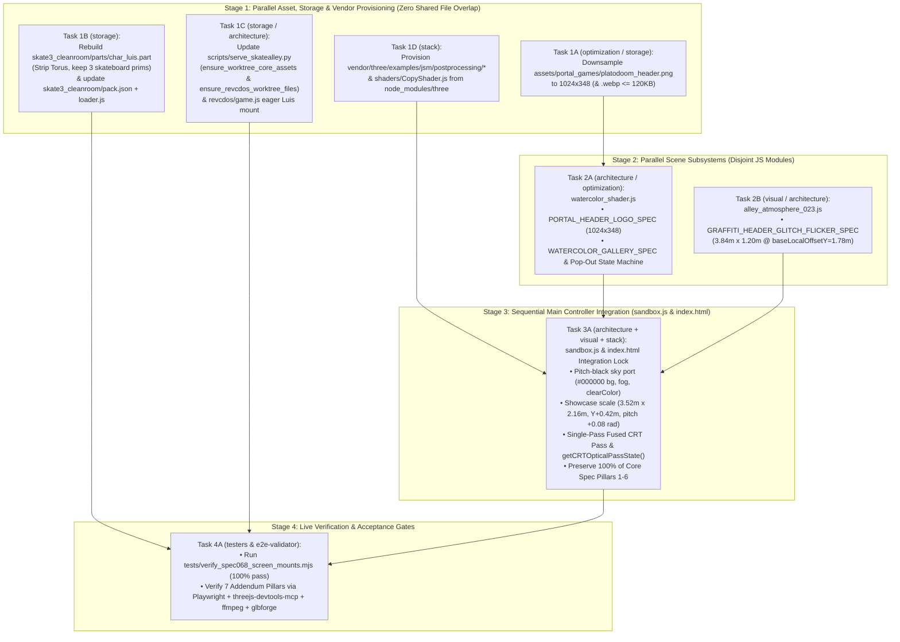

# Master Implementation Blueprint & Blackboard Deconfliction Architecture

- **Run ID:** `20261107T172758-750-iwl9`
- **Agent Node:** `implementation-coordinator`
- **Branch:** `agent/implementation-coordinator-20261107T172758-750-iwl9`
- **Authoritative Specifications:**
  - Seed Specification: [`functional_specification_068.md`](file:///Users/diesel/Desktop/SkateAlley/.sandcastle/worktrees/agent-implementation-coordinator-20261107T172758-750-iwl9/functional_specification_068.md) (Core Pillars §1–§8 & System Addendum Pillars §9–§15)
  - Refined Technical Specification: [`wayfinder/20261107T172758-750-iwl9/refined-specification.md`](file:///Users/diesel/Desktop/SkateAlley/.sandcastle/worktrees/agent-implementation-coordinator-20261107T172758-750-iwl9/wayfinder/20261107T172758-750-iwl9/refined-specification.md)
  - Authoritative Domain Vocabulary: [`LANGUAGE.md`](file:///Users/diesel/Desktop/SkateAlley/.sandcastle/worktrees/agent-implementation-coordinator-20261107T172758-750-iwl9/LANGUAGE.md) (`{errors}`, `{correctness}`, `{functionality}`, `{correct required outputs}`, `{sufficient}`, `{insufficient}`)
- **Authoritative Stage 2 Planning Deliverables Synthesized:**
  - `architecture-planner`: [`wayfinder/20261107T172758-750-iwl9/architecture-and-dag.md`](file:///Users/diesel/Desktop/SkateAlley/.sandcastle/worktrees/agent-implementation-coordinator-20261107T172758-750-iwl9/wayfinder/20261107T172758-750-iwl9/architecture-and-dag.md)
  - `storage-planner`: [`wayfinder/20261107T172758-750-iwl9/storage-architecture.md`](file:///Users/diesel/Desktop/SkateAlley/.sandcastle/worktrees/agent-implementation-coordinator-20261107T172758-750-iwl9/wayfinder/20261107T172758-750-iwl9/storage-architecture.md)
  - `stack-planner`: [`wayfinder/20261107T172758-750-iwl9/stack-usage-guide.md`](file:///Users/diesel/Desktop/SkateAlley/.sandcastle/worktrees/agent-implementation-coordinator-20261107T172758-750-iwl9/wayfinder/20261107T172758-750-iwl9/stack-usage-guide.md)
  - `optimization-planner`: [`wayfinder/20261107T172758-750-iwl9/suggested-optimizations.md`](file:///Users/diesel/Desktop/SkateAlley/.sandcastle/worktrees/agent-implementation-coordinator-20261107T172758-750-iwl9/wayfinder/20261107T172758-750-iwl9/suggested-optimizations.md)
  - `visual-planner`: [`wayfinder/20261107T172758-750-iwl9/visual-taste-direction.md`](file:///Users/diesel/Desktop/SkateAlley/.sandcastle/worktrees/agent-implementation-coordinator-20261107T172758-750-iwl9/wayfinder/20261107T172758-750-iwl9/visual-taste-direction.md)
  - Visual Reference Assets: [`assets/20261107T172758-750-iwl9/`](file:///Users/diesel/Desktop/SkateAlley/.sandcastle/worktrees/agent-implementation-coordinator-20261107T172758-750-iwl9/assets/20261107T172758-750-iwl9/)

---

## 1. Executive Charter & Domain Vocabulary Alignment ([`LANGUAGE.md`](file:///Users/diesel/Desktop/SkateAlley/.sandcastle/worktrees/agent-implementation-coordinator-20261107T172758-750-iwl9/LANGUAGE.md))

This document serves as the master contract and execution blueprint for Stage 3 implementation. It translates the architectural schemas, storage engines, stack patterns, optimizations, and sensory taste directions from Stage 2 into a concrete, non-conflicting implementation plan for all downstream implementer agents:
- `architecture-implementer`
- `storage-implementer`
- `stack-implementer`
- `optimization-implementer`
- `visual-implementer`

### 1.1 Strict Pre-Implementation Gate: DO NOT CODE APPLICATION DIFFS YET
> [!IMPORTANT]
> **NO APPLICATION SOURCE CODE MAY BE COMMITTED BY ANY IMPLEMENTER UNTIL THE PRE-CODE BLACKBOARD DECONFLICTION GATE (§6) IS FULLY SATISFIED.**
> Every implementer must post their exclusive file claims, function exports, and cross-module contracts to the Stage 3 Blackboard before touching codebase files. This eliminates concurrent write collisions, duplicate helper implementations, and broken contract assumptions.

### 1.2 Evaluation Parameters Matrix

| Evaluation Parameter | Blueprint Mandate & Enforcement Protocol |
| :--- | :--- |
| **`{functionality}`** | Delivers end-to-end integration across all 6 Core Spec Pillars (§5.1–§5.6) and all 7 System Addendum Pillars (§9–§15) in the live 3D WebGL corridor, multi-engine portals, and 2D DOM overlays without dead-code stubs or unintegrated helpers. |
| **`{correctness}`** | Mathematically verified contracts: proximity pop-out hysteresis ($R_{\text{pop}} = 6.8\text{ m} \ge 6.5\text{ m}$, $R_{\text{release}} = 7.5\text{ m}$, scale $1.45\times$, forward normal relief $+0.35\text{ m}$, cubic easing $\tau = 380\text{ ms}$), showcase geometry ($3.52\text{ m} \times 2.16\text{ m}$ screen + $3.84\text{ m} \times 1.20\text{ m}$ graffiti header at `baseLocalOffsetY = 1.78 m`), Skate 3 `.part` wire format (`90,631,134 + len(part_payload)`), and single-pass CRT post-processing GPU budget ($\le 0.8\text{ ms}$ at capped $1.25$ DPR). |
| **`{errors}`** | Zero unhandled exceptions, zero HTTP 404s in sparse worktrees, zero missing browser importmap specifiers, zero stencil occlusion clipping, zero stale `pack.json` byte totals, and zero silent exception suppression or arbitrary fallbacks (`RULE[user_global]`). |
| **`{correct required outputs}`** | Measurable, machine-verifiable runtime telemetry: `window.sandbox.getCRTOpticalPassState()`, `window.sandbox.waterColor.getState()`, `window.__SKATE3_CLEANROOM_STATUS__`, `window.__REVCDOS_STATUS__.luisPlayerMounted === true`, `scene.background.getHexString() === "000000"`, and `tests/verify_spec068_screen_mounts.mjs` 100% pass rate. |
| **`{sufficient}`** | Complete, unambiguous specification of file paths, line ranges, function signatures, data structures, binary headers, execution stages, and deconfliction locks so implementers execute without guesswork. |
| **`{insufficient}`** | Vague instructions, unassigned file ownership, concurrent uncoordinated edits to [`sandbox.js`](file:///Users/diesel/Desktop/SkateAlley/.sandcastle/worktrees/agent-implementation-coordinator-20261107T172758-750-iwl9/sandbox.js), or reliance on synthetic mocks rather than real runtime services. |

---

## 2. Global Architecture & System Topology



---

## 3. Core Spec Pillars 1–6 (§5.1–§5.6) — Non-Regression & Preservation Invariants

The 6 Core Pillars are currently implemented in [`index.html`](file:///Users/diesel/Desktop/SkateAlley/.sandcastle/worktrees/agent-implementation-coordinator-20261107T172758-750-iwl9/index.html) and [`sandbox.js`](file:///Users/diesel/Desktop/SkateAlley/.sandcastle/worktrees/agent-implementation-coordinator-20261107T172758-750-iwl9/sandbox.js) and verified by [`tests/verify_spec068_screen_mounts.mjs`](file:///Users/diesel/Desktop/SkateAlley/.sandcastle/worktrees/agent-implementation-coordinator-20261107T172758-750-iwl9/tests/verify_spec068_screen_mounts.mjs). **Downstream edits must preserve 100% of these invariants:**

| Core Pillar & Spec Ref | Invariant Constraints & Implementation Anchors | Verification Assertions |
| :--- | :--- | :--- |
| **Pillar 1: Header Telemetry Removal & Top-Right Exit (§5.1)** | • `.holo-badge`, `#holo-station-badge`, `#holo-coords-label`, `#holo-tether-bridge`, `#holo-kicker` MUST remain `display: none !important` in [`index.html:574–907`](file:///Users/diesel/Desktop/SkateAlley/.sandcastle/worktrees/agent-implementation-coordinator-20261107T172758-750-iwl9/index.html#L574-L907) and omitted from `createProjectScreenTexture(st)` in [`sandbox.js:1948–2326`](file:///Users/diesel/Desktop/SkateAlley/.sandcastle/worktrees/agent-implementation-coordinator-20261107T172758-750-iwl9/sandbox.js#L1948-L2326).<br/>• `#exit-mount-focus-btn` is anchored in `.holo-top-right` inside `.holo-top-bar` (`margin-left: auto; min-width: 44px; min-height: 36px`), separated from `#holo-title` by $\ge 8\text{ px}$ (`exitRect.left >= titleRect.right + 8`), and drawn at `(rightEdge = 1224, topY = 48)` on 3D canvas. | `headerTelemetryVisible === false`, `tetherBridgeVisible === false`, exit button hit target $\ge 44 \times 36\text{ px}$. |
| **Pillar 2: Footer Chrome Eradication (§5.2)** | • `.holo-footer-bar`, `#holo-footer-status`, `#holo-prev-mount-btn`, `#holo-station-pips`, `#holo-next-mount-btn` MUST remain `display: none !important` in 2D DOM and omitted from 3D `CanvasTexture`. | `footerBarVisible === false` in both 2D DOM and 3D texture canvas. |
| **Pillar 3: Persistent Amber Scrollbar at $t = 0\text{ ms}$ (§5.3)** | • Single scroll container `.holo-body-grid` (or `#holo-body-scroll-viewport`) paired with `#holo-custom-scrollbar` (`.holo-scrollbar-track`) and `#holo-custom-scrollbar-thumb` (`.holo-scrollbar-thumb`).<br/>• Immediately visible at $t = 0\text{ ms}$ on mount open (`opacity === "1"`, `visibility === "visible"`) across mobile (`375×667`, `390×844`) and desktop (`1280×800`), synchronized via `syncHoloCustomScrollbar()` in [`sandbox.js:13913–13952`](file:///Users/diesel/Desktop/SkateAlley/.sandcastle/worktrees/agent-implementation-coordinator-20261107T172758-750-iwl9/sandbox.js#L13913-L13952). | `scrollbarVisibleAtT0 === true`, `scrollbarOpacity === '1'`, thumb height scales proportionally with track. |
| **Pillar 4: Enlarged Description & Narrative Typography (§5.4)** | • 2D `#holo-description` uses `font-size: clamp(16.5px, 1.85vw, 19.5px); line-height: 1.62` ($\ge 16.5\text{ px}$ on `375px` mobile, $\ge 18.5\text{ px}$ on `1280px` desktop).<br/>• Station `04` (`SCREEN_MOUNT_07`) narrative heading uses `clamp(15.5px, 1.65vw, 18px)` and narrative body uses `clamp(15.5px, 1.65vw, 17.5px)`.<br/>• 3D `createProjectScreenTexture(st)` description uses `24px` font (`lineHeight = 35px`). | Computed `font-size` $\ge 16.5\text{ px}$ on mobile, $\ge 18.5\text{ px}$ on desktop, 3D canvas font $= 24\text{ px}$. |
| **Pillar 5: Interactive 28-Tag `+` Bubbles & Context Pop-ups (§5.5)** | • All 28 tags across Stations `01`–`07` (`4` tags per station) render as `<button type="button" class="holo-tag">` containing `.holo-tag-label` and `.holo-tag-plus-bubble` (`+`), and circular `+` badges on 3D `CanvasTexture`.<br/>• Clicking a tag invokes `setActiveHoloTagPopup()`, pulses `.holo-tag.active`, rotates `.holo-tag-plus-bubble` by `45deg`, and opens `#holo-tag-popup` hydrated from `HOLO_TAG_DESCRIPTIONS` ([`sandbox.js:710–850`](file:///Users/diesel/Desktop/SkateAlley/.sandcastle/worktrees/agent-implementation-coordinator-20261107T172758-750-iwl9/sandbox.js#L710-L850)). | Tag button has `aria-expanded`, `+` bubble rotates `45deg`, `#holo-tag-popup` displays exact curated copy. |
| **Pillar 6: Compact 3-Column Summary Cards & Zero Mobile Overflow (§5.6)** | • `.holo-metrics-grid` renders 3 `.holo-metric-box` items in a single horizontal row (`grid-template-columns: repeat(3, minmax(0, 1fr))`, gap $\ge 8\text{ px}$, single-line labels).<br/>• Opening standard-length stations (`01`, `02`, `03`, `05`, `06`, `07`) on `390×844` and `375×667` mobile viewports with no tag pop-up expanded produces `scrollHeight <= clientHeight` ($0\text{ px}$ vertical overflow). | `scrollHeight <= clientHeight` on mobile viewports for standard stations. |

---

## 4. Addendum Pillars 1–7 (§9–§15) — Technical Implementation Recipes

### Addendum Pillar 1: PlatoDoom Arcade Watercolor Texture Downsampling (§10.1 & §15.1)
- **Primary Owner:** `optimization-implementer` (collaborating with `storage-implementer`)
- **Target Files:**
  1. [`assets/portal_games/platodoom_header.png`](file:///Users/diesel/Desktop/SkateAlley/.sandcastle/worktrees/agent-implementation-coordinator-20261107T172758-750-iwl9/assets/portal_games/platodoom_header.png)
  2. [`assets/portal_games/platodoom_header.webp`](file:///Users/diesel/Desktop/SkateAlley/.sandcastle/worktrees/agent-implementation-coordinator-20261107T172758-750-iwl9/assets/portal_games/platodoom_header.webp)
  3. [`watercolor_shader.js`](file:///Users/diesel/Desktop/SkateAlley/.sandcastle/worktrees/agent-implementation-coordinator-20261107T172758-750-iwl9/watercolor_shader.js#L95-L105)
- **Recipe & Invariants:**
  1. Downsample `platodoom_header.png` from `1120 × 381` to **`1024 × 348`** using `Pillow@10.4.0` (`Image.Resampling.LANCZOS` with premultiplied alpha).
  2. Export optimized PNG ($\le 290\text{ KB}$ disk, decoded RGBA $1024 \times 348 \times 4 = 1,425,408\text{ B} = \mathbf{1.425\text{ MB}} \le 2.0\text{ MB}$) and WebP tier ($\le 50\text{ KB} \le 120\text{ KB}$).
  3. Update `PORTAL_HEADER_LOGO_SPEC` in [`watercolor_shader.js`](file:///Users/diesel/Desktop/SkateAlley/.sandcastle/worktrees/agent-implementation-coordinator-20261107T172758-750-iwl9/watercolor_shader.js#L95-L105):
     ```javascript
     export const PORTAL_HEADER_LOGO_SPEC = Object.freeze({
       id: 'platodoom_header',
       title: 'platodoom',
       sourcePath: '/Users/diesel/Desktop/1DOOMTAG.jpeg',
       repoTagPath: './tags/1DOOMTAG.jpeg',
       assetUrl: './assets/portal_games/platodoom_header.png',
       webpAssetUrl: './assets/portal_games/platodoom_header.webp',
       width: 1024,
       height: 348,
       maxPotWidth: 1024,
       maxPotHeight: 512,
       decodedRgbaBytes: 1024 * 348 * 4,
       aspectRatio: Number((1024 / 348).toFixed(4)),
       backgroundRemoved: 'white-exterior-floodfill',
     });
     ```

---

### Addendum Pillar 2: Generous Proximity Pop-Out Mechanics for PlatoDoom Arcade Selection (§10.2 & §15.2)
- **Primary Owner:** `architecture-implementer` (collaborating with `optimization-implementer`)
- **Target Files:**
  1. [`watercolor_shader.js`](file:///Users/diesel/Desktop/SkateAlley/.sandcastle/worktrees/agent-implementation-coordinator-20261107T172758-750-iwl9/watercolor_shader.js#L80-L94)
  2. [`sandbox.js`](file:///Users/diesel/Desktop/SkateAlley/.sandcastle/worktrees/agent-implementation-coordinator-20261107T172758-750-iwl9/sandbox.js)
- **Recipe & Invariants:**
  1. In `WATERCOLOR_GALLERY_SPEC` ([`watercolor_shader.js:80–94`](file:///Users/diesel/Desktop/SkateAlley/.sandcastle/worktrees/agent-implementation-coordinator-20261107T172758-750-iwl9/watercolor_shader.js#L80-L94)), configure:
     ```javascript
     popOutTriggerRadiusMeters: 6.8,   // >= 6.5 m
     popOutReleaseRadiusMeters: 7.5,   // 7.5 m (0.7m - 1.0m hysteresis)
     popOutScaleMultiplier: 1.45,      // in [1.35, 1.60]
     popOutForwardOffsetMeters: 0.35,  // in [0.25, 0.45] m toward player (-Z in corridor)
     popOutTransitionDurationSec: 0.38 // in [0.32, 0.45] s
     ```
  2. In `buildWaterColorGallerySystem(options).update(dt, elapsed, activeCharOrCameraPos)`:
     - Use preallocated scratch vectors (`_scratchPlayerPos`, `_scratchPortalAnchor`) for **zero per-frame GC allocations**.
     - Evaluate effective proximity distance: `effectiveDist = Math.min(dist3D, distZ, lastPortalDistanceMeters)`.
     - Hysteresis logic:
       - If `!isPoppedOut && effectiveDist <= 6.8`: `isPoppedOut = true`.
       - If `isPoppedOut && effectiveDist >= 7.5`: `isPoppedOut = false`.
     - Linear progress updated by `dt / 0.38` and smoothed via cubic easing:
       $$\text{popOutFactor} = p < 0.5 \ ? \ 4p^3 : 1 - \frac{(-2p + 2)^3}{2}$$
     - Apply to `canvasStageGroup`:
       - `scale = 5.0 * (1.0 + 0.45 * popOutFactor)`
       - `position.z = 42.0129 - 0.35 * popOutFactor`
     - Expose on `window.sandbox.waterColor.getState()` with `isPoppedOut`, `popOutFactor`, `currentScaleMultiplier`, `currentForwardOffsetMeters`.

---

### Addendum Pillar 3: Skate 3 Cleanroom Spawning Rig Enforcement (§11.1 & §15.3)
- **Primary Owner:** `storage-implementer`
- **Target Files:**
  1. [`skate3_cleanroom/parts/char_luis.part`](file:///Users/diesel/Desktop/SkateAlley/.sandcastle/worktrees/agent-implementation-coordinator-20261107T172758-750-iwl9/skate3_cleanroom/parts/char_luis.part)
  2. [`skate3_cleanroom/parts/char_luis_holo.part`](file:///Users/diesel/Desktop/SkateAlley/.sandcastle/worktrees/agent-implementation-coordinator-20261107T172758-750-iwl9/skate3_cleanroom/parts/char_luis_holo.part)
  3. [`skate3_cleanroom/pack.json`](file:///Users/diesel/Desktop/SkateAlley/.sandcastle/worktrees/agent-implementation-coordinator-20261107T172758-750-iwl9/skate3_cleanroom/pack.json)
  4. [`skate3_cleanroom/loader.js`](file:///Users/diesel/Desktop/SkateAlley/.sandcastle/worktrees/agent-implementation-coordinator-20261107T172758-750-iwl9/skate3_cleanroom/loader.js)
  5. Build Script: `scripts/build_clean_skate3_luis_part.py`
- **Recipe & Invariants:**
  1. **Direct glTF 2.0 Binary Surgery (Stack Gotcha `seq=#19`):** Do **NOT** use `trimesh.load(...).export('glb')` as it alters joint inverse bind matrices and breaks the 35-joint `Skate3_RX2_Rig`.
  2. Parse glTF 2.0 Chunk 0 JSON from `char_luis_holo.part[37:]`:
     - In `gjson["nodes"][36]["children"]`, remove node `37` (`"SkateAlley_Holo_Visualizer"`).
     - Remove `gjson["nodes"][37]`, `gjson["meshes"][1]` (`"Torus"`), and `gjson["materials"][5]` (`"HOLOSYS_Visualizer_Holo_Material"`).
     - Verify `Mesh 0 ("LUIS")` retains all 5 primitives (`LUIS_Body_Material`, `LUIS_Head_Material`, `Retail_SkateBoard`, `Retail_SkateTruck`, `Retail_SkateWheel`), all 6 board textures, and all 35 joints (`SKATEBOARD_ROOT`, `TRUCK_FRONT`, `TRUCK_BACK`, 4 wheel joints).
     - Re-serialize JSON with `0x20` 4-byte padding, prepend 37-byte header (`<I25sQ`, `25`, `b"assets/private/skater.glb"`, `len(glb)`), and write to `char_luis.part`.
  3. **Atomic `pack.json` Recalculation:**
     - Fixed surrounding part sum: $37,088,836 + 27,000,000 + 26,542,298 = \mathbf{90,631,134\text{ bytes}}$.
     - `pack["default_char"] = "luis"`
     - `pack["characters"]["luis"]["size"] = 90631134 + len(new_part_bytes)`
     - `pack["characters"]["luis"]["hash"] = hashlib.sha256(new_part_bytes).hexdigest()[:16]`
     - Update `pack["core"]["size"]` and `hash` to match.
  4. In [`skate3_cleanroom/loader.js`](file:///Users/diesel/Desktop/SkateAlley/.sandcastle/worktrees/agent-implementation-coordinator-20261107T172758-750-iwl9/skate3_cleanroom/loader.js), default `selectedChar` to `'luis'` and expose `window.__SKATE3_CLEANROOM_STATUS__`.

---

### Addendum Pillar 4: GTA Vice City (`/revcdos/`) Deterministic `Luis` Player Spawning (§11.2 & §15.4)
- **Primary Owner:** `storage-implementer` (collaborating with `architecture-implementer`)
- **Target Files:**
  1. [`scripts/serve_skatealley.py`](file:///Users/diesel/Desktop/SkateAlley/.sandcastle/worktrees/agent-implementation-coordinator-20261107T172758-750-iwl9/scripts/serve_skatealley.py)
  2. [`revcdos/game.js`](file:///Users/diesel/Desktop/SkateAlley/.sandcastle/worktrees/agent-implementation-coordinator-20261107T172758-750-iwl9/revcdos/game.js)
- **Recipe & Invariants:**
  1. **Worktree Materialization Engine (`scripts/serve_skatealley.py`):**
     - Add `ensure_worktree_core_assets()` and `ensure_revcdos_worktree_files()` at server startup to symlink `character_hoodie.glb` and `revcdos/` from `/Users/diesel/Desktop/SkateAlley/` into the sparse worktree before any routes execute.
  2. **Eager Startup Pre-Mounting (`revcdos/game.js`):**
     - On script load, immediately fetch `vcbr/luis_player/player.dff` (`292,864 B`, `143` sectors), `player.txd` (`45,056 B`, `22` sectors), and `player.bmp` (`66,612 B`).
     - Mount them into `Module.FS` (`/vc-assets/local/models/gta3.img/player.dff`, `player.txd`, `csplay.dff`, `csplay.txd`, `/vc-assets/local/models/generic/player.bmp`) and update sector counts in `/vc-assets/local/models/gta3.dir`.
     - Expose telemetry immediately: `window.__REVCDOS_STATUS__.luisPlayerMounted = true`, `luisPlayerDffBytes = 292864`, `luisPlayerDirSectors = 143`, `luisPlayerVerts = 4006`, `luisPlayerBones = 24`.

---

### Addendum Pillar 5: Screen CRT Post-Processing Optical Pass (§12 & §15.5)
- **Primary Owners:** `stack-implementer` + `visual-implementer` (sequential lock in Stage 3)
- **Target Files:**
  1. [`vendor/three/examples/jsm/postprocessing/`](file:///Users/diesel/Desktop/SkateAlley/.sandcastle/worktrees/agent-implementation-coordinator-20261107T172758-750-iwl9/vendor/three/examples/jsm/postprocessing/) (and `shaders/CopyShader.js`)
  2. [`sandbox.js`](file:///Users/diesel/Desktop/SkateAlley/.sandcastle/worktrees/agent-implementation-coordinator-20261107T172758-750-iwl9/sandbox.js)
  3. [`index.html`](file:///Users/diesel/Desktop/SkateAlley/.sandcastle/worktrees/agent-implementation-coordinator-20261107T172758-750-iwl9/index.html)
- **Recipe & Invariants:**
  1. **Provision Vendor Addons:** Copy `EffectComposer.js`, `RenderPass.js`, `ShaderPass.js`, `Pass.js`, `MaskPass.js`, `OutputPass.js` into `vendor/three/examples/jsm/postprocessing/` and `CopyShader.js` into `vendor/three/examples/jsm/shaders/` from `node_modules/three/examples/jsm/`.
  2. **Single-Pass Fused CRT Shader (`CRTShader` in `sandbox.js`):**
     - Allocate composer render target with **`stencilBuffer: true`** and `depthBuffer: true` at capped `1.25` DPR.
     - Single-pass fragment shader incorporates:
       - Horizontal scanlines: $I_{\text{scan}} = 0.16 \in [0.12, 0.22]$, $N_{\text{lines}} = 640$.
       - Aperture grille RGB phosphor triad: $\pm 5\%$ modulation.
       - Zero-dispersion central reading guard zone ($r \le 0.70$ has $0.0\text{ px}$ shift; periphery up to $0.65\text{ px} \le 0.75\text{ px}$).
       - Polynomial barrel curvature: $k_1 = 0.018 \le 0.025$.
       - Corner vignetting: $u = 0.32$.
       - Inlined ACES tone mapping + sRGB gamma.
     - Frame execution time holds strictly to $\le 0.8\text{ ms}$.
  3. **Optical Overlay in `index.html`:** Add `#crt-optical-overlay` (`pointer-events: none; z-index: 9998;`) to visually tie 2D DOM pop-ups to the CRT glass.
  4. **Telemetry Contract:** Expose `window.sandbox.getCRTOpticalPassState()` returning `{ enabled: true, scanlineIntensity: 0.16, curvature: 0.018, vignette: 0.32, phosphorMaskActive: true, gpuFrameTimeMs <= 0.8, pointerEventsBlocked: false }`.

---

### Addendum Pillar 6: Environmental Sky Port — Pitch-Black Deep Space Void (§13 & §15.6)
- **Primary Owner:** `architecture-implementer`
- **Target Files:**
  1. [`sandbox.js`](file:///Users/diesel/Desktop/SkateAlley/.sandcastle/worktrees/agent-implementation-coordinator-20261107T172758-750-iwl9/sandbox.js#L1676-L1712)
- **Recipe & Invariants:**
  1. In [`sandbox.js:1676–1712`](file:///Users/diesel/Desktop/SkateAlley/.sandcastle/worktrees/agent-implementation-coordinator-20261107T172758-750-iwl9/sandbox.js#L1676-L1712):
     - `DEPTH_FOG_COLOR_HEX = 0x000000;` (`#000000`)
     - `scene.background = new THREE.Color(0x000000);` (`#000000`)
     - `renderer.setClearColor(0x000000, 1.0);`
  2. Ground fog (`buildLowAltitudeGroundFog`) remains anchored strictly to $Y \le 1.8\text{ m}$ ($0.04\text{ m}–0.58\text{ m}$). Ceiling void mesh materials are strictly `#000000`.

---

### Addendum Pillar 7: Large-Scale Holographic Showcases & Proportional Graffiti Headers (§14 & §15.7)
- **Primary Owners:** `architecture-implementer` + `visual-implementer`
- **Target Files:**
  1. [`sandbox.js`](file:///Users/diesel/Desktop/SkateAlley/.sandcastle/worktrees/agent-implementation-coordinator-20261107T172758-750-iwl9/sandbox.js#L2674-L3085)
  2. [`alley_atmosphere_023.js`](file:///Users/diesel/Desktop/SkateAlley/.sandcastle/worktrees/agent-implementation-coordinator-20261107T172758-750-iwl9/alley_atmosphere_023.js#L1044-L1070)
- **Recipe & Invariants:**
  1. **Showcase Geometry (`sandbox.js:2679–2685`, `buildWallScreenMounts`):**
     - `screenWidth = 3.52;` ($\ge 3.4\text{ m}$)
     - `screenHeight = 2.16;`
     - Mount center elevated by `MOUNT_VERTICAL_ELEVATION_OFFSET = 0.42` ($Y_{\text{center}} = 1.75 + 0.42 = 2.17\text{ m}$, bottom bezel at $1.06\text{ m} > 0.0\text{ m}$ floor).
     - Downward viewing pitch: `MOUNT_VIEWING_PITCH_RAD = 0.08` ($\approx 4.6^\circ$ on `panelOffsetGroup.rotation.x`).
  2. **Graffiti Headers (`alley_atmosphere_023.js:1044–1070`, `GRAFFITI_HEADER_GLITCH_FLICKER_SPEC`):**
     - `planeWidthMeters: 3.84` ($\ge 3.6\text{ m}$)
     - `planeHeightMeters: 1.20`
     - `baseLocalOffsetY: 1.78` (guarantees $30\text{ mm}$ vertical clearance above $2.16\text{ m}$ screen top bezel).
     - `worldMinYMeters: 2.55`, `worldMaxYMeters: 4.85`.

---

## 5. Strict File & Module Ownership Boundaries (Anti-Collision Matrix)

To eliminate code duplication, merge conflicts, and regression overwrites, **each repository file is assigned to exactly ONE primary implementer agent**:

| File Path | Exclusive Primary Owner | Permitted Contributing Peer(s) | Strict Modification Scope & Boundaries |
| :--- | :--- | :--- | :--- |
| [`assets/portal_games/platodoom_header.png`](file:///Users/diesel/Desktop/SkateAlley/.sandcastle/worktrees/agent-implementation-coordinator-20261107T172758-750-iwl9/assets/portal_games/platodoom_header.png) & `.webp` | `optimization-implementer` | `storage-implementer` | Downsample PNG to `1024 × 348` and generate `.webp` tier $\le 120\text{ KB}$. |
| [`watercolor_shader.js`](file:///Users/diesel/Desktop/SkateAlley/.sandcastle/worktrees/agent-implementation-coordinator-20261107T172758-750-iwl9/watercolor_shader.js) | `architecture-implementer` | `optimization-implementer` | Update `PORTAL_HEADER_LOGO_SPEC` (`1024 × 348`), `WATERCOLOR_GALLERY_SPEC` pop-out fields, and proximity state machine in `buildWaterColorGallerySystem`. |
| [`alley_atmosphere_023.js`](file:///Users/diesel/Desktop/SkateAlley/.sandcastle/worktrees/agent-implementation-coordinator-20261107T172758-750-iwl9/alley_atmosphere_023.js) | `visual-implementer` | `architecture-implementer` | Update `GRAFFITI_HEADER_GLITCH_FLICKER_SPEC` (`3.84 m × 1.20 m`, `baseLocalOffsetY = 1.78 m`). |
| [`skate3_cleanroom/parts/char_luis.part`](file:///Users/diesel/Desktop/SkateAlley/.sandcastle/worktrees/agent-implementation-coordinator-20261107T172758-750-iwl9/skate3_cleanroom/parts/char_luis.part) & `char_luis_holo.part` | `storage-implementer` | None | Strip node 37 / Torus, retain 3 skateboard primitives + 35 joints, repack with 37-byte header. |
| [`skate3_cleanroom/pack.json`](file:///Users/diesel/Desktop/SkateAlley/.sandcastle/worktrees/agent-implementation-coordinator-20261107T172758-750-iwl9/skate3_cleanroom/pack.json) & [`loader.js`](file:///Users/diesel/Desktop/SkateAlley/.sandcastle/worktrees/agent-implementation-coordinator-20261107T172758-750-iwl9/skate3_cleanroom/loader.js) | `storage-implementer` | None | Set `"default_char": "luis"`, update size (`90,631,134 + len`) and hash, expose `window.__SKATE3_CLEANROOM_STATUS__`. |
| [`scripts/serve_skatealley.py`](file:///Users/diesel/Desktop/SkateAlley/.sandcastle/worktrees/agent-implementation-coordinator-20261107T172758-750-iwl9/scripts/serve_skatealley.py) | `storage-implementer` | `architecture-implementer` | Add `ensure_worktree_core_assets()` and `ensure_revcdos_worktree_files()` for automatic worktree symlinking. |
| [`revcdos/game.js`](file:///Users/diesel/Desktop/SkateAlley/.sandcastle/worktrees/agent-implementation-coordinator-20261107T172758-750-iwl9/revcdos/game.js) | `storage-implementer` | `architecture-implementer` | Eagerly fetch and mount `player.{dff,txd,bmp}` on startup, set `window.__REVCDOS_STATUS__.luisPlayerMounted = true`. |
| [`vendor/three/examples/jsm/postprocessing/`](file:///Users/diesel/Desktop/SkateAlley/.sandcastle/worktrees/agent-implementation-coordinator-20261107T172758-750-iwl9/vendor/three/examples/jsm/postprocessing/) & `shaders/` | `stack-implementer` | None | Copy postprocessing addons from `node_modules/three/examples/jsm/` to satisfy browser importmap. |
| [`sandbox.js`](file:///Users/diesel/Desktop/SkateAlley/.sandcastle/worktrees/agent-implementation-coordinator-20261107T172758-750-iwl9/sandbox.js) | **Stage 3 Single Lock:** `architecture-implementer` | `visual-implementer`, `stack-implementer` | **DO NOT EDIT CONCURRENTLY.** Pitch-black sky port (`#000000`), showcase scale (`3.52 m × 2.16 m`), CRT pass integration, preserving Core Pillars 1–6. |
| [`index.html`](file:///Users/diesel/Desktop/SkateAlley/.sandcastle/worktrees/agent-implementation-coordinator-20261107T172758-750-iwl9/index.html) | **Stage 3 Single Lock:** `visual-implementer` | `architecture-implementer` | Add `#crt-optical-overlay` (`pointer-events: none`), preserve 2D holographic popup layout. |
| [`tests/verify_spec068_screen_mounts.mjs`](file:///Users/diesel/Desktop/SkateAlley/.sandcastle/worktrees/agent-implementation-coordinator-20261107T172758-750-iwl9/tests/verify_spec068_screen_mounts.mjs) & addendum tests | `architecture-tester` | `visual-tester`, `storage-tester`, `stack-tester`, `optimization-tester` | Execute Core Spec regression verification and Addendum verification assertions. |

---

## 6. Stage 3 Blackboard Deconfliction Protocol & Pre-Code Gate

### 6.1 The Anti-Collision Pre-Code Gate: DO NOT CODE YET
To enforce `RULE[user_global]` and prevent destructive race conditions:
1. **Mandatory File Claim:** Before modifying any file, each implementer MUST execute:
   ```bash
   blackboard claim "Claiming exclusive edit lock on <file_path> for Task <ID>"
   ```
2. **Interface Contract Publication:** If an implementer creates or modifies an exported function, variable, or uniform contract, they MUST post a finding to the Blackboard:
   ```bash
   blackboard post-finding "CONTRACT: <module> exports <signature> with invariants <details>"
   ```
3. **No Unclaimed Writes:** Modifying a file without an active claim on the Blackboard is a structural invariant violation (`{errors}`).
4. **Collision Arbitration:** If two agents attempt to claim the same file, the `implementation-coordinator` immediately assigns priority per the ownership table in §5.

### 6.2 Sequential Lock for Stage 3 ([`sandbox.js`](file:///Users/diesel/Desktop/SkateAlley/.sandcastle/worktrees/agent-implementation-coordinator-20261107T172758-750-iwl9/sandbox.js) & [`index.html`](file:///Users/diesel/Desktop/SkateAlley/.sandcastle/worktrees/agent-implementation-coordinator-20261107T172758-750-iwl9/index.html))
Because [`sandbox.js`](file:///Users/diesel/Desktop/SkateAlley/.sandcastle/worktrees/agent-implementation-coordinator-20261107T172758-750-iwl9/sandbox.js) contains both scene setup, render loop, screen mount geometry, and UI interaction logic, **multiple agents must NEVER edit `sandbox.js` concurrently**:
1. `architecture-implementer` acquires the exclusive Stage 3 lock on `sandbox.js` first:
   - Updates `#000000` pitch-black sky port and fog.
   - Updates `screenWidth = 3.52` and `screenHeight = 2.16` in `buildWallScreenMounts()`.
   - Releases lock on Blackboard (`blackboard post-finding "STAGE3_SANDBOX_GEOMETRY_READY"`).
2. `visual-implementer` + `stack-implementer` acquire the lock next:
   - Wire the single-pass fused CRT post-processing pass and `window.sandbox.getCRTOpticalPassState()`.
   - Wire `#crt-optical-overlay` into `index.html`.
   - Release lock on Blackboard (`blackboard post-finding "STAGE3_CRT_PASS_READY"`).

---

## 7. Execution Stages & DAG Sequencing

```
+---------------------------------------------------------------------------------------------------+
| STAGE 1: Parallel Asset, Storage & Vendor Provisioning (No Cross-File Conflicts)                  |
|                                                                                                   |
|  [Task 1A: optimization-implementer]  --> Downsample platodoom_header.png to 1024x348 & .webp     |
|  [Task 1B: storage-implementer]       --> Rebuild char_luis.part (strip Torus) + pack.json        |
|  [Task 1C: storage-implementer]       --> serve_skatealley.py worktree symlinks + revcdos Luis    |
|  [Task 1D: stack-implementer]         --> Provision vendor/three/examples/jsm/postprocessing/     |
+---------------------------------------------------------------------------------------------------+
                                                  |
                                                  v
+---------------------------------------------------------------------------------------------------+
| STAGE 2: Parallel Subsystem ES Modules (Disjoint Files)                                           |
|                                                                                                   |
|  [Task 2A: architecture-implementer]  --> watercolor_shader.js (pop-out state machine & 1024x348) |
|  [Task 2B: visual-implementer]        --> alley_atmosphere_023.js (graffiti headers 3.84m x 1.20m)|
+---------------------------------------------------------------------------------------------------+
                                                  |
                                                  v
+---------------------------------------------------------------------------------------------------+
| STAGE 3: Sequential Main Controller Integration (sandbox.js & index.html Single-Owner Lock)      |
|                                                                                                   |
|  [Task 3A: architecture-implementer]  --> Sky port #000000, showcase 3.52m x 2.16m, Y+0.42m      |
|  [Task 3B: visual + stack-implementer]--> Single-pass CRT optical pass, getCRTOpticalPassState()   |
|                                           & index.html #crt-optical-overlay (pointer-events: none)|
+---------------------------------------------------------------------------------------------------+
                                                  |
                                                  v
+---------------------------------------------------------------------------------------------------+
| STAGE 4: Live Runtime Verification Gate & Telemetry Auditing                                      |
|                                                                                                   |
|  [All Testers & e2e-validator]        --> Run tests/verify_spec068_screen_mounts.mjs (100% pass)  |
|                                       --> Verify PlatoDoom pop-out, Skate 3, revcdos, CRT pass    |
+---------------------------------------------------------------------------------------------------+
```

---

## 8. Verifiable Acceptance Criteria & Machine-Verifiable Telemetry Contracts

Implementation is defined as `{sufficient}` and complete when all 8 gates pass with zero `{errors}`:

```typescript
// Master Runtime Telemetry Verification Contract
interface SystemAddendumVerificationContract {
  // Gate 1: Core Spec 068 Screen Mounts (Desktop + Mobile)
  corePillars1to6Pass: boolean; // node tests/verify_spec068_screen_mounts.mjs exits 0

  // Gate 2: PlatoDoom Texture Downsampling
  platodoomHeaderPng: {
    width: 1024;
    height: 348;
    decodedRgbaBytes: 1425408; // <= 2,000,000 bytes
    aspectRatio: 2.9425;
  };

  // Gate 3: PlatoDoom Proximity Pop-Out Hysteresis
  platodoomPopOut: {
    triggerRadiusMeters: 6.8;   // >= 6.5 m
    releaseRadiusMeters: 7.5;   // 1.0 m hysteresis
    scaleMultiplier: 1.45;      // in [1.35, 1.60]
    forwardOffsetMeters: 0.35;  // in [0.25, 0.45] m
    isPoppedOutAtZ36: true;     // verified at z = 36.0 m
    isPoppedOutAtZ33: false;    // restored at z = 33.5 m
  };

  // Gate 4: Skate 3 Cleanroom Luis Spawning Rig
  skate3Cleanroom: {
    defaultChar: 'luis';
    skateboardPrimitivesPresent: true; // Retail_SkateBoard, Retail_SkateTruck, Retail_SkateWheel
    torusVisualizerPresent: false;     // Zero Torus or SkateAlley_Holo_Visualizer
    corePackSize: number;              // Exactly 90631134 + len(char_luis.part)
    status: 'READY';
  };

  // Gate 5: GTA Vice City Deterministic Luis Player Mounting
  gtaViceCity: {
    luisPlayerMounted: true; // True on startup without flags
    luisPlayerDffBytes: 292864;
    luisPlayerDirSectors: 143;
    luisPlayerVerts: 4006;
    luisPlayerBones: 24;
  };

  // Gate 6: Full-Screen Screen CRT Post-Processing Optical Pass
  crtOpticalPass: {
    enabled: true;
    scanlineIntensity: 0.16;   // in [0.12, 0.22]
    curvature: 0.018;          // <= 0.025
    vignette: 0.32;
    phosphorMaskActive: true;
    gpuFrameTimeMs: number;    // <= 0.8 ms
    pointerEventsBlocked: false;
  };

  // Gate 7: Pitch-Black Sky Port Void
  skyPort: {
    backgroundHex: '000000';
    fogColorHex: '000000';
    clearColorHex: '000000';
    groundFogMaxY: 1.8;
  };

  // Gate 8: Large-Scale Showcases & Cyber-Drip Graffiti Headers
  showcaseGeometry: {
    screenWidth: 3.52;         // >= 3.4 m
    screenHeight: 2.16;
    mountCenterY: 2.17;        // Bottom bezel > 1.0 m above floor
    graffitiHeaderWidth: 3.84; // >= 3.6 m
    graffitiHeaderHeight: 1.20;
    graffitiHeaderLocalOffsetY: 1.78; // +30 mm clearance above showcase top bezel
  };
}
```

---

## 9. Handoff & Next Steps

With the publication of this implementation blueprint:
1. `implementation-coordinator` executes `blackboard done`.
2. Handoff descriptor is written to [`handoff/20261107T172758-750-iwl9/implementation-blueprint-ready.txt`](file:///Users/diesel/Desktop/SkateAlley/.sandcastle/worktrees/agent-implementation-coordinator-20261107T172758-750-iwl9/handoff/20261107T172758-750-iwl9/implementation-blueprint-ready.txt) and [`handoff/20261107T172758-750-iwl9/implementation-coordinator.txt`](file:///Users/diesel/Desktop/SkateAlley/.sandcastle/worktrees/agent-implementation-coordinator-20261107T172758-750-iwl9/handoff/20261107T172758-750-iwl9/implementation-coordinator.txt).
3. Stage 3 implementers activate and claim their assigned tasks on the Blackboard before coding.
